# Figure Gallery — All 40 Diagrams

> **Visual library for the whole programme** · every figure is original SVG, generated by `scripts/build_figures.py`

This gallery shows every diagram in the library with a one-line description and the books that use it. The files themselves live in `assets/figures/` and can be dropped into slides, handouts or a printed workbook.

---

### Two cybernetics

Where the therapist stands: outside the system (first order) or inside it (second order). MFT 701, 715.

*File:* `assets/figures/fig01-two-cybernetics.svg`

---

### Circular causality

The pursue–withdraw loop drawn as a loop, not a blame story. MFT 701, 710, 715.

*File:* `assets/figures/fig02-circular-causality.svg`

---

### Genogram symbols

Fifteen standard symbols — the grammar of three-generation mapping. MFT 701, 707.

*File:* `assets/figures/fig03-genogram-symbols.svg`

---

### Worked genogram

The Adeyemi family across three generations, with five testable hypotheses. MFT 701, 707, 715.

*File:* `assets/figures/fig04-genogram-case.svg`

---

### Structural map

Enmeshed, disengaged and cross-generational coalition structures compared. MFT 702, 715.

*File:* `assets/figures/fig05-structural-map.svg`

---

### Bowen's eight concepts

Differentiation at the centre, the other seven arranged around it. MFT 702, 715.

*File:* `assets/figures/fig06-bowen-concepts.svg`

---

### Ecological systems

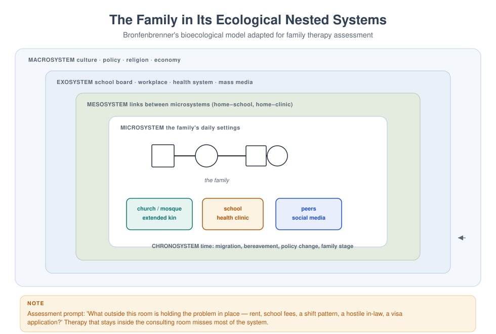

The family inside micro, meso, exo and macro systems, in time. MFT 701, 708.

*File:* `assets/figures/fig07-ecological-systems.svg`

---

### Family life cycle

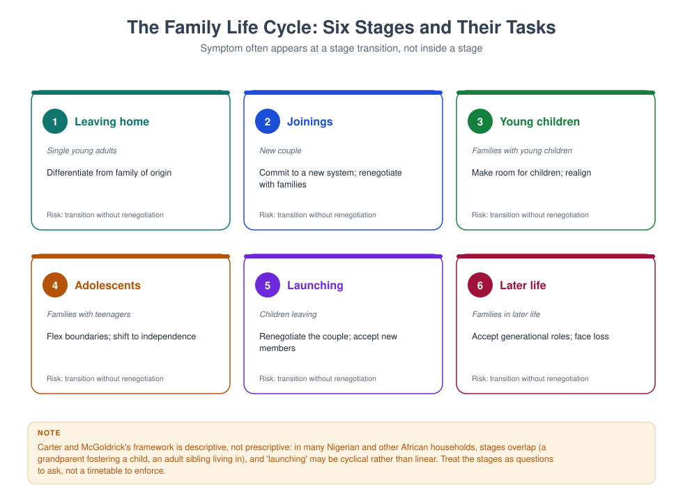

Six stages, their tasks and the risk at each transition. MFT 703, 719.

*File:* `assets/figures/fig08-family-life-cycle.svg`

---

### Stages of change

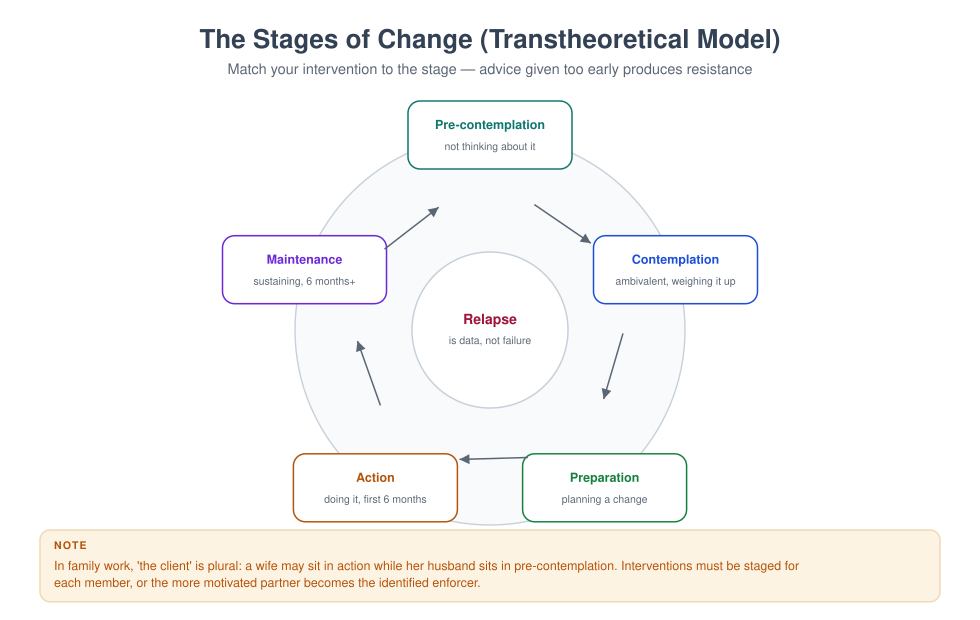

Pre-contemplation to maintenance, with relapse as data. MFT 713, 725.

*File:* `assets/figures/fig09-stages-of-change.svg`

---

### Feedback

A thermostat and a family escalation loop — the same logic twice. MFT 701, 715.

*File:* `assets/figures/fig10-feedback-loops.svg`

---

### Five axioms

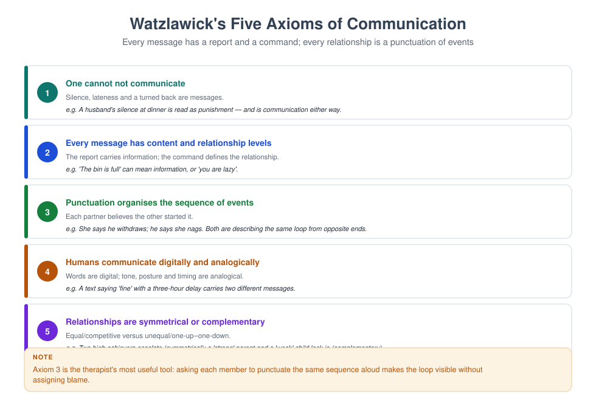

Watzlawick's axioms, each with a concrete family example. MFT 715, 716.

*File:* `assets/figures/fig11-communication-axioms.svg`

---

### EFT cycle

Secondary emotion above, attachment need below, and the loop between partners. MFT 710, 718.

*File:* `assets/figures/fig12-eft-cycle.svg`

---

### Sound Relationship House

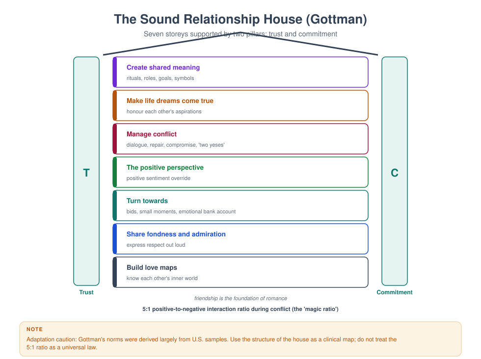

Seven storeys on the pillars of trust and commitment. MFT 710, 718.

*File:* `assets/figures/fig13-sound-relationship-house.svg`

---

### Four horsemen

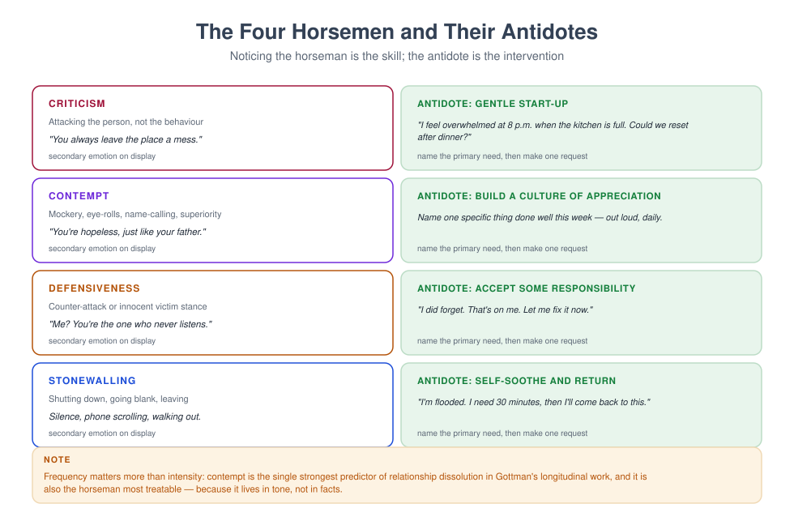

Criticism, contempt, defensiveness and stonewalling, with antidotes. MFT 710, 716.

*File:* `assets/figures/fig14-four-horsemen.svg`

---

### Solution-focused session

Strengths, miracle question, scaling, exceptions, task. MFT 702, 706, 725.

*File:* `assets/figures/fig15-sfbt-moves.svg`

---

### Narrative therapy

From problem-saturated story to preferred story, in four moves. MFT 702, 716.

*File:* `assets/figures/fig16-narrative-externalising.svg`

---

### Attachment patterns

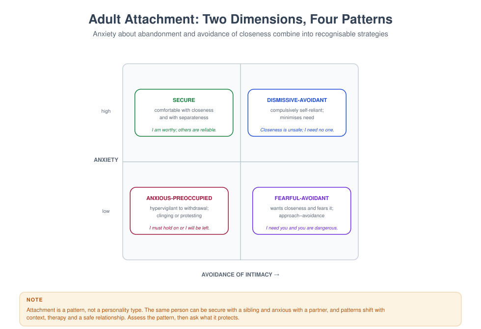

Two dimensions, four patterns, with core beliefs. MFT 710, 718, 726.

*File:* `assets/figures/fig17-attachment-patterns.svg`

---

### Window of tolerance

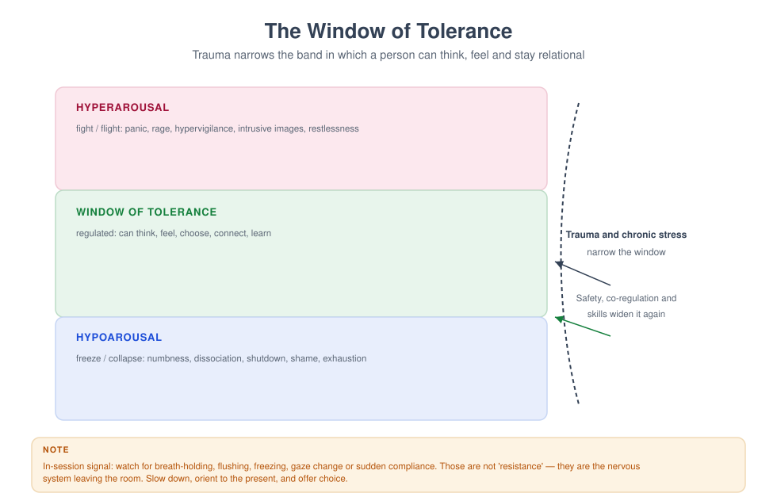

Hyperarousal, the regulated band, hypoarousal — and how trauma narrows it. MFT 712, 714.

*File:* `assets/figures/fig18-window-of-tolerance.svg`

---

### Polyvagal ladder

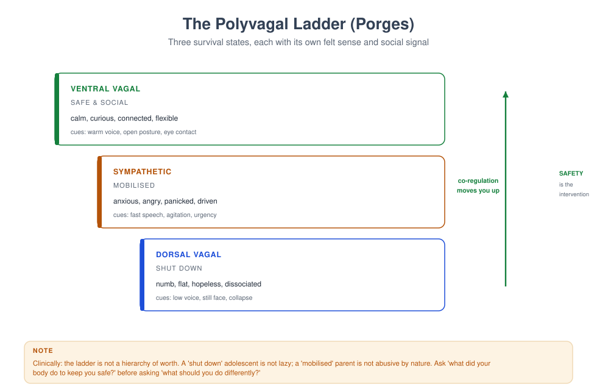

Three survival states with their felt sense and social cues. MFT 714, 726.

*File:* `assets/figures/fig19-polyvagal-ladder.svg`

---

### HPA axis

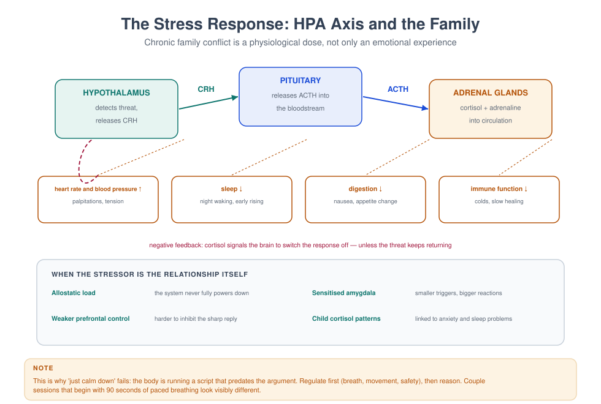

Stress physiology, its target organs, and chronic allostatic load. MFT 714, 726.

*File:* `assets/figures/fig20-hpa-axis.svg`

---

### The social brain

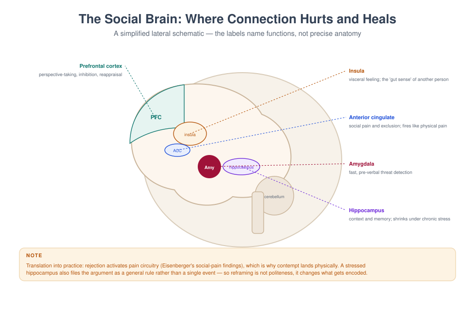

Labelled schematic: prefrontal cortex, insula, ACC, amygdala, hippocampus. MFT 726.

*File:* `assets/figures/fig21-social-brain.svg`

---

### Dual-process grief

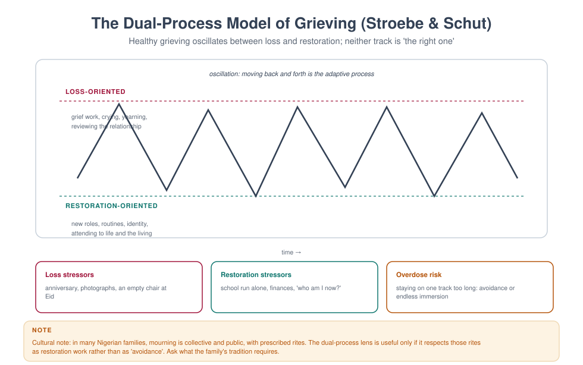

Oscillation between loss-oriented and restoration-oriented living. MFT 712, 719.

*File:* `assets/figures/fig22-dual-process-grief.svg`

---

### Developmental milestones

Physical, cognitive, language and social-emotional milestones, 0–18. MFT 703, 711.

*File:* `assets/figures/fig23-developmental-milestones.svg`

---

### Playroom plan

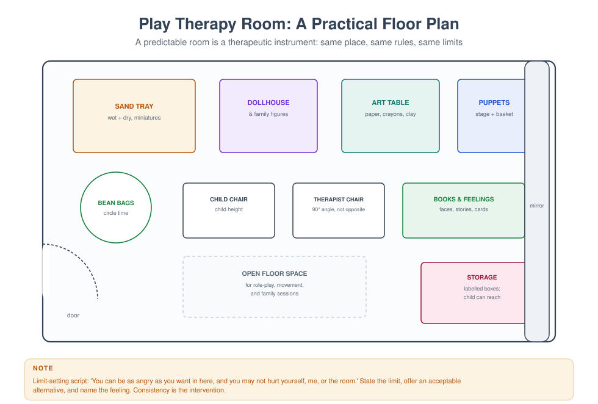

A practical floor plan, with sightlines, storage and limit-setting. MFT 711, 727.

*File:* `assets/figures/fig24-playroom-plan.svg`

---

### Group stages

Forming to adjourning, with Yalom's factors and the leader's task. MFT 709.

*File:* `assets/figures/fig25-group-stages.svg`

---

### Crisis intervention

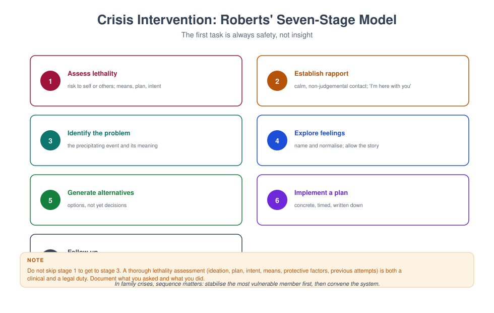

Roberts' seven stages: lethality first, follow-up last. MFT 712.

*File:* `assets/figures/fig26-crisis-stages.svg`

---

### Addiction cycle

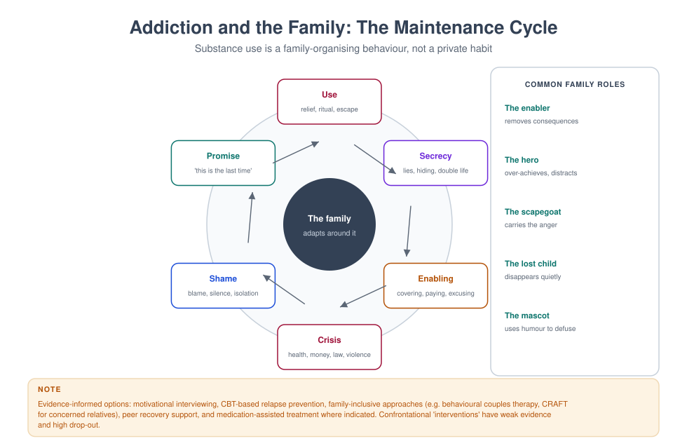

Use, secrecy, enabling, crisis, shame, promise — and family roles. MFT 713.

*File:* `assets/figures/fig27-addiction-family-cycle.svg`

---

### Choosing a design

Quantitative, qualitative and mixed branches, with an ethics gate. MFT 705, 721.

*File:* `assets/figures/fig28-research-design-tree.svg`

---

### Validity and reliability

Four validity targets as dartboards; three reliability methods. MFT 705, 721.

*File:* `assets/figures/fig29-validity-reliability.svg`

---

### Assessment sequence

Seven steps from referral to review, with a minimum assessment package. MFT 701, 707.

*File:* `assets/figures/fig30-assessment-sequence.svg`

---

### 5-P formulation

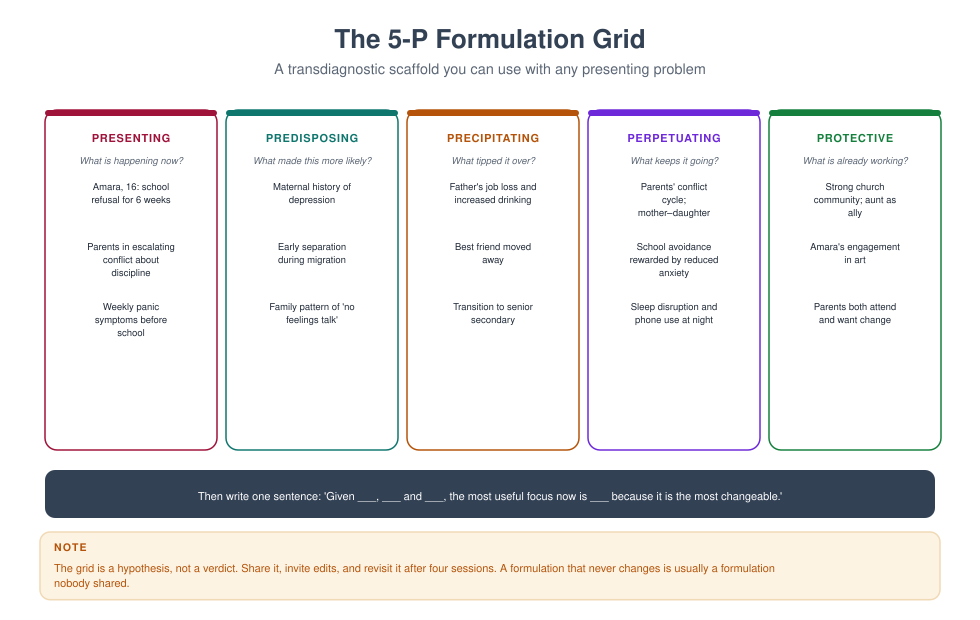

Presenting, predisposing, precipitating, perpetuating, protective — worked. MFT 707, 717.

*File:* `assets/figures/fig31-five-p-formulation.svg`

---

### Supervision triangle

Supervisor, therapist and family — plus parallel process. MFT 720.

*File:* `assets/figures/fig32-supervision-triangle.svg`

---

### Ethics decision model

Seven steps, and a checklist for the moment of doubt. MFT 704, 724.

*File:* `assets/figures/fig33-ethics-decision-model.svg`

---

### ADDRESSING

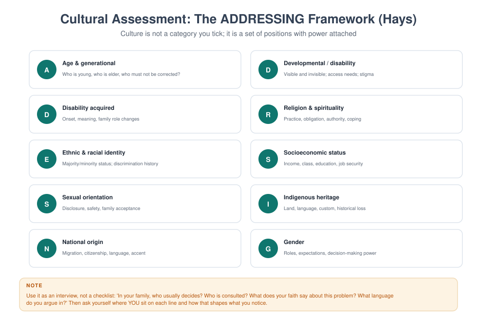

Ten cultural positions, each with an interview prompt. MFT 708, 723.

*File:* `assets/figures/fig34-addressing-framework.svg`

---

### Speaker–listener

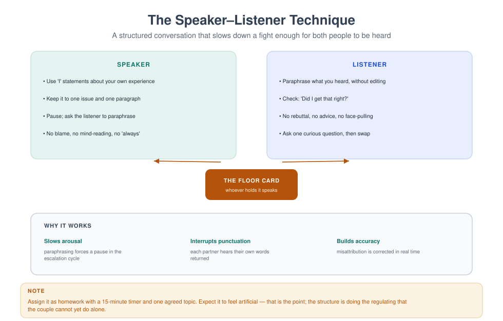

Rules for each role, the floor card, and why structure regulates. MFT 710, 716.

*File:* `assets/figures/fig35-speaker-listener.svg`

---

### Eight intimacies

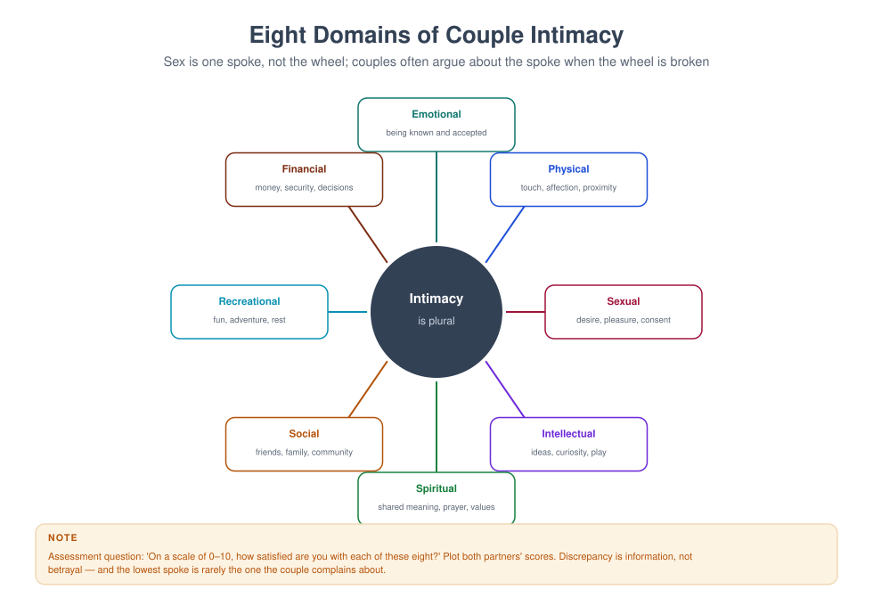

Sex is one spoke, not the wheel. MFT 718.

*File:* `assets/figures/fig36-intimacy-domains.svg`

---

### Self-care audit

Eight domains, rated weekly, with warning signs. MFT 722.

*File:* `assets/figures/fig37-self-care-audit.svg`

---

### Common factors

What accounts for change, and what that implies for training. MFT 701, 725.

*File:* `assets/figures/fig38-common-factors.svg`

---

### Family law map

Four marriage systems, four dissolution questions, one boundary. MFT 704, 724.

*File:* `assets/figures/fig39-family-law-map.svg`

---

### Four R's

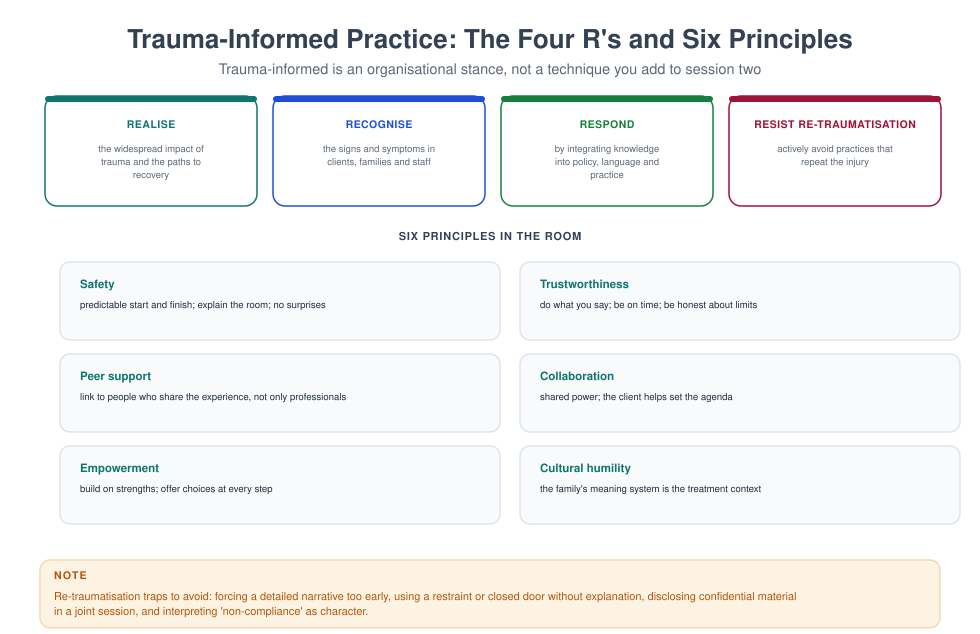

Realise, recognise, respond, resist re-traumatisation. MFT 714.

*File:* `assets/figures/fig40-trauma-informed.svg`

---
