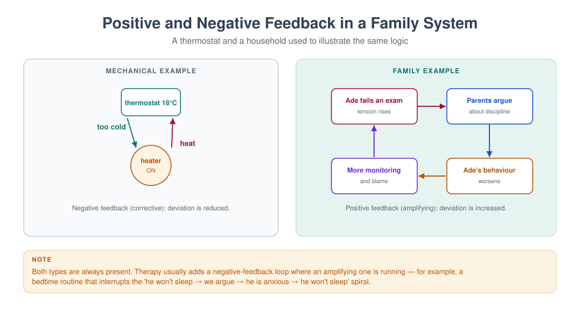

# MFT 701 — Fundamentals of Marriage and Family Therapy

> **MSc Marriage and Family Therapy** · Semester One · 1.71 Units · 14 teaching weeks · Prerequisite: none

**Course leader's summary.** This is the course that turns a helping professional into a *systemic*
one. It covers the intellectual history of family therapy, the epistemology that separates it from
individual work, the profession's identity and scope, and the basic architecture of a first session.
Everything later in the programme — theory, technique, assessment, ethics — assumes the vocabulary
built here.

---

## How to use this book

Each week contains four things: **the idea** (what you must understand), **the practice** (what you must
be able to do), **the case** (what it looks like in a room), and **a reflective task** (what it asks of
you personally). Read the week before the lecture; do the practical in the lab; write the reflection
within 48 hours, while it is still uncomfortable.

The book is written to be read straight through, but it is also designed for revision: the integration
chapter at the end compresses the whole course into two pages, and the glossary defines every term the
examination may use.

---

## 1. Course description and rationale

Most mental health training teaches us to look *inside* a person: their thoughts, their symptoms, their
attachment history. Family therapy teaches us to look *between* people: the loop, the triangle, the rule
that nobody wrote down. This is not a rejection of individual psychology. It is an additional
discipline of attention, and it changes what counts as the problem, the cause, and the cure.

Consider three common presentations:

| Presentation | Individual formulation | Systemic formulation |
|---|---|---|
| A 15-year-old refuses school | Anxiety disorder, school phobia | A child whose symptoms hold a parental conflict at bay; the school refusal is the family's most effective way of preventing an argument about the marriage |
| A wife is "depressed" | Major depressive episode | A woman in a triad with her husband and his mother, carrying the family's unspoken grief about a lost pregnancy |
| A man "works too much" | Workaholism, avoidance | The person who regulates the family's emotional temperature by being absent, in a system that rewards his absence |

None of these systemic formulations is automatically *more true*. Each is a hypothesis with different
implications for where you intervene. The mature clinician holds both — the individual and the
relational — and chooses deliberately.

**Why this course first.** Because students who begin with technique learn to do something they cannot
explain, and students who begin with theory learn to explain something they cannot do. MFT 701 begins
with *framing*: what kind of problem is this, and therefore what kind of help is required?

---

## 2. Learning outcomes

By the end of the course, students will be able to:

| # | Outcome | Assessed in |
|---|---|---|
| LO1 | Explain the epistemological shift from linear to circular causality, and its clinical consequences | Exam, Week 2 log |
| LO2 | Trace the historical development of family therapy and locate contemporary models within it | Exam |
| LO3 | Describe the profession's identity, scope of practice, and relationship to allied professions | Assignment |
| LO4 | Conduct a structured first session, including joining, problem definition, and contracting | Skills assessment |
| LO5 | Draw a three-generation genogram and generate hypotheses from it | Assignment |
| LO6 | Critically discuss the common-factors evidence and its implications for model choice | Exam essay |
| LO7 | Identify their own family-of-origin patterns and describe their effect on clinical work | Reflective log |

---

## 3. Assessment

| Component | Weight | Due |
|---|---|---|
| Reflective practice log (weekly, 300–400 words) | 20% | Fortnightly |
| Genogram and hypothesis assignment (2,000 words + diagram) | 30% | Week 9 |
| Two-hour written examination (seen case + essay + short answers) | 50% | Week 15 |

**Skills gate.** Students must pass a 15-minute observed first session (Week 6) before proceeding to
MFT 706. The gate is pass/fail with one resit.

---

## 4. The fourteen-week teaching plan

| Week | Topic | Practical | Core reading |
|---|---|---|---|
| 1 | What is family therapy? The relational turn | Triad: "the problem as described" | Nichols ch. 1; Handbook ch. 1 |
| 2 | Linear and circular causality; first- and second-order cybernetics | Observation of a recorded argument | Watzlawick, *Pragmatics* ch. 1 |
| 3 | A short history: from schizophrenia research to evidence-based practice | Timeline construction | Nichols ch. 2–3 |
| 4 | Systems thinking: boundaries, feedback, homeostasis, rules | Feedback-loop mapping exercise | Becvar & Becvar ch. 2 |
| 5 | The profession: identity, scope, settings, teamwork | Role boundaries case discussion | AAMFT code, scope sections |
| 6 | The first session I: joining, and the referral question | **Observed skills gate** | Minuchin & Fishman ch. 1 |
| 7 | The first session II: defining the problem in the family's language | Triad: problem definition | Haley, *Leaving Home* ch. 1 |
| 8 | The genogram as a hypothesis machine | Genogram lab (own family) | McGoldrick, *Genograms* ch. 1–2 |
| 9 | Formulating relationally: the 5-P grid applied to a family | Formulation workshop | Dallos & Draper ch. 4 |
| 10 | Culture, class and power in the consulting room | Reflexivity exercise | McGoldrick, *Ethnicity & Family Therapy* |
| 11 | Evidence: what works, for whom, and the common factors | Appraisal of one RCT and one qualitative study | Wampold ch. 2 |
| 12 | Ethics, risk and the limits of the systemic frame | Risk-screen rehearsal | MFT 704 pre-reading |
| 13 | Integration I: three models applied to one family | Live demonstration + discussion | Nichols ch. 10 |
| 14 | Integration II: your emerging clinical stance | Position statement presentation | Course review |

---

## Week 1 — What is family therapy? The relational turn

### 1.1 The lecture in ninety minutes

Week 1 has one job: to make the relational frame feel inevitable rather than eccentric. Everything a student
does later — the first session, the genogram, the formulation, the ethics of conjoint work — assumes they can
see a relationship as a thing with a shape, a history and a set of rules. Students arrive able to see people.
Very few arrive able to see *between* people.

The ninety minutes run like this.

| Minutes | Segment | What the lecturer does | What students do |
|---|---|---|---|
| 0–10 | Two formulations | Read the Okonkwo referral twice: once as an individual case, once as a relational one | Note which version they would have written |
| 10–30 | Where the field came from | The three failures of the individual frame (1.2) | Timeline exercise: place five founding texts |
| 30–50 | Five claims of the relational frame | Build the list on the board, testing each against a live example | Vote: which claim is hardest to accept? |
| 50–65 | Systems as a way of thinking | Cybernetics, feedback, the Watzlawick axioms (1.5) | Map one family loop on paper |
| 65–80 | Three openings in a first session | Annotated transcript, read aloud in parts | Mark where the therapist widened the field |
| 80–90 | Set the lab and the journal | Hand out the widening-question protocol (1.11) | Form triads, choose a real (non-clinical) difficulty |

The lecture is deliberately front-loaded with history. Students who know the field's origins stop treating
systemic thinking as a technique among techniques and start treating it as an epistemology — a claim about
what kind of thing a problem is.

### 1.2 Why the field exists: three failures of the individual frame

Family therapy was not invented because someone preferred groups to individuals. It was invented because
three well-funded, well-intentioned research programmes ran into the same wall: the individual frame kept
losing information that mattered clinically.

**The first failure: the patient kept relapsing into a family.** In the 1950s, Gregory Bateson's research
group at Palo Alto — Bateson, Don Jackson, Jay Haley and John Weakland — was studying communication in
families where one member had been diagnosed with schizophrenia. Their 1956 paper, "Toward a theory of
schizophrenia," proposed the **double bind**: a pattern in which a person receives two messages at different
logical levels that contradict each other, cannot comment on the contradiction, and cannot leave the field.
A mother who says "come here, dear" while stiffening when the child approaches; a father who asks for
honesty and then punishes it; a family that requires affection and forbids the expression of need that would
make affection possible.

The double-bind theory has not survived as an explanation of schizophrenia. Its status as a causal claim
about psychosis is dead, and students should know that. But something else in that research survived and
became the spine of the field: the observation that **sequences of behaviour between people carry information
that is invisible when you describe the people separately.** The patient's behaviour was intelligible as a
move in a game; the game was not in the patient.

**The second failure: the symptom made sense at home.** Independently, researchers studying families of
people with serious mental illness — Theodore Lidz at Yale, Lyman Wynne at the National Institute of Mental
Health — noticed that families organised themselves around the symptomatic member. Wynne described
**pseudo-mutuality**: a family that maintains the appearance of harmony by prohibiting any relationship that
would threaten it. Lidz described **marital schism** and **marital skew**: two patterns in which the couple's
conflict or the couple's imbalance shaped the child's development. Again the aetiological claims are dated.
Again the structural insight held: **a family can be organised by a symptom**, and the symptom can be doing
work for the system.

**The third failure: the child was the family's messenger.** The child guidance movement of the 1920s–1950s
treated the child, advised the mother, and sent both home to a household that had not changed. Clinicians
began to notice that improvement in the child was routinely followed by a new symptom in a sibling, or in the
mother, or by a marital crisis that had been dormant. The pattern is now so familiar that it has a name —
**symptom substitution** — and the observation that produced it is the most practically useful idea in this
week: *if the symptom is functional for the system, removing the symptom without changing the system is
unstable.*

Three research programmes, three different populations, one conclusion: the unit of assessment was wrong.
Between 1950 and 1975 the field built an alternative. Nathan Ackerman founded the Family Institute in 1960
and, with Jackson, the journal *Family Process* in 1962. Murray Bowen developed his theory of differentiation
and multigenerational transmission at the Menninger Clinic and later at Georgetown. Virginia Satir was
teaching conjoint family interviewing in California. Salvador Minuchin, working with delinquent boys at the
Wiltwyck School and then at the Philadelphia Child Guidance Clinic, built structural family therapy out of
the observation that these families were not sick so much as **organised at the wrong level of hierarchy** —
children in charge, parents disengaged or in coalition, boundaries too diffuse or too rigid. Jay Haley joined
Minuchin in Philadelphia in 1967 and brought strategy, power and the deliberate use of directives.

By the late 1970s the field had a canon: the Palo Alto communication school, Bowen's multigenerational
theory, Minuchin's structural therapy, Haley and Madanes's strategic therapy, the Milan group's systemic
therapy with its rituals and positive connotation, Satir's human validation, and the beginnings of
solution-focused work at Milwaukee and narrative therapy in Adelaide and Auckland. Students will meet each
of these properly in MFT 702. For now, one thing matters: **every one of these schools is an answer to the
question "what is the unit?"** and each answers it slightly differently — the sequence, the generations, the
structure, the meaning, the solution, the story.

> **DEBATE** — "If the aetiological claims of the 1950s were wrong, the field built on them is unsound."
> Ten minutes, two sides. The strongest argument against: a science is allowed to keep its methods after
> discarding its first theories — medicine kept auscultation after humoral theory fell. The strongest
> argument for: the field has never fully shed the habit of blaming families for individual distress.

### 1.3 What "relational" actually means: five claims

"Systemic" is a word students learn to say before they learn to mean. Here are the five claims that make
the relational frame a frame, in ascending order of how much they cost you as a clinician.

**Claim 1 — Behaviour is patterned.** Any two people who spend time together generate repeating sequences.
The pattern is not in either person; it is in the loop. A couple who report "we never talk" will, within
twenty minutes of a first session, demonstrate precisely how the not-talking is produced: one asks a question
that contains an accusation, the other answers with a fact, the first escalates the volume, the second goes
quiet. Neither is doing it *to* the other. Both are in it.

**Claim 2 — The pattern is maintained by its consequences, not by its causes.** This is cybernetics in one
sentence. The question "why did this start?" is usually unanswerable and clinically useless; the question
"what keeps it going?" is answerable and clinically decisive. A father's withdrawal is maintained by his
wife's criticism, which is maintained by his withdrawal. Ten years of history explain how they got into the
loop; only the loop explains why they are still in it.

**Claim 3 — Meaning is negotiated between people.** The same act means different things to different family
members, and those meanings are not private. A daughter's silence means "respect" to her father, "punishment"
to her mother, and "safety" to herself. The clinical task is not to find the true meaning but to make the
several meanings audible to everyone in the room.

**Claim 4 — Symptoms can serve the system.** Not always, not deliberately, and never in a way that makes the
symptomatic person responsible. But frequently enough that the therapist must ask: what would change in this
household if this symptom disappeared tomorrow? Sometimes the honest answer is "nothing." Sometimes it is
"my marriage would have to be looked at," and that answer reorganises the whole treatment.

**Claim 5 — The observer is inside the observed system.** You are not a camera. Your presence changes what
the family does, what they say, what they notice about themselves, and what they will risk in front of each
other. The family that arrives furious will perform its fury for you; the family that arrives polite will
perform its politeness. This is not contamination to be minimised — it is the instrument you have. Second-
order cybernetics, which students meet formally in MFT 715, is simply the discipline of using that
instrument knowingly (Figure 1.1).

**A working definition.** Marriage and family therapy is the assessment and treatment of relational systems —
couples, families, and the wider networks in which they live — using interventions that target interaction
patterns, meaning systems, and the emotional bonds between people. Read the definition carefully: *assessment
of relational systems* means the unit of assessment is the relationship; *interventions that target patterns*
means the unit of intervention is the loop, the rule, the structure or the story; *emotional bonds* means
that a purely behavioural account is insufficient, because people are attached to each other and the
attachment is what makes the pattern stubborn.

**What it is not.** Four clarifications, because students routinely collect the wrong ones.

1. **It is not "seeing everyone together" as a matter of policy.** Sometimes the right systemic move is an
   individual session inside family work. Conjoint work is a means, not a doctrine.
2. **It is not a denial that individuals exist, or that biology, trauma and temperament matter.** It is a
   disciplined focus on context, not a metaphysics.
3. **It is not the claim that families cause mental illness.** That claim was made in the 1950s and it was
   wrong, cruel, and expensive. Contemporary systemic practice holds families as the site where distress is
   *expressed, maintained and relieved* — not as the sole cause.
4. **It is not "we don't do diagnosis."** Systemic therapists diagnose, formulate and often work inside
   services that require a diagnosis; see MFT 707.

### 1.4 The four consequences, worked through

The four consequences in the original week note are worth more than a bullet list. Take them one at a time,
each with what it changes on Monday morning.

**Consequence 1 — The unit of assessment changes.** You must hear from more than one person, and notice what
happens *between* them. In practice this means the assessment cannot be completed in a single interview with
one informant. It means disagreement between informants is data rather than noise: if the mother says the
boy is defiant and the father says he is fine, the difference is the finding. It means you watch the room —
who sits where, who answers for whom, who looks at whom before speaking, what happens to the volume when
one person enters.

**Consequence 2 — The unit of intervention changes.** You intervene in sequences, rules, meanings and
structures, not only in individual cognition. A cognitive intervention asks the depressed woman to examine
the evidence for her belief that she is a burden. A systemic intervention asks what happens in the household
in the forty-eight hours after she expresses that belief — and often finds that the expression triggers
reassurance, that reassurance prevents any change in the division of labour, and that the division of labour
is what is depressing her. Both are legitimate. The second is invisible from inside the first.

**Consequence 3 — The definition of success changes.** Success may be a family that argues well, not a family
that never argues. This is the hardest consequence for students trained in symptom reduction, because it
means the goal is not the absence of conflict but the presence of **repair**. A couple who can fight, rupture
and come back together within an hour is doing better than a couple who never fight and are quietly
contemptuous. Outcome measures should reflect this: not only "has the symptom gone?" but "can this system
handle disagreement without breaking?"

**Consequence 4 — The therapist's position changes.** You are not a technician outside the system; you are a
participant who affects it. Three practical implications. First, you must account for your own effect: the
family will behave differently because you are watching, and the difference is informative rather than
annoying. Second, you cannot claim neutrality; you can only be transparent about your partiality. Third,
your own family of origin is in the room with you — which is why every week of this book ends with a
reflective task, and why personal therapy and supervision are professional requirements, not luxuries.

> **CASE** — Mrs Okonkwo brings her 9-year-old son, Ebuka, for "stubbornness". In the first ten minutes she
> mentions, twice, that his father "is never home". The linear frame says: assess and treat Ebuka's
> behaviour. The systemic frame says: ask who else is affected by the behaviour, what happens after it, and
> what would change in the household if it stopped. The second question is not a rejection of the first; it
> is a widening of the field in which the first can be treated.

### 1.5 Systems as a way of thinking

Students often assume "system" is jargon for "family". It is not. A system is any set of elements whose
interaction produces effects none of the elements produces alone. Ludwig von Bertalanffy's general system
theory (1968), Norbert Wiener's cybernetics (1948) and the communications research at Palo Alto gave the
field three tools, and they are still the three tools.

**Feedback.** A system regulates itself through loops. **Negative feedback** reduces deviation and restores
the previous state — the family that pulls a member back whenever they move too far, the couple whose
argument returns to the same sentence. **Positive feedback** amplifies deviation and produces change or
escalation — the quarrel that grows, the affair that is discovered, the child who leaves. Note that the words
are not evaluative: negative feedback is not bad, positive is not good. Most clinical problems are stuck
negative-feedback loops with high cost; most crises are positive-feedback loops that have run away.

**Homeostasis and morphostasis.** Systems resist change in order to remain themselves. When a family comes to
therapy, two processes are always running: the pressure to solve the problem and the pressure to keep the
system intact. This is why families sometimes seem to sabotage their own treatment, and why the therapist
who moves too fast loses the family. The technical answer is to pace: introduce change at a rate the system
can absorb, and check that each change is stable before the next.

**Rules and punctuation.** Watzlawick, Beavin and Jackson's *Pragmatics of Human Communication* (1967) gave
the field its most quoted propositions: one cannot not communicate; every communication has a content and a
relationship level; relationships are defined by punctuation of sequences; humans communicate digitally
(words) and analogically (behaviour, tone, gesture). The idea of **punctuation** is the most clinically
valuable. Each partner punctuates the same sequence differently: she says "he goes silent, so I get loud";
he says "she gets loud, so I go silent". Both are describing the same loop from different points on it, and
each punctuation makes the other the cause. Therapy begins when the loop, rather than either partner, becomes
the object of attention.

**Structure.** Minuchin added what communication theory lacked: an account of *organisation*. Families have
subsystems (parental, sibling, couple), boundaries (clear, diffuse, rigid), hierarchies, alliances and
coalitions. A child who is in a coalition with one parent against the other is not "manipulative"; the child
is holding a structural position that the adults' conflict has created. Structure gives the therapist
something to see in the seating plan and something to change in the session.

**Meaning.** The later schools — Milan, narrative, collaborative — pushed the field from pattern to
interpretation. If the system is a set of interactions, it is also a set of stories about those interactions.
A family that has decided "our son is the problem" has organised its attention, its conversations and its
hopes around that sentence. Change the sentence and the interactions move; move the interactions and the
sentence loses its evidence.

> **PRACTICAL** — Choose an ordinary recurring household event: the school run, Sunday lunch, the nightly
> argument about homework. Draw it as a loop with four to six nodes, each node a behaviour, with arrows
> showing what follows what. Then mark: where is the negative feedback (what restores the previous state)?
> Where is the positive feedback (what escalates)? Where does each participant punctuate the loop? Bring the
> drawing to the lab; you will redraw it after hearing someone else's account of the same event.

---

### 1.11a What the evidence says, in one page

Students are often told either that family therapy "works" or that the evidence is contested. Both are
unhelpful. Here is what a careful reading of the outcome literature supports, stated with the hedge each
claim requires.

**Family and couple therapy outperform no treatment, and generally match individual treatment for relational
problems.** Meta-analyses of couple and family therapy trials report effect sizes in the moderate range —
roughly half a standard deviation to eight-tenths — against no-treatment and wait-list controls, with the
larger effects for couple distress, child conduct problems, and adolescent substance use. Effects are smaller
and less consistent against credible active comparators, which is what you would expect if the specific model
matters less than the common structure of good therapy.

**The model explains less of the variance than the alliance.** The most robust finding in psychotherapy
research, replicated across modalities, is that the therapeutic alliance predicts outcome better than the
technical ingredients of any particular school. In couple and family work the alliance is more complicated
than in individual work, because there is more than one alliance to build and they can pull against each
other: siding with one partner to engage them alienates the other, and a determined even-handedness can leave
both feeling unheard. This is why Week 6 of this book spends two sessions on joining, and why your assessed
skill in this course includes your ability to hold two alliances at once.

**Common factors do a lot of the work.** Client factors (severity, chronicity, social support, motivation),
the alliance, the therapist's skill and the expectancy generated by a credible rationale account for a large
share of change. The practical implication is not that technique is irrelevant but that technique is
delivered *through* a relationship, and a technique delivered through a poor relationship is inert or
harmful.

**Dose and dropout matter more than most trainees think.** A substantial proportion of families attend one
session and never return; the first session is therefore an outcome event, not a preliminary. Retention is
predicted by early alliance, by the fit between the therapist's explanation and the family's own
understanding, and by practicalities — travel, cost, timing, childcare — that a therapist who ignores them
will mistake for resistance.

**Evidence is unevenly distributed across problems.** Couple therapy for relationship distress, behavioural
parent training for conduct problems, family-based treatment for adolescent eating disorders, multidimensional
family therapy for adolescent substance use, and systemic work with chronic illness in children have
reasonably strong support. Evidence for some popular ideas — mechanical use of paradox, unexamined
"dysfunctional family" typologies, polyvagal explanations treated as established mechanism — is much weaker.
Learning to distinguish these is part of professional formation, and MFT 705 and MFT 721 teach you to read the
literature rather than the marketing.

> **CAUTION** — Do not let the common-factors literature become an excuse for not learning a model. "The
> alliance is what matters" is true and is also the sentence most often used by trainees who have not yet
> learned to do anything. You need a model precise enough to be taught, supervised and evaluated, and a
> relationship good enough for the model to reach the family. Neither substitutes for the other.

### 1.6 First contact: three openings, annotated

The relational frame is not announced, it is enacted. Three openings show what it looks like when a
therapist begins relationally in the first five minutes — before any genogram, any diagnosis, any technique.

**Opening A — from the referred person to the referral system.**

> **Therapist:** Before we start, tell me how this appointment came about. Who first said something needed to
> change, and who agreed?
> **Mrs Okonkwo:** The school called me. His teacher said he refuses to write anything.
> **Therapist:** And when you told your husband, what did he say?
> **Mrs Okonkwo:** (pause) He said I should handle it. He is not around.
> **Therapist:** So the school spoke to you, you spoke to your husband, and here you are with Ebuka. Who else
> in the family knows you are here today?

Note what the therapist has done. She has not asked about the symptom at all. She has mapped the **referral
pathway**, which is itself a relational fact: who is worried, who is not, who carries the problem, who was
told and who was not. She has also discovered, in four questions, the sentence that will organise the
assessment: *he said I should handle it.* That sentence is not a complaint about a husband. It is a
description of a household in which one adult holds all the worry, and a child's symptom sits in the space
where the other adult would be.

**Opening B — from the symptom to the sequence.**

> **Therapist:** Tell me about the last time it happened. Not the worst time — the most recent.
> **Mrs Okonkwo:** Yesterday morning. He would not get out of bed. I called him three times, then I started
> shouting, then he got up and stood in the bathroom for twenty minutes.
> **Therapist:** And then?
> **Mrs Okonkwo:** Then I drove him late and I was angry all day.
> **Therapist:** What did Ebuka do when you were angry all day?
> **Mrs Okonkwo:** He was very quiet. He even made me tea.

The sequence is now visible: refusal, escalation, compliance, and then **repair initiated by the child**. That
is the loop. The therapist did not need to interpret it. She asked for a specific episode and then asked
"and then?" until the loop closed. This is the single most useful micro-skill in the first session:
**episode, not opinion.** Opinions produce character descriptions ("he is stubborn"); episodes produce
sequences.

**Opening C — from the individual to the room.**

> **Therapist:** (to Ebuka) Your mum says mornings are hard. If I asked her to describe a good morning, what
> would she say happens?
> **Ebuka:** (shrugs) She would be happy.
> **Therapist:** How would she know? What would she see?
> **Ebuka:** (long pause) My dad would be there.

Three questions, and the child has produced the formulation. The therapist did not ask "how do you feel
about your father's absence?" — a question no nine-year-old answers truthfully. She asked a **behavioural
question about a third person's perception**, which is easier to answer and much harder to fake. Involving
the child as an informant, not a patient, is a structural act: it moves the child out of the identified-
patient position and into the family's information system.

**What all three openings have in common.** Each one moves the unit of attention one step outward — from the
person to the pathway, from the event to the sequence, from the individual to the room — and each does so
with a question that is answerable. That is the whole craft of a first session in miniature. The student who
can do these three moves in the first ten minutes will get a formulation. The student who cannot will get a
history.

### 1.7 The Okonkwo case, fully worked

**Referral.** Ebuka, 9, referred by his school for "defiance and refusal to write". Six weeks of refusing to
complete written work; two episodes of leaving the classroom. Class teacher describes him as "stubborn and
rude". Mother reports he is "fine at home, except mornings". Father did not attend.

**What the linear frame produces.** A differential diagnosis: oppositional defiant disorder versus a specific
learning difficulty (writing), versus anxiety, versus an attention problem. An assessment plan: psychometric
testing, teacher rating scales, classroom observation, possibly a paediatric review. A treatment plan:
behavioural contract, reward chart, parent training in commands and consequences. This is not wrong. It is
incomplete in a way that will matter, because the most important information in this family is not about
Ebuka's writing.

**What the systemic frame adds.** Four moves, in order.

*Move 1 — the referral pathway.* Who is worried? The school, then the mother. Who is not in the room? The
father. Who decided that the mother should manage it? The father, according to the mother. The first
structural fact: **the parental subsystem is not operating as a subsystem.** One adult holds the worry, the
other holds the distance.

*Move 2 — the sequence.* Mornings: refusal, three calls, shouting, compliance, lateness, a day of maternal
anger, evening reparation initiated by the child. The second structural fact: **the child regulates the
mother's emotional state.** He absorbs her anger and then repairs it. A nine-year-old is doing the work of a
partner.

*Move 3 — the function of the symptom.* What would change at home if Ebuka got up cheerfully and wrote
fluently? The mornings would be calm; the mother's day would be easier; and the father's absence would become
a topic rather than a background condition. There is no evidence that anyone wants the child to be
symptomatic. There is good evidence that the symptom sits at the exact point where a marital conversation
would otherwise occur.

*Move 4 — the wider system.* School, church, extended family. In this case the maternal grandmother is
mentioned twice and the paternal aunt once. In many Nigerian households the grandmother is a co-parent and a
court of appeal; leaving her out of the assessment is not neutrality, it is an omission.

**The formulation, in one paragraph.** Ebuka's refusal to write is maintained by a morning sequence in which
escalation reliably produces compliance and in which the child then repairs his mother's distress. That
sequence is itself maintained by a household in which one parent carries all the worry and the other is
absent, and by a school system that has defined the problem as a defect in the child. The symptom is not
caused by the marriage, and nobody is to blame; but the symptom is *located* where the marriage would
otherwise be discussed, and it will be difficult to resolve without that conversation becoming possible.

**The plan that follows.** Conjoint sessions including the father (with an explicit invitation framed as
expertise rather than blame: "I need your view of what happens in the mornings; your wife and I are working
from one account"). A behavioural component for the mornings, because it works and because success builds
the parents' confidence in themselves as a team. A separate conversation with the parents about the marriage,
held only when both are willing. Liaison with the school to reframe "defiance" as "a problem we are
assessing", which reduces the pressure that feeds the loop.

> **TASK** — Rewrite this case as you would present it in a multidisciplinary team meeting in forty seconds,
> without using the word "systemic" and without blaming either parent. Then rewrite it for the parents
> themselves. The two versions should differ in vocabulary, not in content.

### 1.8 Where the profession sits

Students enter training with a blurred map of the mental health professions. In Nigeria, as in most places,
the practical differences matter for referral, for legal standing, and for what you are allowed to do.

| Profession | Core unit | Typical training | What they usually do with a struggling family |
|---|---|---|---|
| Psychiatry | The patient, medically | Medical degree, then residency | Diagnose, prescribe, admit; refer for therapy |
| Clinical psychology | The individual | Doctorate or master's plus internship | Assess, formulate, deliver individual therapy |
| Counselling psychology | The individual in context | Master's or doctorate | Individual and group counselling, some couple work |
| Social work | The person in their environment | Degree plus registration | Case management, child protection, family support |
| Marriage and family therapy | The relationship | Master's or doctorate in MFT | Conjoint, family and couple therapy; relational formulation |

The distinctive contribution is not a technique. Clinical psychologists do behavioural couple work;
psychiatrists do family meetings; social workers do family support. The distinctive contribution is the
**relational formulation** — the disciplined habit of locating the problem in the space between people, and
the training in interventions that change that space. A therapist who can only see individuals will treat a
family by treating its members one at a time and will be genuinely puzzled when the symptom returns.

**Settings in which the work happens.** Outpatient clinics and private practice; hospitals, where family
meetings follow diagnoses that reorganise households; schools, where the referral pathway usually begins;
NGOs and humanitarian settings, where family separation, displacement and bereavement are the presenting
context; faith settings, where pastors, imams and church counsellors are often the first and sometimes the
only port of call; and courts and child protection services, where the therapist's opinion may be read by a
judge. Each setting changes the ethics (see MFT 704), the assessment (MFT 707) and even the language you use.

**Scope of practice.** Three boundaries worth stating on the first day of training. First, family therapists
do not prescribe; any question about medication is a referral question, and the referral should be made
without implying that medication is a failure. Second, family therapists do not give legal advice; they
provide clinical opinion and, where required, reports, and they tell families to obtain a lawyer (see MFT
724). Third, family therapists do not practise beyond their competence — and competence is specific:
adult couple work is not child work, child work is not forensic work, and neither is trauma processing
without specific training (MFT 711, MFT 714).

> **AUDIT** — Write down, in one sentence each, what you would do and would not do if a family asked you to
> (a) advise whether the husband can legally take a second wife, (b) tell the court which parent should have
> custody, (c) prescribe something for the child's sleep. Bring the three sentences to the lab.

### 1.9 Culture, faith and class in the first meeting

The relational frame is not culturally neutral, and pretending otherwise is its own kind of arrogance. Three
adjustments matter from the first session in most Nigerian consulting rooms.

**Kinship is wider than the household.** A genogram that stops at the nuclear family will miss the
grandmother who raised the child for three years, the uncle who pays the school fees and therefore has
standing, the aunt who lives with the family and disciplines the children, and the cousin whose presence has
changed the sleeping arrangements. Ask who is *involved*, not who lives *there*. The distinction between
household and family is one of the most practically useful in the whole programme.

**Faith is a resource and a referral system, not a rival.** Families commonly arrive having already seen a
pastor, an imam, a traditional healer or all three. The therapist's task is not to adjudicate but to
coordinate: what did the prayer, the deliverance, the fasting, the herbal treatment do? What was helpful?
What was frightening? What does the family believe is happening spiritually? A family that believes the
problem is spiritual and a therapist who believes it is relational can still work together if the therapist
takes the belief seriously as a *meaning in the system*, which is exactly what it is.

**Class shapes what is possible.** A recommendation to reduce working hours is meaningless to a family with
two jobs and no childcare. A recommendation to attend weekly sessions is meaningless to a family who travel
four hours. A recommendation to "talk to your husband" is meaningless in a household where his mother is the
decision-maker. Practical recommendations fail not because families are resistant but because the therapist
prescribed from a life the family does not have. The discipline is to ask, before prescribing: what would
have to be true in your week for this to happen? The answer is usually the real treatment plan.

> **CAUTION** — Do not treat cultural deference as consent. A wife who says "I will do whatever my husband
> decides" may be expressing a genuine value, or may be signalling that she cannot speak safely. The
> difference is discovered by seeing her alone at least once, and by asking about safety in the standard
> way — not by assuming either interpretation.

### 1.10 Six errors that begin in week one

These are the mistakes students actually make in their first role-plays, and each one is a failure of the
relational frame rather than a failure of technique.

1. **The single-informant assessment.** You interview the mother, form a picture, and never test it. Fix: no
   relational formulation without at least two informants, and no family assessment without asking who is
   missing.
2. **The character formulation.** "He is oppositional." "She is enmeshed." These are descriptions of persons
   disguised as systemic language. Fix: every formulation must contain at least one *sequence* ("when X, then
   Y, then Z") and at least one *context* ("in the presence of…").
3. **Premature reassurance.** "I'm sure he loves you." It closes the exploration and hands the therapist's
   opinion to a family that needs its own. Fix: acknowledge the experience, ask for the evidence, keep the
   question open.
4. **The alliance slide.** You begin to like one member more than another and your questions begin to build
   the case for that person. Fix: track your questions across a session (record it) and count how many were
   addressed to each person and whose account each question elaborated.
5. **The technique-first session.** You arrive with a genogram to draw, a technique to demonstrate, a model to
   apply — and the family's actual concern is never heard. Fix: the first session belongs to the family's
   account, not to the therapist's plan.
6. **The safety omission.** You conduct a full conjoint assessment without ever asking about violence. Fix:
   every first session includes a private screen for harm to self, harm to others, abuse of children and
   intimate partner violence, conducted in a way that makes disclosure possible (see MFT 704 and MFT 712).

> **REFLECT** — Which of the six are you most likely to commit? Not in theory: in your last conversation with
> someone who was struggling. Write the answer down. You will be asked to revisit it in Week 14.

### 1.11 Laboratory: the widening question

The week's practical is a triad drill in which the therapist may only ask questions that include another
person. It looks simple and it is not: most students discover that their natural question is a question about
an individual, and that widening feels artificial for the first twenty minutes.

**Setup.** Groups of three. Roles rotate every eight minutes, so each person is therapist once. One person
brings a real but non-clinical difficulty — a disagreement with a flatmate, a difficult decision about a
sibling, a strain with a colleague. No clinical material, no disclosure that would be regretted.

**Rules for the therapist.**

1. No statements, interpretations or advice — questions only.
2. Every question must include a third party or a relationship: "who notices…", "what does your sister do
   when…", "who would disagree…", "what happens between you after…".
3. One question at a time, with silence after each.
4. Eight minutes, then stop whether or not the conversation feels finished.

**Observer's task.** Two columns on one sheet: **W** (questions that widened the field) and **N** (questions
that narrowed it back to the individual). Tally, then quote the single most useful widening question and the
single most narrowing one.

**Debrief questions.** What did the client notice about their own description when it was widened? Which
widening felt intrusive, and why? What did the therapist want to say but could not? What happened to the
client's tone when a third person entered the story?

**Marking rubric** (used in the Week 6 skills gate).

| Criterion | Weight | What full marks looks like |
|---|---|---|
| Proportion of widening questions | 30% | More than 80% of questions include another person or a relationship |
| Question quality | 25% | Open, specific, answerable; no double questions; no embedded advice |
| Pacing and silence | 20% | Roughly one question per 30–45 seconds; client speaks more than therapist |
| Use of the client's words | 15% | At least three questions reuse the client's own phrasing |
| Reflexivity in debrief | 10% | Can name what was hard, what was tempting, what they avoided |

> **DRILL** — Record a five-minute role-play on your phone. Count your questions. Then count how many contain
> a third person. Most first attempts are around one in ten. The target is eight in ten, and it takes about
> three hours of deliberate practice to get there.

### 1.12 Reflective task

Write 500 words on the last significant conflict in your own family, then rewrite it from the point of view
of the person you understood least. Note what changed in your body as you wrote. Keep both versions; you will
return to them in Week 14, when you write your emerging clinical stance, and you will find that the second
version contains the therapist you are becoming.

Two rules for this task. Do not show it to the person concerned, and do not bring the person's name into the
seminar. The purpose is to develop the capacity to hold more than one punctuation of the same sequence at
once — which is precisely what you will ask families to do.

### 1.13 Self-test

Six questions, answers below. If you cannot answer 4 and 5 without notes, reread 1.5.

1. Define negative and positive feedback, and give one clinical example of each.
2. Why is "punctuation" clinically useful?
3. State the double-bind hypothesis and its current scientific status.
4. What is symptom substitution, and what does it imply for treatment?
5. Name the five claims of the relational frame, in order.
6. What are the four consequences of treating the relationship as the client?

**Answers.** 1. Negative feedback reduces deviation and restores a prior state (a family pulling a member
back from independence); positive feedback amplifies deviation (an argument that escalates through
counter-complaint). 2. Because each participant's punctuation makes the other appear to be the cause; the
therapist who makes punctuation visible turns blame into a loop both can act on. 3. A person receives
contradictory messages at different logical levels, cannot comment on the contradiction and cannot leave the
field; it is historically important and not a supported causal explanation of schizophrenia. 4. The
observation that removing a symptom is often followed by a new symptom elsewhere in the system; it implies
that treatment must change the system, not only the symptom. 5. Behaviour is patterned; patterns are
maintained by consequences rather than causes; meaning is negotiated; symptoms can serve the system; the
observer is inside the observed system. 6. The unit of assessment, the unit of intervention, the definition
of success, and the therapist's position.

### 1.14 Readings for this week

Read the first two before the lecture; the rest are for the assignment.

* **Bateson, Jackson, Haley & Weakland (1956)**, "Toward a theory of schizophrenia", *Behavioral Science*.
  Read it as a historical document and notice how carefully the authors hedge.
* **Watzlawick, Beavin & Jackson (1967)**, *Pragmatics of Human Communication*, chapters 1–2. The axioms, in
  the original.
* **Nichols & Schwartz**, *Family Therapy: Concepts and Methods*, chapter 1. The best single overview of the
  field's history.
* **Becvar & Becvar**, *Family Therapy: A Systemic Integration*, chapters 3–5. On cybernetics and
  second-order thinking.
* **Hoffman (1985)**, "Beyond power and control", *Family Systems Medicine*. The turn to second-order
  cybernetics, written by a participant.
* **Minuchin (1974)**, *Families and Family Therapy*, chapter 2. Structure, in Minuchin's own voice.

### 1.6a An extended transcript, annotated

Role-plays teach faster than principles. Below is a twelve-turn excerpt from a first session with a couple
who present with "we cannot communicate". The therapist is a trainee in her second term. Read the transcript,
cover the annotations, and decide what you would have asked next. Then read the annotations.

> **T1 Therapist:** What would you like me to understand first?
> **T2 Folake:** He doesn't talk to me. He comes home, eats, watches television, sleeps. I am alone in this
> house.
> **T3 Therapist:** (to Dele) What do you think your wife means when she says she is alone?
> **T4 Dele:** I don't know. I work. I am tired. She is not alone, there are three children in the house.
> **T5 Therapist:** Folake, what do you do when he is watching television?
> **T6 Folake:** I stand there. Sometimes I ask him something and he says "mm".
> **T7 Therapist:** And what happens then?
> **T8 Folake:** I get angry. I say something sharp. Then he goes to bed.
> **T9 Therapist:** Dele, when she says something sharp, what goes through your mind?
> **T10 Dele:** That nothing I do is enough. So I stop.
> **T11 Therapist:** And when you stop, Folake, what happens to the anger?
> **T12 Folake:** It grows. And then I cannot sleep and I am tired the next day and the children see me crying.

**Annotations.**

*T1* is a neutral opening that hands the agenda to the couple without inviting either partner to be the
complainant. Compare "What is the problem?" — which usually produces one person's problem statement and
positions the other as the problem.

*T3* is the first systemic move: instead of asking Dele to defend himself, the therapist asks him to
**interpret his wife**, which requires him to engage with her experience rather than his own. It also reveals
whether he has a theory of her mind at all. He does not: "I don't know" is honest and important.

*T5* is an **episode question** and it is doing three things at once. It bypasses the argument about whether
she is alone (unwinnable), it specifies a moment (television, evening), and it puts the therapist physically
in the room with them. Students who ask "why do you feel alone?" get an explanation; students who ask "what do
you do when he is watching television?" get the behaviour that maintains the loneliness.

*T7*, "and then?", is the single most productive two-word intervention in family therapy. It builds the
sequence one link at a time and stops the therapist from doing the formulating.

*T9* takes the same event and asks for the **other partner's internal sequence**, which turns two monologues
into one loop. Note that the therapist does not challenge Dele's account ("three children in the house" is
not an answer to loneliness, but arguing about it would lose him). She lets the sequence do the work.

*T10* is the pivot of the session. "Nothing I do is enough, so I stop" is a complete formulation of Dele's
side of the loop, offered by Dele. Nothing the therapist could have said would have been as convincing or as
usable.

*T11* closes the loop by returning to Folake with the consequence of his withdrawal. At T12 she supplies it:
the anger grows, sleep is lost, the children see her crying. The loop is now on the table, described entirely
in the couple's own words, and neither partner has been blamed.

What the therapist has **not** done in twelve turns is worth listing, because trainees over-value these
moves: she has not asked about the history of the marriage, has not asked how they met, has not asked about
sex, has not offered an interpretation, has not normalised, has not asked either partner to change anything,
and has not used the word "communication". Every one of those is legitimate; none of them was needed to
establish the relational frame in the first ten minutes.

> **PRACTICAL** — In pairs, take turns being the therapist with this transcript. Cover T3 to T12 and improvise
> your own next question at each point. Then compare with the original. Where did you ask for an opinion
> rather than an episode? Where did you reassure? Where did you take a side without noticing?

### 1.10a Three punctuations of one quarrel

The same sequence can be punctuated at least three ways, and each punctuation licenses a different
intervention. Take the quarrel the couple above actually have.

**Punctuation 1 — the character story.** "He is cold and withdrawn; I am affectionate and he rejects me."
*What it licenses:* an appeal to Dele to change, a diagnosis of Dele (avoidant, depressive, possibly
autistic), and a treatment that works on Dele. *What it costs:* Folake's contribution disappears, Dele
becomes a project rather than a partner, and Dele — who already believes nothing he does is enough —
experiences therapy as one more arena in which he fails.

**Punctuation 2 — the mirror story.** "She criticises; I withdraw; she criticises more." *What it licenses:*
a circular formulation, a sequence map, and interventions aimed at the loop (interrupting the escalation,
slowing the exchange, rehearsing a different response to criticism). *What it costs:* the loop can become an
abstraction that hides the asymmetry of power and the real losses — his hours, her sleeplessness, the
children's exposure.

**Punctuation 3 — the meaning story.** "She is asking for evidence that she matters; he is protecting himself
from evidence that he fails." *What it licenses:* work on attachment, on the meanings each assigns to the
other's behaviour, and on the moment of turning toward or away. *What it costs:* meaning work without
behaviour change can become insight that never reaches the household.

A competent therapist holds all three and chooses deliberately, usually sequencing them: the loop first
(because it lowers blame), the meaning second (because it explains why the loop is so adhesive), and the
character story never as a formulation, only as each partner's experience to be listened to. This pluralism —
several punctuations available, one chosen for a reason — is what distinguishes a systemic clinician from
someone who has memorised a model.

> **DEBATE** — "Circular formulations are kinder but less true." Fifteen minutes. Note that the strongest
> argument for circularity is not moral but empirical: linear accounts of complex interaction are almost
> always wrong about causation, even when they are right about blame.

### 1.13a Examination question with model answer

**Question (20 marks).** "Family therapy is a way of seeing, not a set of techniques." Discuss, with
reference to the historical development of the field and to at least one clinical example.

**Model answer, in note form, with the markers' expectations visible.**

*Introduction (2 marks).* State the claim in your own words: the relational frame is an epistemological
commitment — a claim about the unit of analysis and the nature of causation — and techniques are downstream
of it. Signal the structure of the answer: history, epistemology, clinical example, limits.

*History (6 marks).* Three research programmes converged on the same failure: Bateson's group and the double
bind; Lidz and Wynne on family organisation around psychosis; the child guidance movement and symptom
substitution. The aetiological claims of the 1950s were largely wrong and you should say so; what survived is
the methodological insight that sequences carry information individuals do not. Trace the schools as answers
to "what is the unit?" — Palo Alto (the sequence), Bowen (the generations), Minuchin (the structure), Milan
(the meaning), Milwaukee (the solution), Adelaide (the story).

*Epistemology (6 marks).* Circular versus linear causality; feedback and homeostasis; punctuation;
second-order cybernetics and the therapist's position. Use Watzlawick's axioms precisely — content and
relationship levels, digital and analogic communication — and show what each buys clinically. Demonstrate
that you understand the difference between an ecological claim (the system is the unit of *assessment*) and
a causal claim (the system *causes* the symptom), and reject the second.

*Clinical example (4 marks).* The strongest answers use one case throughout rather than several in passing.
The Okonkwo case works: a nine-year-old's school refusal, a morning sequence, a parental subsystem that is
not operating, and a formulation that no single-informant assessment could have produced. Show what the
relational frame let you see and what it let you do.

*Limits (2 marks).* Name them honestly: the frame can obscure individual biology, trauma and temperament; it
can be used to distribute responsibility in ways that leave an abusive member unaccountable; it can become a
language that describes loops without ever changing them. Note the feminist critique of neutrality and the
evidence that the alliance — not the model — predicts much of the outcome.

*Common ways to lose marks.* Describing techniques without explaining the frame; treating "systemic" as a
synonym for "family"; repeating the double-bind hypothesis as if it were current; failing to give a clinical
example at all; writing about circular causality without ever defining feedback.

### 1.13b What "good" looks like at the end of week one

A checklist you can use on yourself before Week 2. Tick only what you can do *without notes*.

- [ ] Explain, in ninety seconds, why the field moved from the individual to the relationship, using three
      historical examples and one honest caveat about the science of the 1950s.
- [ ] Define negative and positive feedback and give a clinical example of each that you have actually seen.
- [ ] Explain punctuation to a couple without using the word "punctuation".
- [ ] Turn three opinion questions into episode questions, out loud, without hesitation.
- [ ] State the four consequences of treating the relationship as the client, and give one practical
      implication of each for a first session.
- [ ] Describe the difference between a linear and a circular formulation using the same case twice.
- [ ] Name the three professional boundaries from 1.8 and what you would say to a family that crossed them.
- [ ] Ask about safety in a first session without it sounding like an accusation or an afterthought.

---

## Week 2 — Linear and circular causality

### 2.1 The lecture in ninety minutes

Last week asked *who is the client*. This week asks a harder question: **what kind of thing is a cause?** It
is the single most consequential idea in the programme, because everything downstream — the formulation, the
questions you ask, what you count as progress, how you write a report for a court — depends on whether you
think in lines or in loops.

Students usually arrive believing they already understand this. They can define circular causality in a
sentence: "each person's behaviour causes the other's." Then they conduct a role-play in which every question
they ask is a search for who started it. The gap between being able to say it and being able to do it is the
work of this week.

| Minutes | Segment | What the lecturer does | What students do |
|---|---|---|---|
| 0–10 | Two sentences | Reads a case in a linear account, then in a circular account | Mark every causal verb in both |
| 10–25 | The philosophy nobody teaches | Aristotle's four causes, Hume, Mills, why "cause" is plural (2.2) | Sort five clinical explanations into cause types |
| 25–45 | Feedback, formally | Loop diagrams, delay, gain, thresholds (2.3–2.4) | Draw the same family as two different loops |
| 45–60 | Punctuation, again | The same quarrel punctuated three ways (2.5) | Identify their own punctuation habit |
| 60–75 | Circular questioning | Live demonstration, then triads (2.6) | Ask three circular questions each |
| 75–90 | Hypothesis discipline | How to hold a hypothesis without becoming its servant (2.7) | Write one hypothesis, then one disconfirming question |

The lecture has a deliberate shape: philosophy first, engineering second, clinical craft third. Students who
skip the philosophy conclude that circular causality is a nicer way of saying "we are all responsible".
Students who skip the engineering cannot tell a loop from a list.

### 2.2 What a cause is: four traditions you will use without knowing

Family therapy inherited a muddle about causation and never fully cleaned it up. The muddle is worth
untangling, because most of the field's disagreements about evidence, responsibility and blame are
disagreements about what counts as a cause.

**Aristotle's four causes.** Aristotle distinguished the *material* cause (what something is made of), the
*efficient* cause (what set it in motion), the *formal* cause (the pattern it realises) and the *final* cause
(the purpose it serves). A wooden chair: wood, a carpenter, a design, the purpose of sitting. Now apply the
scheme to a symptom. A boy's school refusal: his anxiety (material), a frightening event (efficient), a
pattern of family accommodation (formal), and the function the refusal serves in the household (final). Most
clinical arguments are people defending one of these four while denying the others. The systemic tradition is
chiefly interested in the formal and final causes — the pattern and the function — which is exactly why it
seems to slight the efficient cause (the event that started it) and infuriates colleagues who want to know
what happened.

**Hume and the regularity theory.** A cause is an event constantly conjoined with another, temporally prior,
and contiguous with it. This is the model implicit in most medical training and in most of what patients
believe. It works well for infections and badly for families, because in families the "effect" is usually
also the "cause", arriving before and after in alternation.

**Mill's methods.** Agreement, difference, concomitant variation. These underwrite the randomised trial, and
they are why the trial remains the best tool for the question "does this treatment cause improvement?" They
are much weaker for the question "what maintains this pattern in this family?", where the relevant variation
cannot be manipulated.

**Systems and constitutive causation.** In a system, the state of each element is partly constituted by its
relations to the others. A thermostat is not caused to switch by the temperature in the way a billiard ball
is caused to move by another; the switching is what the system *does*. Family therapists use this sense when
they say that the pursuit and the withdrawal "cause" each other: not that A pushes B and B pushes A in a
chain, but that the two behaviours are what they are in virtue of the loop they form.

> **EXERCISE** — Take the sentence "his drinking broke up the marriage". Rewrite it four times, once for each
> Aristotelian cause. Then decide which of your four sentences a court would want, which a wife would want,
> and which would actually help in session.

Two consequences follow, and students should write them down.

**First, circularity is not a moral claim.** "We are both in the loop" does not mean "we are equally
responsible", and it certainly does not mean "the victim is complicit". A man who is violent and a woman who
placates him are in a loop, and only one of them is doing the violence. Confusing description with
responsibility is the most serious error in the systemic literature, and the feminist critique of the 1980s —
developed by Hare-Mustin, Goldner, Bograd and others — was right about it. The corrective is not to abandon
circularity but to pair it with an explicit account of power: who has the resources, who can leave, who is
believed, whose account is treated as the account.

**Second, circularity is a stance, not a finding.** You cannot observe a loop from outside; you can only
offer a description of a loop from a position inside it. That is second-order cybernetics in one line, and it
means your circular formulation is a hypothesis with an author, not a fact with a discoverer.

### 2.3 Feedback, formally

The engineering vocabulary is not decoration. It gives you words for things you can otherwise only gesture
at, and the words make the difference between a formulation that guides intervention and one that merely
sounds sophisticated.

**Loop, not line.** A loop has a variable, a sensor, a comparison with a reference value, and an effector. In
a family: the variable might be *proximity between the couple*; the sensor is each partner's attention to the
other; the reference value is an implicit standard of how close they should be; the effector is the behaviour
that moves them. This sounds mechanical and is not: the reference values are moral and historical, inherited
from the families the partners grew up in.

**Negative feedback.** Deviation is detected and reduced. The system returns to its set point. Clinically:
the family that pulls the adolescent back whenever she separates; the couple whose argument always returns to
the same unresolved sentence; the mother whose anxiety rises when the household is calm, and who finds a
problem to restore the familiar tension. Note the crucial point: **negative feedback produces stability, and
stability is not always health.**

**Positive feedback.** Deviation is amplified. Clinically: the argument that escalates because each response
is experienced as an attack; the affair discovered, denied, discovered again; the child's school refusal that
produces maternal anxiety that produces more refusal. Positive feedback produces change, and change is not
always growth. Most crises are runaway positive loops; most chronic presentations are locked negative loops.

**Delay.** The most under-taught concept in the field. Systems respond to yesterday's state, not today's. A
wife raises a complaint on Monday; the husband responds on Thursday with a small act of help; she has by then
concluded he does not care and does not notice the help. Delay is why good interventions often look as though
they failed: the change is in the pipeline, and the therapist who panics at session four and changes approach
destroys the very feedback they needed to see. Rule of thumb: **give a structural intervention three sessions
before judging it.**

**Gain.** How much a system responds to a small deviation. High-gain systems escalate fast and are fragile;
low-gain systems are stable and can be rigid. A high-gain couple needs the therapist to slow the exchange and
lower the volume; a low-gain family needs the therapist to introduce novelty, raise the emotional temperature
slightly, and use enactment. This is the practical payoff of the vocabulary: gain tells you whether to
accelerate or decelerate.

**Thresholds and hysteresis.** Systems do not change smoothly; they flip. A family tolerates a behaviour for
years and then, at a threshold, reorganises around it — the daughter's disclosure that triggers a family
schism, the debt that ends the pretence of solvency. Hysteresis means the threshold for going one way is not
the threshold for coming back: it is easier to enter a crisis than to leave it, and families often need help
to cross back.

> **PRACTICAL** — Draw one family twice. First as a negative-feedback loop with a labelled set point: what
> state does this family return to, and how does it get there? Then as a positive-feedback loop: what is
> amplifying, and what would a threshold for change look like? Ten minutes, both drawings, no words allowed
> beyond labels.

### 2.4 Three ways of drawing the same family

The Adeyemi family: Amara, 16, has refused school for six weeks. Her mother has depression and is on
medication. Her father was made redundant fourteen months ago and drinks in the evenings. There is a younger
brother, 11.

**Drawing one — the linear account.** Redundancy → paternal drinking → marital conflict → maternal depression
→ Amara's caregiving and anxiety → school refusal. Every arrow points one way. This drawing is *true* as far
as it goes, and it is what a referral letter usually contains. It is also useless as a treatment plan,
because every arrow points at a cause the therapist cannot move, and the only intervention it licenses is at
Amara.

**Drawing two — the circular account.** Amara's refusal keeps her at home; her presence at home reduces the
parents' opportunity to argue; the reduction in argument lowers the mother's distress; the mother's lowered
distress makes Amara's presence feel necessary; the father's drinking continues in the space that the
parental conflict has vacated. No single arrow is the cause; each arrow maintains the next. This drawing is
*also* true, and it is actionable: the loop has four places where it could be interrupted.

**Drawing three — the power account.** Overlay resources and legitimacy: who earns, who decides, who is
believed, who can leave, whose distress is taken seriously. The father's drinking is not neutralised by being
"part of a loop": it is a behaviour with a cost, exercised by the person with the most structural power in
the household. The mother's depression constrains her capacity to act. Amara has the least power and the most
symptomatic expression. The overlay changes what the therapist says: the mother is not "enmeshed", she is
exhausted and unsupported; the father is not "in a loop", he is a man who is drinking and needs to be asked
to stop, with the consequences named.

**What the three drawings teach.** A formulation is a *choice of drawing for a purpose*. The linear drawing
is good for history and for medico-legal chronology; the circular drawing is good for intervention design
and for lowering blame; the power drawing is good for ethics, safety and responsibility. A competent
clinician keeps all three and says which they are using and why. A weak clinician uses the circular drawing
because it is the house style and then cannot understand why the wife in the violent marriage is not helped
by a conversation about mutual escalation.

> **CAUTION** — If there is violence, the circular drawing must never be used in the room as the primary
> formulation until safety has been established and responsibility assigned. Nothing in this week's material
> licenses the sentence "you are both keeping the cycle going" to a woman who has been hit. See MFT 704,
> MFT 712 and MFT 714 for the full protocol.

### 2.4a A worked loop, with numbers

Circular accounts are often criticised for being unfalsifiable. They need not be. Any loop can be given
rough magnitudes, and doing so changes what you notice.

Take Loop B from the Adeyemi case: mother's low mood → Amara's caregiving → mother's temporary relief →
Amara's increased responsibility → Amara's anxiety about school → school refusal → more time at home.

Assign a plausible scale, in the family's own terms, and mark how confident you are.

| Link | Direction | Rough magnitude | Confidence | Evidence |
|---|---|---|---|---|
| Mother's mood → Amara's caregiving | ↑ caregiving as mood falls | Large | High | Both describe it; it happens most days |
| Caregiving → mother's relief | Relief for hours | Moderate | High | Mother: "she settles me" |
| Relief → Amara's load | Load grows, no reduction | Moderate | Medium | Described across six weeks |
| Load → anxiety about leaving | Anxiety rises | Large | Medium | Amara: "I can't settle at school" |
| Anxiety → refusal | Refusal | Large | High | Directly observed |
| Refusal → time at home | Six extra hours a day | Large | High | Arithmetic |
| Time at home → caregiving | Loop closes | Large | High | Session observation |

Three things follow, and each is a clinical decision rather than a theoretical one.

**First, the loop has a strongest link.** The largest, best-evidenced arrows run through *time at home*. That
is why the first intervention addressed the timetable — not because school attendance is a moral good, but
because it is the highest-leverage node in the loop as drawn.

**Second, magnitudes tell you what to expect from partial change.** If caregiving fell by half but the
mother's mood did not improve, the loop would reassert within days, because the relief arrow would still be
live. This is why single interventions on complex loops fail and why therapists conclude, wrongly, that
"the family is resistant". The family is not resisting; the arithmetic is against you.

**Third, confidence is part of the formulation.** Two of the seven links are medium-confidence. A good
therapist names them in supervision and tests them with a question, rather than building a plan on them
silently. "I am assuming your daughter's being at home makes your days easier; is that right, or is it more
complicated than that?" is not a weak question — it is the question that protects the plan.

> **PRACTICAL** — Take your own loop drawing from 2.3 and add two columns: magnitude (small/moderate/large) and
> confidence (low/medium/high). Then mark the single link you would test first in the next session, and write
> the question you would use to test it.

### 2.5 Punctuation, worked

Punctuation is the process by which each participant marks a beginning in a continuous sequence, thereby
assigning cause. It is not a mistake to be corrected; it is the ordinary operation of a mind trying to make
sense of a loop it is inside.

**The four standard punctuations in couple work.**

1. **The complainant's punctuation.** "I complain because he withdraws." The complaint is a response; the
   withdrawal is the cause. Intervention: ask the complainant what they do immediately *before* the
   withdrawal, in a specific episode.
2. **The withdrawer's punctuation.** "I withdraw because she criticises." The withdrawal is a response; the
   criticism is the cause. Intervention: ask what they notice in their body immediately before they go quiet,
   and what they are protecting.
3. **The reciprocity punctuation.** "We wind each other up." This sounds enlightened and often conceals the
   asymmetry: someone is doing more of the escalating, or someone is more afraid.
4. **The system punctuation.** "The loop between us has a life of its own." Useful therapeutically, but it can
   become a way of talking about the relationship at the exact moment when someone needs to be accountable
   for a specific act.

**How punctuation is changed in the room.** Not by argument. Telling a husband "actually you both do it" does
not change his punctuation; it recruits him into defending it. Punctuation changes through **specific
episode work**: slow the sequence down until both partners can see the moment where their own action
occurred, and let them describe it themselves. In practice this means three moves, which students should
rehearse until they are automatic:

*Move 1 — narrow the time frame.* "Not the usual argument. The last one. Tuesday evening. Start at the point
where you were both still in the kitchen."

*Move 2 — ask for the moment before.* "What were you doing in the thirty seconds before he stood up?" This is
the question that gives the complainant back their own agency without blaming them, because it is factual
rather than evaluative.

*Move 3 — ask what they noticed inside.* "What went through your mind when she said that?" This converts a
behavioural sequence into an emotional one, which is where change becomes possible.

Done well, the couple arrives at a sentence neither could have said at the start: *"I go quiet because I
think I have already lost, and then she gets louder because the quiet looks like contempt."* That sentence is
the treatment target for the rest of the work.

> **DRILL** — Record a five-minute role-play in which one partner describes a recurring argument. Listen back
> and count how many times the therapist asks "why" (which invites justification) versus "what happened next"
> and "what did you notice" (which invite sequence). Targets: no more than one "why" in five minutes; at
> least six sequence questions.

### 2.6 Circular questioning

The Milan associates — Mara Selvini Palazzoli, Luigi Boscolo, Gianfranco Cecchin and Giuliana Prata — developed
**circular questioning** in the late 1970s as the operational form of systemic thinking: questions designed to
elicit *differences* and *relationships between people*, rather than facts about individuals. The technique
is more than fifty years old and remains the most portable skill in the field, because it works inside any
model.

**The four families of circular question.**

1. **Difference questions.** "Who is most upset by this? Who is least? Who would notice first if it changed?"
   These map the system's distribution of concern and give every member a position.
2. **Behavioural-effect questions.** "When she cries, what does your father do? And then what does your mother
   do?" These build the sequence in the room, from several points of view.
3. **Comparison questions.** "Is this worse than it was when your mother was alive? Better than last year?"
   These locate the problem in time and reveal the family's own baseline.
4. **Hypothetical or future questions.** "If this problem disappeared tomorrow, what would be the first thing
   each of you noticed? Who would miss it?" The second half of that question is the one that produces the
   information, and it must be asked gently.

**Two more devices worth knowing.** The **interviewing-the-interviewer** move — the therapist asks one member
to comment on what the therapist has been asking, which reveals the observing system inside the family. And
the **positive connotation** — describing the symptom as serving the family's cohesion — which was Milan's
way of preventing the family from defending itself against the therapist. Both are powerful and both are easy
to misuse: positive connotation applied to violence is a serious error, and interviewing-the-interviewer can
feel like a parlour trick if it is not clearly in the service of the family's question.

**What makes a circular question good.** It is answerable; it concerns a third party; it asks for a
*difference*; and it is asked without a preferred answer. The last criterion is the hardest. A question like
"don't you think your mother worries more than your father?" is a statement with a question mark, and families
can hear the difference even when students cannot.

> **PRACTICAL** — In triads, one person describes a family difficulty. The "therapist" must ask eight
> questions, two from each family of circular question. The observer records which questions produced new
> information and which produced a repeat of information already given. The correlation with quality is
> brutal and instructive.

### 2.6a Reframing: the intervention that follows from circularity

: the intervention that follows from circularity

If the loop is the unit, then the fastest way to change a loop is to change the meaning each member assigns
to the other's behaviour, because meaning is what selects the response. **Reframing** is the deliberate
provision of a new frame that fits the same facts and supports a different response. It is the most portable
intervention in the field and the easiest to do badly.

**The structure of a reframe.** Three parts: *the behaviour as observed* (unchanging, factual), *the intention
or function* (new, plausible, benign), and *the consequence for the relationship* (which now invites a
different response). Example, with a father who works late:

> "You are the person who makes sure this family is provided for, and you do it by being away from it. That
> has worked for the family's security. What your wife is telling me is that it has also taught your son that
> a man's place is outside the house. Neither of you wants that lesson."

Note what has happened. The behaviour is unchanged: he works late. The intention is newly stated and
creditable: he provides. The consequence is newly visible: the son is learning something. The father is not
accused and not excused, and a different response is now available to him.

**Five rules for a reframe that works.**

1. **It must fit the facts.** A reframe the family experiences as false is worse than no reframe: it damages
   credibility and closes the topic. If you cannot find a genuinely plausible benign intention, do not invent
   one — use a difference question instead.
2. **It must be delivered as an offer, not a verdict.** "I wonder whether…" outperforms "What is really
   happening is…" in almost every family, because it leaves room for the family to correct you, which is
   itself engagement.
3. **It must be addressed to the person whose behaviour is being reframed, in their presence.** Reframing
   someone to their partner behind their back is gossip with a therapeutic vocabulary.
4. **It must not absolve harm.** You can reframe the function of a behaviour without reframing away its cost.
   "He drinks to manage a shame he cannot speak" is a reframe; it does not make the drinking acceptable, and
   the next sentence must say so.
5. **It must be followed by a task.** A reframe without a next step is a compliment. The loop changes when the
   family does something different, not when it understands something new.

**Reframes that students overuse.** "You are both doing the best you can" (true and inert). "Your son's
behaviour is a message of love" (often false, and it places an impossible burden on the child). "This is a
normal stage" (sometimes true, and sometimes a way of not assessing). Each of these is a sentence that makes
the therapist feel kind and the family feel handled.

> **DRILL** — Write three reframes for the Adeyemi case: one for the mother's depression, one for the father's
> drinking, one for Amara's refusal. For each, check the five rules explicitly, then read it aloud to a peer
> who plays the family member and tells you whether it landed as an offer or a verdict.

### 2.7 Hypotheses: how to hold one without being owned by it

A **systemic hypothesis** is a provisional explanation of how the presenting problem is maintained by the
relationships in the system, stated so that it can be wrong. Milan's team formalised the discipline: the
team forms a hypothesis before the session, tests it through circular questioning, and revises it, keeping
several alive at once.

**Three properties of a usable hypothesis.**

1. **It is relational.** It mentions at least two people and at least one sequence: "when the father
   criticises, the mother intervenes, and the son then refuses to speak — which returns the couple to a
   familiar division of labour."
2. **It is testable in the room.** There is a question whose answer would make you doubt it. If no such
   question exists, you are holding a belief, not a hypothesis.
3. **It includes the function.** What work does the symptom do for the system? The answer may be "very little,
   and the family is simply suffering", which is a legitimate finding and should be said out loud.

**The hypothesis-discipline drill.** Write your hypothesis in one sentence. Then write three questions: one
that would support it, one that would complicate it, and one that would refute it. Ask all three. Trainees
routinely discover that they only ever ask the first. That habit is the beginning of confirmatory practice,
and it is the most common failure of experienced therapists as well as novices.

**Hypotheses in a team.** Where a reflecting team or a live supervisor is available, the discipline is
strongest: the team holds the hypothesis, the therapist stays curious, and the family is spared the weight of
being interpreted. Where there is no team, the therapist must build the discipline internally — writing the
hypothesis down before the session, and reviewing it after, is not bureaucracy; it is the substitute for a
second mind.

> **TASK** — Take the Adeyemi family. Write three competing hypotheses: one structural, one
> multigenerational, one strategic. For each, name the single question you would ask first and the
> observation that would make you abandon it. Bring all three to the lab; you will be asked to defend the one
> you would bet on, then switch.

### 2.8 The Adeyemi family, worked: from loop to plan

**Referral.** Amara, 16, out of school for six weeks. Referred by the school counsellor, who writes: "Amara
presents with anxiety and possible depression; family reluctant to engage." Mother attends with Amara.
Father "working" and unavailable.

**Session one, what actually happens.** The mother speaks for twenty minutes. Amara sits with her hood up and
says four words. The therapist's temptation, named openly in supervision afterwards, was to get Amara talking
— the standard move, and the wrong one, because it would have confirmed the family's map in which Amara is
the patient and the mother is the escort. Instead the therapist asked three questions, in this order.

1. *"Before Amara stopped going to school, what was happening in the house?"* Mother: a long account of her
   husband's redundancy, her own illness, the money.
2. *"Who else in the family knows how bad things have been?"* Mother: nobody. Her sister "would only worry".
   Her husband "knows some of it".
3. *"Amara, when your mother is having a bad day, what do you do?"* Amara, first full sentence: "I stay with
   her."

The sequence is now visible, and it took three questions. The daughter's presence at home is not only a
symptom; it is the household's arrangement for managing the mother's distress in the absence of another
adult. The school refusal is doing work.

**Formulation.** Three loops, nested.

- **Loop A (parental).** Father's redundancy → shame and drinking → mother's depression → father's further
  withdrawal (he experiences the household as a place where he fails) → more drinking. This is the primary
  loop, and it is invisible while the child is the identified patient.
- **Loop B (mother–daughter).** Mother's low mood → Amara's caregiving → mother's temporary relief → Amara's
  increasing responsibility → Amara's anxiety about leaving → school refusal. This loop is maintained by love
  and by the absence of another adult, not by pathology.
- **Loop C (family–school).** School pressure → mother's shame → pressure on Amara → Amara's withdrawal →
  school escalation → more pressure. This loop is powered by an institution's timetable, which is why it is so
  hard to slow.

**What the therapist did next, and why.** The plan was sequenced deliberately, and the sequencing is the
teachable part.

*Step 1 — change the unit of the sessions before changing anything else.* The therapist asked for a session
with both parents, framed as expertise: "I need your husband's view of what the house is like now; I am
working from one account and it is not fair to any of you." Framing the invitation as a request for
information rather than a summons to be confronted is the difference between a father who attends and a
father who refuses.

*Step 2 — give the parents a job that is theirs.* Not "spend more time together" (an instruction that will be
experienced as another failure) but a specific, small, observable task: both parents to handle the next
school letter together, before either of them speaks to Amara about it. The task is structural — it creates a
parental subsystem in the presence of the therapist — and it is small enough to succeed.

*Step 3 — separate the caregiving from the child.* With the mother: who else could be with her on a bad day?
The answer produced a sister, a neighbour and a church member. The therapist did not ask the mother to need
less; she asked the system to supply more adults.

*Step 4 — take the school out of the loop.* A single call from the therapist to the school counsellor,
reframing "anxiety and reluctance" as "a family in a difficult year, with a plan", reduced the institutional
pressure that was feeding Loop C. Ten minutes of professional-to-professional contact changed the family's
week.

*Step 5 — attend to the father's drinking, on its own terms.* Not as a symptom of the marriage. The therapist
raised it directly, with the mother present and without moralising: how much, how often, what it does, what he
thinks about it. He agreed to a referral for assessment. He did not stop drinking in the course of the work.
The family still improved, which is a finding worth holding: improvement is not contingent on every problem
being solved.

**What happened by session eight.** Amara returned to school part-time, with a staged timetable agreed between
the parents, the school and the therapist. Her caregiving load was shared. The parents' arguments did not
disappear; they became discussable in session, which is a modest and real outcome. The father attended six of
eight sessions and was, by his own account, "not fixed, but in the conversation".

**What a student should take from the case.** Four things. The symptom was doing work, and naming that did not
blame the child. The primary loop was the parents', and the presenting problem was the route to it, not a
distraction from it. The interventions were sequenced, small, and structural. And not everything was solved —
which is what real work looks like and what written case studies too rarely admit.

### 2.9 Annotated transcript: turning a linear account into a loop

The following excerpt is from the first session, minutes 18–26. The mother has been describing Amara's
refusal. Read the annotation after each turn.

> **T1 Mother:** She just will not go. I have tried everything. Her father says I am too soft with her.
> **T2 Therapist:** So your husband thinks the answer is firmer handling. What do you think he would say if I
> asked him why?
> **T3 Mother:** (pause) He would say I let her wrap me round her finger. He thinks I need her at home.
> **T4 Therapist:** What makes you say that?
> **T5 Mother:** Because when she is at home she sits with me. And when she is at school I am on my own all
> day.
> **T6 Therapist:** So her being at home helps you. And it also worries you.
> **T7 Mother:** (crying) Both. I know it is wrong to say that.
> **T8 Therapist:** It is not wrong. It is the most honest thing said in this room today. Amara, when your
> mother is crying, what do you do?
> **T9 Amara:** I get her water.
> **T10 Therapist:** And what happens to your own day when you are getting her water?

**Annotations.**

*T2* is the pivot of the whole session and it is worth studying closely. The therapist does not ask "are you
too soft?" — which would put the mother on trial — nor does she defend the mother. She asks the mother to
**report her husband's view and its reasons**, which does three things: it brings the absent father into the
room as a voice rather than a criticism; it treats the mother as a reliable observer of her marriage; and it
reveals that she already knows what he thinks. Families usually do know. The therapist's job is to make the
knowing speakable.

*T3–T5* produce the formulation from the mother's own mouth. Note that the therapist asks only "what makes you
say that?" — five words, no interpretation. The hypothesis (the daughter's presence is serving the mother's
isolation) is now the mother's own statement, which is the only form in which it can be worked with. Had the
therapist said it, the mother would have had to defend herself against it.

*T6* is the **both-and** move: it holds two truths without resolving them. "It helps you and it worries you."
This is the linguistic form of circularity, and it is a skill that can be practised: every time you are
tempted by "but", try "and".

*T7* is the moment of shame, and it must be handled with precision. What the mother fears is that she is
being accused of wanting her child ill. *T8* does not reassure her ("of course you don't want that") because
reassurance would close the opening; it validates the honesty and moves immediately to the child, which
distributes the emotional weight and prevents the mother from becoming the identified patient in turn.

*T9–T10* bring the child in as an informant about her own behaviour in relation to her mother. T10 is the
crucial one: "what happens to your own day when you are getting her water?" It is a question about
consequence, addressed to the person with least power, and it invites her to describe her own experience
without requiring her to blame her mother. Her answer — that she cannot settle, that she worries, that she
cannot face school after a night of listening — completes the loop.

**What the therapist avoided, deliberately.** She did not ask about the marriage directly in this session.
She did not name the father's drinking. She did not offer a diagnosis. She did not reassure the mother that
she was a good mother, though she was. Each omission was a decision: the first session's job was to establish
that the problem lived between people, and every one of those moves would have pulled it back into one
person.

> **DRILL** — Take turns reading T1–T5 aloud in pairs. The listener must replace T6 with their own "both-and"
> sentence. Then replace T8 with a sentence that validates without reassuring. Compare. Most attempts either
> reassure ("you're a good mother") or interpret ("so you see, you need her at home") — both of which close
> the opening that T7 created.

### 2.10 Laboratory: the same case, three drawings

The week's assessed practical. Ninety minutes, groups of four, one case per group drawn from the case bank
(Appendix to this week).

**Stage 1 (20 minutes) — linear account.** Each group writes the case as a one-directional chain of at least
six arrows, in the form "A → B → C". No loops permitted. This constraint is uncomfortable and instructive:
students discover how natural the linear account is, and how much it leaves out.

**Stage 2 (25 minutes) — circular account.** Redraw as a loop. Rules: every node must be a behaviour or an
observable event, not a trait; every arrow must be justifiable from something a family member said; at least
one node must be something the therapist could actually change.

**Stage 3 (20 minutes) — power overlay.** On the same drawing, mark for each member: resources (income,
housing, mobility), legitimacy (whose account is believed), and exit options. Then write one sentence stating
what the overlay changes about the plan.

**Stage 4 (25 minutes) — presenting.** Each group presents all three drawings in four minutes. The audience
scores on a single criterion: **does the third drawing change the plan?** If the power overlay leaves the
intervention identical, the group has decorated rather than analysed.

**Marking rubric.**

| Criterion | Weight | Full marks |
|---|---|---|
| Linear account fidelity | 15% | Chain is accurate to the referral and contains no smuggled loops |
| Circular account quality | 30% | Nodes behavioural, arrows evidenced, one actionable node identified |
| Power overlay | 25% | Resources, legitimacy and exit named for each member; plan visibly changed |
| Integration and presentation | 20% | Three drawings used together, with the purpose of each stated |
| Reflexivity | 10% | Group can name the drawing they found hardest and why |

### 2.11 Six common errors with circularity

1. **Circularity as absolution.** Using the loop to avoid naming a behaviour that must stop. Fix: pair every
   circular formulation with an explicit statement of responsibility where responsibility exists.
2. **The endless loop with no entry point.** A drawing with eight nodes and no plausible intervention. Fix:
   every formulation must nominate the node the therapist will work on first, and why that one.
3. **Loop-washing the history.** "It doesn't matter who started it" is sometimes true and sometimes a way of
   avoiding a trauma that needs to be named and mourned. Fix: ask the history question, then decide whether to
   work with it.
4. **Circular questions as interrogation.** Eight questions in a row with no acknowledgement, and a family that
   closes. Fix: one question, one answer, one acknowledgement; the ratio should feel slow to the therapist.
5. **The hypothesis that cannot lose.** Interpreting every response as confirmation. Fix: write down, before
   the session, what would count as refutation.
6. **Systems language as a way of sounding clever.** "The system is communicating its homeostatic imperative"
   is not a sentence that helps anybody. Fix: translate every formulation into language a 14-year-old in the
   room could follow, and check that you can.

> **AUDIT** — Record one of your own sessions (role-play is fine). Transcribe three minutes. Mark every causal
> claim you made. Count how many were linear, how many circular, and how many attributed responsibility. If the
> third number is zero, you have a habit worth breaking.

### 2.12 Culture, faith and the limits of circularity

Two cautions, both learned the hard way in supervision.

**The respectful-withdrawal pattern.** In many families, a father's distance is not "coldness" but a culturally
scripted division of labour: he is the provider, the mother is the emotional manager of the household, and his
non-attendance at a clinic is not a symptom but a role. Reading this pattern as "disengagement" and
intervening to increase his emotional involvement can be experienced as an accusation of inadequate
masculinity — and it will fail. The better move is to reframe the invitation in terms of his existing role:
"I need the person who understands the finances and the school fees, because decisions about Amara's school
are partly financial." You are not asking him to become someone else; you are asking him to bring what he
already does into the room.

**The extended-family triangle.** Circular accounts built on the nuclear household routinely miss the
grandmother who is the actual decision-maker, the aunt who funds the school, or the uncle whose approval the
father needs. When these figures are absent from the drawing, the loop looks like a couple problem and the
intervention fails at the point where the real authorisation was required. Ask, always: who else would need to
agree for this plan to happen? Then decide whether to invite them, telephone them with consent, or work with
the family's account of them.

**Faith as an explanation in the system.** "This is a spiritual attack" is a causal account, and a serious
one. It competes with your circular account, and arguing with it is both rude and ineffective. The systemic
move is to treat it as part of the system's explanatory map: who in the family believes it, who does not, what
the belief licenses (more prayer, less school), and what the family would accept as evidence either way. Very
often the family does not need the therapist to agree; it needs the therapist to take the belief seriously
enough to plan around it.

> **CAUTION** — Do not use circularity to soften a disclosure. If a father says "she provoked me" about a
> physical assault, the correct response is not "so you both escalate". It is to name the act, state that it
> is not acceptable, and follow the safety protocol. Circular thinking is a tool for understanding, never a
> substitute for safeguarding.

### 2.13 Key terms for this week

| Term | Definition | Why it matters clinically |
|---|---|---|
| Linear causality | A causes B in one direction | Good for history and legal chronology; poor for intervention |
| Circular causality | Each element both causes and is caused by the others | The basis of loop formulations and of blame reduction |
| Punctuation | The way each participant marks a beginning in a sequence, assigning cause | The mechanism by which blame is distributed; changeable through episode work |
| Feedback (negative) | Process that reduces deviation and restores a set point | Explains stability, including stable misery |
| Feedback (positive) | Process that amplifies deviation | Explains escalation, crisis and sudden change |
| Set point | The state a system returns to | Named in the family's own words whenever possible |
| Delay | Lag between an action and its effect in the system | The reason therapists abandon good interventions too early |
| Gain | Responsiveness of a system to small deviations | Tells you whether to slow down or speed up |
| Threshold / hysteresis | The point at which a system flips, and the asymmetry of flipping back | Explains why crises are easier to enter than to leave |
| Systemic hypothesis | A provisional relational explanation, stated so it can be refuted | Keeps the therapist curious rather than certain |
| Circular question | A question that elicits difference or relationship between people | The core skill of systemic interviewing |
| Difference question | Who is most/least affected; who notices first | Maps the distribution of concern |
| Behavioural-effect question | What one person does when another does X | Builds the sequence in the room |
| Positive connotation | Describing a symptom as serving the system's cohesion | Powerful, and dangerous if applied to violence |
| Second-order cybernetics | The observer is part of the observed system | Makes the therapist's own effect part of the data |
| Constitutive causation | Relations constitute the elements rather than pushing them | The philosophical basis of the loop |

### 2.14 Evidence note: does circularity survive contact with the evidence?

Students are right to ask whether a conceptual scheme this old still earns its place. Three honest answers.

**As a description of interaction, circularity is not controversial.** Sequential analysis of couple
interaction — coding who does what, in what order, and what follows — reliably shows reciprocity: negative
affect from one partner raises the probability of negative affect from the other, and the strength of that
reciprocity predicts relationship satisfaction. Gottman's cascade models and the demand–withdraw literature
(Christensen and colleagues) are, in effect, empirical confirmations that the loop is real. What the
literature does *not* support is the stronger claim that the loop is the cause of the distress, or that both
parties contribute equally. Asymmetry is the norm: demand–withdraw patterns are strongly gendered, with women
more often in the demand role and men in the withdraw role, and that asymmetry is not an artefact of
observation.

**As a therapeutic stance, circularity has modest but real support.** Interventions that externalise the
problem and reduce mutual blame — reframing, positive connotation, circular questioning used to build shared
understanding — are associated with improved alliance and reduced dropout, and the alliance is one of the
strongest predictors of outcome. This is not the same as saying that circular formulations cure. It says that
a formulation the whole family can accept is a precondition for the work, and circular formulations are
better at earning acceptance than accusatory ones.

**As a theory of causation, circularity is under-specified.** The critique from outside the field is that
"circular causality" often means merely "correlation over time", and the critique from inside is that the
metaphor smuggles in a homeostatic assumption — that systems prefer the status quo — which is not always true
and which can make therapists conservative in the face of change that families are ready for. The most
defensible position is the one this week has taught: **circularity is a stance for generating hypotheses and
questions, not a causal theory to be tested.** Use it to widen the field and lower blame; do not use it to
explain the aetiology of anything.

> **DEBATE** — "Circular causality is a metaphor that has done more good than harm, and it is time to retire
> it." Twenty minutes. Note that the strongest argument for retiring it is the violence literature; the
> strongest against is that no better vocabulary for interaction has been found.

### 2.15 Self-test

Eight multiple-choice items and three short answers. Answers follow.

1. Which statement best captures negative feedback?
   (a) A process that amplifies deviation (b) A process that reduces deviation and restores a set point
   (c) A criticism delivered calmly (d) A system's refusal to change
2. "He goes silent because I shout" and "I shout because he goes silent" are examples of:
   (a) Linear causality (b) Different punctuations of one sequence (c) Homeostasis (d) Positive connotation
3. Which is a difference question?
   (a) Why do you fight? (b) What do you do when she cries? (c) Who is most upset by this, and who is least?
   (d) Do you think he is depressed?
4. A couple escalate quickly and the session feels unmanageable. In systems terms the system has:
   (a) High gain (b) Low gain (c) High delay (d) Strong hysteresis
5. The strongest reason to give an intervention three sessions before judging it is:
   (a) Families are resistant (b) Delay in feedback loops (c) Therapist fatigue (d) Ethical guidelines
6. Which formulation error does "you are both keeping the cycle going" most clearly risk when there is
   violence?
   (a) Over-attributing responsibility (b) Absolving responsibility (c) Confusing content and relationship
   (d) Ignoring delay
7. A hypothesis that cannot be refuted is best described as:
   (a) Robust (b) Systemic (c) A belief (d) A difference question
8. Positive connotation should not be used when:
   (a) The family is angry (b) There is violence or abuse (c) The therapist is unsure (d) The symptom is mild

**Answers.** 1 b · 2 b · 3 c · 4 a · 5 b · 6 b · 7 c · 8 b.

**Short answers (150 words each).**

*Explain the difference between a linear and a circular formulation, using one family.* A strong answer names
the direction of the arrows, states that the linear account is not false but incomplete, gives a specific
sequence, and shows what each formulation licenses clinically — including that the linear account is the one a
court or a school will usually want.

*What does the power overlay add to a circular formulation?* A strong answer names resources, legitimacy and
exit options; explains that circularity describes interaction while power explains whose interaction counts;
and gives an example in which the overlay changes the intervention (for instance, from "reduce mutual
escalation" to "name the violence, safety-plan, and refer").

*Why can a good hypothesis make a therapist worse?* A strong answer describes confirmatory questioning, the
loss of curiosity, the family's experience of being interpreted, and the discipline of writing down a
refutation condition before the session.

### 2.16 Reflective task

Think of a recurring difficulty in your own family. Write two paragraphs. In the first, punctuate it the way
you usually do — that is, with the other person's behaviour as the beginning. In the second, punctuate it from
the other person's position, with *your* behaviour as the beginning. Do not try to be fair; try to be accurate
about what each punctuation leaves out.

Then answer, in three sentences: what did you have to believe about yourself to write the second paragraph,
and what did you have to give up? Most students find the answer uncomfortable, and that discomfort is the
beginning of the capacity to hold a loop without needing to be innocent in it.

### 2.17 Readings for this week

Read the first two before the lecture.

* **Watzlawick, Beavin & Jackson (1967)**, *Pragmatics of Human Communication*, chapter 2 — punctuation, in the
  original. Notice how much of the argument is philosophical rather than empirical.
* **Selvini Palazzoli, Boscolo, Cecchin & Prata (1980)**, "Hypothesizing–circularity–neutrality: three
  guidelines for the conductor of the session", *Family Process*. The canonical statement of Milan technique.
* **Bateson (1972)**, *Steps to an Ecology of Mind*, part III. The cybernetic essays, which are better written
  than most of what followed.
* **Hoffman (1981)**, *Foundations of Family Therapy*, chapters 1–4. The best history of the shift from linear
  to circular thinking.
* **Goldner (1985)**, "Feminism and family therapy", *Family Process*, and **Hare-Mustin (1978)**, "A feminist
  approach to family therapy", *Journal of Marital and Family Therapy*. The critique that circularity without
  power is not neutral.
* **Christensen & Heavey (1990)** and the later demand–withdraw literature. Read one empirical paper on
  reciprocity and note what it does and does not establish.

*Next: [Week 3 — A short history of the field](#week-3--a-short-history-of-the-field)*

---

---

## Week 3 — A short history of the field

You cannot critique a tradition you cannot narrate. This week gives you the story in five movements.

**1. The pre-history (1900s–1950s).** Child guidance clinics, marriage counselling, and social casework
treated families, but individually. Psychoanalysis dominated, and the family was understood as the
source of individual pathology rather than as a system in its own right.

**2. The research rupture (1950s–1960s).** Several independent groups — Bateson's Palo Alto project,
Lidz and Wynne studying families of people diagnosed with schizophrenia, Bowen at Menninger, Ackerman in
New York — began observing whole families and describing *patterns* rather than *causes*. Bateson's team
gave us the double bind hypothesis and, more durably, the vocabulary of communication and paradox.

**3. The heroic era (1960s–1970s).** Charismatic founders built schools: Minuchin (structural), Haley
and Madanes (strategic), Satir (experiential/human validation), Whitaker (symbolic-experiential), Bowen
(multigenerational), Boszormenyi-Nagy (contextual), the Milan group (systemic/milan). Techniques were
bold, sessions were long, and therapists were often filmed behind one-way mirrors.

**4. The critique and the turn to meaning (1980s–1990s).** Feminists (Hare-Mustin, Goldner, Walters)
demonstrated that "neutral" systemic descriptions hid gendered power. Social constructionism and
postmodernism (Anderson & Goolishian, White & Epston) shifted attention from structure to story. The
Milan team's later work introduced curiosity and the reflecting team.

**5. Evidence and integration (1990s–present).** Manualised models were tested in randomised trials
(behavioural couples therapy, EFT, multisystemic therapy, functional family therapy, multidimensional
family therapy). Attachment, neuroscience and trauma research entered the field. The current mainstream
is integrative: model-informed, evidence-aware, culturally situated.

**Why the history matters clinically.** Every school was a reaction to a limitation of its predecessor.
Structural therapy reacted to an over-focus on insight; narrative therapy reacted to an over-focus on
expertise; trauma-informed care reacted to an over-focus on technique. When you find yourself irritated
by a model, ask which limitation it is answering — you will usually find your own blind spot there.

> **PRACTICAL** — Build a one-page timeline in small groups. For each decade, write (a) the dominant
> idea, (b) the model it produced, (c) the critique that ended its dominance. Present one decade each.

---

## Week 4 — Systems concepts you will actually use

Six concepts do most of the clinical work. Learn them precisely; vagueness here produces vague therapy.

**1. System and subsystem.** A system is a set of elements in interaction such that a change in one
produces a change in the others. Subsystems (the couple, the siblings, the parental dyad) are organised
by boundaries.

**2. Boundary.** The invisible rules about who participates and how. Boundaries range from *diffuse*
(enmeshed: little privacy, feelings shared before they are owned) to *rigid* (disengaged: autonomy
without belonging). Healthy is not the middle of a line; healthy is *appropriate to the task* — the
parental subsystem needs a clearer boundary than the sibling subsystem (Figure 5 in MFT 702).

**3. Feedback.** Negative feedback corrects deviation (a thermostat, a bedtime routine); positive
feedback amplifies it (an escalation, a panic spiral). Families contain both, always. Symptoms often
persist because a negative-feedback loop protects a positive-feedback loop underneath.

**4. Homeostasis.** The system's tendency to maintain its familiar organisation, *including familiar
pathology*. This is why a family may resist improvement: the drinking, the fighting, or the symptom has
become load-bearing.

**5. Rules.** Recurrent patterns that prescribe and proscribe behaviour ("we do not discuss money"; "no
one is allowed to be angry at Father"). Most family rules are never spoken; they are inferred from what
produces anxiety.

**6. Triangles.** When tension between two people exceeds what the dyad can hold, a third is recruited —
a child, an affair, a job, an in-law, a symptom. Triangles distribute anxiety; they also freeze the
dyad's capacity to resolve it (covered fully in MFT 715).

> **CASE** — Since the father's redundancy, the household has run a nightly cycle: he criticises the
> children's homework, the mother defends them, he accuses her of undermining him, she goes to bed early,
> and the eldest daughter stays up to calm him. Mapping it: the father's shame (unspoken) → criticism →
> mother's protection → his isolation → daughter's role as regulator. Nothing here is "the problem".
> The system has found a way to hold his shame — at the cost of a 14-year-old's adolescence.

**Practice (lab).** Using the case above, label each element: boundary, feedback type, homeostatic
function, rule, triangle. Then answer: what would have to change elsewhere if the daughter stopped
regulating?

---

## Week 5 — The profession: identity, scope and settings

Family therapy is a distinct profession with its own training standards, codes and legal standing, and
it is also a *transdisciplinary* competence. You need both facts.

**Scope of practice.** Assessing and treating relational distress; couple and marital therapy; family
therapy with children and adolescents; parent guidance; separation and divorce work; work with
stepfamilies; group work with relational focus; consultation to organisations. In most jurisdictions,
family therapists do **not** prescribe medication, conduct forensic custody evaluations of their own
clients, or give legal advice.

**Settings.** Private practice, community mental health, hospitals (including paediatric and psychiatric
liaison), schools, child protection services, addiction services, employee assistance programmes,
faith-based counselling centres, NGOs in humanitarian settings, and court-connected mediation.

**Teamwork.** You will work alongside psychiatrists, paediatricians, social workers, teachers, probation
officers, imams and pastors, and community health workers. Two skills matter more than you expect:
writing a referral that says what you want, and knowing the boundaries of what you may disclose.

**Professional identity.** Three tensions recur in the literature and in practice:

1. **Expert or collaborator?** The field has moved from therapist-as-director to therapist-as-curious-
   participant, but families often *want* expertise. The mature position is "expert in process, not in
   their lives".
2. **Neutral or advocating?** Systemic neutrality does not require moral neutrality about violence.
3. **Specialist or generalist?** You will be asked to work with issues you were not trained for. The
   professional answer is competence boundaries plus referral, not improvisation.

> **CASE** — A school refers a 12-year-old for "aggression". The school wants an assessment letter; the
> mother wants the school to stop the bullying; the father does not want to attend. Assume nothing. Ask
> who defined the problem, who benefits from that definition, and what the referral is *for*. Then write
> down your scope: what you will assess, what you will not, and to whom you will send what.

> **PRACTICAL** — Draft a one-page "Scope of practice" statement for yourself as an intern. Include the
> three things you will not do without supervision.

---

## Week 6 — The first session I: joining

**The idea.** Joining is the process of becoming part of the system sufficiently to influence it, without
becoming so much a part of it that you lose the capacity to observe. Minuchin called it the therapist's
"accommodation" to the family's style. It is not friendliness; it is deliberate.

Four joining moves:

1. **Track the family's language.** Use their words, not your diagnostic ones. If they say "he is
   stubborn", ask about "stubborn" before you ask about "oppositionality".
2. **Validate what is true in each person's account.** Not "you are right", but "that makes sense given
   what you have been carrying".
3. **Match pace and formality.** Some families want a structured interview; others need ten minutes of
   narrative before any structure is tolerable. Ask: "How would you like to use this hour?"
4. **Make the structure explicit.** Who is here, why, for how long, who knows, what is confidential.
   Anxiety drops when the frame is clear.

**What to cover in a first session** (the "minimum viable first session"):

| Element | Sample wording |
|---|---|
| Contract and limits | "I will keep what is said here private, except where someone is at risk of harm." |
| Each person's view | "I would like to hear from each of you — what worries you most?" |
| The attempted solutions | "What have you already tried? What happened?" |
| The pattern | "So when X happens, what does Y do? And then?" |
| Risk screen | "Is anyone being hurt at home? Any thoughts of ending your life?" |
| Feedback | "Here is what I think I heard. What have I got wrong?" |
| Next step | "I would like to see all of you again next week, including your father." |

> **CASE** — A family arrives furious with each other and with the referrer. The therapist's first
> sentence is not a question but an acknowledgment: "You have been sent here by three different people
> and none of them asked you what you wanted. Let's start there." Joining succeeded before any
> information was gathered.

> **PRACTICAL (SKILLS GATE)** — Fifteen minutes, observed. You must (1) state confidentiality and its
> limits, (2) obtain a description of the problem from at least two people, (3) ask one circular
> question, (4) complete a risk screen, (5) offer a summary and invite correction. You may use one
> index card of prompts. Feedback uses the four-point structured sheet in the programme handbook.

---

## Week 7 — The first session II: defining the problem

The referral question is rarely the clinical question. Your task is to negotiate a problem definition
that is (a) specific, (b) interactional, (c) owned by the family, and (d) changeable.

**From vague to specific.** "He is disrespectful" → "When I ask him to help, he looks at his phone and
says nothing. That happens most evenings, and then I shout."

**From individual to interactional.** "She is manipulative" → "When she cries, her father gives in and
you feel undermined; then you withdraw, and she comes to me." Notice: no blame is removed, but the
description now includes three people and a sequence.

**From imposed to owned.** Ask each person to complete: "I will know this has worked when…". Write the
answers down and read them back. If the parents' answers are incompatible, that incompatibility *is* the
work.

**From unchangeable to changeable.** "I want him to respect me" is a relational outcome that no one can
deliver on demand. "I want us to agree on one consequence for phone use, and both apply it for a week"
is testable.

> **CASE** — The Adeyemis come because their 16-year-old, Amara, has refused school for six weeks. The
> referral says "school refusal". The negotiated definition becomes: "The mornings have become a battle
> that everyone loses; Amara does not leave the house; her mother stays home from work; her father works
> later; and her brother has started sleeping in her room." The problem is now a system, not a girl.

**Practice (lab).** Take a complaint a peer brings from placement (disguised) and rewrite it four times:
specific, interactional, owned, changeable. Read the final version to the "family" and ask whether it is
recognisable.

---

## Week 8 — The genogram as a hypothesis machine

The genogram is a three-generation map of family structure, relationships and events. Drawing it is
simple; using it is not — the value lies in the hypotheses it generates and the questions it permits.

**Standard symbols** (Figure 3) and conventions: squares for males, circles for females, horizontal line
for marriage, slash for divorce, cross for death, double outline for the index client. Relationship
lines: double for close, zigzag for conflict, broken with slashes for cutoff, triple for enmeshed.

**What to ask while drawing.** Age and year of birth; occupation and migration; deaths and their causes;
separations, divorces, remarriages; who is close to whom; who does not speak to whom; who is the
"responsible one"; who "had a breakdown"; family secrets; repeating names; repeating ages at which
things happened.

**From map to hypothesis.** A good genogram yields three kinds of hypothesis:

1. **Structural** — coalitions, cutoffs, over/under-functioning pairs.
2. **Temporal** — patterns repeating at the same age, or symptom onset clustering around anniversaries.
3. **Legacy** — loyalty, indebtedness, roles inherited ("the eldest daughter always cares for everyone").

**Cultural note.** In many families the genogram must include people who are not biologically related but
are structurally central — a foster child, a co-wife, a pastor, a long-term house help. Ask, "who else
belongs to this family?" before you decide the map is complete.

> **PRACTICAL** — Draw your own three-generation genogram from memory first, then correct it with a
> relative. Note every place where your memory and theirs differ. Those differences are the assignment.

---

## Week 9 — Formulating relationally

A formulation is a *provisional, testable explanation* that connects the presenting problem to the
system that maintains it, and points to where you would intervene.

Use the 5-P grid (presenting, predisposing, precipitating, perpetuating, protective) and add two
relational columns: *who is involved* and *what function the symptom serves*.

| Domain | Adeyemi family |
|---|---|
| Presenting | Amara, 16, school refusal × 6 weeks; parental conflict over discipline |
| Predisposing | Maternal depression; paternal alcohol misuse; migration severed the extended-family buffer |
| Precipitating | Father's redundancy; best friend left the city; transition to senior secondary |
| Perpetuating | Pursue–withdraw cycle between parents; mother–daughter coalition; avoidance rewarded by anxiety relief; disrupted sleep |
| Protective | Both parents attend; church community; Amara's engagement with art; an aunt who is trusted |

**The intervention sentence.** End every formulation with one sentence of the form: *"Given X, Y and Z,
the most useful focus now is W, because it is the most changeable and the most load-bearing."* For the
Adeyemis: "Given the coalition and the parental distance, the most useful focus now is the couple's
conflict cycle, because it is what the symptom is currently regulating."

**Share it.** A formulation that is never spoken is a private theory. Offer it as a draft with three
parts: here is what I think, here is what I am unsure about, here is what I need from you.

> **ASSIGNMENT (30%)** — 2,000 words plus a genogram. Choose a disguised or composite family from
> placement or a detailed role-play. Include: genogram, 5-P grid, circular formulation with a diagram,
> three competing hypotheses, one intervention plan with rationale, and a reflection on your own
> reactivity to this family.

---

## Week 10 — Culture, class and power

Every family you meet is embedded in a culture, and so are you. Culture is not a variable to be
"controlled for"; it is the medium in which the problem is defined.

**Four practical disciplines.**

1. **Ask rather than assume.** "In your family, who usually makes the big decisions? Who is consulted?
   Is that how you want it to be?"
2. **Locate yourself.** Complete the same cultural genogram for your own family. Your views on
   hierarchy, individuation, duty and disclosure are not neutral.
3. **Notice the power in the room** — including yours. The family may be polite because of your status,
   not because they agree.
4. **Interrogate "normal".** Models that prize individuation can pathologise families who prize
   interdependence. Ask what the family's own picture of a good life is.

**Language.** If the family thinks in their first language about emotional matters, the session may need
that language or an interpreter. Interpreters are not furniture: brief them, seat them beside you, ask
them to interpret speech not summaries, and never ask them to translate a disclosure you have not
prepared for.

**Religion and spirituality.** In much of the world, faith is not an "aspect" of family life; it is the
organising frame. Ask what the family's faith says about the problem, who in the religious community
knows, and whether they want that person involved. Do not compete with the pastor or imam; coordinate.

> **CASE** — A couple is referred after the wife disclosed to her pastor that her husband has been
> violent twice. She does not want the police involved and does not want her family told. The therapist
> must hold three things at once: respect for her autonomy and faith, a safety plan that does not depend
> on him changing, and honesty about the limits of confidentiality. (Full treatment in MFT 712 and 724.)

> **REFLECT** — Where in your own family would a therapist from a different culture misread the
> structure? Write 300 words on what they would get wrong and why.

---

## Week 11 — What the evidence says

Students often arrive believing either that therapy "just works" or that only manualised treatments do.
The evidence is more interesting than either position.

**Four findings worth carrying into practice.**

1. **Family and couple therapies work.** Meta-analyses consistently find moderate-to-large effects for
   couple therapy in relationship distress, and for family-based treatments in adolescent behaviour
   problems, eating disorders (family-based treatment for anorexia is a first-line intervention),
   substance misuse and psychosis relapse.
2. **Alliance matters, and it is relational.** In couple and family work, the alliance is not one
   relationship but several, and *shared* sense of purpose predicts outcome better than any single
   dyad's alliance with the therapist.
3. **Model differences are smaller than model loyalties suggest.** Common-factors research attributes
   much of the variance to client factors, alliance and expectancy. Technique is not irrelevant: it
   organises what the therapist notices and does, and it matters more for specific problems.
4. **Drop-out is the silent failure.** In couple and family work, 20–40% of families end therapy
   unilaterally. Attendance, engagement and early change are the best predictors of retention. Track
   them.

**How to read a paper in ten minutes.** Read the abstract; then the design (who, how many, compared to
what); then the outcome measure (does it measure what you care about?); then the effect size, not the
p-value; then the limitations; then ask whether the sample resembles your clinic.

> **CRITICAL READING** — Choose one randomised trial of a family therapy model and one qualitative study
> of family therapy experience. Write 500 words comparing what each can and cannot tell you.

---

## Week 12 — Ethics, risk and the limits of the systemic frame

Ethics is not a chapter at the end of the course; it is the frame that makes the work possible. Here we
establish the four issues every family therapist meets in the first month.

**1. Confidentiality in a multiperson system.** There is no single confidentiality. Agree the rules at
the start: what is said in the joint session is shared; what is told to you individually may need to be
brought into the open; secrets that affect safety cannot be kept. Write the policy down and give it to
the family.

**2. Risk.** Screen for suicide, self-harm, violence, abuse and neglect in every new case, and document
it. You cannot assume a colleague has done it.

**3. Competence.** Taking a case you are not trained for is not courage. It is a risk to the client and
to you.

**4. Multiple relationships and power.** Small communities, religious networks and family ties make dual
relationships likely. The test is not "is there a second relationship?" but "does the second relationship
impair the first, or exploit the first?"

> **CASE** — During an individual session, a husband tells you he has resumed an affair and asks you not
> to tell his wife. He is not at risk and no one is being harmed in the sense that requires disclosure.
> What do you do? (Work this case in groups; then compare with the decision model in Figure 33, MFT 704.)

**Documentation.** Write notes as if a colleague will take over tomorrow and a court may read them in a
year: date, attendees, presenting issues, risk screen result, interventions, plan, and who was told what.

---

## Week 13 — Integration I: three lenses on one family

This week is a rehearsal for MFT 702. You will apply three models to the same case and notice that each
produces a different question, a different focus and a different first move.

| Model | Key question | First move with the Adeyemis | Likely risk |
|---|---|---|---|
| Structural | What is the hierarchy, and where are the boundaries? | Strengthen the parental subsystem; block the mother–daughter coalition | Imposing a structure the family experiences as foreign |
| Bowen/multigenerational | How does anxiety travel, and who absorbs it? | Coach the parents to manage their own reactivity; map the projection onto Amara | Slow; family may want symptom relief now |
| Solution-focused | What is already working, and what would "one point better" look like? | Find exceptions to school refusal; scale the parents' confidence | May bypass the function of the symptom |

**The point of the exercise is not to choose a winner.** It is to notice that a family presents a
*plural* reality and that your model determines what you can see. Good clinicians can move between at
least two frames without losing coherence.

> **PRACTICAL** — In groups, take the same case and produce three one-page plans. Present all three.
> Then answer: which would you start with, and what would make you change your mind?

---

## Week 14 — Integration II: your emerging clinical stance

Write a two-page **position statement**: what you believe about how relational problems develop, what
you think therapy does, what you will not do, and what you still do not know. This is not an exam answer;
it is the beginning of a professional identity that will be revised for the rest of your career.

A strong statement includes: one theoretical commitment, one epistemological commitment (how you know
what you know), one ethical commitment, one cultural commitment, and one honest limitation.

> **REFLECT** — Read your Week 1 reflection again. What has changed? What has not? Write 300 words to
> yourself, dated, to be reread at the end of the programme.

---

## Integration: the whole course on two pages

**1. The frame.** Treat the relationship as the client. Widen the field; include context; notice the
observer.

**2. Causality.** Move from who-started-it to what-maintains-it. Draw the loop. Punctuate differently.

**3. History.** Five movements: pre-history, research rupture, heroic era, critique and meaning, evidence
and integration. Each school answers a limitation of its predecessor.

**4. Concepts.** System, subsystem, boundary, feedback, homeostasis, rule, triangle. Six concepts, most
of the clinical work.

**5. Profession.** Know your scope, your setting, your team, your limits. Refer well.

**6. The first session.** Join, contract, hear everyone, screen for risk, map the pattern, summarise,
invite correction, agree next step.

**7. The problem definition.** Specific, interactional, owned, changeable.

**8. The genogram.** Three generations, structural and temporal hypotheses, cultural completeness.

**9. Formulation.** 5-P plus "who is involved" and "what function the symptom serves", ending with one
intervention sentence.

**10. Culture and power.** Ask, locate yourself, notice power, interrogate normal.

**11. Evidence.** Family therapy works; alliance matters; models overlap; drop-out is the silent failure.

**12. Ethics.** Confidentiality is negotiated, risk is screened, competence is bounded, dual roles are
examined, notes are written for strangers.

**13. Integration.** Multiple lenses; move between frames without losing coherence.

**14. Stance.** A written, revisable position on what you believe and what you do not know.

---

## Glossary

**Boundary** — the implicit rules governing participation and closeness between subsystems.
**Circular causality** — an account in which each element both causes and is caused by the others.
**Coalition** — an alliance of two or more people against a third.
**Cybernetics** — the study of control and communication in systems; first-order (observer outside),
second-order (observer inside).
**Detriangulation** — the process of extricating a third party from a dyadic conflict.
**Enmeshment** — diffuse boundaries with excessive emotional sharing and low autonomy.
**Disengagement** — rigid boundaries with little emotional contact.
**Feedback (negative)** — a process that reduces deviation and restores stability.
**Feedback (positive)** — a process that amplifies deviation and produces escalation.
**Genogram** — a three-generation diagram of family structure, relationships and events.
**Homeostasis** — the system's tendency to maintain its existing organisation.
**Hypothesis** — a provisional, testable explanation that guides enquiry.
**Joining** — the therapist's deliberate accommodation to a family's style in order to work with it.
**Linear causality** — an account in which A causes B in one direction.
**Punctuation** — the way each participant marks the beginning of a sequence, thereby assigning blame.
**Reframe** — relabelling a behaviour so that it is understood in a new, usually relational, frame.
**Subsystem** — a unit within a system organised by boundaries (couple, siblings, parental dyad).
**System** — a set of interacting elements such that a change in one changes the others.
**Triangle** — a three-person configuration that absorbs and stabilises dyadic tension.

---

## Self-assessment

### Multiple choice (answers below)

**1.** A therapist says, "The real question is not who started the argument but what keeps it going."
This statement reflects:
(a) linear causality (b) circular causality (c) psychodynamic causality (d) moral causality

**2.** A father's drinking has the effect of preventing his wife and son from discussing the son's
expulsion. In systemic terms the drinking is:
(a) random (b) homeostatic (c) an individual symptom only (d) irrelevant to the family

**3.** "We never discuss money" is best described as:
(a) a boundary (b) a family rule (c) a triangle (d) a reframe

**4.** In second-order cybernetics the therapist is:
(a) outside the system (b) part of the observed system (c) a neutral observer (d) irrelevant

**5.** The best first move with a family that arrives furious at the referrer is:
(a) correct the misunderstanding immediately (b) acknowledge their experience of being sent
(c) begin the assessment (d) ask who is the identified patient

**6.** A negotiated problem definition should be specific, interactional, owned and:
(a) clinically imposed (b) changeable (c) blame-allocating (d) historical

**7.** Which is *not* an element of a minimum first session?
(a) confidentiality and limits (b) a risk screen (c) a full genogram (d) a summary and invitation to correct

**8.** The strongest predictor of drop-out in couple and family work is:
(a) diagnosis (b) therapist's model (c) early engagement and early change (d) family size

**9.** "Multigenerational transmission" belongs to which tradition?
(a) structural (b) Bowen (c) Milan (d) solution-focused

**10.** The statement "expert in process, not in their lives" describes:
(a) neutrality about violence (b) the therapist's stance (c) a legal requirement (d) a diagnostic rule

### Answer key
1 b · 2 b · 3 b · 4 b · 5 b · 6 b · 7 c · 8 c · 9 b · 10 b

### Short answer (150 words each)

1. Explain the difference between negative and positive feedback using a family example.
2. Why is "punctuation" clinically useful? Give a sample question.
3. Name three limits of confidentiality in family work and how you would state each to a family.
4. What is the difference between a genogram and a formulation?
5. Summarise the common-factors critique of model loyalty in four sentences.

### Essay questions (choose one, 1,500 words)

1. "Family therapy is a frame, not a technique." Discuss with reference to at least two models and one
   case from your placement.
2. Critically evaluate the claim that systemic neutrality is impossible — and undesirable — in cases of
   domestic violence.
3. Using a disguised case, demonstrate how a linear formulation and a circular formulation would lead to
   different treatment plans. Which would you choose and why?

---

## Practical and clinical log requirements

For each session you observe or conduct, record:

| Field | Requirement |
|---|---|
| Date and duration | Exact |
| Attendees | Relationship to index client; ages; who was absent |
| Referral source and question | In the referrer's words |
| Presenting problem | In each attendee's words |
| Risk screen | Completed Y/N; result; action |
| Pattern observed | One loop or sequence, described behaviourally |
| Intervention | What you did, and why |
| Response | What happened next |
| Supervision | Who, when, what was discussed |
| Plan | Next step, with review date |

The log is assessed for **specificity and consistency**, not for how impressive the case was. A log of
ordinary sessions written precisely will score higher than a dramatic case written vaguely.

---

## Further reading

**Core texts**
- Nichols, M. P., & Davis, S. (2021). *Family Therapy: Concepts and Methods* (12th ed.). Pearson.
- Becvar, D. S., & Becvar, R. J. (2018). *Family Therapy: A Systemic Integration* (9th ed.). Pearson.
- Dallos, R., & Draper, R. (2015). *An Introduction to Family Therapy* (4th ed.). Open University Press.

**Foundations and history**
- Watzlawick, P., Beavin, J., & Jackson, D. (1967). *Pragmatics of Human Communication*. Norton.
- Bateson, G. (1972). *Steps to an Ecology of Mind*. Chandler.
- Hoffman, L. (1981). *Foundations of Family Therapy*. Basic Books.
- Gurman, A. S., Lebow, J. L., & Snyder, D. K. (Eds.). (2015). *Clinical Handbook of Couple Therapy*
  (5th ed.). Guilford.

**Practice and technique**
- Minuchin, S., & Fishman, H. C. (1981). *Family Therapy Techniques*. Harvard University Press.
- Haley, J. (1980). *Leaving Home*. McGraw-Hill.
- McGoldrick, M., Gerson, R., & Petry, S. (2020). *Genograms: Assessment and Treatment* (4th ed.). Norton.

**Culture and critique**
- McGoldrick, M., Giordano, J., & Garcia-Preto, N. (Eds.). (2005). *Ethnicity and Family Therapy*
  (3rd ed.). Guilford.
- Hare-Mustin, R. (1978). A feminist approach to family therapy. *Family Process, 17*(2), 181–194.

**Evidence**
- Wampold, B. E., & Imel, Z. E. (2015). *The Great Psychotherapy Debate* (2nd ed.). Routledge.
- Sprenkle, D. H., Davis, S. D., & Lebow, J. L. (2009). *Common Factors in Couple and Family Therapy*.
  Guilford.
- Shadish, W. R., & Baldwin, S. A. (2003). Effects of family and marital psychotherapies: A meta-analysis.
  *Journal of Consulting and Clinical Psychology, 71*(6), 1080–1097.

**Codes and standards**
- American Association for Marriage and Family Therapy. (2015). *Code of Ethics*.
- International Association of Marriage and Family Counselors. *Ethical Code*.

---

*Next: [MFT 702 — Theories of Family Therapy](MFT-702-theories-of-family-therapy.md)*
