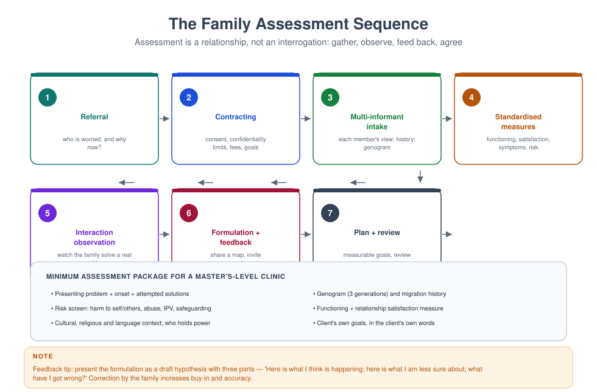
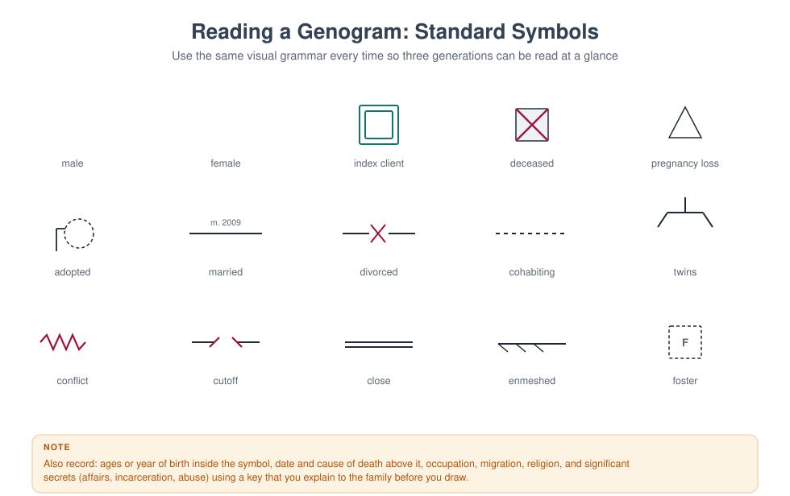
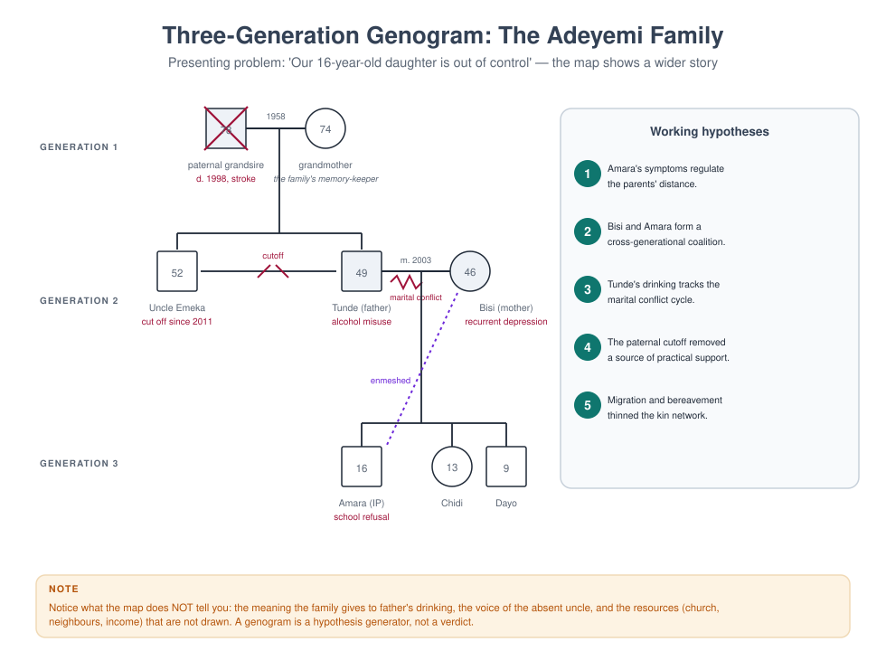
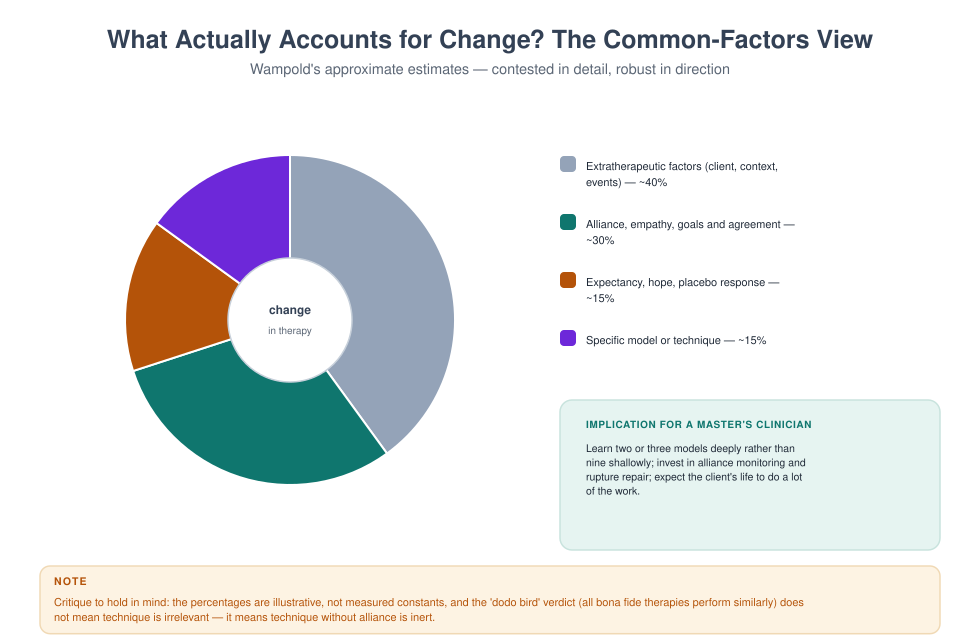

# MFT 701 — Fundamentals of Marriage and Family Therapy

> **MSc Marriage and Family Therapy** · Semester One · 1.71 Units · 14 teaching weeks · Prerequisite: none

**Course leader's summary.** This is the course that turns a helping professional into a *systemic*
one. It covers the intellectual history of family therapy, the epistemology that separates it from
individual work, the profession's identity and scope, and the basic architecture of a first session.
Everything later in the programme — theory, technique, assessment, ethics — assumes the vocabulary
built here.

---

## How to use this book

Each week contains four things: **the idea** (what you must understand), **the practice** (what you must
be able to do), **the case** (what it looks like in a room), and **a reflective task** (what it asks of
you personally). Read the week before the lecture; do the practical in the lab; write the reflection
within 48 hours, while it is still uncomfortable.

The book is written to be read straight through, but it is also designed for revision: the integration
chapter at the end compresses the whole course into two pages, and the glossary defines every term the
examination may use.

---

## 1. Course description and rationale

Most mental health training teaches us to look *inside* a person: their thoughts, their symptoms, their
attachment history. Family therapy teaches us to look *between* people: the loop, the triangle, the rule
that nobody wrote down. This is not a rejection of individual psychology. It is an additional
discipline of attention, and it changes what counts as the problem, the cause, and the cure.

Consider three common presentations:

| Presentation | Individual formulation | Systemic formulation |
|---|---|---|
| A 15-year-old refuses school | Anxiety disorder, school phobia | A child whose symptoms hold a parental conflict at bay; the school refusal is the family's most effective way of preventing an argument about the marriage |
| A wife is "depressed" | Major depressive episode | A woman in a triad with her husband and his mother, carrying the family's unspoken grief about a lost pregnancy |
| A man "works too much" | Workaholism, avoidance | The person who regulates the family's emotional temperature by being absent, in a system that rewards his absence |

None of these systemic formulations is automatically *more true*. Each is a hypothesis with different
implications for where you intervene. The mature clinician holds both — the individual and the
relational — and chooses deliberately.

**Why this course first.** Because students who begin with technique learn to do something they cannot
explain, and students who begin with theory learn to explain something they cannot do. MFT 701 begins
with *framing*: what kind of problem is this, and therefore what kind of help is required?

---

## 2. Learning outcomes

By the end of the course, students will be able to:

| # | Outcome | Assessed in |
|---|---|---|
| LO1 | Explain the epistemological shift from linear to circular causality, and its clinical consequences | Exam, Week 2 log |
| LO2 | Trace the historical development of family therapy and locate contemporary models within it | Exam |
| LO3 | Describe the profession's identity, scope of practice, and relationship to allied professions | Assignment |
| LO4 | Conduct a structured first session, including joining, problem definition, and contracting | Skills assessment |
| LO5 | Draw a three-generation genogram and generate hypotheses from it | Assignment |
| LO6 | Critically discuss the common-factors evidence and its implications for model choice | Exam essay |
| LO7 | Identify their own family-of-origin patterns and describe their effect on clinical work | Reflective log |

---

## 3. Assessment

| Component | Weight | Due |
|---|---|---|
| Reflective practice log (weekly, 300–400 words) | 20% | Fortnightly |
| Genogram and hypothesis assignment (2,000 words + diagram) | 30% | Week 9 |
| Two-hour written examination (seen case + essay + short answers) | 50% | Week 15 |

**Skills gate.** Students must pass a 15-minute observed first session (Week 6) before proceeding to
MFT 706. The gate is pass/fail with one resit.

---

## 4. The fourteen-week teaching plan

| Week | Topic | Practical | Core reading |
|---|---|---|---|
| 1 | What is family therapy? The relational turn | Triad: "the problem as described" | Nichols ch. 1; Handbook ch. 1 |
| 2 | Linear and circular causality; first- and second-order cybernetics | Observation of a recorded argument | Watzlawick, *Pragmatics* ch. 1 |
| 3 | A short history: from schizophrenia research to evidence-based practice | Timeline construction | Nichols ch. 2–3 |
| 4 | Systems thinking: boundaries, feedback, homeostasis, rules | Feedback-loop mapping exercise | Becvar & Becvar ch. 2 |
| 5 | The profession: identity, scope, settings, teamwork | Role boundaries case discussion | AAMFT code, scope sections |
| 6 | The first session I: joining, and the referral question | **Observed skills gate** | Minuchin & Fishman ch. 1 |
| 7 | The first session II: defining the problem in the family's language | Triad: problem definition | Haley, *Leaving Home* ch. 1 |
| 8 | The genogram as a hypothesis machine | Genogram lab (own family) | McGoldrick, *Genograms* ch. 1–2 |
| 9 | Formulating relationally: the 5-P grid applied to a family | Formulation workshop | Dallos & Draper ch. 4 |
| 10 | Culture, class and power in the consulting room | Reflexivity exercise | McGoldrick, *Ethnicity & Family Therapy* |
| 11 | Evidence: what works, for whom, and the common factors | Appraisal of one RCT and one qualitative study | Wampold ch. 2 |
| 12 | Ethics, risk and the limits of the systemic frame | Risk-screen rehearsal | MFT 704 pre-reading |
| 13 | Integration I: three models applied to one family | Live demonstration + discussion | Nichols ch. 10 |
| 14 | Integration II: your emerging clinical stance | Position statement presentation | Course review |

---

## Week 1 — What is family therapy? The relational turn

### 1.1 The lecture in ninety minutes

Week 1 has one job: to make the relational frame feel inevitable rather than eccentric. Everything a student
does later — the first session, the genogram, the formulation, the ethics of conjoint work — assumes they can
see a relationship as a thing with a shape, a history and a set of rules. Students arrive able to see people.
Very few arrive able to see *between* people.

The ninety minutes run like this.

| Minutes | Segment | What the lecturer does | What students do |
|---|---|---|---|
| 0–10 | Two formulations | Read the Okonkwo referral twice: once as an individual case, once as a relational one | Note which version they would have written |
| 10–30 | Where the field came from | The three failures of the individual frame (1.2) | Timeline exercise: place five founding texts |
| 30–50 | Five claims of the relational frame | Build the list on the board, testing each against a live example | Vote: which claim is hardest to accept? |
| 50–65 | Systems as a way of thinking | Cybernetics, feedback, the Watzlawick axioms (1.5) | Map one family loop on paper |
| 65–80 | Three openings in a first session | Annotated transcript, read aloud in parts | Mark where the therapist widened the field |
| 80–90 | Set the lab and the journal | Hand out the widening-question protocol (1.11) | Form triads, choose a real (non-clinical) difficulty |

The lecture is deliberately front-loaded with history. Students who know the field's origins stop treating
systemic thinking as a technique among techniques and start treating it as an epistemology — a claim about
what kind of thing a problem is.

### 1.2 Why the field exists: three failures of the individual frame

Family therapy was not invented because someone preferred groups to individuals. It was invented because
three well-funded, well-intentioned research programmes ran into the same wall: the individual frame kept
losing information that mattered clinically.

**The first failure: the patient kept relapsing into a family.** In the 1950s, Gregory Bateson's research
group at Palo Alto — Bateson, Don Jackson, Jay Haley and John Weakland — was studying communication in
families where one member had been diagnosed with schizophrenia. Their 1956 paper, "Toward a theory of
schizophrenia," proposed the **double bind**: a pattern in which a person receives two messages at different
logical levels that contradict each other, cannot comment on the contradiction, and cannot leave the field.
A mother who says "come here, dear" while stiffening when the child approaches; a father who asks for
honesty and then punishes it; a family that requires affection and forbids the expression of need that would
make affection possible.

The double-bind theory has not survived as an explanation of schizophrenia. Its status as a causal claim
about psychosis is dead, and students should know that. But something else in that research survived and
became the spine of the field: the observation that **sequences of behaviour between people carry information
that is invisible when you describe the people separately.** The patient's behaviour was intelligible as a
move in a game; the game was not in the patient.

**The second failure: the symptom made sense at home.** Independently, researchers studying families of
people with serious mental illness — Theodore Lidz at Yale, Lyman Wynne at the National Institute of Mental
Health — noticed that families organised themselves around the symptomatic member. Wynne described
**pseudo-mutuality**: a family that maintains the appearance of harmony by prohibiting any relationship that
would threaten it. Lidz described **marital schism** and **marital skew**: two patterns in which the couple's
conflict or the couple's imbalance shaped the child's development. Again the aetiological claims are dated.
Again the structural insight held: **a family can be organised by a symptom**, and the symptom can be doing
work for the system.

**The third failure: the child was the family's messenger.** The child guidance movement of the 1920s–1950s
treated the child, advised the mother, and sent both home to a household that had not changed. Clinicians
began to notice that improvement in the child was routinely followed by a new symptom in a sibling, or in the
mother, or by a marital crisis that had been dormant. The pattern is now so familiar that it has a name —
**symptom substitution** — and the observation that produced it is the most practically useful idea in this
week: *if the symptom is functional for the system, removing the symptom without changing the system is
unstable.*

Three research programmes, three different populations, one conclusion: the unit of assessment was wrong.
Between 1950 and 1975 the field built an alternative. Nathan Ackerman founded the Family Institute in 1960
and, with Jackson, the journal *Family Process* in 1962. Murray Bowen developed his theory of differentiation
and multigenerational transmission at the Menninger Clinic and later at Georgetown. Virginia Satir was
teaching conjoint family interviewing in California. Salvador Minuchin, working with delinquent boys at the
Wiltwyck School and then at the Philadelphia Child Guidance Clinic, built structural family therapy out of
the observation that these families were not sick so much as **organised at the wrong level of hierarchy** —
children in charge, parents disengaged or in coalition, boundaries too diffuse or too rigid. Jay Haley joined
Minuchin in Philadelphia in 1967 and brought strategy, power and the deliberate use of directives.

By the late 1970s the field had a canon: the Palo Alto communication school, Bowen's multigenerational
theory, Minuchin's structural therapy, Haley and Madanes's strategic therapy, the Milan group's systemic
therapy with its rituals and positive connotation, Satir's human validation, and the beginnings of
solution-focused work at Milwaukee and narrative therapy in Adelaide and Auckland. Students will meet each
of these properly in MFT 702. For now, one thing matters: **every one of these schools is an answer to the
question "what is the unit?"** and each answers it slightly differently — the sequence, the generations, the
structure, the meaning, the solution, the story.

> **DEBATE** — "If the aetiological claims of the 1950s were wrong, the field built on them is unsound."
> Ten minutes, two sides. The strongest argument against: a science is allowed to keep its methods after
> discarding its first theories — medicine kept auscultation after humoral theory fell. The strongest
> argument for: the field has never fully shed the habit of blaming families for individual distress.

### 1.3 What "relational" actually means: five claims

"Systemic" is a word students learn to say before they learn to mean. Here are the five claims that make
the relational frame a frame, in ascending order of how much they cost you as a clinician.

**Claim 1 — Behaviour is patterned.** Any two people who spend time together generate repeating sequences.
The pattern is not in either person; it is in the loop. A couple who report "we never talk" will, within
twenty minutes of a first session, demonstrate precisely how the not-talking is produced: one asks a question
that contains an accusation, the other answers with a fact, the first escalates the volume, the second goes
quiet. Neither is doing it *to* the other. Both are in it.

**Claim 2 — The pattern is maintained by its consequences, not by its causes.** This is cybernetics in one
sentence. The question "why did this start?" is usually unanswerable and clinically useless; the question
"what keeps it going?" is answerable and clinically decisive. A father's withdrawal is maintained by his
wife's criticism, which is maintained by his withdrawal. Ten years of history explain how they got into the
loop; only the loop explains why they are still in it.

**Claim 3 — Meaning is negotiated between people.** The same act means different things to different family
members, and those meanings are not private. A daughter's silence means "respect" to her father, "punishment"
to her mother, and "safety" to herself. The clinical task is not to find the true meaning but to make the
several meanings audible to everyone in the room.

**Claim 4 — Symptoms can serve the system.** Not always, not deliberately, and never in a way that makes the
symptomatic person responsible. But frequently enough that the therapist must ask: what would change in this
household if this symptom disappeared tomorrow? Sometimes the honest answer is "nothing." Sometimes it is
"my marriage would have to be looked at," and that answer reorganises the whole treatment.

**Claim 5 — The observer is inside the observed system.** You are not a camera. Your presence changes what
the family does, what they say, what they notice about themselves, and what they will risk in front of each
other. The family that arrives furious will perform its fury for you; the family that arrives polite will
perform its politeness. This is not contamination to be minimised — it is the instrument you have. Second-
order cybernetics, which students meet formally in MFT 715, is simply the discipline of using that
instrument knowingly (Figure 1.1).


**A working definition.** Marriage and family therapy is the assessment and treatment of relational systems —
couples, families, and the wider networks in which they live — using interventions that target interaction
patterns, meaning systems, and the emotional bonds between people. Read the definition carefully: *assessment
of relational systems* means the unit of assessment is the relationship; *interventions that target patterns*
means the unit of intervention is the loop, the rule, the structure or the story; *emotional bonds* means
that a purely behavioural account is insufficient, because people are attached to each other and the
attachment is what makes the pattern stubborn.

**What it is not.** Four clarifications, because students routinely collect the wrong ones.

1. **It is not "seeing everyone together" as a matter of policy.** Sometimes the right systemic move is an
   individual session inside family work. Conjoint work is a means, not a doctrine.
2. **It is not a denial that individuals exist, or that biology, trauma and temperament matter.** It is a
   disciplined focus on context, not a metaphysics.
3. **It is not the claim that families cause mental illness.** That claim was made in the 1950s and it was
   wrong, cruel, and expensive. Contemporary systemic practice holds families as the site where distress is
   *expressed, maintained and relieved* — not as the sole cause.
4. **It is not "we don't do diagnosis."** Systemic therapists diagnose, formulate and often work inside
   services that require a diagnosis; see MFT 707.

### 1.4 The four consequences, worked through

The four consequences in the original week note are worth more than a bullet list. Take them one at a time,
each with what it changes on Monday morning.

**Consequence 1 — The unit of assessment changes.** You must hear from more than one person, and notice what
happens *between* them. In practice this means the assessment cannot be completed in a single interview with
one informant. It means disagreement between informants is data rather than noise: if the mother says the
boy is defiant and the father says he is fine, the difference is the finding. It means you watch the room —
who sits where, who answers for whom, who looks at whom before speaking, what happens to the volume when
one person enters.

**Consequence 2 — The unit of intervention changes.** You intervene in sequences, rules, meanings and
structures, not only in individual cognition. A cognitive intervention asks the depressed woman to examine
the evidence for her belief that she is a burden. A systemic intervention asks what happens in the household
in the forty-eight hours after she expresses that belief — and often finds that the expression triggers
reassurance, that reassurance prevents any change in the division of labour, and that the division of labour
is what is depressing her. Both are legitimate. The second is invisible from inside the first.

**Consequence 3 — The definition of success changes.** Success may be a family that argues well, not a family
that never argues. This is the hardest consequence for students trained in symptom reduction, because it
means the goal is not the absence of conflict but the presence of **repair**. A couple who can fight, rupture
and come back together within an hour is doing better than a couple who never fight and are quietly
contemptuous. Outcome measures should reflect this: not only "has the symptom gone?" but "can this system
handle disagreement without breaking?"

**Consequence 4 — The therapist's position changes.** You are not a technician outside the system; you are a
participant who affects it. Three practical implications. First, you must account for your own effect: the
family will behave differently because you are watching, and the difference is informative rather than
annoying. Second, you cannot claim neutrality; you can only be transparent about your partiality. Third,
your own family of origin is in the room with you — which is why every week of this book ends with a
reflective task, and why personal therapy and supervision are professional requirements, not luxuries.

> **CASE** — Mrs Okonkwo brings her 9-year-old son, Ebuka, for "stubbornness". In the first ten minutes she
> mentions, twice, that his father "is never home". The linear frame says: assess and treat Ebuka's
> behaviour. The systemic frame says: ask who else is affected by the behaviour, what happens after it, and
> what would change in the household if it stopped. The second question is not a rejection of the first; it
> is a widening of the field in which the first can be treated.

### 1.5 Systems as a way of thinking

Students often assume "system" is jargon for "family". It is not. A system is any set of elements whose
interaction produces effects none of the elements produces alone. Ludwig von Bertalanffy's general system
theory (1968), Norbert Wiener's cybernetics (1948) and the communications research at Palo Alto gave the
field three tools, and they are still the three tools.

**Feedback.** A system regulates itself through loops. **Negative feedback** reduces deviation and restores
the previous state — the family that pulls a member back whenever they move too far, the couple whose
argument returns to the same sentence. **Positive feedback** amplifies deviation and produces change or
escalation — the quarrel that grows, the affair that is discovered, the child who leaves. Note that the words
are not evaluative: negative feedback is not bad, positive is not good. Most clinical problems are stuck
negative-feedback loops with high cost; most crises are positive-feedback loops that have run away.

**Homeostasis and morphostasis.** Systems resist change in order to remain themselves. When a family comes to
therapy, two processes are always running: the pressure to solve the problem and the pressure to keep the
system intact. This is why families sometimes seem to sabotage their own treatment, and why the therapist
who moves too fast loses the family. The technical answer is to pace: introduce change at a rate the system
can absorb, and check that each change is stable before the next.

**Rules and punctuation.** Watzlawick, Beavin and Jackson's *Pragmatics of Human Communication* (1967) gave
the field its most quoted propositions: one cannot not communicate; every communication has a content and a
relationship level; relationships are defined by punctuation of sequences; humans communicate digitally
(words) and analogically (behaviour, tone, gesture). The idea of **punctuation** is the most clinically
valuable. Each partner punctuates the same sequence differently: she says "he goes silent, so I get loud";
he says "she gets loud, so I go silent". Both are describing the same loop from different points on it, and
each punctuation makes the other the cause. Therapy begins when the loop, rather than either partner, becomes
the object of attention.

**Structure.** Minuchin added what communication theory lacked: an account of *organisation*. Families have
subsystems (parental, sibling, couple), boundaries (clear, diffuse, rigid), hierarchies, alliances and
coalitions. A child who is in a coalition with one parent against the other is not "manipulative"; the child
is holding a structural position that the adults' conflict has created. Structure gives the therapist
something to see in the seating plan and something to change in the session.

**Meaning.** The later schools — Milan, narrative, collaborative — pushed the field from pattern to
interpretation. If the system is a set of interactions, it is also a set of stories about those interactions.
A family that has decided "our son is the problem" has organised its attention, its conversations and its
hopes around that sentence. Change the sentence and the interactions move; move the interactions and the
sentence loses its evidence.

> **PRACTICAL** — Choose an ordinary recurring household event: the school run, Sunday lunch, the nightly
> argument about homework. Draw it as a loop with four to six nodes, each node a behaviour, with arrows
> showing what follows what. Then mark: where is the negative feedback (what restores the previous state)?
> Where is the positive feedback (what escalates)? Where does each participant punctuate the loop? Bring the
> drawing to the lab; you will redraw it after hearing someone else's account of the same event.

---

### 1.11a What the evidence says, in one page

Students are often told either that family therapy "works" or that the evidence is contested. Both are
unhelpful. Here is what a careful reading of the outcome literature supports, stated with the hedge each
claim requires.

**Family and couple therapy outperform no treatment, and generally match individual treatment for relational
problems.** Meta-analyses of couple and family therapy trials report effect sizes in the moderate range —
roughly half a standard deviation to eight-tenths — against no-treatment and wait-list controls, with the
larger effects for couple distress, child conduct problems, and adolescent substance use. Effects are smaller
and less consistent against credible active comparators, which is what you would expect if the specific model
matters less than the common structure of good therapy.

**The model explains less of the variance than the alliance.** The most robust finding in psychotherapy
research, replicated across modalities, is that the therapeutic alliance predicts outcome better than the
technical ingredients of any particular school. In couple and family work the alliance is more complicated
than in individual work, because there is more than one alliance to build and they can pull against each
other: siding with one partner to engage them alienates the other, and a determined even-handedness can leave
both feeling unheard. This is why Week 6 of this book spends two sessions on joining, and why your assessed
skill in this course includes your ability to hold two alliances at once.

**Common factors do a lot of the work.** Client factors (severity, chronicity, social support, motivation),
the alliance, the therapist's skill and the expectancy generated by a credible rationale account for a large
share of change. The practical implication is not that technique is irrelevant but that technique is
delivered *through* a relationship, and a technique delivered through a poor relationship is inert or
harmful.

**Dose and dropout matter more than most trainees think.** A substantial proportion of families attend one
session and never return; the first session is therefore an outcome event, not a preliminary. Retention is
predicted by early alliance, by the fit between the therapist's explanation and the family's own
understanding, and by practicalities — travel, cost, timing, childcare — that a therapist who ignores them
will mistake for resistance.

**Evidence is unevenly distributed across problems.** Couple therapy for relationship distress, behavioural
parent training for conduct problems, family-based treatment for adolescent eating disorders, multidimensional
family therapy for adolescent substance use, and systemic work with chronic illness in children have
reasonably strong support. Evidence for some popular ideas — mechanical use of paradox, unexamined
"dysfunctional family" typologies, polyvagal explanations treated as established mechanism — is much weaker.
Learning to distinguish these is part of professional formation, and MFT 705 and MFT 721 teach you to read the
literature rather than the marketing.

> **CAUTION** — Do not let the common-factors literature become an excuse for not learning a model. "The
> alliance is what matters" is true and is also the sentence most often used by trainees who have not yet
> learned to do anything. You need a model precise enough to be taught, supervised and evaluated, and a
> relationship good enough for the model to reach the family. Neither substitutes for the other.

### 1.6 First contact: three openings, annotated

The relational frame is not announced, it is enacted. Three openings show what it looks like when a
therapist begins relationally in the first five minutes — before any genogram, any diagnosis, any technique.

**Opening A — from the referred person to the referral system.**

> **Therapist:** Before we start, tell me how this appointment came about. Who first said something needed to
> change, and who agreed?
> **Mrs Okonkwo:** The school called me. His teacher said he refuses to write anything.
> **Therapist:** And when you told your husband, what did he say?
> **Mrs Okonkwo:** (pause) He said I should handle it. He is not around.
> **Therapist:** So the school spoke to you, you spoke to your husband, and here you are with Ebuka. Who else
> in the family knows you are here today?

Note what the therapist has done. She has not asked about the symptom at all. She has mapped the **referral
pathway**, which is itself a relational fact: who is worried, who is not, who carries the problem, who was
told and who was not. She has also discovered, in four questions, the sentence that will organise the
assessment: *he said I should handle it.* That sentence is not a complaint about a husband. It is a
description of a household in which one adult holds all the worry, and a child's symptom sits in the space
where the other adult would be.

**Opening B — from the symptom to the sequence.**

> **Therapist:** Tell me about the last time it happened. Not the worst time — the most recent.
> **Mrs Okonkwo:** Yesterday morning. He would not get out of bed. I called him three times, then I started
> shouting, then he got up and stood in the bathroom for twenty minutes.
> **Therapist:** And then?
> **Mrs Okonkwo:** Then I drove him late and I was angry all day.
> **Therapist:** What did Ebuka do when you were angry all day?
> **Mrs Okonkwo:** He was very quiet. He even made me tea.

The sequence is now visible: refusal, escalation, compliance, and then **repair initiated by the child**. That
is the loop. The therapist did not need to interpret it. She asked for a specific episode and then asked
"and then?" until the loop closed. This is the single most useful micro-skill in the first session:
**episode, not opinion.** Opinions produce character descriptions ("he is stubborn"); episodes produce
sequences.

**Opening C — from the individual to the room.**

> **Therapist:** (to Ebuka) Your mum says mornings are hard. If I asked her to describe a good morning, what
> would she say happens?
> **Ebuka:** (shrugs) She would be happy.
> **Therapist:** How would she know? What would she see?
> **Ebuka:** (long pause) My dad would be there.

Three questions, and the child has produced the formulation. The therapist did not ask "how do you feel
about your father's absence?" — a question no nine-year-old answers truthfully. She asked a **behavioural
question about a third person's perception**, which is easier to answer and much harder to fake. Involving
the child as an informant, not a patient, is a structural act: it moves the child out of the identified-
patient position and into the family's information system.

**What all three openings have in common.** Each one moves the unit of attention one step outward — from the
person to the pathway, from the event to the sequence, from the individual to the room — and each does so
with a question that is answerable. That is the whole craft of a first session in miniature. The student who
can do these three moves in the first ten minutes will get a formulation. The student who cannot will get a
history.

### 1.7 The Okonkwo case, fully worked

**Referral.** Ebuka, 9, referred by his school for "defiance and refusal to write". Six weeks of refusing to
complete written work; two episodes of leaving the classroom. Class teacher describes him as "stubborn and
rude". Mother reports he is "fine at home, except mornings". Father did not attend.

**What the linear frame produces.** A differential diagnosis: oppositional defiant disorder versus a specific
learning difficulty (writing), versus anxiety, versus an attention problem. An assessment plan: psychometric
testing, teacher rating scales, classroom observation, possibly a paediatric review. A treatment plan:
behavioural contract, reward chart, parent training in commands and consequences. This is not wrong. It is
incomplete in a way that will matter, because the most important information in this family is not about
Ebuka's writing.

**What the systemic frame adds.** Four moves, in order.

*Move 1 — the referral pathway.* Who is worried? The school, then the mother. Who is not in the room? The
father. Who decided that the mother should manage it? The father, according to the mother. The first
structural fact: **the parental subsystem is not operating as a subsystem.** One adult holds the worry, the
other holds the distance.

*Move 2 — the sequence.* Mornings: refusal, three calls, shouting, compliance, lateness, a day of maternal
anger, evening reparation initiated by the child. The second structural fact: **the child regulates the
mother's emotional state.** He absorbs her anger and then repairs it. A nine-year-old is doing the work of a
partner.

*Move 3 — the function of the symptom.* What would change at home if Ebuka got up cheerfully and wrote
fluently? The mornings would be calm; the mother's day would be easier; and the father's absence would become
a topic rather than a background condition. There is no evidence that anyone wants the child to be
symptomatic. There is good evidence that the symptom sits at the exact point where a marital conversation
would otherwise occur.

*Move 4 — the wider system.* School, church, extended family. In this case the maternal grandmother is
mentioned twice and the paternal aunt once. In many Nigerian households the grandmother is a co-parent and a
court of appeal; leaving her out of the assessment is not neutrality, it is an omission.

**The formulation, in one paragraph.** Ebuka's refusal to write is maintained by a morning sequence in which
escalation reliably produces compliance and in which the child then repairs his mother's distress. That
sequence is itself maintained by a household in which one parent carries all the worry and the other is
absent, and by a school system that has defined the problem as a defect in the child. The symptom is not
caused by the marriage, and nobody is to blame; but the symptom is *located* where the marriage would
otherwise be discussed, and it will be difficult to resolve without that conversation becoming possible.

**The plan that follows.** Conjoint sessions including the father (with an explicit invitation framed as
expertise rather than blame: "I need your view of what happens in the mornings; your wife and I are working
from one account"). A behavioural component for the mornings, because it works and because success builds
the parents' confidence in themselves as a team. A separate conversation with the parents about the marriage,
held only when both are willing. Liaison with the school to reframe "defiance" as "a problem we are
assessing", which reduces the pressure that feeds the loop.

> **TASK** — Rewrite this case as you would present it in a multidisciplinary team meeting in forty seconds,
> without using the word "systemic" and without blaming either parent. Then rewrite it for the parents
> themselves. The two versions should differ in vocabulary, not in content.

### 1.8 Where the profession sits

Students enter training with a blurred map of the mental health professions. In Nigeria, as in most places,
the practical differences matter for referral, for legal standing, and for what you are allowed to do.

| Profession | Core unit | Typical training | What they usually do with a struggling family |
|---|---|---|---|
| Psychiatry | The patient, medically | Medical degree, then residency | Diagnose, prescribe, admit; refer for therapy |
| Clinical psychology | The individual | Doctorate or master's plus internship | Assess, formulate, deliver individual therapy |
| Counselling psychology | The individual in context | Master's or doctorate | Individual and group counselling, some couple work |
| Social work | The person in their environment | Degree plus registration | Case management, child protection, family support |
| Marriage and family therapy | The relationship | Master's or doctorate in MFT | Conjoint, family and couple therapy; relational formulation |

The distinctive contribution is not a technique. Clinical psychologists do behavioural couple work;
psychiatrists do family meetings; social workers do family support. The distinctive contribution is the
**relational formulation** — the disciplined habit of locating the problem in the space between people, and
the training in interventions that change that space. A therapist who can only see individuals will treat a
family by treating its members one at a time and will be genuinely puzzled when the symptom returns.

**Settings in which the work happens.** Outpatient clinics and private practice; hospitals, where family
meetings follow diagnoses that reorganise households; schools, where the referral pathway usually begins;
NGOs and humanitarian settings, where family separation, displacement and bereavement are the presenting
context; faith settings, where pastors, imams and church counsellors are often the first and sometimes the
only port of call; and courts and child protection services, where the therapist's opinion may be read by a
judge. Each setting changes the ethics (see MFT 704), the assessment (MFT 707) and even the language you use.

**Scope of practice.** Three boundaries worth stating on the first day of training. First, family therapists
do not prescribe; any question about medication is a referral question, and the referral should be made
without implying that medication is a failure. Second, family therapists do not give legal advice; they
provide clinical opinion and, where required, reports, and they tell families to obtain a lawyer (see MFT
724). Third, family therapists do not practise beyond their competence — and competence is specific:
adult couple work is not child work, child work is not forensic work, and neither is trauma processing
without specific training (MFT 711, MFT 714).

> **AUDIT** — Write down, in one sentence each, what you would do and would not do if a family asked you to
> (a) advise whether the husband can legally take a second wife, (b) tell the court which parent should have
> custody, (c) prescribe something for the child's sleep. Bring the three sentences to the lab.

### 1.9 Culture, faith and class in the first meeting

The relational frame is not culturally neutral, and pretending otherwise is its own kind of arrogance. Three
adjustments matter from the first session in most Nigerian consulting rooms.

**Kinship is wider than the household.** A genogram that stops at the nuclear family will miss the
grandmother who raised the child for three years, the uncle who pays the school fees and therefore has
standing, the aunt who lives with the family and disciplines the children, and the cousin whose presence has
changed the sleeping arrangements. Ask who is *involved*, not who lives *there*. The distinction between
household and family is one of the most practically useful in the whole programme.

**Faith is a resource and a referral system, not a rival.** Families commonly arrive having already seen a
pastor, an imam, a traditional healer or all three. The therapist's task is not to adjudicate but to
coordinate: what did the prayer, the deliverance, the fasting, the herbal treatment do? What was helpful?
What was frightening? What does the family believe is happening spiritually? A family that believes the
problem is spiritual and a therapist who believes it is relational can still work together if the therapist
takes the belief seriously as a *meaning in the system*, which is exactly what it is.

**Class shapes what is possible.** A recommendation to reduce working hours is meaningless to a family with
two jobs and no childcare. A recommendation to attend weekly sessions is meaningless to a family who travel
four hours. A recommendation to "talk to your husband" is meaningless in a household where his mother is the
decision-maker. Practical recommendations fail not because families are resistant but because the therapist
prescribed from a life the family does not have. The discipline is to ask, before prescribing: what would
have to be true in your week for this to happen? The answer is usually the real treatment plan.

> **CAUTION** — Do not treat cultural deference as consent. A wife who says "I will do whatever my husband
> decides" may be expressing a genuine value, or may be signalling that she cannot speak safely. The
> difference is discovered by seeing her alone at least once, and by asking about safety in the standard
> way — not by assuming either interpretation.

### 1.10 Six errors that begin in week one

These are the mistakes students actually make in their first role-plays, and each one is a failure of the
relational frame rather than a failure of technique.

1. **The single-informant assessment.** You interview the mother, form a picture, and never test it. Fix: no
   relational formulation without at least two informants, and no family assessment without asking who is
   missing.
2. **The character formulation.** "He is oppositional." "She is enmeshed." These are descriptions of persons
   disguised as systemic language. Fix: every formulation must contain at least one *sequence* ("when X, then
   Y, then Z") and at least one *context* ("in the presence of…").
3. **Premature reassurance.** "I'm sure he loves you." It closes the exploration and hands the therapist's
   opinion to a family that needs its own. Fix: acknowledge the experience, ask for the evidence, keep the
   question open.
4. **The alliance slide.** You begin to like one member more than another and your questions begin to build
   the case for that person. Fix: track your questions across a session (record it) and count how many were
   addressed to each person and whose account each question elaborated.
5. **The technique-first session.** You arrive with a genogram to draw, a technique to demonstrate, a model to
   apply — and the family's actual concern is never heard. Fix: the first session belongs to the family's
   account, not to the therapist's plan.
6. **The safety omission.** You conduct a full conjoint assessment without ever asking about violence. Fix:
   every first session includes a private screen for harm to self, harm to others, abuse of children and
   intimate partner violence, conducted in a way that makes disclosure possible (see MFT 704 and MFT 712).

> **REFLECT** — Which of the six are you most likely to commit? Not in theory: in your last conversation with
> someone who was struggling. Write the answer down. You will be asked to revisit it in Week 14.

### 1.11 Laboratory: the widening question

The week's practical is a triad drill in which the therapist may only ask questions that include another
person. It looks simple and it is not: most students discover that their natural question is a question about
an individual, and that widening feels artificial for the first twenty minutes.

**Setup.** Groups of three. Roles rotate every eight minutes, so each person is therapist once. One person
brings a real but non-clinical difficulty — a disagreement with a flatmate, a difficult decision about a
sibling, a strain with a colleague. No clinical material, no disclosure that would be regretted.

**Rules for the therapist.**

1. No statements, interpretations or advice — questions only.
2. Every question must include a third party or a relationship: "who notices…", "what does your sister do
   when…", "who would disagree…", "what happens between you after…".
3. One question at a time, with silence after each.
4. Eight minutes, then stop whether or not the conversation feels finished.

**Observer's task.** Two columns on one sheet: **W** (questions that widened the field) and **N** (questions
that narrowed it back to the individual). Tally, then quote the single most useful widening question and the
single most narrowing one.

**Debrief questions.** What did the client notice about their own description when it was widened? Which
widening felt intrusive, and why? What did the therapist want to say but could not? What happened to the
client's tone when a third person entered the story?

**Marking rubric** (used in the Week 6 skills gate).

| Criterion | Weight | What full marks looks like |
|---|---|---|
| Proportion of widening questions | 30% | More than 80% of questions include another person or a relationship |
| Question quality | 25% | Open, specific, answerable; no double questions; no embedded advice |
| Pacing and silence | 20% | Roughly one question per 30–45 seconds; client speaks more than therapist |
| Use of the client's words | 15% | At least three questions reuse the client's own phrasing |
| Reflexivity in debrief | 10% | Can name what was hard, what was tempting, what they avoided |

> **DRILL** — Record a five-minute role-play on your phone. Count your questions. Then count how many contain
> a third person. Most first attempts are around one in ten. The target is eight in ten, and it takes about
> three hours of deliberate practice to get there.

### 1.12 Reflective task

Write 500 words on the last significant conflict in your own family, then rewrite it from the point of view
of the person you understood least. Note what changed in your body as you wrote. Keep both versions; you will
return to them in Week 14, when you write your emerging clinical stance, and you will find that the second
version contains the therapist you are becoming.

Two rules for this task. Do not show it to the person concerned, and do not bring the person's name into the
seminar. The purpose is to develop the capacity to hold more than one punctuation of the same sequence at
once — which is precisely what you will ask families to do.

### 1.13 Self-test

Six questions, answers below. If you cannot answer 4 and 5 without notes, reread 1.5.

1. Define negative and positive feedback, and give one clinical example of each.
2. Why is "punctuation" clinically useful?
3. State the double-bind hypothesis and its current scientific status.
4. What is symptom substitution, and what does it imply for treatment?
5. Name the five claims of the relational frame, in order.
6. What are the four consequences of treating the relationship as the client?

**Answers.** 1. Negative feedback reduces deviation and restores a prior state (a family pulling a member
back from independence); positive feedback amplifies deviation (an argument that escalates through
counter-complaint). 2. Because each participant's punctuation makes the other appear to be the cause; the
therapist who makes punctuation visible turns blame into a loop both can act on. 3. A person receives
contradictory messages at different logical levels, cannot comment on the contradiction and cannot leave the
field; it is historically important and not a supported causal explanation of schizophrenia. 4. The
observation that removing a symptom is often followed by a new symptom elsewhere in the system; it implies
that treatment must change the system, not only the symptom. 5. Behaviour is patterned; patterns are
maintained by consequences rather than causes; meaning is negotiated; symptoms can serve the system; the
observer is inside the observed system. 6. The unit of assessment, the unit of intervention, the definition
of success, and the therapist's position.

### 1.14 Readings for this week

Read the first two before the lecture; the rest are for the assignment.

* **Bateson, Jackson, Haley & Weakland (1956)**, "Toward a theory of schizophrenia", *Behavioral Science*.
  Read it as a historical document and notice how carefully the authors hedge.
* **Watzlawick, Beavin & Jackson (1967)**, *Pragmatics of Human Communication*, chapters 1–2. The axioms, in
  the original.
* **Nichols & Schwartz**, *Family Therapy: Concepts and Methods*, chapter 1. The best single overview of the
  field's history.
* **Becvar & Becvar**, *Family Therapy: A Systemic Integration*, chapters 3–5. On cybernetics and
  second-order thinking.
* **Hoffman (1985)**, "Beyond power and control", *Family Systems Medicine*. The turn to second-order
  cybernetics, written by a participant.
* **Minuchin (1974)**, *Families and Family Therapy*, chapter 2. Structure, in Minuchin's own voice.

### 1.6a An extended transcript, annotated

Role-plays teach faster than principles. Below is a twelve-turn excerpt from a first session with a couple
who present with "we cannot communicate". The therapist is a trainee in her second term. Read the transcript,
cover the annotations, and decide what you would have asked next. Then read the annotations.

> **T1 Therapist:** What would you like me to understand first?
> **T2 Folake:** He doesn't talk to me. He comes home, eats, watches television, sleeps. I am alone in this
> house.
> **T3 Therapist:** (to Dele) What do you think your wife means when she says she is alone?
> **T4 Dele:** I don't know. I work. I am tired. She is not alone, there are three children in the house.
> **T5 Therapist:** Folake, what do you do when he is watching television?
> **T6 Folake:** I stand there. Sometimes I ask him something and he says "mm".
> **T7 Therapist:** And what happens then?
> **T8 Folake:** I get angry. I say something sharp. Then he goes to bed.
> **T9 Therapist:** Dele, when she says something sharp, what goes through your mind?
> **T10 Dele:** That nothing I do is enough. So I stop.
> **T11 Therapist:** And when you stop, Folake, what happens to the anger?
> **T12 Folake:** It grows. And then I cannot sleep and I am tired the next day and the children see me crying.

**Annotations.**

*T1* is a neutral opening that hands the agenda to the couple without inviting either partner to be the
complainant. Compare "What is the problem?" — which usually produces one person's problem statement and
positions the other as the problem.

*T3* is the first systemic move: instead of asking Dele to defend himself, the therapist asks him to
**interpret his wife**, which requires him to engage with her experience rather than his own. It also reveals
whether he has a theory of her mind at all. He does not: "I don't know" is honest and important.

*T5* is an **episode question** and it is doing three things at once. It bypasses the argument about whether
she is alone (unwinnable), it specifies a moment (television, evening), and it puts the therapist physically
in the room with them. Students who ask "why do you feel alone?" get an explanation; students who ask "what do
you do when he is watching television?" get the behaviour that maintains the loneliness.

*T7*, "and then?", is the single most productive two-word intervention in family therapy. It builds the
sequence one link at a time and stops the therapist from doing the formulating.

*T9* takes the same event and asks for the **other partner's internal sequence**, which turns two monologues
into one loop. Note that the therapist does not challenge Dele's account ("three children in the house" is
not an answer to loneliness, but arguing about it would lose him). She lets the sequence do the work.

*T10* is the pivot of the session. "Nothing I do is enough, so I stop" is a complete formulation of Dele's
side of the loop, offered by Dele. Nothing the therapist could have said would have been as convincing or as
usable.

*T11* closes the loop by returning to Folake with the consequence of his withdrawal. At T12 she supplies it:
the anger grows, sleep is lost, the children see her crying. The loop is now on the table, described entirely
in the couple's own words, and neither partner has been blamed.

What the therapist has **not** done in twelve turns is worth listing, because trainees over-value these
moves: she has not asked about the history of the marriage, has not asked how they met, has not asked about
sex, has not offered an interpretation, has not normalised, has not asked either partner to change anything,
and has not used the word "communication". Every one of those is legitimate; none of them was needed to
establish the relational frame in the first ten minutes.

> **PRACTICAL** — In pairs, take turns being the therapist with this transcript. Cover T3 to T12 and improvise
> your own next question at each point. Then compare with the original. Where did you ask for an opinion
> rather than an episode? Where did you reassure? Where did you take a side without noticing?

### 1.10a Three punctuations of one quarrel

The same sequence can be punctuated at least three ways, and each punctuation licenses a different
intervention. Take the quarrel the couple above actually have.

**Punctuation 1 — the character story.** "He is cold and withdrawn; I am affectionate and he rejects me."
*What it licenses:* an appeal to Dele to change, a diagnosis of Dele (avoidant, depressive, possibly
autistic), and a treatment that works on Dele. *What it costs:* Folake's contribution disappears, Dele
becomes a project rather than a partner, and Dele — who already believes nothing he does is enough —
experiences therapy as one more arena in which he fails.

**Punctuation 2 — the mirror story.** "She criticises; I withdraw; she criticises more." *What it licenses:*
a circular formulation, a sequence map, and interventions aimed at the loop (interrupting the escalation,
slowing the exchange, rehearsing a different response to criticism). *What it costs:* the loop can become an
abstraction that hides the asymmetry of power and the real losses — his hours, her sleeplessness, the
children's exposure.

**Punctuation 3 — the meaning story.** "She is asking for evidence that she matters; he is protecting himself
from evidence that he fails." *What it licenses:* work on attachment, on the meanings each assigns to the
other's behaviour, and on the moment of turning toward or away. *What it costs:* meaning work without
behaviour change can become insight that never reaches the household.

A competent therapist holds all three and chooses deliberately, usually sequencing them: the loop first
(because it lowers blame), the meaning second (because it explains why the loop is so adhesive), and the
character story never as a formulation, only as each partner's experience to be listened to. This pluralism —
several punctuations available, one chosen for a reason — is what distinguishes a systemic clinician from
someone who has memorised a model.

> **DEBATE** — "Circular formulations are kinder but less true." Fifteen minutes. Note that the strongest
> argument for circularity is not moral but empirical: linear accounts of complex interaction are almost
> always wrong about causation, even when they are right about blame.

### 1.13a Examination question with model answer

**Question (20 marks).** "Family therapy is a way of seeing, not a set of techniques." Discuss, with
reference to the historical development of the field and to at least one clinical example.

**Model answer, in note form, with the markers' expectations visible.**

*Introduction (2 marks).* State the claim in your own words: the relational frame is an epistemological
commitment — a claim about the unit of analysis and the nature of causation — and techniques are downstream
of it. Signal the structure of the answer: history, epistemology, clinical example, limits.

*History (6 marks).* Three research programmes converged on the same failure: Bateson's group and the double
bind; Lidz and Wynne on family organisation around psychosis; the child guidance movement and symptom
substitution. The aetiological claims of the 1950s were largely wrong and you should say so; what survived is
the methodological insight that sequences carry information individuals do not. Trace the schools as answers
to "what is the unit?" — Palo Alto (the sequence), Bowen (the generations), Minuchin (the structure), Milan
(the meaning), Milwaukee (the solution), Adelaide (the story).

*Epistemology (6 marks).* Circular versus linear causality; feedback and homeostasis; punctuation;
second-order cybernetics and the therapist's position. Use Watzlawick's axioms precisely — content and
relationship levels, digital and analogic communication — and show what each buys clinically. Demonstrate
that you understand the difference between an ecological claim (the system is the unit of *assessment*) and
a causal claim (the system *causes* the symptom), and reject the second.

*Clinical example (4 marks).* The strongest answers use one case throughout rather than several in passing.
The Okonkwo case works: a nine-year-old's school refusal, a morning sequence, a parental subsystem that is
not operating, and a formulation that no single-informant assessment could have produced. Show what the
relational frame let you see and what it let you do.

*Limits (2 marks).* Name them honestly: the frame can obscure individual biology, trauma and temperament; it
can be used to distribute responsibility in ways that leave an abusive member unaccountable; it can become a
language that describes loops without ever changing them. Note the feminist critique of neutrality and the
evidence that the alliance — not the model — predicts much of the outcome.

*Common ways to lose marks.* Describing techniques without explaining the frame; treating "systemic" as a
synonym for "family"; repeating the double-bind hypothesis as if it were current; failing to give a clinical
example at all; writing about circular causality without ever defining feedback.

### 1.13b What "good" looks like at the end of week one

A checklist you can use on yourself before Week 2. Tick only what you can do *without notes*.

- [ ] Explain, in ninety seconds, why the field moved from the individual to the relationship, using three
      historical examples and one honest caveat about the science of the 1950s.
- [ ] Define negative and positive feedback and give a clinical example of each that you have actually seen.
- [ ] Explain punctuation to a couple without using the word "punctuation".
- [ ] Turn three opinion questions into episode questions, out loud, without hesitation.
- [ ] State the four consequences of treating the relationship as the client, and give one practical
      implication of each for a first session.
- [ ] Describe the difference between a linear and a circular formulation using the same case twice.
- [ ] Name the three professional boundaries from 1.8 and what you would say to a family that crossed them.
- [ ] Ask about safety in a first session without it sounding like an accusation or an afterthought.

---

## Week 2 — Linear and circular causality

### 2.1 The lecture in ninety minutes

Last week asked *who is the client*. This week asks a harder question: **what kind of thing is a cause?** It
is the single most consequential idea in the programme, because everything downstream — the formulation, the
questions you ask, what you count as progress, how you write a report for a court — depends on whether you
think in lines or in loops.

Students usually arrive believing they already understand this. They can define circular causality in a
sentence: "each person's behaviour causes the other's." Then they conduct a role-play in which every question
they ask is a search for who started it. The gap between being able to say it and being able to do it is the
work of this week.

| Minutes | Segment | What the lecturer does | What students do |
|---|---|---|---|
| 0–10 | Two sentences | Reads a case in a linear account, then in a circular account | Mark every causal verb in both |
| 10–25 | The philosophy nobody teaches | Aristotle's four causes, Hume, Mills, why "cause" is plural (2.2) | Sort five clinical explanations into cause types |
| 25–45 | Feedback, formally | Loop diagrams, delay, gain, thresholds (2.3–2.4) | Draw the same family as two different loops |
| 45–60 | Punctuation, again | The same quarrel punctuated three ways (2.5) | Identify their own punctuation habit |
| 60–75 | Circular questioning | Live demonstration, then triads (2.6) | Ask three circular questions each |
| 75–90 | Hypothesis discipline | How to hold a hypothesis without becoming its servant (2.7) | Write one hypothesis, then one disconfirming question |

The lecture has a deliberate shape: philosophy first, engineering second, clinical craft third. Students who
skip the philosophy conclude that circular causality is a nicer way of saying "we are all responsible".
Students who skip the engineering cannot tell a loop from a list.

### 2.2 What a cause is: four traditions you will use without knowing

Family therapy inherited a muddle about causation and never fully cleaned it up. The muddle is worth
untangling, because most of the field's disagreements about evidence, responsibility and blame are
disagreements about what counts as a cause.

**Aristotle's four causes.** Aristotle distinguished the *material* cause (what something is made of), the
*efficient* cause (what set it in motion), the *formal* cause (the pattern it realises) and the *final* cause
(the purpose it serves). A wooden chair: wood, a carpenter, a design, the purpose of sitting. Now apply the
scheme to a symptom. A boy's school refusal: his anxiety (material), a frightening event (efficient), a
pattern of family accommodation (formal), and the function the refusal serves in the household (final). Most
clinical arguments are people defending one of these four while denying the others. The systemic tradition is
chiefly interested in the formal and final causes — the pattern and the function — which is exactly why it
seems to slight the efficient cause (the event that started it) and infuriates colleagues who want to know
what happened.

**Hume and the regularity theory.** A cause is an event constantly conjoined with another, temporally prior,
and contiguous with it. This is the model implicit in most medical training and in most of what patients
believe. It works well for infections and badly for families, because in families the "effect" is usually
also the "cause", arriving before and after in alternation.

**Mill's methods.** Agreement, difference, concomitant variation. These underwrite the randomised trial, and
they are why the trial remains the best tool for the question "does this treatment cause improvement?" They
are much weaker for the question "what maintains this pattern in this family?", where the relevant variation
cannot be manipulated.

**Systems and constitutive causation.** In a system, the state of each element is partly constituted by its
relations to the others. A thermostat is not caused to switch by the temperature in the way a billiard ball
is caused to move by another; the switching is what the system *does*. Family therapists use this sense when
they say that the pursuit and the withdrawal "cause" each other: not that A pushes B and B pushes A in a
chain, but that the two behaviours are what they are in virtue of the loop they form.

> **EXERCISE** — Take the sentence "his drinking broke up the marriage". Rewrite it four times, once for each
> Aristotelian cause. Then decide which of your four sentences a court would want, which a wife would want,
> and which would actually help in session.

Two consequences follow, and students should write them down.

**First, circularity is not a moral claim.** "We are both in the loop" does not mean "we are equally
responsible", and it certainly does not mean "the victim is complicit". A man who is violent and a woman who
placates him are in a loop, and only one of them is doing the violence. Confusing description with
responsibility is the most serious error in the systemic literature, and the feminist critique of the 1980s —
developed by Hare-Mustin, Goldner, Bograd and others — was right about it. The corrective is not to abandon
circularity but to pair it with an explicit account of power: who has the resources, who can leave, who is
believed, whose account is treated as the account.

**Second, circularity is a stance, not a finding.** You cannot observe a loop from outside; you can only
offer a description of a loop from a position inside it. That is second-order cybernetics in one line, and it
means your circular formulation is a hypothesis with an author, not a fact with a discoverer.

### 2.3 Feedback, formally

The engineering vocabulary is not decoration. It gives you words for things you can otherwise only gesture
at, and the words make the difference between a formulation that guides intervention and one that merely
sounds sophisticated.

**Loop, not line.** A loop has a variable, a sensor, a comparison with a reference value, and an effector. In
a family: the variable might be *proximity between the couple*; the sensor is each partner's attention to the
other; the reference value is an implicit standard of how close they should be; the effector is the behaviour
that moves them. This sounds mechanical and is not: the reference values are moral and historical, inherited
from the families the partners grew up in.

**Negative feedback.** Deviation is detected and reduced. The system returns to its set point. Clinically:
the family that pulls the adolescent back whenever she separates; the couple whose argument always returns to
the same unresolved sentence; the mother whose anxiety rises when the household is calm, and who finds a
problem to restore the familiar tension. Note the crucial point: **negative feedback produces stability, and
stability is not always health.**

**Positive feedback.** Deviation is amplified. Clinically: the argument that escalates because each response
is experienced as an attack; the affair discovered, denied, discovered again; the child's school refusal that
produces maternal anxiety that produces more refusal. Positive feedback produces change, and change is not
always growth. Most crises are runaway positive loops; most chronic presentations are locked negative loops.

**Delay.** The most under-taught concept in the field. Systems respond to yesterday's state, not today's. A
wife raises a complaint on Monday; the husband responds on Thursday with a small act of help; she has by then
concluded he does not care and does not notice the help. Delay is why good interventions often look as though
they failed: the change is in the pipeline, and the therapist who panics at session four and changes approach
destroys the very feedback they needed to see. Rule of thumb: **give a structural intervention three sessions
before judging it.**

**Gain.** How much a system responds to a small deviation. High-gain systems escalate fast and are fragile;
low-gain systems are stable and can be rigid. A high-gain couple needs the therapist to slow the exchange and
lower the volume; a low-gain family needs the therapist to introduce novelty, raise the emotional temperature
slightly, and use enactment. This is the practical payoff of the vocabulary: gain tells you whether to
accelerate or decelerate.

**Thresholds and hysteresis.** Systems do not change smoothly; they flip. A family tolerates a behaviour for
years and then, at a threshold, reorganises around it — the daughter's disclosure that triggers a family
schism, the debt that ends the pretence of solvency. Hysteresis means the threshold for going one way is not
the threshold for coming back: it is easier to enter a crisis than to leave it, and families often need help
to cross back.

> **PRACTICAL** — Draw one family twice. First as a negative-feedback loop with a labelled set point: what
> state does this family return to, and how does it get there? Then as a positive-feedback loop: what is
> amplifying, and what would a threshold for change look like? Ten minutes, both drawings, no words allowed
> beyond labels.

### 2.4 Three ways of drawing the same family

The Adeyemi family: Amara, 16, has refused school for six weeks. Her mother has depression and is on
medication. Her father was made redundant fourteen months ago and drinks in the evenings. There is a younger
brother, 11.

**Drawing one — the linear account.** Redundancy → paternal drinking → marital conflict → maternal depression
→ Amara's caregiving and anxiety → school refusal. Every arrow points one way. This drawing is *true* as far
as it goes, and it is what a referral letter usually contains. It is also useless as a treatment plan,
because every arrow points at a cause the therapist cannot move, and the only intervention it licenses is at
Amara.

**Drawing two — the circular account.** Amara's refusal keeps her at home; her presence at home reduces the
parents' opportunity to argue; the reduction in argument lowers the mother's distress; the mother's lowered
distress makes Amara's presence feel necessary; the father's drinking continues in the space that the
parental conflict has vacated. No single arrow is the cause; each arrow maintains the next. This drawing is
*also* true, and it is actionable: the loop has four places where it could be interrupted.

**Drawing three — the power account.** Overlay resources and legitimacy: who earns, who decides, who is
believed, who can leave, whose distress is taken seriously. The father's drinking is not neutralised by being
"part of a loop": it is a behaviour with a cost, exercised by the person with the most structural power in
the household. The mother's depression constrains her capacity to act. Amara has the least power and the most
symptomatic expression. The overlay changes what the therapist says: the mother is not "enmeshed", she is
exhausted and unsupported; the father is not "in a loop", he is a man who is drinking and needs to be asked
to stop, with the consequences named.

**What the three drawings teach.** A formulation is a *choice of drawing for a purpose*. The linear drawing
is good for history and for medico-legal chronology; the circular drawing is good for intervention design
and for lowering blame; the power drawing is good for ethics, safety and responsibility. A competent
clinician keeps all three and says which they are using and why. A weak clinician uses the circular drawing
because it is the house style and then cannot understand why the wife in the violent marriage is not helped
by a conversation about mutual escalation.

> **CAUTION** — If there is violence, the circular drawing must never be used in the room as the primary
> formulation until safety has been established and responsibility assigned. Nothing in this week's material
> licenses the sentence "you are both keeping the cycle going" to a woman who has been hit. See MFT 704,
> MFT 712 and MFT 714 for the full protocol.

### 2.4a A worked loop, with numbers

Circular accounts are often criticised for being unfalsifiable. They need not be. Any loop can be given
rough magnitudes, and doing so changes what you notice.

Take Loop B from the Adeyemi case: mother's low mood → Amara's caregiving → mother's temporary relief →
Amara's increased responsibility → Amara's anxiety about school → school refusal → more time at home.

Assign a plausible scale, in the family's own terms, and mark how confident you are.

| Link | Direction | Rough magnitude | Confidence | Evidence |
|---|---|---|---|---|
| Mother's mood → Amara's caregiving | ↑ caregiving as mood falls | Large | High | Both describe it; it happens most days |
| Caregiving → mother's relief | Relief for hours | Moderate | High | Mother: "she settles me" |
| Relief → Amara's load | Load grows, no reduction | Moderate | Medium | Described across six weeks |
| Load → anxiety about leaving | Anxiety rises | Large | Medium | Amara: "I can't settle at school" |
| Anxiety → refusal | Refusal | Large | High | Directly observed |
| Refusal → time at home | Six extra hours a day | Large | High | Arithmetic |
| Time at home → caregiving | Loop closes | Large | High | Session observation |

Three things follow, and each is a clinical decision rather than a theoretical one.

**First, the loop has a strongest link.** The largest, best-evidenced arrows run through *time at home*. That
is why the first intervention addressed the timetable — not because school attendance is a moral good, but
because it is the highest-leverage node in the loop as drawn.

**Second, magnitudes tell you what to expect from partial change.** If caregiving fell by half but the
mother's mood did not improve, the loop would reassert within days, because the relief arrow would still be
live. This is why single interventions on complex loops fail and why therapists conclude, wrongly, that
"the family is resistant". The family is not resisting; the arithmetic is against you.

**Third, confidence is part of the formulation.** Two of the seven links are medium-confidence. A good
therapist names them in supervision and tests them with a question, rather than building a plan on them
silently. "I am assuming your daughter's being at home makes your days easier; is that right, or is it more
complicated than that?" is not a weak question — it is the question that protects the plan.

> **PRACTICAL** — Take your own loop drawing from 2.3 and add two columns: magnitude (small/moderate/large) and
> confidence (low/medium/high). Then mark the single link you would test first in the next session, and write
> the question you would use to test it.

### 2.5 Punctuation, worked

Punctuation is the process by which each participant marks a beginning in a continuous sequence, thereby
assigning cause. It is not a mistake to be corrected; it is the ordinary operation of a mind trying to make
sense of a loop it is inside.

**The four standard punctuations in couple work.**

1. **The complainant's punctuation.** "I complain because he withdraws." The complaint is a response; the
   withdrawal is the cause. Intervention: ask the complainant what they do immediately *before* the
   withdrawal, in a specific episode.
2. **The withdrawer's punctuation.** "I withdraw because she criticises." The withdrawal is a response; the
   criticism is the cause. Intervention: ask what they notice in their body immediately before they go quiet,
   and what they are protecting.
3. **The reciprocity punctuation.** "We wind each other up." This sounds enlightened and often conceals the
   asymmetry: someone is doing more of the escalating, or someone is more afraid.
4. **The system punctuation.** "The loop between us has a life of its own." Useful therapeutically, but it can
   become a way of talking about the relationship at the exact moment when someone needs to be accountable
   for a specific act.

**How punctuation is changed in the room.** Not by argument. Telling a husband "actually you both do it" does
not change his punctuation; it recruits him into defending it. Punctuation changes through **specific
episode work**: slow the sequence down until both partners can see the moment where their own action
occurred, and let them describe it themselves. In practice this means three moves, which students should
rehearse until they are automatic:

*Move 1 — narrow the time frame.* "Not the usual argument. The last one. Tuesday evening. Start at the point
where you were both still in the kitchen."

*Move 2 — ask for the moment before.* "What were you doing in the thirty seconds before he stood up?" This is
the question that gives the complainant back their own agency without blaming them, because it is factual
rather than evaluative.

*Move 3 — ask what they noticed inside.* "What went through your mind when she said that?" This converts a
behavioural sequence into an emotional one, which is where change becomes possible.

Done well, the couple arrives at a sentence neither could have said at the start: *"I go quiet because I
think I have already lost, and then she gets louder because the quiet looks like contempt."* That sentence is
the treatment target for the rest of the work.

> **DRILL** — Record a five-minute role-play in which one partner describes a recurring argument. Listen back
> and count how many times the therapist asks "why" (which invites justification) versus "what happened next"
> and "what did you notice" (which invite sequence). Targets: no more than one "why" in five minutes; at
> least six sequence questions.

### 2.6 Circular questioning

The Milan associates — Mara Selvini Palazzoli, Luigi Boscolo, Gianfranco Cecchin and Giuliana Prata — developed
**circular questioning** in the late 1970s as the operational form of systemic thinking: questions designed to
elicit *differences* and *relationships between people*, rather than facts about individuals. The technique
is more than fifty years old and remains the most portable skill in the field, because it works inside any
model.

**The four families of circular question.**

1. **Difference questions.** "Who is most upset by this? Who is least? Who would notice first if it changed?"
   These map the system's distribution of concern and give every member a position.
2. **Behavioural-effect questions.** "When she cries, what does your father do? And then what does your mother
   do?" These build the sequence in the room, from several points of view.
3. **Comparison questions.** "Is this worse than it was when your mother was alive? Better than last year?"
   These locate the problem in time and reveal the family's own baseline.
4. **Hypothetical or future questions.** "If this problem disappeared tomorrow, what would be the first thing
   each of you noticed? Who would miss it?" The second half of that question is the one that produces the
   information, and it must be asked gently.

**Two more devices worth knowing.** The **interviewing-the-interviewer** move — the therapist asks one member
to comment on what the therapist has been asking, which reveals the observing system inside the family. And
the **positive connotation** — describing the symptom as serving the family's cohesion — which was Milan's
way of preventing the family from defending itself against the therapist. Both are powerful and both are easy
to misuse: positive connotation applied to violence is a serious error, and interviewing-the-interviewer can
feel like a parlour trick if it is not clearly in the service of the family's question.

**What makes a circular question good.** It is answerable; it concerns a third party; it asks for a
*difference*; and it is asked without a preferred answer. The last criterion is the hardest. A question like
"don't you think your mother worries more than your father?" is a statement with a question mark, and families
can hear the difference even when students cannot.

> **PRACTICAL** — In triads, one person describes a family difficulty. The "therapist" must ask eight
> questions, two from each family of circular question. The observer records which questions produced new
> information and which produced a repeat of information already given. The correlation with quality is
> brutal and instructive.

### 2.6a Reframing: the intervention that follows from circularity

: the intervention that follows from circularity

If the loop is the unit, then the fastest way to change a loop is to change the meaning each member assigns
to the other's behaviour, because meaning is what selects the response. **Reframing** is the deliberate
provision of a new frame that fits the same facts and supports a different response. It is the most portable
intervention in the field and the easiest to do badly.

**The structure of a reframe.** Three parts: *the behaviour as observed* (unchanging, factual), *the intention
or function* (new, plausible, benign), and *the consequence for the relationship* (which now invites a
different response). Example, with a father who works late:

> "You are the person who makes sure this family is provided for, and you do it by being away from it. That
> has worked for the family's security. What your wife is telling me is that it has also taught your son that
> a man's place is outside the house. Neither of you wants that lesson."

Note what has happened. The behaviour is unchanged: he works late. The intention is newly stated and
creditable: he provides. The consequence is newly visible: the son is learning something. The father is not
accused and not excused, and a different response is now available to him.

**Five rules for a reframe that works.**

1. **It must fit the facts.** A reframe the family experiences as false is worse than no reframe: it damages
   credibility and closes the topic. If you cannot find a genuinely plausible benign intention, do not invent
   one — use a difference question instead.
2. **It must be delivered as an offer, not a verdict.** "I wonder whether…" outperforms "What is really
   happening is…" in almost every family, because it leaves room for the family to correct you, which is
   itself engagement.
3. **It must be addressed to the person whose behaviour is being reframed, in their presence.** Reframing
   someone to their partner behind their back is gossip with a therapeutic vocabulary.
4. **It must not absolve harm.** You can reframe the function of a behaviour without reframing away its cost.
   "He drinks to manage a shame he cannot speak" is a reframe; it does not make the drinking acceptable, and
   the next sentence must say so.
5. **It must be followed by a task.** A reframe without a next step is a compliment. The loop changes when the
   family does something different, not when it understands something new.

**Reframes that students overuse.** "You are both doing the best you can" (true and inert). "Your son's
behaviour is a message of love" (often false, and it places an impossible burden on the child). "This is a
normal stage" (sometimes true, and sometimes a way of not assessing). Each of these is a sentence that makes
the therapist feel kind and the family feel handled.

> **DRILL** — Write three reframes for the Adeyemi case: one for the mother's depression, one for the father's
> drinking, one for Amara's refusal. For each, check the five rules explicitly, then read it aloud to a peer
> who plays the family member and tells you whether it landed as an offer or a verdict.

### 2.7 Hypotheses: how to hold one without being owned by it

A **systemic hypothesis** is a provisional explanation of how the presenting problem is maintained by the
relationships in the system, stated so that it can be wrong. Milan's team formalised the discipline: the
team forms a hypothesis before the session, tests it through circular questioning, and revises it, keeping
several alive at once.

**Three properties of a usable hypothesis.**

1. **It is relational.** It mentions at least two people and at least one sequence: "when the father
   criticises, the mother intervenes, and the son then refuses to speak — which returns the couple to a
   familiar division of labour."
2. **It is testable in the room.** There is a question whose answer would make you doubt it. If no such
   question exists, you are holding a belief, not a hypothesis.
3. **It includes the function.** What work does the symptom do for the system? The answer may be "very little,
   and the family is simply suffering", which is a legitimate finding and should be said out loud.

**The hypothesis-discipline drill.** Write your hypothesis in one sentence. Then write three questions: one
that would support it, one that would complicate it, and one that would refute it. Ask all three. Trainees
routinely discover that they only ever ask the first. That habit is the beginning of confirmatory practice,
and it is the most common failure of experienced therapists as well as novices.

**Hypotheses in a team.** Where a reflecting team or a live supervisor is available, the discipline is
strongest: the team holds the hypothesis, the therapist stays curious, and the family is spared the weight of
being interpreted. Where there is no team, the therapist must build the discipline internally — writing the
hypothesis down before the session, and reviewing it after, is not bureaucracy; it is the substitute for a
second mind.

> **TASK** — Take the Adeyemi family. Write three competing hypotheses: one structural, one
> multigenerational, one strategic. For each, name the single question you would ask first and the
> observation that would make you abandon it. Bring all three to the lab; you will be asked to defend the one
> you would bet on, then switch.

### 2.8 The Adeyemi family, worked: from loop to plan

**Referral.** Amara, 16, out of school for six weeks. Referred by the school counsellor, who writes: "Amara
presents with anxiety and possible depression; family reluctant to engage." Mother attends with Amara.
Father "working" and unavailable.

**Session one, what actually happens.** The mother speaks for twenty minutes. Amara sits with her hood up and
says four words. The therapist's temptation, named openly in supervision afterwards, was to get Amara talking
— the standard move, and the wrong one, because it would have confirmed the family's map in which Amara is
the patient and the mother is the escort. Instead the therapist asked three questions, in this order.

1. *"Before Amara stopped going to school, what was happening in the house?"* Mother: a long account of her
   husband's redundancy, her own illness, the money.
2. *"Who else in the family knows how bad things have been?"* Mother: nobody. Her sister "would only worry".
   Her husband "knows some of it".
3. *"Amara, when your mother is having a bad day, what do you do?"* Amara, first full sentence: "I stay with
   her."

The sequence is now visible, and it took three questions. The daughter's presence at home is not only a
symptom; it is the household's arrangement for managing the mother's distress in the absence of another
adult. The school refusal is doing work.

**Formulation.** Three loops, nested.

- **Loop A (parental).** Father's redundancy → shame and drinking → mother's depression → father's further
  withdrawal (he experiences the household as a place where he fails) → more drinking. This is the primary
  loop, and it is invisible while the child is the identified patient.
- **Loop B (mother–daughter).** Mother's low mood → Amara's caregiving → mother's temporary relief → Amara's
  increasing responsibility → Amara's anxiety about leaving → school refusal. This loop is maintained by love
  and by the absence of another adult, not by pathology.
- **Loop C (family–school).** School pressure → mother's shame → pressure on Amara → Amara's withdrawal →
  school escalation → more pressure. This loop is powered by an institution's timetable, which is why it is so
  hard to slow.

**What the therapist did next, and why.** The plan was sequenced deliberately, and the sequencing is the
teachable part.

*Step 1 — change the unit of the sessions before changing anything else.* The therapist asked for a session
with both parents, framed as expertise: "I need your husband's view of what the house is like now; I am
working from one account and it is not fair to any of you." Framing the invitation as a request for
information rather than a summons to be confronted is the difference between a father who attends and a
father who refuses.

*Step 2 — give the parents a job that is theirs.* Not "spend more time together" (an instruction that will be
experienced as another failure) but a specific, small, observable task: both parents to handle the next
school letter together, before either of them speaks to Amara about it. The task is structural — it creates a
parental subsystem in the presence of the therapist — and it is small enough to succeed.

*Step 3 — separate the caregiving from the child.* With the mother: who else could be with her on a bad day?
The answer produced a sister, a neighbour and a church member. The therapist did not ask the mother to need
less; she asked the system to supply more adults.

*Step 4 — take the school out of the loop.* A single call from the therapist to the school counsellor,
reframing "anxiety and reluctance" as "a family in a difficult year, with a plan", reduced the institutional
pressure that was feeding Loop C. Ten minutes of professional-to-professional contact changed the family's
week.

*Step 5 — attend to the father's drinking, on its own terms.* Not as a symptom of the marriage. The therapist
raised it directly, with the mother present and without moralising: how much, how often, what it does, what he
thinks about it. He agreed to a referral for assessment. He did not stop drinking in the course of the work.
The family still improved, which is a finding worth holding: improvement is not contingent on every problem
being solved.

**What happened by session eight.** Amara returned to school part-time, with a staged timetable agreed between
the parents, the school and the therapist. Her caregiving load was shared. The parents' arguments did not
disappear; they became discussable in session, which is a modest and real outcome. The father attended six of
eight sessions and was, by his own account, "not fixed, but in the conversation".

**What a student should take from the case.** Four things. The symptom was doing work, and naming that did not
blame the child. The primary loop was the parents', and the presenting problem was the route to it, not a
distraction from it. The interventions were sequenced, small, and structural. And not everything was solved —
which is what real work looks like and what written case studies too rarely admit.

### 2.9 Annotated transcript: turning a linear account into a loop

The following excerpt is from the first session, minutes 18–26. The mother has been describing Amara's
refusal. Read the annotation after each turn.

> **T1 Mother:** She just will not go. I have tried everything. Her father says I am too soft with her.
> **T2 Therapist:** So your husband thinks the answer is firmer handling. What do you think he would say if I
> asked him why?
> **T3 Mother:** (pause) He would say I let her wrap me round her finger. He thinks I need her at home.
> **T4 Therapist:** What makes you say that?
> **T5 Mother:** Because when she is at home she sits with me. And when she is at school I am on my own all
> day.
> **T6 Therapist:** So her being at home helps you. And it also worries you.
> **T7 Mother:** (crying) Both. I know it is wrong to say that.
> **T8 Therapist:** It is not wrong. It is the most honest thing said in this room today. Amara, when your
> mother is crying, what do you do?
> **T9 Amara:** I get her water.
> **T10 Therapist:** And what happens to your own day when you are getting her water?

**Annotations.**

*T2* is the pivot of the whole session and it is worth studying closely. The therapist does not ask "are you
too soft?" — which would put the mother on trial — nor does she defend the mother. She asks the mother to
**report her husband's view and its reasons**, which does three things: it brings the absent father into the
room as a voice rather than a criticism; it treats the mother as a reliable observer of her marriage; and it
reveals that she already knows what he thinks. Families usually do know. The therapist's job is to make the
knowing speakable.

*T3–T5* produce the formulation from the mother's own mouth. Note that the therapist asks only "what makes you
say that?" — five words, no interpretation. The hypothesis (the daughter's presence is serving the mother's
isolation) is now the mother's own statement, which is the only form in which it can be worked with. Had the
therapist said it, the mother would have had to defend herself against it.

*T6* is the **both-and** move: it holds two truths without resolving them. "It helps you and it worries you."
This is the linguistic form of circularity, and it is a skill that can be practised: every time you are
tempted by "but", try "and".

*T7* is the moment of shame, and it must be handled with precision. What the mother fears is that she is
being accused of wanting her child ill. *T8* does not reassure her ("of course you don't want that") because
reassurance would close the opening; it validates the honesty and moves immediately to the child, which
distributes the emotional weight and prevents the mother from becoming the identified patient in turn.

*T9–T10* bring the child in as an informant about her own behaviour in relation to her mother. T10 is the
crucial one: "what happens to your own day when you are getting her water?" It is a question about
consequence, addressed to the person with least power, and it invites her to describe her own experience
without requiring her to blame her mother. Her answer — that she cannot settle, that she worries, that she
cannot face school after a night of listening — completes the loop.

**What the therapist avoided, deliberately.** She did not ask about the marriage directly in this session.
She did not name the father's drinking. She did not offer a diagnosis. She did not reassure the mother that
she was a good mother, though she was. Each omission was a decision: the first session's job was to establish
that the problem lived between people, and every one of those moves would have pulled it back into one
person.

> **DRILL** — Take turns reading T1–T5 aloud in pairs. The listener must replace T6 with their own "both-and"
> sentence. Then replace T8 with a sentence that validates without reassuring. Compare. Most attempts either
> reassure ("you're a good mother") or interpret ("so you see, you need her at home") — both of which close
> the opening that T7 created.

### 2.10 Laboratory: the same case, three drawings

The week's assessed practical. Ninety minutes, groups of four, one case per group drawn from the case bank
(Appendix to this week).

**Stage 1 (20 minutes) — linear account.** Each group writes the case as a one-directional chain of at least
six arrows, in the form "A → B → C". No loops permitted. This constraint is uncomfortable and instructive:
students discover how natural the linear account is, and how much it leaves out.

**Stage 2 (25 minutes) — circular account.** Redraw as a loop. Rules: every node must be a behaviour or an
observable event, not a trait; every arrow must be justifiable from something a family member said; at least
one node must be something the therapist could actually change.

**Stage 3 (20 minutes) — power overlay.** On the same drawing, mark for each member: resources (income,
housing, mobility), legitimacy (whose account is believed), and exit options. Then write one sentence stating
what the overlay changes about the plan.

**Stage 4 (25 minutes) — presenting.** Each group presents all three drawings in four minutes. The audience
scores on a single criterion: **does the third drawing change the plan?** If the power overlay leaves the
intervention identical, the group has decorated rather than analysed.

**Marking rubric.**

| Criterion | Weight | Full marks |
|---|---|---|
| Linear account fidelity | 15% | Chain is accurate to the referral and contains no smuggled loops |
| Circular account quality | 30% | Nodes behavioural, arrows evidenced, one actionable node identified |
| Power overlay | 25% | Resources, legitimacy and exit named for each member; plan visibly changed |
| Integration and presentation | 20% | Three drawings used together, with the purpose of each stated |
| Reflexivity | 10% | Group can name the drawing they found hardest and why |

### 2.11 Six common errors with circularity

1. **Circularity as absolution.** Using the loop to avoid naming a behaviour that must stop. Fix: pair every
   circular formulation with an explicit statement of responsibility where responsibility exists.
2. **The endless loop with no entry point.** A drawing with eight nodes and no plausible intervention. Fix:
   every formulation must nominate the node the therapist will work on first, and why that one.
3. **Loop-washing the history.** "It doesn't matter who started it" is sometimes true and sometimes a way of
   avoiding a trauma that needs to be named and mourned. Fix: ask the history question, then decide whether to
   work with it.
4. **Circular questions as interrogation.** Eight questions in a row with no acknowledgement, and a family that
   closes. Fix: one question, one answer, one acknowledgement; the ratio should feel slow to the therapist.
5. **The hypothesis that cannot lose.** Interpreting every response as confirmation. Fix: write down, before
   the session, what would count as refutation.
6. **Systems language as a way of sounding clever.** "The system is communicating its homeostatic imperative"
   is not a sentence that helps anybody. Fix: translate every formulation into language a 14-year-old in the
   room could follow, and check that you can.

> **AUDIT** — Record one of your own sessions (role-play is fine). Transcribe three minutes. Mark every causal
> claim you made. Count how many were linear, how many circular, and how many attributed responsibility. If the
> third number is zero, you have a habit worth breaking.

### 2.12 Culture, faith and the limits of circularity

Two cautions, both learned the hard way in supervision.

**The respectful-withdrawal pattern.** In many families, a father's distance is not "coldness" but a culturally
scripted division of labour: he is the provider, the mother is the emotional manager of the household, and his
non-attendance at a clinic is not a symptom but a role. Reading this pattern as "disengagement" and
intervening to increase his emotional involvement can be experienced as an accusation of inadequate
masculinity — and it will fail. The better move is to reframe the invitation in terms of his existing role:
"I need the person who understands the finances and the school fees, because decisions about Amara's school
are partly financial." You are not asking him to become someone else; you are asking him to bring what he
already does into the room.

**The extended-family triangle.** Circular accounts built on the nuclear household routinely miss the
grandmother who is the actual decision-maker, the aunt who funds the school, or the uncle whose approval the
father needs. When these figures are absent from the drawing, the loop looks like a couple problem and the
intervention fails at the point where the real authorisation was required. Ask, always: who else would need to
agree for this plan to happen? Then decide whether to invite them, telephone them with consent, or work with
the family's account of them.

**Faith as an explanation in the system.** "This is a spiritual attack" is a causal account, and a serious
one. It competes with your circular account, and arguing with it is both rude and ineffective. The systemic
move is to treat it as part of the system's explanatory map: who in the family believes it, who does not, what
the belief licenses (more prayer, less school), and what the family would accept as evidence either way. Very
often the family does not need the therapist to agree; it needs the therapist to take the belief seriously
enough to plan around it.

> **CAUTION** — Do not use circularity to soften a disclosure. If a father says "she provoked me" about a
> physical assault, the correct response is not "so you both escalate". It is to name the act, state that it
> is not acceptable, and follow the safety protocol. Circular thinking is a tool for understanding, never a
> substitute for safeguarding.

### 2.13 Key terms for this week

| Term | Definition | Why it matters clinically |
|---|---|---|
| Linear causality | A causes B in one direction | Good for history and legal chronology; poor for intervention |
| Circular causality | Each element both causes and is caused by the others | The basis of loop formulations and of blame reduction |
| Punctuation | The way each participant marks a beginning in a sequence, assigning cause | The mechanism by which blame is distributed; changeable through episode work |
| Feedback (negative) | Process that reduces deviation and restores a set point | Explains stability, including stable misery |
| Feedback (positive) | Process that amplifies deviation | Explains escalation, crisis and sudden change |
| Set point | The state a system returns to | Named in the family's own words whenever possible |
| Delay | Lag between an action and its effect in the system | The reason therapists abandon good interventions too early |
| Gain | Responsiveness of a system to small deviations | Tells you whether to slow down or speed up |
| Threshold / hysteresis | The point at which a system flips, and the asymmetry of flipping back | Explains why crises are easier to enter than to leave |
| Systemic hypothesis | A provisional relational explanation, stated so it can be refuted | Keeps the therapist curious rather than certain |
| Circular question | A question that elicits difference or relationship between people | The core skill of systemic interviewing |
| Difference question | Who is most/least affected; who notices first | Maps the distribution of concern |
| Behavioural-effect question | What one person does when another does X | Builds the sequence in the room |
| Positive connotation | Describing a symptom as serving the system's cohesion | Powerful, and dangerous if applied to violence |
| Second-order cybernetics | The observer is part of the observed system | Makes the therapist's own effect part of the data |
| Constitutive causation | Relations constitute the elements rather than pushing them | The philosophical basis of the loop |

### 2.14 Evidence note: does circularity survive contact with the evidence?

Students are right to ask whether a conceptual scheme this old still earns its place. Three honest answers.

**As a description of interaction, circularity is not controversial.** Sequential analysis of couple
interaction — coding who does what, in what order, and what follows — reliably shows reciprocity: negative
affect from one partner raises the probability of negative affect from the other, and the strength of that
reciprocity predicts relationship satisfaction. Gottman's cascade models and the demand–withdraw literature
(Christensen and colleagues) are, in effect, empirical confirmations that the loop is real. What the
literature does *not* support is the stronger claim that the loop is the cause of the distress, or that both
parties contribute equally. Asymmetry is the norm: demand–withdraw patterns are strongly gendered, with women
more often in the demand role and men in the withdraw role, and that asymmetry is not an artefact of
observation.

**As a therapeutic stance, circularity has modest but real support.** Interventions that externalise the
problem and reduce mutual blame — reframing, positive connotation, circular questioning used to build shared
understanding — are associated with improved alliance and reduced dropout, and the alliance is one of the
strongest predictors of outcome. This is not the same as saying that circular formulations cure. It says that
a formulation the whole family can accept is a precondition for the work, and circular formulations are
better at earning acceptance than accusatory ones.

**As a theory of causation, circularity is under-specified.** The critique from outside the field is that
"circular causality" often means merely "correlation over time", and the critique from inside is that the
metaphor smuggles in a homeostatic assumption — that systems prefer the status quo — which is not always true
and which can make therapists conservative in the face of change that families are ready for. The most
defensible position is the one this week has taught: **circularity is a stance for generating hypotheses and
questions, not a causal theory to be tested.** Use it to widen the field and lower blame; do not use it to
explain the aetiology of anything.

> **DEBATE** — "Circular causality is a metaphor that has done more good than harm, and it is time to retire
> it." Twenty minutes. Note that the strongest argument for retiring it is the violence literature; the
> strongest against is that no better vocabulary for interaction has been found.

### 2.15 Self-test

Eight multiple-choice items and three short answers. Answers follow.

1. Which statement best captures negative feedback?
   (a) A process that amplifies deviation (b) A process that reduces deviation and restores a set point
   (c) A criticism delivered calmly (d) A system's refusal to change
2. "He goes silent because I shout" and "I shout because he goes silent" are examples of:
   (a) Linear causality (b) Different punctuations of one sequence (c) Homeostasis (d) Positive connotation
3. Which is a difference question?
   (a) Why do you fight? (b) What do you do when she cries? (c) Who is most upset by this, and who is least?
   (d) Do you think he is depressed?
4. A couple escalate quickly and the session feels unmanageable. In systems terms the system has:
   (a) High gain (b) Low gain (c) High delay (d) Strong hysteresis
5. The strongest reason to give an intervention three sessions before judging it is:
   (a) Families are resistant (b) Delay in feedback loops (c) Therapist fatigue (d) Ethical guidelines
6. Which formulation error does "you are both keeping the cycle going" most clearly risk when there is
   violence?
   (a) Over-attributing responsibility (b) Absolving responsibility (c) Confusing content and relationship
   (d) Ignoring delay
7. A hypothesis that cannot be refuted is best described as:
   (a) Robust (b) Systemic (c) A belief (d) A difference question
8. Positive connotation should not be used when:
   (a) The family is angry (b) There is violence or abuse (c) The therapist is unsure (d) The symptom is mild

**Answers.** 1 b · 2 b · 3 c · 4 a · 5 b · 6 b · 7 c · 8 b.

**Short answers (150 words each).**

*Explain the difference between a linear and a circular formulation, using one family.* A strong answer names
the direction of the arrows, states that the linear account is not false but incomplete, gives a specific
sequence, and shows what each formulation licenses clinically — including that the linear account is the one a
court or a school will usually want.

*What does the power overlay add to a circular formulation?* A strong answer names resources, legitimacy and
exit options; explains that circularity describes interaction while power explains whose interaction counts;
and gives an example in which the overlay changes the intervention (for instance, from "reduce mutual
escalation" to "name the violence, safety-plan, and refer").

*Why can a good hypothesis make a therapist worse?* A strong answer describes confirmatory questioning, the
loss of curiosity, the family's experience of being interpreted, and the discipline of writing down a
refutation condition before the session.

### 2.16 Reflective task

Think of a recurring difficulty in your own family. Write two paragraphs. In the first, punctuate it the way
you usually do — that is, with the other person's behaviour as the beginning. In the second, punctuate it from
the other person's position, with *your* behaviour as the beginning. Do not try to be fair; try to be accurate
about what each punctuation leaves out.

Then answer, in three sentences: what did you have to believe about yourself to write the second paragraph,
and what did you have to give up? Most students find the answer uncomfortable, and that discomfort is the
beginning of the capacity to hold a loop without needing to be innocent in it.

### 2.17 Readings for this week

Read the first two before the lecture.

* **Watzlawick, Beavin & Jackson (1967)**, *Pragmatics of Human Communication*, chapter 2 — punctuation, in the
  original. Notice how much of the argument is philosophical rather than empirical.
* **Selvini Palazzoli, Boscolo, Cecchin & Prata (1980)**, "Hypothesizing–circularity–neutrality: three
  guidelines for the conductor of the session", *Family Process*. The canonical statement of Milan technique.
* **Bateson (1972)**, *Steps to an Ecology of Mind*, part III. The cybernetic essays, which are better written
  than most of what followed.
* **Hoffman (1981)**, *Foundations of Family Therapy*, chapters 1–4. The best history of the shift from linear
  to circular thinking.
* **Goldner (1985)**, "Feminism and family therapy", *Family Process*, and **Hare-Mustin (1978)**, "A feminist
  approach to family therapy", *Journal of Marital and Family Therapy*. The critique that circularity without
  power is not neutral.
* **Christensen & Heavey (1990)** and the later demand–withdraw literature. Read one empirical paper on
  reciprocity and note what it does and does not establish.

*Next: [Week 3 — A short history of the field](#week-3--a-short-history-of-the-field)*

---

---

## Week 3 — A short history of the field

### 3.1 The lecture in ninety minutes

Why does a clinician need history? Three reasons, and they are not decorative. First, models are answers to
questions, and you cannot evaluate an answer without the question. Second, the field's current fashions are
usually old arguments in new clothes, and a clinician who knows the argument is harder to sell a rebranding.
Third, your own professional identity is built from this material: what you call yourself, what you think you
are doing, and what you refuse to do all come from a seventy-year conversation.

The lecture is a walk through five waves, with a hard question attached to each.

| Minutes | Segment | What the lecturer does | What students do |
|---|---|---|---|
| 0–10 | Prehistory | The child guidance movement, marriage counselling, social casework | Note which problems each could and could not solve |
| 10–30 | Wave 1: communication | Palo Alto, Bateson, Jackson, Haley, Watzlawick | Timeline: place five key texts |
| 30–45 | Wave 2: structure and generations | Minuchin, Haley, Bowen, Satir | Draw the same family as each would see it |
| 45–60 | Wave 3: meaning | Milan, systemic therapy, positive connotation, circular questioning | Identify what Milan added and what it cost |
| 60–72 | Wave 4: solutions and stories | de Shazer, White, Epston, Andersen | Compare two session transcripts |
| 72–85 | Wave 5: evidence and integration | Common factors, attachment, neuroscience, feedback-informed work | Argue for what the sixth wave will be |
| 85–90 | Set the essay | The comparative assignment (3.14) | Choose two models to compare |

### 3.2 Prehistory: three streams before "family therapy"

Nobody invented family therapy in a single place. Three professional streams were converging by 1950, each
with its own methods and its own blind spots.

**Child guidance.** From the 1920s, clinics in the United States and Britain treated children referred for
behavioural and emotional problems. The standard team was a psychiatrist, a psychologist and a social worker:
the psychiatrist saw the child, the social worker saw the mother. Fathers were largely absent from the
literature, and the mother was usually the object of investigation — a framing that did enormous damage and
whose echoes are still audible in referrals today ("mother is over-involved"). The practical legacy is the
multi-disciplinary team, which survives in child and adolescent mental health services.

**Marriage counselling.** From the 1930s, and especially after the Second World War, counsellors began seeing
couples together — often in religious or voluntary settings, often with an explicitly moral vocabulary. The
American Association of Marriage Counsellors was founded in 1942. Its legacy is the couple as a legitimate
clinical unit and, less happily, a tendency to treat marital distress as a communication problem to be
instructed rather than a system to be understood.

**Social casework.** Caseworkers had always worked with families, but as the environment of an individual
client rather than as a system with its own properties. The legacy is attention to context — housing, income,
kin, migration — that purely psychological models lack, and which this library's cultural chapters depend on.

**What the three streams lacked.** A theory of interaction. Each could describe a person in a family; none
could describe the family as a thing with a structure. That arrived from an unexpected direction: engineering
and biology.

### 3.3 Wave 1: communication (1952–1970)

The founding texts are not clinical. They are cybernetic and anthropological, and that origin still shapes how
the field thinks.

**Bateson's project.** Gregory Bateson — anthropologist, cyberneticist, and a man whose influence is out of all
proportion to the number of patients he treated — assembled a research group at Palo Alto from 1952 with Jay
Haley, John Weakland and, from 1954, Don Jackson. They studied communication in families with a member
diagnosed with schizophrenia, and produced the double-bind paper in 1956. Bateson's wider project was a theory
of mind as a property of systems rather than brains: "the difference which makes a difference", information as
a pattern in a circuit.

**Jackson and homeostasis.** Don Jackson, a psychiatrist, founded the Mental Research Institute (MRI) in 1959
and, with Ackerman, the journal *Family Process* in 1962. His contribution was the application of homeostasis
to families: a family is a rule-governed system that maintains itself against change, and symptomatic behaviour
can be part of that maintenance. He also introduced **family homeostasis** as a clinical observation: when one
member improves, another may worsen, because the system's set point has not changed.

**Haley and strategy.** Jay Haley's *Strategies of Psychotherapy* (1963) and *Problem-Solving Therapy* (1976)
treated symptoms as tactics in a power struggle, and therapy as a contest of influence to be won by the
therapist's directives. Out of this came **strategic therapy**: prescribing the symptom, ordeals, paradoxical
instructions, and a therapist who takes responsibility for change. Haley's later collaboration with Cloe
Madanes produced a body of technique that is unfashionable and still effective in the right hands.

**Watzlawick and the axioms.** *Pragmatics of Human Communication* (1967) gave the field a vocabulary: one
cannot not communicate; content and relationship levels; punctuation; digital and analogic codes; symmetrical
and complementary relationships. Two of these are now so embedded in clinical language that students use them
without knowing their source, which is exactly what a foundational vocabulary looks like.

**What wave 1 got right.** The unit is the sequence. Communication is not a skill laid on top of a
relationship; it is the relationship. Change the sequence and the symptoms move.

**What wave 1 got wrong.** It was often manipulative (therapists withholding information, using paradox on
unconsenting families), it was blind to power and gender, and its central aetiological claim about
schizophrenia was false. Students should be able to say all three without either dismissing the wave or
defending it.

### 3.4 Wave 2: structure and generations (1965–1980)

Wave 2 made the field clinical. It brought families into rooms, built training programmes, and produced the
models still most widely taught.

**Minuchin and structure.** Salvador Minuchin, trained as a paediatrician and psychoanalyst, worked with
delinquent boys at the Wiltwyck School and then led the Philadelphia Child Guidance Clinic from 1965. His
observation was that these families were not deficient in insight or motivation; they were **organised**
in ways that made the child's symptom functional — a weak parental subsystem, a child in coalition with one
parent against the other, boundaries too diffuse or too rigid. *Families and Family Therapy* (1974) remains
the clearest book in the field. His techniques — joining, enactment, unbalancing, restructuring, mapping —
are the backbone of MFT 706.

**Haley in Philadelphia.** Haley joined Minuchin in 1967, and the exchange between structure and strategy
produced much of what is now standard: the therapist as an active organiser of the session, the deliberate use
of directives, the assumption that change in behaviour precedes change in understanding.

**Bowen and the generations.** Murray Bowen, at the Menninger Clinic and later Georgetown, built the most
elaborate theory in the field: **differentiation of self** (the capacity to stay emotionally connected while
thinking for oneself), **triangles** (the three-person unit as the molecule of emotional systems),
**multigenerational transmission** (patterns passed down and intensified across generations), **family
projection** (a child recruited to carry the family's undifferentiation), **emotional cutoff**, and **societal
regression**. Bowen's therapy was explicitly about the therapist's own family of origin: trainees were
required to work on their own genograms and to re-enter relationships with their families of origin as the
core of their training. That requirement is why this library asks you to do a reflective task every week.

**Satir and the person.** Virginia Satir brought warmth, communication training, family sculpture and an
explicitly humanistic value system. Her categories — placator, blamer, computer, distractor, leveller — are
crude and useful: students recognise them instantly, and so do families. She also insisted, against the
cybernetic mainstream, that the therapist's own personhood is the instrument, a claim that the common-factors
literature later supported with less charm.

**The experiential wing.** Carl Whitaker's symbolic-experiential therapy — deliberately unsettling,
co-therapy with a live team, the therapist's own fantasies used in the room — represents a road the field
mostly did not take, and its influence survives in the use of self and in the practice of working with the
therapist's own reactions in the moment.

> **PRACTICAL** — Take the Okonkwo family. Write four sentences describing the same session as Minuchin,
> Bowen, Satir and Whitaker would each have conducted it. Where do they differ: in the seating, the first
> question, the target of change, or the theory of what a symptom is?

### 3.5 Wave 3: meaning (1975–1990)

The Milan group — Selvini Palazzoli, Boscolo, Cecchin and Prata — began as strategic therapists and became
something else. Their *Paradox and Counterparadox* (1978) described a team working behind a one-way mirror,
long intervals between sessions, and interventions delivered as letters: rituals, positive connotation, and
the **prescription of the symptom**. The style was hierarchical, elegant and, in retrospect, ethically
awkward.

By the early 1980s the group had split, and the second phase — associated especially with Cecchin — turned
from intervention to **meaning**. The key concepts: **hypothesising** (a provisional explanation, held lightly
and revised), **circularity** (the interviewer's discipline of asking about differences and relationships),
**neutrality** (curiosity about all positions rather than indifference), and **circular questioning** as the
primary instrument. The therapist's job was less to change the system than to introduce information that the
system could not have generated itself.

**Second-order cybernetics** entered here, through the work of Heinz von Foerster and the writing of Lynn
Hoffman ("Beyond power and control", 1985). The observer is part of the observed system; there is no
Archimedean point; therapy is a conversation in which the therapist's own descriptions are part of what is
described. This is intellectually attractive and clinically dangerous, because a therapist who is only
curious can leave a violent household undisturbed. The corrective came from the outside, in wave 5.

**The reflecting team.** Tom Andersen, in Tromsø, Norway, developed the reflecting team (1985–87): the team
observes and then discusses in front of the family, with the family listening, in a tone of tentative
curiosity. The move distributes expertise and gives the family the experience of being thought about rather
than judged. It is one of the few techniques of this period that has survived intact and is used across
models.

### 3.6 Wave 4: solutions and stories (1980–2000)

Two movements, both impatient with pathology, both popular with trainees because they feel respectful, and
both vulnerable to the criticism that respect can shade into avoidance.

**Solution-focused brief therapy.** Steve de Shazer, Insoo Kim Berg and colleagues at the Milwaukee Brief
Family Therapy Center built an approach around the question "what would be different if the problem were
solved?" — the **miracle question** — plus **scaling**, **exceptions** (times the problem did not happen),
and **coping questions**. The stance is minimal-intervention, client-as-expert, and oriented to the next small
step. The strength: engagement, brevity, respect. The weakness: when there is trauma, violence or serious
mental illness, a focus on solutions can leave the worst of the situation unaddressed, and the therapist may
not notice, because the conversation is pleasant.

**Narrative therapy.** Michael White and David Epston, in Adelaide and Auckland, worked from the premise that
people organise experience through stories, and that problems are maintained by **dominant stories** that
narrow what a person can be. The techniques: **externalisation** ("the problem is the problem, the person is
not the problem"), **unique outcomes** (moments that contradict the dominant story), **re-authoring**,
**definitional ceremonies**, and the use of letters and documents. The political commitment is explicit:
narrative therapy is designed to notice and resist the power of diagnosis, institutions and cultural
norms — including, in White's later work, the norms that shape gender and family life.

**Collaborative and dialogic practice.** Harlene Anderson and Harry Goolishian's collaborative language
systems approach, and the open-dialogue work of Jaakko Seikkula in Finnish Western Lapland, pushed further:
therapy as a conversation among many voices, the therapist as a participant in a dialogue rather than an
agent of change. Open dialogue's outcomes with first-episode psychosis have been widely discussed and are
methodologically contested; students should read the primary papers rather than the summaries, which are
usually more enthusiastic than the data.

> **DEBATE** — "Solution-focused and narrative therapy are the most ethical models in the field, and the least
> adequate for serious risk." Twenty minutes. Both halves of the sentence need defending.

### 3.7 Wave 5: evidence, attachment and integration (1990–present)

Contemporary practice is not a single wave but a convergence, and students should be able to name its parts.

**The evidence movement.** Manualised treatments, randomised trials, meta-analysis, and the rise of
evidence-based practice as a policy requirement. Its achievements are real: couple therapy for relationship
distress, behavioural parent training, family-based treatment for anorexia, multidimensional family therapy
for adolescent substance use, and systemic work in paediatric chronic illness all have credible support. Its
costs are also real: manualisation can strip the flexibility that made systemic work effective; trials
under-represent the families who actually attend public clinics; and the hierarchy of evidence privileges
questions about average effects over questions about mechanism and meaning.

**The common-factors turn.** Research on the alliance, on therapist effects and on client factors demonstrated
that a large share of outcome variance is not attributable to the model. This did not make models irrelevant;
it made the *fit* between model, therapist and family the central question. Feedback-informed treatment —
the routine use of session-by-session outcome and alliance measures — is the practical descendant, and it is
now a standard of good practice rather than an innovation.

**Attachment.** Emotionally focused therapy (Sue Johnson, Les Greenberg) rebuilt couple therapy on attachment
theory and emotion science. It is the most influential couple model of the last thirty years, and its
evidence base — including several randomised trials and meta-analytic support — is the strongest of any
couple approach. Attachment thinking also reorganised work with children, fostering and adoption (see MFT
711).

**Neuroscience.** Findings on the social brain, stress physiology, co-regulation and memory have enriched the
field's language and some of its techniques (see MFT 726). The danger is **neuro-pseudo-profundity**: using
brain vocabulary as though it explained what it merely redescribes. Polyvagal theory, in particular, is
clinically generative and scientifically contested; a professional should be able to use its metaphors while
saying honestly that the mechanism is not settled.

**Integration and the common structure.** Most practitioners now describe themselves as integrative. The
substantive question is not whether to integrate but *how*: by theory (a superordinate framework), by
technique (borrowing tools), by sequence (matching the model to the phase of work), or by feedback (letting
outcome data choose). MFT 725 takes this up properly; here it is enough to note that "integrative" is a
description of a problem, not a solution.

> **TASK** — Write 300 words predicting the sixth wave. Defend it with two pieces of evidence from the last
> five years and one prediction that could be shown to be wrong within a decade. Keep it; you will reread it
> in Week 14.

### 3.8 The family tree as a diagram

The history is easier to hold as a picture than as a list. Draw it once, by hand, and you will not need to
revise it.

```
1890 ── child guidance ──┐
1930 ── marriage counsel ─┼──→ 1952 PALO ALTO (Bateson, Jackson, Haley, Weakland)
1930 ── social casework ──┘         │  cybernetics · double bind · homeostasis
                                    │  Watzlawick 1967: the axioms
                    ┌───────────────┴───────────────┐
                    ▼                               ▼
        1965 PHILADELPHIA                    1965 GEORGETOWN
        Minuchin, Haley                      Bowen
        structure · enactment                differentiation · triangles
        unbalancing · mapping                multigenerational transmission
                    │                               │
                    ▼                               ▼
        1978 MILAN                           1970s EXPERIENTIAL
        Palazzoli, Boscolo,                  Satir · Whitaker
        Cecchin, Prata                       sculpture · use of self
        paradox · ritual · positive connotation
                    │
                    ▼
        1985 SECOND-ORDER CYBERNETICS (Hoffman; von Foerster)
        hypothesising · circularity · neutrality
        reflecting teams (Andersen)
                    │
        ┌───────────┴────────────┐
        ▼                        ▼
  1982 MILWAUKEE            1985 ADELAIDE / AUCKLAND
  de Shazer, Berg           White, Epston
  miracle question          externalisation · re-authoring
  exceptions · scaling      unique outcomes · letters
        │                        │
        └───────────┬────────────┘
                    ▼
        1990s–2020s: EVIDENCE · ATTACHMENT · NEUROSCIENCE · FEEDBACK
        EFT (Johnson, Greenberg) · common factors · routine outcome monitoring
```

Read the diagram three ways. **Vertically**, as descent: Milan comes out of Palo Alto, solution-focused and
narrative come out of Milan's turn to meaning. **Horizontally**, as disagreement: Philadelphia and Georgetown
were contemporaries answering the same question differently, and their disagreement about whether the target
is structure or differentiation is still unresolved. **Diagonally**, as return: the contemporary interest in
attachment is a return to wave 1's question about emotional bonds, with better instruments.

**What the diagram leaves out, and why it matters.** The feminist critique (Hare-Mustin, Goldner, Walters,
Bograd, and later intersectional writers) is drawn as an arrow into the whole picture rather than a branch: it
did not produce a school but it changed every school's self-understanding, by insisting that power,
gender and violence are not background variables. The same is true of the cultural critique, which this
library treats as constitutive rather than supplementary (MFT 708).

### 3.9 What each wave still gives you

Students often ask, reasonably, which model to learn. The honest answer is that each wave contributes
something you will use whatever you call yourself, and that the contributions are not equally large.

| Wave | Permanent contribution | What to leave behind |
|---|---|---|
| Communication | Sequence, punctuation, feedback vocabulary, the idea that communication is the relationship | Manipulation; treating paradox as a default; the double-bind aetiology |
| Structure and generations | Enactment, joining, mapping, subsystem and boundary language, the multigenerational lens, work on the therapist's own family | Rigid normative assumptions about "healthy" family form |
| Meaning | Hypothesising, circular questioning, reflecting teams, curiosity as a discipline | Neutrality as an excuse for inaction in the face of danger |
| Solutions and stories | Engagement, brevity, externalisation, respect for the family's own language and values | Avoidance of trauma, risk and diagnosis dressed as respect |
| Evidence and integration | Outcome measurement, attachment science, feedback-informed practice, training in what demonstrably helps | Manual-worship; neuro-vocabulary substituting for mechanism |

**The test of a professional.** Can you say, for a specific family, why you chose a particular stance and what
you would have done differently if you had chosen another? The therapist who cannot answer that question is
not eclectic; they are unskilled and lucky.

### 3.10 The Adeyemi family seen through five lenses

The same family, five ways. This exercise is the heart of the week: it demonstrates that the models are not
competing truths but different instruments, each of which reveals something the others hide.

**Communication lens (wave 1).** The sequence: father criticises → mother defends Amara → father withdraws →
Amara refuses school → mother appeals to father → father criticises. Punctuation: father says "she is out of
control because you indulge her"; mother says "he is never here and then he interferes". The intervention
would be to slow the sequence, mark the punctuation, and change one link — for example, agreeing that
criticism happens only in a scheduled conversation. *What this lens sees:* the mechanics of escalation. *What
it misses:* the father's grief about his job, which is the fuel.

**Structural lens (wave 2).** The parental subsystem is weak; Amara is in a coalition with her mother against
her father; the boundary between mother and daughter is diffuse. The intervention: strengthen the parental
subsystem by giving the parents a joint task, move Amara out of the executive position, and re-establish the
sibling subsystem by giving the brother a role that is not "the easy one". *What this lens sees:* hierarchy and
coalition, and it produces action immediately. *What it misses:* the meaning of the father's drinking and the
mother's depression, which structure alone treats as noise.

**Multigenerational lens (Bowen).** The father's own father was a proud man who lost everything in a business
failure and drank; the father's withdrawal is a repetition he has never named. The mother is the child who
managed her own mother's depression and has recruited Amara to the same role — family projection in progress.
The intervention: a genogram across three generations, work on the father's relationship with his own father,
and coaching the mother to differentiate rather than to manage. *What this lens sees:* the timeline that
explains why *this* family, *now*. *What it misses:* the immediate sequence, and the risk that a
multigenerational story becomes an excuse ("it was passed down to us").

**Meaning lens (wave 3).** What does the family believe is happening? Mother: "I am failing as a mother."
Father: "I am no longer the man of this house." Amara: "If I leave, something will happen." Brother: "Nobody
notices me." The intervention: circular questions that make these beliefs audible to one another; a reframe
that the family is protecting each other rather than failing; a ritual — a weekly family conversation with a
fixed structure — that lets new meanings be enacted. *What this lens sees:* the moral world of the family and
its capacity for loyalty. *What it misses:* the practicalities of a household in financial strain.

**Solution-focused lens (wave 4).** Exceptions: what happens on the days Amara goes to school? (Her mother's
sister visited; the father was at home in the morning.) Scaling: where are you today, 0 to 10, on "this family
coping"? What would one point higher look like this week? The intervention: build on the exceptions,
deliberately, one small step at a time. *What this lens sees:* competence, and it engages a family exhausted by
being a problem. *What it misses:* the depression and the drinking, which are not solved by scaling.

**The point of the exercise.** A formulation is a *choice of lens for a purpose*, and the competent clinician
uses at least two lenses and says which they are using. The incompetent clinician uses one lens, calls it
"the evidence-based approach", and cannot explain what it hides.

> **PRACTICAL** — In groups of five, each person takes one lens and prepares a five-minute opening for the
> family. Present in role. The observers score each opening on two criteria: does it fit the family's own
> language, and does it make the next step obvious?

### 3.10a Four primary sources, read closely

History is learned from secondary summaries at the student's peril. Below are four short extracts, each with
what to notice. You do not need to agree with any of them; you need to be able to say what they claim and what
they assume.

**Bateson, Jackson, Haley and Weakland (1956), on the double bind.** The authors describe a mother who, when
her child approaches, stiffens; when the child withdraws, she asks why he does not love her. The child cannot
win and cannot comment on the game. *What to notice:* the paper is hedged much more carefully than its
reputation suggests — the authors call it a hypothesis and explicitly disclaim a simple causal claim; and the
language of "victim" is used without any account of what the mother herself is experiencing. That absence is
the seed of the feminist critique, twenty years early.

**Watzlawick, Beavin and Jackson (1967), on punctuation.** "The nature of a relationship is contingent upon
the punctuation of the communicational sequences between the communicants." *What to notice:* this is a claim
about *description*, not about causation. The authors do not say both parties are equally responsible; they say
each behaves as though the other started it. Students who muddle those two claims produce circularity without
accountability, which is the error discussed in Week 2.

**Minuchin (1974), on structure.** "The therapist joins the family in a position of leadership and then uses
himself to change the organisation." *What to notice:* the therapist is inside, and directive. The sentence is
unimaginable in the Milan writing that followed, and it is the ancestor of every modern discussion of the
therapist's use of self.

**White (1989), on externalisation.** "The problem is the problem; the person is not the problem." *What to
notice:* the sentence's power is grammatical. It separates a person from a description, which changes what the
family can do; and its weakness is that some problems are also acts — violence is not merely a story, and a
person who commits it is not only a narrator.

### 3.11 Annotated transcript: history in one sentence

Students often experience the history as inert because it is taught as a list of names. It comes alive when you
see a clinician *choose* a tradition in a single sentence. Four openings, all defensible, all different.

> **Opening A (structural):** "Before we talk about Amara, I would like to see how the two of you decide
> something together. Can you choose something small — the next school letter, say — and decide it now, in
> front of me?"

*What this does.* It creates the parental subsystem by asking it to act, and it gives the therapist live data
rather than reported data. It comes straight out of Minuchin's enactment. *What it costs.* It is directive, and
a family that feels managed will resist it; it presumes the parents can act together at all.

> **Opening B (Bowenian):** "I want to understand where this pattern comes from. Could you tell me about your
> own parents' marriage — what happened in their house when money was short?"

*What this does.* It places the current difficulty in a multigenerational frame and begins the process of
differentiation by asking an adult to think about their family rather than react within it. *What it costs.*
It can feel like a history lesson when the family wants relief, and it can deflect from immediate risk.

> **Opening C (Milan):** "I am going to ask some unusual questions, and I want each of you to answer for
> someone else. Amara, who in this family is most worried about your mother? And who is least worried?"

*What this does.* It builds a map of the system's concern and immediately distributes the problem across
relationships. *What it costs.* It can feel like a parlour game, particularly with a family in acute distress,
and it can produce abstract answers that the therapist then over-interprets.

> **Opening D (solution-focused):** "Tell me about a day in the last month when things went better than usual
> — even slightly. What was different about that morning?"

*What this does.* It starts from competence and gives the family an experience of itself as capable, which is
powerful with a demoralised household. *What it costs.* If the honest answer is "there hasn't been one", the
therapist is left holding an approach the family has just refuted; a skilled practitioner will have a bridge
ready ("then tell me how you have kept going").

**The lesson.** Each opening is a hypothesis about what will help, expressed as a first move. Your training
should leave you able to make any of the four deliberately, and able to explain afterwards why you chose the
one you chose. That capacity — not loyalty to a school — is what "integrative" should mean.

> **DRILL** — Deliver all four openings to the same peer, in role as the mother. Ask which one made her want to
> come back, and which one made her want to leave. The answers will surprise you and will differ by person,
> which is the point.

### 3.11a How the field's arguments became clinical habits

The history is not over; its disagreements are embedded in the language clinicians use, usually without
attribution. Five examples.

**"Let's not get into the past"** comes from the strategic and solution-focused waves, which treated history as
a distraction from the loop. It is right about the futility of archaeology and wrong when the past contains
unmourned loss or untreated trauma.

**"Everyone in the family is doing their best"** comes from Satir and the humanistic wing. It is a useful
corrective to pathologising and a dangerous substitute for accountability.

**"What would it look like if the problem were solved?"** comes from Milwaukee. It is the single most portable
question in the field and it will fail with a family for whom the problem is a death.

**"That's a boundary issue"** comes from Minuchin, filtered through thirty years of training. It is often
accurate and almost always unusable as a sentence uttered in the room.

**"The system is resisting"** comes from the cybernetic wave and is the field's most damaging inheritance. It
converts the therapist's failure into the family's pathology. The corrective is a sentence this library repeats:
if nothing is changing, check the formulation, the dose, the goal and the fit before you check the family's
motivation.

> **AUDIT** — List five sentences you habitually use in clinical conversation. For each, identify which wave it
> comes from and what it assumes. Then mark the ones you would be unable to defend if challenged by a
> colleague, a supervisor or a family member.

### 3.12 Six errors in using history

1. **The name-drop.** Citing Bateson to a family. Fix: history is for you, not for them; translate every idea
   into the family's language before it leaves your mouth.
2. **Nostalgia.** Treating the 1970s as a golden age. Fix: name what those clinicians did that would now be
   unethical, and say why.
3. **Fashion as evidence.** Adopting a model because it is current or because a training was convenient. Fix:
   ask what evidence supports it for *this* problem, and what it costs.
4. **Model loyalty as identity.** "I am a structural therapist" as a personality claim. Fix: describe what you
   do, when, and why; let others attach a label if they need one.
5. **The single-story training.** Learning one model deeply and calling it integration. Fix: the comparative
   assignment exists for this reason; do it honestly.
6. **Ignoring the critiques.** Teaching the canon without the feminist, anti-racist and survivor critiques.
   Fix: they are not add-ons; they are the reason the canon changed.

### 3.12a A supervision case: what happens when the model fails

A trainee presented this in supervision. She had been working with a family of four for six sessions using a
structural approach — joining, mapping, enacting, unbalancing — and nothing had shifted. The parents performed
the joint tasks in the room and abandoned them at home. The children were polite and blank. The trainee's
formulation, reviewed in supervision, was accurate but incomplete: she had described the family's organisation
and had not asked what the organisation was *for*.

Two questions changed the case.

**"What does this family believe would happen if they did the task?"** The answer, discovered through circular
questions, was that both parents believed that acting together would expose the marriage as a pretence. The
father's family had a saying: "a house that discusses its problems is a house with no roof." The mother had
been raised to keep the peace at any price, and had watched her own mother absorb her father's rage for thirty
years. The structural task was, from inside their world, a request to demolish the house.

**"What has this family survived together?"** A fire, a business collapse, a stillbirth, and a period of
separation the children knew nothing about. This is a family with a history of endurance and a rule that
endurance is done silently.

**What the trainee did in the next session.** She abandoned the enactment task for the moment and used a
different instrument: she asked the parents, in front of the children, to describe one thing they were proud of
having got through together. It took four minutes and produced more contact between them than six sessions of
structure. She then reframed the joint parental task in the family's own terms — not "decide together" but "as
a family that has survived worse, decide how to handle this one".

**The lesson for this week.** Models are instruments, and the skill is diagnostic: when an instrument is not
working, the question is not "how do I do the technique better?" but "what does the family's world make this
technique mean?" That question is historical in its logic — it asks which tradition of family life the family
itself belongs to, and which of the field's available languages can reach them. A therapist who has only one
model has only one chance of finding a language the family can hear.

### 3.13 Culture, faith and the Nigerian lineage

The history above is mostly North American and European, and a student in Ibadan should ask what it has to do
with them. Two answers.

**First, the critiques from the global South are part of the field's history, not a local appendix.** The
assumption that the nuclear household is the unit, that individuation is the goal, and that the therapist is a
neutral observer have all been contested from African, Asian and Latin American contexts for decades. The
Nigerian literature — in counselling, psychology, social work and pastoral care — has its own lineage:
community mental health work in the 1970s and 1980s, the integration of traditional healers into referral
pathways, pastoral counselling in the churches and *alfas* and imams in the mosques, and a strong tradition of
family-life education. Knowing that lineage is not decoration: it is what allows you to place imported models
rather than being placed by them.

**Second, the extended family is a theoretical asset, not a complication.** Western family therapy spent thirty
years discovering that the household is not the system — through work on multigenerational process, on
non-resident fathers, on kinship care. A clinician trained in a context where grandmothers, aunts, uncles and
cousins routinely co-parent starts with that insight rather than arriving at it. The task is to make it
explicit and teachable, not to apologise for it.

**A caution.** Cultural specificity can become a way of exempting families from scrutiny. "In our culture,
discipline means beating" is a claim that requires examination, not deference — the evidence on corporal
punishment is clear, and the child's safety is not a Western import. The discipline is to take the family's
frame seriously *and* to hold the professional's obligations, including the legal ones (see MFT 724).

> **REFLECT** — Which of the five waves most resembles how your own family handles difficulty? Which one most
> resembles how you were taught to handle it professionally? Write 250 words on the gap between them.

### 3.13a The Nigerian and African lineage, in more detail

A student who learns only the North American canon will arrive at a professional identity that is borrowed. The
local lineage is substantial and should be known.

**Community psychiatry and the extension of care, 1960s–1980s.** The Aro Mental Hospital in Abeokuta, and its
community-based programme from the early 1960s under T. Adeoye Lambo, is a landmark in world psychiatry: it
replaced custodial care with village-based care, involved families and traditional healers, and demonstrated
outcomes that were, for their time, remarkable. Family involvement was not an added technique; it was the
model. Any honest history of systemic practice has to include it.

**Traditional and faith-based healing as part of the referral system.** Herbalists, *babalawos*, pastors,
*alfas* and imams are, for most Nigerian families, the first port of call and sometimes the only one. The
professional task is not to compete but to understand, coordinate and — where a practice is dangerous — to say
so clearly while keeping the family engaged. Research on collaboration between traditional healers and formal
services has a long history in Nigeria and West Africa, and the practical lessons are consistent: respect,
clarity about what each can offer, and an explicit safety floor.

**Family life education and pastoral counselling.** Churches and mosques run premarital counselling, marriage
enrichment, and considerable informal couple and family work. Many of the referrals you will receive come
through these channels, and many of the families you see will have had a pastoral conversation before they had
a clinical one. Knowing what those conversations contain — and their limits — makes you a better collaborator
and a less anxious professional.

**The academic lineage.** Departments of psychology, sociology, guidance and counselling, and social work in
Nigerian universities have produced a substantial literature on marriage, family structure, child-rearing,
migration and mental health. Students writing dissertations (MFT 721, MFT 770) should search it deliberately:
the international databases are not neutral archives, and a literature review that cites only Northern
journals will have missed the studies with the most relevant samples.

**What to take from this.** The relational frame is not an import that must be adapted to local reality; it is
an insight that local practice arrived at independently, with different vocabulary and different institutional
forms. Your task is to learn both lineages and to be able to say, for any particular technique, whether it
travels, what it needs to travel, and what it might destroy on arrival.

### 3.14 The comparative essay: how to write it

Half of the marks for this course come from a comparative essay of 2,000 words on two models applied to one
case. Students lose marks in predictable ways, and the essay is easier than it looks if you follow the
structure.

**The brief.** Choose two models from different waves — for example, structural (wave 2) and narrative
(wave 4), or Milan systemic (wave 3) and emotionally focused (wave 5). Choose one family from the case bank.
Write an essay with the following sections, in this order.

1. **The presenting pattern** (250 words). The family as they arrive: who is worried, who is present, what has
   been tried, what the referral says. No theory yet. This section establishes that you can describe before
   you interpret — a skill examiners find conspicuously rare.
2. **Model one: how it sees** (450 words). The model's assumptions: what a symptom is, where pathology lives,
   what counts as the unit, what counts as change. Then the formulation in that model's terms, in its
   vocabulary, with the specific evidence from the case that supports it.
3. **Model one: what it would do** (250 words). Two or three concrete moves, in sequence, with the reasoning.
   Not "use enactment"; rather, "ask the parents to decide the school letter in front of Amara, because the
   parental subsystem is the target and doing it live gives me better data than asking about it".
4. **Model two: how it sees** (450 words). As above. Resist the temptation to make model two a foil; a
   comparison in which one model is obviously superior is a failed comparison.
5. **Model two: what it would do** (250 words). As above.
6. **The comparison** (250 words). Where do the two formulations conflict? Where do they merely differ in
   emphasis? What does each model see that the other cannot? Which would you choose for this family, and on
   what grounds — evidence, fit, the family's preferences, your own competence, or the setting's constraints?
   The grounds must be explicit.
7. **Conclusion** (100 words). What you have learned about the relationship between theory and practice.

**The six ways students lose marks.** Describing models without applying them to the case; applying both
models to different aspects of the case so no comparison occurs; declaring one model "more holistic" without
evidence; using the models' jargon without translating it; ignoring power, culture and risk; and failing to
state a reasoned preference.

**Model paragraph, for calibration.** Here is a body paragraph at distinction level.

> Structural family therapy locates the problem in the organisation of the family rather than in the
> individual. Minuchin's claim is that symptomatic children are frequently occupying a position in the
> hierarchy that belongs to adults — in coalition with one parent against the other, or parentified by an
> absent adult. This is visible in the Adeyemi family in three places: Amara sits beside her mother and answers
> questions addressed to her; she describes managing her mother's low mood; and her father, when he attends,
> is treated by both as a visitor whose opinion arrives from outside the household. The structural formulation
> is therefore that the parental subsystem is not functioning as a subsystem, and that Amara's school refusal
> is a stabilising move within that structure. What this formulation gains is a target that can be acted on in
> the room: the therapist can create the parental subsystem by giving the parents a joint task and observing
> them attempt it. What it risks losing is the meaning of the father's absence to the father — his own
> redundancy, his own father's drinking — which structural language can describe as "distance" but cannot
> explain.

Note what the paragraph does: it names the model's claim, applies it to specific observable evidence, states
what the formulation buys and what it costs. That last sentence is what separates a distinction from a
competent pass.

### 3.15 Timeline for revision

Twenty dates, in the order a student should be able to produce them. The examination sometimes asks for a
timeline, and always rewards precision about which decade a development belongs to.

| Year | Event | Why it matters |
|---|---|---|
| 1942 | American Association of Marriage Counsellors founded | The couple as a clinical unit, before "family therapy" existed |
| 1952 | Bateson's group begins work at Palo Alto | Cybernetics enters the study of families |
| 1956 | "Toward a theory of schizophrenia" published | The double bind; the field's founding controversy |
| 1959 | Mental Research Institute founded (Jackson) | An institutional base for communication research |
| 1960 | Ackerman Family Institute, New York | Clinical training in family therapy begins |
| 1962 | *Family Process* founded (Ackerman and Jackson) | The field acquires a journal and a canon |
| 1963 | Haley, *Strategies of Psychotherapy* | Strategic therapy formalised |
| 1965 | Minuchin leads the Philadelphia Child Guidance Clinic | Structural family therapy develops |
| 1966 | Bowen, "The use of family theory in clinical practice" | Differentiation and triangles published |
| 1967 | Watzlawick, Beavin and Jackson, *Pragmatics* | The axioms; the field's vocabulary fixed |
| 1972 | Bateson, *Steps to an Ecology of Mind* | The cybernetic essays collected |
| 1974 | Minuchin, *Families and Family Therapy* | The clearest clinical text in the field |
| 1978 | Selvini Palazzoli et al., *Paradox and Counterparadox* | Milan systemic therapy; the team behind the mirror |
| 1980 | "Hypothesizing–circularity–neutrality" published | The technique of circular questioning formalised |
| 1982 | Milwaukee Brief Family Therapy Center founded | Solution-focused work begins |
| 1985 | Hoffman, "Beyond power and control" | Second-order cybernetics enters clinical writing |
| 1985–87 | Andersen's reflecting team papers | The team discusses in front of the family |
| 1990 | White and Epston, *Narrative Means to Therapeutic Ends* | Narrative therapy consolidated |
| 1990s | EFT trials begin to appear (Johnson, Greenberg) | Attachment-based couple therapy acquires evidence |
| 2000s– | Feedback-informed treatment; routine outcome monitoring | The model matters less than the fit and the feedback |

### 3.16 Self-test

Multiple choice, then short answers.

1. The double-bind hypothesis was developed by:
   (a) Minuchin and Haley (b) Bateson, Jackson, Haley and Weakland (c) Bowen and Kerr (d) White and Epston
2. "The problem is the problem; the person is not the problem" is a principle of:
   (a) Structural therapy (b) Strategic therapy (c) Narrative therapy (d) Bowenian therapy
3. Which model is most associated with enactment and unbalancing?
   (a) Milan systemic (b) Structural (c) Solution-focused (d) Collaborative
4. Positive connotation and ritual are techniques of:
   (a) The Milan group (b) The Milwaukee group (c) The Philadelphia group (d) The Galveston group
5. Differentiation of self, triangles and multigenerational transmission belong to:
   (a) Satir (b) Whitaker (c) Bowen (d) de Shazer
6. Second-order cybernetics holds that:
   (a) Systems have two levels (b) The observer is part of the observed system (c) Feedback operates twice
   (d) Two therapists should work together
7. The reflecting team was developed by:
   (a) Andersen (b) Anderson and Goolishian (c) Seikkula (d) Cecchin
8. Which is the strongest evidence-supported couple therapy?
   (a) Milan systemic (b) Emotionally focused therapy (c) Strategic therapy (d) Collaborative therapy

**Answers.** 1 b · 2 c · 3 b · 4 a · 5 c · 6 b · 7 a · 8 b.

**Short answers.**

*What did wave 3 add that wave 1 lacked, and what did it lose?* A strong answer names meaning, hypothesis,
circular questioning and the reflecting team; then names the loss — therapeutic ambition, responsibility for
change, and attention to power and risk.

*Why is "integrative" a description of a problem rather than a solution?* A strong answer distinguishes
integration by theory, technique, sequence and feedback, and shows that each requires a criterion for
choosing; without a criterion, integration is incoherence with good manners.

### 3.16a What the examiners look for

A note on assessment for this week's material, since the examination question on history is one of the most
predictable and the most frequently answered badly.

**Three habits earn marks.** Precision about dates and decades (not "in the seventies" when you mean 1978);
attribution that is correct (positive connotation is Milan, not Minuchin); and evaluation — what each wave
gained and lost, stated in the same paragraph as the description.

**Three habits lose them.** The list, in which each model is described in a sentence and nothing is compared;
the hagiography, in which founders are praised rather than understood; and the anachronism, in which 1950s
claims are judged by 2020s standards without noting that the standards themselves are a product of the
intervening argument.

**A model sentence for evaluation.** "Milan's turn to meaning gave the field its most refined interview
technique and deprived it, for a decade, of a theory of action; the reflecting team is best understood as an
attempt to recover action without abandoning curiosity." A sentence like that demonstrates that you can hold
a gain and a loss at once, which is the intellectual skill this course is trying to build.

### 3.17 Reflective task

Write 300 words on the model you find most attractive and the model you find most repellent. For each, name
the reason — and then check the reason against your own family history. Students usually discover that the
attractive model is the one that would have helped their family and the repellent one is the one their family
was subjected to. That discovery is not a debunking; it is professional formation, and it is the reason
supervision exists.

### 3.18 Readings for this week

* **Nichols & Schwartz**, *Family Therapy: Concepts and Methods*, chapters 1–4. The best overview; read it as a
  map, not as a verdict.
* **Hoffman (1981)**, *Foundations of Family Therapy*. The history written by someone who was there.
* **Minuchin (1974)**, *Families and Family Therapy*, chapters 1–3. Read for the clarity of the clinical
  reasoning, not for the model.
* **Bowen (1978)**, *Family Therapy in Clinical Practice*, chapters 1–5. Dense, idiosyncratic, foundational.
* **White & Epston (1990)**, *Narrative Means to Therapeutic Ends*, chapters 1–2. Externalisation, in the
  original.
* **de Shazer (1985)**, *Keys to Solution in Brief Therapy*. The miracle question and its rationale.
* **Hare-Mustin (1978)** and **Goldner (1985)**, as for Week 2. The critiques that changed the canon.

*Next: [Week 4 — Systems concepts you will actually use](#week-4--systems-concepts-you-will-actually-use)*

---

### 3.16b Two worked formulations, same family, different waves

The clearest test of historical knowledge is the ability to formulate the same family in two vocabularies
without mixing them. Here are two, both about the Adeyemis, both defensible, written to be read side by side.

**Structural formulation.** The household is organised around a weak parental subsystem. The father is
peripherally involved: he is present, but he occupies a visiting position, offering opinions from outside the
executive of the family. The mother–daughter boundary is diffuse; Amara functions as her mother's emotional
companion and, in the mornings, as the person who absorbs and then repairs her mother's distress. A stable
cross-generational coalition has formed. The school refusal is not a symptom that arrived from nowhere; it is
the behaviour that keeps the coalition intact by keeping Amara at home. *Target of change:* strengthen the
parental subsystem, move Amara out of the executive position, and re-establish the sibling subsystem so that
the younger brother is not recruited into the space Amara vacates. *First move:* a joint parental task,
attempted in the session, on a real decision.

**Bowenian formulation.** The family's level of differentiation is low in the marital dyad, and the anxiety
that this generates has been triangulated through Amara, who is the child most attuned to her mother and
therefore the most available for the family projection process. The father's emotional cutoff from his own
family of origin — he has not spoken to his brother in nine years, and his father drank — has left him with no
vocabulary for the shame of redundancy and no relationship in which to think about it. The mother's
over-functioning is a repetition of her position in her family of origin, where she managed her own mother's
depression. *Target of change:* increase differentiation — the capacity of each adult to stay connected while
thinking for themselves — and reduce the triangulation of Amara. *First move:* a three-generation genogram,
followed by coaching the mother to define a position to her own mother, and the father to re-open contact with
his brother.

**What to notice in comparing them.** Structural language gives you an immediate, testable, in-session action;
Bowenian language gives you a timeline and a theory of why these particular people, and it produces change
slowly, through the adults' own development. Neither is a description of the family; both are descriptions of
what the clinician has decided to notice. The mark of a trained clinician is that the choice between them is
explicit and defensible rather than temperamental.

> **TASK** — Write a third formulation, 300 words, in the vocabulary of narrative therapy. Then write one
> sentence stating what your narrative formulation can see that neither of the above can, and one sentence
> stating what it cannot see.

---

## Week 4 — Systems concepts you will actually use

### 4.1 The lecture in ninety minutes

Weeks 1 to 3 built the frame. This week supplies the vocabulary you will use in every session for the rest of
your career. It is a technical week, and students often find it the most useful of the first month, because for
the first time they can *describe* what they are seeing rather than merely reacting to it.

The organising principle: a concept earns its place only if it changes what you do. Every term in this week is
therefore taught with three things attached — what you can observe that tells you it is present, what it costs
the family, and what you would do about it.

| Minutes | Segment | What the lecturer does | What students do |
|---|---|---|---|
| 0–10 | The test of a concept | Two formulations, one with and one without usable concepts | Decide which they could act on |
| 10–25 | Boundaries and subsystems | Live mapping with a volunteer family of dolls | Map a family from a transcript |
| 25–40 | Triangles, coalitions, detouring | The three-person diagram, drawn and then applied | Identify the triangle in a case |
| 40–55 | Rules, roles, myths, secrets | The invisible rule exercise | Write three rules from a family description |
| 55–70 | Communication concepts | Metacommunication, levels, symmetry and complementarity | Mark levels in a four-line transcript |
| 70–85 | Mapping the Adeyemis | Draw the map, defend every symbol | Draw and defend in pairs |
| 85–90 | Set the lab | The structural map assessment | Prepare a map for next week |

### 4.2 What makes a concept usable

A concept is usable when it meets four criteria.

1. **Observable.** You can point to something in the session that would count as evidence. "Enmeshment" fails
   this test in most students' hands; "mother answers questions addressed to her daughter, three times in ten
   minutes" passes it.
2. **Relational.** It describes something between people, not inside one person. "Triangulation" passes;
   "manipulative" fails.
3. **Actionable.** It tells you where to intervene, or at least where to look next.
4. **Falsifiable.** You can be wrong. If no observation would make you withdraw the description, you are not
   describing the family; you are describing your own frame.

The discipline of this week is to translate every concept into observables before you use it in a report, a
supervision or a session. It is the difference between a clinician and someone who has read about clinicians.

### 4.3 Boundaries

A **boundary** is the set of rules that governs who participates in what, and how close members may be. It is
not a wall; it is a permeable membrane that regulates contact, and it exists between subsystems (parent/child,
couple/siblings), between the family and the outside (school, kin, services), and inside individuals
(self/other, thought/feeling).

Minuchin's three-way classification is still the most useful, provided you replace his normative tone with
observational criteria.

| Type | What you observe | Typical cost | Typical presentation |
|---|---|---|---|
| Clear | Adults decide adult matters; children are informed appropriately; each member has privacy and a voice | None inherent; flexibility is the point | Families who manage difficulty without losing function |
| Diffuse | Members answer for each other; privacy is treated as secrecy; distress in one member is felt by all and acted on by all | Chronic anxiety; difficulty individuating; a child recruited as confidant | "We are very close" families in which one adolescent cannot leave |
| Rigid | Information is compartmentalised; emotion is not discussed; contact is formal or distant | Isolation; secrets; children who cannot read emotion | "We don't have problems" families who present late and in crisis |

**Observational markers of a diffuse boundary.** One member finishes another's sentence; a parent answers a
question put to a child; the family reports that everyone knows everything; a member's mood is described as
the household's weather; there is no closed door in the house; alliances are assumed rather than chosen.

**Observational markers of a rigid boundary.** The family reports that a member "has never been one to talk
about feelings"; there is a topic nobody names; the parents describe the marriage as "not the children's
business" and also cannot discuss it with each other; siblings are estranged; contact with extended family has
been cut after a dispute.

**Two cautions.** First, boundaries are culturally specified. A household in which three generations share
sleeping space, income and child-rearing is not enmeshed by definition; the question is whether its members can
think, disagree and move. Second, boundaries fluctuate with circumstance: after a death, a migration or an
illness, a family will temporarily close ranks, and that is adaptive. Diagnose a boundary only when it is
stable across contexts and costly to someone.

> **PRACTICAL** — Listen to five minutes of any family conversation (a recorded role-play is fine). For each
> member, count: (a) times they answered for another person, (b) times they were interrupted, (c) times they
> were asked directly and (d) times they spoke without being asked. The four counts give you a boundary profile
> in numbers, which is worth more than an adjective.

### 4.4 Subsystems and hierarchy

Families are organised into **subsystems**: the couple, the parents, the siblings, each individual, and the
extended kin who function as a subsystem even at a distance. Each subsystem has its own rules, its own
language and its own legitimate authority.

**Hierarchy** is the arrangement of authority and responsibility. In families with children, the parental
subsystem carries executive authority: decisions about money, schooling, discipline, safety and contact with
the outside world. That authority is not a value judgement about who matters; it is a functional necessity,
because someone has to decide, and children cannot.

**Three common structural problems, with their observable signs.**

*Weak parental hierarchy.* The child decides, negotiates or vetoes; parents ask the child's permission; a child
is the family's spokesperson; discipline is inconsistent because it is negotiated. Cost: the child carries
authority without the capacity for it, which produces anxiety, not confidence.

*Cross-generational coalition.* One parent and one child form a stable alliance against the other parent. Signs:
the child knows about the marriage; the child takes one parent's side in arguments; the other parent is treated
as an outsider in discipline. Cost: the child loses the parent they are allied with *as a parent* — the
relationship becomes a partnership, and the child's own development is mortgaged.

*Parentification.* A child takes on practical or emotional care of a parent or siblings. Signs: the child cooks,
organises medication, translates, manages the household's feelings. Cost: precocious competence alongside
suppressed need; these children present in adolescence or adulthood with anxiety, resentment or a collapse when
they finally cannot carry it. Note carefully: parentification is not always harmful. Many children in many
households take real responsibility and thrive. The harm correlates with *the absence of recognition and
support*, not with the task itself — a distinction that matters in cultures where children's contribution is
normative.

### 4.5 Triangles, coalitions, detouring: three different things

Students conflate these constantly, and the conflation produces bad formulations. They are not synonyms.

**A triangle** (Bowen) is a three-person emotional configuration that is the smallest stable relationship
system. Two people under tension recruit a third to manage it; the third may be a person, an activity, a
substance or a symptom. Triangles are normal and universal; the question is how rigid and how costly they are.
*Observable signs:* conversation about a third person whenever two are together; a member who is always
discussed and never present; a symptom that appears when the couple's tension rises.

**A coalition** (Minuchin) is an alliance of two against a third that crosses generational lines. It is a
structural fact, not an emotional process: parent and child against the other parent. *Observable signs:*
seating; who looks at whom when a topic is raised; who defends whom; who is described as "the one who
understands".

**Detouring** is a specific manoeuvre: the couple's conflict is displaced onto a third party — usually a child
— so that the couple never has to fight. Two forms: **detouring-attacking** (the child is defined as the
problem and both parents unite against them) and **detouring-supportive** (the child is defined as fragile and
both parents unite to protect them). *Observable signs:* the couple's disagreements reliably become
conversations about the child; the child's symptoms appear at moments of marital tension; the parents agree
warmly about the child and coolly about everything else.

**Why the distinction matters.** A triangle is a process you interrupt with questions; a coalition is a
structure you change with tasks and seating; a detour is a function you name, carefully, when the couple is
ready to hear it. The same family can have all three, and the sequence in which you address them is a clinical
judgement, not a doctrine.

> **DEBATE** — "Detouring is a useful concept and a dangerous accusation." Fifteen minutes. Note that the
> danger is greatest when the child is present: any formulation the family hears as "your child's illness is
> your marriage" will mobilise defences and may harm the child's relationship with the therapist.

### 4.5a A triangle worked, carefully

Take a triangle that is present in the Adeyemi household and show how to establish it without asserting it.

**The evidence.** In the first session, four things happened. The mother described the father's drinking and
then, within the same breath, described Amara's sensitivity: "she takes everything to heart, she is like me."
When the therapist asked Amara a question about school, the mother answered first, twice. When the therapist
asked about the marriage, the mother returned to Amara within one sentence. And when Amara was asked what she
worried about, she said "that my mother will be alone".

**The inference.** The marital tension is being managed through the mother–daughter relationship. That is a
triangle in Bowen's sense — a third party recruited to absorb what the dyad cannot hold — and it is also, at
the structural level, a coalition, because the alliance is stable and the father is positioned outside it.
Note that the two descriptions are of the same phenomenon seen with different instruments.

**What you say in the room.** Not "Amara is triangulated". The usable sentences are about behaviour and are
addressed to the person who can act:

> "Mrs Adeyemi, I notice that when I ask about you and your husband, you tell me about Amara. I may be wrong,
> but I wonder whether Amara is the person you talk to about the hard things. Is that right?"

Then, to the daughter, without requiring her to betray anyone:

> "Amara, when your mother is upset, what do you do? And what happens to your own evening?"

**What you do not do.** You do not interpret the triangle to the child, you do not describe the father as
"peripheral" in front of his family, and you do not invite the daughter to stop being close to her mother. Each
of those moves would produce loyalty conflict in the person with least power, which is the clinical definition
of harm in family work.

**How you know it is working.** Three signs, in order of appearance: the mother begins to answer questions
about her marriage with information about her marriage; the daughter volunteers an opinion that differs from
her mother's without checking her face; and the father, when present, is addressed by his wife before the
daughter is consulted. None of these is dramatic. All of them are structural.

### 4.6 Rules, roles, myths and secrets

Four concepts that describe the invisible organisation of a family. Each is taught badly in most textbooks,
because each is presented as a noun rather than as a procedure for noticing.

**Rules.** Families run on rules that nobody wrote down: who speaks first, who is consulted, who may be angry,
what may be discussed at dinner, who apologises, how money is decided, what happens when someone cries. Most
rules are functional and invisible, which is what makes them rules rather than decisions.

*Metarules* govern the rules: for example "we do not discuss the rules". A family whose metarule is "conflict
must not be named" will produce a session in which nothing is argued and everything is tense, and it will
describe itself as close.

*How to surface a rule.* Ask about a specific, recent, ordinary occasion: "What happens at dinner if someone is
upset?" "Who decides when the television goes off?" "What would happen if you disagreed with your father in
front of your mother?" The answers are rules, stated as customs — and customs can be examined.

**Roles.** Functional roles (the responsible one, the clown, the sick one, the peacemaker, the scapegoat) are
distributed early and stabilise the system. The clinical significance is that a role can outlive its usefulness
and imprison the person in it: the peacemaker who cannot express anger, the sick one who cannot be well without
destabilising the system, the responsible one who cannot fail.

A crucial caution: roles are descriptions *of positions in a system*, not of personalities. A child in the
scapegoat position is not a bad child. When a therapist slips into "he is the difficult one", the formulation
has failed.

**Myths.** A family myth is a shared belief about the family that organises behaviour and resists disconfirming
evidence: "we are a happy family", "we never needed anyone", "the men in this family are hot-tempered",
"nobody in this family gets depressed, we just get on with it". Myths are not lies; they are the family's
constitution, and they are usually protective. They become a problem when reality contradicts them and nobody
is allowed to say so.

*How to work with a myth.* Never by confrontation. The usable route is through an exception or a cost: "You have
described a family that never asks for help. What has that cost you?" Or, with a myth of invulnerability:
"Which of you would find it hardest to say 'I am not coping'?" The myth is then available to be revised
without anybody being humiliated.

**Secrets.** Not all secrets are damaging; some are protective and some are nobody else's business. Three
categories are clinically important. *Secrets about the past* (a death, a prison term, an adoption, a previous
marriage) that are known to some and not others, and that distort the family's explanatory map. *Secrets
inside the session* (an affair disclosed by one partner, a plan to leave, a diagnosis withheld) that place the
therapist in an impossible position; the ethical handling of these is treated in MFT 704 and revisited in
MFT 710. *Secrets that protect harm* (abuse, violence) which must be addressed under safeguarding protocols,
whatever the family's wish.

*The rule of thumb for secrets.* Ask: who is protected by this secret, and who is protected *from* it? If the
answer is the same person, the secret may be kind. If the person protected and the person kept in the dark are
different, the secret is doing something else.

> **CASE** — A 14-year-old is brought for "lying". The parents discovered she had been meeting a boy. In the
> second session the mother mentions, in passing, that the girl's father is not her biological father and that
> she does not know. The family myth is "we are completely honest with each other". The therapist's task is not
> to expose the myth but to establish that the girl's lying is a rational response to a household in which two
> people hold information the third is not allowed to have — and to work with the parents about whether, when
> and how the disclosure should happen, with the girl's interests, not the therapist's candour, as the
> criterion.

### 4.7 Communication concepts worth keeping

Week 2 gave you punctuation and feedback. Four more concepts complete the vocabulary.

**Metacommunication.** Communication about communication: "I don't mind you being late, it's that you don't
text." Metacommunication is how relationships are negotiated, and families vary enormously in how much of it
they do. A family with no metacommunication has no way to revise its rules except through crisis.

**Levels: content and relationship.** Every message carries information and a definition of the relationship.
"How was your day?" can be an inquiry or a check on whereabouts. Most couple conflict is a relationship-level
dispute conducted at content level — an argument about the dishes that is about respect.

**Symmetrical and complementary.** In symmetrical exchanges, both parties behave as equals (which can escalate
into competition). In complementary exchanges, the behaviours are different and mutually fitting (parent/child,
pursuer/withdrawer, teacher/student). Neither is healthy or unhealthy in itself; problems arise from rigidity.
A couple stuck in complementary pursuit–withdrawal needs to build symmetry; a couple stuck in symmetrical
escalation needs to accept asymmetry in some domains.

**Double-level messages.** Messages in which the content and the relationship level contradict each other
("Of course I want you to go out with your friends" said in a tone that forbids it). This is *not* the double
bind — the double bind requires that the recipient cannot leave the field and cannot comment on the
contradiction. Ordinary double-level messages are common, survivable and worth naming in session.

### 4.8 The genogram as a conceptual instrument

A **genogram** is a three-generation diagram of family structure, relationships and events. Students often
treat it as a data-collection form. It is better understood as a *hypothesis machine*: its value is in what it
makes visible, and in the family's reaction to seeing it.

For this week, three uses only. (Week 8 covers the technique in full.)

1. **To reveal structure.** Deaths, divorces, remarriages, migrations, births, adoptions — drawn to scale,
   across generations — make patterns visible that no interview would have produced.
2. **To reveal repetition.** "Your father left at 9, you left at 9, your son is 9." Nobody had said this
   sentence in the family before.
3. **To reveal the family's own version.** Ask the family to draw it, or to correct yours. The corrections are
   the data: who is included, who is omitted, which relationships are drawn close and which distant.

**Symbols you must know.** Male square, female circle, deceased crossed, marriage a horizontal line with the
date, divorce two slashes, children descending in birth order, household membership a dotted rectangle,
close relationship a double line, conflict a zigzag, cutoff a slash through the line. Learn to draw them small
and neat; a genogram drawn badly is a message to the family about how carefully they are being taken.

### 4.9 The Adeyemi family, mapped

The map, described in words so that you can draw it.

*Household.* Father (48), mother (45), Amara (16), brother (11). A dotted rectangle around all four — with the
brother's position marked and a note that he is "the easy one". The paternal grandmother lives 200 km away and
is telephoned every day by the mother; draw a close line to the mother, a conflicted line to the father.

*Relationships.* Between the parents: conflict (zigzag), with a note "arguments about money and the
father's drinking". Father to Amara: distant with moments of criticism; draw a dashed line and mark it
"unpredictable". Mother to Amara: very close (double line) with an arrow from Amara to the mother marked
"caretaking". Mother to brother: close but described as "neglected" by the mother herself. Brother to Amara:
close, protective.

*Events.* Father's redundancy fourteen months ago (mark it on the timeline). Mother's first depressive episode
six years ago, and the current one. The father's own father died of a stroke when the father was 19; mark
deceased and note that the father "has never talked about it". A stillbirth between the two living children,
never discussed.

*What the map makes visible that the interview did not.* Four things. The father's father died when he was
Amara's age, which reframes his difficulty with her adolescence. The stillbirth sits between the two living
children and is never mentioned, which suggests an unmourned loss in the mother's story. The grandmother is a
daily presence and a structural authority. And the brother is described by everyone as fine, which in a family
like this is a hypothesis to test rather than a fact to accept.

**How to use the map in session.** Show it, ask for corrections, and then ask the two questions the map makes
possible: "Who is missing from this picture?" and "What would change on this drawing if therapy worked?"

> **PRACTICAL** — Draw the Adeyemi genogram yourself, from the description above, without looking at the
> printed version in the appendix. Then compare. Most students omit the stillbirth, place the grandmother
> wrongly, or fail to mark the father's age at his own father's death — which is precisely the kind of omission
> that makes a formulation respectable and useless.

### 4.10 Annotated transcript: mapping in the room

> **T1 Therapist:** I am going to draw your family on this paper while we talk. Tell me if I get it wrong.
> **T2 Mother:** (laughs) You will get it wrong.
> **T3 Therapist:** Good. Start me with your husband's family. Who were his parents?
> **T4 Mother:** His father is dead. His mother is alive, she is in Ibadan. He does not talk to her much.
> **T5 Therapist:** (draws) How long has he not talked to her much?
> **T6 Mother:** Since his father died. That was a long time ago. He was still a boy.
> **T7 Therapist:** How old was he?
> **T8 Mother:** (pause) About nineteen. He had to leave school.
> **T9 Therapist:** And Amara is how old?
> **T10 Mother:** Sixteen.
> **T11 Therapist:** (draws, then stops) Is there anything else on this paper that I should know about?

**Annotations.** *T1* announces the task and immediately hands the family the right to correct the therapist.
This is a structural move: it makes the map a shared object rather than the therapist's assessment. *T2* is a
test of the therapist's response to teasing; the answer — warmth and an invitation — establishes that the room
can be informal.

*T3* starts with the *father's* family, who are absent. This is deliberate: it prevents the session from
becoming a conversation about the mother, and it surfaces the paternal cutoffs that no one has mentioned.
Students almost always start with the presenting child.

*T5–T8* produce the most important sentence in the session: the father was 19 when his own father died and he
had to leave school. The therapist asks for the age and does not comment further. *T9* is the juxtaposition —
"and Amara is how old?" — which lets the mother make the connection herself. She does, in the pause before
T10.

*T11* is the invitation that produces secrets. "Is there anything else on this paper that I should know about?"
is open, bounded by the drawing, and not threatening: it asks about the paper, not about the family's morality.

**What the therapist did not do.** She did not say "so your husband is repeating his own adolescence with his
daughter" — which would have been an interpretation the mother could neither confirm nor use. She did not ask
about the stillbirth directly, which would have been premature in a first mapping session. She did not draw
conclusions from the map in front of the family; the map's job in session one is to gather and to invite.

### 4.10a Second transcript: naming the rule, not the person

> **T1 Father:** In this house we don't discuss feelings. That is not how I was raised.
> **T2 Therapist:** So the rule is that feelings are handled privately. Who taught you that rule?
> **T3 Father:** My father. He never said a word about anything. He just worked.
> **T4 Therapist:** And what did that give you?
> **T5 Father:** (long pause) It gave me a strong house. Nobody went hungry.
> **T6 Therapist:** And what did it cost?
> **T7 Father:** (longer pause) I don't know what my son is thinking. I don't know what my wife is thinking.
> **T8 Therapist:** Amara, in this family, if you were having a bad week, who would know?

**Annotations.** *T2* is the whole technique of this week in one move: the father has stated a rule, and the
therapist treats it as a rule — a thing with an author, a history and a cost — rather than as a fact about the
family or a failing of the father. *T4* asks for the *gain* before the cost, which is why *T5* is not defensive;
the therapist has protected the father's inheritance before examining it.

*T6* is the pivot, and it only works because *T4* came first. A therapist who leads with "what did it cost?"
produces a defended father; a therapist who establishes what the rule achieved produces a father who can name
its limits himself. *T7* is the father doing the formulation.

*T8* moves the question from the father, who has just disclosed something painful, to the daughter, in a way
that lets her answer without contradicting him. Her answer — "nobody, unless my mother notices" — completes the
picture: the rule is not just the father's; it is the household's, and the mother has been carrying the
emotional work the rule leaves undone.

### 4.11 Laboratory: the structural map

The assessed practical. Groups of three. Each group receives a one-page case summary (case bank, appendix) and
must produce a structural map, a genogram and a two-minute presentation.

**Rules for the map.** Every symbol must be justifiable from the text or from an inference you state aloud.
Adjectives are not permitted on the drawing; only behaviours and events. Each map must mark at least one
*hypothesis* with a question mark, so that the group declares what it does not know.

**Marking rubric.**

| Criterion | Weight | Full marks |
|---|---|---|
| Genogram accuracy | 20% | Three generations, correct symbols, dates and deaths, household marked |
| Structural reading | 30% | Subsystems, boundaries and hierarchy named with observational evidence, not adjectives |
| Triangle/coalition/detour distinction | 20% | The correct concept is applied, and the group can say why not the others |
| Hypothesis discipline | 20% | At least two competing hypotheses, each with the question that would test it |
| Presentation | 10% | Two minutes, no jargon the family could not follow |

### 4.12 Six errors in using systems concepts

1. **Concept as insult.** "She is enmeshed" said about a mother who is doing what her culture and her
   circumstances require. Fix: describe the behaviour and its cost before you use any label.
2. **The static map.** Drawing a family once and treating the drawing as the family. Fix: redraw after every
   third session; families change, and so should your map.
3. **Triangle-spotting as a game.** Finding triangles everywhere, including where the evidence is a single
   sentence. Fix: a triangle requires evidence of a *process* — a third party recruited when tension rises —
   not merely three people in a room.
4. **Detour accusations.** Telling parents their child's illness is about their marriage. Fix: name the
   function only when the couple has enough containment to hear it, and never with the child present.
5. **Normative hierarchy.** Assuming that a "proper" family has a particular shape, and pathologising
   households that organise differently. Fix: ask what the organisation *costs* and *whom*, rather than whether
   it matches a template.
6. **The unmarked inference.** Presenting an inference as an observation, in a report or in a session. Fix:
   distinguish, out loud, between what you saw and what you think — "I noticed your husband answered for you
   twice; I may be wrong, but I wondered whether that happens often."

### 4.12a Writing a structural formulation for a report

Students can formulate in the room and freeze at the keyboard. A short template, with the rule that every
sentence must survive a challenge from a colleague who has never met the family.

> *Structure.* The household consists of four members (father 48, mother 45, daughter 16, son 11) with a
> peripheral but present paternal role and a telephone-based involvement of the paternal grandmother.
> *Hierarchy.* Executive decisions are made by the mother; the father is consulted after the event, and his
> disagreement is registered as criticism rather than as participation.
> *Boundaries.* The mother–daughter relationship is highly involved and carries emotional confidences; the
> marriage is comparatively disengaged; the son is described by all members as "easy" and appears to be outside
> the organising conflict.
> *Hypothesis.* The daughter's school refusal is maintained by a sequence in which her presence at home reduces
> the mother's isolation and defers marital discussion. This is a hypothesis, not a conclusion: it is supported
> by three observations and would be disconfirmed if the refusal persisted during a period in which the parents'
> contact increased and the mother's support from others improved.
> *Risk.* No current indicators of violence or self-harm were disclosed on direct enquiry; the father's alcohol
> use was reported at 4–6 units on 5 nights per week and has been raised with him for assessment.
> *Plan.* Conjoint sessions including the father; a joint parental task in session; a staged school return
> negotiated with the school; support for the mother's own treatment; review at six sessions.

**Three rules for this kind of writing.** Separate observation from inference, in different sentences. State at
least one thing that would prove you wrong. And never write a sentence you would not be willing to read aloud to
the family in a feedback session — because in many settings, that is exactly what will happen.

### 4.13 Culture, faith and the boundary question

The concepts in this week are the ones most likely to do cultural damage, because they describe closeness,
hierarchy and obligation — precisely the domains in which cultures differ most. Four corrections.

**Closeness is not enmeshment.** In households where three generations share care of children, sleep in the
same room, pool income and take decisions collectively, a high level of involvement is functional. The
diagnostic question is not "how close are they?" but "can each member think, disagree and move?" A young
adult who consults her mother about a marriage proposal is not enmeshed; a young adult who cannot form an
opinion without her mother's approval, and who experiences disagreement as betrayal, may be.

**Hierarchy is not obedience.** A family in which children do not question adults is not automatically
dysfunctional. The functional question is whether the hierarchy carries responsibility as well as authority:
do the adults protect, provide and decide, or do they merely command and then require the children to manage
the consequences?

**Filial duty is a resource.** Expectations that adult children care for parents and siblings can be a source
of meaning and support, and also of exhaustion. Both are true, and the therapist who treats obligation as
pathology will lose the family. Ask instead: what does this obligation give you, and what does it cost, and
who decided?

**Respect for elders can mask abuse.** The most difficult clinical situation in this domain is a household in
which hierarchy is used to silence a victim: "you cannot speak against your uncle." The professional obligation
is clear — child protection and adult safeguarding override deference — but the skill is to act without
humiliating the family, and to keep the door open for the members who need you. MFT 704 and MFT 724 give the
legal and ethical framework; this week's contribution is the conceptual warning.

> **CAUTION** — "In our culture, families are close" is sometimes a description and sometimes a prohibition on
> examining anything. The therapist's response is neither agreement nor challenge, but curiosity with
> boundaries: "Tell me what closeness means in your family, and what happens when someone needs distance."

### 4.13b A five-minute version for the corridor

Colleagues in hospitals and schools will ask you what you think, in a corridor, with thirty seconds to answer.
A usable five-sentence formulation, in the order that survives interruption:

1. **Who is in the system** — "Four at home, plus a grandmother who makes the decisions by telephone."
2. **What is happening, behaviourally** — "The 16-year-old has been out of school six weeks; her mother answers
   for her; the father is present but outside the executive."
3. **What maintains it** — "Her presence at home reduces her mother's isolation and defers a marital
   conversation that nobody wants to have."
4. **What I am unsure about** — "Whether the father's drinking is a cause or a consequence; I have not assessed
   it yet."
5. **What I am doing next** — "Both parents in the room next week, a joint task on the school letter, and a
   separate alcohol assessment for the father."

Note the fourth sentence. Including what you do not know is not weakness in a corridor; it is how you prevent a
colleague from acting on your guess as though it were an assessment. The habit also protects you: the clinician
who always sounds certain is the one who is quoted in a serious case review.

### 4.13a When the concept is the problem: the misuse audit

A concept becomes dangerous at the moment it stops generating questions and starts closing them. Five signs,
each with the question that reopens the inquiry.

**Sign 1 — the label arrives before the evidence.** You find yourself saying "this is an enmeshed family" in the
first ten minutes. *Reopening question:* what exactly did I see, and what else could explain it?

**Sign 2 — the family's own account is treated as resistance.** A mother says "in our family we are close" and
you hear denial. *Reopening question:* what would it mean if she were simply right?

**Sign 3 — the concept explains everything.** Every behaviour in the session becomes evidence of the same
structure. *Reopening question:* name one observation from today that does not fit my formulation.

**Sign 4 — the concept justifies a plan the family has not agreed to.** You find yourself designing an
intervention to change a boundary the family has not identified as a problem. *Reopening question:* whose goal
is this, and did they ask for it?

**Sign 5 — the concept travels into the report as fact.** "The family is enmeshed" appears in a letter to a
school or a court. *Reopening question:* can I rewrite this sentence as an observation with a date and a count?

> **AUDIT** — Take your most recent formulation, written or spoken. Run the five signs against it. Then rewrite
> it so that every sentence could be defended in a case conference by a colleague who disagrees with you.

### 4.14 The concept table you will actually use

Twelve concepts, each with what to observe, what it usually costs, and what you would do. Learn this table and
you can formulate almost any family in the language the profession shares. Copy it into the front of your
clinical notebook.

| Concept | What you observe | Usual cost | What you do |
|---|---|---|---|
| Diffuse boundary | Members answer for each other; no privacy; moods shared as weather | Chronic anxiety; difficulty leaving; confidences that a child cannot carry | Mark the behaviour in the room; build one small boundary with the family's consent |
| Rigid boundary | Topics that cannot be named; formality; information kept in compartments | Isolation; late presentation; secrets | Name the cost of the rule, not the rule; use a third-person question to open it |
| Weak parental hierarchy | Child decides or vetoes; parents negotiate with the child | Anxious, parentified or defiant child; inconsistent discipline | Give the parents a joint task in the session and coach them through it |
| Cross-generational coalition | Parent and child allied against the other parent; child knows the marriage | Child loses a parent as a parent; other parent discredited | Re-seat; give the couple a task; support the outsider without blaming the insider |
| Parentification | Child cooks, translates, manages a parent's feelings | Premature competence; suppressed need; later collapse or resentment | Name the competence and the cost; redistribute one task to an adult |
| Triangle | Third party discussed whenever two are together; symptom rises with tension | The third person carries what the pair cannot | Ask about the third person's view; bring them in; work the pair's tension directly |
| Detouring | Couple's conflict reliably becomes a conversation about a child | The child's symptom is the couple's containment | Name the function, cautiously, when the couple can hear it |
| Rule | Repeated pattern described as custom ("that's just how we are") | Rigidity; invisible obligations | Ask about a specific ordinary occasion; make the rule sayable |
| Metarule | "We don't discuss that"; "we don't argue in this house" | The family cannot revise its own rules | Ask what would happen if it were discussed; work with the feared consequence |
| Role | Stable position (peacemaker, sick one, responsible one) | A person imprisoned in a function | Name the position, not the person; ask who else could occupy it |
| Myth | Shared belief resistant to evidence ("we never needed anyone") | Reality that cannot be spoken; delayed help-seeking | Work through exceptions and costs, never by confrontation |
| Secret | Information held by some and withheld from others | Distorted explanations; alliances; a member who "lies" | Ask who is protected, and from what; manage the disclosure ethically |

**How to use the table in supervision.** Present the *observation* column first, with your evidence, and only
then the concept. "The mother answered three questions addressed to the daughter, and the daughter looked at
her mother before every answer, so I am working with a diffuse boundary — but I may be wrong, because the
daughter also corrected her mother twice." A presentation in that order cannot be dismissed as labelling.

### 4.15 Two families, same concept, opposite interventions

The most important skill in this week is knowing that a concept does not dictate an intervention. Two cases
illustrate the point.

**Family A — the close household.** A 20-year-old university student is brought by her parents because she is
"withdrawn and rude". She has stopped attending lectures. The family is warm, loud, interdependent. The mother
and daughter share a bed when the daughter is home; the father describes his wife and daughter as "best
friends". The daughter says, in a private moment, that she has never made a decision without her mother.

*Formulation:* a diffuse boundary between mother and daughter, which was functional in adolescence and is now
costly at the threshold of adulthood.

*Intervention:* not separation, and emphatically not a lecture on independence. First, name the closeness as a
strength and get the family's agreement that it is. Second, create one small experiment: the daughter takes
one decision a week without consulting her mother, and reports it afterwards. Third, work with the mother's own
anxiety about the daughter's adulthood — what does the mother lose if the daughter becomes independent? Fourth,
involve the father as a partner to the mother, so that the mother is not left with only the daughter's company.

**Family B — the distant household.** A 20-year-old university student is brought by her parents because she is
"withdrawn and rude". She has stopped attending lectures. The family is formal; conversation is conducted in
turn; nobody has raised their voice in the house for years. The father works abroad and telephones on Sundays.
The daughter says, in a private moment, that she has never told her parents anything that mattered.

*Formulation:* a rigid boundary around emotional information, with an implicit rule that distress is not
discussed. The withdrawal is not individuation; it is the family pattern applied to one member.

*Intervention:* the opposite of Family A. First, name the absence without accusing anyone: "In this family,
people manage things privately — is that right?" Second, use a structured, low-risk disclosure task in the
session (each person says one thing about the past month that the others did not know). Third, work with the
father's distance explicitly, including the question of what he knows about his daughter's life. Fourth, expect
the family to find the session uncomfortable and to report that it was "fine" — and use that report as the next
topic.

**The point.** Diffuse and rigid boundaries need opposite moves. This is why a diagnosis-like use of concepts
produces bad therapy: the same label, applied to two families, licenses interventions that would harm one and
help the other. The concept tells you where to look; the family tells you which direction to move.

> **PRACTICAL** — Read both cases again. Write the first three sentences you would say in each session. Then
> swap with a peer and check: could your sentences for Family A be said to Family B? If so, you are working from
> the concept rather than from the family.

### 4.16 Evidence note: which of these concepts have research support

Students should know how much weight each concept can bear outside the consulting room.

**Boundaries and hierarchy.** Structural family therapy has a reasonable evidence base for adolescent conduct
and substance problems, and observational research on family organisation — for example the work on
authoritative versus permissive versus authoritarian parenting — broadly supports the claim that clear
hierarchy with warmth predicts better child outcomes. The specific vocabulary of "enmeshment" has weaker
support: measures of family cohesion show curvilinear relationships with wellbeing, which is to say that both
very low and very high cohesion can be problematic, and that the optimum depends on culture and stage.

**Triangles.** Bowen's triangles are theoretically influential and empirically under-tested as a mechanism.
There is support for the broader claim that interparental conflict affects children's adjustment, and that
children's involvement in parental conflict — especially that which makes them feel caught — predicts worse
outcomes. This is not proof of triangles; it is consistent with them.

**Parentification.** There is good evidence that *destructive* parentification (role reversal without
recognition or support) predicts internalising problems, and equally good evidence that *adaptive* or
"filial responsibility" in supportive contexts predicts competence. The distinction is now standard in the
literature and should be standard in your practice.

**Rules, roles, myths.** Mostly clinical concepts with qualitative support. They are useful and they are not
measurable; say so when you write reports. Their value is descriptive and intervention-generating, not
predictive.

**Communication concepts.** Demand–withdraw patterns, negative reciprocity and the balance of positive to
negative affect have solid empirical support in couple research. The stronger claims of the early
communication school — that specific communication deficits cause distress — have been revised: communication
is as much a product of satisfaction as a cause of it, and the direction of effect is contested.

**What this means for practice.** Use the concepts; do not over-claim for them. A formulation can be clinically
excellent and evidentially modest at the same time, and the professional habit is to be able to say which is
which.

### 4.17 Key terms

| Term | Definition |
|---|---|
| Boundary | The rules governing participation, closeness and privacy between subsystems |
| Subsystem | A unit within the family organised by generation, function or gender (couple, parents, siblings) |
| Hierarchy | The arrangement of authority and responsibility, especially across generations |
| Coalition | An alliance of two against a third that crosses generational lines |
| Triangle | A three-person emotional configuration recruited to manage tension between two |
| Detouring | Displacement of couple conflict onto a third party, usually a child |
| Parentification | A child taking on adult caregiving responsibilities for a parent or siblings |
| Enmeshment | Diffuse boundaries with excessive sharing and low autonomy (use with care) |
| Disengagement | Rigid boundaries with little emotional contact |
| Rule / metarule | A recurring pattern of what is permitted; a rule about rules |
| Family myth | A shared belief about the family that organises behaviour and resists disconfirmation |
| Metacommunication | Communication about the relationship or about communication itself |
| Symmetrical / complementary | Equal versus different-and-mutually-fitting exchanges |
| Genogram | A three-generation diagram of structure, relationships and events |
| Homeostasis | The system's tendency to maintain its existing organisation |
| Function of a symptom | The work a symptom does in maintaining the system's organisation |

### 4.18 Self-test

1. Name the three boundary types and give one observational marker of each.
2. What distinguishes a coalition from a triangle?
3. What is the difference between detouring-attacking and detouring-supportive?
4. Why is "enmeshment" dangerous as a label in a collectivist household?
5. What is a metarule, and how do you surface one?
6. Which question helps you decide whether a secret is protective?
7. Give one concept from this week with strong empirical support and one with weak support.
8. Why do two families with the same boundary problem need opposite interventions?

**Answers.** 1. Clear (each member has voice and privacy; adults decide adult matters), diffuse (members answer
for each other; moods shared as weather), rigid (topics that cannot be named; formality). 2. A coalition is a
structural alliance across generations against a third; a triangle is an emotional process in which a third is
recruited to manage tension between two. 3. In detouring-attacking the child is defined as the problem and the
parents unite against them; in detouring-supportive the child is defined as fragile and the parents unite to
protect them. 4. Because high involvement can be functional and normative; the diagnostic question is whether
members can think, disagree and move, not how close they are. 5. A rule about what may be discussed; surface it
by asking what would happen if the topic were raised. 6. Ask who is protected by the secret and who is
protected from it. 7. Hierarchy/parenting style or demand–withdraw has reasonable support; "enmeshment" as a
diagnosis or Bowen's triangles as a mechanism have weak support. 8. Because the same label can describe
under-involvement or over-involvement, and the direction of the required change is opposite.

### 4.19 Reflective task

Draw your own family of origin as a structural map: subsystems, boundaries, hierarchy, one triangle, one rule
that was never stated. Then answer three questions in 300 words. Which of the concepts was easiest to apply to
your own family, and why might that be? Which was hardest, and what does the difficulty protect? And what would
your family say if they saw the drawing?

Bring the drawing to the lab, but not the answers to the third question: that one stays private, and you will
return to it in Week 14.

### 4.21 Appendix: the case bank for this week

The lab draws on four cases. Read all four; you will be assigned one.

**Case 1 — the returning father.** A father returns to the household after three years working in another
city. The 13-year-old son refuses to obey him and the mother mediates every exchange. *Concept focus:*
hierarchy, coalition, re-entry.

**Case 2 — the two-household child.** A 10-year-old moves between two households with different rules, and
presents with "behaviour problems" that occur only after each transition. *Concept focus:* boundaries between
systems, rules across contexts, the child as the carrier of a conflict between two subsystems.

**Case 3 — the bereaved couple.** A couple in their fifties lost their eldest son eighteen months ago. They
describe no conflict and no intimacy. Their younger daughter has become the household's organiser.
*Concept focus:* rigid boundary around grief, parentification, the function of silence.

**Case 4 — the church leader's family.** A pastor's household in which the father is a public figure and the
family's difficulties are treated as a threat to his ministry. The 17-year-old daughter has disclosed self-harm
to a teacher. *Concept focus:* myth, secret, hierarchy, and the point at which risk overrides the family's
preferred account.

**What to produce for your assigned case.** A genogram, a structural map, a one-paragraph formulation, two
competing hypotheses with the question that would test each, and the first intervention with its rationale. Two
pages maximum. The two-page limit is deliberate: a formulation you cannot compress is one you have not
finished thinking about.

**How the four cases are marked together.** Cases 1 and 2 test hierarchy and cross-system boundaries; cases 3
and 4 test the concepts that carry the most risk of harm — parentification and secrecy respectively. Present
your case to a group working on a different one, and spend five minutes on the question: which of your concepts
would have been dangerous in the other group's family, and why? That question, asked honestly, is the best
protection against the misuse discussed in section 4.13a.

### 4.20 Readings for this week

* **Minuchin (1974)**, *Families and Family Therapy*, chapters 2–4. Boundaries, subsystems, mapping.
* **Bowen (1978)**, *Family Therapy in Clinical Practice*, chapter 8 on triangles. Read for the mechanism, not
  the dogma.
* **Nichols & Schwartz**, chapters 5–6. The structural model, summarised fairly.
* **Byng-Hall (1995)**, "Creating a secure family base", *Family Process*. On caregiving roles and their costs —
  a bridge between structure and attachment.
* **Kerig (2005)**, on parentification. Read one empirical paper and notice the distinction between destructive
  and adaptive forms.
* **Palazzoli et al. (1978)**, *Paradox and Counterparadox*, on the referring person and the function of the
  symptom. Dated and illuminating.

*Next: [Week 5 — The profession: identity, scope and settings](#week-5--the-profession-identity-scope-and-settings)*

---

---

## Week 5 — The profession: identity, scope and settings

### 5.1 The lecture in ninety minutes

Students spend the first month learning to think relationally. This week asks a different question: who are you
when you do it? Not in a philosophical sense, but in the practical one that governs your career — what you are
licensed to do, where you may do it, what you must refuse, how you are paid, who you answer to, and how you
explain yourself to a judge, a school principal, a church council or a hospital consultant.

The week has an uncomfortable edge, and it should. Family therapy is a young profession in most jurisdictions,
practised by people with several different trainings, sometimes without a clear legal footing. Students who
imagine that professional identity is conferred automatically by a certificate will be unprepared for the
questions that arrive in practice: *Can I see this child without the father's consent? Does my report carry
weight in court? May I call myself a psychologist? What do I do when the imam who referred this family expects
a report on their spiritual state?*

| Minutes | Segment | What the lecturer does | What students do |
|---|---|---|---|
| 0–12 | What makes an occupation a profession | Six criteria, applied to three occupations | Score MFT against the six |
| 12–30 | Scope of practice | The three circles: competence, authorisation, mandate | Place ten tasks inside or outside |
| 30–45 | Training and registration | Routes into the work; what each title may and may not claim | Map their own route and its limits |
| 45–60 | Settings | Six settings, each with its own contract | Identify the invisible contract in a case |
| 60–75 | Teams, referrals and boundaries | A live referral letter, criticised | Draft a referral in eight lines |
| 75–90 | Money, records and the long career | Fees, sliding scales, notes, supervision, burnout | Write their own three-year CPD plan |

### 5.2 What makes an occupation a profession

The sociology of the professions gives six criteria. They are not a definition to be recited; they are a
checklist for understanding the negotiations that shape your working life.

**1. A specialised body of knowledge.** Not merely skills, but a system of theory that practitioners must learn
and that outsiders cannot easily acquire. Family therapy has this: systems theory, cybernetics, structural and
attachment-based models, and a distinctive literature. The weakness is that the knowledge is dispersed across
several disciplines, which makes the claim to exclusivity harder than it is for medicine.

**2. Prolonged training and socialisation.** A profession reproduces itself through education that changes who
the student is, not only what they know. The reflective tasks in this library are part of that socialisation,
not an indulgence.

**3. A code of ethics with enforcement.** Not a statement of values on a website, but a mechanism: a code,
a complaints route, and sanctions including removal. Where the enforcement mechanism is weak, the public is
protected mainly by individual conscience, which is not a system.

**4. A registration or licensing mechanism.** Some legal recognition of who may use the title and practise the
activity. This is where the picture varies enormously across jurisdictions, and where students must know the
facts for their own country rather than assume.

**5. Autonomy and self-regulation.** The profession, not the state or the market, sets its standards. Autonomy is
always partial and always contested — by insurers, by employers, by government — and it has costs: professions
that regulate themselves are slow to discipline their members.

**6. A service orientation with a fiduciary duty.** The client's interest comes before the practitioner's. This
is the criterion most easily damaged by the conditions of practice: a therapist paid per session by an agency
that requires a diagnosis has a conflict that must be managed openly, not denied.

**Where family therapy sits.** Strong on 1, 2 and 3; variable on 4 and 5 depending on jurisdiction; and
permanently at risk on 6 wherever funding structures reward volume over outcome. A student who understands this
will not be surprised by the political arguments that surround the field, and will know which of them they can
influence and which they cannot.

> **AUDIT** — Score marriage and family therapy, in your own jurisdiction, against the six criteria, 0–2 each.
> Where you score 0 or 1, write the name of the body — if any — that could change it. Most students discover
> that the weakest criterion is registration, and that the second weakest is enforcement.

### 5.3 Scope of practice: three circles, not one

The commonest professional error is to equate scope of practice with competence. It is narrower and more
complicated. Think of three circles.

**Circle 1 — Competence.** What you can actually do well, given your training, your supervised experience and your
current skills. This is a factual question, and the honest answer changes over a career: it grows with
deliberate practice and shrinks with neglect.

**Circle 2 — Authorisation.** What you are permitted to do by law, by your registering body, and by your
employer. A competent family therapist may be legally unable to write the report a court requires, or to see a
child without a guardian's consent, or to assess for a diagnosis that only a clinical psychologist may make in
that jurisdiction.

**Circle 3 — Mandate.** What this particular client, family or referrer has asked you to do, and what the
setting expects. A school that refers a child wants an opinion about schooling; a court wants an opinion about
custody; a family wants relief. These are not the same mandate, and the therapist who does not clarify it will
eventually be experienced as either useless or intrusive.

**The safe zone is the intersection.** Competent, authorised and mandated. When one circle is missing, three
legitimate options exist: refer, consult and work within limits, or obtain additional training and
authorisation before proceeding. The illegitimate option — which is common, well-meant and career-ending — is to
proceed because the family needs help and nobody else is available.

| Situation | Circle missing | Correct response |
|---|---|---|
| Asked to assess a 6-year-old for ADHD and recommend medication | Authorisation (prescribing) and probably competence | Assess the family context, write to the paediatrician, do not recommend medication |
| Asked by a court to say which parent should have custody | Authorisation (in many jurisdictions) and competence (forensic) | Offer a clinical opinion on the child's needs; recommend a forensic assessment |
| Asked to see a couple where there is current violence | Competence and safety conditions | Screen, safety-plan, consider separate sessions, refer to a specialist service |
| Asked by a church to "deliver" a family from a spiritual problem | Mandate mismatch | Clarify roles; offer clinical work alongside, not instead of, pastoral care |
| Asked to work with a family in a language you speak poorly | Competence | Use a trained interpreter; do not use the family's child |

### 5.4 Training, titles and what they may claim

Titles matter because they carry legal and public meaning. The details vary by country and change over time; what
follows is orientation, and the rule is always: **verify the current requirements with the relevant council or
association before you use a title or accept a referral.**

**The routes into the work, in outline.**

- **Marriage and family therapy as a distinct qualification** — a master's or doctoral programme in MFT,
  usually with supervised clinical hours, a placement, and a research component. This is the route this library
  supports.
- **Psychology** — clinical or counselling psychology, with its own professional registration, assessment
  privileges and, in many jurisdictions, a protected title.
- **Counselling** — a large and varied field, ranging from rigorous postgraduate training with supervised
  practice to short courses. The variance is the problem: a title that can mean anything protects nobody.
- **Psychiatry** — a medical route, with prescribing rights and, usually, authority over admission and
  diagnosis in institutional settings.
- **Social work** — with statutory powers in child protection in many jurisdictions, and a distinctive
  ecological training.
- **Pastoral and faith-based counselling** — substantial in practice, variable in training, and often the first
  service a family encounters.

**Three things to be able to say about your own training.** What you are qualified to do; what you are not; and
what you are working towards. The third is what distinguishes a professional from a technician. Write the three
sentences now, and revise them every year.

**The title trap.** Students sometimes use a title loosely — "psychotherapist", "counselling psychologist",
"family therapist" — in a jurisdiction where the title is protected or where an employer interprets it
narrowly. The consequences range from embarrassment to prosecution, and they always damage the client's
confidence. Use the title your registration permits, and describe the work rather than the label: "I work with
couples and families using a systemic approach" is accurate, informative and safe.

> **CAUTION** — Never describe yourself as supervising, diagnosing or assessing beyond your authorisation, even
> informally and even when asked by a senior colleague. The sentence "as the family therapist, I would say this
> child has…" has ended careers, and more importantly has harmed families who acted on an opinion that had no
> standing.

### 5.5 Six settings and their invisible contracts

Each setting imposes a contract that nobody writes down. The therapist who does not read it will be in conflict
with the institution within a month.

**Outpatient clinic.** *The contract:* the family self-refers or is referred; attendance is voluntary; the work
is time-limited by funding. *What this affords:* the best conditions for systemic work — a room, a series of
sessions, a family that chose to come. *What it demands:* rapid engagement, because dropout is highest in the
first three sessions. *The characteristic failure:* treating a voluntary contract as though it were compulsory,
and losing the family by session two.

**Hospital inpatient and liaison.** *The contract:* the patient is admitted; the family is a visitor; the medical
team owns the plan. *What this affords:* access at a moment of crisis, when a family is most open to change.
*What it demands:* brevity, clarity about what you are and are not deciding, and tolerance of hierarchy. *The
characteristic failure:* conducting a leisurely family assessment while a consultant waits for a one-paragraph
opinion.

**School.** *The contract:* the school has a duty to the child's education and to other pupils; the parents have
rights; the child has a voice that is easily lost. *What this affords:* early intervention, and access to the
system in which the symptom is most visible. *What it demands:* an explicit agreement about what will be shared
with whom, in writing, before the first session. *The characteristic failure:* becoming an instrument of
institutional discipline, so that the child experiences therapy as another arm of the school.

**NGO and humanitarian settings.** *The contract:* a donor funds a defined service with defined indicators; the
population is often displaced, bereaved and without legal documentation. *What this affords:* reach and
flexibility — home visits, groups, community workers. *What it demands:* attention to the difference between
what the donor counts and what the family needs, and a firm grip on boundaries in a context where the therapist
may be the only professional the family sees. *The characteristic failure:* imposing a manualised model designed
elsewhere, and recording outcomes that satisfy the indicator rather than describe the family.

**Faith settings.** *The contract:* the community's authority is spiritual; the therapist may be a guest, an
employee or a member. *What this affords:* trust, access, and a language of meaning that many families prefer to
the language of pathology. *What it demands:* explicit role clarity — who is responsible for what — and
willingness to name the limit when a spiritual explanation is being used to avoid medical or protective action.
*The characteristic failure:* two authorities giving contradictory instructions to a family, with the family
caught between them.

**Court, statutory and forensic.** *The contract:* the court is the client; the family is the subject; your
opinion may be tested under adversarial conditions. *What this affords:* influence at the point where a
family's life is decided. *What it demands:* forensic competence, meticulous records, and a clear statement of
the limits of your assessment. *The characteristic failure:* the therapist who has been treating the family
writing a custody opinion without the training, the mandate or the methodology.

> **PRACTICAL** — Choose one setting you expect to work in. Write its invisible contract in five lines: who
> pays, who refers, who owns the plan, what is recorded, who can see the record. Then write the sentence you
> would say to a family in the first session to make that contract explicit.

### 5.6 A day in three settings

The abstractions become concrete in the ordinary texture of a working day. Three Thursdays, three settings.

**Thursday in an outpatient clinic.** Eight appointments, three of them new. The first family cancels; you use
the hour to write a report that was due yesterday. The second is a couple in their forties, together eleven
years, presenting with "we argue about everything"; by minute twenty you have the cycle, by minute forty they
have agreed on one experiment, and you have agreed to see them fortnightly because they can only afford that.
The third is a 15-year-old who comes alone because her mother works; you spend ten minutes on consent, and
establish that the mother has agreed to the referral in writing. Between appointments you take a call from a
school counsellor who wants to know whether a pupil's self-harm is "serious enough" to refer; you say you cannot
discuss a pupil you have never met, and offer a consultation with the counsellor about the process. You finish
twenty minutes late, which is normal and is a warning sign.

**Thursday in a hospital.** You are asked to see a family on the medical ward: a 62-year-old man after a stroke,
his wife, two adult daughters, one of whom has travelled from abroad. The medical team wants to know whether the
family "will manage at home". You have one hour and a ward round at three. You do four things: you find out what
each person has understood of the diagnosis (they have four different understandings); you ask who makes
decisions and who will do the caring (everyone assumes the daughter who lives nearby, who has not been asked);
you name the disagreement between the sisters about nursing-home care, which nobody has said aloud; and you
write six lines in the notes with a plan and a named person responsible for each step. The consultant reads it
and says "useful", which in a hospital is high praise.

**Thursday in a faith-based counselling centre.** Three couples, all referred by their pastor. The first is
straightforward couple work. The second involves a husband who has been violent twice; the pastoral expectation
is reconciliation, your assessment is that the wife is at risk, and you spend the session on safety planning
and on being explicit, in the pastor's presence, about what you will and will not do. The third is a family
convinced that the daughter's seizures are spiritual; you establish that she has had a neurological workup, that
the medication is being given irregularly because of the family's beliefs, and you negotiate — carefully, with
the pastor as an ally rather than an obstacle — a plan in which prayer continues and the medication is given.

**What the three days have in common.** Every session involved a negotiation about role, mandate or
confidentiality before any clinical work happened. The clinical content was, in each case, easier than the
contract. This is what experienced practitioners mean when they say that most of the job is boundaries.

### 5.7 Working in a multidisciplinary team

Family therapists rarely work alone. The team is where the profession's identity is tested, because the team
carries other professions' assumptions about what a family therapist does.

**Four practical disciplines.**

1. **Write your role into the record.** "Family meeting held; systemic assessment of the family's understanding
   of the diagnosis and capacity to care at home; recommendations below" tells the team what you did and did
   not do. "Family seen" tells them nothing and invites them to assume you did whatever they imagine.
2. **Separate information from opinion.** In team meetings, use two sentences: "What I observed was…" and "What
   I think it means is…". Colleagues will quote the first as fact and the second as your view, which is
   correct, and your practice should make the difference audible.
3. **Protect the family's confidences within the team.** The team needs the information necessary for care, not
   everything you know. A wife's disclosure of an affair is not team business unless it bears on safety; a
   child's disclosure of self-harm is team business immediately.
4. **Refuse the role of the team's conscience.** You will be invited to be the person who raises the emotional
   dimension that nobody else wants to discuss. Accept the task, not the identity: raise the issue, name the
   evidence, propose an action, and let the team decide.

**Three conflicts that recur, and how to handle them.**

*The diagnosis conflict.* A psychiatrist diagnoses the child and the team organises treatment around the child;
you think the family is maintaining the problem. You are probably partly right and partly wrong, and the
family needs both. Handle it by agreeing a shared formulation in writing, with each profession's contribution
named, rather than by arguing about whose model is true.

*The confidentiality conflict.* The team wants information that the family gave you in confidence. Handle it by
telling the family, at the start, exactly what you will share with the team and why — and by returning to them
before you share anything outside that agreement.

*The authority conflict.* A senior colleague instructs you to do something outside your scope. Handle it by
naming the scope, offering the alternative, and putting the exchange in writing, courteously. If the instruction
is repeated, it becomes a supervision and, if necessary, a registration matter.

> **CASE** — A paediatric team asks you to "sort out the mother" of a child with a chronic condition. The
> referral assumes she is the problem: she is "anxious, over-involved, not following the plan". You meet her.
> She is a woman managing a child's illness, two other children, a job and a husband who is away; she is
> following the plan as she understands it, and the plan was explained to her once, in English, at a bedside,
> while her child was crying. The team's formulation was not malicious; it was the natural product of a system
> that had never asked her what she had understood. Your intervention is not to treat her anxiety. It is to write
> a note that records what she understood, what she was asked to do, and what support she would need — and to
> ask the team to repeat the explanation with her, in her language, with a written summary.

### 5.8 Referral: the skill nobody teaches

A referral is a clinical act. Done well, it transfers care without losing the family; done badly, it loses them,
or it transmits a formulation that follows the family for years.

**The eight lines of a good referral.** Every referral letter or call should contain, in this order:

1. **Who you are and what you are asking for.** "I am the family therapist seeing the Adeyemi family; I am asking
   for an alcohol assessment, not for treatment to begin without them."
2. **The presenting problem, in the family's language and in yours.** Both, labelled.
3. **What you have tried and what happened.**
4. **What you have assessed, and how.** Name the instruments and the sessions.
5. **Risk, stated explicitly.** Not "no concerns" — say what you asked about and what was reported.
6. **What the family has been told about the referral, and whether they agree.** Never refer behind a family's
   back except where safeguarding requires it, and then say so.
7. **What you are asking the recipient to do, and by when.**
8. **Your contact details and your availability for a conversation.**

**What families experience.** A referral is often experienced as rejection: "she has given up on us". Two
sentences prevent this. First, name the referral as an addition rather than an ending: "I am not stopping work
with you; I am bringing in someone who knows more about this than I do." Second, be specific about what
continues: "we will still meet on the 14th, and I want to hear how the appointment went."

**Referral failures worth recognising.**

- **The hot potato.** A family referred to four services in a year, each of which assessed them and passed them
  on. The pattern is usually a sign that the presenting problem is relational and each service is looking for
  an individual diagnosis. The systemic response is to convene a meeting of the involved professionals — with the
  family's consent — so that the network is treated as a system too.
- **The referral that transmits a verdict.** "Mother is enmeshed and resistant" in a referral letter becomes
  the next clinician's premise. Write observations, not verdicts.
- **The referral that abandons.** A family referred to a service with a two-year waiting list, and no interim
  plan. If the wait is long, the referral needs a holding plan, and the family needs to be told what to do if
  things get worse.
- **The referral to nowhere.** A service that does not exist, or does not take that kind of case. Check before
  you promise.

### 5.9 Money, contracts and the ordinary ethics of practice

Therapy is a service delivered in an economy. Students are often taught to be embarrassed by this, which produces
two failure modes: therapists who cannot discuss money and therefore resent their clients, and therapists who
optimise for income and call it efficiency.

**Fees.** Three principles. First, the fee is agreed before the work begins, in writing, including what happens
to missed sessions. Second, the fee should be one you can charge without resentment: a therapist who feels
underpaid becomes subtly punitive. Third, sliding scales and pro bono work are legitimate and should be
structured rather than improvised — a fixed number of reduced-fee places, reviewed at intervals, protects both
the client and the therapist.

**Missed sessions.** The policy should be simple, written, and applied consistently: for example, 48 hours'
notice, otherwise the session is charged; exceptions for emergencies, at the therapist's discretion. The point is
not the money; it is that an unclear policy produces resentment, and resentment produces bad therapy.

**Records.** Keep notes that are accurate, dated, and written as though the family and a court will read them —
because both may. Record what was observed, what was said, what was decided, what was risk-assessed, and what the
plan is. Do not record speculation as fact, do not record your irritation, and do not record information that is
irrelevant to care. Retention periods and access rights are jurisdiction-specific: know yours, and tell families
at the start.

**Contracts with third parties.** When an employer, a school, a court or a donor pays, the client is not the only
party with a claim. The professional answer is not to pretend otherwise but to write it down: who the client is,
what will be shared, what will not, and what happens if the interests diverge. Families can understand this if
it is said plainly in the first session; they cannot forgive discovering it later.

> **PRACTICAL** — Write your own practice policy on one page: fees, missed sessions, confidentiality and its
> limits, records and retention, contact between sessions, and what you do in an emergency. Show it to a peer
> and ask them to find the three sentences a distressed family would misread. Rewrite those three.

### 5.10 The law, at the level a therapist needs

Legal detail belongs to MFT 704 and MFT 724. What belongs here is the shape of the therapist's legal exposure,
because it determines how you practise in a setting.

**Consent.** Sessions with minors require the consent of a person with parental responsibility, except in
specific statutory situations. Separated parents may each hold rights; a therapist who assumes the custodial
parent speaks for both can find themselves in a dispute they did not anticipate. Establish, in writing, who has
consented and who has been informed.

**Confidentiality and its limits.** Every family should be told, in the first session, in plain language, the
circumstances in which you would share information without their consent: risk of serious harm to a child or
vulnerable adult, risk of serious harm to self or others, and where a court orders disclosure. Then — and this is
the part students forget — you must be able to say what you would do, not merely that there are limits.

**Records and disclosure.** Notes can be requested by courts, insurers, employers and the family themselves. Write
accordingly. Where a request arrives, the correct response is rarely immediate compliance or immediate refusal:
it is to seek advice, to inform the family where lawful, and to disclose only what is required.

**Reports.** A report written for a court or a school is a professional document with consequences. Three rules:
state your qualifications and the limits of your assessment; separate observation from opinion; and never
express an opinion outside your competence, however strongly you are pressed.

**Duty to report.** Many jurisdictions impose mandatory reporting of suspected child abuse. Know whether yours
does, know the threshold, and know that a therapist's own judgement about whether a report will "help the
family" is not a lawful basis for withholding one.

### 5.11 The long career: supervision, CPD and burnout

The profession's most common casualty is not malpractice but attrition. Therapists leave because they are
exhausted, isolated, under-supported and under-paid, and the families who need experienced clinicians lose them.

**Supervision.** Not optional, not a sign of deficiency, and not the same as management. A supervisor is
responsible for the quality and safety of your work; the relationship should be contracted explicitly — frequency,
cost, what is recorded, what happens in a disagreement, and how the supervisor would respond to a concern about
your practice. Group supervision adds perspective and costs less, but individual supervision is necessary at
points of difficulty. MFT 720 covers the practice in depth.

**Continuing professional development.** A three-part plan is more useful than a course list: one *depth*
activity (a long training in a model you use), one *breadth* activity (something outside your model, to keep
you honest), and one *evidence* activity (reading primary research in your area). Review annually. The trap is
accumulating certificates in fashionable approaches while never deepening a single competence.

**Burnout, and how it actually presents.** Not as cynicism alone. Early signs: sessions feel longer; you stop
writing notes properly; you notice you are avoiding a particular family; the families begin to blur; you are
irritable at home; you feel relief when someone cancels. Later signs: dread before sessions, sleep disturbance,
loss of empathy, intrusive thoughts about a case, and a private conviction that you are fraud.

**What actually helps.** Caseload limits you can defend; a peer group that meets reliably; supervision that is
about the work rather than about your personality; attention to the practical (sleep, money, commuting);
personal therapy when the material is touching your own history; and the professional courage to say "I cannot
take this case" before you take it.

> **CAUTION** — Vicarious trauma is an occupational hazard, not a character weakness, and the therapists most
> at risk are often the most conscientious. If you notice yourself avoiding a case, that is data. Take it to
> supervision before it becomes a decision you make alone.

### 5.12 Annotated transcript: the contract conversation

The first five minutes of a first session, in a faith-based setting, where the pastor has referred the family and
is present at the start.

> **T1 Therapist:** Before I ask about the difficulty, I want to be clear about who I am and what happens to what
> you tell me. May I take five minutes on that?
> **T2 Father:** (to the pastor) She is the one you said would help.
> **T3 Therapist:** I am. And I want to be honest about my part. I am a family therapist; I am not a pastor, and
> I will not lead prayers. Pastor, you are here at the start because you made the referral, and my suggestion is
> that after today you are not in the room, unless the family wants you there for a particular session.
> **T4 Pastor:** That is fine. I only want to know that they are being helped.
> **T5 Therapist:** I will tell you whether they are attending and whether the plan is being followed. I will not
> tell you what they say about each other, and I will not give you a report. Is that acceptable to everyone?
> **T6 Mother:** (quietly) Yes.
> **T7 Therapist:** Two more things. If I believe a child is at risk of harm, I will have to act, and I will tell
> you what I am doing and why. And my notes are my records; you may ask to see what I have written about you.

**Annotations.** *T1* asks permission for the contract conversation, which is both courteous and structural: it
signals that the therapist has a procedure and is not purely reactive. *T3* does three things at once — states
the professional identity, declines the pastoral role explicitly (which respects the pastor rather than
competing with him), and proposes a boundary for the pastor's presence. Note that the boundary is proposed, not
imposed: "my suggestion is".

*T5* is the most important sentence in the exchange. It distinguishes *attendance and adherence* (legitimately
shared with a referrer) from *content* (not shared without consent). Most boundary failures with referrers are
failures to make exactly this distinction.

*T6* — the mother's quiet "yes" — should be noticed. The therapist does not pursue it in front of the pastor,
but notes it and returns to it in the first individual moment available. The quietest voice in a contract
conversation is often the one who will later disclose the most serious material.

*T7* states the limits of confidentiality and records in two sentences, in plain language, before the family has
said anything they might regret. Students often leave this to the end of the session, when the family is
committed and the disclosure has already happened; that ordering is both less ethical and less effective.

### 5.13 Laboratory: the scope-of-practice tribunal

A ninety-minute exercise in which students practise refusing, referring and negotiating — the three skills
nobody enjoys practising and every professional needs.

**Setup.** Groups of four. Three students receive a scenario card; one is the "registrar's assessor". Each
scenario contains a plausible, urgent request that exceeds the therapist's scope, plus pressure to comply (a
senior colleague, a distressed family, a deadline).

**Scenario examples.**

- A school principal asks you to confirm in writing that a pupil is "not a risk" so that he may return to school
  tomorrow, after an incident you did not witness and a family you have met once.
- A mother asks you to see her 14-year-old without telling the father, from whom she is separated.
- A judge's clerk asks you to send your case notes by Friday, including notes of individual sessions.
- A pastor asks you to tell him whether the wife in a couple you are seeing is "telling the truth" about her
  husband's violence.
- A hospital consultant asks you to "sign off" a family's capacity to care for a dying relative at home.

**The task.** The therapist must: identify which circle (competence, authorisation, mandate) is missing; say what
they *can* offer; make one referral or consultation; and put the essential exchange into two written sentences.
Six minutes per scenario, then the assessor gives a verdict.

**Marking rubric.**

| Criterion | Weight | Full marks |
|---|---|---|
| Identification of the missing circle | 25% | Names competence, authorisation or mandate precisely, not vaguely |
| Offering an alternative | 25% | Offers something specific and useful; does not merely refuse |
| Boundary language | 20% | Courteous, brief, no over-explanation, no moralising |
| Written record | 20% | Two sentences that would protect the family and the therapist |
| Pressure handling | 10% | Holds the boundary under at least two escalations without becoming defensive |

### 5.14 Six errors in professional identity

1. **The competence-authorisation confusion.** Doing something you are good at but not permitted to do. Fix:
   know your three circles and check them before you accept a referral.
2. **The invisible contract.** Working in a setting without ever making its terms explicit to the family. Fix:
   the five-line contract conversation, in the first session, every time.
3. **The ambitious referral.** Promising a service you have not confirmed exists. Fix: check, then promise.
4. **The title stretch.** Using a protected or ambiguous title because it sounds more credible. Fix: describe
   the work, not the label.
5. **The solo practitioner.** Working without supervision, peer contact or a route to advice. Fix: build the
   network before you need it; the moment you need it is too late to build it.
6. **The unpaid martyr.** Accepting a caseload that cannot be sustained, then resenting the families. Fix: a
   written caseload policy and the discipline to say no.

### 5.15 Culture, faith and the professional's own position

Three observations that belong to this week rather than to the culture course, because they are about the
profession's identity rather than the family's.

**The imported profession.** In many countries the structures of professional practice — registration, title
protection, insurance, supervision contracts — were modelled on Northern institutions and do not map cleanly onto
local realities of practice, funding and authority. A therapist working in a context where most families see a
pastor first, where few can afford private fees, and where the state provides little, is practising a profession
whose formal infrastructure is thin. The honest response is neither cynicism nor imitation: it is to build what
is missing locally — peer supervision groups, referral networks, written policies, outcome measurement — rather
than waiting for a regulator to arrive.

**The class position of the therapist.** You will usually be more educated and better paid than the families you
see, and you will be consulting them in a room they had to travel to. This asymmetry is not dissolved by
friendliness. It is managed by transparency: explaining what you are doing and why, offering choices, naming your
own limits, and refusing to make decisions that belong to the family.

**Faith and the therapist's own convictions.** A therapist with strong religious commitments will meet families
whose beliefs differ, and a therapist with none will meet families for whom faith is the organising fact of life.
Both need the same discipline: the family's beliefs are part of the system you are assessing, not a position you
are required to endorse or correct. If a family's belief leads to a child being denied medical care, your
obligation is to act under the law and safeguarding framework — and to do so in a way that keeps the family in
contact with help rather than driving them underground.

> **REFLECT** — Write 300 words on the kind of professional you intend to be in five years: what you will be
> competent in, what you will refuse, who you will consult, and how you will know you are still learning. Keep
> it; you will compare it with reality at the end of the programme.

### 5.16 Evidence note: does professionalisation improve outcomes?

A question students rarely ask and should: does all this — registration, codes, supervision, CPD — actually make
therapy better for families?

**What the evidence suggests.** Therapist effects are large: in most psychotherapy datasets, a small proportion
of therapists account for a disproportionate share of outcomes, and the variance attributable to the therapist
exceeds that attributable to the model. Training and deliberate practice predict skill acquisition; experience
alone does not reliably predict better outcomes, and some therapists decline over time. Routine outcome
monitoring, with feedback to the therapist, improves outcomes and reduces deterioration, particularly for
therapists whose clients are deteriorating. Supervision is mandated almost everywhere and is much less studied
than its ubiquity would suggest; the available evidence links good supervisory alliance to better outcomes, and
links supervision that is punitive or absent to worse ones.

**What this implies for professional structures.** The mechanisms most likely to protect the public are not
titles but practices: measurement of outcomes, feedback loops, supervision with a genuine authority to intervene,
and a culture in which a therapist can say "this case is not going well" without career damage. Registration
without these practices protects the profession's status more than it protects families.

**What students should demand of their own training.** Regular outcome measurement in your placements; supervision
that watches your actual work, not only your account of it; and honest discussion of your failures. If your
training does not provide these, the professional habit to build is to provide them for yourself.

### 5.17 Key terms

| Term | Definition |
|---|---|
| Profession | An occupation with specialised knowledge, prolonged training, a code, enforcement, and a service orientation |
| Registration / licensure | Legal recognition of who may use a title and practise an activity |
| Scope of practice | The intersection of competence, authorisation and mandate |
| Mandate | What the client, referrer or setting has asked you to do |
| Fiduciary duty | The obligation to put the client's interest before your own |
| Duty to report | A statutory obligation, in some jurisdictions, to report suspected abuse |
| Parental responsibility | The legal authority to consent on a child's behalf |
| Sliding scale | A structured reduced-fee arrangement |
| Vicarious trauma | Cumulative harm to the therapist from exposure to clients' trauma |
| Burnout | Exhaustion, detachment and reduced efficacy resulting from chronic occupational stress |
| Therapist effects | Variance in outcome attributable to the individual therapist rather than the model |
| Routine outcome monitoring | Session-by-session measurement of outcome and alliance, fed back to the therapist |

### 5.18 Self-test

1. Name the six criteria of a profession and identify the two weakest for family therapy in most jurisdictions.
2. A family asks you to testify that a father is "safe" so that a court will allow unsupervised contact. Which
   circle is missing, and what do you offer?
3. What is the difference between competence and authorisation? Give an example of each.
4. What should a referral letter contain? Name five of the eight elements.
5. Why is a written missed-session policy a clinical matter and not merely an administrative one?
6. What is the strongest evidence-based argument for routine outcome monitoring?
7. What are the early signs of burnout, and what is the first thing you should do?
8. Why might registration alone not protect the public?

**Answers.** 1. Specialised knowledge; prolonged training; code with enforcement; registration; autonomy;
service orientation. Weakest: registration and enforcement. 2. Authorisation (and forensic competence); offer a
clinical opinion on the child's needs and recommend a forensic assessment. 3. Competence is what you can do
well; authorisation is what you are permitted to do — for example, being skilled at assessment but not
authorised to diagnose in that jurisdiction. 4. Any five of: who you are and the request; the presenting problem
in both languages; what you tried; what you assessed and how; risk; what the family has been told; what you want
and by when; contact details. 5. Because an unclear policy produces resentment, and resentment is enacted in the
therapy. 6. Feedback improves outcomes and reduces deterioration, especially for therapists whose clients are
worsening. 7. Sessions feel long, notes slip, avoidance of a particular family, families blurring, irritability,
relief at cancellations; take it to supervision immediately. 8. Because titles do not change practice; outcome
measurement, supervision with real authority, and a culture that tolerates admitting failure do.

### 5.19 Readings for this week

* **AAMFT Code of Ethics** (current edition). Read it as a document about power, not as a list of rules.
* **Corey, Corey & Callanan**, *Issues and Ethics in the Helping Professions*, chapters on competence and
  boundaries. The standard orientation text.
* **Strupp & Anderson (1997)**, on the therapist as a person, and the contemporary literature on therapist
  effects (for example the reviews by Wampold and by Barkham). Why who you are matters as much as what you do.
* **Lambert et al.**, on routine outcome monitoring and feedback. The strongest practical case for measurement.
* **Local professional association guidance** for your jurisdiction: registration requirements, codes, complaint
  procedures. Read the actual documents rather than the summaries.
* **Roberts (2005)**, *Crisis Intervention Handbook*, chapter on settings — useful on institutional contracts.
* **Your own jurisdiction's registration and complaints guidance.** Read the complaints procedure, not only the
  code of ethics: it tells you what the public can actually expect of you, what kind of failure is treated as
  serious, and how long a determination takes. Students are routinely surprised by both the scope and the pace
  of the process.

*Next: [Week 6 — The first session I: joining](#week-6--the-first-session-i-joining)*

---

### 5.5a Two more settings: private practice and telehealth

Two settings have grown fast enough to need their own note, because each changes the professional contract in
ways that catch newly qualified therapists unprepared.

**Private practice.** *The contract:* the family pays directly, self-refers, and may leave at any time. *What
this affords:* continuity, flexibility, and freedom from institutional definitions of the problem. *What it
demands:* a business infrastructure — a written agreement, a fee policy, a records system, insurance, a
referral network, and a plan for what happens when the therapist is ill or on leave. *The characteristic
failures:* isolation (no team, no supervision, nobody to notice deterioration); over-acceptance (taking every
referral because income is uncertain, and ending up with a caseload beyond competence); and the boundary
erosion that comes from being reachable by WhatsApp at all hours. The professional answers are unglamorous and
effective: a fixed number of clients, a supervision contract regardless of whether anyone requires it, an
answering policy that states your response times, and a rule that clinical content is discussed in sessions and
not in messages.

**Telehealth.** *The contract:* the same clinical relationship, delivered through a medium that changes what can
be seen and who can be present. *What this affords:* access for families separated by distance or work, and a
window into homes that a clinic never provides — you will see who walks through the room, who is listening
off-camera, and what the household actually looks like. *What it demands:* explicit work on privacy (who else is
in the house, who can overhear), on safety (you cannot physically intervene; you need a local contact and an
address at the start of every session), on consent (recording, and the limits of confidentiality on a platform),
and on the technical frame (a plan for disconnection). *The characteristic failure:* treating a video session as
though it were a clinic session with a camera on it, and missing both the advantages and the risks.

**A practical telehealth checklist for the first session.** Confirm the full address of each participant; ask
who else is in the house; agree a signal for "I cannot speak freely"; agree what happens if the connection
drops; confirm that the family understands the limits of emergency response at a distance; and record the
consent. Ten minutes of setup prevents the two most serious telehealth failures: a disclosure overheard by
someone who should not have heard it, and a crisis in which the therapist does not know where the family is.

### 5.7a The network as a system: case management when several services are involved

Families with complex difficulties are usually known to several services at once: a school, a clinic, a
social worker, a church, sometimes a court. This network behaves like a system, with the same properties you
learned in Week 4 — boundaries, rules, triangles, and a tendency to nominate one member as the problem.

**The observable signs that a network has become a system problem.** Professionals criticise each other in
front of the family; the family tells each professional a different story and each believes theirs; there are
four assessments and no plan; the family is described by every service in the same negative terms
("non-engaged", "chaotic", "resistant"), which is usually a description of the network's failure rather than the
family's; and meetings are held about the family rather than with them.

**The intervention.** A network meeting, convened with the family present, with four agenda items and nothing
else: what each service has observed; what each service is doing; what the family wants; and who will do what
by when. Two rules make it work: no service may describe the family using adjectives it cannot evidence with an
observation, and the family speaks first.

**Why this belongs in a week about professional identity.** Because the most common cause of a family being
failed by services is not any single clinician's incompetence; it is the absence of anyone whose role includes
the network. In many teams, that role is nobody's. The family therapist, trained to think in systems, is often
the best-placed person to take it — provided they take it explicitly, rather than doing it invisibly and
carrying the resentment that invisibility breeds.

### 5.11a Writing your first professional documents

New graduates are usually competent in the room and completely unprepared for the paperwork, which is where
most complaints begin. Three documents, with the standard each should meet.

**The client agreement (one page).** What you offer, how long sessions last, the fee and cancellation policy,
confidentiality and its limits, how records are kept and who may see them, how to reach you between sessions
and what to do in an emergency, and a signature line for each adult and for the guardian of any minor. The test:
a frightened person with no professional training should be able to read it once and know what to expect.

**The case note (five lines per session).** Date and attendees; presenting issue in the family's words; what you
observed and did (including risk screening, explicitly); your formulation in one sentence; the plan and who is
responsible. Written in the past tense, without speculation presented as fact, and without characterisations you
would not want read aloud. The test: could a colleague who has never met this family pick up your file and
continue safely?

**The report (two pages).** Who asked for it and what question it answers; who you saw, when, and with what
consent; what you did and how; what you observed; your opinion, clearly labelled as opinion, with its limits;
and recommendations that are specific, feasible and addressed to someone who can act. The test: would you be
comfortable having every sentence read aloud in a hearing?

> **AUDIT** — Take one page of any notes you have written, in a placement or a role-play, and apply the three
> tests above. Most students find at least one sentence that is speculation recorded as observation. Rewrite it.

### 5.12a The professional's first year: a survival map

The first year after qualification is the most dangerous for the practitioner and, indirectly, for clients. Five
predictable pressures and the response that works.

**Pressure 1 — the caseload creep.** You accept a referral because you can help, then another, then a family you
should have referred. *Response:* a written maximum, reviewed quarterly, and a rule that any exception is
discussed with a supervisor before it is accepted.

**Pressure 2 — the isolated practice.** You are the only systemic clinician in your setting, so nobody can check
your thinking. *Response:* buy or negotiate external supervision; join or start a peer group of three to five
clinicians; commit to one case presentation a month.

**Pressure 3 — the impossible mandate.** Your employer wants throughput, the family needs depth. *Response:*
negotiate in writing what the service can and cannot deliver in the time available, and record the consequence
for families (waiting lists, brief work, referral elsewhere). The record protects the families who come after
yours.

**Pressure 4 — the case that follows you home.** *Response:* a boundary ritual after work (a walk, a change of
clothes, a specific moment of transition); a named person you can telephone; and the discipline of writing the
note before you leave, which is both a legal and a psychological act.

**Pressure 5 — the identity crisis.** Six months in, you know more about what you cannot do than about what you
can, and you begin to suspect the training was inadequate. *Response:* this is normal and is the beginning of
real competence. Track your outcomes, review recordings of your own work with a supervisor, and notice that the
families are still coming back. Competence is built in the second and third year, not the first.

---

## Week 6 — The first session I: joining

**The idea.** Joining is the process of becoming part of the system sufficiently to influence it, without
becoming so much a part of it that you lose the capacity to observe. Minuchin called it the therapist's
"accommodation" to the family's style. It is not friendliness; it is deliberate.

Four joining moves:

1. **Track the family's language.** Use their words, not your diagnostic ones. If they say "he is
   stubborn", ask about "stubborn" before you ask about "oppositionality".
2. **Validate what is true in each person's account.** Not "you are right", but "that makes sense given
   what you have been carrying".
3. **Match pace and formality.** Some families want a structured interview; others need ten minutes of
   narrative before any structure is tolerable. Ask: "How would you like to use this hour?"
4. **Make the structure explicit.** Who is here, why, for how long, who knows, what is confidential.
   Anxiety drops when the frame is clear.

**What to cover in a first session** (the "minimum viable first session"):

| Element | Sample wording |
|---|---|
| Contract and limits | "I will keep what is said here private, except where someone is at risk of harm." |
| Each person's view | "I would like to hear from each of you — what worries you most?" |
| The attempted solutions | "What have you already tried? What happened?" |
| The pattern | "So when X happens, what does Y do? And then?" |
| Risk screen | "Is anyone being hurt at home? Any thoughts of ending your life?" |
| Feedback | "Here is what I think I heard. What have I got wrong?" |
| Next step | "I would like to see all of you again next week, including your father." |



> **CASE** — A family arrives furious with each other and with the referrer. The therapist's first
> sentence is not a question but an acknowledgment: "You have been sent here by three different people
> and none of them asked you what you wanted. Let's start there." Joining succeeded before any
> information was gathered.

> **PRACTICAL (SKILLS GATE)** — Fifteen minutes, observed. You must (1) state confidentiality and its
> limits, (2) obtain a description of the problem from at least two people, (3) ask one circular
> question, (4) complete a risk screen, (5) offer a summary and invite correction. You may use one
> index card of prompts. Feedback uses the four-point structured sheet in the programme handbook.

---

## Week 7 — The first session II: defining the problem

The referral question is rarely the clinical question. Your task is to negotiate a problem definition
that is (a) specific, (b) interactional, (c) owned by the family, and (d) changeable.

**From vague to specific.** "He is disrespectful" → "When I ask him to help, he looks at his phone and
says nothing. That happens most evenings, and then I shout."

**From individual to interactional.** "She is manipulative" → "When she cries, her father gives in and
you feel undermined; then you withdraw, and she comes to me." Notice: no blame is removed, but the
description now includes three people and a sequence.

**From imposed to owned.** Ask each person to complete: "I will know this has worked when…". Write the
answers down and read them back. If the parents' answers are incompatible, that incompatibility *is* the
work.

**From unchangeable to changeable.** "I want him to respect me" is a relational outcome that no one can
deliver on demand. "I want us to agree on one consequence for phone use, and both apply it for a week"
is testable.

> **CASE** — The Adeyemis come because their 16-year-old, Amara, has refused school for six weeks. The
> referral says "school refusal". The negotiated definition becomes: "The mornings have become a battle
> that everyone loses; Amara does not leave the house; her mother stays home from work; her father works
> later; and her brother has started sleeping in her room." The problem is now a system, not a girl.

**Practice (lab).** Take a complaint a peer brings from placement (disguised) and rewrite it four times:
specific, interactional, owned, changeable. Read the final version to the "family" and ask whether it is
recognisable.

---

## Week 8 — The genogram as a hypothesis machine

The genogram is a three-generation map of family structure, relationships and events. Drawing it is
simple; using it is not — the value lies in the hypotheses it generates and the questions it permits.

**Standard symbols** (Figure 3) and conventions: squares for males, circles for females, horizontal line
for marriage, slash for divorce, cross for death, double outline for the index client. Relationship
lines: double for close, zigzag for conflict, broken with slashes for cutoff, triple for enmeshed.



**What to ask while drawing.** Age and year of birth; occupation and migration; deaths and their causes;
separations, divorces, remarriages; who is close to whom; who does not speak to whom; who is the
"responsible one"; who "had a breakdown"; family secrets; repeating names; repeating ages at which
things happened.

**From map to hypothesis.** A good genogram yields three kinds of hypothesis:

1. **Structural** — coalitions, cutoffs, over/under-functioning pairs.
2. **Temporal** — patterns repeating at the same age, or symptom onset clustering around anniversaries.
3. **Legacy** — loyalty, indebtedness, roles inherited ("the eldest daughter always cares for everyone").



**Cultural note.** In many families the genogram must include people who are not biologically related but
are structurally central — a foster child, a co-wife, a pastor, a long-term house help. Ask, "who else
belongs to this family?" before you decide the map is complete.

> **PRACTICAL** — Draw your own three-generation genogram from memory first, then correct it with a
> relative. Note every place where your memory and theirs differ. Those differences are the assignment.

---

## Week 9 — Formulating relationally

A formulation is a *provisional, testable explanation* that connects the presenting problem to the
system that maintains it, and points to where you would intervene.

Use the 5-P grid (presenting, predisposing, precipitating, perpetuating, protective) and add two
relational columns: *who is involved* and *what function the symptom serves*.

| Domain | Adeyemi family |
|---|---|
| Presenting | Amara, 16, school refusal × 6 weeks; parental conflict over discipline |
| Predisposing | Maternal depression; paternal alcohol misuse; migration severed the extended-family buffer |
| Precipitating | Father's redundancy; best friend left the city; transition to senior secondary |
| Perpetuating | Pursue–withdraw cycle between parents; mother–daughter coalition; avoidance rewarded by anxiety relief; disrupted sleep |
| Protective | Both parents attend; church community; Amara's engagement with art; an aunt who is trusted |

**The intervention sentence.** End every formulation with one sentence of the form: *"Given X, Y and Z,
the most useful focus now is W, because it is the most changeable and the most load-bearing."* For the
Adeyemis: "Given the coalition and the parental distance, the most useful focus now is the couple's
conflict cycle, because it is what the symptom is currently regulating."

**Share it.** A formulation that is never spoken is a private theory. Offer it as a draft with three
parts: here is what I think, here is what I am unsure about, here is what I need from you.

> **ASSIGNMENT (30%)** — 2,000 words plus a genogram. Choose a disguised or composite family from
> placement or a detailed role-play. Include: genogram, 5-P grid, circular formulation with a diagram,
> three competing hypotheses, one intervention plan with rationale, and a reflection on your own
> reactivity to this family.

---

## Week 10 — Culture, class and power

Every family you meet is embedded in a culture, and so are you. Culture is not a variable to be
"controlled for"; it is the medium in which the problem is defined.

**Four practical disciplines.**

1. **Ask rather than assume.** "In your family, who usually makes the big decisions? Who is consulted?
   Is that how you want it to be?"
2. **Locate yourself.** Complete the same cultural genogram for your own family. Your views on
   hierarchy, individuation, duty and disclosure are not neutral.
3. **Notice the power in the room** — including yours. The family may be polite because of your status,
   not because they agree.
4. **Interrogate "normal".** Models that prize individuation can pathologise families who prize
   interdependence. Ask what the family's own picture of a good life is.

**Language.** If the family thinks in their first language about emotional matters, the session may need
that language or an interpreter. Interpreters are not furniture: brief them, seat them beside you, ask
them to interpret speech not summaries, and never ask them to translate a disclosure you have not
prepared for.

**Religion and spirituality.** In much of the world, faith is not an "aspect" of family life; it is the
organising frame. Ask what the family's faith says about the problem, who in the religious community
knows, and whether they want that person involved. Do not compete with the pastor or imam; coordinate.

> **CASE** — A couple is referred after the wife disclosed to her pastor that her husband has been
> violent twice. She does not want the police involved and does not want her family told. The therapist
> must hold three things at once: respect for her autonomy and faith, a safety plan that does not depend
> on him changing, and honesty about the limits of confidentiality. (Full treatment in MFT 712 and 724.)

> **REFLECT** — Where in your own family would a therapist from a different culture misread the
> structure? Write 300 words on what they would get wrong and why.

---

## Week 11 — What the evidence says

Students often arrive believing either that therapy "just works" or that only manualised treatments do.
The evidence is more interesting than either position.



**Four findings worth carrying into practice.**

1. **Family and couple therapies work.** Meta-analyses consistently find moderate-to-large effects for
   couple therapy in relationship distress, and for family-based treatments in adolescent behaviour
   problems, eating disorders (family-based treatment for anorexia is a first-line intervention),
   substance misuse and psychosis relapse.
2. **Alliance matters, and it is relational.** In couple and family work, the alliance is not one
   relationship but several, and *shared* sense of purpose predicts outcome better than any single
   dyad's alliance with the therapist.
3. **Model differences are smaller than model loyalties suggest.** Common-factors research attributes
   much of the variance to client factors, alliance and expectancy. Technique is not irrelevant: it
   organises what the therapist notices and does, and it matters more for specific problems.
4. **Drop-out is the silent failure.** In couple and family work, 20–40% of families end therapy
   unilaterally. Attendance, engagement and early change are the best predictors of retention. Track
   them.

**How to read a paper in ten minutes.** Read the abstract; then the design (who, how many, compared to
what); then the outcome measure (does it measure what you care about?); then the effect size, not the
p-value; then the limitations; then ask whether the sample resembles your clinic.

> **CRITICAL READING** — Choose one randomised trial of a family therapy model and one qualitative study
> of family therapy experience. Write 500 words comparing what each can and cannot tell you.

---

## Week 12 — Ethics, risk and the limits of the systemic frame

Ethics is not a chapter at the end of the course; it is the frame that makes the work possible. Here we
establish the four issues every family therapist meets in the first month.

**1. Confidentiality in a multiperson system.** There is no single confidentiality. Agree the rules at
the start: what is said in the joint session is shared; what is told to you individually may need to be
brought into the open; secrets that affect safety cannot be kept. Write the policy down and give it to
the family.

**2. Risk.** Screen for suicide, self-harm, violence, abuse and neglect in every new case, and document
it. You cannot assume a colleague has done it.

**3. Competence.** Taking a case you are not trained for is not courage. It is a risk to the client and
to you.

**4. Multiple relationships and power.** Small communities, religious networks and family ties make dual
relationships likely. The test is not "is there a second relationship?" but "does the second relationship
impair the first, or exploit the first?"

> **CASE** — During an individual session, a husband tells you he has resumed an affair and asks you not
> to tell his wife. He is not at risk and no one is being harmed in the sense that requires disclosure.
> What do you do? (Work this case in groups; then compare with the decision model in Figure 33, MFT 704.)

**Documentation.** Write notes as if a colleague will take over tomorrow and a court may read them in a
year: date, attendees, presenting issues, risk screen result, interventions, plan, and who was told what.

---

## Week 13 — Integration I: three lenses on one family

This week is a rehearsal for MFT 702. You will apply three models to the same case and notice that each
produces a different question, a different focus and a different first move.

| Model | Key question | First move with the Adeyemis | Likely risk |
|---|---|---|---|
| Structural | What is the hierarchy, and where are the boundaries? | Strengthen the parental subsystem; block the mother–daughter coalition | Imposing a structure the family experiences as foreign |
| Bowen/multigenerational | How does anxiety travel, and who absorbs it? | Coach the parents to manage their own reactivity; map the projection onto Amara | Slow; family may want symptom relief now |
| Solution-focused | What is already working, and what would "one point better" look like? | Find exceptions to school refusal; scale the parents' confidence | May bypass the function of the symptom |

**The point of the exercise is not to choose a winner.** It is to notice that a family presents a
*plural* reality and that your model determines what you can see. Good clinicians can move between at
least two frames without losing coherence.

> **PRACTICAL** — In groups, take the same case and produce three one-page plans. Present all three.
> Then answer: which would you start with, and what would make you change your mind?

---

## Week 14 — Integration II: your emerging clinical stance

Write a two-page **position statement**: what you believe about how relational problems develop, what
you think therapy does, what you will not do, and what you still do not know. This is not an exam answer;
it is the beginning of a professional identity that will be revised for the rest of your career.

A strong statement includes: one theoretical commitment, one epistemological commitment (how you know
what you know), one ethical commitment, one cultural commitment, and one honest limitation.

> **REFLECT** — Read your Week 1 reflection again. What has changed? What has not? Write 300 words to
> yourself, dated, to be reread at the end of the programme.

---

## Integration: the whole course on two pages

**1. The frame.** Treat the relationship as the client. Widen the field; include context; notice the
observer.

**2. Causality.** Move from who-started-it to what-maintains-it. Draw the loop. Punctuate differently.

**3. History.** Five movements: pre-history, research rupture, heroic era, critique and meaning, evidence
and integration. Each school answers a limitation of its predecessor.

**4. Concepts.** System, subsystem, boundary, feedback, homeostasis, rule, triangle. Six concepts, most
of the clinical work.

**5. Profession.** Know your scope, your setting, your team, your limits. Refer well.

**6. The first session.** Join, contract, hear everyone, screen for risk, map the pattern, summarise,
invite correction, agree next step.

**7. The problem definition.** Specific, interactional, owned, changeable.

**8. The genogram.** Three generations, structural and temporal hypotheses, cultural completeness.

**9. Formulation.** 5-P plus "who is involved" and "what function the symptom serves", ending with one
intervention sentence.

**10. Culture and power.** Ask, locate yourself, notice power, interrogate normal.

**11. Evidence.** Family therapy works; alliance matters; models overlap; drop-out is the silent failure.

**12. Ethics.** Confidentiality is negotiated, risk is screened, competence is bounded, dual roles are
examined, notes are written for strangers.

**13. Integration.** Multiple lenses; move between frames without losing coherence.

**14. Stance.** A written, revisable position on what you believe and what you do not know.

---

## Glossary

**Boundary** — the implicit rules governing participation and closeness between subsystems.
**Circular causality** — an account in which each element both causes and is caused by the others.
**Coalition** — an alliance of two or more people against a third.
**Cybernetics** — the study of control and communication in systems; first-order (observer outside),
second-order (observer inside).
**Detriangulation** — the process of extricating a third party from a dyadic conflict.
**Enmeshment** — diffuse boundaries with excessive emotional sharing and low autonomy.
**Disengagement** — rigid boundaries with little emotional contact.
**Feedback (negative)** — a process that reduces deviation and restores stability.
**Feedback (positive)** — a process that amplifies deviation and produces escalation.
**Genogram** — a three-generation diagram of family structure, relationships and events.
**Homeostasis** — the system's tendency to maintain its existing organisation.
**Hypothesis** — a provisional, testable explanation that guides enquiry.
**Joining** — the therapist's deliberate accommodation to a family's style in order to work with it.
**Linear causality** — an account in which A causes B in one direction.
**Punctuation** — the way each participant marks the beginning of a sequence, thereby assigning blame.
**Reframe** — relabelling a behaviour so that it is understood in a new, usually relational, frame.
**Subsystem** — a unit within a system organised by boundaries (couple, siblings, parental dyad).
**System** — a set of interacting elements such that a change in one changes the others.
**Triangle** — a three-person configuration that absorbs and stabilises dyadic tension.

---

## Self-assessment

### Multiple choice (answers below)

**1.** A therapist says, "The real question is not who started the argument but what keeps it going."
This statement reflects:
(a) linear causality (b) circular causality (c) psychodynamic causality (d) moral causality

**2.** A father's drinking has the effect of preventing his wife and son from discussing the son's
expulsion. In systemic terms the drinking is:
(a) random (b) homeostatic (c) an individual symptom only (d) irrelevant to the family

**3.** "We never discuss money" is best described as:
(a) a boundary (b) a family rule (c) a triangle (d) a reframe

**4.** In second-order cybernetics the therapist is:
(a) outside the system (b) part of the observed system (c) a neutral observer (d) irrelevant

**5.** The best first move with a family that arrives furious at the referrer is:
(a) correct the misunderstanding immediately (b) acknowledge their experience of being sent
(c) begin the assessment (d) ask who is the identified patient

**6.** A negotiated problem definition should be specific, interactional, owned and:
(a) clinically imposed (b) changeable (c) blame-allocating (d) historical

**7.** Which is *not* an element of a minimum first session?
(a) confidentiality and limits (b) a risk screen (c) a full genogram (d) a summary and invitation to correct

**8.** The strongest predictor of drop-out in couple and family work is:
(a) diagnosis (b) therapist's model (c) early engagement and early change (d) family size

**9.** "Multigenerational transmission" belongs to which tradition?
(a) structural (b) Bowen (c) Milan (d) solution-focused

**10.** The statement "expert in process, not in their lives" describes:
(a) neutrality about violence (b) the therapist's stance (c) a legal requirement (d) a diagnostic rule

### Answer key
1 b · 2 b · 3 b · 4 b · 5 b · 6 b · 7 c · 8 c · 9 b · 10 b

### Short answer (150 words each)

1. Explain the difference between negative and positive feedback using a family example.
2. Why is "punctuation" clinically useful? Give a sample question.
3. Name three limits of confidentiality in family work and how you would state each to a family.
4. What is the difference between a genogram and a formulation?
5. Summarise the common-factors critique of model loyalty in four sentences.

### Essay questions (choose one, 1,500 words)

1. "Family therapy is a frame, not a technique." Discuss with reference to at least two models and one
   case from your placement.
2. Critically evaluate the claim that systemic neutrality is impossible — and undesirable — in cases of
   domestic violence.
3. Using a disguised case, demonstrate how a linear formulation and a circular formulation would lead to
   different treatment plans. Which would you choose and why?

---

## Practical and clinical log requirements

For each session you observe or conduct, record:

| Field | Requirement |
|---|---|
| Date and duration | Exact |
| Attendees | Relationship to index client; ages; who was absent |
| Referral source and question | In the referrer's words |
| Presenting problem | In each attendee's words |
| Risk screen | Completed Y/N; result; action |
| Pattern observed | One loop or sequence, described behaviourally |
| Intervention | What you did, and why |
| Response | What happened next |
| Supervision | Who, when, what was discussed |
| Plan | Next step, with review date |

The log is assessed for **specificity and consistency**, not for how impressive the case was. A log of
ordinary sessions written precisely will score higher than a dramatic case written vaguely.

---

## Further reading

**Core texts**
- Nichols, M. P., & Davis, S. (2021). *Family Therapy: Concepts and Methods* (12th ed.). Pearson.
- Becvar, D. S., & Becvar, R. J. (2018). *Family Therapy: A Systemic Integration* (9th ed.). Pearson.
- Dallos, R., & Draper, R. (2015). *An Introduction to Family Therapy* (4th ed.). Open University Press.

**Foundations and history**
- Watzlawick, P., Beavin, J., & Jackson, D. (1967). *Pragmatics of Human Communication*. Norton.
- Bateson, G. (1972). *Steps to an Ecology of Mind*. Chandler.
- Hoffman, L. (1981). *Foundations of Family Therapy*. Basic Books.
- Gurman, A. S., Lebow, J. L., & Snyder, D. K. (Eds.). (2015). *Clinical Handbook of Couple Therapy*
  (5th ed.). Guilford.

**Practice and technique**
- Minuchin, S., & Fishman, H. C. (1981). *Family Therapy Techniques*. Harvard University Press.
- Haley, J. (1980). *Leaving Home*. McGraw-Hill.
- McGoldrick, M., Gerson, R., & Petry, S. (2020). *Genograms: Assessment and Treatment* (4th ed.). Norton.

**Culture and critique**
- McGoldrick, M., Giordano, J., & Garcia-Preto, N. (Eds.). (2005). *Ethnicity and Family Therapy*
  (3rd ed.). Guilford.
- Hare-Mustin, R. (1978). A feminist approach to family therapy. *Family Process, 17*(2), 181–194.

**Evidence**
- Wampold, B. E., & Imel, Z. E. (2015). *The Great Psychotherapy Debate* (2nd ed.). Routledge.
- Sprenkle, D. H., Davis, S. D., & Lebow, J. L. (2009). *Common Factors in Couple and Family Therapy*.
  Guilford.
- Shadish, W. R., & Baldwin, S. A. (2003). Effects of family and marital psychotherapies: A meta-analysis.
  *Journal of Consulting and Clinical Psychology, 71*(6), 1080–1097.

**Codes and standards**
- American Association for Marriage and Family Therapy. (2015). *Code of Ethics*.
- International Association of Marriage and Family Counselors. *Ethical Code*.

---

*Next: [MFT 702 — Theories of Family Therapy](MFT-702-theories-of-family-therapy.md)*
