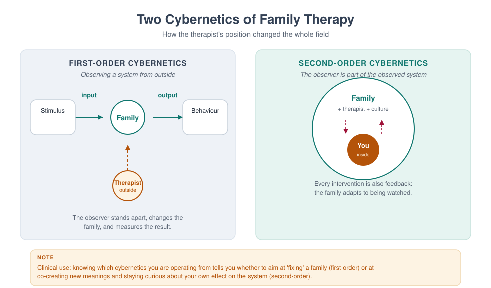

# MFT 701 — Fundamentals of Marriage and Family Therapy

> **MSc Marriage and Family Therapy** · Semester One · 1.71 Units · 14 teaching weeks · Prerequisite: none

**Course leader's summary.** This is the course that turns a helping professional into a *systemic*
one. It covers the intellectual history of family therapy, the epistemology that separates it from
individual work, the profession's identity and scope, and the basic architecture of a first session.
Everything later in the programme — theory, technique, assessment, ethics — assumes the vocabulary
built here.

---

## How to use this book

Each week contains four things: **the idea** (what you must understand), **the practice** (what you must
be able to do), **the case** (what it looks like in a room), and **a reflective task** (what it asks of
you personally). Read the week before the lecture; do the practical in the lab; write the reflection
within 48 hours, while it is still uncomfortable.

The book is written to be read straight through, but it is also designed for revision: the integration
chapter at the end compresses the whole course into two pages, and the glossary defines every term the
examination may use.

---

## 1. Course description and rationale

Most mental health training teaches us to look *inside* a person: their thoughts, their symptoms, their
attachment history. Family therapy teaches us to look *between* people: the loop, the triangle, the rule
that nobody wrote down. This is not a rejection of individual psychology. It is an additional
discipline of attention, and it changes what counts as the problem, the cause, and the cure.

Consider three common presentations:

| Presentation | Individual formulation | Systemic formulation |
|---|---|---|
| A 15-year-old refuses school | Anxiety disorder, school phobia | A child whose symptoms hold a parental conflict at bay; the school refusal is the family's most effective way of preventing an argument about the marriage |
| A wife is "depressed" | Major depressive episode | A woman in a triad with her husband and his mother, carrying the family's unspoken grief about a lost pregnancy |
| A man "works too much" | Workaholism, avoidance | The person who regulates the family's emotional temperature by being absent, in a system that rewards his absence |

None of these systemic formulations is automatically *more true*. Each is a hypothesis with different
implications for where you intervene. The mature clinician holds both — the individual and the
relational — and chooses deliberately.

**Why this course first.** Because students who begin with technique learn to do something they cannot
explain, and students who begin with theory learn to explain something they cannot do. MFT 701 begins
with *framing*: what kind of problem is this, and therefore what kind of help is required?

---

## 2. Learning outcomes

By the end of the course, students will be able to:

| # | Outcome | Assessed in |
|---|---|---|
| LO1 | Explain the epistemological shift from linear to circular causality, and its clinical consequences | Exam, Week 2 log |
| LO2 | Trace the historical development of family therapy and locate contemporary models within it | Exam |
| LO3 | Describe the profession's identity, scope of practice, and relationship to allied professions | Assignment |
| LO4 | Conduct a structured first session, including joining, problem definition, and contracting | Skills assessment |
| LO5 | Draw a three-generation genogram and generate hypotheses from it | Assignment |
| LO6 | Critically discuss the common-factors evidence and its implications for model choice | Exam essay |
| LO7 | Identify their own family-of-origin patterns and describe their effect on clinical work | Reflective log |

---

## 3. Assessment

| Component | Weight | Due |
|---|---|---|
| Reflective practice log (weekly, 300–400 words) | 20% | Fortnightly |
| Genogram and hypothesis assignment (2,000 words + diagram) | 30% | Week 9 |
| Two-hour written examination (seen case + essay + short answers) | 50% | Week 15 |

**Skills gate.** Students must pass a 15-minute observed first session (Week 6) before proceeding to
MFT 706. The gate is pass/fail with one resit.

---

## 4. The fourteen-week teaching plan

| Week | Topic | Practical | Core reading |
|---|---|---|---|
| 1 | What is family therapy? The relational turn | Triad: "the problem as described" | Nichols ch. 1; Handbook ch. 1 |
| 2 | Linear and circular causality; first- and second-order cybernetics | Observation of a recorded argument | Watzlawick, *Pragmatics* ch. 1 |
| 3 | A short history: from schizophrenia research to evidence-based practice | Timeline construction | Nichols ch. 2–3 |
| 4 | Systems thinking: boundaries, feedback, homeostasis, rules | Feedback-loop mapping exercise | Becvar & Becvar ch. 2 |
| 5 | The profession: identity, scope, settings, teamwork | Role boundaries case discussion | AAMFT code, scope sections |
| 6 | The first session I: joining, and the referral question | **Observed skills gate** | Minuchin & Fishman ch. 1 |
| 7 | The first session II: defining the problem in the family's language | Triad: problem definition | Haley, *Leaving Home* ch. 1 |
| 8 | The genogram as a hypothesis machine | Genogram lab (own family) | McGoldrick, *Genograms* ch. 1–2 |
| 9 | Formulating relationally: the 5-P grid applied to a family | Formulation workshop | Dallos & Draper ch. 4 |
| 10 | Culture, class and power in the consulting room | Reflexivity exercise | McGoldrick, *Ethnicity & Family Therapy* |
| 11 | Evidence: what works, for whom, and the common factors | Appraisal of one RCT and one qualitative study | Wampold ch. 2 |
| 12 | Ethics, risk and the limits of the systemic frame | Risk-screen rehearsal | MFT 704 pre-reading |
| 13 | Integration I: three models applied to one family | Live demonstration + discussion | Nichols ch. 10 |
| 14 | Integration II: your emerging clinical stance | Position statement presentation | Course review |

---

## Week 1 — What is family therapy? The relational turn

### 1.1 The lecture in ninety minutes

Week 1 has one job: to make the relational frame feel inevitable rather than eccentric. Everything a student
does later — the first session, the genogram, the formulation, the ethics of conjoint work — assumes they can
see a relationship as a thing with a shape, a history and a set of rules. Students arrive able to see people.
Very few arrive able to see *between* people.

The ninety minutes run like this.

| Minutes | Segment | What the lecturer does | What students do |
|---|---|---|---|
| 0–10 | Two formulations | Read the Okonkwo referral twice: once as an individual case, once as a relational one | Note which version they would have written |
| 10–30 | Where the field came from | The three failures of the individual frame (1.2) | Timeline exercise: place five founding texts |
| 30–50 | Five claims of the relational frame | Build the list on the board, testing each against a live example | Vote: which claim is hardest to accept? |
| 50–65 | Systems as a way of thinking | Cybernetics, feedback, the Watzlawick axioms (1.5) | Map one family loop on paper |
| 65–80 | Three openings in a first session | Annotated transcript, read aloud in parts | Mark where the therapist widened the field |
| 80–90 | Set the lab and the journal | Hand out the widening-question protocol (1.11) | Form triads, choose a real (non-clinical) difficulty |

The lecture is deliberately front-loaded with history. Students who know the field's origins stop treating
systemic thinking as a technique among techniques and start treating it as an epistemology — a claim about
what kind of thing a problem is.

### 1.2 Why the field exists: three failures of the individual frame

Family therapy was not invented because someone preferred groups to individuals. It was invented because
three well-funded, well-intentioned research programmes ran into the same wall: the individual frame kept
losing information that mattered clinically.

**The first failure: the patient kept relapsing into a family.** In the 1950s, Gregory Bateson's research
group at Palo Alto — Bateson, Don Jackson, Jay Haley and John Weakland — was studying communication in
families where one member had been diagnosed with schizophrenia. Their 1956 paper, "Toward a theory of
schizophrenia," proposed the **double bind**: a pattern in which a person receives two messages at different
logical levels that contradict each other, cannot comment on the contradiction, and cannot leave the field.
A mother who says "come here, dear" while stiffening when the child approaches; a father who asks for
honesty and then punishes it; a family that requires affection and forbids the expression of need that would
make affection possible.

The double-bind theory has not survived as an explanation of schizophrenia. Its status as a causal claim
about psychosis is dead, and students should know that. But something else in that research survived and
became the spine of the field: the observation that **sequences of behaviour between people carry information
that is invisible when you describe the people separately.** The patient's behaviour was intelligible as a
move in a game; the game was not in the patient.

**The second failure: the symptom made sense at home.** Independently, researchers studying families of
people with serious mental illness — Theodore Lidz at Yale, Lyman Wynne at the National Institute of Mental
Health — noticed that families organised themselves around the symptomatic member. Wynne described
**pseudo-mutuality**: a family that maintains the appearance of harmony by prohibiting any relationship that
would threaten it. Lidz described **marital schism** and **marital skew**: two patterns in which the couple's
conflict or the couple's imbalance shaped the child's development. Again the aetiological claims are dated.
Again the structural insight held: **a family can be organised by a symptom**, and the symptom can be doing
work for the system.

**The third failure: the child was the family's messenger.** The child guidance movement of the 1920s–1950s
treated the child, advised the mother, and sent both home to a household that had not changed. Clinicians
began to notice that improvement in the child was routinely followed by a new symptom in a sibling, or in the
mother, or by a marital crisis that had been dormant. The pattern is now so familiar that it has a name —
**symptom substitution** — and the observation that produced it is the most practically useful idea in this
week: *if the symptom is functional for the system, removing the symptom without changing the system is
unstable.*

Three research programmes, three different populations, one conclusion: the unit of assessment was wrong.
Between 1950 and 1975 the field built an alternative. Nathan Ackerman founded the Family Institute in 1960
and, with Jackson, the journal *Family Process* in 1962. Murray Bowen developed his theory of differentiation
and multigenerational transmission at the Menninger Clinic and later at Georgetown. Virginia Satir was
teaching conjoint family interviewing in California. Salvador Minuchin, working with delinquent boys at the
Wiltwyck School and then at the Philadelphia Child Guidance Clinic, built structural family therapy out of
the observation that these families were not sick so much as **organised at the wrong level of hierarchy** —
children in charge, parents disengaged or in coalition, boundaries too diffuse or too rigid. Jay Haley joined
Minuchin in Philadelphia in 1967 and brought strategy, power and the deliberate use of directives.

By the late 1970s the field had a canon: the Palo Alto communication school, Bowen's multigenerational
theory, Minuchin's structural therapy, Haley and Madanes's strategic therapy, the Milan group's systemic
therapy with its rituals and positive connotation, Satir's human validation, and the beginnings of
solution-focused work at Milwaukee and narrative therapy in Adelaide and Auckland. Students will meet each
of these properly in MFT 702. For now, one thing matters: **every one of these schools is an answer to the
question "what is the unit?"** and each answers it slightly differently — the sequence, the generations, the
structure, the meaning, the solution, the story.

> **DEBATE** — "If the aetiological claims of the 1950s were wrong, the field built on them is unsound."
> Ten minutes, two sides. The strongest argument against: a science is allowed to keep its methods after
> discarding its first theories — medicine kept auscultation after humoral theory fell. The strongest
> argument for: the field has never fully shed the habit of blaming families for individual distress.

### 1.3 What "relational" actually means: five claims

"Systemic" is a word students learn to say before they learn to mean. Here are the five claims that make
the relational frame a frame, in ascending order of how much they cost you as a clinician.

**Claim 1 — Behaviour is patterned.** Any two people who spend time together generate repeating sequences.
The pattern is not in either person; it is in the loop. A couple who report "we never talk" will, within
twenty minutes of a first session, demonstrate precisely how the not-talking is produced: one asks a question
that contains an accusation, the other answers with a fact, the first escalates the volume, the second goes
quiet. Neither is doing it *to* the other. Both are in it.

**Claim 2 — The pattern is maintained by its consequences, not by its causes.** This is cybernetics in one
sentence. The question "why did this start?" is usually unanswerable and clinically useless; the question
"what keeps it going?" is answerable and clinically decisive. A father's withdrawal is maintained by his
wife's criticism, which is maintained by his withdrawal. Ten years of history explain how they got into the
loop; only the loop explains why they are still in it.

**Claim 3 — Meaning is negotiated between people.** The same act means different things to different family
members, and those meanings are not private. A daughter's silence means "respect" to her father, "punishment"
to her mother, and "safety" to herself. The clinical task is not to find the true meaning but to make the
several meanings audible to everyone in the room.

**Claim 4 — Symptoms can serve the system.** Not always, not deliberately, and never in a way that makes the
symptomatic person responsible. But frequently enough that the therapist must ask: what would change in this
household if this symptom disappeared tomorrow? Sometimes the honest answer is "nothing." Sometimes it is
"my marriage would have to be looked at," and that answer reorganises the whole treatment.

**Claim 5 — The observer is inside the observed system.** You are not a camera. Your presence changes what
the family does, what they say, what they notice about themselves, and what they will risk in front of each
other. The family that arrives furious will perform its fury for you; the family that arrives polite will
perform its politeness. This is not contamination to be minimised — it is the instrument you have. Second-
order cybernetics, which students meet formally in MFT 715, is simply the discipline of using that
instrument knowingly (Figure 1.1).



**A working definition.** Marriage and family therapy is the assessment and treatment of relational systems —
couples, families, and the wider networks in which they live — using interventions that target interaction
patterns, meaning systems, and the emotional bonds between people. Read the definition carefully: *assessment
of relational systems* means the unit of assessment is the relationship; *interventions that target patterns*
means the unit of intervention is the loop, the rule, the structure or the story; *emotional bonds* means
that a purely behavioural account is insufficient, because people are attached to each other and the
attachment is what makes the pattern stubborn.

**What it is not.** Four clarifications, because students routinely collect the wrong ones.

1. **It is not "seeing everyone together" as a matter of policy.** Sometimes the right systemic move is an
   individual session inside family work. Conjoint work is a means, not a doctrine.
2. **It is not a denial that individuals exist, or that biology, trauma and temperament matter.** It is a
   disciplined focus on context, not a metaphysics.
3. **It is not the claim that families cause mental illness.** That claim was made in the 1950s and it was
   wrong, cruel, and expensive. Contemporary systemic practice holds families as the site where distress is
   *expressed, maintained and relieved* — not as the sole cause.
4. **It is not "we don't do diagnosis."** Systemic therapists diagnose, formulate and often work inside
   services that require a diagnosis; see MFT 707.

### 1.4 The four consequences, worked through

The four consequences in the original week note are worth more than a bullet list. Take them one at a time,
each with what it changes on Monday morning.

**Consequence 1 — The unit of assessment changes.** You must hear from more than one person, and notice what
happens *between* them. In practice this means the assessment cannot be completed in a single interview with
one informant. It means disagreement between informants is data rather than noise: if the mother says the
boy is defiant and the father says he is fine, the difference is the finding. It means you watch the room —
who sits where, who answers for whom, who looks at whom before speaking, what happens to the volume when
one person enters.

**Consequence 2 — The unit of intervention changes.** You intervene in sequences, rules, meanings and
structures, not only in individual cognition. A cognitive intervention asks the depressed woman to examine
the evidence for her belief that she is a burden. A systemic intervention asks what happens in the household
in the forty-eight hours after she expresses that belief — and often finds that the expression triggers
reassurance, that reassurance prevents any change in the division of labour, and that the division of labour
is what is depressing her. Both are legitimate. The second is invisible from inside the first.

**Consequence 3 — The definition of success changes.** Success may be a family that argues well, not a family
that never argues. This is the hardest consequence for students trained in symptom reduction, because it
means the goal is not the absence of conflict but the presence of **repair**. A couple who can fight, rupture
and come back together within an hour is doing better than a couple who never fight and are quietly
contemptuous. Outcome measures should reflect this: not only "has the symptom gone?" but "can this system
handle disagreement without breaking?"

**Consequence 4 — The therapist's position changes.** You are not a technician outside the system; you are a
participant who affects it. Three practical implications. First, you must account for your own effect: the
family will behave differently because you are watching, and the difference is informative rather than
annoying. Second, you cannot claim neutrality; you can only be transparent about your partiality. Third,
your own family of origin is in the room with you — which is why every week of this book ends with a
reflective task, and why personal therapy and supervision are professional requirements, not luxuries.

> **CASE** — Mrs Okonkwo brings her 9-year-old son, Ebuka, for "stubbornness". In the first ten minutes she
> mentions, twice, that his father "is never home". The linear frame says: assess and treat Ebuka's
> behaviour. The systemic frame says: ask who else is affected by the behaviour, what happens after it, and
> what would change in the household if it stopped. The second question is not a rejection of the first; it
> is a widening of the field in which the first can be treated.

### 1.5 Systems as a way of thinking

Students often assume "system" is jargon for "family". It is not. A system is any set of elements whose
interaction produces effects none of the elements produces alone. Ludwig von Bertalanffy's general system
theory (1968), Norbert Wiener's cybernetics (1948) and the communications research at Palo Alto gave the
field three tools, and they are still the three tools.

**Feedback.** A system regulates itself through loops. **Negative feedback** reduces deviation and restores
the previous state — the family that pulls a member back whenever they move too far, the couple whose
argument returns to the same sentence. **Positive feedback** amplifies deviation and produces change or
escalation — the quarrel that grows, the affair that is discovered, the child who leaves. Note that the words
are not evaluative: negative feedback is not bad, positive is not good. Most clinical problems are stuck
negative-feedback loops with high cost; most crises are positive-feedback loops that have run away.

**Homeostasis and morphostasis.** Systems resist change in order to remain themselves. When a family comes to
therapy, two processes are always running: the pressure to solve the problem and the pressure to keep the
system intact. This is why families sometimes seem to sabotage their own treatment, and why the therapist
who moves too fast loses the family. The technical answer is to pace: introduce change at a rate the system
can absorb, and check that each change is stable before the next.

**Rules and punctuation.** Watzlawick, Beavin and Jackson's *Pragmatics of Human Communication* (1967) gave
the field its most quoted propositions: one cannot not communicate; every communication has a content and a
relationship level; relationships are defined by punctuation of sequences; humans communicate digitally
(words) and analogically (behaviour, tone, gesture). The idea of **punctuation** is the most clinically
valuable. Each partner punctuates the same sequence differently: she says "he goes silent, so I get loud";
he says "she gets loud, so I go silent". Both are describing the same loop from different points on it, and
each punctuation makes the other the cause. Therapy begins when the loop, rather than either partner, becomes
the object of attention.

**Structure.** Minuchin added what communication theory lacked: an account of *organisation*. Families have
subsystems (parental, sibling, couple), boundaries (clear, diffuse, rigid), hierarchies, alliances and
coalitions. A child who is in a coalition with one parent against the other is not "manipulative"; the child
is holding a structural position that the adults' conflict has created. Structure gives the therapist
something to see in the seating plan and something to change in the session.

**Meaning.** The later schools — Milan, narrative, collaborative — pushed the field from pattern to
interpretation. If the system is a set of interactions, it is also a set of stories about those interactions.
A family that has decided "our son is the problem" has organised its attention, its conversations and its
hopes around that sentence. Change the sentence and the interactions move; move the interactions and the
sentence loses its evidence.

> **PRACTICAL** — Choose an ordinary recurring household event: the school run, Sunday lunch, the nightly
> argument about homework. Draw it as a loop with four to six nodes, each node a behaviour, with arrows
> showing what follows what. Then mark: where is the negative feedback (what restores the previous state)?
> Where is the positive feedback (what escalates)? Where does each participant punctuate the loop? Bring the
> drawing to the lab; you will redraw it after hearing someone else's account of the same event.

---

### 1.11a What the evidence says, in one page

Students are often told either that family therapy "works" or that the evidence is contested. Both are
unhelpful. Here is what a careful reading of the outcome literature supports, stated with the hedge each
claim requires.

**Family and couple therapy outperform no treatment, and generally match individual treatment for relational
problems.** Meta-analyses of couple and family therapy trials report effect sizes in the moderate range —
roughly half a standard deviation to eight-tenths — against no-treatment and wait-list controls, with the
larger effects for couple distress, child conduct problems, and adolescent substance use. Effects are smaller
and less consistent against credible active comparators, which is what you would expect if the specific model
matters less than the common structure of good therapy.

**The model explains less of the variance than the alliance.** The most robust finding in psychotherapy
research, replicated across modalities, is that the therapeutic alliance predicts outcome better than the
technical ingredients of any particular school. In couple and family work the alliance is more complicated
than in individual work, because there is more than one alliance to build and they can pull against each
other: siding with one partner to engage them alienates the other, and a determined even-handedness can leave
both feeling unheard. This is why Week 6 of this book spends two sessions on joining, and why your assessed
skill in this course includes your ability to hold two alliances at once.

**Common factors do a lot of the work.** Client factors (severity, chronicity, social support, motivation),
the alliance, the therapist's skill and the expectancy generated by a credible rationale account for a large
share of change. The practical implication is not that technique is irrelevant but that technique is
delivered *through* a relationship, and a technique delivered through a poor relationship is inert or
harmful.

**Dose and dropout matter more than most trainees think.** A substantial proportion of families attend one
session and never return; the first session is therefore an outcome event, not a preliminary. Retention is
predicted by early alliance, by the fit between the therapist's explanation and the family's own
understanding, and by practicalities — travel, cost, timing, childcare — that a therapist who ignores them
will mistake for resistance.

**Evidence is unevenly distributed across problems.** Couple therapy for relationship distress, behavioural
parent training for conduct problems, family-based treatment for adolescent eating disorders, multidimensional
family therapy for adolescent substance use, and systemic work with chronic illness in children have
reasonably strong support. Evidence for some popular ideas — mechanical use of paradox, unexamined
"dysfunctional family" typologies, polyvagal explanations treated as established mechanism — is much weaker.
Learning to distinguish these is part of professional formation, and MFT 705 and MFT 721 teach you to read the
literature rather than the marketing.

> **CAUTION** — Do not let the common-factors literature become an excuse for not learning a model. "The
> alliance is what matters" is true and is also the sentence most often used by trainees who have not yet
> learned to do anything. You need a model precise enough to be taught, supervised and evaluated, and a
> relationship good enough for the model to reach the family. Neither substitutes for the other.

### 1.6 First contact: three openings, annotated

The relational frame is not announced, it is enacted. Three openings show what it looks like when a
therapist begins relationally in the first five minutes — before any genogram, any diagnosis, any technique.

**Opening A — from the referred person to the referral system.**

> **Therapist:** Before we start, tell me how this appointment came about. Who first said something needed to
> change, and who agreed?
> **Mrs Okonkwo:** The school called me. His teacher said he refuses to write anything.
> **Therapist:** And when you told your husband, what did he say?
> **Mrs Okonkwo:** (pause) He said I should handle it. He is not around.
> **Therapist:** So the school spoke to you, you spoke to your husband, and here you are with Ebuka. Who else
> in the family knows you are here today?

Note what the therapist has done. She has not asked about the symptom at all. She has mapped the **referral
pathway**, which is itself a relational fact: who is worried, who is not, who carries the problem, who was
told and who was not. She has also discovered, in four questions, the sentence that will organise the
assessment: *he said I should handle it.* That sentence is not a complaint about a husband. It is a
description of a household in which one adult holds all the worry, and a child's symptom sits in the space
where the other adult would be.

**Opening B — from the symptom to the sequence.**

> **Therapist:** Tell me about the last time it happened. Not the worst time — the most recent.
> **Mrs Okonkwo:** Yesterday morning. He would not get out of bed. I called him three times, then I started
> shouting, then he got up and stood in the bathroom for twenty minutes.
> **Therapist:** And then?
> **Mrs Okonkwo:** Then I drove him late and I was angry all day.
> **Therapist:** What did Ebuka do when you were angry all day?
> **Mrs Okonkwo:** He was very quiet. He even made me tea.

The sequence is now visible: refusal, escalation, compliance, and then **repair initiated by the child**. That
is the loop. The therapist did not need to interpret it. She asked for a specific episode and then asked
"and then?" until the loop closed. This is the single most useful micro-skill in the first session:
**episode, not opinion.** Opinions produce character descriptions ("he is stubborn"); episodes produce
sequences.

**Opening C — from the individual to the room.**

> **Therapist:** (to Ebuka) Your mum says mornings are hard. If I asked her to describe a good morning, what
> would she say happens?
> **Ebuka:** (shrugs) She would be happy.
> **Therapist:** How would she know? What would she see?
> **Ebuka:** (long pause) My dad would be there.

Three questions, and the child has produced the formulation. The therapist did not ask "how do you feel
about your father's absence?" — a question no nine-year-old answers truthfully. She asked a **behavioural
question about a third person's perception**, which is easier to answer and much harder to fake. Involving
the child as an informant, not a patient, is a structural act: it moves the child out of the identified-
patient position and into the family's information system.

**What all three openings have in common.** Each one moves the unit of attention one step outward — from the
person to the pathway, from the event to the sequence, from the individual to the room — and each does so
with a question that is answerable. That is the whole craft of a first session in miniature. The student who
can do these three moves in the first ten minutes will get a formulation. The student who cannot will get a
history.

### 1.7 The Okonkwo case, fully worked

**Referral.** Ebuka, 9, referred by his school for "defiance and refusal to write". Six weeks of refusing to
complete written work; two episodes of leaving the classroom. Class teacher describes him as "stubborn and
rude". Mother reports he is "fine at home, except mornings". Father did not attend.

**What the linear frame produces.** A differential diagnosis: oppositional defiant disorder versus a specific
learning difficulty (writing), versus anxiety, versus an attention problem. An assessment plan: psychometric
testing, teacher rating scales, classroom observation, possibly a paediatric review. A treatment plan:
behavioural contract, reward chart, parent training in commands and consequences. This is not wrong. It is
incomplete in a way that will matter, because the most important information in this family is not about
Ebuka's writing.

**What the systemic frame adds.** Four moves, in order.

*Move 1 — the referral pathway.* Who is worried? The school, then the mother. Who is not in the room? The
father. Who decided that the mother should manage it? The father, according to the mother. The first
structural fact: **the parental subsystem is not operating as a subsystem.** One adult holds the worry, the
other holds the distance.

*Move 2 — the sequence.* Mornings: refusal, three calls, shouting, compliance, lateness, a day of maternal
anger, evening reparation initiated by the child. The second structural fact: **the child regulates the
mother's emotional state.** He absorbs her anger and then repairs it. A nine-year-old is doing the work of a
partner.

*Move 3 — the function of the symptom.* What would change at home if Ebuka got up cheerfully and wrote
fluently? The mornings would be calm; the mother's day would be easier; and the father's absence would become
a topic rather than a background condition. There is no evidence that anyone wants the child to be
symptomatic. There is good evidence that the symptom sits at the exact point where a marital conversation
would otherwise occur.

*Move 4 — the wider system.* School, church, extended family. In this case the maternal grandmother is
mentioned twice and the paternal aunt once. In many Nigerian households the grandmother is a co-parent and a
court of appeal; leaving her out of the assessment is not neutrality, it is an omission.

**The formulation, in one paragraph.** Ebuka's refusal to write is maintained by a morning sequence in which
escalation reliably produces compliance and in which the child then repairs his mother's distress. That
sequence is itself maintained by a household in which one parent carries all the worry and the other is
absent, and by a school system that has defined the problem as a defect in the child. The symptom is not
caused by the marriage, and nobody is to blame; but the symptom is *located* where the marriage would
otherwise be discussed, and it will be difficult to resolve without that conversation becoming possible.

**The plan that follows.** Conjoint sessions including the father (with an explicit invitation framed as
expertise rather than blame: "I need your view of what happens in the mornings; your wife and I are working
from one account"). A behavioural component for the mornings, because it works and because success builds
the parents' confidence in themselves as a team. A separate conversation with the parents about the marriage,
held only when both are willing. Liaison with the school to reframe "defiance" as "a problem we are
assessing", which reduces the pressure that feeds the loop.

> **TASK** — Rewrite this case as you would present it in a multidisciplinary team meeting in forty seconds,
> without using the word "systemic" and without blaming either parent. Then rewrite it for the parents
> themselves. The two versions should differ in vocabulary, not in content.

### 1.8 Where the profession sits

Students enter training with a blurred map of the mental health professions. In Nigeria, as in most places,
the practical differences matter for referral, for legal standing, and for what you are allowed to do.

| Profession | Core unit | Typical training | What they usually do with a struggling family |
|---|---|---|---|
| Psychiatry | The patient, medically | Medical degree, then residency | Diagnose, prescribe, admit; refer for therapy |
| Clinical psychology | The individual | Doctorate or master's plus internship | Assess, formulate, deliver individual therapy |
| Counselling psychology | The individual in context | Master's or doctorate | Individual and group counselling, some couple work |
| Social work | The person in their environment | Degree plus registration | Case management, child protection, family support |
| Marriage and family therapy | The relationship | Master's or doctorate in MFT | Conjoint, family and couple therapy; relational formulation |

The distinctive contribution is not a technique. Clinical psychologists do behavioural couple work;
psychiatrists do family meetings; social workers do family support. The distinctive contribution is the
**relational formulation** — the disciplined habit of locating the problem in the space between people, and
the training in interventions that change that space. A therapist who can only see individuals will treat a
family by treating its members one at a time and will be genuinely puzzled when the symptom returns.

**Settings in which the work happens.** Outpatient clinics and private practice; hospitals, where family
meetings follow diagnoses that reorganise households; schools, where the referral pathway usually begins;
NGOs and humanitarian settings, where family separation, displacement and bereavement are the presenting
context; faith settings, where pastors, imams and church counsellors are often the first and sometimes the
only port of call; and courts and child protection services, where the therapist's opinion may be read by a
judge. Each setting changes the ethics (see MFT 704), the assessment (MFT 707) and even the language you use.

**Scope of practice.** Three boundaries worth stating on the first day of training. First, family therapists
do not prescribe; any question about medication is a referral question, and the referral should be made
without implying that medication is a failure. Second, family therapists do not give legal advice; they
provide clinical opinion and, where required, reports, and they tell families to obtain a lawyer (see MFT
724). Third, family therapists do not practise beyond their competence — and competence is specific:
adult couple work is not child work, child work is not forensic work, and neither is trauma processing
without specific training (MFT 711, MFT 714).

> **AUDIT** — Write down, in one sentence each, what you would do and would not do if a family asked you to
> (a) advise whether the husband can legally take a second wife, (b) tell the court which parent should have
> custody, (c) prescribe something for the child's sleep. Bring the three sentences to the lab.

### 1.9 Culture, faith and class in the first meeting

The relational frame is not culturally neutral, and pretending otherwise is its own kind of arrogance. Three
adjustments matter from the first session in most Nigerian consulting rooms.

**Kinship is wider than the household.** A genogram that stops at the nuclear family will miss the
grandmother who raised the child for three years, the uncle who pays the school fees and therefore has
standing, the aunt who lives with the family and disciplines the children, and the cousin whose presence has
changed the sleeping arrangements. Ask who is *involved*, not who lives *there*. The distinction between
household and family is one of the most practically useful in the whole programme.

**Faith is a resource and a referral system, not a rival.** Families commonly arrive having already seen a
pastor, an imam, a traditional healer or all three. The therapist's task is not to adjudicate but to
coordinate: what did the prayer, the deliverance, the fasting, the herbal treatment do? What was helpful?
What was frightening? What does the family believe is happening spiritually? A family that believes the
problem is spiritual and a therapist who believes it is relational can still work together if the therapist
takes the belief seriously as a *meaning in the system*, which is exactly what it is.

**Class shapes what is possible.** A recommendation to reduce working hours is meaningless to a family with
two jobs and no childcare. A recommendation to attend weekly sessions is meaningless to a family who travel
four hours. A recommendation to "talk to your husband" is meaningless in a household where his mother is the
decision-maker. Practical recommendations fail not because families are resistant but because the therapist
prescribed from a life the family does not have. The discipline is to ask, before prescribing: what would
have to be true in your week for this to happen? The answer is usually the real treatment plan.

> **CAUTION** — Do not treat cultural deference as consent. A wife who says "I will do whatever my husband
> decides" may be expressing a genuine value, or may be signalling that she cannot speak safely. The
> difference is discovered by seeing her alone at least once, and by asking about safety in the standard
> way — not by assuming either interpretation.

### 1.10 Six errors that begin in week one

These are the mistakes students actually make in their first role-plays, and each one is a failure of the
relational frame rather than a failure of technique.

1. **The single-informant assessment.** You interview the mother, form a picture, and never test it. Fix: no
   relational formulation without at least two informants, and no family assessment without asking who is
   missing.
2. **The character formulation.** "He is oppositional." "She is enmeshed." These are descriptions of persons
   disguised as systemic language. Fix: every formulation must contain at least one *sequence* ("when X, then
   Y, then Z") and at least one *context* ("in the presence of…").
3. **Premature reassurance.** "I'm sure he loves you." It closes the exploration and hands the therapist's
   opinion to a family that needs its own. Fix: acknowledge the experience, ask for the evidence, keep the
   question open.
4. **The alliance slide.** You begin to like one member more than another and your questions begin to build
   the case for that person. Fix: track your questions across a session (record it) and count how many were
   addressed to each person and whose account each question elaborated.
5. **The technique-first session.** You arrive with a genogram to draw, a technique to demonstrate, a model to
   apply — and the family's actual concern is never heard. Fix: the first session belongs to the family's
   account, not to the therapist's plan.
6. **The safety omission.** You conduct a full conjoint assessment without ever asking about violence. Fix:
   every first session includes a private screen for harm to self, harm to others, abuse of children and
   intimate partner violence, conducted in a way that makes disclosure possible (see MFT 704 and MFT 712).

> **REFLECT** — Which of the six are you most likely to commit? Not in theory: in your last conversation with
> someone who was struggling. Write the answer down. You will be asked to revisit it in Week 14.

### 1.11 Laboratory: the widening question

The week's practical is a triad drill in which the therapist may only ask questions that include another
person. It looks simple and it is not: most students discover that their natural question is a question about
an individual, and that widening feels artificial for the first twenty minutes.

**Setup.** Groups of three. Roles rotate every eight minutes, so each person is therapist once. One person
brings a real but non-clinical difficulty — a disagreement with a flatmate, a difficult decision about a
sibling, a strain with a colleague. No clinical material, no disclosure that would be regretted.

**Rules for the therapist.**

1. No statements, interpretations or advice — questions only.
2. Every question must include a third party or a relationship: "who notices…", "what does your sister do
   when…", "who would disagree…", "what happens between you after…".
3. One question at a time, with silence after each.
4. Eight minutes, then stop whether or not the conversation feels finished.

**Observer's task.** Two columns on one sheet: **W** (questions that widened the field) and **N** (questions
that narrowed it back to the individual). Tally, then quote the single most useful widening question and the
single most narrowing one.

**Debrief questions.** What did the client notice about their own description when it was widened? Which
widening felt intrusive, and why? What did the therapist want to say but could not? What happened to the
client's tone when a third person entered the story?

**Marking rubric** (used in the Week 6 skills gate).

| Criterion | Weight | What full marks looks like |
|---|---|---|
| Proportion of widening questions | 30% | More than 80% of questions include another person or a relationship |
| Question quality | 25% | Open, specific, answerable; no double questions; no embedded advice |
| Pacing and silence | 20% | Roughly one question per 30–45 seconds; client speaks more than therapist |
| Use of the client's words | 15% | At least three questions reuse the client's own phrasing |
| Reflexivity in debrief | 10% | Can name what was hard, what was tempting, what they avoided |

> **DRILL** — Record a five-minute role-play on your phone. Count your questions. Then count how many contain
> a third person. Most first attempts are around one in ten. The target is eight in ten, and it takes about
> three hours of deliberate practice to get there.

### 1.12 Reflective task

Write 500 words on the last significant conflict in your own family, then rewrite it from the point of view
of the person you understood least. Note what changed in your body as you wrote. Keep both versions; you will
return to them in Week 14, when you write your emerging clinical stance, and you will find that the second
version contains the therapist you are becoming.

Two rules for this task. Do not show it to the person concerned, and do not bring the person's name into the
seminar. The purpose is to develop the capacity to hold more than one punctuation of the same sequence at
once — which is precisely what you will ask families to do.

### 1.13 Self-test

Six questions, answers below. If you cannot answer 4 and 5 without notes, reread 1.5.

1. Define negative and positive feedback, and give one clinical example of each.
2. Why is "punctuation" clinically useful?
3. State the double-bind hypothesis and its current scientific status.
4. What is symptom substitution, and what does it imply for treatment?
5. Name the five claims of the relational frame, in order.
6. What are the four consequences of treating the relationship as the client?

**Answers.** 1. Negative feedback reduces deviation and restores a prior state (a family pulling a member
back from independence); positive feedback amplifies deviation (an argument that escalates through
counter-complaint). 2. Because each participant's punctuation makes the other appear to be the cause; the
therapist who makes punctuation visible turns blame into a loop both can act on. 3. A person receives
contradictory messages at different logical levels, cannot comment on the contradiction and cannot leave the
field; it is historically important and not a supported causal explanation of schizophrenia. 4. The
observation that removing a symptom is often followed by a new symptom elsewhere in the system; it implies
that treatment must change the system, not only the symptom. 5. Behaviour is patterned; patterns are
maintained by consequences rather than causes; meaning is negotiated; symptoms can serve the system; the
observer is inside the observed system. 6. The unit of assessment, the unit of intervention, the definition
of success, and the therapist's position.

### 1.14 Readings for this week

Read the first two before the lecture; the rest are for the assignment.

* **Bateson, Jackson, Haley & Weakland (1956)**, "Toward a theory of schizophrenia", *Behavioral Science*.
  Read it as a historical document and notice how carefully the authors hedge.
* **Watzlawick, Beavin & Jackson (1967)**, *Pragmatics of Human Communication*, chapters 1–2. The axioms, in
  the original.
* **Nichols & Schwartz**, *Family Therapy: Concepts and Methods*, chapter 1. The best single overview of the
  field's history.
* **Becvar & Becvar**, *Family Therapy: A Systemic Integration*, chapters 3–5. On cybernetics and
  second-order thinking.
* **Hoffman (1985)**, "Beyond power and control", *Family Systems Medicine*. The turn to second-order
  cybernetics, written by a participant.
* **Minuchin (1974)**, *Families and Family Therapy*, chapter 2. Structure, in Minuchin's own voice.

### 1.6a An extended transcript, annotated

Role-plays teach faster than principles. Below is a twelve-turn excerpt from a first session with a couple
who present with "we cannot communicate". The therapist is a trainee in her second term. Read the transcript,
cover the annotations, and decide what you would have asked next. Then read the annotations.

> **T1 Therapist:** What would you like me to understand first?
> **T2 Folake:** He doesn't talk to me. He comes home, eats, watches television, sleeps. I am alone in this
> house.
> **T3 Therapist:** (to Dele) What do you think your wife means when she says she is alone?
> **T4 Dele:** I don't know. I work. I am tired. She is not alone, there are three children in the house.
> **T5 Therapist:** Folake, what do you do when he is watching television?
> **T6 Folake:** I stand there. Sometimes I ask him something and he says "mm".
> **T7 Therapist:** And what happens then?
> **T8 Folake:** I get angry. I say something sharp. Then he goes to bed.
> **T9 Therapist:** Dele, when she says something sharp, what goes through your mind?
> **T10 Dele:** That nothing I do is enough. So I stop.
> **T11 Therapist:** And when you stop, Folake, what happens to the anger?
> **T12 Folake:** It grows. And then I cannot sleep and I am tired the next day and the children see me crying.

**Annotations.**

*T1* is a neutral opening that hands the agenda to the couple without inviting either partner to be the
complainant. Compare "What is the problem?" — which usually produces one person's problem statement and
positions the other as the problem.

*T3* is the first systemic move: instead of asking Dele to defend himself, the therapist asks him to
**interpret his wife**, which requires him to engage with her experience rather than his own. It also reveals
whether he has a theory of her mind at all. He does not: "I don't know" is honest and important.

*T5* is an **episode question** and it is doing three things at once. It bypasses the argument about whether
she is alone (unwinnable), it specifies a moment (television, evening), and it puts the therapist physically
in the room with them. Students who ask "why do you feel alone?" get an explanation; students who ask "what do
you do when he is watching television?" get the behaviour that maintains the loneliness.

*T7*, "and then?", is the single most productive two-word intervention in family therapy. It builds the
sequence one link at a time and stops the therapist from doing the formulating.

*T9* takes the same event and asks for the **other partner's internal sequence**, which turns two monologues
into one loop. Note that the therapist does not challenge Dele's account ("three children in the house" is
not an answer to loneliness, but arguing about it would lose him). She lets the sequence do the work.

*T10* is the pivot of the session. "Nothing I do is enough, so I stop" is a complete formulation of Dele's
side of the loop, offered by Dele. Nothing the therapist could have said would have been as convincing or as
usable.

*T11* closes the loop by returning to Folake with the consequence of his withdrawal. At T12 she supplies it:
the anger grows, sleep is lost, the children see her crying. The loop is now on the table, described entirely
in the couple's own words, and neither partner has been blamed.

What the therapist has **not** done in twelve turns is worth listing, because trainees over-value these
moves: she has not asked about the history of the marriage, has not asked how they met, has not asked about
sex, has not offered an interpretation, has not normalised, has not asked either partner to change anything,
and has not used the word "communication". Every one of those is legitimate; none of them was needed to
establish the relational frame in the first ten minutes.

> **PRACTICAL** — In pairs, take turns being the therapist with this transcript. Cover T3 to T12 and improvise
> your own next question at each point. Then compare with the original. Where did you ask for an opinion
> rather than an episode? Where did you reassure? Where did you take a side without noticing?

### 1.10a Three punctuations of one quarrel

The same sequence can be punctuated at least three ways, and each punctuation licenses a different
intervention. Take the quarrel the couple above actually have.

**Punctuation 1 — the character story.** "He is cold and withdrawn; I am affectionate and he rejects me."
*What it licenses:* an appeal to Dele to change, a diagnosis of Dele (avoidant, depressive, possibly
autistic), and a treatment that works on Dele. *What it costs:* Folake's contribution disappears, Dele
becomes a project rather than a partner, and Dele — who already believes nothing he does is enough —
experiences therapy as one more arena in which he fails.

**Punctuation 2 — the mirror story.** "She criticises; I withdraw; she criticises more." *What it licenses:*
a circular formulation, a sequence map, and interventions aimed at the loop (interrupting the escalation,
slowing the exchange, rehearsing a different response to criticism). *What it costs:* the loop can become an
abstraction that hides the asymmetry of power and the real losses — his hours, her sleeplessness, the
children's exposure.

**Punctuation 3 — the meaning story.** "She is asking for evidence that she matters; he is protecting himself
from evidence that he fails." *What it licenses:* work on attachment, on the meanings each assigns to the
other's behaviour, and on the moment of turning toward or away. *What it costs:* meaning work without
behaviour change can become insight that never reaches the household.

A competent therapist holds all three and chooses deliberately, usually sequencing them: the loop first
(because it lowers blame), the meaning second (because it explains why the loop is so adhesive), and the
character story never as a formulation, only as each partner's experience to be listened to. This pluralism —
several punctuations available, one chosen for a reason — is what distinguishes a systemic clinician from
someone who has memorised a model.

> **DEBATE** — "Circular formulations are kinder but less true." Fifteen minutes. Note that the strongest
> argument for circularity is not moral but empirical: linear accounts of complex interaction are almost
> always wrong about causation, even when they are right about blame.

### 1.13a Examination question with model answer

**Question (20 marks).** "Family therapy is a way of seeing, not a set of techniques." Discuss, with
reference to the historical development of the field and to at least one clinical example.

**Model answer, in note form, with the markers' expectations visible.**

*Introduction (2 marks).* State the claim in your own words: the relational frame is an epistemological
commitment — a claim about the unit of analysis and the nature of causation — and techniques are downstream
of it. Signal the structure of the answer: history, epistemology, clinical example, limits.

*History (6 marks).* Three research programmes converged on the same failure: Bateson's group and the double
bind; Lidz and Wynne on family organisation around psychosis; the child guidance movement and symptom
substitution. The aetiological claims of the 1950s were largely wrong and you should say so; what survived is
the methodological insight that sequences carry information individuals do not. Trace the schools as answers
to "what is the unit?" — Palo Alto (the sequence), Bowen (the generations), Minuchin (the structure), Milan
(the meaning), Milwaukee (the solution), Adelaide (the story).

*Epistemology (6 marks).* Circular versus linear causality; feedback and homeostasis; punctuation;
second-order cybernetics and the therapist's position. Use Watzlawick's axioms precisely — content and
relationship levels, digital and analogic communication — and show what each buys clinically. Demonstrate
that you understand the difference between an ecological claim (the system is the unit of *assessment*) and
a causal claim (the system *causes* the symptom), and reject the second.

*Clinical example (4 marks).* The strongest answers use one case throughout rather than several in passing.
The Okonkwo case works: a nine-year-old's school refusal, a morning sequence, a parental subsystem that is
not operating, and a formulation that no single-informant assessment could have produced. Show what the
relational frame let you see and what it let you do.

*Limits (2 marks).* Name them honestly: the frame can obscure individual biology, trauma and temperament; it
can be used to distribute responsibility in ways that leave an abusive member unaccountable; it can become a
language that describes loops without ever changing them. Note the feminist critique of neutrality and the
evidence that the alliance — not the model — predicts much of the outcome.

*Common ways to lose marks.* Describing techniques without explaining the frame; treating "systemic" as a
synonym for "family"; repeating the double-bind hypothesis as if it were current; failing to give a clinical
example at all; writing about circular causality without ever defining feedback.

### 1.13b What "good" looks like at the end of week one

A checklist you can use on yourself before Week 2. Tick only what you can do *without notes*.

- [ ] Explain, in ninety seconds, why the field moved from the individual to the relationship, using three
      historical examples and one honest caveat about the science of the 1950s.
- [ ] Define negative and positive feedback and give a clinical example of each that you have actually seen.
- [ ] Explain punctuation to a couple without using the word "punctuation".
- [ ] Turn three opinion questions into episode questions, out loud, without hesitation.
- [ ] State the four consequences of treating the relationship as the client, and give one practical
      implication of each for a first session.
- [ ] Describe the difference between a linear and a circular formulation using the same case twice.
- [ ] Name the three professional boundaries from 1.8 and what you would say to a family that crossed them.
- [ ] Ask about safety in a first session without it sounding like an accusation or an afterthought.

---

## Week 2 — Linear and circular causality

### 2.1 The lecture in ninety minutes

Last week asked *who is the client*. This week asks a harder question: **what kind of thing is a cause?** It
is the single most consequential idea in the programme, because everything downstream — the formulation, the
questions you ask, what you count as progress, how you write a report for a court — depends on whether you
think in lines or in loops.

Students usually arrive believing they already understand this. They can define circular causality in a
sentence: "each person's behaviour causes the other's." Then they conduct a role-play in which every question
they ask is a search for who started it. The gap between being able to say it and being able to do it is the
work of this week.

| Minutes | Segment | What the lecturer does | What students do |
|---|---|---|---|
| 0–10 | Two sentences | Reads a case in a linear account, then in a circular account | Mark every causal verb in both |
| 10–25 | The philosophy nobody teaches | Aristotle's four causes, Hume, Mills, why "cause" is plural (2.2) | Sort five clinical explanations into cause types |
| 25–45 | Feedback, formally | Loop diagrams, delay, gain, thresholds (2.3–2.4) | Draw the same family as two different loops |
| 45–60 | Punctuation, again | The same quarrel punctuated three ways (2.5) | Identify their own punctuation habit |
| 60–75 | Circular questioning | Live demonstration, then triads (2.6) | Ask three circular questions each |
| 75–90 | Hypothesis discipline | How to hold a hypothesis without becoming its servant (2.7) | Write one hypothesis, then one disconfirming question |

The lecture has a deliberate shape: philosophy first, engineering second, clinical craft third. Students who
skip the philosophy conclude that circular causality is a nicer way of saying "we are all responsible".
Students who skip the engineering cannot tell a loop from a list.

### 2.2 What a cause is: four traditions you will use without knowing

Family therapy inherited a muddle about causation and never fully cleaned it up. The muddle is worth
untangling, because most of the field's disagreements about evidence, responsibility and blame are
disagreements about what counts as a cause.

**Aristotle's four causes.** Aristotle distinguished the *material* cause (what something is made of), the
*efficient* cause (what set it in motion), the *formal* cause (the pattern it realises) and the *final* cause
(the purpose it serves). A wooden chair: wood, a carpenter, a design, the purpose of sitting. Now apply the
scheme to a symptom. A boy's school refusal: his anxiety (material), a frightening event (efficient), a
pattern of family accommodation (formal), and the function the refusal serves in the household (final). Most
clinical arguments are people defending one of these four while denying the others. The systemic tradition is
chiefly interested in the formal and final causes — the pattern and the function — which is exactly why it
seems to slight the efficient cause (the event that started it) and infuriates colleagues who want to know
what happened.

**Hume and the regularity theory.** A cause is an event constantly conjoined with another, temporally prior,
and contiguous with it. This is the model implicit in most medical training and in most of what patients
believe. It works well for infections and badly for families, because in families the "effect" is usually
also the "cause", arriving before and after in alternation.

**Mill's methods.** Agreement, difference, concomitant variation. These underwrite the randomised trial, and
they are why the trial remains the best tool for the question "does this treatment cause improvement?" They
are much weaker for the question "what maintains this pattern in this family?", where the relevant variation
cannot be manipulated.

**Systems and constitutive causation.** In a system, the state of each element is partly constituted by its
relations to the others. A thermostat is not caused to switch by the temperature in the way a billiard ball
is caused to move by another; the switching is what the system *does*. Family therapists use this sense when
they say that the pursuit and the withdrawal "cause" each other: not that A pushes B and B pushes A in a
chain, but that the two behaviours are what they are in virtue of the loop they form.

> **EXERCISE** — Take the sentence "his drinking broke up the marriage". Rewrite it four times, once for each
> Aristotelian cause. Then decide which of your four sentences a court would want, which a wife would want,
> and which would actually help in session.

Two consequences follow, and students should write them down.

**First, circularity is not a moral claim.** "We are both in the loop" does not mean "we are equally
responsible", and it certainly does not mean "the victim is complicit". A man who is violent and a woman who
placates him are in a loop, and only one of them is doing the violence. Confusing description with
responsibility is the most serious error in the systemic literature, and the feminist critique of the 1980s —
developed by Hare-Mustin, Goldner, Bograd and others — was right about it. The corrective is not to abandon
circularity but to pair it with an explicit account of power: who has the resources, who can leave, who is
believed, whose account is treated as the account.

**Second, circularity is a stance, not a finding.** You cannot observe a loop from outside; you can only
offer a description of a loop from a position inside it. That is second-order cybernetics in one line, and it
means your circular formulation is a hypothesis with an author, not a fact with a discoverer.

### 2.3 Feedback, formally

The engineering vocabulary is not decoration. It gives you words for things you can otherwise only gesture
at, and the words make the difference between a formulation that guides intervention and one that merely
sounds sophisticated.

**Loop, not line.** A loop has a variable, a sensor, a comparison with a reference value, and an effector. In
a family: the variable might be *proximity between the couple*; the sensor is each partner's attention to the
other; the reference value is an implicit standard of how close they should be; the effector is the behaviour
that moves them. This sounds mechanical and is not: the reference values are moral and historical, inherited
from the families the partners grew up in.

**Negative feedback.** Deviation is detected and reduced. The system returns to its set point. Clinically:
the family that pulls the adolescent back whenever she separates; the couple whose argument always returns to
the same unresolved sentence; the mother whose anxiety rises when the household is calm, and who finds a
problem to restore the familiar tension. Note the crucial point: **negative feedback produces stability, and
stability is not always health.**

**Positive feedback.** Deviation is amplified. Clinically: the argument that escalates because each response
is experienced as an attack; the affair discovered, denied, discovered again; the child's school refusal that
produces maternal anxiety that produces more refusal. Positive feedback produces change, and change is not
always growth. Most crises are runaway positive loops; most chronic presentations are locked negative loops.

**Delay.** The most under-taught concept in the field. Systems respond to yesterday's state, not today's. A
wife raises a complaint on Monday; the husband responds on Thursday with a small act of help; she has by then
concluded he does not care and does not notice the help. Delay is why good interventions often look as though
they failed: the change is in the pipeline, and the therapist who panics at session four and changes approach
destroys the very feedback they needed to see. Rule of thumb: **give a structural intervention three sessions
before judging it.**

**Gain.** How much a system responds to a small deviation. High-gain systems escalate fast and are fragile;
low-gain systems are stable and can be rigid. A high-gain couple needs the therapist to slow the exchange and
lower the volume; a low-gain family needs the therapist to introduce novelty, raise the emotional temperature
slightly, and use enactment. This is the practical payoff of the vocabulary: gain tells you whether to
accelerate or decelerate.

**Thresholds and hysteresis.** Systems do not change smoothly; they flip. A family tolerates a behaviour for
years and then, at a threshold, reorganises around it — the daughter's disclosure that triggers a family
schism, the debt that ends the pretence of solvency. Hysteresis means the threshold for going one way is not
the threshold for coming back: it is easier to enter a crisis than to leave it, and families often need help
to cross back.

> **PRACTICAL** — Draw one family twice. First as a negative-feedback loop with a labelled set point: what
> state does this family return to, and how does it get there? Then as a positive-feedback loop: what is
> amplifying, and what would a threshold for change look like? Ten minutes, both drawings, no words allowed
> beyond labels.

### 2.4 Three ways of drawing the same family

The Adeyemi family: Amara, 16, has refused school for six weeks. Her mother has depression and is on
medication. Her father was made redundant fourteen months ago and drinks in the evenings. There is a younger
brother, 11.

**Drawing one — the linear account.** Redundancy → paternal drinking → marital conflict → maternal depression
→ Amara's caregiving and anxiety → school refusal. Every arrow points one way. This drawing is *true* as far
as it goes, and it is what a referral letter usually contains. It is also useless as a treatment plan,
because every arrow points at a cause the therapist cannot move, and the only intervention it licenses is at
Amara.

**Drawing two — the circular account.** Amara's refusal keeps her at home; her presence at home reduces the
parents' opportunity to argue; the reduction in argument lowers the mother's distress; the mother's lowered
distress makes Amara's presence feel necessary; the father's drinking continues in the space that the
parental conflict has vacated. No single arrow is the cause; each arrow maintains the next. This drawing is
*also* true, and it is actionable: the loop has four places where it could be interrupted.

**Drawing three — the power account.** Overlay resources and legitimacy: who earns, who decides, who is
believed, who can leave, whose distress is taken seriously. The father's drinking is not neutralised by being
"part of a loop": it is a behaviour with a cost, exercised by the person with the most structural power in
the household. The mother's depression constrains her capacity to act. Amara has the least power and the most
symptomatic expression. The overlay changes what the therapist says: the mother is not "enmeshed", she is
exhausted and unsupported; the father is not "in a loop", he is a man who is drinking and needs to be asked
to stop, with the consequences named.

**What the three drawings teach.** A formulation is a *choice of drawing for a purpose*. The linear drawing
is good for history and for medico-legal chronology; the circular drawing is good for intervention design
and for lowering blame; the power drawing is good for ethics, safety and responsibility. A competent
clinician keeps all three and says which they are using and why. A weak clinician uses the circular drawing
because it is the house style and then cannot understand why the wife in the violent marriage is not helped
by a conversation about mutual escalation.

> **CAUTION** — If there is violence, the circular drawing must never be used in the room as the primary
> formulation until safety has been established and responsibility assigned. Nothing in this week's material
> licenses the sentence "you are both keeping the cycle going" to a woman who has been hit. See MFT 704,
> MFT 712 and MFT 714 for the full protocol.

### 2.4a A worked loop, with numbers

Circular accounts are often criticised for being unfalsifiable. They need not be. Any loop can be given
rough magnitudes, and doing so changes what you notice.

Take Loop B from the Adeyemi case: mother's low mood → Amara's caregiving → mother's temporary relief →
Amara's increased responsibility → Amara's anxiety about school → school refusal → more time at home.

Assign a plausible scale, in the family's own terms, and mark how confident you are.

| Link | Direction | Rough magnitude | Confidence | Evidence |
|---|---|---|---|---|
| Mother's mood → Amara's caregiving | ↑ caregiving as mood falls | Large | High | Both describe it; it happens most days |
| Caregiving → mother's relief | Relief for hours | Moderate | High | Mother: "she settles me" |
| Relief → Amara's load | Load grows, no reduction | Moderate | Medium | Described across six weeks |
| Load → anxiety about leaving | Anxiety rises | Large | Medium | Amara: "I can't settle at school" |
| Anxiety → refusal | Refusal | Large | High | Directly observed |
| Refusal → time at home | Six extra hours a day | Large | High | Arithmetic |
| Time at home → caregiving | Loop closes | Large | High | Session observation |

Three things follow, and each is a clinical decision rather than a theoretical one.

**First, the loop has a strongest link.** The largest, best-evidenced arrows run through *time at home*. That
is why the first intervention addressed the timetable — not because school attendance is a moral good, but
because it is the highest-leverage node in the loop as drawn.

**Second, magnitudes tell you what to expect from partial change.** If caregiving fell by half but the
mother's mood did not improve, the loop would reassert within days, because the relief arrow would still be
live. This is why single interventions on complex loops fail and why therapists conclude, wrongly, that
"the family is resistant". The family is not resisting; the arithmetic is against you.

**Third, confidence is part of the formulation.** Two of the seven links are medium-confidence. A good
therapist names them in supervision and tests them with a question, rather than building a plan on them
silently. "I am assuming your daughter's being at home makes your days easier; is that right, or is it more
complicated than that?" is not a weak question — it is the question that protects the plan.

> **PRACTICAL** — Take your own loop drawing from 2.3 and add two columns: magnitude (small/moderate/large) and
> confidence (low/medium/high). Then mark the single link you would test first in the next session, and write
> the question you would use to test it.

### 2.5 Punctuation, worked

Punctuation is the process by which each participant marks a beginning in a continuous sequence, thereby
assigning cause. It is not a mistake to be corrected; it is the ordinary operation of a mind trying to make
sense of a loop it is inside.

**The four standard punctuations in couple work.**

1. **The complainant's punctuation.** "I complain because he withdraws." The complaint is a response; the
   withdrawal is the cause. Intervention: ask the complainant what they do immediately *before* the
   withdrawal, in a specific episode.
2. **The withdrawer's punctuation.** "I withdraw because she criticises." The withdrawal is a response; the
   criticism is the cause. Intervention: ask what they notice in their body immediately before they go quiet,
   and what they are protecting.
3. **The reciprocity punctuation.** "We wind each other up." This sounds enlightened and often conceals the
   asymmetry: someone is doing more of the escalating, or someone is more afraid.
4. **The system punctuation.** "The loop between us has a life of its own." Useful therapeutically, but it can
   become a way of talking about the relationship at the exact moment when someone needs to be accountable
   for a specific act.

**How punctuation is changed in the room.** Not by argument. Telling a husband "actually you both do it" does
not change his punctuation; it recruits him into defending it. Punctuation changes through **specific
episode work**: slow the sequence down until both partners can see the moment where their own action
occurred, and let them describe it themselves. In practice this means three moves, which students should
rehearse until they are automatic:

*Move 1 — narrow the time frame.* "Not the usual argument. The last one. Tuesday evening. Start at the point
where you were both still in the kitchen."

*Move 2 — ask for the moment before.* "What were you doing in the thirty seconds before he stood up?" This is
the question that gives the complainant back their own agency without blaming them, because it is factual
rather than evaluative.

*Move 3 — ask what they noticed inside.* "What went through your mind when she said that?" This converts a
behavioural sequence into an emotional one, which is where change becomes possible.

Done well, the couple arrives at a sentence neither could have said at the start: *"I go quiet because I
think I have already lost, and then she gets louder because the quiet looks like contempt."* That sentence is
the treatment target for the rest of the work.

> **DRILL** — Record a five-minute role-play in which one partner describes a recurring argument. Listen back
> and count how many times the therapist asks "why" (which invites justification) versus "what happened next"
> and "what did you notice" (which invite sequence). Targets: no more than one "why" in five minutes; at
> least six sequence questions.

### 2.6 Circular questioning

The Milan associates — Mara Selvini Palazzoli, Luigi Boscolo, Gianfranco Cecchin and Giuliana Prata — developed
**circular questioning** in the late 1970s as the operational form of systemic thinking: questions designed to
elicit *differences* and *relationships between people*, rather than facts about individuals. The technique
is more than fifty years old and remains the most portable skill in the field, because it works inside any
model.

**The four families of circular question.**

1. **Difference questions.** "Who is most upset by this? Who is least? Who would notice first if it changed?"
   These map the system's distribution of concern and give every member a position.
2. **Behavioural-effect questions.** "When she cries, what does your father do? And then what does your mother
   do?" These build the sequence in the room, from several points of view.
3. **Comparison questions.** "Is this worse than it was when your mother was alive? Better than last year?"
   These locate the problem in time and reveal the family's own baseline.
4. **Hypothetical or future questions.** "If this problem disappeared tomorrow, what would be the first thing
   each of you noticed? Who would miss it?" The second half of that question is the one that produces the
   information, and it must be asked gently.

**Two more devices worth knowing.** The **interviewing-the-interviewer** move — the therapist asks one member
to comment on what the therapist has been asking, which reveals the observing system inside the family. And
the **positive connotation** — describing the symptom as serving the family's cohesion — which was Milan's
way of preventing the family from defending itself against the therapist. Both are powerful and both are easy
to misuse: positive connotation applied to violence is a serious error, and interviewing-the-interviewer can
feel like a parlour trick if it is not clearly in the service of the family's question.

**What makes a circular question good.** It is answerable; it concerns a third party; it asks for a
*difference*; and it is asked without a preferred answer. The last criterion is the hardest. A question like
"don't you think your mother worries more than your father?" is a statement with a question mark, and families
can hear the difference even when students cannot.

> **PRACTICAL** — In triads, one person describes a family difficulty. The "therapist" must ask eight
> questions, two from each family of circular question. The observer records which questions produced new
> information and which produced a repeat of information already given. The correlation with quality is
> brutal and instructive.

### 2.6a Reframing: the intervention that follows from circularity

: the intervention that follows from circularity

If the loop is the unit, then the fastest way to change a loop is to change the meaning each member assigns
to the other's behaviour, because meaning is what selects the response. **Reframing** is the deliberate
provision of a new frame that fits the same facts and supports a different response. It is the most portable
intervention in the field and the easiest to do badly.

**The structure of a reframe.** Three parts: *the behaviour as observed* (unchanging, factual), *the intention
or function* (new, plausible, benign), and *the consequence for the relationship* (which now invites a
different response). Example, with a father who works late:

> "You are the person who makes sure this family is provided for, and you do it by being away from it. That
> has worked for the family's security. What your wife is telling me is that it has also taught your son that
> a man's place is outside the house. Neither of you wants that lesson."

Note what has happened. The behaviour is unchanged: he works late. The intention is newly stated and
creditable: he provides. The consequence is newly visible: the son is learning something. The father is not
accused and not excused, and a different response is now available to him.

**Five rules for a reframe that works.**

1. **It must fit the facts.** A reframe the family experiences as false is worse than no reframe: it damages
   credibility and closes the topic. If you cannot find a genuinely plausible benign intention, do not invent
   one — use a difference question instead.
2. **It must be delivered as an offer, not a verdict.** "I wonder whether…" outperforms "What is really
   happening is…" in almost every family, because it leaves room for the family to correct you, which is
   itself engagement.
3. **It must be addressed to the person whose behaviour is being reframed, in their presence.** Reframing
   someone to their partner behind their back is gossip with a therapeutic vocabulary.
4. **It must not absolve harm.** You can reframe the function of a behaviour without reframing away its cost.
   "He drinks to manage a shame he cannot speak" is a reframe; it does not make the drinking acceptable, and
   the next sentence must say so.
5. **It must be followed by a task.** A reframe without a next step is a compliment. The loop changes when the
   family does something different, not when it understands something new.

**Reframes that students overuse.** "You are both doing the best you can" (true and inert). "Your son's
behaviour is a message of love" (often false, and it places an impossible burden on the child). "This is a
normal stage" (sometimes true, and sometimes a way of not assessing). Each of these is a sentence that makes
the therapist feel kind and the family feel handled.

> **DRILL** — Write three reframes for the Adeyemi case: one for the mother's depression, one for the father's
> drinking, one for Amara's refusal. For each, check the five rules explicitly, then read it aloud to a peer
> who plays the family member and tells you whether it landed as an offer or a verdict.

### 2.7 Hypotheses: how to hold one without being owned by it

A **systemic hypothesis** is a provisional explanation of how the presenting problem is maintained by the
relationships in the system, stated so that it can be wrong. Milan's team formalised the discipline: the
team forms a hypothesis before the session, tests it through circular questioning, and revises it, keeping
several alive at once.

**Three properties of a usable hypothesis.**

1. **It is relational.** It mentions at least two people and at least one sequence: "when the father
   criticises, the mother intervenes, and the son then refuses to speak — which returns the couple to a
   familiar division of labour."
2. **It is testable in the room.** There is a question whose answer would make you doubt it. If no such
   question exists, you are holding a belief, not a hypothesis.
3. **It includes the function.** What work does the symptom do for the system? The answer may be "very little,
   and the family is simply suffering", which is a legitimate finding and should be said out loud.

**The hypothesis-discipline drill.** Write your hypothesis in one sentence. Then write three questions: one
that would support it, one that would complicate it, and one that would refute it. Ask all three. Trainees
routinely discover that they only ever ask the first. That habit is the beginning of confirmatory practice,
and it is the most common failure of experienced therapists as well as novices.

**Hypotheses in a team.** Where a reflecting team or a live supervisor is available, the discipline is
strongest: the team holds the hypothesis, the therapist stays curious, and the family is spared the weight of
being interpreted. Where there is no team, the therapist must build the discipline internally — writing the
hypothesis down before the session, and reviewing it after, is not bureaucracy; it is the substitute for a
second mind.

> **TASK** — Take the Adeyemi family. Write three competing hypotheses: one structural, one
> multigenerational, one strategic. For each, name the single question you would ask first and the
> observation that would make you abandon it. Bring all three to the lab; you will be asked to defend the one
> you would bet on, then switch.

### 2.8 The Adeyemi family, worked: from loop to plan

**Referral.** Amara, 16, out of school for six weeks. Referred by the school counsellor, who writes: "Amara
presents with anxiety and possible depression; family reluctant to engage." Mother attends with Amara.
Father "working" and unavailable.

**Session one, what actually happens.** The mother speaks for twenty minutes. Amara sits with her hood up and
says four words. The therapist's temptation, named openly in supervision afterwards, was to get Amara talking
— the standard move, and the wrong one, because it would have confirmed the family's map in which Amara is
the patient and the mother is the escort. Instead the therapist asked three questions, in this order.

1. *"Before Amara stopped going to school, what was happening in the house?"* Mother: a long account of her
   husband's redundancy, her own illness, the money.
2. *"Who else in the family knows how bad things have been?"* Mother: nobody. Her sister "would only worry".
   Her husband "knows some of it".
3. *"Amara, when your mother is having a bad day, what do you do?"* Amara, first full sentence: "I stay with
   her."

The sequence is now visible, and it took three questions. The daughter's presence at home is not only a
symptom; it is the household's arrangement for managing the mother's distress in the absence of another
adult. The school refusal is doing work.

**Formulation.** Three loops, nested.

- **Loop A (parental).** Father's redundancy → shame and drinking → mother's depression → father's further
  withdrawal (he experiences the household as a place where he fails) → more drinking. This is the primary
  loop, and it is invisible while the child is the identified patient.
- **Loop B (mother–daughter).** Mother's low mood → Amara's caregiving → mother's temporary relief → Amara's
  increasing responsibility → Amara's anxiety about leaving → school refusal. This loop is maintained by love
  and by the absence of another adult, not by pathology.
- **Loop C (family–school).** School pressure → mother's shame → pressure on Amara → Amara's withdrawal →
  school escalation → more pressure. This loop is powered by an institution's timetable, which is why it is so
  hard to slow.

**What the therapist did next, and why.** The plan was sequenced deliberately, and the sequencing is the
teachable part.

*Step 1 — change the unit of the sessions before changing anything else.* The therapist asked for a session
with both parents, framed as expertise: "I need your husband's view of what the house is like now; I am
working from one account and it is not fair to any of you." Framing the invitation as a request for
information rather than a summons to be confronted is the difference between a father who attends and a
father who refuses.

*Step 2 — give the parents a job that is theirs.* Not "spend more time together" (an instruction that will be
experienced as another failure) but a specific, small, observable task: both parents to handle the next
school letter together, before either of them speaks to Amara about it. The task is structural — it creates a
parental subsystem in the presence of the therapist — and it is small enough to succeed.

*Step 3 — separate the caregiving from the child.* With the mother: who else could be with her on a bad day?
The answer produced a sister, a neighbour and a church member. The therapist did not ask the mother to need
less; she asked the system to supply more adults.

*Step 4 — take the school out of the loop.* A single call from the therapist to the school counsellor,
reframing "anxiety and reluctance" as "a family in a difficult year, with a plan", reduced the institutional
pressure that was feeding Loop C. Ten minutes of professional-to-professional contact changed the family's
week.

*Step 5 — attend to the father's drinking, on its own terms.* Not as a symptom of the marriage. The therapist
raised it directly, with the mother present and without moralising: how much, how often, what it does, what he
thinks about it. He agreed to a referral for assessment. He did not stop drinking in the course of the work.
The family still improved, which is a finding worth holding: improvement is not contingent on every problem
being solved.

**What happened by session eight.** Amara returned to school part-time, with a staged timetable agreed between
the parents, the school and the therapist. Her caregiving load was shared. The parents' arguments did not
disappear; they became discussable in session, which is a modest and real outcome. The father attended six of
eight sessions and was, by his own account, "not fixed, but in the conversation".

**What a student should take from the case.** Four things. The symptom was doing work, and naming that did not
blame the child. The primary loop was the parents', and the presenting problem was the route to it, not a
distraction from it. The interventions were sequenced, small, and structural. And not everything was solved —
which is what real work looks like and what written case studies too rarely admit.

### 2.9 Annotated transcript: turning a linear account into a loop

The following excerpt is from the first session, minutes 18–26. The mother has been describing Amara's
refusal. Read the annotation after each turn.

> **T1 Mother:** She just will not go. I have tried everything. Her father says I am too soft with her.
> **T2 Therapist:** So your husband thinks the answer is firmer handling. What do you think he would say if I
> asked him why?
> **T3 Mother:** (pause) He would say I let her wrap me round her finger. He thinks I need her at home.
> **T4 Therapist:** What makes you say that?
> **T5 Mother:** Because when she is at home she sits with me. And when she is at school I am on my own all
> day.
> **T6 Therapist:** So her being at home helps you. And it also worries you.
> **T7 Mother:** (crying) Both. I know it is wrong to say that.
> **T8 Therapist:** It is not wrong. It is the most honest thing said in this room today. Amara, when your
> mother is crying, what do you do?
> **T9 Amara:** I get her water.
> **T10 Therapist:** And what happens to your own day when you are getting her water?

**Annotations.**

*T2* is the pivot of the whole session and it is worth studying closely. The therapist does not ask "are you
too soft?" — which would put the mother on trial — nor does she defend the mother. She asks the mother to
**report her husband's view and its reasons**, which does three things: it brings the absent father into the
room as a voice rather than a criticism; it treats the mother as a reliable observer of her marriage; and it
reveals that she already knows what he thinks. Families usually do know. The therapist's job is to make the
knowing speakable.

*T3–T5* produce the formulation from the mother's own mouth. Note that the therapist asks only "what makes you
say that?" — five words, no interpretation. The hypothesis (the daughter's presence is serving the mother's
isolation) is now the mother's own statement, which is the only form in which it can be worked with. Had the
therapist said it, the mother would have had to defend herself against it.

*T6* is the **both-and** move: it holds two truths without resolving them. "It helps you and it worries you."
This is the linguistic form of circularity, and it is a skill that can be practised: every time you are
tempted by "but", try "and".

*T7* is the moment of shame, and it must be handled with precision. What the mother fears is that she is
being accused of wanting her child ill. *T8* does not reassure her ("of course you don't want that") because
reassurance would close the opening; it validates the honesty and moves immediately to the child, which
distributes the emotional weight and prevents the mother from becoming the identified patient in turn.

*T9–T10* bring the child in as an informant about her own behaviour in relation to her mother. T10 is the
crucial one: "what happens to your own day when you are getting her water?" It is a question about
consequence, addressed to the person with least power, and it invites her to describe her own experience
without requiring her to blame her mother. Her answer — that she cannot settle, that she worries, that she
cannot face school after a night of listening — completes the loop.

**What the therapist avoided, deliberately.** She did not ask about the marriage directly in this session.
She did not name the father's drinking. She did not offer a diagnosis. She did not reassure the mother that
she was a good mother, though she was. Each omission was a decision: the first session's job was to establish
that the problem lived between people, and every one of those moves would have pulled it back into one
person.

> **DRILL** — Take turns reading T1–T5 aloud in pairs. The listener must replace T6 with their own "both-and"
> sentence. Then replace T8 with a sentence that validates without reassuring. Compare. Most attempts either
> reassure ("you're a good mother") or interpret ("so you see, you need her at home") — both of which close
> the opening that T7 created.

### 2.10 Laboratory: the same case, three drawings

The week's assessed practical. Ninety minutes, groups of four, one case per group drawn from the case bank
(Appendix to this week).

**Stage 1 (20 minutes) — linear account.** Each group writes the case as a one-directional chain of at least
six arrows, in the form "A → B → C". No loops permitted. This constraint is uncomfortable and instructive:
students discover how natural the linear account is, and how much it leaves out.

**Stage 2 (25 minutes) — circular account.** Redraw as a loop. Rules: every node must be a behaviour or an
observable event, not a trait; every arrow must be justifiable from something a family member said; at least
one node must be something the therapist could actually change.

**Stage 3 (20 minutes) — power overlay.** On the same drawing, mark for each member: resources (income,
housing, mobility), legitimacy (whose account is believed), and exit options. Then write one sentence stating
what the overlay changes about the plan.

**Stage 4 (25 minutes) — presenting.** Each group presents all three drawings in four minutes. The audience
scores on a single criterion: **does the third drawing change the plan?** If the power overlay leaves the
intervention identical, the group has decorated rather than analysed.

**Marking rubric.**

| Criterion | Weight | Full marks |
|---|---|---|
| Linear account fidelity | 15% | Chain is accurate to the referral and contains no smuggled loops |
| Circular account quality | 30% | Nodes behavioural, arrows evidenced, one actionable node identified |
| Power overlay | 25% | Resources, legitimacy and exit named for each member; plan visibly changed |
| Integration and presentation | 20% | Three drawings used together, with the purpose of each stated |
| Reflexivity | 10% | Group can name the drawing they found hardest and why |

### 2.11 Six common errors with circularity

1. **Circularity as absolution.** Using the loop to avoid naming a behaviour that must stop. Fix: pair every
   circular formulation with an explicit statement of responsibility where responsibility exists.
2. **The endless loop with no entry point.** A drawing with eight nodes and no plausible intervention. Fix:
   every formulation must nominate the node the therapist will work on first, and why that one.
3. **Loop-washing the history.** "It doesn't matter who started it" is sometimes true and sometimes a way of
   avoiding a trauma that needs to be named and mourned. Fix: ask the history question, then decide whether to
   work with it.
4. **Circular questions as interrogation.** Eight questions in a row with no acknowledgement, and a family that
   closes. Fix: one question, one answer, one acknowledgement; the ratio should feel slow to the therapist.
5. **The hypothesis that cannot lose.** Interpreting every response as confirmation. Fix: write down, before
   the session, what would count as refutation.
6. **Systems language as a way of sounding clever.** "The system is communicating its homeostatic imperative"
   is not a sentence that helps anybody. Fix: translate every formulation into language a 14-year-old in the
   room could follow, and check that you can.

> **AUDIT** — Record one of your own sessions (role-play is fine). Transcribe three minutes. Mark every causal
> claim you made. Count how many were linear, how many circular, and how many attributed responsibility. If the
> third number is zero, you have a habit worth breaking.

### 2.12 Culture, faith and the limits of circularity

Two cautions, both learned the hard way in supervision.

**The respectful-withdrawal pattern.** In many families, a father's distance is not "coldness" but a culturally
scripted division of labour: he is the provider, the mother is the emotional manager of the household, and his
non-attendance at a clinic is not a symptom but a role. Reading this pattern as "disengagement" and
intervening to increase his emotional involvement can be experienced as an accusation of inadequate
masculinity — and it will fail. The better move is to reframe the invitation in terms of his existing role:
"I need the person who understands the finances and the school fees, because decisions about Amara's school
are partly financial." You are not asking him to become someone else; you are asking him to bring what he
already does into the room.

**The extended-family triangle.** Circular accounts built on the nuclear household routinely miss the
grandmother who is the actual decision-maker, the aunt who funds the school, or the uncle whose approval the
father needs. When these figures are absent from the drawing, the loop looks like a couple problem and the
intervention fails at the point where the real authorisation was required. Ask, always: who else would need to
agree for this plan to happen? Then decide whether to invite them, telephone them with consent, or work with
the family's account of them.

**Faith as an explanation in the system.** "This is a spiritual attack" is a causal account, and a serious
one. It competes with your circular account, and arguing with it is both rude and ineffective. The systemic
move is to treat it as part of the system's explanatory map: who in the family believes it, who does not, what
the belief licenses (more prayer, less school), and what the family would accept as evidence either way. Very
often the family does not need the therapist to agree; it needs the therapist to take the belief seriously
enough to plan around it.

> **CAUTION** — Do not use circularity to soften a disclosure. If a father says "she provoked me" about a
> physical assault, the correct response is not "so you both escalate". It is to name the act, state that it
> is not acceptable, and follow the safety protocol. Circular thinking is a tool for understanding, never a
> substitute for safeguarding.

### 2.13 Key terms for this week

| Term | Definition | Why it matters clinically |
|---|---|---|
| Linear causality | A causes B in one direction | Good for history and legal chronology; poor for intervention |
| Circular causality | Each element both causes and is caused by the others | The basis of loop formulations and of blame reduction |
| Punctuation | The way each participant marks a beginning in a sequence, assigning cause | The mechanism by which blame is distributed; changeable through episode work |
| Feedback (negative) | Process that reduces deviation and restores a set point | Explains stability, including stable misery |
| Feedback (positive) | Process that amplifies deviation | Explains escalation, crisis and sudden change |
| Set point | The state a system returns to | Named in the family's own words whenever possible |
| Delay | Lag between an action and its effect in the system | The reason therapists abandon good interventions too early |
| Gain | Responsiveness of a system to small deviations | Tells you whether to slow down or speed up |
| Threshold / hysteresis | The point at which a system flips, and the asymmetry of flipping back | Explains why crises are easier to enter than to leave |
| Systemic hypothesis | A provisional relational explanation, stated so it can be refuted | Keeps the therapist curious rather than certain |
| Circular question | A question that elicits difference or relationship between people | The core skill of systemic interviewing |
| Difference question | Who is most/least affected; who notices first | Maps the distribution of concern |
| Behavioural-effect question | What one person does when another does X | Builds the sequence in the room |
| Positive connotation | Describing a symptom as serving the system's cohesion | Powerful, and dangerous if applied to violence |
| Second-order cybernetics | The observer is part of the observed system | Makes the therapist's own effect part of the data |
| Constitutive causation | Relations constitute the elements rather than pushing them | The philosophical basis of the loop |

### 2.14 Evidence note: does circularity survive contact with the evidence?

Students are right to ask whether a conceptual scheme this old still earns its place. Three honest answers.

**As a description of interaction, circularity is not controversial.** Sequential analysis of couple
interaction — coding who does what, in what order, and what follows — reliably shows reciprocity: negative
affect from one partner raises the probability of negative affect from the other, and the strength of that
reciprocity predicts relationship satisfaction. Gottman's cascade models and the demand–withdraw literature
(Christensen and colleagues) are, in effect, empirical confirmations that the loop is real. What the
literature does *not* support is the stronger claim that the loop is the cause of the distress, or that both
parties contribute equally. Asymmetry is the norm: demand–withdraw patterns are strongly gendered, with women
more often in the demand role and men in the withdraw role, and that asymmetry is not an artefact of
observation.

**As a therapeutic stance, circularity has modest but real support.** Interventions that externalise the
problem and reduce mutual blame — reframing, positive connotation, circular questioning used to build shared
understanding — are associated with improved alliance and reduced dropout, and the alliance is one of the
strongest predictors of outcome. This is not the same as saying that circular formulations cure. It says that
a formulation the whole family can accept is a precondition for the work, and circular formulations are
better at earning acceptance than accusatory ones.

**As a theory of causation, circularity is under-specified.** The critique from outside the field is that
"circular causality" often means merely "correlation over time", and the critique from inside is that the
metaphor smuggles in a homeostatic assumption — that systems prefer the status quo — which is not always true
and which can make therapists conservative in the face of change that families are ready for. The most
defensible position is the one this week has taught: **circularity is a stance for generating hypotheses and
questions, not a causal theory to be tested.** Use it to widen the field and lower blame; do not use it to
explain the aetiology of anything.

> **DEBATE** — "Circular causality is a metaphor that has done more good than harm, and it is time to retire
> it." Twenty minutes. Note that the strongest argument for retiring it is the violence literature; the
> strongest against is that no better vocabulary for interaction has been found.

### 2.15 Self-test

Eight multiple-choice items and three short answers. Answers follow.

1. Which statement best captures negative feedback?
   (a) A process that amplifies deviation (b) A process that reduces deviation and restores a set point
   (c) A criticism delivered calmly (d) A system's refusal to change
2. "He goes silent because I shout" and "I shout because he goes silent" are examples of:
   (a) Linear causality (b) Different punctuations of one sequence (c) Homeostasis (d) Positive connotation
3. Which is a difference question?
   (a) Why do you fight? (b) What do you do when she cries? (c) Who is most upset by this, and who is least?
   (d) Do you think he is depressed?
4. A couple escalate quickly and the session feels unmanageable. In systems terms the system has:
   (a) High gain (b) Low gain (c) High delay (d) Strong hysteresis
5. The strongest reason to give an intervention three sessions before judging it is:
   (a) Families are resistant (b) Delay in feedback loops (c) Therapist fatigue (d) Ethical guidelines
6. Which formulation error does "you are both keeping the cycle going" most clearly risk when there is
   violence?
   (a) Over-attributing responsibility (b) Absolving responsibility (c) Confusing content and relationship
   (d) Ignoring delay
7. A hypothesis that cannot be refuted is best described as:
   (a) Robust (b) Systemic (c) A belief (d) A difference question
8. Positive connotation should not be used when:
   (a) The family is angry (b) There is violence or abuse (c) The therapist is unsure (d) The symptom is mild

**Answers.** 1 b · 2 b · 3 c · 4 a · 5 b · 6 b · 7 c · 8 b.

**Short answers (150 words each).**

*Explain the difference between a linear and a circular formulation, using one family.* A strong answer names
the direction of the arrows, states that the linear account is not false but incomplete, gives a specific
sequence, and shows what each formulation licenses clinically — including that the linear account is the one a
court or a school will usually want.

*What does the power overlay add to a circular formulation?* A strong answer names resources, legitimacy and
exit options; explains that circularity describes interaction while power explains whose interaction counts;
and gives an example in which the overlay changes the intervention (for instance, from "reduce mutual
escalation" to "name the violence, safety-plan, and refer").

*Why can a good hypothesis make a therapist worse?* A strong answer describes confirmatory questioning, the
loss of curiosity, the family's experience of being interpreted, and the discipline of writing down a
refutation condition before the session.

### 2.16 Reflective task

Think of a recurring difficulty in your own family. Write two paragraphs. In the first, punctuate it the way
you usually do — that is, with the other person's behaviour as the beginning. In the second, punctuate it from
the other person's position, with *your* behaviour as the beginning. Do not try to be fair; try to be accurate
about what each punctuation leaves out.

Then answer, in three sentences: what did you have to believe about yourself to write the second paragraph,
and what did you have to give up? Most students find the answer uncomfortable, and that discomfort is the
beginning of the capacity to hold a loop without needing to be innocent in it.

### 2.17 Readings for this week

Read the first two before the lecture.

* **Watzlawick, Beavin & Jackson (1967)**, *Pragmatics of Human Communication*, chapter 2 — punctuation, in the
  original. Notice how much of the argument is philosophical rather than empirical.
* **Selvini Palazzoli, Boscolo, Cecchin & Prata (1980)**, "Hypothesizing–circularity–neutrality: three
  guidelines for the conductor of the session", *Family Process*. The canonical statement of Milan technique.
* **Bateson (1972)**, *Steps to an Ecology of Mind*, part III. The cybernetic essays, which are better written
  than most of what followed.
* **Hoffman (1981)**, *Foundations of Family Therapy*, chapters 1–4. The best history of the shift from linear
  to circular thinking.
* **Goldner (1985)**, "Feminism and family therapy", *Family Process*, and **Hare-Mustin (1978)**, "A feminist
  approach to family therapy", *Journal of Marital and Family Therapy*. The critique that circularity without
  power is not neutral.
* **Christensen & Heavey (1990)** and the later demand–withdraw literature. Read one empirical paper on
  reciprocity and note what it does and does not establish.

*Next: [Week 3 — A short history of the field](#week-3--a-short-history-of-the-field)*

---

---

## Week 3 — A short history of the field

### 3.1 The lecture in ninety minutes

Why does a clinician need history? Three reasons, and they are not decorative. First, models are answers to
questions, and you cannot evaluate an answer without the question. Second, the field's current fashions are
usually old arguments in new clothes, and a clinician who knows the argument is harder to sell a rebranding.
Third, your own professional identity is built from this material: what you call yourself, what you think you
are doing, and what you refuse to do all come from a seventy-year conversation.

The lecture is a walk through five waves, with a hard question attached to each.

| Minutes | Segment | What the lecturer does | What students do |
|---|---|---|---|
| 0–10 | Prehistory | The child guidance movement, marriage counselling, social casework | Note which problems each could and could not solve |
| 10–30 | Wave 1: communication | Palo Alto, Bateson, Jackson, Haley, Watzlawick | Timeline: place five key texts |
| 30–45 | Wave 2: structure and generations | Minuchin, Haley, Bowen, Satir | Draw the same family as each would see it |
| 45–60 | Wave 3: meaning | Milan, systemic therapy, positive connotation, circular questioning | Identify what Milan added and what it cost |
| 60–72 | Wave 4: solutions and stories | de Shazer, White, Epston, Andersen | Compare two session transcripts |
| 72–85 | Wave 5: evidence and integration | Common factors, attachment, neuroscience, feedback-informed work | Argue for what the sixth wave will be |
| 85–90 | Set the essay | The comparative assignment (3.14) | Choose two models to compare |

### 3.2 Prehistory: three streams before "family therapy"

Nobody invented family therapy in a single place. Three professional streams were converging by 1950, each
with its own methods and its own blind spots.

**Child guidance.** From the 1920s, clinics in the United States and Britain treated children referred for
behavioural and emotional problems. The standard team was a psychiatrist, a psychologist and a social worker:
the psychiatrist saw the child, the social worker saw the mother. Fathers were largely absent from the
literature, and the mother was usually the object of investigation — a framing that did enormous damage and
whose echoes are still audible in referrals today ("mother is over-involved"). The practical legacy is the
multi-disciplinary team, which survives in child and adolescent mental health services.

**Marriage counselling.** From the 1930s, and especially after the Second World War, counsellors began seeing
couples together — often in religious or voluntary settings, often with an explicitly moral vocabulary. The
American Association of Marriage Counsellors was founded in 1942. Its legacy is the couple as a legitimate
clinical unit and, less happily, a tendency to treat marital distress as a communication problem to be
instructed rather than a system to be understood.

**Social casework.** Caseworkers had always worked with families, but as the environment of an individual
client rather than as a system with its own properties. The legacy is attention to context — housing, income,
kin, migration — that purely psychological models lack, and which this library's cultural chapters depend on.

**What the three streams lacked.** A theory of interaction. Each could describe a person in a family; none
could describe the family as a thing with a structure. That arrived from an unexpected direction: engineering
and biology.

### 3.3 Wave 1: communication (1952–1970)

The founding texts are not clinical. They are cybernetic and anthropological, and that origin still shapes how
the field thinks.

**Bateson's project.** Gregory Bateson — anthropologist, cyberneticist, and a man whose influence is out of all
proportion to the number of patients he treated — assembled a research group at Palo Alto from 1952 with Jay
Haley, John Weakland and, from 1954, Don Jackson. They studied communication in families with a member
diagnosed with schizophrenia, and produced the double-bind paper in 1956. Bateson's wider project was a theory
of mind as a property of systems rather than brains: "the difference which makes a difference", information as
a pattern in a circuit.

**Jackson and homeostasis.** Don Jackson, a psychiatrist, founded the Mental Research Institute (MRI) in 1959
and, with Ackerman, the journal *Family Process* in 1962. His contribution was the application of homeostasis
to families: a family is a rule-governed system that maintains itself against change, and symptomatic behaviour
can be part of that maintenance. He also introduced **family homeostasis** as a clinical observation: when one
member improves, another may worsen, because the system's set point has not changed.

**Haley and strategy.** Jay Haley's *Strategies of Psychotherapy* (1963) and *Problem-Solving Therapy* (1976)
treated symptoms as tactics in a power struggle, and therapy as a contest of influence to be won by the
therapist's directives. Out of this came **strategic therapy**: prescribing the symptom, ordeals, paradoxical
instructions, and a therapist who takes responsibility for change. Haley's later collaboration with Cloe
Madanes produced a body of technique that is unfashionable and still effective in the right hands.

**Watzlawick and the axioms.** *Pragmatics of Human Communication* (1967) gave the field a vocabulary: one
cannot not communicate; content and relationship levels; punctuation; digital and analogic codes; symmetrical
and complementary relationships. Two of these are now so embedded in clinical language that students use them
without knowing their source, which is exactly what a foundational vocabulary looks like.

**What wave 1 got right.** The unit is the sequence. Communication is not a skill laid on top of a
relationship; it is the relationship. Change the sequence and the symptoms move.

**What wave 1 got wrong.** It was often manipulative (therapists withholding information, using paradox on
unconsenting families), it was blind to power and gender, and its central aetiological claim about
schizophrenia was false. Students should be able to say all three without either dismissing the wave or
defending it.

### 3.4 Wave 2: structure and generations (1965–1980)

Wave 2 made the field clinical. It brought families into rooms, built training programmes, and produced the
models still most widely taught.

**Minuchin and structure.** Salvador Minuchin, trained as a paediatrician and psychoanalyst, worked with
delinquent boys at the Wiltwyck School and then led the Philadelphia Child Guidance Clinic from 1965. His
observation was that these families were not deficient in insight or motivation; they were **organised**
in ways that made the child's symptom functional — a weak parental subsystem, a child in coalition with one
parent against the other, boundaries too diffuse or too rigid. *Families and Family Therapy* (1974) remains
the clearest book in the field. His techniques — joining, enactment, unbalancing, restructuring, mapping —
are the backbone of MFT 706.

**Haley in Philadelphia.** Haley joined Minuchin in 1967, and the exchange between structure and strategy
produced much of what is now standard: the therapist as an active organiser of the session, the deliberate use
of directives, the assumption that change in behaviour precedes change in understanding.

**Bowen and the generations.** Murray Bowen, at the Menninger Clinic and later Georgetown, built the most
elaborate theory in the field: **differentiation of self** (the capacity to stay emotionally connected while
thinking for oneself), **triangles** (the three-person unit as the molecule of emotional systems),
**multigenerational transmission** (patterns passed down and intensified across generations), **family
projection** (a child recruited to carry the family's undifferentiation), **emotional cutoff**, and **societal
regression**. Bowen's therapy was explicitly about the therapist's own family of origin: trainees were
required to work on their own genograms and to re-enter relationships with their families of origin as the
core of their training. That requirement is why this library asks you to do a reflective task every week.

**Satir and the person.** Virginia Satir brought warmth, communication training, family sculpture and an
explicitly humanistic value system. Her categories — placator, blamer, computer, distractor, leveller — are
crude and useful: students recognise them instantly, and so do families. She also insisted, against the
cybernetic mainstream, that the therapist's own personhood is the instrument, a claim that the common-factors
literature later supported with less charm.

**The experiential wing.** Carl Whitaker's symbolic-experiential therapy — deliberately unsettling,
co-therapy with a live team, the therapist's own fantasies used in the room — represents a road the field
mostly did not take, and its influence survives in the use of self and in the practice of working with the
therapist's own reactions in the moment.

> **PRACTICAL** — Take the Okonkwo family. Write four sentences describing the same session as Minuchin,
> Bowen, Satir and Whitaker would each have conducted it. Where do they differ: in the seating, the first
> question, the target of change, or the theory of what a symptom is?

### 3.5 Wave 3: meaning (1975–1990)

The Milan group — Selvini Palazzoli, Boscolo, Cecchin and Prata — began as strategic therapists and became
something else. Their *Paradox and Counterparadox* (1978) described a team working behind a one-way mirror,
long intervals between sessions, and interventions delivered as letters: rituals, positive connotation, and
the **prescription of the symptom**. The style was hierarchical, elegant and, in retrospect, ethically
awkward.

By the early 1980s the group had split, and the second phase — associated especially with Cecchin — turned
from intervention to **meaning**. The key concepts: **hypothesising** (a provisional explanation, held lightly
and revised), **circularity** (the interviewer's discipline of asking about differences and relationships),
**neutrality** (curiosity about all positions rather than indifference), and **circular questioning** as the
primary instrument. The therapist's job was less to change the system than to introduce information that the
system could not have generated itself.

**Second-order cybernetics** entered here, through the work of Heinz von Foerster and the writing of Lynn
Hoffman ("Beyond power and control", 1985). The observer is part of the observed system; there is no
Archimedean point; therapy is a conversation in which the therapist's own descriptions are part of what is
described. This is intellectually attractive and clinically dangerous, because a therapist who is only
curious can leave a violent household undisturbed. The corrective came from the outside, in wave 5.

**The reflecting team.** Tom Andersen, in Tromsø, Norway, developed the reflecting team (1985–87): the team
observes and then discusses in front of the family, with the family listening, in a tone of tentative
curiosity. The move distributes expertise and gives the family the experience of being thought about rather
than judged. It is one of the few techniques of this period that has survived intact and is used across
models.

### 3.6 Wave 4: solutions and stories (1980–2000)

Two movements, both impatient with pathology, both popular with trainees because they feel respectful, and
both vulnerable to the criticism that respect can shade into avoidance.

**Solution-focused brief therapy.** Steve de Shazer, Insoo Kim Berg and colleagues at the Milwaukee Brief
Family Therapy Center built an approach around the question "what would be different if the problem were
solved?" — the **miracle question** — plus **scaling**, **exceptions** (times the problem did not happen),
and **coping questions**. The stance is minimal-intervention, client-as-expert, and oriented to the next small
step. The strength: engagement, brevity, respect. The weakness: when there is trauma, violence or serious
mental illness, a focus on solutions can leave the worst of the situation unaddressed, and the therapist may
not notice, because the conversation is pleasant.

**Narrative therapy.** Michael White and David Epston, in Adelaide and Auckland, worked from the premise that
people organise experience through stories, and that problems are maintained by **dominant stories** that
narrow what a person can be. The techniques: **externalisation** ("the problem is the problem, the person is
not the problem"), **unique outcomes** (moments that contradict the dominant story), **re-authoring**,
**definitional ceremonies**, and the use of letters and documents. The political commitment is explicit:
narrative therapy is designed to notice and resist the power of diagnosis, institutions and cultural
norms — including, in White's later work, the norms that shape gender and family life.

**Collaborative and dialogic practice.** Harlene Anderson and Harry Goolishian's collaborative language
systems approach, and the open-dialogue work of Jaakko Seikkula in Finnish Western Lapland, pushed further:
therapy as a conversation among many voices, the therapist as a participant in a dialogue rather than an
agent of change. Open dialogue's outcomes with first-episode psychosis have been widely discussed and are
methodologically contested; students should read the primary papers rather than the summaries, which are
usually more enthusiastic than the data.

> **DEBATE** — "Solution-focused and narrative therapy are the most ethical models in the field, and the least
> adequate for serious risk." Twenty minutes. Both halves of the sentence need defending.

### 3.7 Wave 5: evidence, attachment and integration (1990–present)

Contemporary practice is not a single wave but a convergence, and students should be able to name its parts.

**The evidence movement.** Manualised treatments, randomised trials, meta-analysis, and the rise of
evidence-based practice as a policy requirement. Its achievements are real: couple therapy for relationship
distress, behavioural parent training, family-based treatment for anorexia, multidimensional family therapy
for adolescent substance use, and systemic work in paediatric chronic illness all have credible support. Its
costs are also real: manualisation can strip the flexibility that made systemic work effective; trials
under-represent the families who actually attend public clinics; and the hierarchy of evidence privileges
questions about average effects over questions about mechanism and meaning.

**The common-factors turn.** Research on the alliance, on therapist effects and on client factors demonstrated
that a large share of outcome variance is not attributable to the model. This did not make models irrelevant;
it made the *fit* between model, therapist and family the central question. Feedback-informed treatment —
the routine use of session-by-session outcome and alliance measures — is the practical descendant, and it is
now a standard of good practice rather than an innovation.

**Attachment.** Emotionally focused therapy (Sue Johnson, Les Greenberg) rebuilt couple therapy on attachment
theory and emotion science. It is the most influential couple model of the last thirty years, and its
evidence base — including several randomised trials and meta-analytic support — is the strongest of any
couple approach. Attachment thinking also reorganised work with children, fostering and adoption (see MFT
711).

**Neuroscience.** Findings on the social brain, stress physiology, co-regulation and memory have enriched the
field's language and some of its techniques (see MFT 726). The danger is **neuro-pseudo-profundity**: using
brain vocabulary as though it explained what it merely redescribes. Polyvagal theory, in particular, is
clinically generative and scientifically contested; a professional should be able to use its metaphors while
saying honestly that the mechanism is not settled.

**Integration and the common structure.** Most practitioners now describe themselves as integrative. The
substantive question is not whether to integrate but *how*: by theory (a superordinate framework), by
technique (borrowing tools), by sequence (matching the model to the phase of work), or by feedback (letting
outcome data choose). MFT 725 takes this up properly; here it is enough to note that "integrative" is a
description of a problem, not a solution.

> **TASK** — Write 300 words predicting the sixth wave. Defend it with two pieces of evidence from the last
> five years and one prediction that could be shown to be wrong within a decade. Keep it; you will reread it
> in Week 14.

### 3.8 The family tree as a diagram

The history is easier to hold as a picture than as a list. Draw it once, by hand, and you will not need to
revise it.

```
1890 ── child guidance ──┐
1930 ── marriage counsel ─┼──→ 1952 PALO ALTO (Bateson, Jackson, Haley, Weakland)
1930 ── social casework ──┘         │  cybernetics · double bind · homeostasis
                                    │  Watzlawick 1967: the axioms
                    ┌───────────────┴───────────────┐
                    ▼                               ▼
        1965 PHILADELPHIA                    1965 GEORGETOWN
        Minuchin, Haley                      Bowen
        structure · enactment                differentiation · triangles
        unbalancing · mapping                multigenerational transmission
                    │                               │
                    ▼                               ▼
        1978 MILAN                           1970s EXPERIENTIAL
        Palazzoli, Boscolo,                  Satir · Whitaker
        Cecchin, Prata                       sculpture · use of self
        paradox · ritual · positive connotation
                    │
                    ▼
        1985 SECOND-ORDER CYBERNETICS (Hoffman; von Foerster)
        hypothesising · circularity · neutrality
        reflecting teams (Andersen)
                    │
        ┌───────────┴────────────┐
        ▼                        ▼
  1982 MILWAUKEE            1985 ADELAIDE / AUCKLAND
  de Shazer, Berg           White, Epston
  miracle question          externalisation · re-authoring
  exceptions · scaling      unique outcomes · letters
        │                        │
        └───────────┬────────────┘
                    ▼
        1990s–2020s: EVIDENCE · ATTACHMENT · NEUROSCIENCE · FEEDBACK
        EFT (Johnson, Greenberg) · common factors · routine outcome monitoring
```

Read the diagram three ways. **Vertically**, as descent: Milan comes out of Palo Alto, solution-focused and
narrative come out of Milan's turn to meaning. **Horizontally**, as disagreement: Philadelphia and Georgetown
were contemporaries answering the same question differently, and their disagreement about whether the target
is structure or differentiation is still unresolved. **Diagonally**, as return: the contemporary interest in
attachment is a return to wave 1's question about emotional bonds, with better instruments.

**What the diagram leaves out, and why it matters.** The feminist critique (Hare-Mustin, Goldner, Walters,
Bograd, and later intersectional writers) is drawn as an arrow into the whole picture rather than a branch: it
did not produce a school but it changed every school's self-understanding, by insisting that power,
gender and violence are not background variables. The same is true of the cultural critique, which this
library treats as constitutive rather than supplementary (MFT 708).

### 3.9 What each wave still gives you

Students often ask, reasonably, which model to learn. The honest answer is that each wave contributes
something you will use whatever you call yourself, and that the contributions are not equally large.

| Wave | Permanent contribution | What to leave behind |
|---|---|---|
| Communication | Sequence, punctuation, feedback vocabulary, the idea that communication is the relationship | Manipulation; treating paradox as a default; the double-bind aetiology |
| Structure and generations | Enactment, joining, mapping, subsystem and boundary language, the multigenerational lens, work on the therapist's own family | Rigid normative assumptions about "healthy" family form |
| Meaning | Hypothesising, circular questioning, reflecting teams, curiosity as a discipline | Neutrality as an excuse for inaction in the face of danger |
| Solutions and stories | Engagement, brevity, externalisation, respect for the family's own language and values | Avoidance of trauma, risk and diagnosis dressed as respect |
| Evidence and integration | Outcome measurement, attachment science, feedback-informed practice, training in what demonstrably helps | Manual-worship; neuro-vocabulary substituting for mechanism |

**The test of a professional.** Can you say, for a specific family, why you chose a particular stance and what
you would have done differently if you had chosen another? The therapist who cannot answer that question is
not eclectic; they are unskilled and lucky.

### 3.10 The Adeyemi family seen through five lenses

The same family, five ways. This exercise is the heart of the week: it demonstrates that the models are not
competing truths but different instruments, each of which reveals something the others hide.

**Communication lens (wave 1).** The sequence: father criticises → mother defends Amara → father withdraws →
Amara refuses school → mother appeals to father → father criticises. Punctuation: father says "she is out of
control because you indulge her"; mother says "he is never here and then he interferes". The intervention
would be to slow the sequence, mark the punctuation, and change one link — for example, agreeing that
criticism happens only in a scheduled conversation. *What this lens sees:* the mechanics of escalation. *What
it misses:* the father's grief about his job, which is the fuel.

**Structural lens (wave 2).** The parental subsystem is weak; Amara is in a coalition with her mother against
her father; the boundary between mother and daughter is diffuse. The intervention: strengthen the parental
subsystem by giving the parents a joint task, move Amara out of the executive position, and re-establish the
sibling subsystem by giving the brother a role that is not "the easy one". *What this lens sees:* hierarchy and
coalition, and it produces action immediately. *What it misses:* the meaning of the father's drinking and the
mother's depression, which structure alone treats as noise.

**Multigenerational lens (Bowen).** The father's own father was a proud man who lost everything in a business
failure and drank; the father's withdrawal is a repetition he has never named. The mother is the child who
managed her own mother's depression and has recruited Amara to the same role — family projection in progress.
The intervention: a genogram across three generations, work on the father's relationship with his own father,
and coaching the mother to differentiate rather than to manage. *What this lens sees:* the timeline that
explains why *this* family, *now*. *What it misses:* the immediate sequence, and the risk that a
multigenerational story becomes an excuse ("it was passed down to us").

**Meaning lens (wave 3).** What does the family believe is happening? Mother: "I am failing as a mother."
Father: "I am no longer the man of this house." Amara: "If I leave, something will happen." Brother: "Nobody
notices me." The intervention: circular questions that make these beliefs audible to one another; a reframe
that the family is protecting each other rather than failing; a ritual — a weekly family conversation with a
fixed structure — that lets new meanings be enacted. *What this lens sees:* the moral world of the family and
its capacity for loyalty. *What it misses:* the practicalities of a household in financial strain.

**Solution-focused lens (wave 4).** Exceptions: what happens on the days Amara goes to school? (Her mother's
sister visited; the father was at home in the morning.) Scaling: where are you today, 0 to 10, on "this family
coping"? What would one point higher look like this week? The intervention: build on the exceptions,
deliberately, one small step at a time. *What this lens sees:* competence, and it engages a family exhausted by
being a problem. *What it misses:* the depression and the drinking, which are not solved by scaling.

**The point of the exercise.** A formulation is a *choice of lens for a purpose*, and the competent clinician
uses at least two lenses and says which they are using. The incompetent clinician uses one lens, calls it
"the evidence-based approach", and cannot explain what it hides.

> **PRACTICAL** — In groups of five, each person takes one lens and prepares a five-minute opening for the
> family. Present in role. The observers score each opening on two criteria: does it fit the family's own
> language, and does it make the next step obvious?

### 3.10a Four primary sources, read closely

History is learned from secondary summaries at the student's peril. Below are four short extracts, each with
what to notice. You do not need to agree with any of them; you need to be able to say what they claim and what
they assume.

**Bateson, Jackson, Haley and Weakland (1956), on the double bind.** The authors describe a mother who, when
her child approaches, stiffens; when the child withdraws, she asks why he does not love her. The child cannot
win and cannot comment on the game. *What to notice:* the paper is hedged much more carefully than its
reputation suggests — the authors call it a hypothesis and explicitly disclaim a simple causal claim; and the
language of "victim" is used without any account of what the mother herself is experiencing. That absence is
the seed of the feminist critique, twenty years early.

**Watzlawick, Beavin and Jackson (1967), on punctuation.** "The nature of a relationship is contingent upon
the punctuation of the communicational sequences between the communicants." *What to notice:* this is a claim
about *description*, not about causation. The authors do not say both parties are equally responsible; they say
each behaves as though the other started it. Students who muddle those two claims produce circularity without
accountability, which is the error discussed in Week 2.

**Minuchin (1974), on structure.** "The therapist joins the family in a position of leadership and then uses
himself to change the organisation." *What to notice:* the therapist is inside, and directive. The sentence is
unimaginable in the Milan writing that followed, and it is the ancestor of every modern discussion of the
therapist's use of self.

**White (1989), on externalisation.** "The problem is the problem; the person is not the problem." *What to
notice:* the sentence's power is grammatical. It separates a person from a description, which changes what the
family can do; and its weakness is that some problems are also acts — violence is not merely a story, and a
person who commits it is not only a narrator.

### 3.11 Annotated transcript: history in one sentence

Students often experience the history as inert because it is taught as a list of names. It comes alive when you
see a clinician *choose* a tradition in a single sentence. Four openings, all defensible, all different.

> **Opening A (structural):** "Before we talk about Amara, I would like to see how the two of you decide
> something together. Can you choose something small — the next school letter, say — and decide it now, in
> front of me?"

*What this does.* It creates the parental subsystem by asking it to act, and it gives the therapist live data
rather than reported data. It comes straight out of Minuchin's enactment. *What it costs.* It is directive, and
a family that feels managed will resist it; it presumes the parents can act together at all.

> **Opening B (Bowenian):** "I want to understand where this pattern comes from. Could you tell me about your
> own parents' marriage — what happened in their house when money was short?"

*What this does.* It places the current difficulty in a multigenerational frame and begins the process of
differentiation by asking an adult to think about their family rather than react within it. *What it costs.*
It can feel like a history lesson when the family wants relief, and it can deflect from immediate risk.

> **Opening C (Milan):** "I am going to ask some unusual questions, and I want each of you to answer for
> someone else. Amara, who in this family is most worried about your mother? And who is least worried?"

*What this does.* It builds a map of the system's concern and immediately distributes the problem across
relationships. *What it costs.* It can feel like a parlour game, particularly with a family in acute distress,
and it can produce abstract answers that the therapist then over-interprets.

> **Opening D (solution-focused):** "Tell me about a day in the last month when things went better than usual
> — even slightly. What was different about that morning?"

*What this does.* It starts from competence and gives the family an experience of itself as capable, which is
powerful with a demoralised household. *What it costs.* If the honest answer is "there hasn't been one", the
therapist is left holding an approach the family has just refuted; a skilled practitioner will have a bridge
ready ("then tell me how you have kept going").

**The lesson.** Each opening is a hypothesis about what will help, expressed as a first move. Your training
should leave you able to make any of the four deliberately, and able to explain afterwards why you chose the
one you chose. That capacity — not loyalty to a school — is what "integrative" should mean.

> **DRILL** — Deliver all four openings to the same peer, in role as the mother. Ask which one made her want to
> come back, and which one made her want to leave. The answers will surprise you and will differ by person,
> which is the point.

### 3.11a How the field's arguments became clinical habits

The history is not over; its disagreements are embedded in the language clinicians use, usually without
attribution. Five examples.

**"Let's not get into the past"** comes from the strategic and solution-focused waves, which treated history as
a distraction from the loop. It is right about the futility of archaeology and wrong when the past contains
unmourned loss or untreated trauma.

**"Everyone in the family is doing their best"** comes from Satir and the humanistic wing. It is a useful
corrective to pathologising and a dangerous substitute for accountability.

**"What would it look like if the problem were solved?"** comes from Milwaukee. It is the single most portable
question in the field and it will fail with a family for whom the problem is a death.

**"That's a boundary issue"** comes from Minuchin, filtered through thirty years of training. It is often
accurate and almost always unusable as a sentence uttered in the room.

**"The system is resisting"** comes from the cybernetic wave and is the field's most damaging inheritance. It
converts the therapist's failure into the family's pathology. The corrective is a sentence this library repeats:
if nothing is changing, check the formulation, the dose, the goal and the fit before you check the family's
motivation.

> **AUDIT** — List five sentences you habitually use in clinical conversation. For each, identify which wave it
> comes from and what it assumes. Then mark the ones you would be unable to defend if challenged by a
> colleague, a supervisor or a family member.

### 3.12 Six errors in using history

1. **The name-drop.** Citing Bateson to a family. Fix: history is for you, not for them; translate every idea
   into the family's language before it leaves your mouth.
2. **Nostalgia.** Treating the 1970s as a golden age. Fix: name what those clinicians did that would now be
   unethical, and say why.
3. **Fashion as evidence.** Adopting a model because it is current or because a training was convenient. Fix:
   ask what evidence supports it for *this* problem, and what it costs.
4. **Model loyalty as identity.** "I am a structural therapist" as a personality claim. Fix: describe what you
   do, when, and why; let others attach a label if they need one.
5. **The single-story training.** Learning one model deeply and calling it integration. Fix: the comparative
   assignment exists for this reason; do it honestly.
6. **Ignoring the critiques.** Teaching the canon without the feminist, anti-racist and survivor critiques.
   Fix: they are not add-ons; they are the reason the canon changed.

### 3.12a A supervision case: what happens when the model fails

A trainee presented this in supervision. She had been working with a family of four for six sessions using a
structural approach — joining, mapping, enacting, unbalancing — and nothing had shifted. The parents performed
the joint tasks in the room and abandoned them at home. The children were polite and blank. The trainee's
formulation, reviewed in supervision, was accurate but incomplete: she had described the family's organisation
and had not asked what the organisation was *for*.

Two questions changed the case.

**"What does this family believe would happen if they did the task?"** The answer, discovered through circular
questions, was that both parents believed that acting together would expose the marriage as a pretence. The
father's family had a saying: "a house that discusses its problems is a house with no roof." The mother had
been raised to keep the peace at any price, and had watched her own mother absorb her father's rage for thirty
years. The structural task was, from inside their world, a request to demolish the house.

**"What has this family survived together?"** A fire, a business collapse, a stillbirth, and a period of
separation the children knew nothing about. This is a family with a history of endurance and a rule that
endurance is done silently.

**What the trainee did in the next session.** She abandoned the enactment task for the moment and used a
different instrument: she asked the parents, in front of the children, to describe one thing they were proud of
having got through together. It took four minutes and produced more contact between them than six sessions of
structure. She then reframed the joint parental task in the family's own terms — not "decide together" but "as
a family that has survived worse, decide how to handle this one".

**The lesson for this week.** Models are instruments, and the skill is diagnostic: when an instrument is not
working, the question is not "how do I do the technique better?" but "what does the family's world make this
technique mean?" That question is historical in its logic — it asks which tradition of family life the family
itself belongs to, and which of the field's available languages can reach them. A therapist who has only one
model has only one chance of finding a language the family can hear.

### 3.13 Culture, faith and the Nigerian lineage

The history above is mostly North American and European, and a student in Ibadan should ask what it has to do
with them. Two answers.

**First, the critiques from the global South are part of the field's history, not a local appendix.** The
assumption that the nuclear household is the unit, that individuation is the goal, and that the therapist is a
neutral observer have all been contested from African, Asian and Latin American contexts for decades. The
Nigerian literature — in counselling, psychology, social work and pastoral care — has its own lineage:
community mental health work in the 1970s and 1980s, the integration of traditional healers into referral
pathways, pastoral counselling in the churches and *alfas* and imams in the mosques, and a strong tradition of
family-life education. Knowing that lineage is not decoration: it is what allows you to place imported models
rather than being placed by them.

**Second, the extended family is a theoretical asset, not a complication.** Western family therapy spent thirty
years discovering that the household is not the system — through work on multigenerational process, on
non-resident fathers, on kinship care. A clinician trained in a context where grandmothers, aunts, uncles and
cousins routinely co-parent starts with that insight rather than arriving at it. The task is to make it
explicit and teachable, not to apologise for it.

**A caution.** Cultural specificity can become a way of exempting families from scrutiny. "In our culture,
discipline means beating" is a claim that requires examination, not deference — the evidence on corporal
punishment is clear, and the child's safety is not a Western import. The discipline is to take the family's
frame seriously *and* to hold the professional's obligations, including the legal ones (see MFT 724).

> **REFLECT** — Which of the five waves most resembles how your own family handles difficulty? Which one most
> resembles how you were taught to handle it professionally? Write 250 words on the gap between them.

### 3.13a The Nigerian and African lineage, in more detail

A student who learns only the North American canon will arrive at a professional identity that is borrowed. The
local lineage is substantial and should be known.

**Community psychiatry and the extension of care, 1960s–1980s.** The Aro Mental Hospital in Abeokuta, and its
community-based programme from the early 1960s under T. Adeoye Lambo, is a landmark in world psychiatry: it
replaced custodial care with village-based care, involved families and traditional healers, and demonstrated
outcomes that were, for their time, remarkable. Family involvement was not an added technique; it was the
model. Any honest history of systemic practice has to include it.

**Traditional and faith-based healing as part of the referral system.** Herbalists, *babalawos*, pastors,
*alfas* and imams are, for most Nigerian families, the first port of call and sometimes the only one. The
professional task is not to compete but to understand, coordinate and — where a practice is dangerous — to say
so clearly while keeping the family engaged. Research on collaboration between traditional healers and formal
services has a long history in Nigeria and West Africa, and the practical lessons are consistent: respect,
clarity about what each can offer, and an explicit safety floor.

**Family life education and pastoral counselling.** Churches and mosques run premarital counselling, marriage
enrichment, and considerable informal couple and family work. Many of the referrals you will receive come
through these channels, and many of the families you see will have had a pastoral conversation before they had
a clinical one. Knowing what those conversations contain — and their limits — makes you a better collaborator
and a less anxious professional.

**The academic lineage.** Departments of psychology, sociology, guidance and counselling, and social work in
Nigerian universities have produced a substantial literature on marriage, family structure, child-rearing,
migration and mental health. Students writing dissertations (MFT 721, MFT 770) should search it deliberately:
the international databases are not neutral archives, and a literature review that cites only Northern
journals will have missed the studies with the most relevant samples.

**What to take from this.** The relational frame is not an import that must be adapted to local reality; it is
an insight that local practice arrived at independently, with different vocabulary and different institutional
forms. Your task is to learn both lineages and to be able to say, for any particular technique, whether it
travels, what it needs to travel, and what it might destroy on arrival.

### 3.14 The comparative essay: how to write it

Half of the marks for this course come from a comparative essay of 2,000 words on two models applied to one
case. Students lose marks in predictable ways, and the essay is easier than it looks if you follow the
structure.

**The brief.** Choose two models from different waves — for example, structural (wave 2) and narrative
(wave 4), or Milan systemic (wave 3) and emotionally focused (wave 5). Choose one family from the case bank.
Write an essay with the following sections, in this order.

1. **The presenting pattern** (250 words). The family as they arrive: who is worried, who is present, what has
   been tried, what the referral says. No theory yet. This section establishes that you can describe before
   you interpret — a skill examiners find conspicuously rare.
2. **Model one: how it sees** (450 words). The model's assumptions: what a symptom is, where pathology lives,
   what counts as the unit, what counts as change. Then the formulation in that model's terms, in its
   vocabulary, with the specific evidence from the case that supports it.
3. **Model one: what it would do** (250 words). Two or three concrete moves, in sequence, with the reasoning.
   Not "use enactment"; rather, "ask the parents to decide the school letter in front of Amara, because the
   parental subsystem is the target and doing it live gives me better data than asking about it".
4. **Model two: how it sees** (450 words). As above. Resist the temptation to make model two a foil; a
   comparison in which one model is obviously superior is a failed comparison.
5. **Model two: what it would do** (250 words). As above.
6. **The comparison** (250 words). Where do the two formulations conflict? Where do they merely differ in
   emphasis? What does each model see that the other cannot? Which would you choose for this family, and on
   what grounds — evidence, fit, the family's preferences, your own competence, or the setting's constraints?
   The grounds must be explicit.
7. **Conclusion** (100 words). What you have learned about the relationship between theory and practice.

**The six ways students lose marks.** Describing models without applying them to the case; applying both
models to different aspects of the case so no comparison occurs; declaring one model "more holistic" without
evidence; using the models' jargon without translating it; ignoring power, culture and risk; and failing to
state a reasoned preference.

**Model paragraph, for calibration.** Here is a body paragraph at distinction level.

> Structural family therapy locates the problem in the organisation of the family rather than in the
> individual. Minuchin's claim is that symptomatic children are frequently occupying a position in the
> hierarchy that belongs to adults — in coalition with one parent against the other, or parentified by an
> absent adult. This is visible in the Adeyemi family in three places: Amara sits beside her mother and answers
> questions addressed to her; she describes managing her mother's low mood; and her father, when he attends,
> is treated by both as a visitor whose opinion arrives from outside the household. The structural formulation
> is therefore that the parental subsystem is not functioning as a subsystem, and that Amara's school refusal
> is a stabilising move within that structure. What this formulation gains is a target that can be acted on in
> the room: the therapist can create the parental subsystem by giving the parents a joint task and observing
> them attempt it. What it risks losing is the meaning of the father's absence to the father — his own
> redundancy, his own father's drinking — which structural language can describe as "distance" but cannot
> explain.

Note what the paragraph does: it names the model's claim, applies it to specific observable evidence, states
what the formulation buys and what it costs. That last sentence is what separates a distinction from a
competent pass.

### 3.15 Timeline for revision

Twenty dates, in the order a student should be able to produce them. The examination sometimes asks for a
timeline, and always rewards precision about which decade a development belongs to.

| Year | Event | Why it matters |
|---|---|---|
| 1942 | American Association of Marriage Counsellors founded | The couple as a clinical unit, before "family therapy" existed |
| 1952 | Bateson's group begins work at Palo Alto | Cybernetics enters the study of families |
| 1956 | "Toward a theory of schizophrenia" published | The double bind; the field's founding controversy |
| 1959 | Mental Research Institute founded (Jackson) | An institutional base for communication research |
| 1960 | Ackerman Family Institute, New York | Clinical training in family therapy begins |
| 1962 | *Family Process* founded (Ackerman and Jackson) | The field acquires a journal and a canon |
| 1963 | Haley, *Strategies of Psychotherapy* | Strategic therapy formalised |
| 1965 | Minuchin leads the Philadelphia Child Guidance Clinic | Structural family therapy develops |
| 1966 | Bowen, "The use of family theory in clinical practice" | Differentiation and triangles published |
| 1967 | Watzlawick, Beavin and Jackson, *Pragmatics* | The axioms; the field's vocabulary fixed |
| 1972 | Bateson, *Steps to an Ecology of Mind* | The cybernetic essays collected |
| 1974 | Minuchin, *Families and Family Therapy* | The clearest clinical text in the field |
| 1978 | Selvini Palazzoli et al., *Paradox and Counterparadox* | Milan systemic therapy; the team behind the mirror |
| 1980 | "Hypothesizing–circularity–neutrality" published | The technique of circular questioning formalised |
| 1982 | Milwaukee Brief Family Therapy Center founded | Solution-focused work begins |
| 1985 | Hoffman, "Beyond power and control" | Second-order cybernetics enters clinical writing |
| 1985–87 | Andersen's reflecting team papers | The team discusses in front of the family |
| 1990 | White and Epston, *Narrative Means to Therapeutic Ends* | Narrative therapy consolidated |
| 1990s | EFT trials begin to appear (Johnson, Greenberg) | Attachment-based couple therapy acquires evidence |
| 2000s– | Feedback-informed treatment; routine outcome monitoring | The model matters less than the fit and the feedback |

### 3.16 Self-test

Multiple choice, then short answers.

1. The double-bind hypothesis was developed by:
   (a) Minuchin and Haley (b) Bateson, Jackson, Haley and Weakland (c) Bowen and Kerr (d) White and Epston
2. "The problem is the problem; the person is not the problem" is a principle of:
   (a) Structural therapy (b) Strategic therapy (c) Narrative therapy (d) Bowenian therapy
3. Which model is most associated with enactment and unbalancing?
   (a) Milan systemic (b) Structural (c) Solution-focused (d) Collaborative
4. Positive connotation and ritual are techniques of:
   (a) The Milan group (b) The Milwaukee group (c) The Philadelphia group (d) The Galveston group
5. Differentiation of self, triangles and multigenerational transmission belong to:
   (a) Satir (b) Whitaker (c) Bowen (d) de Shazer
6. Second-order cybernetics holds that:
   (a) Systems have two levels (b) The observer is part of the observed system (c) Feedback operates twice
   (d) Two therapists should work together
7. The reflecting team was developed by:
   (a) Andersen (b) Anderson and Goolishian (c) Seikkula (d) Cecchin
8. Which is the strongest evidence-supported couple therapy?
   (a) Milan systemic (b) Emotionally focused therapy (c) Strategic therapy (d) Collaborative therapy

**Answers.** 1 b · 2 c · 3 b · 4 a · 5 c · 6 b · 7 a · 8 b.

**Short answers.**

*What did wave 3 add that wave 1 lacked, and what did it lose?* A strong answer names meaning, hypothesis,
circular questioning and the reflecting team; then names the loss — therapeutic ambition, responsibility for
change, and attention to power and risk.

*Why is "integrative" a description of a problem rather than a solution?* A strong answer distinguishes
integration by theory, technique, sequence and feedback, and shows that each requires a criterion for
choosing; without a criterion, integration is incoherence with good manners.

### 3.16a What the examiners look for

A note on assessment for this week's material, since the examination question on history is one of the most
predictable and the most frequently answered badly.

**Three habits earn marks.** Precision about dates and decades (not "in the seventies" when you mean 1978);
attribution that is correct (positive connotation is Milan, not Minuchin); and evaluation — what each wave
gained and lost, stated in the same paragraph as the description.

**Three habits lose them.** The list, in which each model is described in a sentence and nothing is compared;
the hagiography, in which founders are praised rather than understood; and the anachronism, in which 1950s
claims are judged by 2020s standards without noting that the standards themselves are a product of the
intervening argument.

**A model sentence for evaluation.** "Milan's turn to meaning gave the field its most refined interview
technique and deprived it, for a decade, of a theory of action; the reflecting team is best understood as an
attempt to recover action without abandoning curiosity." A sentence like that demonstrates that you can hold
a gain and a loss at once, which is the intellectual skill this course is trying to build.

### 3.17 Reflective task

Write 300 words on the model you find most attractive and the model you find most repellent. For each, name
the reason — and then check the reason against your own family history. Students usually discover that the
attractive model is the one that would have helped their family and the repellent one is the one their family
was subjected to. That discovery is not a debunking; it is professional formation, and it is the reason
supervision exists.

### 3.18 Readings for this week

* **Nichols & Schwartz**, *Family Therapy: Concepts and Methods*, chapters 1–4. The best overview; read it as a
  map, not as a verdict.
* **Hoffman (1981)**, *Foundations of Family Therapy*. The history written by someone who was there.
* **Minuchin (1974)**, *Families and Family Therapy*, chapters 1–3. Read for the clarity of the clinical
  reasoning, not for the model.
* **Bowen (1978)**, *Family Therapy in Clinical Practice*, chapters 1–5. Dense, idiosyncratic, foundational.
* **White & Epston (1990)**, *Narrative Means to Therapeutic Ends*, chapters 1–2. Externalisation, in the
  original.
* **de Shazer (1985)**, *Keys to Solution in Brief Therapy*. The miracle question and its rationale.
* **Hare-Mustin (1978)** and **Goldner (1985)**, as for Week 2. The critiques that changed the canon.

*Next: [Week 4 — Systems concepts you will actually use](#week-4--systems-concepts-you-will-actually-use)*

---

### 3.16b Two worked formulations, same family, different waves

The clearest test of historical knowledge is the ability to formulate the same family in two vocabularies
without mixing them. Here are two, both about the Adeyemis, both defensible, written to be read side by side.

**Structural formulation.** The household is organised around a weak parental subsystem. The father is
peripherally involved: he is present, but he occupies a visiting position, offering opinions from outside the
executive of the family. The mother–daughter boundary is diffuse; Amara functions as her mother's emotional
companion and, in the mornings, as the person who absorbs and then repairs her mother's distress. A stable
cross-generational coalition has formed. The school refusal is not a symptom that arrived from nowhere; it is
the behaviour that keeps the coalition intact by keeping Amara at home. *Target of change:* strengthen the
parental subsystem, move Amara out of the executive position, and re-establish the sibling subsystem so that
the younger brother is not recruited into the space Amara vacates. *First move:* a joint parental task,
attempted in the session, on a real decision.

**Bowenian formulation.** The family's level of differentiation is low in the marital dyad, and the anxiety
that this generates has been triangulated through Amara, who is the child most attuned to her mother and
therefore the most available for the family projection process. The father's emotional cutoff from his own
family of origin — he has not spoken to his brother in nine years, and his father drank — has left him with no
vocabulary for the shame of redundancy and no relationship in which to think about it. The mother's
over-functioning is a repetition of her position in her family of origin, where she managed her own mother's
depression. *Target of change:* increase differentiation — the capacity of each adult to stay connected while
thinking for themselves — and reduce the triangulation of Amara. *First move:* a three-generation genogram,
followed by coaching the mother to define a position to her own mother, and the father to re-open contact with
his brother.

**What to notice in comparing them.** Structural language gives you an immediate, testable, in-session action;
Bowenian language gives you a timeline and a theory of why these particular people, and it produces change
slowly, through the adults' own development. Neither is a description of the family; both are descriptions of
what the clinician has decided to notice. The mark of a trained clinician is that the choice between them is
explicit and defensible rather than temperamental.

> **TASK** — Write a third formulation, 300 words, in the vocabulary of narrative therapy. Then write one
> sentence stating what your narrative formulation can see that neither of the above can, and one sentence
> stating what it cannot see.

---

## Week 4 — Systems concepts you will actually use

### 4.1 The lecture in ninety minutes

Weeks 1 to 3 built the frame. This week supplies the vocabulary you will use in every session for the rest of
your career. It is a technical week, and students often find it the most useful of the first month, because for
the first time they can *describe* what they are seeing rather than merely reacting to it.

The organising principle: a concept earns its place only if it changes what you do. Every term in this week is
therefore taught with three things attached — what you can observe that tells you it is present, what it costs
the family, and what you would do about it.

| Minutes | Segment | What the lecturer does | What students do |
|---|---|---|---|
| 0–10 | The test of a concept | Two formulations, one with and one without usable concepts | Decide which they could act on |
| 10–25 | Boundaries and subsystems | Live mapping with a volunteer family of dolls | Map a family from a transcript |
| 25–40 | Triangles, coalitions, detouring | The three-person diagram, drawn and then applied | Identify the triangle in a case |
| 40–55 | Rules, roles, myths, secrets | The invisible rule exercise | Write three rules from a family description |
| 55–70 | Communication concepts | Metacommunication, levels, symmetry and complementarity | Mark levels in a four-line transcript |
| 70–85 | Mapping the Adeyemis | Draw the map, defend every symbol | Draw and defend in pairs |
| 85–90 | Set the lab | The structural map assessment | Prepare a map for next week |

### 4.2 What makes a concept usable

A concept is usable when it meets four criteria.

1. **Observable.** You can point to something in the session that would count as evidence. "Enmeshment" fails
   this test in most students' hands; "mother answers questions addressed to her daughter, three times in ten
   minutes" passes it.
2. **Relational.** It describes something between people, not inside one person. "Triangulation" passes;
   "manipulative" fails.
3. **Actionable.** It tells you where to intervene, or at least where to look next.
4. **Falsifiable.** You can be wrong. If no observation would make you withdraw the description, you are not
   describing the family; you are describing your own frame.

The discipline of this week is to translate every concept into observables before you use it in a report, a
supervision or a session. It is the difference between a clinician and someone who has read about clinicians.

### 4.3 Boundaries

A **boundary** is the set of rules that governs who participates in what, and how close members may be. It is
not a wall; it is a permeable membrane that regulates contact, and it exists between subsystems (parent/child,
couple/siblings), between the family and the outside (school, kin, services), and inside individuals
(self/other, thought/feeling).

Minuchin's three-way classification is still the most useful, provided you replace his normative tone with
observational criteria.

| Type | What you observe | Typical cost | Typical presentation |
|---|---|---|---|
| Clear | Adults decide adult matters; children are informed appropriately; each member has privacy and a voice | None inherent; flexibility is the point | Families who manage difficulty without losing function |
| Diffuse | Members answer for each other; privacy is treated as secrecy; distress in one member is felt by all and acted on by all | Chronic anxiety; difficulty individuating; a child recruited as confidant | "We are very close" families in which one adolescent cannot leave |
| Rigid | Information is compartmentalised; emotion is not discussed; contact is formal or distant | Isolation; secrets; children who cannot read emotion | "We don't have problems" families who present late and in crisis |

**Observational markers of a diffuse boundary.** One member finishes another's sentence; a parent answers a
question put to a child; the family reports that everyone knows everything; a member's mood is described as
the household's weather; there is no closed door in the house; alliances are assumed rather than chosen.

**Observational markers of a rigid boundary.** The family reports that a member "has never been one to talk
about feelings"; there is a topic nobody names; the parents describe the marriage as "not the children's
business" and also cannot discuss it with each other; siblings are estranged; contact with extended family has
been cut after a dispute.

**Two cautions.** First, boundaries are culturally specified. A household in which three generations share
sleeping space, income and child-rearing is not enmeshed by definition; the question is whether its members can
think, disagree and move. Second, boundaries fluctuate with circumstance: after a death, a migration or an
illness, a family will temporarily close ranks, and that is adaptive. Diagnose a boundary only when it is
stable across contexts and costly to someone.

> **PRACTICAL** — Listen to five minutes of any family conversation (a recorded role-play is fine). For each
> member, count: (a) times they answered for another person, (b) times they were interrupted, (c) times they
> were asked directly and (d) times they spoke without being asked. The four counts give you a boundary profile
> in numbers, which is worth more than an adjective.

### 4.4 Subsystems and hierarchy

Families are organised into **subsystems**: the couple, the parents, the siblings, each individual, and the
extended kin who function as a subsystem even at a distance. Each subsystem has its own rules, its own
language and its own legitimate authority.

**Hierarchy** is the arrangement of authority and responsibility. In families with children, the parental
subsystem carries executive authority: decisions about money, schooling, discipline, safety and contact with
the outside world. That authority is not a value judgement about who matters; it is a functional necessity,
because someone has to decide, and children cannot.

**Three common structural problems, with their observable signs.**

*Weak parental hierarchy.* The child decides, negotiates or vetoes; parents ask the child's permission; a child
is the family's spokesperson; discipline is inconsistent because it is negotiated. Cost: the child carries
authority without the capacity for it, which produces anxiety, not confidence.

*Cross-generational coalition.* One parent and one child form a stable alliance against the other parent. Signs:
the child knows about the marriage; the child takes one parent's side in arguments; the other parent is treated
as an outsider in discipline. Cost: the child loses the parent they are allied with *as a parent* — the
relationship becomes a partnership, and the child's own development is mortgaged.

*Parentification.* A child takes on practical or emotional care of a parent or siblings. Signs: the child cooks,
organises medication, translates, manages the household's feelings. Cost: precocious competence alongside
suppressed need; these children present in adolescence or adulthood with anxiety, resentment or a collapse when
they finally cannot carry it. Note carefully: parentification is not always harmful. Many children in many
households take real responsibility and thrive. The harm correlates with *the absence of recognition and
support*, not with the task itself — a distinction that matters in cultures where children's contribution is
normative.

### 4.5 Triangles, coalitions, detouring: three different things

Students conflate these constantly, and the conflation produces bad formulations. They are not synonyms.

**A triangle** (Bowen) is a three-person emotional configuration that is the smallest stable relationship
system. Two people under tension recruit a third to manage it; the third may be a person, an activity, a
substance or a symptom. Triangles are normal and universal; the question is how rigid and how costly they are.
*Observable signs:* conversation about a third person whenever two are together; a member who is always
discussed and never present; a symptom that appears when the couple's tension rises.

**A coalition** (Minuchin) is an alliance of two against a third that crosses generational lines. It is a
structural fact, not an emotional process: parent and child against the other parent. *Observable signs:*
seating; who looks at whom when a topic is raised; who defends whom; who is described as "the one who
understands".

**Detouring** is a specific manoeuvre: the couple's conflict is displaced onto a third party — usually a child
— so that the couple never has to fight. Two forms: **detouring-attacking** (the child is defined as the
problem and both parents unite against them) and **detouring-supportive** (the child is defined as fragile and
both parents unite to protect them). *Observable signs:* the couple's disagreements reliably become
conversations about the child; the child's symptoms appear at moments of marital tension; the parents agree
warmly about the child and coolly about everything else.

**Why the distinction matters.** A triangle is a process you interrupt with questions; a coalition is a
structure you change with tasks and seating; a detour is a function you name, carefully, when the couple is
ready to hear it. The same family can have all three, and the sequence in which you address them is a clinical
judgement, not a doctrine.

> **DEBATE** — "Detouring is a useful concept and a dangerous accusation." Fifteen minutes. Note that the
> danger is greatest when the child is present: any formulation the family hears as "your child's illness is
> your marriage" will mobilise defences and may harm the child's relationship with the therapist.

### 4.5a A triangle worked, carefully

Take a triangle that is present in the Adeyemi household and show how to establish it without asserting it.

**The evidence.** In the first session, four things happened. The mother described the father's drinking and
then, within the same breath, described Amara's sensitivity: "she takes everything to heart, she is like me."
When the therapist asked Amara a question about school, the mother answered first, twice. When the therapist
asked about the marriage, the mother returned to Amara within one sentence. And when Amara was asked what she
worried about, she said "that my mother will be alone".

**The inference.** The marital tension is being managed through the mother–daughter relationship. That is a
triangle in Bowen's sense — a third party recruited to absorb what the dyad cannot hold — and it is also, at
the structural level, a coalition, because the alliance is stable and the father is positioned outside it.
Note that the two descriptions are of the same phenomenon seen with different instruments.

**What you say in the room.** Not "Amara is triangulated". The usable sentences are about behaviour and are
addressed to the person who can act:

> "Mrs Adeyemi, I notice that when I ask about you and your husband, you tell me about Amara. I may be wrong,
> but I wonder whether Amara is the person you talk to about the hard things. Is that right?"

Then, to the daughter, without requiring her to betray anyone:

> "Amara, when your mother is upset, what do you do? And what happens to your own evening?"

**What you do not do.** You do not interpret the triangle to the child, you do not describe the father as
"peripheral" in front of his family, and you do not invite the daughter to stop being close to her mother. Each
of those moves would produce loyalty conflict in the person with least power, which is the clinical definition
of harm in family work.

**How you know it is working.** Three signs, in order of appearance: the mother begins to answer questions
about her marriage with information about her marriage; the daughter volunteers an opinion that differs from
her mother's without checking her face; and the father, when present, is addressed by his wife before the
daughter is consulted. None of these is dramatic. All of them are structural.

### 4.6 Rules, roles, myths and secrets

Four concepts that describe the invisible organisation of a family. Each is taught badly in most textbooks,
because each is presented as a noun rather than as a procedure for noticing.

**Rules.** Families run on rules that nobody wrote down: who speaks first, who is consulted, who may be angry,
what may be discussed at dinner, who apologises, how money is decided, what happens when someone cries. Most
rules are functional and invisible, which is what makes them rules rather than decisions.

*Metarules* govern the rules: for example "we do not discuss the rules". A family whose metarule is "conflict
must not be named" will produce a session in which nothing is argued and everything is tense, and it will
describe itself as close.

*How to surface a rule.* Ask about a specific, recent, ordinary occasion: "What happens at dinner if someone is
upset?" "Who decides when the television goes off?" "What would happen if you disagreed with your father in
front of your mother?" The answers are rules, stated as customs — and customs can be examined.

**Roles.** Functional roles (the responsible one, the clown, the sick one, the peacemaker, the scapegoat) are
distributed early and stabilise the system. The clinical significance is that a role can outlive its usefulness
and imprison the person in it: the peacemaker who cannot express anger, the sick one who cannot be well without
destabilising the system, the responsible one who cannot fail.

A crucial caution: roles are descriptions *of positions in a system*, not of personalities. A child in the
scapegoat position is not a bad child. When a therapist slips into "he is the difficult one", the formulation
has failed.

**Myths.** A family myth is a shared belief about the family that organises behaviour and resists disconfirming
evidence: "we are a happy family", "we never needed anyone", "the men in this family are hot-tempered",
"nobody in this family gets depressed, we just get on with it". Myths are not lies; they are the family's
constitution, and they are usually protective. They become a problem when reality contradicts them and nobody
is allowed to say so.

*How to work with a myth.* Never by confrontation. The usable route is through an exception or a cost: "You have
described a family that never asks for help. What has that cost you?" Or, with a myth of invulnerability:
"Which of you would find it hardest to say 'I am not coping'?" The myth is then available to be revised
without anybody being humiliated.

**Secrets.** Not all secrets are damaging; some are protective and some are nobody else's business. Three
categories are clinically important. *Secrets about the past* (a death, a prison term, an adoption, a previous
marriage) that are known to some and not others, and that distort the family's explanatory map. *Secrets
inside the session* (an affair disclosed by one partner, a plan to leave, a diagnosis withheld) that place the
therapist in an impossible position; the ethical handling of these is treated in MFT 704 and revisited in
MFT 710. *Secrets that protect harm* (abuse, violence) which must be addressed under safeguarding protocols,
whatever the family's wish.

*The rule of thumb for secrets.* Ask: who is protected by this secret, and who is protected *from* it? If the
answer is the same person, the secret may be kind. If the person protected and the person kept in the dark are
different, the secret is doing something else.

> **CASE** — A 14-year-old is brought for "lying". The parents discovered she had been meeting a boy. In the
> second session the mother mentions, in passing, that the girl's father is not her biological father and that
> she does not know. The family myth is "we are completely honest with each other". The therapist's task is not
> to expose the myth but to establish that the girl's lying is a rational response to a household in which two
> people hold information the third is not allowed to have — and to work with the parents about whether, when
> and how the disclosure should happen, with the girl's interests, not the therapist's candour, as the
> criterion.

### 4.7 Communication concepts worth keeping

Week 2 gave you punctuation and feedback. Four more concepts complete the vocabulary.

**Metacommunication.** Communication about communication: "I don't mind you being late, it's that you don't
text." Metacommunication is how relationships are negotiated, and families vary enormously in how much of it
they do. A family with no metacommunication has no way to revise its rules except through crisis.

**Levels: content and relationship.** Every message carries information and a definition of the relationship.
"How was your day?" can be an inquiry or a check on whereabouts. Most couple conflict is a relationship-level
dispute conducted at content level — an argument about the dishes that is about respect.

**Symmetrical and complementary.** In symmetrical exchanges, both parties behave as equals (which can escalate
into competition). In complementary exchanges, the behaviours are different and mutually fitting (parent/child,
pursuer/withdrawer, teacher/student). Neither is healthy or unhealthy in itself; problems arise from rigidity.
A couple stuck in complementary pursuit–withdrawal needs to build symmetry; a couple stuck in symmetrical
escalation needs to accept asymmetry in some domains.

**Double-level messages.** Messages in which the content and the relationship level contradict each other
("Of course I want you to go out with your friends" said in a tone that forbids it). This is *not* the double
bind — the double bind requires that the recipient cannot leave the field and cannot comment on the
contradiction. Ordinary double-level messages are common, survivable and worth naming in session.

### 4.8 The genogram as a conceptual instrument

A **genogram** is a three-generation diagram of family structure, relationships and events. Students often
treat it as a data-collection form. It is better understood as a *hypothesis machine*: its value is in what it
makes visible, and in the family's reaction to seeing it.

For this week, three uses only. (Week 8 covers the technique in full.)

1. **To reveal structure.** Deaths, divorces, remarriages, migrations, births, adoptions — drawn to scale,
   across generations — make patterns visible that no interview would have produced.
2. **To reveal repetition.** "Your father left at 9, you left at 9, your son is 9." Nobody had said this
   sentence in the family before.
3. **To reveal the family's own version.** Ask the family to draw it, or to correct yours. The corrections are
   the data: who is included, who is omitted, which relationships are drawn close and which distant.

**Symbols you must know.** Male square, female circle, deceased crossed, marriage a horizontal line with the
date, divorce two slashes, children descending in birth order, household membership a dotted rectangle,
close relationship a double line, conflict a zigzag, cutoff a slash through the line. Learn to draw them small
and neat; a genogram drawn badly is a message to the family about how carefully they are being taken.

### 4.9 The Adeyemi family, mapped

The map, described in words so that you can draw it.

*Household.* Father (48), mother (45), Amara (16), brother (11). A dotted rectangle around all four — with the
brother's position marked and a note that he is "the easy one". The paternal grandmother lives 200 km away and
is telephoned every day by the mother; draw a close line to the mother, a conflicted line to the father.

*Relationships.* Between the parents: conflict (zigzag), with a note "arguments about money and the
father's drinking". Father to Amara: distant with moments of criticism; draw a dashed line and mark it
"unpredictable". Mother to Amara: very close (double line) with an arrow from Amara to the mother marked
"caretaking". Mother to brother: close but described as "neglected" by the mother herself. Brother to Amara:
close, protective.

*Events.* Father's redundancy fourteen months ago (mark it on the timeline). Mother's first depressive episode
six years ago, and the current one. The father's own father died of a stroke when the father was 19; mark
deceased and note that the father "has never talked about it". A stillbirth between the two living children,
never discussed.

*What the map makes visible that the interview did not.* Four things. The father's father died when he was
Amara's age, which reframes his difficulty with her adolescence. The stillbirth sits between the two living
children and is never mentioned, which suggests an unmourned loss in the mother's story. The grandmother is a
daily presence and a structural authority. And the brother is described by everyone as fine, which in a family
like this is a hypothesis to test rather than a fact to accept.

**How to use the map in session.** Show it, ask for corrections, and then ask the two questions the map makes
possible: "Who is missing from this picture?" and "What would change on this drawing if therapy worked?"

> **PRACTICAL** — Draw the Adeyemi genogram yourself, from the description above, without looking at the
> printed version in the appendix. Then compare. Most students omit the stillbirth, place the grandmother
> wrongly, or fail to mark the father's age at his own father's death — which is precisely the kind of omission
> that makes a formulation respectable and useless.

### 4.10 Annotated transcript: mapping in the room

> **T1 Therapist:** I am going to draw your family on this paper while we talk. Tell me if I get it wrong.
> **T2 Mother:** (laughs) You will get it wrong.
> **T3 Therapist:** Good. Start me with your husband's family. Who were his parents?
> **T4 Mother:** His father is dead. His mother is alive, she is in Ibadan. He does not talk to her much.
> **T5 Therapist:** (draws) How long has he not talked to her much?
> **T6 Mother:** Since his father died. That was a long time ago. He was still a boy.
> **T7 Therapist:** How old was he?
> **T8 Mother:** (pause) About nineteen. He had to leave school.
> **T9 Therapist:** And Amara is how old?
> **T10 Mother:** Sixteen.
> **T11 Therapist:** (draws, then stops) Is there anything else on this paper that I should know about?

**Annotations.** *T1* announces the task and immediately hands the family the right to correct the therapist.
This is a structural move: it makes the map a shared object rather than the therapist's assessment. *T2* is a
test of the therapist's response to teasing; the answer — warmth and an invitation — establishes that the room
can be informal.

*T3* starts with the *father's* family, who are absent. This is deliberate: it prevents the session from
becoming a conversation about the mother, and it surfaces the paternal cutoffs that no one has mentioned.
Students almost always start with the presenting child.

*T5–T8* produce the most important sentence in the session: the father was 19 when his own father died and he
had to leave school. The therapist asks for the age and does not comment further. *T9* is the juxtaposition —
"and Amara is how old?" — which lets the mother make the connection herself. She does, in the pause before
T10.

*T11* is the invitation that produces secrets. "Is there anything else on this paper that I should know about?"
is open, bounded by the drawing, and not threatening: it asks about the paper, not about the family's morality.

**What the therapist did not do.** She did not say "so your husband is repeating his own adolescence with his
daughter" — which would have been an interpretation the mother could neither confirm nor use. She did not ask
about the stillbirth directly, which would have been premature in a first mapping session. She did not draw
conclusions from the map in front of the family; the map's job in session one is to gather and to invite.

### 4.10a Second transcript: naming the rule, not the person

> **T1 Father:** In this house we don't discuss feelings. That is not how I was raised.
> **T2 Therapist:** So the rule is that feelings are handled privately. Who taught you that rule?
> **T3 Father:** My father. He never said a word about anything. He just worked.
> **T4 Therapist:** And what did that give you?
> **T5 Father:** (long pause) It gave me a strong house. Nobody went hungry.
> **T6 Therapist:** And what did it cost?
> **T7 Father:** (longer pause) I don't know what my son is thinking. I don't know what my wife is thinking.
> **T8 Therapist:** Amara, in this family, if you were having a bad week, who would know?

**Annotations.** *T2* is the whole technique of this week in one move: the father has stated a rule, and the
therapist treats it as a rule — a thing with an author, a history and a cost — rather than as a fact about the
family or a failing of the father. *T4* asks for the *gain* before the cost, which is why *T5* is not defensive;
the therapist has protected the father's inheritance before examining it.

*T6* is the pivot, and it only works because *T4* came first. A therapist who leads with "what did it cost?"
produces a defended father; a therapist who establishes what the rule achieved produces a father who can name
its limits himself. *T7* is the father doing the formulation.

*T8* moves the question from the father, who has just disclosed something painful, to the daughter, in a way
that lets her answer without contradicting him. Her answer — "nobody, unless my mother notices" — completes the
picture: the rule is not just the father's; it is the household's, and the mother has been carrying the
emotional work the rule leaves undone.

### 4.11 Laboratory: the structural map

The assessed practical. Groups of three. Each group receives a one-page case summary (case bank, appendix) and
must produce a structural map, a genogram and a two-minute presentation.

**Rules for the map.** Every symbol must be justifiable from the text or from an inference you state aloud.
Adjectives are not permitted on the drawing; only behaviours and events. Each map must mark at least one
*hypothesis* with a question mark, so that the group declares what it does not know.

**Marking rubric.**

| Criterion | Weight | Full marks |
|---|---|---|
| Genogram accuracy | 20% | Three generations, correct symbols, dates and deaths, household marked |
| Structural reading | 30% | Subsystems, boundaries and hierarchy named with observational evidence, not adjectives |
| Triangle/coalition/detour distinction | 20% | The correct concept is applied, and the group can say why not the others |
| Hypothesis discipline | 20% | At least two competing hypotheses, each with the question that would test it |
| Presentation | 10% | Two minutes, no jargon the family could not follow |

### 4.12 Six errors in using systems concepts

1. **Concept as insult.** "She is enmeshed" said about a mother who is doing what her culture and her
   circumstances require. Fix: describe the behaviour and its cost before you use any label.
2. **The static map.** Drawing a family once and treating the drawing as the family. Fix: redraw after every
   third session; families change, and so should your map.
3. **Triangle-spotting as a game.** Finding triangles everywhere, including where the evidence is a single
   sentence. Fix: a triangle requires evidence of a *process* — a third party recruited when tension rises —
   not merely three people in a room.
4. **Detour accusations.** Telling parents their child's illness is about their marriage. Fix: name the
   function only when the couple has enough containment to hear it, and never with the child present.
5. **Normative hierarchy.** Assuming that a "proper" family has a particular shape, and pathologising
   households that organise differently. Fix: ask what the organisation *costs* and *whom*, rather than whether
   it matches a template.
6. **The unmarked inference.** Presenting an inference as an observation, in a report or in a session. Fix:
   distinguish, out loud, between what you saw and what you think — "I noticed your husband answered for you
   twice; I may be wrong, but I wondered whether that happens often."

### 4.12a Writing a structural formulation for a report

Students can formulate in the room and freeze at the keyboard. A short template, with the rule that every
sentence must survive a challenge from a colleague who has never met the family.

> *Structure.* The household consists of four members (father 48, mother 45, daughter 16, son 11) with a
> peripheral but present paternal role and a telephone-based involvement of the paternal grandmother.
> *Hierarchy.* Executive decisions are made by the mother; the father is consulted after the event, and his
> disagreement is registered as criticism rather than as participation.
> *Boundaries.* The mother–daughter relationship is highly involved and carries emotional confidences; the
> marriage is comparatively disengaged; the son is described by all members as "easy" and appears to be outside
> the organising conflict.
> *Hypothesis.* The daughter's school refusal is maintained by a sequence in which her presence at home reduces
> the mother's isolation and defers marital discussion. This is a hypothesis, not a conclusion: it is supported
> by three observations and would be disconfirmed if the refusal persisted during a period in which the parents'
> contact increased and the mother's support from others improved.
> *Risk.* No current indicators of violence or self-harm were disclosed on direct enquiry; the father's alcohol
> use was reported at 4–6 units on 5 nights per week and has been raised with him for assessment.
> *Plan.* Conjoint sessions including the father; a joint parental task in session; a staged school return
> negotiated with the school; support for the mother's own treatment; review at six sessions.

**Three rules for this kind of writing.** Separate observation from inference, in different sentences. State at
least one thing that would prove you wrong. And never write a sentence you would not be willing to read aloud to
the family in a feedback session — because in many settings, that is exactly what will happen.

### 4.13 Culture, faith and the boundary question

The concepts in this week are the ones most likely to do cultural damage, because they describe closeness,
hierarchy and obligation — precisely the domains in which cultures differ most. Four corrections.

**Closeness is not enmeshment.** In households where three generations share care of children, sleep in the
same room, pool income and take decisions collectively, a high level of involvement is functional. The
diagnostic question is not "how close are they?" but "can each member think, disagree and move?" A young
adult who consults her mother about a marriage proposal is not enmeshed; a young adult who cannot form an
opinion without her mother's approval, and who experiences disagreement as betrayal, may be.

**Hierarchy is not obedience.** A family in which children do not question adults is not automatically
dysfunctional. The functional question is whether the hierarchy carries responsibility as well as authority:
do the adults protect, provide and decide, or do they merely command and then require the children to manage
the consequences?

**Filial duty is a resource.** Expectations that adult children care for parents and siblings can be a source
of meaning and support, and also of exhaustion. Both are true, and the therapist who treats obligation as
pathology will lose the family. Ask instead: what does this obligation give you, and what does it cost, and
who decided?

**Respect for elders can mask abuse.** The most difficult clinical situation in this domain is a household in
which hierarchy is used to silence a victim: "you cannot speak against your uncle." The professional obligation
is clear — child protection and adult safeguarding override deference — but the skill is to act without
humiliating the family, and to keep the door open for the members who need you. MFT 704 and MFT 724 give the
legal and ethical framework; this week's contribution is the conceptual warning.

> **CAUTION** — "In our culture, families are close" is sometimes a description and sometimes a prohibition on
> examining anything. The therapist's response is neither agreement nor challenge, but curiosity with
> boundaries: "Tell me what closeness means in your family, and what happens when someone needs distance."

### 4.13b A five-minute version for the corridor

Colleagues in hospitals and schools will ask you what you think, in a corridor, with thirty seconds to answer.
A usable five-sentence formulation, in the order that survives interruption:

1. **Who is in the system** — "Four at home, plus a grandmother who makes the decisions by telephone."
2. **What is happening, behaviourally** — "The 16-year-old has been out of school six weeks; her mother answers
   for her; the father is present but outside the executive."
3. **What maintains it** — "Her presence at home reduces her mother's isolation and defers a marital
   conversation that nobody wants to have."
4. **What I am unsure about** — "Whether the father's drinking is a cause or a consequence; I have not assessed
   it yet."
5. **What I am doing next** — "Both parents in the room next week, a joint task on the school letter, and a
   separate alcohol assessment for the father."

Note the fourth sentence. Including what you do not know is not weakness in a corridor; it is how you prevent a
colleague from acting on your guess as though it were an assessment. The habit also protects you: the clinician
who always sounds certain is the one who is quoted in a serious case review.

### 4.13a When the concept is the problem: the misuse audit

A concept becomes dangerous at the moment it stops generating questions and starts closing them. Five signs,
each with the question that reopens the inquiry.

**Sign 1 — the label arrives before the evidence.** You find yourself saying "this is an enmeshed family" in the
first ten minutes. *Reopening question:* what exactly did I see, and what else could explain it?

**Sign 2 — the family's own account is treated as resistance.** A mother says "in our family we are close" and
you hear denial. *Reopening question:* what would it mean if she were simply right?

**Sign 3 — the concept explains everything.** Every behaviour in the session becomes evidence of the same
structure. *Reopening question:* name one observation from today that does not fit my formulation.

**Sign 4 — the concept justifies a plan the family has not agreed to.** You find yourself designing an
intervention to change a boundary the family has not identified as a problem. *Reopening question:* whose goal
is this, and did they ask for it?

**Sign 5 — the concept travels into the report as fact.** "The family is enmeshed" appears in a letter to a
school or a court. *Reopening question:* can I rewrite this sentence as an observation with a date and a count?

> **AUDIT** — Take your most recent formulation, written or spoken. Run the five signs against it. Then rewrite
> it so that every sentence could be defended in a case conference by a colleague who disagrees with you.

### 4.14 The concept table you will actually use

Twelve concepts, each with what to observe, what it usually costs, and what you would do. Learn this table and
you can formulate almost any family in the language the profession shares. Copy it into the front of your
clinical notebook.

| Concept | What you observe | Usual cost | What you do |
|---|---|---|---|
| Diffuse boundary | Members answer for each other; no privacy; moods shared as weather | Chronic anxiety; difficulty leaving; confidences that a child cannot carry | Mark the behaviour in the room; build one small boundary with the family's consent |
| Rigid boundary | Topics that cannot be named; formality; information kept in compartments | Isolation; late presentation; secrets | Name the cost of the rule, not the rule; use a third-person question to open it |
| Weak parental hierarchy | Child decides or vetoes; parents negotiate with the child | Anxious, parentified or defiant child; inconsistent discipline | Give the parents a joint task in the session and coach them through it |
| Cross-generational coalition | Parent and child allied against the other parent; child knows the marriage | Child loses a parent as a parent; other parent discredited | Re-seat; give the couple a task; support the outsider without blaming the insider |
| Parentification | Child cooks, translates, manages a parent's feelings | Premature competence; suppressed need; later collapse or resentment | Name the competence and the cost; redistribute one task to an adult |
| Triangle | Third party discussed whenever two are together; symptom rises with tension | The third person carries what the pair cannot | Ask about the third person's view; bring them in; work the pair's tension directly |
| Detouring | Couple's conflict reliably becomes a conversation about a child | The child's symptom is the couple's containment | Name the function, cautiously, when the couple can hear it |
| Rule | Repeated pattern described as custom ("that's just how we are") | Rigidity; invisible obligations | Ask about a specific ordinary occasion; make the rule sayable |
| Metarule | "We don't discuss that"; "we don't argue in this house" | The family cannot revise its own rules | Ask what would happen if it were discussed; work with the feared consequence |
| Role | Stable position (peacemaker, sick one, responsible one) | A person imprisoned in a function | Name the position, not the person; ask who else could occupy it |
| Myth | Shared belief resistant to evidence ("we never needed anyone") | Reality that cannot be spoken; delayed help-seeking | Work through exceptions and costs, never by confrontation |
| Secret | Information held by some and withheld from others | Distorted explanations; alliances; a member who "lies" | Ask who is protected, and from what; manage the disclosure ethically |

**How to use the table in supervision.** Present the *observation* column first, with your evidence, and only
then the concept. "The mother answered three questions addressed to the daughter, and the daughter looked at
her mother before every answer, so I am working with a diffuse boundary — but I may be wrong, because the
daughter also corrected her mother twice." A presentation in that order cannot be dismissed as labelling.

### 4.15 Two families, same concept, opposite interventions

The most important skill in this week is knowing that a concept does not dictate an intervention. Two cases
illustrate the point.

**Family A — the close household.** A 20-year-old university student is brought by her parents because she is
"withdrawn and rude". She has stopped attending lectures. The family is warm, loud, interdependent. The mother
and daughter share a bed when the daughter is home; the father describes his wife and daughter as "best
friends". The daughter says, in a private moment, that she has never made a decision without her mother.

*Formulation:* a diffuse boundary between mother and daughter, which was functional in adolescence and is now
costly at the threshold of adulthood.

*Intervention:* not separation, and emphatically not a lecture on independence. First, name the closeness as a
strength and get the family's agreement that it is. Second, create one small experiment: the daughter takes
one decision a week without consulting her mother, and reports it afterwards. Third, work with the mother's own
anxiety about the daughter's adulthood — what does the mother lose if the daughter becomes independent? Fourth,
involve the father as a partner to the mother, so that the mother is not left with only the daughter's company.

**Family B — the distant household.** A 20-year-old university student is brought by her parents because she is
"withdrawn and rude". She has stopped attending lectures. The family is formal; conversation is conducted in
turn; nobody has raised their voice in the house for years. The father works abroad and telephones on Sundays.
The daughter says, in a private moment, that she has never told her parents anything that mattered.

*Formulation:* a rigid boundary around emotional information, with an implicit rule that distress is not
discussed. The withdrawal is not individuation; it is the family pattern applied to one member.

*Intervention:* the opposite of Family A. First, name the absence without accusing anyone: "In this family,
people manage things privately — is that right?" Second, use a structured, low-risk disclosure task in the
session (each person says one thing about the past month that the others did not know). Third, work with the
father's distance explicitly, including the question of what he knows about his daughter's life. Fourth, expect
the family to find the session uncomfortable and to report that it was "fine" — and use that report as the next
topic.

**The point.** Diffuse and rigid boundaries need opposite moves. This is why a diagnosis-like use of concepts
produces bad therapy: the same label, applied to two families, licenses interventions that would harm one and
help the other. The concept tells you where to look; the family tells you which direction to move.

> **PRACTICAL** — Read both cases again. Write the first three sentences you would say in each session. Then
> swap with a peer and check: could your sentences for Family A be said to Family B? If so, you are working from
> the concept rather than from the family.

### 4.16 Evidence note: which of these concepts have research support

Students should know how much weight each concept can bear outside the consulting room.

**Boundaries and hierarchy.** Structural family therapy has a reasonable evidence base for adolescent conduct
and substance problems, and observational research on family organisation — for example the work on
authoritative versus permissive versus authoritarian parenting — broadly supports the claim that clear
hierarchy with warmth predicts better child outcomes. The specific vocabulary of "enmeshment" has weaker
support: measures of family cohesion show curvilinear relationships with wellbeing, which is to say that both
very low and very high cohesion can be problematic, and that the optimum depends on culture and stage.

**Triangles.** Bowen's triangles are theoretically influential and empirically under-tested as a mechanism.
There is support for the broader claim that interparental conflict affects children's adjustment, and that
children's involvement in parental conflict — especially that which makes them feel caught — predicts worse
outcomes. This is not proof of triangles; it is consistent with them.

**Parentification.** There is good evidence that *destructive* parentification (role reversal without
recognition or support) predicts internalising problems, and equally good evidence that *adaptive* or
"filial responsibility" in supportive contexts predicts competence. The distinction is now standard in the
literature and should be standard in your practice.

**Rules, roles, myths.** Mostly clinical concepts with qualitative support. They are useful and they are not
measurable; say so when you write reports. Their value is descriptive and intervention-generating, not
predictive.

**Communication concepts.** Demand–withdraw patterns, negative reciprocity and the balance of positive to
negative affect have solid empirical support in couple research. The stronger claims of the early
communication school — that specific communication deficits cause distress — have been revised: communication
is as much a product of satisfaction as a cause of it, and the direction of effect is contested.

**What this means for practice.** Use the concepts; do not over-claim for them. A formulation can be clinically
excellent and evidentially modest at the same time, and the professional habit is to be able to say which is
which.

### 4.17 Key terms

| Term | Definition |
|---|---|
| Boundary | The rules governing participation, closeness and privacy between subsystems |
| Subsystem | A unit within the family organised by generation, function or gender (couple, parents, siblings) |
| Hierarchy | The arrangement of authority and responsibility, especially across generations |
| Coalition | An alliance of two against a third that crosses generational lines |
| Triangle | A three-person emotional configuration recruited to manage tension between two |
| Detouring | Displacement of couple conflict onto a third party, usually a child |
| Parentification | A child taking on adult caregiving responsibilities for a parent or siblings |
| Enmeshment | Diffuse boundaries with excessive sharing and low autonomy (use with care) |
| Disengagement | Rigid boundaries with little emotional contact |
| Rule / metarule | A recurring pattern of what is permitted; a rule about rules |
| Family myth | A shared belief about the family that organises behaviour and resists disconfirmation |
| Metacommunication | Communication about the relationship or about communication itself |
| Symmetrical / complementary | Equal versus different-and-mutually-fitting exchanges |
| Genogram | A three-generation diagram of structure, relationships and events |
| Homeostasis | The system's tendency to maintain its existing organisation |
| Function of a symptom | The work a symptom does in maintaining the system's organisation |

### 4.18 Self-test

1. Name the three boundary types and give one observational marker of each.
2. What distinguishes a coalition from a triangle?
3. What is the difference between detouring-attacking and detouring-supportive?
4. Why is "enmeshment" dangerous as a label in a collectivist household?
5. What is a metarule, and how do you surface one?
6. Which question helps you decide whether a secret is protective?
7. Give one concept from this week with strong empirical support and one with weak support.
8. Why do two families with the same boundary problem need opposite interventions?

**Answers.** 1. Clear (each member has voice and privacy; adults decide adult matters), diffuse (members answer
for each other; moods shared as weather), rigid (topics that cannot be named; formality). 2. A coalition is a
structural alliance across generations against a third; a triangle is an emotional process in which a third is
recruited to manage tension between two. 3. In detouring-attacking the child is defined as the problem and the
parents unite against them; in detouring-supportive the child is defined as fragile and the parents unite to
protect them. 4. Because high involvement can be functional and normative; the diagnostic question is whether
members can think, disagree and move, not how close they are. 5. A rule about what may be discussed; surface it
by asking what would happen if the topic were raised. 6. Ask who is protected by the secret and who is
protected from it. 7. Hierarchy/parenting style or demand–withdraw has reasonable support; "enmeshment" as a
diagnosis or Bowen's triangles as a mechanism have weak support. 8. Because the same label can describe
under-involvement or over-involvement, and the direction of the required change is opposite.

### 4.19 Reflective task

Draw your own family of origin as a structural map: subsystems, boundaries, hierarchy, one triangle, one rule
that was never stated. Then answer three questions in 300 words. Which of the concepts was easiest to apply to
your own family, and why might that be? Which was hardest, and what does the difficulty protect? And what would
your family say if they saw the drawing?

Bring the drawing to the lab, but not the answers to the third question: that one stays private, and you will
return to it in Week 14.

### 4.21 Appendix: the case bank for this week

The lab draws on four cases. Read all four; you will be assigned one.

**Case 1 — the returning father.** A father returns to the household after three years working in another
city. The 13-year-old son refuses to obey him and the mother mediates every exchange. *Concept focus:*
hierarchy, coalition, re-entry.

**Case 2 — the two-household child.** A 10-year-old moves between two households with different rules, and
presents with "behaviour problems" that occur only after each transition. *Concept focus:* boundaries between
systems, rules across contexts, the child as the carrier of a conflict between two subsystems.

**Case 3 — the bereaved couple.** A couple in their fifties lost their eldest son eighteen months ago. They
describe no conflict and no intimacy. Their younger daughter has become the household's organiser.
*Concept focus:* rigid boundary around grief, parentification, the function of silence.

**Case 4 — the church leader's family.** A pastor's household in which the father is a public figure and the
family's difficulties are treated as a threat to his ministry. The 17-year-old daughter has disclosed self-harm
to a teacher. *Concept focus:* myth, secret, hierarchy, and the point at which risk overrides the family's
preferred account.

**What to produce for your assigned case.** A genogram, a structural map, a one-paragraph formulation, two
competing hypotheses with the question that would test each, and the first intervention with its rationale. Two
pages maximum. The two-page limit is deliberate: a formulation you cannot compress is one you have not
finished thinking about.

**How the four cases are marked together.** Cases 1 and 2 test hierarchy and cross-system boundaries; cases 3
and 4 test the concepts that carry the most risk of harm — parentification and secrecy respectively. Present
your case to a group working on a different one, and spend five minutes on the question: which of your concepts
would have been dangerous in the other group's family, and why? That question, asked honestly, is the best
protection against the misuse discussed in section 4.13a.

### 4.20 Readings for this week

* **Minuchin (1974)**, *Families and Family Therapy*, chapters 2–4. Boundaries, subsystems, mapping.
* **Bowen (1978)**, *Family Therapy in Clinical Practice*, chapter 8 on triangles. Read for the mechanism, not
  the dogma.
* **Nichols & Schwartz**, chapters 5–6. The structural model, summarised fairly.
* **Byng-Hall (1995)**, "Creating a secure family base", *Family Process*. On caregiving roles and their costs —
  a bridge between structure and attachment.
* **Kerig (2005)**, on parentification. Read one empirical paper and notice the distinction between destructive
  and adaptive forms.
* **Palazzoli et al. (1978)**, *Paradox and Counterparadox*, on the referring person and the function of the
  symptom. Dated and illuminating.

*Next: [Week 5 — The profession: identity, scope and settings](#week-5--the-profession-identity-scope-and-settings)*

---

---

## Week 5 — The profession: identity, scope and settings

### 5.1 The lecture in ninety minutes

Students spend the first month learning to think relationally. This week asks a different question: who are you
when you do it? Not in a philosophical sense, but in the practical one that governs your career — what you are
licensed to do, where you may do it, what you must refuse, how you are paid, who you answer to, and how you
explain yourself to a judge, a school principal, a church council or a hospital consultant.

The week has an uncomfortable edge, and it should. Family therapy is a young profession in most jurisdictions,
practised by people with several different trainings, sometimes without a clear legal footing. Students who
imagine that professional identity is conferred automatically by a certificate will be unprepared for the
questions that arrive in practice: *Can I see this child without the father's consent? Does my report carry
weight in court? May I call myself a psychologist? What do I do when the imam who referred this family expects
a report on their spiritual state?*

| Minutes | Segment | What the lecturer does | What students do |
|---|---|---|---|
| 0–12 | What makes an occupation a profession | Six criteria, applied to three occupations | Score MFT against the six |
| 12–30 | Scope of practice | The three circles: competence, authorisation, mandate | Place ten tasks inside or outside |
| 30–45 | Training and registration | Routes into the work; what each title may and may not claim | Map their own route and its limits |
| 45–60 | Settings | Six settings, each with its own contract | Identify the invisible contract in a case |
| 60–75 | Teams, referrals and boundaries | A live referral letter, criticised | Draft a referral in eight lines |
| 75–90 | Money, records and the long career | Fees, sliding scales, notes, supervision, burnout | Write their own three-year CPD plan |

### 5.2 What makes an occupation a profession

The sociology of the professions gives six criteria. They are not a definition to be recited; they are a
checklist for understanding the negotiations that shape your working life.

**1. A specialised body of knowledge.** Not merely skills, but a system of theory that practitioners must learn
and that outsiders cannot easily acquire. Family therapy has this: systems theory, cybernetics, structural and
attachment-based models, and a distinctive literature. The weakness is that the knowledge is dispersed across
several disciplines, which makes the claim to exclusivity harder than it is for medicine.

**2. Prolonged training and socialisation.** A profession reproduces itself through education that changes who
the student is, not only what they know. The reflective tasks in this library are part of that socialisation,
not an indulgence.

**3. A code of ethics with enforcement.** Not a statement of values on a website, but a mechanism: a code,
a complaints route, and sanctions including removal. Where the enforcement mechanism is weak, the public is
protected mainly by individual conscience, which is not a system.

**4. A registration or licensing mechanism.** Some legal recognition of who may use the title and practise the
activity. This is where the picture varies enormously across jurisdictions, and where students must know the
facts for their own country rather than assume.

**5. Autonomy and self-regulation.** The profession, not the state or the market, sets its standards. Autonomy is
always partial and always contested — by insurers, by employers, by government — and it has costs: professions
that regulate themselves are slow to discipline their members.

**6. A service orientation with a fiduciary duty.** The client's interest comes before the practitioner's. This
is the criterion most easily damaged by the conditions of practice: a therapist paid per session by an agency
that requires a diagnosis has a conflict that must be managed openly, not denied.

**Where family therapy sits.** Strong on 1, 2 and 3; variable on 4 and 5 depending on jurisdiction; and
permanently at risk on 6 wherever funding structures reward volume over outcome. A student who understands this
will not be surprised by the political arguments that surround the field, and will know which of them they can
influence and which they cannot.

> **AUDIT** — Score marriage and family therapy, in your own jurisdiction, against the six criteria, 0–2 each.
> Where you score 0 or 1, write the name of the body — if any — that could change it. Most students discover
> that the weakest criterion is registration, and that the second weakest is enforcement.

### 5.3 Scope of practice: three circles, not one

The commonest professional error is to equate scope of practice with competence. It is narrower and more
complicated. Think of three circles.

**Circle 1 — Competence.** What you can actually do well, given your training, your supervised experience and your
current skills. This is a factual question, and the honest answer changes over a career: it grows with
deliberate practice and shrinks with neglect.

**Circle 2 — Authorisation.** What you are permitted to do by law, by your registering body, and by your
employer. A competent family therapist may be legally unable to write the report a court requires, or to see a
child without a guardian's consent, or to assess for a diagnosis that only a clinical psychologist may make in
that jurisdiction.

**Circle 3 — Mandate.** What this particular client, family or referrer has asked you to do, and what the
setting expects. A school that refers a child wants an opinion about schooling; a court wants an opinion about
custody; a family wants relief. These are not the same mandate, and the therapist who does not clarify it will
eventually be experienced as either useless or intrusive.

**The safe zone is the intersection.** Competent, authorised and mandated. When one circle is missing, three
legitimate options exist: refer, consult and work within limits, or obtain additional training and
authorisation before proceeding. The illegitimate option — which is common, well-meant and career-ending — is to
proceed because the family needs help and nobody else is available.

| Situation | Circle missing | Correct response |
|---|---|---|
| Asked to assess a 6-year-old for ADHD and recommend medication | Authorisation (prescribing) and probably competence | Assess the family context, write to the paediatrician, do not recommend medication |
| Asked by a court to say which parent should have custody | Authorisation (in many jurisdictions) and competence (forensic) | Offer a clinical opinion on the child's needs; recommend a forensic assessment |
| Asked to see a couple where there is current violence | Competence and safety conditions | Screen, safety-plan, consider separate sessions, refer to a specialist service |
| Asked by a church to "deliver" a family from a spiritual problem | Mandate mismatch | Clarify roles; offer clinical work alongside, not instead of, pastoral care |
| Asked to work with a family in a language you speak poorly | Competence | Use a trained interpreter; do not use the family's child |

### 5.4 Training, titles and what they may claim

Titles matter because they carry legal and public meaning. The details vary by country and change over time; what
follows is orientation, and the rule is always: **verify the current requirements with the relevant council or
association before you use a title or accept a referral.**

**The routes into the work, in outline.**

- **Marriage and family therapy as a distinct qualification** — a master's or doctoral programme in MFT,
  usually with supervised clinical hours, a placement, and a research component. This is the route this library
  supports.
- **Psychology** — clinical or counselling psychology, with its own professional registration, assessment
  privileges and, in many jurisdictions, a protected title.
- **Counselling** — a large and varied field, ranging from rigorous postgraduate training with supervised
  practice to short courses. The variance is the problem: a title that can mean anything protects nobody.
- **Psychiatry** — a medical route, with prescribing rights and, usually, authority over admission and
  diagnosis in institutional settings.
- **Social work** — with statutory powers in child protection in many jurisdictions, and a distinctive
  ecological training.
- **Pastoral and faith-based counselling** — substantial in practice, variable in training, and often the first
  service a family encounters.

**Three things to be able to say about your own training.** What you are qualified to do; what you are not; and
what you are working towards. The third is what distinguishes a professional from a technician. Write the three
sentences now, and revise them every year.

**The title trap.** Students sometimes use a title loosely — "psychotherapist", "counselling psychologist",
"family therapist" — in a jurisdiction where the title is protected or where an employer interprets it
narrowly. The consequences range from embarrassment to prosecution, and they always damage the client's
confidence. Use the title your registration permits, and describe the work rather than the label: "I work with
couples and families using a systemic approach" is accurate, informative and safe.

> **CAUTION** — Never describe yourself as supervising, diagnosing or assessing beyond your authorisation, even
> informally and even when asked by a senior colleague. The sentence "as the family therapist, I would say this
> child has…" has ended careers, and more importantly has harmed families who acted on an opinion that had no
> standing.

### 5.5 Six settings and their invisible contracts

Each setting imposes a contract that nobody writes down. The therapist who does not read it will be in conflict
with the institution within a month.

**Outpatient clinic.** *The contract:* the family self-refers or is referred; attendance is voluntary; the work
is time-limited by funding. *What this affords:* the best conditions for systemic work — a room, a series of
sessions, a family that chose to come. *What it demands:* rapid engagement, because dropout is highest in the
first three sessions. *The characteristic failure:* treating a voluntary contract as though it were compulsory,
and losing the family by session two.

**Hospital inpatient and liaison.** *The contract:* the patient is admitted; the family is a visitor; the medical
team owns the plan. *What this affords:* access at a moment of crisis, when a family is most open to change.
*What it demands:* brevity, clarity about what you are and are not deciding, and tolerance of hierarchy. *The
characteristic failure:* conducting a leisurely family assessment while a consultant waits for a one-paragraph
opinion.

**School.** *The contract:* the school has a duty to the child's education and to other pupils; the parents have
rights; the child has a voice that is easily lost. *What this affords:* early intervention, and access to the
system in which the symptom is most visible. *What it demands:* an explicit agreement about what will be shared
with whom, in writing, before the first session. *The characteristic failure:* becoming an instrument of
institutional discipline, so that the child experiences therapy as another arm of the school.

**NGO and humanitarian settings.** *The contract:* a donor funds a defined service with defined indicators; the
population is often displaced, bereaved and without legal documentation. *What this affords:* reach and
flexibility — home visits, groups, community workers. *What it demands:* attention to the difference between
what the donor counts and what the family needs, and a firm grip on boundaries in a context where the therapist
may be the only professional the family sees. *The characteristic failure:* imposing a manualised model designed
elsewhere, and recording outcomes that satisfy the indicator rather than describe the family.

**Faith settings.** *The contract:* the community's authority is spiritual; the therapist may be a guest, an
employee or a member. *What this affords:* trust, access, and a language of meaning that many families prefer to
the language of pathology. *What it demands:* explicit role clarity — who is responsible for what — and
willingness to name the limit when a spiritual explanation is being used to avoid medical or protective action.
*The characteristic failure:* two authorities giving contradictory instructions to a family, with the family
caught between them.

**Court, statutory and forensic.** *The contract:* the court is the client; the family is the subject; your
opinion may be tested under adversarial conditions. *What this affords:* influence at the point where a
family's life is decided. *What it demands:* forensic competence, meticulous records, and a clear statement of
the limits of your assessment. *The characteristic failure:* the therapist who has been treating the family
writing a custody opinion without the training, the mandate or the methodology.

> **PRACTICAL** — Choose one setting you expect to work in. Write its invisible contract in five lines: who
> pays, who refers, who owns the plan, what is recorded, who can see the record. Then write the sentence you
> would say to a family in the first session to make that contract explicit.

### 5.6 A day in three settings

The abstractions become concrete in the ordinary texture of a working day. Three Thursdays, three settings.

**Thursday in an outpatient clinic.** Eight appointments, three of them new. The first family cancels; you use
the hour to write a report that was due yesterday. The second is a couple in their forties, together eleven
years, presenting with "we argue about everything"; by minute twenty you have the cycle, by minute forty they
have agreed on one experiment, and you have agreed to see them fortnightly because they can only afford that.
The third is a 15-year-old who comes alone because her mother works; you spend ten minutes on consent, and
establish that the mother has agreed to the referral in writing. Between appointments you take a call from a
school counsellor who wants to know whether a pupil's self-harm is "serious enough" to refer; you say you cannot
discuss a pupil you have never met, and offer a consultation with the counsellor about the process. You finish
twenty minutes late, which is normal and is a warning sign.

**Thursday in a hospital.** You are asked to see a family on the medical ward: a 62-year-old man after a stroke,
his wife, two adult daughters, one of whom has travelled from abroad. The medical team wants to know whether the
family "will manage at home". You have one hour and a ward round at three. You do four things: you find out what
each person has understood of the diagnosis (they have four different understandings); you ask who makes
decisions and who will do the caring (everyone assumes the daughter who lives nearby, who has not been asked);
you name the disagreement between the sisters about nursing-home care, which nobody has said aloud; and you
write six lines in the notes with a plan and a named person responsible for each step. The consultant reads it
and says "useful", which in a hospital is high praise.

**Thursday in a faith-based counselling centre.** Three couples, all referred by their pastor. The first is
straightforward couple work. The second involves a husband who has been violent twice; the pastoral expectation
is reconciliation, your assessment is that the wife is at risk, and you spend the session on safety planning
and on being explicit, in the pastor's presence, about what you will and will not do. The third is a family
convinced that the daughter's seizures are spiritual; you establish that she has had a neurological workup, that
the medication is being given irregularly because of the family's beliefs, and you negotiate — carefully, with
the pastor as an ally rather than an obstacle — a plan in which prayer continues and the medication is given.

**What the three days have in common.** Every session involved a negotiation about role, mandate or
confidentiality before any clinical work happened. The clinical content was, in each case, easier than the
contract. This is what experienced practitioners mean when they say that most of the job is boundaries.

### 5.7 Working in a multidisciplinary team

Family therapists rarely work alone. The team is where the profession's identity is tested, because the team
carries other professions' assumptions about what a family therapist does.

**Four practical disciplines.**

1. **Write your role into the record.** "Family meeting held; systemic assessment of the family's understanding
   of the diagnosis and capacity to care at home; recommendations below" tells the team what you did and did
   not do. "Family seen" tells them nothing and invites them to assume you did whatever they imagine.
2. **Separate information from opinion.** In team meetings, use two sentences: "What I observed was…" and "What
   I think it means is…". Colleagues will quote the first as fact and the second as your view, which is
   correct, and your practice should make the difference audible.
3. **Protect the family's confidences within the team.** The team needs the information necessary for care, not
   everything you know. A wife's disclosure of an affair is not team business unless it bears on safety; a
   child's disclosure of self-harm is team business immediately.
4. **Refuse the role of the team's conscience.** You will be invited to be the person who raises the emotional
   dimension that nobody else wants to discuss. Accept the task, not the identity: raise the issue, name the
   evidence, propose an action, and let the team decide.

**Three conflicts that recur, and how to handle them.**

*The diagnosis conflict.* A psychiatrist diagnoses the child and the team organises treatment around the child;
you think the family is maintaining the problem. You are probably partly right and partly wrong, and the
family needs both. Handle it by agreeing a shared formulation in writing, with each profession's contribution
named, rather than by arguing about whose model is true.

*The confidentiality conflict.* The team wants information that the family gave you in confidence. Handle it by
telling the family, at the start, exactly what you will share with the team and why — and by returning to them
before you share anything outside that agreement.

*The authority conflict.* A senior colleague instructs you to do something outside your scope. Handle it by
naming the scope, offering the alternative, and putting the exchange in writing, courteously. If the instruction
is repeated, it becomes a supervision and, if necessary, a registration matter.

> **CASE** — A paediatric team asks you to "sort out the mother" of a child with a chronic condition. The
> referral assumes she is the problem: she is "anxious, over-involved, not following the plan". You meet her.
> She is a woman managing a child's illness, two other children, a job and a husband who is away; she is
> following the plan as she understands it, and the plan was explained to her once, in English, at a bedside,
> while her child was crying. The team's formulation was not malicious; it was the natural product of a system
> that had never asked her what she had understood. Your intervention is not to treat her anxiety. It is to write
> a note that records what she understood, what she was asked to do, and what support she would need — and to
> ask the team to repeat the explanation with her, in her language, with a written summary.

### 5.8 Referral: the skill nobody teaches

A referral is a clinical act. Done well, it transfers care without losing the family; done badly, it loses them,
or it transmits a formulation that follows the family for years.

**The eight lines of a good referral.** Every referral letter or call should contain, in this order:

1. **Who you are and what you are asking for.** "I am the family therapist seeing the Adeyemi family; I am asking
   for an alcohol assessment, not for treatment to begin without them."
2. **The presenting problem, in the family's language and in yours.** Both, labelled.
3. **What you have tried and what happened.**
4. **What you have assessed, and how.** Name the instruments and the sessions.
5. **Risk, stated explicitly.** Not "no concerns" — say what you asked about and what was reported.
6. **What the family has been told about the referral, and whether they agree.** Never refer behind a family's
   back except where safeguarding requires it, and then say so.
7. **What you are asking the recipient to do, and by when.**
8. **Your contact details and your availability for a conversation.**

**What families experience.** A referral is often experienced as rejection: "she has given up on us". Two
sentences prevent this. First, name the referral as an addition rather than an ending: "I am not stopping work
with you; I am bringing in someone who knows more about this than I do." Second, be specific about what
continues: "we will still meet on the 14th, and I want to hear how the appointment went."

**Referral failures worth recognising.**

- **The hot potato.** A family referred to four services in a year, each of which assessed them and passed them
  on. The pattern is usually a sign that the presenting problem is relational and each service is looking for
  an individual diagnosis. The systemic response is to convene a meeting of the involved professionals — with the
  family's consent — so that the network is treated as a system too.
- **The referral that transmits a verdict.** "Mother is enmeshed and resistant" in a referral letter becomes
  the next clinician's premise. Write observations, not verdicts.
- **The referral that abandons.** A family referred to a service with a two-year waiting list, and no interim
  plan. If the wait is long, the referral needs a holding plan, and the family needs to be told what to do if
  things get worse.
- **The referral to nowhere.** A service that does not exist, or does not take that kind of case. Check before
  you promise.

### 5.9 Money, contracts and the ordinary ethics of practice

Therapy is a service delivered in an economy. Students are often taught to be embarrassed by this, which produces
two failure modes: therapists who cannot discuss money and therefore resent their clients, and therapists who
optimise for income and call it efficiency.

**Fees.** Three principles. First, the fee is agreed before the work begins, in writing, including what happens
to missed sessions. Second, the fee should be one you can charge without resentment: a therapist who feels
underpaid becomes subtly punitive. Third, sliding scales and pro bono work are legitimate and should be
structured rather than improvised — a fixed number of reduced-fee places, reviewed at intervals, protects both
the client and the therapist.

**Missed sessions.** The policy should be simple, written, and applied consistently: for example, 48 hours'
notice, otherwise the session is charged; exceptions for emergencies, at the therapist's discretion. The point is
not the money; it is that an unclear policy produces resentment, and resentment produces bad therapy.

**Records.** Keep notes that are accurate, dated, and written as though the family and a court will read them —
because both may. Record what was observed, what was said, what was decided, what was risk-assessed, and what the
plan is. Do not record speculation as fact, do not record your irritation, and do not record information that is
irrelevant to care. Retention periods and access rights are jurisdiction-specific: know yours, and tell families
at the start.

**Contracts with third parties.** When an employer, a school, a court or a donor pays, the client is not the only
party with a claim. The professional answer is not to pretend otherwise but to write it down: who the client is,
what will be shared, what will not, and what happens if the interests diverge. Families can understand this if
it is said plainly in the first session; they cannot forgive discovering it later.

> **PRACTICAL** — Write your own practice policy on one page: fees, missed sessions, confidentiality and its
> limits, records and retention, contact between sessions, and what you do in an emergency. Show it to a peer
> and ask them to find the three sentences a distressed family would misread. Rewrite those three.

### 5.10 The law, at the level a therapist needs

Legal detail belongs to MFT 704 and MFT 724. What belongs here is the shape of the therapist's legal exposure,
because it determines how you practise in a setting.

**Consent.** Sessions with minors require the consent of a person with parental responsibility, except in
specific statutory situations. Separated parents may each hold rights; a therapist who assumes the custodial
parent speaks for both can find themselves in a dispute they did not anticipate. Establish, in writing, who has
consented and who has been informed.

**Confidentiality and its limits.** Every family should be told, in the first session, in plain language, the
circumstances in which you would share information without their consent: risk of serious harm to a child or
vulnerable adult, risk of serious harm to self or others, and where a court orders disclosure. Then — and this is
the part students forget — you must be able to say what you would do, not merely that there are limits.

**Records and disclosure.** Notes can be requested by courts, insurers, employers and the family themselves. Write
accordingly. Where a request arrives, the correct response is rarely immediate compliance or immediate refusal:
it is to seek advice, to inform the family where lawful, and to disclose only what is required.

**Reports.** A report written for a court or a school is a professional document with consequences. Three rules:
state your qualifications and the limits of your assessment; separate observation from opinion; and never
express an opinion outside your competence, however strongly you are pressed.

**Duty to report.** Many jurisdictions impose mandatory reporting of suspected child abuse. Know whether yours
does, know the threshold, and know that a therapist's own judgement about whether a report will "help the
family" is not a lawful basis for withholding one.

### 5.11 The long career: supervision, CPD and burnout

The profession's most common casualty is not malpractice but attrition. Therapists leave because they are
exhausted, isolated, under-supported and under-paid, and the families who need experienced clinicians lose them.

**Supervision.** Not optional, not a sign of deficiency, and not the same as management. A supervisor is
responsible for the quality and safety of your work; the relationship should be contracted explicitly — frequency,
cost, what is recorded, what happens in a disagreement, and how the supervisor would respond to a concern about
your practice. Group supervision adds perspective and costs less, but individual supervision is necessary at
points of difficulty. MFT 720 covers the practice in depth.

**Continuing professional development.** A three-part plan is more useful than a course list: one *depth*
activity (a long training in a model you use), one *breadth* activity (something outside your model, to keep
you honest), and one *evidence* activity (reading primary research in your area). Review annually. The trap is
accumulating certificates in fashionable approaches while never deepening a single competence.

**Burnout, and how it actually presents.** Not as cynicism alone. Early signs: sessions feel longer; you stop
writing notes properly; you notice you are avoiding a particular family; the families begin to blur; you are
irritable at home; you feel relief when someone cancels. Later signs: dread before sessions, sleep disturbance,
loss of empathy, intrusive thoughts about a case, and a private conviction that you are fraud.

**What actually helps.** Caseload limits you can defend; a peer group that meets reliably; supervision that is
about the work rather than about your personality; attention to the practical (sleep, money, commuting);
personal therapy when the material is touching your own history; and the professional courage to say "I cannot
take this case" before you take it.

> **CAUTION** — Vicarious trauma is an occupational hazard, not a character weakness, and the therapists most
> at risk are often the most conscientious. If you notice yourself avoiding a case, that is data. Take it to
> supervision before it becomes a decision you make alone.

### 5.12 Annotated transcript: the contract conversation

The first five minutes of a first session, in a faith-based setting, where the pastor has referred the family and
is present at the start.

> **T1 Therapist:** Before I ask about the difficulty, I want to be clear about who I am and what happens to what
> you tell me. May I take five minutes on that?
> **T2 Father:** (to the pastor) She is the one you said would help.
> **T3 Therapist:** I am. And I want to be honest about my part. I am a family therapist; I am not a pastor, and
> I will not lead prayers. Pastor, you are here at the start because you made the referral, and my suggestion is
> that after today you are not in the room, unless the family wants you there for a particular session.
> **T4 Pastor:** That is fine. I only want to know that they are being helped.
> **T5 Therapist:** I will tell you whether they are attending and whether the plan is being followed. I will not
> tell you what they say about each other, and I will not give you a report. Is that acceptable to everyone?
> **T6 Mother:** (quietly) Yes.
> **T7 Therapist:** Two more things. If I believe a child is at risk of harm, I will have to act, and I will tell
> you what I am doing and why. And my notes are my records; you may ask to see what I have written about you.

**Annotations.** *T1* asks permission for the contract conversation, which is both courteous and structural: it
signals that the therapist has a procedure and is not purely reactive. *T3* does three things at once — states
the professional identity, declines the pastoral role explicitly (which respects the pastor rather than
competing with him), and proposes a boundary for the pastor's presence. Note that the boundary is proposed, not
imposed: "my suggestion is".

*T5* is the most important sentence in the exchange. It distinguishes *attendance and adherence* (legitimately
shared with a referrer) from *content* (not shared without consent). Most boundary failures with referrers are
failures to make exactly this distinction.

*T6* — the mother's quiet "yes" — should be noticed. The therapist does not pursue it in front of the pastor,
but notes it and returns to it in the first individual moment available. The quietest voice in a contract
conversation is often the one who will later disclose the most serious material.

*T7* states the limits of confidentiality and records in two sentences, in plain language, before the family has
said anything they might regret. Students often leave this to the end of the session, when the family is
committed and the disclosure has already happened; that ordering is both less ethical and less effective.

### 5.13 Laboratory: the scope-of-practice tribunal

A ninety-minute exercise in which students practise refusing, referring and negotiating — the three skills
nobody enjoys practising and every professional needs.

**Setup.** Groups of four. Three students receive a scenario card; one is the "registrar's assessor". Each
scenario contains a plausible, urgent request that exceeds the therapist's scope, plus pressure to comply (a
senior colleague, a distressed family, a deadline).

**Scenario examples.**

- A school principal asks you to confirm in writing that a pupil is "not a risk" so that he may return to school
  tomorrow, after an incident you did not witness and a family you have met once.
- A mother asks you to see her 14-year-old without telling the father, from whom she is separated.
- A judge's clerk asks you to send your case notes by Friday, including notes of individual sessions.
- A pastor asks you to tell him whether the wife in a couple you are seeing is "telling the truth" about her
  husband's violence.
- A hospital consultant asks you to "sign off" a family's capacity to care for a dying relative at home.

**The task.** The therapist must: identify which circle (competence, authorisation, mandate) is missing; say what
they *can* offer; make one referral or consultation; and put the essential exchange into two written sentences.
Six minutes per scenario, then the assessor gives a verdict.

**Marking rubric.**

| Criterion | Weight | Full marks |
|---|---|---|
| Identification of the missing circle | 25% | Names competence, authorisation or mandate precisely, not vaguely |
| Offering an alternative | 25% | Offers something specific and useful; does not merely refuse |
| Boundary language | 20% | Courteous, brief, no over-explanation, no moralising |
| Written record | 20% | Two sentences that would protect the family and the therapist |
| Pressure handling | 10% | Holds the boundary under at least two escalations without becoming defensive |

### 5.14 Six errors in professional identity

1. **The competence-authorisation confusion.** Doing something you are good at but not permitted to do. Fix:
   know your three circles and check them before you accept a referral.
2. **The invisible contract.** Working in a setting without ever making its terms explicit to the family. Fix:
   the five-line contract conversation, in the first session, every time.
3. **The ambitious referral.** Promising a service you have not confirmed exists. Fix: check, then promise.
4. **The title stretch.** Using a protected or ambiguous title because it sounds more credible. Fix: describe
   the work, not the label.
5. **The solo practitioner.** Working without supervision, peer contact or a route to advice. Fix: build the
   network before you need it; the moment you need it is too late to build it.
6. **The unpaid martyr.** Accepting a caseload that cannot be sustained, then resenting the families. Fix: a
   written caseload policy and the discipline to say no.

### 5.15 Culture, faith and the professional's own position

Three observations that belong to this week rather than to the culture course, because they are about the
profession's identity rather than the family's.

**The imported profession.** In many countries the structures of professional practice — registration, title
protection, insurance, supervision contracts — were modelled on Northern institutions and do not map cleanly onto
local realities of practice, funding and authority. A therapist working in a context where most families see a
pastor first, where few can afford private fees, and where the state provides little, is practising a profession
whose formal infrastructure is thin. The honest response is neither cynicism nor imitation: it is to build what
is missing locally — peer supervision groups, referral networks, written policies, outcome measurement — rather
than waiting for a regulator to arrive.

**The class position of the therapist.** You will usually be more educated and better paid than the families you
see, and you will be consulting them in a room they had to travel to. This asymmetry is not dissolved by
friendliness. It is managed by transparency: explaining what you are doing and why, offering choices, naming your
own limits, and refusing to make decisions that belong to the family.

**Faith and the therapist's own convictions.** A therapist with strong religious commitments will meet families
whose beliefs differ, and a therapist with none will meet families for whom faith is the organising fact of life.
Both need the same discipline: the family's beliefs are part of the system you are assessing, not a position you
are required to endorse or correct. If a family's belief leads to a child being denied medical care, your
obligation is to act under the law and safeguarding framework — and to do so in a way that keeps the family in
contact with help rather than driving them underground.

> **REFLECT** — Write 300 words on the kind of professional you intend to be in five years: what you will be
> competent in, what you will refuse, who you will consult, and how you will know you are still learning. Keep
> it; you will compare it with reality at the end of the programme.

### 5.16 Evidence note: does professionalisation improve outcomes?

A question students rarely ask and should: does all this — registration, codes, supervision, CPD — actually make
therapy better for families?

**What the evidence suggests.** Therapist effects are large: in most psychotherapy datasets, a small proportion
of therapists account for a disproportionate share of outcomes, and the variance attributable to the therapist
exceeds that attributable to the model. Training and deliberate practice predict skill acquisition; experience
alone does not reliably predict better outcomes, and some therapists decline over time. Routine outcome
monitoring, with feedback to the therapist, improves outcomes and reduces deterioration, particularly for
therapists whose clients are deteriorating. Supervision is mandated almost everywhere and is much less studied
than its ubiquity would suggest; the available evidence links good supervisory alliance to better outcomes, and
links supervision that is punitive or absent to worse ones.

**What this implies for professional structures.** The mechanisms most likely to protect the public are not
titles but practices: measurement of outcomes, feedback loops, supervision with a genuine authority to intervene,
and a culture in which a therapist can say "this case is not going well" without career damage. Registration
without these practices protects the profession's status more than it protects families.

**What students should demand of their own training.** Regular outcome measurement in your placements; supervision
that watches your actual work, not only your account of it; and honest discussion of your failures. If your
training does not provide these, the professional habit to build is to provide them for yourself.

### 5.17 Key terms

| Term | Definition |
|---|---|
| Profession | An occupation with specialised knowledge, prolonged training, a code, enforcement, and a service orientation |
| Registration / licensure | Legal recognition of who may use a title and practise an activity |
| Scope of practice | The intersection of competence, authorisation and mandate |
| Mandate | What the client, referrer or setting has asked you to do |
| Fiduciary duty | The obligation to put the client's interest before your own |
| Duty to report | A statutory obligation, in some jurisdictions, to report suspected abuse |
| Parental responsibility | The legal authority to consent on a child's behalf |
| Sliding scale | A structured reduced-fee arrangement |
| Vicarious trauma | Cumulative harm to the therapist from exposure to clients' trauma |
| Burnout | Exhaustion, detachment and reduced efficacy resulting from chronic occupational stress |
| Therapist effects | Variance in outcome attributable to the individual therapist rather than the model |
| Routine outcome monitoring | Session-by-session measurement of outcome and alliance, fed back to the therapist |

### 5.18 Self-test

1. Name the six criteria of a profession and identify the two weakest for family therapy in most jurisdictions.
2. A family asks you to testify that a father is "safe" so that a court will allow unsupervised contact. Which
   circle is missing, and what do you offer?
3. What is the difference between competence and authorisation? Give an example of each.
4. What should a referral letter contain? Name five of the eight elements.
5. Why is a written missed-session policy a clinical matter and not merely an administrative one?
6. What is the strongest evidence-based argument for routine outcome monitoring?
7. What are the early signs of burnout, and what is the first thing you should do?
8. Why might registration alone not protect the public?

**Answers.** 1. Specialised knowledge; prolonged training; code with enforcement; registration; autonomy;
service orientation. Weakest: registration and enforcement. 2. Authorisation (and forensic competence); offer a
clinical opinion on the child's needs and recommend a forensic assessment. 3. Competence is what you can do
well; authorisation is what you are permitted to do — for example, being skilled at assessment but not
authorised to diagnose in that jurisdiction. 4. Any five of: who you are and the request; the presenting problem
in both languages; what you tried; what you assessed and how; risk; what the family has been told; what you want
and by when; contact details. 5. Because an unclear policy produces resentment, and resentment is enacted in the
therapy. 6. Feedback improves outcomes and reduces deterioration, especially for therapists whose clients are
worsening. 7. Sessions feel long, notes slip, avoidance of a particular family, families blurring, irritability,
relief at cancellations; take it to supervision immediately. 8. Because titles do not change practice; outcome
measurement, supervision with real authority, and a culture that tolerates admitting failure do.

### 5.19 Readings for this week

* **AAMFT Code of Ethics** (current edition). Read it as a document about power, not as a list of rules.
* **Corey, Corey & Callanan**, *Issues and Ethics in the Helping Professions*, chapters on competence and
  boundaries. The standard orientation text.
* **Strupp & Anderson (1997)**, on the therapist as a person, and the contemporary literature on therapist
  effects (for example the reviews by Wampold and by Barkham). Why who you are matters as much as what you do.
* **Lambert et al.**, on routine outcome monitoring and feedback. The strongest practical case for measurement.
* **Local professional association guidance** for your jurisdiction: registration requirements, codes, complaint
  procedures. Read the actual documents rather than the summaries.
* **Roberts (2005)**, *Crisis Intervention Handbook*, chapter on settings — useful on institutional contracts.
* **Your own jurisdiction's registration and complaints guidance.** Read the complaints procedure, not only the
  code of ethics: it tells you what the public can actually expect of you, what kind of failure is treated as
  serious, and how long a determination takes. Students are routinely surprised by both the scope and the pace
  of the process.

*Next: [Week 6 — The first session I: joining](#week-6--the-first-session-i-joining)*

---

### 5.5a Two more settings: private practice and telehealth

Two settings have grown fast enough to need their own note, because each changes the professional contract in
ways that catch newly qualified therapists unprepared.

**Private practice.** *The contract:* the family pays directly, self-refers, and may leave at any time. *What
this affords:* continuity, flexibility, and freedom from institutional definitions of the problem. *What it
demands:* a business infrastructure — a written agreement, a fee policy, a records system, insurance, a
referral network, and a plan for what happens when the therapist is ill or on leave. *The characteristic
failures:* isolation (no team, no supervision, nobody to notice deterioration); over-acceptance (taking every
referral because income is uncertain, and ending up with a caseload beyond competence); and the boundary
erosion that comes from being reachable by WhatsApp at all hours. The professional answers are unglamorous and
effective: a fixed number of clients, a supervision contract regardless of whether anyone requires it, an
answering policy that states your response times, and a rule that clinical content is discussed in sessions and
not in messages.

**Telehealth.** *The contract:* the same clinical relationship, delivered through a medium that changes what can
be seen and who can be present. *What this affords:* access for families separated by distance or work, and a
window into homes that a clinic never provides — you will see who walks through the room, who is listening
off-camera, and what the household actually looks like. *What it demands:* explicit work on privacy (who else is
in the house, who can overhear), on safety (you cannot physically intervene; you need a local contact and an
address at the start of every session), on consent (recording, and the limits of confidentiality on a platform),
and on the technical frame (a plan for disconnection). *The characteristic failure:* treating a video session as
though it were a clinic session with a camera on it, and missing both the advantages and the risks.

**A practical telehealth checklist for the first session.** Confirm the full address of each participant; ask
who else is in the house; agree a signal for "I cannot speak freely"; agree what happens if the connection
drops; confirm that the family understands the limits of emergency response at a distance; and record the
consent. Ten minutes of setup prevents the two most serious telehealth failures: a disclosure overheard by
someone who should not have heard it, and a crisis in which the therapist does not know where the family is.

### 5.7a The network as a system: case management when several services are involved

Families with complex difficulties are usually known to several services at once: a school, a clinic, a
social worker, a church, sometimes a court. This network behaves like a system, with the same properties you
learned in Week 4 — boundaries, rules, triangles, and a tendency to nominate one member as the problem.

**The observable signs that a network has become a system problem.** Professionals criticise each other in
front of the family; the family tells each professional a different story and each believes theirs; there are
four assessments and no plan; the family is described by every service in the same negative terms
("non-engaged", "chaotic", "resistant"), which is usually a description of the network's failure rather than the
family's; and meetings are held about the family rather than with them.

**The intervention.** A network meeting, convened with the family present, with four agenda items and nothing
else: what each service has observed; what each service is doing; what the family wants; and who will do what
by when. Two rules make it work: no service may describe the family using adjectives it cannot evidence with an
observation, and the family speaks first.

**Why this belongs in a week about professional identity.** Because the most common cause of a family being
failed by services is not any single clinician's incompetence; it is the absence of anyone whose role includes
the network. In many teams, that role is nobody's. The family therapist, trained to think in systems, is often
the best-placed person to take it — provided they take it explicitly, rather than doing it invisibly and
carrying the resentment that invisibility breeds.

### 5.11a Writing your first professional documents

New graduates are usually competent in the room and completely unprepared for the paperwork, which is where
most complaints begin. Three documents, with the standard each should meet.

**The client agreement (one page).** What you offer, how long sessions last, the fee and cancellation policy,
confidentiality and its limits, how records are kept and who may see them, how to reach you between sessions
and what to do in an emergency, and a signature line for each adult and for the guardian of any minor. The test:
a frightened person with no professional training should be able to read it once and know what to expect.

**The case note (five lines per session).** Date and attendees; presenting issue in the family's words; what you
observed and did (including risk screening, explicitly); your formulation in one sentence; the plan and who is
responsible. Written in the past tense, without speculation presented as fact, and without characterisations you
would not want read aloud. The test: could a colleague who has never met this family pick up your file and
continue safely?

**The report (two pages).** Who asked for it and what question it answers; who you saw, when, and with what
consent; what you did and how; what you observed; your opinion, clearly labelled as opinion, with its limits;
and recommendations that are specific, feasible and addressed to someone who can act. The test: would you be
comfortable having every sentence read aloud in a hearing?

> **AUDIT** — Take one page of any notes you have written, in a placement or a role-play, and apply the three
> tests above. Most students find at least one sentence that is speculation recorded as observation. Rewrite it.

### 5.12a The professional's first year: a survival map

The first year after qualification is the most dangerous for the practitioner and, indirectly, for clients. Five
predictable pressures and the response that works.

**Pressure 1 — the caseload creep.** You accept a referral because you can help, then another, then a family you
should have referred. *Response:* a written maximum, reviewed quarterly, and a rule that any exception is
discussed with a supervisor before it is accepted.

**Pressure 2 — the isolated practice.** You are the only systemic clinician in your setting, so nobody can check
your thinking. *Response:* buy or negotiate external supervision; join or start a peer group of three to five
clinicians; commit to one case presentation a month.

**Pressure 3 — the impossible mandate.** Your employer wants throughput, the family needs depth. *Response:*
negotiate in writing what the service can and cannot deliver in the time available, and record the consequence
for families (waiting lists, brief work, referral elsewhere). The record protects the families who come after
yours.

**Pressure 4 — the case that follows you home.** *Response:* a boundary ritual after work (a walk, a change of
clothes, a specific moment of transition); a named person you can telephone; and the discipline of writing the
note before you leave, which is both a legal and a psychological act.

**Pressure 5 — the identity crisis.** Six months in, you know more about what you cannot do than about what you
can, and you begin to suspect the training was inadequate. *Response:* this is normal and is the beginning of
real competence. Track your outcomes, review recordings of your own work with a supervisor, and notice that the
families are still coming back. Competence is built in the second and third year, not the first.

---

## Week 6 — The first session I: joining

### 6.1 The lecture in ninety minutes

This week is the assessed skills gate of the course, and it is also the week that separates students who
understand family therapy from students who can do it. Joining is not a warm-up before the real work; it is the
work, in its most compressed form. Everything that follows depends on whether this family will come back, and
whether they will let you see what is actually happening.

The lecture has a simple structure: what joining is, why the first session is an outcome event, then four live
demonstrations with the class in role.

| Minutes | Segment | What the lecturer does | What students do |
|---|---|---|---|
| 0–10 | The evidence | Dropout figures; what predicts return | Predict which of four openings loses the family |
| 10–25 | What joining is | Minuchin's three operations: maintenance, tracking, mimesis | Mark them in a transcript |
| 25–40 | The architecture | Pre-session, opening, contract, agenda, closing | Draft their own six-step opening |
| 40–60 | Four hard families | Reluctant father, silent adolescent, furious mother, polite family | Role-play one, in triads |
| 60–75 | Multi-alliance | Pinsof's dimensions; the balance problem | Diagnose an alliance failure on video |
| 75–90 | The gate | Rubric, what is assessed, what fails | Self-assess against the rubric |

### 6.2 What joining is

Salvador Minuchin described joining as the therapist's effort to become part of the family system in a position
from which change is possible. It has three technical operations, and students should be able to name them while
doing them.

**Maintenance.** You affirm and support the family's existing structure and rules while you work. You do not
challenge the father's authority in the first ten minutes; you do not correct the mother's description of her
son; you do not require the family to reorganise itself in order to accommodate you. Maintenance sounds passive
and is not: it is a deliberate choice to earn the right to disturb.

**Tracking.** You follow the family's own content, language and imagery rather than steering towards your
agenda. If the mother talks about the kitchen, you ask about the kitchen. Tracking communicates that the family
is being listened to by someone who can follow, which is rarer than students imagine and more persuasive than
any technique.

**Mimesis.** You adopt the family's style — pace, formality, volume, vocabulary, dress, seating — enough to be
experienced as familiar, not enough to be experienced as mockery. A loud family with a quiet therapist will
either shout louder or conclude the therapist is judging them; a quiet family with a loud therapist will
conclude the therapist is unsafe.

**What joining is not.** It is not agreement. It is not collusion with the family's account. It is not
friendliness, though friendliness helps. It is not a phase you complete and leave behind: you re-join every
session, and after every intervention that disturbs the system you re-join again. The rhythm of a well-conducted
session is *join — disturb — rejoin*, repeated.

**The test of successful joining.** The family tells you something they did not plan to tell you, and they book
another appointment. Those are the only two reliable indicators, and they typically occur within the first
session or not at all.

### 6.3 Why the first session is an outcome event

Students often treat the first session as data collection and assume the real work starts later. The research
does not support that model.

**Dropout happens early.** Across outpatient services, a substantial minority of families attend one session and
never return; a larger group attends fewer than four. The single strongest predictors of return are the
early alliance and the fit between the therapist's explanation and the family's own understanding of the
problem. Practical factors — distance, cost, timing, childcare, whether the father can get leave — matter
enormously and are frequently ignored by trainees who interpret non-attendance as resistance.

**The alliance is multi-dimensional.** Pinsof's system for couple and family therapy distinguishes the
*individual* alliance of each participant with the therapist, the *subsystem* alliance (for example, with the
couple as a unit), and the *whole-system* alliance, across three domains: the content of the work, the goals and
the tasks. A family can be high on one dimension and low on another: the mother feels understood (individual
alliance high), the couple feels ganged up on (subsystem alliance low), and the family as a whole is uncertain
that therapy can help (whole-system alliance low).

**The practical consequence.** You must monitor at least three alliances, and you cannot do it by intuition. Two
habits make it possible. First, at the end of a first session, ask each person directly: "Was there anything
about today that did not fit, or that you would want me to do differently?" Second, note, after the session,
which member you spoke to most, which member you interrupted, and whose explanation you adopted — because the
recording usually contradicts your memory.

> **CAUTION** — The most common alliance failure in the first session is not hostility; it is *over-agreement
> with the person who speaks first*. The talkative member's formulation becomes the therapist's, and the quiet
> member concludes that the room belongs to someone else. Count your questions by addressee after every first
> session for a month; the numbers will surprise you.

### 6.4 Preparing the session

The first session begins before the family arrives. Six decisions, each of which changes what happens.

**1. What you know, and what you refuse to conclude.** Read the referral; note the referring person's
formulation; write down two competing hypotheses *before* the session, and one question that would test each.
This is the discipline that prevents the referral letter from becoming your assessment.

**2. Who you invite.** The people in the household, plus anyone with real authority over the problem — a
grandmother who co-parents, an aunt who pays the fees, sometimes a pastor. The invitation should explain why:
"I want to hear how it looks from everyone, because one person's view is never the whole picture." Where someone
refuses to attend, ask the family how they would like that refusal handled, and consider whether the refusal is
itself the central clinical fact.

**3. The room.** Chairs that can be moved; no desk between you and the family; tissues within reach; a clock you
can see; something to write on that does not look like an assessment form. Seating matters more than students
expect: a couple separated by a child is already saying something, and where you sit either accepts that
arrangement or quietly reconfigures it.

**4. The interpreter.** If a family needs one, use a trained interpreter, not a child, and brief them
beforehand: first person, everything said, no side conversations, and the right to tell you when a phrase does
not translate. See MFT 708 for the fuller protocol.

**5. Your own state.** Check your own distraction before the door opens. A therapist who is running late,
hungry, or preoccupied with the previous session will join badly and will blame the family for it.

**6. The paperwork.** Consent, the practice agreement, the limits of confidentiality, and the recording
consent — before the clinical work, not after. Twelve minutes of housekeeping at the start is twelve minutes
that protects everyone in the room.

### 6.5 The opening ten minutes: an architecture

There is no single correct opening, but there is a shape that reliably works, and trainees are well served by
practising it until it is automatic and can then be varied deliberately.

**Step 1 — orient (1 minute).** "I know a little from the referral, and I want to hear it from you. Before we
start, is there anything you want to ask me?"

**Step 2 — contract (3 minutes).** Who you are; what you do; how long sessions last; how many sessions you
expect to need before reviewing; what happens between sessions; confidentiality and its limits, stated
concretely; and what you will do in an emergency.

**Step 3 — agenda (2 minutes).** "I would like to hear from each of you what you think is going on, and what you
would want to be different. Then I will say something about how I understand it and what I would suggest. Is
that all right?" The agenda is proposed, not imposed; the family may change it, and often does.

**Step 4 — the account (25–35 minutes).** Each person in turn, with the quieter members invited explicitly and
early: mothers usually speak first and children usually last, and the reverse order is often more informative.
Use episode questions, not opinion questions. Notice who answers for whom.

**Step 5 — the sequence (10–15 minutes).** Take one specific episode and slow it down until the loop is visible
and the family recognises it. Do not interpret; ask until they describe it themselves.

**Step 6 — the feedback (10 minutes).** Offer your formulation as a hypothesis, in plain language, with an
explicit invitation to correct it: "Here is what I think I am seeing; tell me what I have got wrong." Then ask
for one small thing to be different this week, and book the next session.

**Step 7 — the closing question (2 minutes).** "Was there anything today that did not fit?" This is not
politeness; it is alliance monitoring, and it produces information no questionnaire will.

### 6.5a Reading a family's style in seven minutes

Experienced therapists appear to join effortlessly because they are reading the family's style from the moment
the door opens, and adjusting before they speak. The skill is teachable if you know what to look for. Seven
dimensions, each with the adjustment that follows.

**1. Pace.** Fast, overlapping, interruptive — or slow, formal, with long silences. *Adjustment:* match it for
five minutes, then slow the fast family by about a third and hold the slow family's pace without filling their
silences. A fast family experiences a slow therapist as a barrier; a slow family experiences a fast therapist as
an intruder.

**2. Volume and affect.** Loud and expressive, or quiet and restrained. *Adjustment:* join at their level and
come down gradually. Do not begin quieter than the family, and do not begin louder: both read as judgement.

**3. Formality.** Titles, dress, posture, whether humour is permitted. *Adjustment:* err on the formal side for
the first ten minutes, then follow the family's lead. It is easy to become less formal; it is almost impossible
to recover from being too familiar too early.

**4. Who speaks for whom.** The mother who answers for the father; the father who answers for the child; the
child who translates. *Adjustment:* interrupt the pattern once, politely, in the first fifteen minutes, by
addressing the person directly: "I would like to hear it in your words." One interruption establishes that
individual voices exist; repeated interruptions establish that the therapist is at war with the family's
structure.

**5. The family's theory of the problem.** Medical ("it is a chemical imbalance"), moral ("he is stubborn"),
spiritual ("there is a curse"), systemic ("we all wind each other up"), or fatalistic ("this is just how our
family is"). *Adjustment:* adopt the family's language for the first session while keeping your own hypothesis
private. A family whose theory is spiritual will not hear a neurochemical explanation in the first hour, and a
family whose theory is medical will hear a relational explanation as blame.

**6. The emotional temperature of the room.** Who is crying, who is frozen, who is watching everyone else, who
is trying to make the therapist laugh. *Adjustment:* address the most distressed person first and the most
watchful person second; the watchful one is usually the family's emotional barometer and will tell you, in the
car park, what everyone really thinks.

**7. The relationship to help.** Has the family been in therapy before? Was it useful? Were they blamed? Were
they reported? *Adjustment:* if the family has been harmed by services, name it early and explicitly: "It sounds
as though professionals have not been much use to you. I would like to know what went wrong, so that I do not
repeat it." Nothing joins a previously harmed family faster than an accurate account of their previous
experience.

**A caution about reading style.** Every one of these dimensions is culturally patterned, and the therapist's own
style is not neutral. If you find yourself concluding that a family is "cold", check whether you are reading
restraint as absence; if you conclude a family is "chaotic", check whether you are reading a different cultural
norm of overlap as disorder. The dimensions are useful for adjustment, dangerous as diagnoses.

### 6.6 Joining each member

Each position in the family has its own way of being joined, and the same move that joins one member can
alienate another.

**The mother who carries the worry.** Usually the referrer, usually the most motivated, usually the person whose
account has already been adopted by everyone including the school. Joining her means taking her seriously *and*
not adopting her formulation wholesale. The sentence that works: "You have been carrying this on your own for a
long time, and I want to understand how you have managed. I also want to hear how it looks from the others,
because I suspect there is more going on than any one person can see."

**The father who is absent or reluctant.** He arrives expecting to be blamed, because he usually has been. Joining
him requires *making him necessary* rather than merely welcome: "I cannot do this without you, because you are
the only person who can tell me what happens in this house when your wife is not in the room." Ask him about his
work, his own father, his view of what has gone wrong — before you ask him to change anything. A father who is
interviewed as an expert on his own family will often stay; a father who is interviewed as a defendant will not.

**The adolescent.** She has been brought, often against her will, and she has been discussed by professionals
before. Joining her means giving her status and privacy: ask her permission before asking about her; offer the
option of a session alone; ask what she thinks the adults have got wrong. The single most effective sentence
with a reluctant adolescent is: "I am not here to make you talk about things you do not want to talk about. I
would like to know what you think is going on, even if it is that this is a waste of time."

**The child.** Speak to the child directly, early, at their level, and about their own experience — not about
the parents' problem. Ask what they notice, what they would change if they had a magic wand, and what they do
when the house is tense. Children are reliable reporters of *sequences* and unreliable reporters of *feelings*
under interrogation; ask for the sequence.

**The grandparent or kin who holds authority.** Join them as an elder, not as a complication. Ask for their view
of the family's history, because they usually have information that nobody else has; ask what they think the
younger generation has got wrong; and negotiate their role explicitly, since a grandmother who is present but
not consulted will reassert her authority at the worst possible moment.

**The person who is not there.** The absent member is joined through questions: "What would your husband say if
he were here?" "Who would disagree with that?" The answers keep the absent member in the system and stop the
present members from speaking as though the family were complete.

> **PRACTICAL** — In triads, practise joining a reluctant father. The father's opening line is: "I don't know why
> I'm here. She's the one with the problem." You have six minutes and three moves. Then swap. Observers record
> how many of your questions addressed him, and whether any of them positioned him as an expert.

### 6.7 Handling four hard families

**The furious family.** They arrive angry — with the referrer, with each other, with you for being the fourth
professional to see them. The joining move is to *name the anger and legitimise it* before doing anything else:
"Something has gone badly wrong for you before you got here, and I would like to know what it was." Do not
defend the profession, the referrer or yourself. Give the anger somewhere to go — a structured account of what
happened — and it usually converts into engagement within ten minutes.

**The polite family.** They present no problem, agree with everything, and give you nothing. Politeness is often
a rule ("we do not argue in this family") rather than a personality. The joining move is to name the rule
respectfully and test it: "You are all being very careful with each other. Is that how it is at home?" Then ask
what would happen if someone disagreed in the room. The first disagreement is the clinical event.

**The family that fights in the session.** They continue the argument they were having in the car. Joining means
structuring, not stopping: "I want to hear this argument, but slowly. Start again, and one of you speak at a
time; I will tell you when to pause." Slowing the exchange is itself an intervention, and it converts a
destructive argument into observable data.

**The family in crisis.** Something has just happened — a death, an arrest, a disclosure, an eviction. The
structure of the session changes: safety and practicalities first, formulation later. The joining move is to
acknowledge the acute situation and to ask what they need in the next forty-eight hours before asking about
patterns. MFT 712 covers crisis work properly; here the point is that joining in a crisis means being useful
before being insightful.

### 6.8 The Adeyemi first session, in full

The case has appeared in previous weeks; here it is as a first session, minute by minute, with the reasoning
that a trainee would not see.

**Before the session.** Referral from the school counsellor. Two hypotheses written down: (a) the school refusal
is maintaining a caregiving role for the mother; (b) the refusal is a protest against a parental conflict that
the family will not discuss. One question to test each: (a) "What does Amara do when her mother is having a bad
day?" (b) "What happens between the two of you when Amara is at school?"

**Minutes 0–5.** Mother and Amara arrive; the father has not come. Contract stated; both agree to proceed.
The therapist notes the absence and asks a single question about it — "Is your husband aware you are here
today?" — and does not pursue it. The answer ("he knows, he had work") is recorded as data, not challenged.

**Minutes 5–20.** The mother's account. The therapist tracks: asks about the school, the mornings, the mother's
own health, and what she has tried. She uses maintenance: "You have been doing all of this on your own." She
asks Amara twice, early: "Is that how it looks to you?" Amara says "mm" and looks at her mother. The therapist
notes it and does not press.

**Minutes 20–35.** The pivot questions from Week 2: "Before Amara stopped going to school, what was happening in
the house?" and then "Who else in the family knows how bad things have been?" The mother cries. The therapist
acknowledges, offers tissues, waits. Then, to Amara: "When your mother is having a bad day, what do you do?"
Answer: "I stay with her."

**Minutes 35–50.** The sequence is slowed: what happens in the morning, who says what, what Amara does, what her
mother does, what her father does when he is there. The therapist draws nothing yet; she keeps the sequence in
words so that the family can hear themselves describing it.

**Minutes 50–60.** Feedback as hypothesis. Three sentences: what she has seen; what she thinks it might mean;
what she is less sure about. Then the invitation to correct: "Have I got that wrong?" The mother corrects one
detail (the father is more involved than the therapist has assumed) and the therapist thanks her and writes it
down — visibly, because visible correction teaches the family that the formulation is theirs to revise.

**Minutes 60–70.** The plan. A session with both parents, framed as a request for the father's expertise. A
specific morning task, small and observable. A conversation with the school, with consent. A review in two
weeks.

**After the session.** Notes written immediately: who attended, what was observed (two answers-for-another, one
look-to-mother-before-answering), risk screening (asked about self-harm and violence; nothing disclosed), the
formulation in one sentence, the plan. The therapist also writes one line for supervision: "I did not ask about
the father's drinking today, and I need to decide when and how."

### 6.8a The Okonkwo first session, contrasted

The Adeyemi session above shows joining a family that arrives motivated and sad. The Okonkwo session shows
joining a family that arrives defended, and the two together cover most first sessions a trainee will meet.

**Referral.** Ebuka, 9, "stubbornness". Mother attends; father does not. The mother opens with a complaint about
the school, then about her son, then, in the fourth minute, about her husband, then apologises for complaining.

**What is different.** The mother arrives with a *verdict* rather than a question: the school says the child is
the problem, she half-believes it, and she is braced to be told she is a bad mother. The therapist's first task is
not to gather information but to lower the threat level.

**Minutes 0–8.** The therapist does three things before asking about Ebuka at all. She thanks the mother for
coming, and mentions that coming to a clinic about a child is a decision most parents put off. She asks what the
mother was told by the school *in the school's words* — "stubborn, refuses to write" — and asks what she thought
when she heard it. The answer ("I thought they were saying I cannot control my own son") is the true opening of
the session, and it took six minutes to reach.

**Minutes 8–20.** The therapist asks Ebuka, directly and first, what a good day at school looks like. He says "no
writing". She asks what happens when the teacher gives him the book; he demonstrates, physically, pushing it away.
She asks what his teacher does then. He says she calls his mother. The sequence is now: worksheet → push away →
teacher calls mother → mother is angry → evening reparation. The therapist has not mentioned stubbornness once.

**Minutes 20–35.** She asks the mother about the mornings, then about her week, then, gently, about her own
support: who helps her? The answer names a sister, a neighbour, a church group, and, with a pause, "not my
husband, he is working". The therapist does not pursue the husband yet. She asks: "When Ebuka is at school and
writing is not happening, what is your day like?" The mother, unexpectedly, cries.

**Minutes 35–50.** The therapist works with the sequence rather than the diagnosis: what happens in the ten
minutes before the worksheet comes out; what happens in the ten minutes after; what Ebuka does when his mother is
upset. She draws nothing and interprets nothing. Twice she says, "I may be wrong about this — tell me", and twice
the mother corrects her, which is exactly the outcome she wants.

**Minutes 50–60.** Feedback. Three sentences of hypothesis, one of which is about the marriage, offered carefully
and framed as a question the family can decline. Then a plan with three parts: an assessment of whether there is
a writing-specific difficulty (a legitimate referral, not a dismissal of the systemic view); a morning routine
the mother can run without escalation; and an invitation to the father framed as expertise.

**The contrast, summarised.** With the Adeyemis, joining meant *widening* — bringing in the father, the school,
the grandmother, and the marital conversation. With the Okonkwos, joining meant *lowering the threat* — taking the
verdict off the child and the mother before any widening was possible. Same skill, opposite first move. Students
who learn one template and apply it to both families will fail with one of them.

### 6.9 Annotated transcript: joining the father who did not come

The father attends the second session. Below are the first eight turns, with the reasoning.

> **T1 Therapist:** (standing, offering a hand) Mr Adeyemi. Thank you for coming. I know it was not easy to get
> away.
> **T2 Father:** The office allowed me. I do not know how much I can help.
> **T3 Therapist:** You can help more than anyone else in this room, and I will tell you why in a moment. First,
> sit where you like. Would you rather sit next to your wife or over here?
> **T4 Father:** (sits beside his wife, slightly apart) Here is fine.
> **T5 Therapist:** Before I ask you anything about Amara, I want to ask about you. What was your week like?
> **T6 Father:** (pause) Long. The work is not regular. I take what comes.
> **T7 Therapist:** And what does that do to you, by the end of a week?
> **T8 Father:** (longer pause) It makes me tired of being asked for things.

**Annotations.** *T1* does two things at once: it greets him by name, which recognises him as a person rather
than a category ("the father"), and it acknowledges the cost of attending — the first currency of joining with a
reluctant man. *T2* is a test: "I do not know how much I can help" is an invitation to be told he is unnecessary.
Many trainees respond with reassurance ("of course you can help!"), which is heard as hollow.

*T3* does the opposite of reassurance: it asserts his necessity and defers the explanation, which creates a
reason to stay. The seating question is not small talk; it is a structural intervention offered as a courtesy —
he chooses whether to sit with his wife, and whatever he chooses is information, given without coercion.

*T5* is the crux. Asking about the child first would have confirmed the referral's frame (he is here about
Amara's problem). Asking about *his* week establishes that he is a subject in the room, not an exhibit. *T6*
gives the answer that matters clinically: precarious work. *T7* follows the emotion, not the fact — and *T8*
produces the sentence that will organise the treatment: **tired of being asked for things.**

**What the therapist does next, and why it matters.** She says nothing for a moment, then:

> **T9 Therapist:** So you come home, and the house asks you for something too.
> **T10 Father:** (nods) Everybody wants something from me. I have nothing left to give.
> **T11 Therapist:** And when you have nothing left, what do you do?
> **T12 Father:** I sit in the car for a while before I come in. Sometimes I do not come in.

*T9* is a reflection that stays with his metaphor — "asked for things" becomes "the house asks you for
something" — which is tracking at the level of language. *T11* is an episode question that produces the
sequence, and *T12* gives the therapist the behaviour that the family experiences as absence. No interpretation
has been offered. No one has been blamed. And the father has, in four minutes, described his own side of the
loop that the family has been living inside for fourteen months.

**How the therapist then uses it.** She does not say "so your absence is your way of coping". She turns to the
mother and asks a genuine question: "Did you know about the car?" The mother did not. That single exchange —
conducted without accusation, in the father's presence — does more for the couple's understanding than an hour
of interpretation, and it is the reason the father returned for the remaining sessions.

### 6.10 Laboratory: the joining gate

This is the assessed skills gate for the course. Twenty minutes per student, in a triad with a trained
role-player or a peer playing a scripted family, observed live and scored against the rubric below.

**Task.** Conduct the first twelve minutes of a first session with a family of three (two parents and a
reluctant adolescent), in which the father is hostile, the mother is exhausted, and the adolescent says
nothing. You must: state the contract; take an account from each person; join the hostile father; and offer one
next step.

**What is assessed.**

| Criterion | Weight | Full marks |
|---|---|---|
| Contract and consent | 10% | Confidentiality limits and practicalities stated concretely, in plain language, checked for understanding |
| Agenda-setting | 5% | Agenda proposed, not imposed; family's amendment accepted |
| Balance of speaking time | 20% | Each member asked at least four substantive questions; the quietest member is not left until last |
| Joining the hostile member | 25% | Positions him as necessary and expert; no reassurance, no defensiveness, no alliance against him |
| Episode questions | 20% | At least three questions about a specific recent episode rather than opinions or traits |
| Session management | 10% | Time held; interruptions managed; no attempt to cover everything |
| Closing and next step | 10% | Hypothesis offered with an invitation to correct; one concrete next step agreed |

**What fails the gate, regardless of charm.** Talking more than the family; adopting one member's formulation as
fact; failing to state the limits of confidentiality; asking no episode questions in twelve minutes; and
ignoring the silent member entirely.

**Resit arrangements.** A resit is available after two weeks of supervised practice, with a written reflection
on what went wrong. The gate is not a punishment; it is a check that you can be trusted with a family's first
hour, which is the hour that determines whether there is a second.

### 6.10a The feedback sequence, scripted

The last ten minutes of a first session are the most technically demanding, and the least rehearsed. Here is a
script that works, with the reasoning attached.

> **1. Permission.** "I would like to tell you what I think I am seeing. Some of it may be wrong. Will you tell me
> where I am wrong?" *Why:* it frames the formulation as a hypothesis, and it recruits the family as
> collaborators rather than recipients.

> **2. What you saw.** "I noticed three things. In the first half hour, Ebuka's mother answered two questions that
> I had asked him. When I asked about the mornings, she described shouting, and then she described him making her
> tea. And when I asked what happened after the teacher called, she said she felt judged by the school." *Why:*
> observations first, in plain language, each of them checkable. No adjectives.

> **3. What you make of it.** "The way I understand it is this: the writing has become the place where several
> worries meet — Ebuka's, yours, the school's. When the school telephones, you carry the judgement alone, and by
> the evening the two of you have found a way to repair it. I think the repair is a strength, and I also think it
> is a lot of work for a nine-year-old." *Why:* one paragraph, no jargon, one reframe (the repair is a strength),
> and one gentle observation about cost.

> **4. What you are unsure about.** "What I do not yet know is whether writing itself is hard for him, and whether
> your husband sees the same things you do. Those are the two things I would want to find out." *Why:* naming
> uncertainty is what makes the confident parts credible, and it sets up the next two sessions.

> **5. Invitation to correct.** "What have I got wrong?" *Why:* the single most valuable question in the
> sequence. Families correct the therapist far more often than trainees expect, and the corrections are data.

> **6. The next step, specific.** "I would like to see the three of you next time, and I would like to ask the
> school for their written record of what they have observed. Before then, I would like one thing to be different:
> when the school telephones, you and your husband talk first, before either of you speaks to Ebuka." *Why:* one
> task, observable, structural (it creates a parental subsystem), and achievable in a week.

> **7. The safety net.** "If anything happens before we meet — if anyone is hurt, or you feel you cannot cope —
> here is how to reach me, and here is what to do if you cannot." *Why:* families in distress need to know the
> route out of the room; the therapist who omits it is assuming a stability the family may not have.

**What to avoid in the feedback.** Four sentences that destroy the sequence: "It is very common" (which erases
the family's particularity); "You must not blame yourself" (which introduces blame); "The real problem is your
marriage" (which is a verdict, not a hypothesis, and is rarely true in the simple form it is said); and "I think
he may be on the spectrum" (a diagnostic opinion offered without assessment, in a first session, with no
follow-up plan — an error that can take months to undo).

### 6.10b Two opening scripts you can memorise

Trainees freeze in the first two minutes, and rehearsed language dissolves the freeze. Two scripts, to be learned
and then abandoned once they are no longer needed.

**Script A — first session, voluntary family.**

> "Thank you for coming — all of you. My name is …, and I am a family therapist. I work with couples and families
> rather than with one person at a time, because most difficulties that bring people here involve relationships
> rather than one person's mind. Before I ask you anything, I want to tell you four things. First, what you say
> here is confidential, with three exceptions: if someone is at risk of serious harm, if a child is being hurt, or
> if a court orders me to disclose. Second, sessions last fifty minutes. Third, I will not be able to solve this in
> one hour, and I do not think you expect that. Fourth, if I ask something you do not want to answer, say so and I
> will move on. Does that make sense? Anything you want to ask me before we start?"

**Script B — first session, family referred by an institution and suspicious.**

> "I know that you did not choose to be here, and I know that schools — or courts, or doctors — can make a family
> feel accused. I want to be clear about my position: I am not here to judge whether you are good parents, and I
> have no authority over what the school decides. What I can do is help this family work out what is happening and
> what you want to do about it. If at the end of this hour you decide this is not useful, I will tell you honestly
> whether I think that is a mistake. Shall we start with what you were told, and what you think of it?"

**Why these work.** Both state the frame before the content; both pre-empt the family's most likely fear; both
offer control ("say so and I will move on"; "if you decide this is not useful"); and neither asks a clinical
question in the first minute. Script A is 170 words and takes about fifty seconds to say. Script B is 130 words.
That brevity matters: a first-session monologue longer than ninety seconds makes a family anxious.

**What to do when the script goes wrong.** It will. A father will interrupt; a mother will cry before the contract
is finished; an adolescent will ask why they are there. The rule is: *the contract can be delivered in pieces, but
it cannot be skipped*. If you are interrupted, return to it before the clinical work: "Before we go on, I need to
finish one thing, because it protects all of us."

### 6.11 Six errors in the first session

1. **The interrogation.** Twenty questions in a row with no reflection, no acknowledgement and no silence. Fix:
   one question, one answer, one brief acknowledgement; slow to two-thirds of your natural pace.
2. **The premature formulation.** A confident account of the family's dynamics in minute fifteen. Fix: no
   formulation before you can describe one full sequence in the family's own words.
3. **The missing safety screen.** No questions about harm to self, harm to others, violence or abuse. Fix: build
   the screen into the first session as a standard section, with a scripted opening that makes disclosure
   possible.
4. **The informal contract.** Confidentiality mentioned vaguely or not at all. Fix: a concrete script, checked
   for understanding, in every first session.
5. **The over-identification.** You like one member, and your questions begin building their case. Fix: count
   your questions by addressee; ask the quietest member first next time.
6. **The unbooked next step.** The session ends warmly and nobody agrees what happens next. Fix: end with a
   specific appointment, a specific task, and one sentence about what to do if things get worse before then.

### 6.12 Culture, faith and the first ten minutes

The joining techniques above are culturally saturated, and students should adjust them deliberately rather than
applying them uniformly.

**Greeting and seniority.** In many contexts, the first minutes are governed by protocol: who is greeted first,
whether an elder is acknowledged before the presenting problem, whether shoes are removed, whether a visitor is
offered water. A therapist who does not observe these courtesies will be experienced as a stranger who does not
know how to be in a home, and the clinical work will not recover from it. Ask, or observe, or ask a colleague
from the community — and do not treat protocol as an obstacle to the "real" work. The protocol *is* the work of
the first ten minutes.

**Language and code-switching.** Families often discuss emotion in one language and practicalities in another,
or switch when they are uncomfortable. Do not force a language; follow the family. If you do not speak the
language they use for the most intimate material, you need an interpreter and a plan for how their words will
reach you.

**Naming the problem.** In some families, naming a difficulty too directly in the first session is experienced
as bad manners or as a curse invited. Indirect openings — asking about a typical day, about what has been tried,
about what the elders think — will produce the information more reliably than a direct question. The rule is to
take the family's route to the problem rather than yours, while making sure you arrive.

**Hospitality and fees.** Offer of food or drink; who pays for the session; whether a gift is appropriate. These
are not trivia: they define the relationship. The professional answers are to accept hospitality graciously and
briefly, to be transparent about fees before the work begins, and to have a stated policy about gifts that
respects the gesture without creating obligation.

> **CAUTION** — Do not use cultural respect as a reason to skip the safety screen. A question about violence
> asked with courtesy, in private, in the family's own idiom, is not a cultural insult; failing to ask it is a
> professional failure. Where a family's norms make a private conversation difficult, create the privacy
> structurally: a separate appointment, a home visit, a walk to the car.

### 6.12a The joined room: what good looks like from outside

Trainees rarely see a good first session from the outside, because they are always inside one. Here is a
description of a session that went well, written by an observer, with the specific behaviours that made it work.

**The room at minute five.** The therapist has moved her chair to the corner of the family's seating rather than
opposite them. The father, who arrived last and sat furthest away, has been asked where he would like to sit and
has moved closer without being asked twice. The nine-year-old is drawing on paper the therapist provided, and
nobody has told him to stop.

**The talk.** The therapist has spoken for perhaps 40% of the first ten minutes, and about 25% after that. She uses
the family's words — "the shouting", "the tea", "the letter" — rather than clinical abstractions. Twice she has
said "tell me more about that", which produced the two most informative passages of the session. In the first
twenty minutes she has asked the mother six questions, the father five and the child four, each of them at least
twice, and the father was asked about his work before he was asked about his son.

**The moment of difficulty.** At minute twenty-two the mother says, sharply, that the father does not care. The
observer expects the therapist to smooth it over. Instead she slows it: "Say that to him rather than to me. Then I
would like to hear what happens in you when she says it." The mother repeats it; the father is silent; the
therapist waits eleven seconds, visibly, without filling the silence, and the father then says something he had not
planned to say. That silence is the most skilled thing in the session.

**The correction.** At minute forty the therapist offers a hypothesis. The father disagrees with part of it. She
writes his correction down, reads it back to him and says "that changes what I think". The observer notes the
family's posture change at this point: they are working with the therapist rather than being assessed by her.

**The ending.** The therapist summarises in five sentences, names one task, books the next appointment while
everyone is still in the room, and asks the closing question. The child's drawing is left on the table between
them and the therapist asks whether she may keep it; he says yes. Nobody leaves in silence.

**What the observer would teach from this session.** Three things. The seating and the drawing were not
decoration; they were the physical form of the message "you are welcome here and you are not on trial". The
eleven-second silence is a technique of a high order, teachable only by practice. And the visible acceptance of
correction turned an assessment into a collaboration, which is what the family will remember when deciding
whether to come back.

> **DRILL** — Watch any recorded first session — a training video, a demonstration, or your own role-play — with a
> stopwatch. Time the therapist's longest silence and count the times they said "tell me more". Then do the same
> with your own recording. The comparison is humbling and always useful.

> **TASK** — Write the observer's account of your own last role-play in the same form: room at minute five, talk,
> moment of difficulty, correction, ending. Write it in the third person, as though about a stranger. Then mark
> the three things an observer would teach from it, and the one thing they would want changed.

### 6.13 Evidence note: what predicts a second session

The literature on engagement and dropout in family therapy is unusually practical, and four findings are worth
knowing precisely.

**The first session is the strongest single predictor.** Attendance at a second session is predicted by what
happened in the first — alliance, clarity of the plan, and the family's sense that the therapist understood the
problem. Families who leave the first session without a clear next step are much less likely to return.

**Practical barriers are underestimated.** Distance, transport cost, work schedules, childcare, and the timing of
appointments predict attendance at least as strongly as motivation. Interventions that address logistics —
evening clinics, reminder calls, transport support, co-locating with schools — have larger effects on attendance
than most clinical techniques, and they are the least fashionable thing a service can do.

**Alliance matters, and it is measurable.** Session-rating measures completed by each family member after each
session identify alliance ruptures early enough to repair them. The evidence supports routine use, and the
practical obstacle is not the measure but the habit.

**Motivation is not a fixed trait.** Families described as "unmotivated" in referral letters frequently engage
well when the therapist's explanation fits their own understanding of the problem. The construct that predicts
engagement is not motivation in general but *fit*: does this explanation, in this room, make sense of what this
family is living with?

**The implication for the gate.** The skills assessed this week are not the most sophisticated in the course; they
are the ones with the best evidence for keeping families in treatment long enough for anything else to matter.

### 6.14 Key terms

| Term | Definition |
|---|---|
| Joining | The therapist's deliberate accommodation to the family in order to work from inside the system |
| Maintenance | Supporting the family's existing structure and rules while working |
| Tracking | Following the family's content, language and imagery rather than steering to your agenda |
| Mimesis | Adopting the family's style, pace and vocabulary enough to be experienced as familiar |
| Accommodation | The therapist's adjustment to the family's system (Minuchin) |
| Alliance (individual) | Each member's relationship with the therapist |
| Alliance (subsystem) | The alliance with a dyad or subsystem as a unit |
| Alliance (whole system) | The family's shared alliance with the therapy |
| Episode question | A question about a specific, recent instance of the problem |
| Opinion question | A question about general patterns, traits or feelings — less reliable |
| Rupture and repair | A break in the alliance and the process of mending it |
| Dropout | Premature termination without agreement |

### 6.15 Self-test

1. Name Minuchin's three joining operations and give one example of each.
2. What are the only two reliable signs that joining succeeded?
3. What are the three alliance dimensions in Pinsof's model?
4. A father says "I don't know why I'm here — she's the one with the problem." What are your first two moves?
5. Why is a *polite* family often harder than a furious one?
6. Give the six steps of the opening architecture in order.
7. What is an episode question, and why does it outperform an opinion question?
8. What should you record after a first session that students usually omit?

**Answers.** 1. Maintenance (affirming the family's structure), tracking (following their content), mimesis
(matching their style). 2. The family discloses something unplanned, and they book again. 3. Individual,
subsystem and whole-system alliances, across content, goals and tasks. 4. Acknowledge the cost of attending and
assert his necessity, then ask about his own week before asking about the child. 5. Because politeness is often
a rule that forbids disagreement, so the conflict the family needs to address never appears. 6. Orient; contract;
agenda; account from each person; slow the sequence; feedback and next step; closing question. 7. A question
about a specific recent instance; it produces behaviour rather than characterisations and is harder to answer
with a defence. 8. Risk screening, who answered for whom, and whose formulation you adopted — plus what you did
not ask and need to ask next time.

### 6.16 Reflective task

Record a twelve-minute role-play of a first session. Watch it twice: once with the sound off, noting seating,
gesture, who leans forward and who looks at whom; once with sound, counting questions by addressee. Then write
300 words answering three questions. Which member did you join most easily, and why? Which member did you avoid,
and what did you avoid? And what does the answer to the second question remind you of in your own family?

This is the exercise students most often skip and most need. The pattern of avoidance you find here will follow
you into practice, and the only reliable remedy is to have named it early.

### 6.17 Readings for this week

* **Minuchin (1974)**, *Families and Family Therapy*, chapter 6 on joining and accommodation. Read it twice: once
  for the technique, once for the tone.
* **Pinsof (1995)**, *Integrative Problem-Centered Therapy*, on the alliance in couple and family work. The
  measurement framework.
* **Friedlander, Escudero & Heatherington (2008)**, *Therapeutic Alliances in Couple and Family Therapy*. The best
  single treatment of ruptures and repairs.
* **Alexander, Holtzworth-Munroe & Jameson (1994)**, on engaging resistant families. Practical and evidence-based.
* **Boyd-Franklin (2003)**, *Black Families in Therapy*, chapters on engagement. On the first session in families
  whose previous experience of services has been hostile.
* **A recorded first session with a transcript.** Any good training archive will do; read the transcript rather
  than watching, because reading reveals exactly what the eye edits out: the question you asked twice, the
  member you never addressed, the moment you filled a silence that was doing useful work.

*Next: [Week 7 — The first session II: defining the problem](#week-7--the-first-session-ii-defining-the-problem)*

---

---

## Week 7 — The first session II: defining the problem

### 7.1 The lecture in ninety minutes

Week 6 was about joining: getting into the system in a position from which change is possible. This week is
about the second half of the same hour — turning a complaint into a definition of the problem that the whole
family can work with. It is the most cognitively demanding skill in the first month, because it requires you to
hold three things at once: the family's language, your clinical hypothesis, and the criteria by which the
definition will be judged usable.

The week's central claim is simple and contested: **the way a problem is defined determines what counts as a
solution.** A family that defines the problem as "he is stubborn" will accept only that he becomes compliant. A
family that defines it as "the evenings have become a battle none of us knows how to end" can work on something.
The therapist's job in the first session is not to impose a definition but to negotiate one that is specific,
interactional, owned by the family, and changeable.

| Minutes | Segment | What the lecturer does | What students do |
|---|---|---|---|
| 0–10 | Why definitions matter | Two definitions of one problem, and the plans that follow | Predict the plan from the definition |
| 10–25 | The four criteria | Specific, interactional, owned, changeable — tested on live examples | Score six definitions |
| 25–45 | From complaint to request | The negotiation, demonstrated twice | Negotiate with a scripted parent |
| 45–60 | Reframing the definition | From trait to sequence to function | Rewrite five complaints |
| 60–75 | Presenting problem versus underlying problem | What to leave alone in session one | Diagnose a formulation for over-reach |
| 75–90 | The agreed statement | Write it, read it back, get it agreed | Draft and test in pairs |

### 7.2 Why the definition is the intervention

A definition of the problem is not a description; it is a set of instructions. It tells the family what to
notice, who is responsible, what would count as improvement, and who has to change. Four consequences follow,
and students should be able to state them.

**First, a definition selects the data.** A family that defines the problem as "Amara refuses school" will report
on school attendance and will not report the mornings, the mother's mood or the father's drinking. The definition
is a filter, and the therapist who accepts it unexamined will work with a filtered family.

**Second, a definition distributes responsibility.** "He is stubborn" places the problem inside a nine-year-old.
"The mornings have become a battle" places it between people. The second is not kinder by accident; it is kinder
because it is more accurate, and it is more useful because more people can act on it.

**Third, a definition sets the criterion of success.** If the problem is "he does not obey", success is obedience,
and the family will be dissatisfied with anything less. If the problem is "we cannot get through a morning
without shouting", success is a calm morning, which is achievable within a fortnight and which changes the
family's sense of itself.

**Fourth, a definition is a hypothesis about cause smuggled into a description.** "She is manipulative" contains
an account of intention; "she asks for her mother whenever her father enters the room" contains a sequence. The
second can be tested; the first cannot. The therapist's discipline is to convert the first into the second,
without correcting the family and without agreeing with them.

> **CAUTION** — There is a difference between negotiating a definition and rewriting the family's experience.
> The family's account is data, and the version they bring is the version they can bear to bring. If you replace
> it too quickly with your own, you have not defined the problem; you have taken it.

### 7.3 The four criteria, tested

A usable definition of the problem meets four criteria. Teach them as a checklist and use them as a test in the
room.

**1. Specific.** It names an occasion, a behaviour and a time frame. *Not:* "we have no communication." *But:*
"on weekday evenings, after the children are in bed, we sit in different rooms and neither of us starts a
conversation."

**2. Interactional.** It involves at least two people and at least one sequence. *Not:* "she is cold." *But:*
"when I ask about her day she answers in one word, and then I stop asking, and then she says I never ask."

**3. Owned.** The family recognises it as theirs, in their language, without having to be persuaded. The test is
simple: read it back and ask, "is that right?" If they correct you twice, the definition is still yours.

**4. Changeable.** It is the kind of thing that could plausibly be different within the timeframe of the work.
*Not:* "he has always been like this." *But:* "the last three months, since the new job, the arguments have moved
from the weekend to every night."

**Scoring exercise.** Six definitions, from real referral letters. Score each 0–2 on the four criteria, then
rewrite the weakest.

| Definition (as presented) | Specific | Interactional | Owned | Changeable | Total |
|---|---|---|---|---|---|
| "Family communication problems" | 0 | 1 | 1 | 1 | 3 |
| "Mother is over-involved with daughter" | 1 | 0 | 0 | 1 | 2 |
| "Since the father's redundancy, the parents argue about money every weekend and the daughter refuses school on Mondays" | 2 | 2 | 2 | 2 | 8 |
| "Adolescent behavioural difficulties" | 0 | 0 | 1 | 1 | 2 |
| "He will not talk to me since his brother was born" | 2 | 2 | 2 | 2 | 8 |
| "The family is enmeshed" | 0 | 0 | 0 | 0 | 0 |

The exercise produces two lessons. Definitions from institutions score badly because they are written for
categories, not families; and the best definitions sound like ordinary speech, because they are the family's own
words arranged more carefully.

### 7.4 From complaint to request: the negotiation

Families arrive with a **complaint** (what is wrong) and often without a **request** (what they want). The
therapist's task is to convert one into the other without dismissing either. Four moves, in sequence.

**Move 1 — get the complaint in full, in the complainant's language.** Do not translate yet. "Tell me what it is
like. Not the summary — the last time it happened."

**Move 2 — find the exception or the contrast.** "When was the last time it did not happen?" or "What is
different on the days it is better?" This does two things: it establishes that the pattern is not total, and it
gives the family a piece of evidence about their own competence.

**Move 3 — ask for the wished-for change, in behaviour.** "If this were better, what would I see you doing
differently?" Not "how would you feel" but "what would you see". Vague answers are normal; the therapist's job is
to keep asking until something observable appears.

**Move 4 — test the request for feasibility and ownership.** "Is that something you could do this week, or is it
too big?" A request that fails this test is not a request; it is a wish, and the therapist should say so gently
and shrink it.

**The negotiation, worked.**

> **Mother:** He will not listen to me. I have to say everything five times.
> **Therapist:** Give me the last time. Yesterday morning?
> **Mother:** Yesterday. I asked him to get ready. Five times. Then I shouted.
> **Therapist:** And the fifth time — did he get ready?
> **Mother:** Yes. After I shouted.
> **Therapist:** So shouting works. It gets him ready and it costs you the morning, and by the evening you are
> both tired. What would you want instead — what would I see happening in that kitchen if it were better?
> **Mother:** I would ask once and he would move.
> **Therapist:** Once. And if it took twice, would that be acceptable?
> **Mother:** (pause) Twice would be fine.

The negotiation has produced a definition ("in this kitchen, getting ready takes five requests and a shout") and a
request ("asking once or twice and he moves") that is specific, interactional, owned and changeable. Note what the
therapist did not do: she did not tell the mother that shouting is bad, she did not diagnose the child, and she did
not propose a technique. She found the sequence, found its cost, and let the mother name the alternative.

### 7.5 Reframing the definition

Reframing was introduced in Week 2 as an intervention for meaning. Here it is a tool for the definition itself.
Three routes, each converting a trait into something workable.

**Route 1 — from trait to sequence.** "He is lazy" becomes "when you ask him to start his homework, he says
'nothing', and you then do it yourself". The rewrite is not a correction; it is a request for the episode that
produced the trait. Ask: "What does he do, exactly, that you would call lazy?" The answer is always a sequence.

**Route 2 — from sequence to function.** "When you take over his homework, what happens?" — "It gets done, and we
stop arguing." The function is now visible: taking over ends the argument and costs the child the experience of
finishing something. Naming the function must be done without blame: "the takeover is doing a job for the
household."

**Route 3 — from function to a both-and.** The mature definition holds the cost and the function: "the two of you
have found a way to stop the evening becoming a fight, and it means he never has to finish anything on his own.
What would let you keep the peace and let him finish?"

**Five complaints, rewritten.** From the case bank, with the rewrite a competent therapist would negotiate rather
than impose.

| Complaint | Usable definition |
|---|---|
| "My husband is controlling" | "He asks where I am three or four times an evening, and I have stopped telling him things in advance" |
| "My daughter is rude" | "She answers in one word and leaves the room when I ask about school, which she did not do before the exam period" |
| "My mother interferes" | "She telephones every morning with advice about the children, and I have not told her that it makes me feel judged" |
| "He drinks too much" | "He drinks four to six bottles on five nights, and on those nights he does not speak to me or the children" |
| "We have grown apart" | "We have not had a conversation longer than five minutes, without the children, in about a year" |

**The rule behind the table.** Every usable definition contains a behaviour, a time frame, and at least two
people. Every unusable one contains an adjective, a diagnosis or a verdict.

### 7.6 Presenting problem, underlying problem, and what to leave alone

The commonest error of enthusiastic trainees is to address the underlying problem in the first session. Three
categories, and the discipline each requires.

**The presenting problem** is what the family brings. It must be taken seriously, addressed concretely, and, if
possible, improved. A therapist who ignores it in favour of a richer formulation teaches the family that therapy
is a place where their actual trouble is not discussed.

**The underlying problem** is what the therapist believes maintains the presenting one — a disengaged father, an
unmourned loss, a marital conflict, a family myth. It is a hypothesis, and it should be held, tested and, in most
cases, not named in the first session.

**The unnamed problem** is the material that is not available yet: a secret, a trauma, a violence that has not
been disclosed. It must be *suspected carefully* and *not pursued* beyond the safety screen. The therapist who
pushes for a disclosure in the first hour often gets one that the family is not ready to have made.

**A sequencing rule that serves students well.** In the first session: address the presenting problem concretely,
test the underlying hypothesis with two or three questions, and make one small move. Name the underlying problem
only when (a) the family raises it, (b) the alliance is sufficient that a name will not feel like an accusation,
and (c) you have something to offer once it is named.

> **CASE** — A couple presents with "our son will not sleep in his own bed" (presenting). The underlying
> hypothesis is that the mother has not recovered from a miscarriage two years ago and the child's presence in the
> bed is the couple's way of not being alone together. The therapist says nothing about the miscarriage in session
> one. She takes a sleep history, identifies the sequence (child wakes, mother goes to him, father sleeps in the
> spare room), and offers a graded plan. In session four, the mother mentions the miscarriage; by then the couple
> have succeeded at something together and can bear the conversation. That sequencing is not avoidance; it is
> clinical judgement about dose.

### 7.7 The agreed statement

The first session ends with a negotiated statement of the problem and a first step. It should be short enough to
be remembered, and it should be written down — on paper, in front of the family, and given to them.

**The template, in five parts.**

> *What happens* — the sequence, in the family's words, with a time frame.
> *What it costs* — the consequence, stated by the family.
> *What has been tried* — evidence of effort, named so it is not repeated or dismissed.
> *What would be different* — the request, behavioural and small.
> *What happens next* — who does what, by when.

**Worked example, for the Okonkwos.**

> "Over the last two months, getting ready for school has taken five requests and usually a shout, and it leaves
> both of you tired and upset for the day (what happens, what it costs). You have tried rewards, taking things
> away and talking to the school (what has been tried). What you want is to ask once, or twice, and for him to
> move (what would be different). Next week I would like to see all three of you, and before then, when the school
> telephones, I would like the two of you to talk to each other before either of you speaks to Ebuka (what happens
> next)."

**Reading it back.** The statement is read aloud and offered for correction. Two corrections are typical: the
family will want to add something they consider important, and they will want to soften a word that sounds like
an accusation. Accept both; the statement is better with them.

**Giving it to them.** A written copy on a single sheet — the statement, the task, the next appointment — is one
of the cheapest and most effective interventions available. Families keep these; they show them to relatives; they
remind themselves of what they agreed when the week gets difficult.

### 7.7a The Adeyemi definition, negotiated in real time

The general method becomes concrete in a single case. Here is the negotiation, as it happened, with the therapist's
reasoning.

**The complaint as offered.** "Amara refuses to go to school. She has missed six weeks. The school is threatening
to report us." Three complaints in two sentences: a behaviour, a duration and an institutional threat. The therapist
records all three and returns to the first.

**The first attempt at specificity.** *Therapist:* "Tell me about this morning. Not the whole six weeks — this
morning, from waking up." *Mother:* "I woke her at six. She said she was not going. I said she had to. She pulled
the cover over her head. I shouted. She cried. I left her." *Therapist:* "And then what did you do?" *Mother:* "I
telephoned the school and said she was sick."

**What the therapist now has.** A sequence with five links, a lie told to an institution, and a mother who is
managing alone. Note that the sequence is *not* "Amara refuses school"; it is "waking, refusal, escalation, tears,
and a telephone call that converts a family difficulty into an absence". The definition is already more useful
than the complaint.

**The second attempt — the cost.** *Therapist:* "What does that morning do to the rest of your day?" *Mother:* "I
am angry all day. And then I feel guilty. And then I wait for her to come out of her room." The cost is now
specific and is the mother's own, not the institution's.

**The third attempt — the request.** *Therapist:* "If I could change one thing about that morning, what would you
want it to be?" *Mother:* "That I did not have to lie." This is the pivot of the session, and it is not what the
therapist expected. The mother does not ask for attendance; she asks to stop deceiving the school. The therapist
follows it: "So the lie is the worst part." *Mother:* "Because they will find out and then they will think I am a
bad mother."

**The reframe.** *Therapist:* "So you have been protecting your daughter from the school's judgement, and yourself
from being seen as a bad mother, at the cost of being alone with something you cannot manage." *Mother:* (cries)
"Yes."

**The negotiated statement, written on paper and read back.**

> "For six weeks, most mornings have gone: you wake Amara, she refuses, you insist, she cries, you telephone the
> school and say she is ill. The cost is that you spend the day angry and guilty, and you are carrying something
> alone that you believe will make people think you are a bad mother. You have tried insisting, talking, and
> threatening. What you want first is to stop having to lie. What I suggest is that we tell the school the truth
> together — a letter from me, and a conversation with you present — and that we do not make attendance the first
> goal. The first goal is that you are not alone with this."

**What makes this statement good.** It is specific (six weeks, most mornings, five links); interactional (mother
and daughter, then mother and school); owned (the mother's words: "I did not have to lie", "a bad mother"); and
changeable (a letter and a conversation can happen this week). It also does something that a formulation based on
the referral could never have done: it identifies the *institutional* loop as part of the problem, and it makes the
therapist an ally in the mother's relationship with the school rather than an agent of the school's demand.

**The lesson for trainees.** The definition you would have written from the referral letter ("school refusal in a
16-year-old, six weeks") is accurate and unusable. The definition the family negotiated is accurate and
actionable, and it took fourteen minutes of questions and one reframe.

### 7.8 Annotated transcript: negotiating with a family that does not agree

In many first sessions the family does not have one problem; it has three. The negotiation of a shared definition
is the clinical work. Below is a twelve-turn excerpt from a family in which the parents' definitions are
incompatible.

> **T1 Mother:** The problem is his temper. He shouts at the children and then they come to me.
> **T2 Father:** The problem is that she undermines me. I say no, she says yes, they learn that I mean nothing.
> **T3 Therapist:** So there are two accounts. Let me hold both for a moment. Mother, when he shouts, what do the
> children do?
> **T4 Mother:** They cry and come to me. Then I tell him he is frightening them.
> **T5 Therapist:** And then, Father?
> **T6 Father:** Then I leave the room. There is no point.
> **T7 Therapist:** So: he shouts, they go to her, she tells him he is frightening them, he leaves. Is that what
> happens most weekend evenings?
> **T8 Both:** (nods) Yes.
> **T9 Therapist:** Which part of that would each of you most want to be different? Not the whole thing — one part.
> **T10 Mother:** I would want him not to shout.
> **T11 Father:** I would want her to back me up in front of them, even if she disagrees with me.
> **T12 Therapist:** Those are different requests, and they might be connected. Let me see whether I can put them
> together in a way that is honest for both of you.

**Annotations.** *T3* is the pivot, and it is a refusal to arbitrate. The therapist does not decide whose definition
is correct; she says she is holding both, which is both truthful and the only position from which the loop can be
described. Students who arbitrate — even silently, by asking more questions of one partner — lose the other.

*T3–T8* build a sequence that both partners confirm. Note the technique: the therapist asks each partner about the
*other's* behaviour, not their own, which is easier to answer honestly and produces the loop rather than two
monologues. The confirmation at T8 ("is that what happens most weekend evenings?") matters: a definition the
family has confirmed is a definition they cannot easily disown later.

*T9* is the request-elicitation move, and the constraint ("not the whole thing — one part") is doing important
work. It prevents the session from becoming a negotiation of everything, and it produces two requests that can be
compared. *T10* and *T11* are incompatible as stated — he must not shout; she must back him up when he shouts —
which is precisely the material for the next several sessions.

*T12* names the incompatibility honestly and promises an integrative move without pretending there is none. The
therapist's next sentences, not shown, construct a both-and: "What would let him speak firmly without shouting,
and let her support the decision without supporting the shouting?" That question converts two competing requests
into one joint task.

**The most common trainee error in this transcript.** Asking "how do you feel when he shouts?" That question is
sympathetic, and it makes the loop harder to see, because it invites each partner to describe their own inner
state rather than their joint behaviour. Feelings become clinically useful *after* the sequence is visible, not
before.

### 7.9 Laboratory: the definition negotiation

Ninety minutes. Triads, with a scripted family played by two peers from a case card, and an observer scoring
against the rubric. Each student takes the therapist's chair once, for twenty minutes.

**The card.** Both parents present, one adolescent present and silent, and a referral letter containing a
diagnosis. The parents' definitions conflict. The adolescent has not been asked.

**The task.** Produce, in twenty minutes: a sequence the family confirms; one behavioural request from each
parent; a both-and formulation that does not require either parent to concede; and a written statement of five
lines, read back and agreed.

**Marking rubric.**

| Criterion | Weight | Full marks |
|---|---|---|
| Sequence elicited and confirmed | 25% | A behavioural loop, stated in the family's words, confirmed by both partners |
| Requests elicited | 20% | One behavioural request per parent; vague requests converted into observable ones |
| Non-arbitration | 20% | Both definitions held; no silent siding; questions balanced |
| Integrative formulation | 20% | A both-and that addresses both requests without collapsing them into one |
| Written statement | 15% | Five lines; specific, interactional, owned, changeable; read back and corrected |

**The pass standard.** Four of five criteria at 3/5 or better, with sequence and non-arbitration at 4/5. Students
who fail most often fail on non-arbitration, and the usual cause is a sympathetic identification with the parent
who arrived first or who is more articulate.

### 7.9a The goals grid: four columns, one page

Families rarely have one goal; they have several, held by different members, of different sizes, with different
time horizons. A single page, completed in the first or second session, prevents most of the confusion that
follows.

| Person | What they want (behavioural) | By when | What they would accept as a first step |
|---|---|---|---|
| Mother | To stop lying to the school; to have one calm morning a week | Six weeks | A letter to the school this week |
| Father (when present) | To know what is happening in the house; to stop being the last to hear | Six weeks | A fortnightly conversation with his wife before the session |
| Amara | To be left alone in the mornings; not to be asked about school every day | Two weeks | Nobody mentions school before 9 a.m. |
| Therapist | A shared definition the family owns; one structural change in the parental subsystem | Four sessions | Both parents in the room next week |

**How to use the grid.** Complete it in front of the family, reading each entry back. Where a row is blank, say so:
"Amara, I do not have anything from you yet." Where two entries conflict, name the conflict as the work: "Your
mother wants one calm morning and you want no conversation before nine. Those might be the same thing."

**Why a grid rather than a conversation.** Because the conversation produces the illusion of agreement, and the
grid produces evidence of disagreement. The families who benefit most from therapy are often those whose members
want incompatible things, and the grid makes that incompatibility discussable without making anybody the villain.

> **TASK** — Complete a goals grid for a family you know from placement, role-play or the case bank. Bring it to
> the seminar. Then answer: whose goal did you find hardest to write in behavioural terms, and why? The answer is
> usually the goal you understand least, which is the goal you will accidentally neglect in the work.

### 7.10 Six errors in defining the problem

1. **Accepting the referral's definition.** The letter says "oppositional behaviour" and the session proceeds as
   though that were established. Fix: ask the family what they would call it, and note the difference.
2. **The premature insight.** Naming the underlying problem in the first session, before the family has the
   resources to hear it. Fix: test the hypothesis by questions, name it only when the family raises it.
3. **The vague request.** Accepting "I want us to communicate better" as a goal. Fix: ask what you would see, on a
   Tuesday, that would tell you it had improved.
4. **The single request.** Agreeing only the more articulate partner's goal. Fix: ask each person separately and
   write both down, even if they conflict — especially if they conflict.
5. **The definition that blames.** A statement the family experiences as an accusation, however carefully worded.
   Fix: read it back and ask for corrections; if a member goes quiet, the definition is not agreed.
6. **The missing safety clause.** A definition that omits risk — violence, self-harm, safeguarding — because the
   family did not raise it. Fix: the screen comes before the definition, always.

### 7.10a Rewriting six institutional definitions

Referral letters are written for institutions. This week's most practical skill is translating them without
losing the information they contain.

**1. "Poor engagement; family disengaged from services."** *Translation:* the family has attended four services,
each of which asked them to do something they could not do, and the fourth asked them to come to a clinic two
buses away on a weekday morning. *What to do:* ask what each previous service asked of them, and change the
practical conditions before interpreting the motivation.

**2. "Mother is over-involved; enmeshed relationship with daughter."** *Translation:* the mother is the only adult
who has been managing a chronic difficulty, and the daughter has become her confidante because the marriage is
disengaged. *What to do:* widen the support, not detach the daughter; interview the father.

**3. "Non-compliant with treatment plan."** *Translation:* the plan required something the family could not
sustain — daily homework, weekly attendance, a medication schedule that conflicts with shift work. *What to do:*
ask what happened at home when they tried; redesign the plan around the family's actual week.

**4. "Adolescent is manipulative; splits parents."** *Translation:* the adolescent has learned that approaching one
parent produces a different answer from the other, and uses the difference to get what most adolescents want,
which is to be allowed out. *What to do:* work with the parents on a consistent position; do not diagnose the
adolescent.

**5. "Child has behavioural difficulties at school only."** *Translation:* the difficulty is a property of the
school–child fit, and possibly of the classroom, not of the family. *What to do:* obtain the school's observations
before assuming a family pattern; involve the school in the plan.

**6. "Family in denial."** *Translation:* the family does not accept the institution's definition of the problem,
and has reasons. *What to do:* ask what they think the problem is, and what they make of the institution's account.
"Denial" is usually a description of a disagreement, written from the side that has more power.

**The general rule.** Every institutional definition contains information about the family and information about
the institution. Your job is to separate the two, and to notice that the second is often more revealing than the
first.

### 7.10b The definition audit: five questions after every first session

A checklist to complete in the ten minutes after a first session, before the notes. It takes five minutes and it
improves the second session more than any technique.

**1. Whose words are in my definition?** Count the phrases in your agreed statement that came from the family,
and the phrases that came from you or from the referral. A statement with more of your language than theirs is
a formulation, not an agreement, and it will not survive a difficult week.

**2. Who did not contribute a goal?** Every family has a member who says nothing when goals are requested. Name
them in your notes, and plan how to hear from them next time — usually alone, usually first, and usually with a
question about what they would change if they had a magic wand.

**3. Did I define the problem in a way that requires someone to become a different person?** "He needs to be less
aggressive" is a definition that requires a personality change. "When he raises his voice, his wife leaves the room
and takes an hour to return" is a definition that describes a pattern two people can alter.

**4. What would count as evidence, next week, that the definition was wrong?** If nothing could count, you have a
belief rather than a hypothesis. Write the evidence condition in your note.

**5. Did I leave the session with a statement I could read aloud to the family without flinching?** If not, the
statement contains something you would not defend in their presence, which means it contains something you have
not yet said to them. That is the material for session two.

### 7.11 Culture, faith and the definition of a problem

The definition of the problem is one of the most culturally loaded moments in the session, because it determines
what kind of difficulty this is: medical, moral, spiritual, relational or social. Four adjustments.

**Whose problem is it?** In many families, the person who telephones is not the person with authority to define the
problem. A mother may describe the difficulty, but the father, the grandmother or an uncle may hold the right to
name it. A definition agreed with the wrong person will not hold. Ask, early: who else would need to agree that
this is the problem?

**The spiritual definition.** "This is a spiritual attack" is a complete definition, with its own aetiology,
treatment and criterion of success. It competes with yours and should not be dismissed. The usable move is to
establish what the family would count as evidence of improvement, and to negotiate a definition that allows both
accounts: "The family believes this is spiritual, and we are also going to look at what happens in the household,
because both matter for a child." Note that where a spiritual definition leads to a child being denied treatment,
the professional obligation overrides the negotiation.

**The moral definition.** "He is disobedient" is a moral claim, and in many families it is a claim about the
parents' standing as much as about the child. Challenge it directly and you challenge the parents. Instead, keep
the moral frame and widen it: "Disobedience is serious in this family. I want to understand what makes it possible
in this house, because that is what we can change." The parents' values are preserved; the target moves.

**The social definition.** Poverty, migration status, housing and unemployment are definitions of the problem that
therapists often translate into psychological language to their cost. A family whose problem is that the father
has no work does not need a formulation about boundaries. Ask the practical question first, and let the family tell
you whether the difficulty is material, relational or both.

> **CAUTION** — Do not use "we need to understand the family's meaning system" as an excuse for not stating the
> obvious. If a child is not attending school, or a woman is being hit, the professional's definition of the
> problem has to include it, in plain language, whatever the family's preferred account.

### 7.11a Working with a family whose definition is a diagnosis

Increasingly, families arrive with a diagnosis already in hand — from a school, a paediatrician, a previous
clinician, or increasingly from the internet. The diagnosis is both a definition and a resource, and it must be
handled with respect rather than either deference or dismissal.

**What a diagnosis gives a family.** A name, which reduces chaos; an explanation, which reduces self-blame; an
entitlement to services; a community of other families; and, often, a moral status ("this is an illness, not bad
behaviour"). These are substantial benefits, and a therapist who attacks the diagnosis attacks the family's coping.

**What a diagnosis costs.** It can locate the problem entirely inside one person, which removes the family's
leverage; it can freeze a developing picture into a label; it can become the family's only way of talking about the
child; and it can license a fatalism ("this is how he is") that forecloses change.

**The systemic move.** Do not dispute the diagnosis; widen the definition around it. Four sentences that work:

> "The diagnosis explains a lot, and it does not explain everything. In this house, the difficult hours are
> between six and eight in the evening — is that right? Let us look at what happens in those hours, because those
> are the hours we can change, whatever the diagnosis says about the rest."

The family keeps its explanation and acquires a target. The therapist does not have to win an argument about
aetiology in order to do useful work.

**A caution about diagnostic enthusiasm.** The opposite error is equally common: a family arrives with a relational
story, and the clinician supplies a diagnosis that reorganises the family's understanding of their child. The
responsibility that comes with naming a condition is significant, and it belongs to an assessment process, not to a
first session (see MFT 707).

### 7.12 Evidence note: goal consensus and outcome

Three findings from the literature on goals and definition of the problem, all practically useful.

**Goal consensus predicts outcome.** Across psychotherapy research, agreement on goals and tasks between client and
therapist is one of the more robust predictors of outcome, and disagreement about goals is a common precursor to
dropout. In family work the finding is stronger and more complicated, because there are several clients: consensus
must be built with each member, and where members' goals conflict, the therapy must accommodate the conflict
explicitly rather than resolve it by fiat.

**Behavioural specificity improves engagement.** Families given vague goals report less progress and discontinue
more often than families given specific, observable goals. This is not merely a measurement convenience; a specific
goal allows a family to notice change, and noticing change is what sustains hope in the early weeks.

**The first-session formulation predicts attendance at session two.** Families who leave the first session with a
formulation they recognise — in their own words, offered as a hypothesis — are significantly more likely to return.
The mechanism is probably the experience of being understood, which is the same construct the alliance literature
measures.

**The implication.** The negotiating skills in this week are not a preliminary to treatment; they are among its
active ingredients. A therapist who spends the first session chasing information and leaves without an agreed
statement has spent the hour on the least evidence-based part of the work.

**A fourth finding, on measurement.** When families and therapists independently rate the goals of therapy, their
agreement is moderate at best, and the discrepancy is not random: therapists tend to rate goals as more shared than
families do. The practical lesson is to ask rather than to assume, and to ask in a form that can be answered
concretely — "which of these three would you put first?" rather than "do we agree on the goals?" The question that
invites a yes tells you almost nothing, and the question that offers a choice tells you which of the family's three
priorities they will actually act on in the following week.

### 7.12a Two definitions, two plans: the same family, a year apart

A comparison that makes the week's argument vivid. The same household, defined two ways, six months apart, by two
different clinicians.

**Definition A (a community clinic, first appointment after the referral).** "Amara, 16, school refusal for six
weeks, with anxiety features; mother reports exhaustion; father works away." *The plan that follows:* an anxiety
assessment for Amara, a graded return-to-school plan negotiated with the school, individual CBT, and a review in
six weeks. *What happened:* Amara attended two sessions, the graded plan collapsed in the second week, and the
family did not return.

**Definition B (a family therapist, six months later).** "The mornings have become a battle in which the mother
asks five times, shouts, and then telephones the school with an explanation she knows is not true; the cost is a
day of anger and guilt for her, and a daughter who is at home and cannot leave; the father is outside this
sequence and has not been asked what he thinks." *The plan that follows:* a letter to the school, written with the
mother; both parents in the room; a small morning task; a conversation about the marriage when the parents are
ready; review in two weeks. *What happened:* the family attended eleven sessions; the school return was staged over
two months; the parents' arguments became discussable; the father did not stop drinking, and the household still
improved.

**What the comparison is not saying.** It is not saying that CBT is wrong, that anxiety was not present, or that
the first clinician was incompetent. It is saying that the first definition located the problem where nothing in
the household could be changed, and the second located it where several things could. Two accurate descriptions,
one usable.

**The question for the examination.** "What is the relationship between the accuracy of a formulation and its
usefulness?" A strong answer says that they are different virtues: a formulation can be accurate and inert, or
actionable and incomplete, and the professional's task is to be accurate *and* to choose, deliberately, the level
of description at which change is possible.

### 7.13 Key terms

| Term | Definition |
|---|---|
| Presenting problem | The difficulty the family brings and wants addressed |
| Underlying problem | The therapist's hypothesis about what maintains the presenting problem |
| Complaint | What is wrong, as described by the complainant |
| Request | The behavioural change the family wants |
| Goal consensus | Agreement between therapist and clients on goals (and on tasks) |
| Reframing | Offering a new frame for the same facts that supports a different response |
| Both-and formulation | A statement holding two apparently incompatible truths without collapsing them |
| Agreed statement | A short written summary of the problem, its cost, the request and the next step |
| Exception | An occasion when the problem did not occur, or occurred less |
| Scaling question | A question asking the family to place the problem or their coping on a numbered scale |

### 7.14 Self-test

1. What are the four criteria of a usable definition of the problem?
2. Why is "he is stubborn" a poor definition? Give two reasons.
3. What is the difference between a complaint and a request?
4. Give the four moves of the negotiation from complaint to request.
5. What are the three routes of reframing a definition?
6. Why should the underlying problem usually not be named in the first session?
7. What are the five parts of the agreed statement?
8. What does the research say about goal consensus?

**Answers.** 1. Specific, interactional, owned, changeable. 2. It names a trait rather than a behaviour, so it
cannot be observed or tested; and it places the problem inside one person, so only that person can change. 3. A
complaint describes what is wrong; a request describes the behaviour the family wants instead. 4. Take the
complaint in full; find the exception or contrast; ask for the wished-for change in behaviour; test for feasibility
and ownership. 5. Trait to sequence; sequence to function; function to a both-and. 6. Because it is a hypothesis,
and naming it before the family has the resources to hear it produces defence or compliance rather than
collaboration. 7. What happens; what it costs; what has been tried; what would be different; what happens next. 8.
Goal consensus predicts outcome, and disagreement about goals precedes dropout.

### 7.15 Reflective task

Take a difficulty you have described about your own family, in the words you actually use — "my mother is
controlling", "my brother is irresponsible", "we are not a demonstrative family". Now run it through the three
reframing routes: the sequence it hides, the function it performs, and the both-and that holds both truths. Write
300 words on what you had to give up to write the both-and. Most students find they had to give up a satisfying
certainty.

### 7.16 Readings for this week

* **Minuchin (1974)**, *Families and Family Therapy*, chapter 7, on problem definition and restructuring.
* **de Shazer (1985)**, *Keys to Solution in Brief Therapy*, on well-formed goals. Read it alongside the family
  therapy literature, because it is the clearest writing on specificity.
* **Friedlander, Escudero & Heatherington (2008)**, chapters on goals and on ruptures — the empirical case for this
  week's skills.
* **Weakland, Fisch, Watzlawick & Bodin (1974)**, "Brief therapy: focused problem resolution", *Family Process*. The
  classic statement on negotiating a workable definition.
* **Anderson & Goolishian (1988)**, "Human systems as linguistic systems", *Family Process*. The opposite view —
  problem-dissolving rather than problem-solving — worth arguing with.
* **Any current clinical guideline** for the presenting problem in your placement, to see how institutions define
  problems and what that definition does to the family's own account. Read one guideline as if you were the family
  receiving it: what does it say the problem is, who does it say is responsible, and what would it count as
  failure? That exercise takes twenty minutes and changes how you write a formulation for the rest of your career.

*Next: [Week 8 — The genogram as a hypothesis machine](#week-8--the-genogram-as-a-hypothesis-machine)*

---

### 7.10b The definition audit: five questions after every first session

A checklist to complete in the ten minutes after a first session, before the notes. It takes five minutes and it
improves the second session more than any technique.

**1. Whose words are in my definition?** Count the phrases in your agreed statement that came from the family,
and the phrases that came from you or from the referral. A statement with more of your language than theirs is
a formulation, not an agreement, and it will not survive a difficult week.

**2. Who did not contribute a goal?** Every family has a member who says nothing when goals are requested. Name
them in your notes, and plan how to hear from them next time — usually alone, usually first, and usually with a
question about what they would change if they had a magic wand.

**3. Did I define the problem in a way that requires someone to become a different person?** "He needs to be less
aggressive" is a definition that requires a personality change. "When he raises his voice, his wife leaves the room
and takes an hour to return" is a definition that describes a pattern two people can alter.

**4. What would count as evidence, next week, that the definition was wrong?** If nothing could count, you have a
belief rather than a hypothesis. Write the evidence condition in your note.

**5. Did I leave the session with a statement I could read aloud to the family without flinching?** If not, the
statement contains something you would not defend in their presence, which means it contains something you have
not yet said to them. That is the material for session two.

### 7.11a Working with a family whose definition is a diagnosis

Increasingly, families arrive with a diagnosis already in hand — from a school, a paediatrician, a previous
clinician, or increasingly from the internet. The diagnosis is both a definition and a resource, and it must be
handled with respect rather than either deference or dismissal.

**What a diagnosis gives a family.** A name, which reduces chaos; an explanation, which reduces self-blame; an
entitlement to services; a community of other families; and, often, a moral status ("this is an illness, not bad
behaviour"). These are substantial benefits, and a therapist who attacks the diagnosis attacks the family's coping.

**What a diagnosis costs.** It can locate the problem entirely inside one person, which removes the family's
leverage; it can freeze a developing picture into a label; it can become the family's only way of talking about the
child; and it can license a fatalism ("this is how he is") that forecloses change.

**The systemic move.** Do not dispute the diagnosis; widen the definition around it. Four sentences that work:

> "The diagnosis explains a lot, and it does not explain everything. In this house, the difficult hours are
> between six and eight in the evening — is that right? Let us look at what happens in those hours, because those
> are the hours we can change, whatever the diagnosis says about the rest."

The family keeps its explanation and acquires a target. The therapist does not have to win an argument about
aetiology in order to do useful work.

**A caution about diagnostic enthusiasm.** The opposite error is equally common: a family arrives with a relational
story, and the clinician supplies a diagnosis that reorganises the family's understanding of their child. The
responsibility that comes with naming a condition is significant, and it belongs to an assessment process, not to a
first session (see MFT 707).

### 7.12a Two definitions, two plans: the same family, a year apart

A comparison that makes the week's argument vivid. The same household, defined two ways, six months apart, by two
different clinicians.

**Definition A (a community clinic, first appointment after the referral).** "Amara, 16, school refusal for six
weeks, with anxiety features; mother reports exhaustion; father works away." *The plan that follows:* an anxiety
assessment for Amara, a graded return-to-school plan negotiated with the school, individual CBT, and a review in
six weeks. *What happened:* Amara attended two sessions, the graded plan collapsed in the second week, and the
family did not return.

**Definition B (a family therapist, six months later).** "The mornings have become a battle in which the mother
asks five times, shouts, and then telephones the school with an explanation she knows is not true; the cost is a
day of anger and guilt for her, and a daughter who is at home and cannot leave; the father is outside this
sequence and has not been asked what he thinks." *The plan that follows:* a letter to the school, written with the
mother; both parents in the room; a small morning task; a conversation about the marriage when the parents are
ready; review in two weeks. *What happened:* the family attended eleven sessions; the school return was staged over
two months; the parents' arguments became discussable; the father did not stop drinking, and the household still
improved.

**What the comparison is not saying.** It is not saying that CBT is wrong, that anxiety was not present, or that
the first clinician was incompetent. It is saying that the first definition located the problem where nothing in
the household could be changed, and the second located it where several things could. Two accurate descriptions,
one usable.

**The question for the examination.** "What is the relationship between the accuracy of a formulation and its
usefulness?" A strong answer says that they are different virtues: a formulation can be accurate and inert, or
actionable and incomplete, and the professional's task is to be accurate *and* to choose, deliberately, the level
of description at which change is possible.


---

## Week 8 — The genogram as a hypothesis machine

### 8.1 The lecture in ninety minutes

The genogram is taught badly almost everywhere, as a data-collection instrument: symbols to memorise, information
to gather, a diagram to file. That version of the genogram is tedious for the family and useless for the clinician.
The version in this week is a *hypothesis machine* — a device for making visible what nobody in the family has said
aloud, and for generating questions that could not otherwise be asked.

The technique is associated with Murray Bowen, who used family diagrams in the 1960s as part of his
multigenerational approach, and with Monica McGoldrick and Randy Gerson, whose *Genograms in Family Assessment*
(1985) standardised the symbols and, more importantly, the interviewing. The standardisation is a convenience; the
interviewing is the method.

| Minutes | Segment | What the lecturer does | What students do |
|---|---|---|---|
| 0–12 | What a genogram is for | Three functions: structure, repetition, relationship | Predict what each function reveals in a case |
| 12–25 | Symbols and conventions | Draw live, deliberately including errors | Copy, then criticise the drawing |
| 25–45 | The interview | Demonstrate the standard sequence on a volunteer | Interview a peer about their family of origin |
| 45–60 | Reading the map | Six patterns that recur across generations | Identify patterns in two maps |
| 60–72 | The date-line and the year | Why dates are the most powerful questions | Calculate two family dates |
| 72–85 | Genogram with the family present | Demonstrate the shared drawing | Draw with a role-played family |
| 85–90 | Set the assignment | The three-generation map and its commentary | Plan their own genogram |

### 8.2 What a genogram is for

Three functions, and a student should be able to say which one they are using in any given session.

**Function 1 — structure.** The genogram makes visible who is in the family, who is not, who is close, who is
cut off, who has died, who has left, who is spoken about and who is never mentioned. A family that describes
itself as "just the four of us" will produce, in twenty minutes of genogram work, an absent father, two deceased
grandparents, a stillborn child and a cousin who lived with them for three years. The structure is not merely
background; it is the field in which the presenting problem is located.

**Function 2 — repetition.** The genogram makes visible patterns across generations: the age at which people leave
home, marry, die, or become ill; the recurrence of a particular kind of loss; the repetition of a role (the
caretaker, the black sheep, the one who never married). Repetition is the most clinically powerful thing a genogram
reveals, because it converts a personal difficulty into a family pattern, which is both less shaming and more
actionable.

**Function 3 — relationship.** The genogram records the quality of relationships: close, distant, conflicted,
cut off, abusive, fused. These are the family's own descriptions, drawn as they are described, and the drawing
makes the emotional geography available for comment in a way that speech does not. "You have drawn your mother
very close and your father at the edge; is that how it feels?" is a question a diagram makes askable.

**What the genogram is not.** It is not an assessment instrument with a scoring system (whatever the commercial
packages suggest); it is not a substitute for asking about the present; and it is not a test the family can fail.
Its output is not a diagram but a set of hypotheses and a set of questions.

### 8.2a What the map cannot show

A technique is only understood when its limits are. Five things a genogram cannot tell you.

**It cannot show the family's emotional life.** A double line means "close" as the family describes it; it does not
tell you whether the closeness is warm, anxious, controlling or comforting. The map records the family's
description, not the family's experience, and the two diverge exactly where the clinical interest lies.

**It cannot show what is happening now.** A genogram is a history. The date-line brings it as far as the present,
but the sequence in the kitchen on Tuesday morning is not on the map, and that sequence is where the work is done.

**It cannot show strength of evidence.** A line drawn from one member's account is drawn in the same ink as a line
confirmed by four. Mark your sources, or you will forget which is which when you reread the file in six months.

**It cannot show the family's own theory.** Families have explanations — spiritual, moral, medical, relational — and
the genogram has no notation for them. Record them in words beside the diagram: "Family's account: this began after
the grandmother's burial, and the family believes the burial was not done properly."

**It cannot show the network.** Schools, clinics, churches, mosques, employers, immigration authorities and courts
are all part of the field in which the family lives. A genogram that stops at the household boundary will
systematically miss the institution that is actually keeping the problem going (see Week 9).

### 8.3 Symbols, conventions and the discipline of drawing

The standard conventions are simple and worth learning precisely, because imprecision is read by the family as
carelessness.

| Element | Convention |
|---|---|
| Male | Square |
| Female | Circle |
| Gender unknown or not disclosed | Diamond |
| Deceased | Symbol with a cross, with date of death |
| Marriage / partnership | Horizontal line between the symbols, with the date above |
| Divorce | Two slashes across the marriage line, with the date |
| Separation | One slash |
| Cohabitation | Dashed horizontal line |
| Children | Vertical line from the marriage line, then siblings in birth order left to right |
| Twins | Line from a single point, then branching |
| Pregnancy loss / stillbirth | Small filled circle at the end of a short line |
| Adoption | Dashed vertical line to the child |
| Foster child | Dashed line with a small "F" |
| Household membership | Dotted rectangle around those living together |
| Close relationship | Double line |
| Conflict | Zigzag line |
| Distant | Dashed line |
| Cutoff | Line with a single slash through it |
| Abuse | Double line with a zigzag, or a labelled arrow (use with care) |

**Five drawing disciplines.**

1. **Draw big.** A genogram on a postcard is a diagram of the therapist's impatience. Use a full sheet.
2. **Three generations minimum.** Two is a family tree; three is a pattern.
3. **Dates on everything.** Births, deaths, marriages, divorces, migrations, the onset of the problem. The dates
   are where the clinical gold is.
4. **Label what you infer.** If you draw a conflict line because of something the family said rather than
   explicitly, mark it with a question mark. The family will correct you, which is the point.
5. **Let the family hold the pen.** At least once in the work, ask a family member to draw or correct the map. The
   corrections are the assessment.

### 8.4 The interview: a standard sequence

The genogram interview has a shape, and following it prevents the two common failures: gathering endless facts and
never asking about feelings, or asking about feelings and never establishing the facts.

**Step 1 — the household, now.** Who lives here? Ages, occupations, health, who sleeps where, who is at school or
working. Five minutes. Draw as you go, and say what you are drawing.

**Step 2 — the parents' families of origin.** For each parent: their parents (names, ages, occupations, health,
deaths), their siblings, and the quality of those relationships. This is where most of the material is, and it is
where trainees spend the least time.

**Step 3 — the events timeline.** Deaths, separations, migrations, losses, illnesses, job changes, moves — with
dates, placed against the family's history. Then the crucial question: *what was happening in the family when each
of these occurred?*

**Step 4 — the presenting problem on the timeline.** When did it start? What else was happening then? The answer
frequently identifies the event that the family has not connected to the problem, and sometimes the event that
nobody has mentioned at all.

**Step 5 — the relationship questions.** Who was closest to whom? Who did not speak? Who was the one everyone
worried about? Who was the one nobody worried about? Who is most like whom?

**Step 6 — the questions the map makes possible.** "Your father left home at seventeen; your son is seventeen." "Your
mother died in March; the school refusal began in April." "You are the eldest of six and your daughter is the
eldest of two." Ask the question, then wait. The family's answer — including "that is a coincidence" — is the
clinical material.

**Timing.** A full three-generation genogram takes 40–60 minutes with a cooperative family, and it is rarely
possible in a first session. Two approaches work: a partial genogram in session one (household and the parents'
families, drawn quickly and deliberately unfinished), completed over the next two sessions; or the genogram as the
agenda for session two, announced at the end of session one. Never rush it; a rushed genogram is a form.

### 8.4a When a member will not take part

Somebody always refuses the genogram. Usually it is the father, sometimes the adolescent, occasionally the
grandmother who "does not see what the past has to do with it". Refusal is information, and it is manageable.

**The three refusals, and what they mean.**

*The unprepared refusal.* "I do not see the point." This is the most common and the least meaningful. It is a
comment about the therapist's explanation, not about the technique. Fix: explain the purpose in one sentence and give
a small, low-threat task: "I am going to ask your wife about her family for ten minutes. If you would correct me
when I get something wrong, that would help."

*The protective refusal.* The member does not want certain material discussed in front of certain people — a death,
a previous marriage, a child given away, a prison sentence. This is almost always a request for a different format,
not a refusal of the work. Fix: offer the genogram in a different configuration. "Would you rather we did this with
just the two of us first, and then I bring it back to the family?" Almost every protective refusal becomes
cooperation once the audience changes.

*The defensive refusal.* The member has understood that the genogram will make their own history visible, and does
not want it examined. This is the refusal to respect and to work with slowly. Fix: do not insist, do not interpret
the refusal in the room, and note it: a family member who cannot bear to look at three generations is often the
person carrying the most.

**What not to do.** Do not proceed as though the refuser were absent, drawing their side with a shrug and a comment
about "the gaps". Families hear these comments. Do not make the refusal the topic of the session either — the
therapist who spends twenty minutes processing why the father will not discuss his mother has made the father the
problem.

**The long game.** The genogram can be returned to at any point in the therapy, and the member who refused in
session two often volunteers the crucial piece of information in session eight, when something else has been
resolved.

### 8.5 Reading the map: six patterns that recur

The genogram's value is in pattern recognition, and patterns are learned by looking at many maps. Six recur
constantly in clinical work.

**1. The repetition of an age.** A father whose own father died when he was eleven becomes anxious when his son
turns eleven. A woman who left home at seventeen becomes distressed when her daughter turns seventeen. The age is
the trigger, and nobody has connected the two events because they are forty years apart.

**2. The repetition of a loss at the same point in the life cycle.** Miscarriage, stillbirth, the death of a
child, a parent's death during the respondent's adolescence. Families often organise themselves around an
unmourned loss, and the organisation is visible in the map: a gap in the birth order, a name that is never
mentioned, a child who is described as "the one who came after".

**3. The replacement child.** A child conceived or named after a dead sibling, or treated as though they were the
dead person. The pattern is visible in the map when a birth follows a death within a year, and in the interview
when the child is described in terms that belong to someone else.

**4. The cut-off.** A branch of the family with whom contact has ceased, often after a dispute whose original
subject nobody remembers. Cut-offs are transmitted: children of cut-off parents often have no relationship with
half their kin, and the map makes the amputation visible.

**5. The role that recurs.** The caretaker, the black sheep, the one who never married, the one who "held the family
together". These roles are frequently occupied by one person per generation, and the map shows who is next in line.

**6. The migration pattern.** Who left, who stayed, who was left behind, and at what cost. In families with
significant migration, the map carries an emotional geography as important as the relational one: the grandmother
who raised the children while the parents worked abroad, the sibling who was left and never forgave, the money that
flowed one way and the obligation that flowed back.

> **PRACTICAL** — Take any published genogram from a textbook and read it in ninety seconds, writing one hypothesis
> and one question. Then read the case discussion. Comparing your hypothesis with the author's is the fastest way to
> learn pattern recognition, and it takes ten minutes per case.

### 8.6 The date-line: the most powerful question in the technique

If a student learns one thing from this week, it should be the use of dates.

**Why dates work.** Families live in time, and they rarely place events against each other. A mother who says "my
father died when I was young" and "my son has always been difficult" has not noticed that "always" began in the
March her father died. The date-line does the noticing for her, and it does it visibly, on paper, in front of
everyone.

**How to use it.** Draw a horizontal line beneath the genogram, mark the years, and place the events the family has
mentioned. Then place the onset of the presenting problem. Then simply point at the proximity and ask an open
question: "What was happening in the family in that year?" Nothing more. The family will do the work.

**What to place on the line.** Births, deaths, marriages, divorces, migrations, job losses, house moves, illnesses,
accidents, imprisonments, the onset of the presenting problem, and the date the family first sought help. The last
one is often revealing: a family that seeks help five years after the onset has usually had a reason to wait.

**Three examples of what the date-line produces.**

*A couple present with sexual difficulties that began "about two years ago". The date-line shows that the wife's
mother died two years and one month ago, and that the couple moved into the mother's house six weeks after the
death. Nobody had connected the two.*

*A father presents with anger at his 14-year-old son. The date-line shows that the father was 14 when his own
father left the family, and that the son's difficulties began in the month the father was promoted to a job
requiring travel. Two repetitions at once.*

*A woman presents with panic attacks. The date-line shows a stillbirth eleven years earlier, never discussed, and
the panic began in the month her eldest daughter — the child born after the stillbirth — turned eleven.*

**The rule.** Use dates, draw them, and ask the open question. Do not interpret the coincidence for the family; point
at it and let them speak.

### 8.6a Three date-line cases from the case bank

The technique is best learned by applying it. Three short cases, each with the events as the family first gave
them and the placement that changed the question.

**Case 1 — Folake and Dele.** Presented problem: "we argue about everything, mostly about money, for about a year".
Events as first given: married 2016; first child 2018; Dele's business incorporated 2021; Folake returned to
full-time work 2023; a car accident in 2023; the arguments began "about a year ago". On the date-line the therapist
placed the accident and the return to work in the same month, and asked what happened after the accident. Folake
had been unable to drive for four months; Dele had driven her everywhere; the arguments began when she resumed
driving and no longer needed him. The question "what changed when you got the car back?" produced the session's
central material, and it had nothing to do with money.

**Case 2 — Mrs Okonkwo and Ebuka.** Presented problem: "he will not listen; the school says he is defiant". Events:
Ebuka born 2016; father posted to another state 2022; grandmother died 2023; a new baby 2024; the school's first
letter 2024. The date-line showed that the defiance began in the term after the grandmother's death, and that the
grandmother had been Ebuka's daytime carer from 2017 to 2022. The therapist's question was not about discipline but
about who looked after him when his father left; the mother wept, and the "defiance" acquired a bereavement.

**Case 3 — Aisha and Sam.** Presented problem: "we cannot talk without it becoming a fight — since we married".
Events: met 2019; married 2021; Aisha's father died 2022; Sam's job loss 2023; a miscarriage 2024, never mentioned
by either partner in the session until the date-line. Placed on the line, the miscarriage sat three months before
the couple's first appointment and eleven months after the job loss. The therapist said only: "There is a date here
that we have not talked about." That sentence, and the twenty minutes that followed, was the treatment.

**The pattern across the three cases.** In each, the family's "about a year ago" or "always" concealed a specific
date, and the specific date was connected to a loss that had not been spoken about. This is not because loss
explains everything; it is because families often present the argument and not the bereavement, and the date-line
is the cheapest way to invite the second into the room.

### 8.7 Drawing with the family present

The genogram is most powerful when the family watches it being drawn, because the drawing itself becomes an
intervention.

**The mechanics.** Large sheet, on a table the family can see, or on a flip chart. Draw slowly. Say what you are
drawing as you draw it, and use the family's words. Ask for confirmation at each step. Leave gaps deliberately
where you do not know something, and mark them with a question mark.

**What happens in the room.** Three things, reliably. First, members correct each other, and the corrections reveal
disagreements about family history that nobody knew existed ("your father did not leave in 1998, he left in 1996").
Second, members contribute information that the identified patient has never heard, because the conversation is
addressed to the map rather than to the child. Third, the family's emotional temperature often drops, because the
task is concrete and shared, which makes the genogram useful with families that cannot tolerate direct emotional
work early on.

**The question that does the most work.** After the map is drawn, ask: **"Who is missing from this picture?"**
Families produce, in response, the stillborn child, the sibling who died in infancy, the father who left, the
aunt who is never mentioned, the child given up for adoption. The answer is the most clinically valuable sentence
of the session.

**The second question.** "What would change on this drawing if things got better?" This converts the map from a
history into a plan, and it gives the therapist the family's own criteria of change.

> **CAUTION** — Drawing a genogram in front of a family can surface material that is painful and unexpected: a
> death that some members did not know about, or a secret that slips out. Be prepared to stop, to acknowledge, and
> to ask whether the family wants to continue. The technique must never override the family's pace.

### 8.7a Mapping three household structures

The standard genogram assumes a nuclear household. Three common Nigerian structures require deliberate adaptation,
and each is best taught with a worked description.

**Structure 1 — the extended household with an absent parent.**

A household of seven: a grandmother (68), her daughter (34, the mother), three children (14, 11, 6), a niece (19)
and a nephew (16) whose own mother lives in Abuja. The father works in Port Harcourt and returns monthly.

*Standard drawing.* Father and mother with a marriage line, three children below, and the niece and nephew attached
to nobody, floating in the corner of the page.

*The drawing that matches the family.* The father is drawn at the top right, in a dotted rectangle labelled "Port
Harcourt, monthly"; a cohabitation-style dashed line to the mother, labelled "monthly"; the grandmother's square
drawn close to the mother's circle with a double line; a dotted rectangle around grandmother, mother, the three
children, the niece and the nephew, labelled "same compound"; the niece and nephew attached to their own mother in
Abuja by a dashed line, labelled "fostered since 2019".

*Why the second drawing is better.* It shows at a glance what the first hides: that the meaningful parental
structure in this household has three adults in it, one of whom is physically absent; that the grandmother is the
daily authority; and that two children in the house are there because of an arrangement that has a date. The first
drawing produces the hypothesis "father is disengaged". The second produces the hypothesis "the parental subsystem
is a grandmother–mother coalition, with a father who participates monthly and two children whose placement has
never been discussed". The second is more useful and more accurate.

**Structure 2 — two households, one father.**

A father (41) with a wife (38) and two children (12, 8) in Ibadan, and a second partner (33) with one child (5) in
Abeokuta. All four adults know each other. The second partner's child spends school holidays in Ibadan.

*The drawing.* Two unions from the father's square, each with its own line — a marriage line to the wife, a partner
line to the second partner — the children attached to the correct line, and a dotted rectangle around the Ibadan
household, with an arrow from the Abeokuta child into the rectangle labelled "holidays".

*What the map makes discussable.* The obligations, the money, the school fees, the question of who is introduced to
whom, and — frequently — the wife's experience of the arrangement, which she has never been asked about in a
clinical setting. Drawing the family accurately is itself an act of respect; drawing it as though the second
household did not exist tells the family that the therapist has already decided what counts as a family.

**Structure 3 — the transnational family.**

Parents migrated to the United Kingdom in 2015; three children remained in Lagos with the paternal grandmother, and
the eldest joined the parents in 2021 at the age of fifteen; the two younger children joined in 2023.

*The drawing.* The parents' squares and circles in a dotted rectangle labelled "UK since 2015"; the children
connected, with a migration arrow and date beside each movement; the grandmother's symbol in a separate dotted
rectangle labelled "Lagos", with a double line to each of the children, labelled "raised her".

*What it reveals.* The sibling group has been separated and reunited in a particular order, at particular ages, and
the person who did the raising is not in the household. The eldest child, who joined first at fifteen, spent six
years as an only child in a new country; the youngest, who joined at twelve, spent her early adolescence with her
grandmother and joined her parents at the point when adolescents typically begin to separate. These are facts about
attachment, obligation and belonging, and they are visible in ninety seconds on the right drawing.

**The general principle.** Draw what is there. Every adaptation to the standard symbol set is justified if it
makes the family more recognisable to itself, and every departure from the standard should be explained to the
family in one sentence: "I am drawing it this way because this is how you have described it to me."

### 8.8 Annotated transcript: the genogram that changed the session

A sixth-turn sequence from a second session with the Adeyemi family. The mother has agreed to a genogram; the
father is present but has said little; Amara is at school.

> **T1 Therapist:** I would like to draw your two families — your parents, your brothers and sisters, and the dates.
> It takes about twenty minutes and I will ask you to correct me. Mother, your side first. Your mother's name?
> **T2 Mother:** Mama. She is 71. She lives in Ibadan.
> **T3 Therapist:** (draws) 71. And your father?
> **T4 Mother:** He died. 1994. I was 19.
> **T5 Therapist:** (draws, then pauses) You were 19. And you are the eldest?
> **T6 Mother:** I am the eldest of five. When he died I stopped school and I looked after them. My mother was not…
> she was not well after it.
> **T7 Therapist:** You looked after four children at 19, while your mother was unwell. (draws) Where were you all?
> **T8 Mother:** In the same house. Until I married. I married at 24.
> **T9 Therapist:** (to Father) And your side?
> **T10 Father:** My father is 68, he is in Lagos. My mother died in 1998. I am the third of six.
> **T11 Therapist:** (draws) How old were you in 1998?
> **T12 Father:** Sixteen. I left for Lagos that year. For work.
> **T13 Therapist:** And your mother had died that year.

*(The therapist draws a date-line: 1994, 1998, 2001, 2008, 2019, 2025. She places the deaths, the mother's
marriage, the father's departure, the births of the children, and then the onset of the school refusal.)*

> **T14 Therapist:** Here is your mother's father's death in 1994. Here is your father's mother's death in 1998, and
> your leaving in the same year. Here is 2008, when Amara was born, and 2019, when your husband lost the job. And
> here is this year, when the school refusal began.
> **T15 Mother:** (after a pause) 2019 is when everything changed.
> **T16 Therapist:** What happened in 2019?
> **T17 Mother:** He was at home for two years. Then he found this work, but it is in Lagos. He is away Monday to
> Friday. (pause) I am alone with them, like I was alone with my sisters.
> **T18 Therapist:** You were 19 and you were looking after four children, and now you are looking after three
> children alone on weekdays. (pause) Nobody has said that out loud in this room.
> **T19 Father:** She has not said it to me either.
> **T20 Therapist:** (draws a line between the parents, marked "distant, weekdays") Is that the right line?

**Annotations.** *T1* announces the task, its duration, and the correction clause. The correction clause is what
makes the technique collaborative rather than extractive, and it produces better data.

*T5* is the date-line question asked early, and it does more work than any question about the marriage. *T7* repeats
the mother's sentence back, which is a simple and under-used technique: repetition without interpretation invites
elaboration.

*T13* is a one-sentence observation, followed by silence. Note that it is not an interpretation. It is a statement of
fact, in sequence, which the mother can take or leave.

*T14–T17* is the date-line doing the clinical work. The therapist has not said that the mother is repeating her
adolescence, or that the father is repeating his own departure. She has placed the events on a line, and the mother
has done the rest.

*T18* is the most dangerous sentence in the transcript and it is carefully built: it names a repetition, but it
names it as an observation about the mother's life rather than as an accusation about the father. The sentence is
delivered with two facts, not one interpretation, and it is followed by a pause long enough for the mother to
respond.

*T19* is the moment the session changes. The father speaks, and what he says ("She has not said it to me either") is
both a defence and an opening. The therapist does not pursue the defence; she draws a line, labels it with the
family's own description, and asks for correction. The line is the intervention: the distance is now on the paper,
where both of them can see it, rather than in the mother's private resentment.

**What the therapist avoided.** She did not ask the father why he drinks. She did not connect his mother's death to
his absence, although the connection is obvious and may be right. She did not use the word "abandonment". Each of
these would have closed the session in a way that this sequence opens it.

### 8.9 Laboratory: the three-generation genogram

The assessed practical for this week runs over two sessions: one in class, one completed at home.

**Part A (in class, 60 minutes).** In pairs, take a full three-generation genogram of your partner's family of
origin, using the standard sequence. Then swap, and take the genogram of the partner's *chosen* family — the people
they would call family, which is often not the people on the birth certificate. The second version is the harder and
more instructive task.

**Part B (at home).** Draw your own three-generation genogram on a single A3 sheet, with dates, and write a
500-word commentary answering four questions: what pattern repeats; what event coincides with the onset of a
difficulty in the family; who is missing from the map; and what the map suggests you would find hardest to ask
about.

**Marking rubric.**

| Criterion | Weight | Full marks |
|---|---|---|
| Symbolic accuracy | 20% | All symbols correct; dates present; household marked |
| Coverage | 20% | Three generations; both sides; losses, cut-offs and migrations included |
| Interviewing | 20% | Standard sequence followed; family's words used; corrections invited |
| Pattern reading | 25% | Two defensible hypotheses, each tied to a specific feature of the map |
| Commentary | 15% | Honest; identifies the student's own blind spot without exhibitionism |

**Two warnings for the assignment.** Students sometimes produce a genogram that contains material a family member
would not want shared. The rule is that the sheet stays in the student's possession and only the commentary is
submitted, with names replaced. And students sometimes discover something about their own family in the exercise
that they need to talk about. That is not a failure of the assignment; it is the assignment working, and there is
supervision available.

### 8.9a Reading a published genogram: an exercise in hypothesis generation

The skill this week is not drawing; it is generating hypotheses and knowing which ones to test. Here is the
exercise that develops it fastest, done in pairs in fifteen minutes.

**The map.** Take any published genogram with a case discussion — McGoldrick and Gerson contains dozens. Read only
the diagram and the three-line referral. Do not read the discussion.

**Step 1 — three structural facts.** Write the three most striking structural features: an unusual age gap, a
death at a particular point, a cut-off, a household composition that does not match the birth order, a cluster of
events in one year. Keep to facts on the page.

**Step 2 — two hypotheses.** Write two competing hypotheses that would explain the referral, each tied to a
different structural fact. The discipline of two is important: it prevents premature certainty and it trains the
habit of holding alternatives.

**Step 3 — the discriminating question.** For each hypothesis, write the single question whose answer would most
reduce your uncertainty. This is the most important step, and the one students skip.

**Step 4 — read the discussion.** Compare. The published author will usually have seen one of your hypotheses and
missed the other, and will sometimes have seen something you did not. Note which.

**Worked example.** A referral: "Parents request help with a 9-year-old son, defiant at home." The map shows a
father who is the eldest of five, his own father dead at 62 of a stroke when the father was 9; a mother who is the
youngest of three, her parents alive; the son is the couple's only child; the father's youngest brother is drawn
with a conflict line to the father.

*Structural facts:* the father was 9 when his own father died; the son is 9; the father is in conflict with the
brother who is closest in age to the son; the son is an only child, in a family where the father was one of five.

*Hypothesis 1 (the age repetition):* the son's ninth year has reactivated the father's own loss, and his anxiety is
expressed as strictness, which the son experiences as defiance.

*Hypothesis 2 (the role):* the father's conflict with his youngest brother has moved into the household, and the son
has become the brother he cannot speak to.

*Discriminating questions:* "What was your father like when you were nine?" (tests H1). "When you argue with your
son, who does he remind you of?" (tests H2). Either answer is informative, and both are askable in the first
session.

**What the exercise teaches.** The genogram does not give answers; it gives the shape of the question. A clinician
who leaves the map with three structural facts, two hypotheses and two questions is ready for a second session. A
clinician who leaves with a diagram has drawn a picture.

### 8.10 Six errors in genogram work

1. **The questionnaire genogram.** Twenty minutes of questions with no drawing in front of the family, and no
   hypothesis. Fix: draw, say what you are drawing, and ask the sequence questions aloud.
2. **Two generations.** A map that stops at the parents cannot reveal repetition. Fix: three generations, always,
   even if the third is sparse.
3. **No dates.** A genogram without dates is a diagram of names. Fix: dates on births, deaths, marriages, moves and
   the onset of the problem.
4. **The therapist's interpretation delivered as fact.** "So your mother's death is why you cannot let your
   daughter go." Fix: place the events, ask the open question, and let the family make the connection — or not.
5. **Ignoring the missing.** A map that reproduces only what the family offers will omit the disowned, the dead
   and the never-mentioned. Fix: ask "who is missing?" and draw what appears, including the gaps.
6. **The genogram as an end in itself.** Six sessions of history and no present-day work. Fix: the genogram is a
   hypothesis machine; every hypothesis it produces should generate a question about this week.

### 8.10a The ten-minute genogram

Most clinical settings do not permit a sixty-minute genogram interview. A workable compressed version takes ten
minutes and produces two hypotheses, which is more than most first sessions produce.

**Minutes 1–3: the household.** Who lives here, ages, and who else is involved in raising these children. Draw as
you ask; keep it rough.

**Minutes 4–6: two dates.** The year the parents married, and the year the presenting problem began. Ask what else
was happening in the year the problem began.

**Minutes 7–8: one question about the parents' own childhoods.** "When you were your son's age, what was your
household like?" Ask both parents; draw a rough sketch of each family of origin.

**Minutes 9–10: one question about the missing.** "Who else is in the family who we have not mentioned?" Draw what
appears. Stop.

**The output.** Two hypotheses and two questions for the next session, in the notes. Nothing more. The compressed
version is not a substitute for the full interview, and it should be completed in the second or third session when
the material justifies it.

### 8.11 Culture, faith and the genogram

The genogram looks like a neutral technique and is not. Five adjustments for work in Nigeria and in any context
where kinship does not follow the nuclear template.

**Kinship is wider than the diagram.** In many Nigerian families, the household includes cousins, wards, nieces,
apprentices, house-help and elderly relatives, and obligations extend to a wider lineage than the genogram's
three generations can show. A genogram that records only the parents and their children will systematically miss
the people who are raising the children and the people who hold authority over them. Draw the household as it
actually is, with a dotted line around everyone who eats from the same pot, and ask about the wider lineage
separately.

**Polygyny and multiple households.** A genogram based on a single marriage per person misrepresents a family with
two households, co-wives, or children raised between homes. The convention is to draw each union honestly, in
whatever form it takes, with a cohabitation line, a marriage line or a partner line, and to record where each child
was raised. The map must match the family, not the template.

**Names and the dead.** Some families will not speak the names of the dead, and some will not discuss a death at
all. The genogram must be built at the family's pace, and the therapist must be able to leave a symbol undrawn.
Ask permission: "Some families do not like to say the names of those who have died. Tell me what is comfortable for
you, and I will draw only that."

**The spiritual lineage.** In families with strong religious or traditional commitments, the significant
"ancestors" are not only biological. A map that includes the church, the mosque, the imam, the pastor, the
traditional healer or the family's deity as significant figures in the family's structure is often more accurate
than a purely biological one. Ask: "Who else is a parent in this family — in the sense of having authority or
responsibility for these children?"

**Migration and remittance.** A genogram of a transnational family should record who migrated, when, and who was
left behind with whom. The grandmother who raised four grandchildren while their parents worked abroad is a
structural fact of the family, not a footnote, and the guilt, obligation and resentment that accompany the pattern
are frequently the material of the presenting problem.

> **DEBATE** — Is the standard genogram a culturally specific instrument that imposes a Western kinship model on
> families whose structure it cannot represent? Take a position, and argue it with reference to a family you know.

### 8.12 Evidence note: what the genogram is and is not

The genogram's evidence base is thinner than its popularity suggests, and honesty about this is part of professional
competence.

**What is established.** Genograms are reliable as *descriptive* instruments: trained clinicians can produce
similar maps from the same family, and inter-rater agreement on structural facts (household composition, deaths,
marriages) is generally good. Genogram data have been used in family medicine to identify risk patterns, in
genetic counselling to map heritable conditions, and in systemic research as a way of recording family structure.

**What is not established.** There is little evidence that genogram-derived *interpretations* — the
multigenerational hypothesis, the "repetition compulsion" reading, the assumption that a pattern in the map explains
a symptom in the present — are valid. The genogram generates hypotheses; it does not confirm them. A therapist who
treats the map as an explanation has confused a heuristic with a finding.

**What the research does support.** The genogram is a powerful *engagement* device. Families report the genogram
interview as one of the more comfortable and revealing parts of an assessment, and the technique reliably produces
information that families have not previously connected. Its value is in the process — the drawing, the
corrections, the date-line — rather than in the diagram that results.

**The professional implication.** Use the genogram to ask better questions, not to reach conclusions. Record the
family's own account of the pattern alongside your hypothesis, and mark your hypothesis as such. When you write a
report, distinguish what was drawn from what was inferred, and give the family the opportunity to correct the
inference before it becomes part of a record that will outlast the therapy.

### 8.12a Putting the genogram in the record

The genogram will be filed, and the filing requires judgement. Four rules.

**Record the family's account and your hypothesis separately.** The record might read: "Family's account: father's
mother died 1998, when he was 16; he left for Lagos that year. My hypothesis: father's own experience of loss at 16
may be connected to his difficulty in remaining present for his son's adolescence; not yet tested." The distinction
matters for supervision, for any subsequent clinician, and for the family if they ever read the file.

**Do not record unconfirmed third-party information as fact.** If a mother says that her husband's sister was
"sent away" at 17, and nobody confirms what happened, the record says "mother reports" — not "aunt was sent away".

**Obtain agreement about who sees the map.** The genogram is a document about people who are not in the room, and
those people have not consented to being mapped. In a shared record, mark the diagram as clinical material with
restricted access where the system allows it, and never circulate it beyond the treating team without consent.

**Give the family their own copy, if they want one.** Some families will want to keep the map, to take it home and
correct it. This is a good outcome: the map that the family corrects at home is better than the map the therapist
files.

**Storage.** A genogram contains health information about relatives who are not clients. Follow the same rules you
would for any clinical document: secure storage, defined retention period, no photographic copies on personal
devices, and no use in teaching without consent and anonymisation thorough enough that the family could not
recognise itself.

### 8.12b Two genograms of one family, and the difference it made

The final worked example for the week, showing how the drawing changes the formulation.

**The map produced in session two.** Mother, father, two children aged 9 and 4. Father's parents: both alive;
father is the second of four. Mother's parents: both alive; mother is an only child. Presented problem: the
9-year-old's tantrums.

**The formulation that followed.** A firstborn child, displaced by the arrival of a sibling, in a family where the
mother has no experience of siblings and the father has three. The tantrums were read as a protest about the
dethronement. The plan was a behavioural programme for the tantrums and a discussion of the parents' expectations of
a firstborn.

**The map produced in session five, after the family had corrected it.** The father is the second of four, but the
first of those four died at 14 months, before the father was born. The mother is an only child whose own mother had
four pregnancies and three losses. Nobody had mentioned either fact, because in both families the losses were "not
spoken about".

**The formulation that followed.** Two parents who had each grown up in a household organised around a child who
died, and who had each learned that a child's survival was not to be assumed. The 9-year-old's tantrums were being
met not with ordinary irritation but with alarm, and the father's nightly checking of the child's breathing — which
the family had not mentioned either — now made sense as a symptom of the parental history rather than of the child's
behaviour. The tantrums were addressed, and so, in the following weeks, was the checking.

**Why the father's checking was not asked about.** Because the therapist had a map that made it unnecessary to
ask. The tantrums were the referral, the parents were cooperative, and the programme was working well enough to
satisfy the school, the parents and the therapist. A formulation can be adequate to the referral and still miss the
thing the family most needs to say, and the only reliable protection against that is to keep asking the structural
questions after the crisis has passed, when there is time to hear the answers.

**The lesson.** The first map was accurate as far as it went. It lacked two symbols and a date, and those two
symbols reorganised the case. The therapist's job is not to draw the perfect map in the first session; it is to keep
the map open, to keep asking who is missing, and to expect that the answer will change the case a second time —
as this one did in the fifth session, when the family said the breathing had never been mentioned because there was
nothing to say.

---

### 8.13 Key terms

| Term | Definition |
|---|---|
| Genogram | A multigenerational family diagram with dates, relationships and events |
| Date-line | A horizontal timeline on which family events and the onset of the problem are placed |
| Cut-off | A relationship in which contact has ceased, often transmitted across generations |
| Replacement child | A child conceived or treated as a substitute for a deceased sibling |
| Fusion | A relationship in which the two parties have little separate identity (Bowen) |
| Differentiation | The capacity to remain oneself while emotionally close to others (Bowen) |
| Triangle | A three-person configuration in which tension between two is displaced onto a third |
| Family of origin | The family in which a person was raised |
| Family of procreation | The family a person forms as an adult |
| Horizontal stressor | A difficulty occurring in the present generation |
| Vertical stressor | A difficulty transmitted from previous generations (McGoldrick) |
| Household marker | A dotted line around those living together |

### 8.14 Self-test

1. What are the three functions of a genogram?
2. Why is three generations the minimum?
3. What is the date-line, and what question follows it?
4. Name four patterns that recur across generations and are visible on a genogram.
5. What is the most useful question to ask once the map is drawn?
6. What does the evidence say about genogram interpretation?
7. How should a genogram represent a family with two households?
8. Why should the family hold the pen at least once?

**Answers.** 1. Structure, repetition, relationship. 2. Two generations show a family; three show a pattern, because
repetition requires comparison across at least three. 3. A timeline of family events with the onset of the problem
placed on it; the question is "what was happening in the family in that year?" 4. Repetition of an age; repetition
of a loss at the same life-cycle point; the replacement child; the cut-off; the recurring role; the migration
pattern. 5. "Who is missing from this picture?" 6. Descriptive reliability is reasonable; interpretive validity is
not established — the genogram generates hypotheses rather than confirming them. 7. Draw each union honestly, with
its own line type, and record where each child was raised. 8. Because the corrections are the assessment, and
drawing distributes ownership of the map.

### 8.15 Reflective task

Draw your own genogram before the seminar, with dates, and place on the date-line the year you decided to train as a
therapist. Then write 250 words on the proximity of that decision to any other event on the line. Students
frequently find that the decision is closer to a family event than they had realised; that discovery is not a
diagnosis of your motives, it is an example of how the technique works.

### 8.16 Readings for this week

* **McGoldrick, Gerson & Petry (2008)**, *Genograms: Assessment and Intervention*, 3rd edition. The standard text;
  read the chapters on the genogram interview rather than the symbol list.
* **Bowen (1978)**, *Family Therapy in Clinical Practice*, especially the chapters on multigenerational transmission
  and triangles.
* **McGoldrick & Gerson (1985)**, the first edition, for the historical development of the conventions.
* **Kerr & Bowen (1988)**, *Family Evaluation*, chapters 4–6, for the theory the genogram was designed to serve;
  read chapter 5 twice if triangles are still abstract, because they will not be after the second reading, and
  then draw three of your own from memory before you go back to the book.
* **Bennett & Wolin**, any paper on the "resilience genogram", for a strengths-oriented variation.
* **A published case study** that includes a full genogram and a date-line, read to see how an experienced clinician
  moves from the drawing to a hypothesis.

*Next: [Week 9 — Formulating relationally](#week-9--formulating-relationally)*

---

## Week 9 — Formulating relationally

### 9.1 The lecture in ninety minutes

Assessment gathers. Formulation explains. The distinction is not academic: a service can be full of assessments and
empty of formulations, and the result is a file that records everything and understands nothing. This week is about
the second half of the process — turning the material of Weeks 6 to 8, plus whatever standardised measures the
service uses, into a relational explanation that generates a plan and can be tested.

The week's central claim: **a formulation is a hypothesis written in a form that could be wrong.** Everything else
follows from that sentence. If your formulation could not be wrong, it is a description or a belief. If it could be
wrong but you have not said what would show it to be wrong, it is not yet usable. If it could be wrong and you have
said how, you have a professional document.

| Minutes | Segment | What the lecturer does | What students do |
|---|---|---|---|
| 0–10 | Assessment versus formulation | Two files on one case, both complete | Identify which explains |
| 10–25 | What a formulation does | The five jobs, with examples of each | Match jobs to sentences from real reports |
| 25–45 | A relational template | Build one on the board from a case | Supply the material from the case bank |
| 45–60 | Competing formulations | Four lenses on one family; four plans | Choose a lens and defend the plan |
| 60–72 | Writing it | The one-page format; the testability clause | Draft one page in pairs |
| 72–85 | Presenting it to the family | Demonstration and correction | Rehearse the first three sentences |
| 85–90 | The network | Who else is in the system, and who decides | Map one real network |

### 9.2 What a formulation is, and the five jobs it does

A formulation is a provisional, collaborative explanation of why this difficulty, in this family, at this time, and
what would change it. Five jobs, each of which a good formulation performs explicitly.

**Job 1 — it organises the information.** The assessment produces forty facts: ages, diagnoses, dates, scores,
incidents, accounts. A formulation selects and arranges them so that some are central and others are background.
The selection is a judgement and should be visible as one: "I am treating the father's absence as central, and the
school's response as background, because the pattern changes when he is at home."

**Job 2 — it explains the maintenance.** The most important single sentence in any formulation is the one that
answers: *what keeps this going now?* Not why it started — that is usually unknowable and almost never the lever —
but what is holding it in place this month. A formulation without a maintenance account is a history.

**Job 3 — it predicts.** A formulation should say what will happen if nothing changes, and what should change first
if the intervention works. "If the parents continue to disagree about discipline in front of the child, the child's
behaviour will not change, whatever programme is used; if they agree on one rule for two weeks, the behaviour should
reduce within a fortnight." That sentence is testable, and it commits the therapist.

**Job 4 — it generates a plan.** The plan should follow from the formulation with a visibility that a colleague
could trace. If the formulation says the problem is maintained by the parents' disagreement, the plan must include
work on the parents' disagreement; a plan of individual sessions for the child would contradict the formulation, and
either the plan or the formulation is wrong.

**Job 5 — it can be revised.** Formulations are hypotheses, and they change with evidence. A formulation that
survives twenty sessions unchanged is either miraculously correct or no longer being used.

**What a formulation is not.** It is not a diagnosis (a classification of a condition), not a summary (a condensed
record), not an interpretation delivered to the family as insight, and not a story that makes the therapist feel
clever. The temptation of the elegant formulation is the subject of one of this week's errors.

> **CAUTION** — Formulation is a professional activity with a real risk of harm: a persuasive formulation can
> create a self-fulfilling account that the family adopts and cannot challenge. Write formulations in language the
> family could read, and give them the chance to disagree with it.

### 9.2a Bringing the numbers into the formulation

Most services now use standardised measures, and trainees often treat them as an audit requirement rather than as
clinical material. Three ways to build self-report data into a relational formulation.

**Use the discrepancy, not the score.** The SCORE-15 and similar family measures give several viewpoints: each
member rates the family's communication, the difficulty, and their own coping. The total score is the least
interesting number on the page. What matters is the pattern of disagreement: a family where the mother rates the
difficulty at 5 and the father at 1, when both are describing the same household, is telling you something about
who carries the worry. The formulation should say so: "The parents' ratings of the difficulty differ by four points
on a five-point scale; the mother's rating is consistent with her account of being alone with it."

**Use the change, not the level.** A family that begins at a high level of distress and falls sharply is improving
faster than a family that begins at a moderate level and does not move. Plot the scores, show the family the plot,
and ask them what they make of it. Families find their own data persuasive in a way that a therapist's interpretation
is not, and the plot gives the therapist a shared object of attention that is not a person.

**Use the feedback to break the bad-news loop.** Where the scores for a young person are far worse than the parents'
ratings, the therapist has evidence for something the young person may not be able to say and the parents may not be
able to hear. The formulation can hold it: "The two ratings do not match, and both are true — this is how it looks
from where each of you is sitting." This is often the most useful intervention of a first session.

**What measures cannot do.** They cannot tell you the mechanism, they are culturally loaded in ways that are still
poorly understood, and they are easy to over-interpret. A score is a sentence the family has said in a constrained
format; treat it as one piece of what the family has said, not as the family's verdict.

### 9.3 The 4 Ps in a systemic key

The most widely used formulation structure in clinical training is the four Ps: predisposing, precipitating,
perpetuating, protective. It transfers well to family work if each P is rewritten in relational terms.

**Predisposing (relational history).** What in the family's history makes this difficulty more likely? Patterns
transmitted across generations, attachment experiences, previous losses, models of marriage and parenting,
migration history, experiences of discrimination, and the family's relationship with institutions. Not "genetics"
alone, and not a list of traumas: an account of how the family learned to manage the kind of stress it now faces.

**Precipitating (the event and its meaning).** What happened, and what did the family make of it? The event is
usually identifiable — a redundancy, a death, a move, a diagnosis, an adolescence, a birth. The meaning is what
converts an event into a crisis: "his redundancy meant that he was no longer the provider, and in this family that
is what a man is." Both parts are needed; the event alone is a chronology, the meaning alone is a mood.

**Perpetuating (the pattern).** What is keeping it going now? The cycle between the members, the family's attempted
solutions, the responses of the wider system (school, employer, clinic), and the meanings that have hardened. This
is the section that does the clinical work, and in a family formulation it should name at least one loop with three
or more elements, and at least one attempted solution that has become part of the problem.

**Protective (the resources).** What is holding the family together and what can be built on? Not a list of
compliments: a specific inventory of capacities — who works, who is affectionate with whom, what the family has
survived, which relationships are intact, which professionals are allies, what the family does well on good days.

**A fifth P for family work: the pattern of help-seeking.** How has this family used help before, and what happened?
Families that arrive with a history of failed services have a formulation-relevant history of failed services, and
the history predicts how this episode will go unless the therapist changes something (see Week 5).

**Worked four-P summary, the Okonkwo family.**

| P | Content |
|---|---|
| Predisposing | Mother the eldest of five, raised siblings from 19 after her father's death; father posted away for work since 2022; both parents raised in households where children were disciplined by senior relatives rather than by parents |
| Precipitating | Paternal grandmother, Ebuka's daytime carer from 2017 to 2022, died in 2023; new baby born 2024; school's first behavioural letter in the same term |
| Perpetuating | Ebuka's defiance escalates in the mornings; mother responds with threats she does not carry out; father, home at weekends, over-corrects; school telephones the mother, who feels judged and does not tell the father; the parents' only conversations are about Ebuka |
| Protective | Mother is resourceful and organised; father is affectionate on return and is not distant by choice; a maternal aunt is a trusted ally; the school's head of year is willing to meet |
| Help-seeking | First contact with services; the mother telephoned after the school's second letter, without telling her husband |

**What the table does.** It shows, in five rows, why a plan of "parenting classes for the mother" would fail (the
perpetuating pattern is triadic and institutional) and why a plan involving the father, the school and the
bereavement is more likely to work.

### 9.4 A one-page relational formulation template

Services use many templates. The one below is deliberately short, because a formulation longer than a page is
usually two formulations with the contradiction hidden.

**1. The presenting pattern (three sentences).** Who, what, when, and what has been tried.

**2. The central loop (a diagram or four sentences).** The cycle that maintains the problem, with the members'
behaviour at each step. This should be drawable.

**3. The meanings that hold the loop in place.** What each member believes about the others, and about themselves,
that makes the behaviour seem necessary.

**4. The context.** Developmental stage, health, work, money, housing, migration, culture, faith, and the
institutions involved.

**5. History in one paragraph.** How the family arrived here, with the dates that matter.

**6. What has been tried, and what it did.** Including previous therapy and its ending.

**7. Strengths and resources.** Specific, evidenced, and usable in the plan.

**8. Risk.** Stated plainly, with a management plan, or stated as "no current indicators" after a screen.

**9. The plan, derived.** Each element of the plan should name the element of the formulation it addresses.

**10. The testability clause.** Two or three sentences: what would show this formulation to be wrong, when it will
be reviewed, and what would be done differently if it is.

**The testability clause, worked.** "If the central loop is the parents' disagreement about discipline, then two
weeks of a single agreed rule should reduce the morning conflict, even before any work on the child. If the
mornings do not change, the loop is elsewhere — most likely in the mother's bereavement, which we have not yet
addressed — and I will shift the focus at the review in three weeks."

### 9.5 Worked formulation: the Adeyemi family, six sessions in

A full formulation, written as it would appear in a clinical record after six sessions. Read it for how the sections
connect, not for the content.

**Presenting pattern.** Amara, 16, has not attended school for four months. Mornings follow a five-link sequence
(wake, refuse, insist, cry, telephone the school with an untrue explanation). The mother has contacted the school
four times and has told nobody in the extended family. The father is away Monday to Friday and has attended two of
the six sessions.

**Central loop.** Amara refuses; the mother insists and then telephones the school; the school accepts the
explanation; Amara stays home; the mother spends the day angry and guilty; the father returns at the weekend and is
told only the headline; the mother feels alone with it; the next morning the sequence repeats with less hope. A
second loop runs between the parents: the father's advice at weekends is experienced as criticism, so the mother
tells him less, so he knows less, so his advice is less useful.

**Meanings.** The mother believes that a good mother manages her children alone, and that asking for help is
evidence of failure; her own mother managed four children after a death, and this is the standard she measures
herself against. Amara believes that her mother cannot bear her distress, and that staying home protects them both
from a conversation neither can have. The father believes he has already lost standing in the household and that
his contribution will be rejected.

**Context.** Two incomes, one of them insecure; the father's work is in another state and is not negotiable in the
short term; the maternal grandmother is 71 and lives nearby; the family attends a Pentecostal church where the
mother is a respected member, which raises the cost of disclosing the difficulty; Amara is in the final two years of
secondary school, with examinations in eight months.

**History.** The mother was 19 when her father died and she raised four siblings. She married at 24 and had Amara at
25. The father's mother died when he was 16, the year he left for Lagos. The redundancy in 2019 began two years of
his being at home; the new post in 2021 restored the income and removed him from the household in the week.
The school refusal began nine months after the father's return to work and three months after Amara's closest friend
left the school.

**What has been tried.** Insistence, withdrawal of the telephone, a conversation with the school's counsellor, prayer
and a fast, and a three-week period in which the mother took leave from work to supervise the mornings. All were
reasonable; each was tried alone; none addressed the loop.

**Strengths.** The parents agree on the goal and disagree only on method; the mother is resourceful and has kept the
household functioning through two difficult years; the father is affectionate and wants to be involved; the
grandmother is available and willing; the school's head of year has offered flexibility; Amara has a part-time job
she values and wishes to keep.

**Risk.** No current indicators of self-harm or suicidal ideation; no domestic violence disclosed and no indicators
on screen; safeguarding referral not indicated at this stage; the school's threat to report the absences is live and
is itself a stressor. Reviewed each session.

**Plan, derived from the formulation.** (1) Address the institutional loop first: a letter to the school written
with the mother, ending the deception, and a meeting at which the therapist is present. This addresses the
"meanings" section — the mother's fear of being seen as a bad mother. (2) Both parents in the room for sessions 4, 5
and 7, to interrupt the weekend–weekday information loop. (3) A conversation about the maternal standard of
self-sufficiency, framed as history rather than as criticism. (4) A small, staged return to school, negotiated with
Amara and the school, beginning with two mornings a week in a supported room. (5) Bereavement and loss work with the
mother only if she raises it, and not before the school situation is stable. (6) Review at session nine.

**Testability clause.** If the institutional loop is central, then ending the deception should reduce the mother's
guilt and the morning escalation within three weeks, before any change in attendance. If the morning sequence does
not shift, the central loop is more likely to be the mother–daughter dyad, or the marriage, and the plan will be
reordered at the review.

**What this formulation does that an assessment would not.** It commits to a lever, a sequence of moves, and a
condition under which the therapist would be wrong. It could be read by a colleague, disagreed with, and improved —
which is the professional standard.

### 9.5a The network map: one case, drawn

The technique of mapping the professional network is best shown rather than described. Here is the network for the
Okonkwo family, drawn in the fifth session and used in the case conference.

**The nodes.** Mother; father (weekends); Ebuka (9); the new baby; the maternal aunt; the deceased paternal
grandmother; the school (head of year, class teacher, SENCO); the general practitioner; the clinic (therapist); the
church (a pastor the mother trusts but has not told).

**The links, as drawn.** A thick line between mother and school, labelled "telephone, escalating"; a dashed line
between father and school, labelled "nothing"; a double line between mother and aunt, labelled "support"; a
conflicted line between mother and father, labelled "reports on Saturday"; a dotted line from the therapist to the
school, labelled "consent given, letter sent"; and a symbol for the grandmother with a cross, positioned close to
Ebuka and to the mother.

**What the drawing showed that the file did not.** Three things: the school had more contact with this family than
any professional, and all of it was aversive; the father had no relationship with the institution that was defining
his son; and the one person with moral authority in the mother's life — the pastor — was entirely outside the
network, which meant the family's principal source of meaning and support was uninformed about the difficulty and
therefore unable to help.

**What changed as a result.** The therapist wrote to the school with consent, naming a single contact and asking for
fortnightly review by telephone with both parents; the school agreed, and the head of year spoke to the father for
the first time. The father's inclusion in the institutional loop was, on the family's own account at the review, the
change that mattered most. The pastor was not contacted, at the mother's request, and that decision was recorded.

**The habit to build.** On one page, name every institution and every significant person, draw the links, label each
link with its quality and its frequency, and then ask: which link is doing the most harm, and which missing link
would do the most good? The answer to the second question is usually the first thing the plan should address.

### 9.6 Four lenses on one family

The same case, formulated four ways. The purpose of this section is not relativism — "any formulation will do" — but
discipline: each lens must be stated in a form that could be tested, and the therapist must be able to say why they
chose this lens and what would make them change it.

**The case.** A couple, married eleven years, two children (7 and 4). They present with "constant arguing, no
affection, and we do not know whether we should stay together". Both work; the wife earns more; the husband's
mother lives with them; the wife says the husband is "never on my side"; the husband says the wife "has no respect
for my mother".

**Lens 1 — structural.** The household contains a three-generational hierarchy in which the grandmother holds
executive authority over the children and the parenting, and the couple has no boundary around itself. The wife is
in a coalition with the children against the grandmother; the husband is in a coalition with his mother. The
maintenance mechanism is the cross-generational alliance and the absence of a clear couple subsystem.

*Plan:* strengthen the couple boundary (a weekly conversation with a defined agenda; decisions made by the parents
before consulting the grandmother); restructure the hierarchy with the grandmother's authority acknowledged but
limited to specific domains; then work on the marriage.

*Test:* if the formulation is right, agreeing even one domain in which the parents decide without the grandmother
should reduce the arguing within three weeks.

**Lens 2 — emotion-focused.** The arguing is a protest against disconnection. Underneath the conflict are primary
emotions — the wife's fear of not mattering, the husband's shame at being judged inadequate — which are expressed as
secondary anger. The cycle is: she criticises to be heard; he defends or withdraws to avoid shame; she escalates;
he withdraws further. The arguments are the couple's way of staying engaged.

*Plan:* track the cycle; access the primary emotions; enact a new cycle in which she can name her fear and he can
stay present; consolidate.

*Test:* if the formulation is right, the wife's ability to express the fear without criticism should produce a
softening in the husband within one or two sessions. If he withdraws further, the formulation needs revision.

**Lens 3 — narrative/social-constructionist.** The couple are living inside a story about what a marriage and a
family should be — the wife's story of partnership and equality, the husband's story of filial duty and respect,
the grandmother's story of a household she holds together. The problem is not the people but the collision of
stories, each of which is legitimate and neither of which has room for the other.

*Plan:* externalise the conflict ("the Respect argument", "the Loyalty problem"); map the influence of each story;
find unique outcomes where the couple have resisted the conflict; re-author a story that can hold both duties.

*Test:* if the formulation is right, externalising should reduce defensiveness and allow the couple to describe
their positions without accusing each other, within two sessions.

**Lens 4 — behavioural/cognitive-behavioural with a family frame.** The couple's interaction is maintained by
negative reciprocity and by cognitive attributions ("she does not respect me", "he always takes his mother's side")
that are confirmed by selective attention. The grandmother's presence increases the frequency of the triggering
events. There is also a skills deficit in negotiation and repair.

*Plan:* behavioural exchange (daily check-in, agreed small positives); attribution retraining; communication and
problem-solving training; a structured conversation with the grandmother about domains.

*Test:* if the formulation is right, a two-week behavioural exchange should raise the rate of positive exchanges
measurably and reduce the frequency of arguments.

**What the comparison teaches.** The four lenses identify overlapping and partly incompatible mechanisms, and each
generates a plan that would probably help some couples. Three disciplines follow.

*First, choose deliberately and say why.* "I am working structurally first because the household hierarchy is the
most immediate source of the wife's experience of being unsupported, and because a behavioural programme will not
survive the grandmother's daily countermanding."

*Second, write the test.* Each lens above comes with a condition under which it would be falsified. A therapist who
cannot state such a condition is practising a faith rather than a method.

*Third, change lenses when the test fails.* The most common professional failure is not choosing the wrong lens; it
is keeping it after the evidence has gone the other way, because the therapist is more attached to the model than to
the family.

> **DEBATE** — If all four formulations can be defended, in what sense is formulation a professional activity rather
> than an artistic one? Argue that the discipline lies in the testing, not in the content.

### 9.7 Annotated transcript: presenting a formulation to a family

A formulation is only useful when the family can hear it. Below is the presentation of the Okonkwo formulation, six
turns in, with the therapist's choices annotated.

> **T1 Therapist:** I want to tell you what I think is happening, and then I want you to tell me where I have got it
> wrong. Is that all right?
> **T2 Mother:** Yes.
> **T3 Therapist:** What I see is this. Ebuka's difficult mornings started in the term after his grandmother died.
> She had looked after him every day for five years, and nobody has really talked about that in this room.
> **T4 Mother:** (quietly) No.
> **T5 Therapist:** And I think the mornings became the place where the sadness goes. He is difficult, you are tired,
> the school telephones, and there is no room left for missing her. Does that fit?
> **T6 Mother:** (crying) It fits.
> **T7 Therapist:** There is a second part, and this is about the two of you. When Ebuka is difficult, you handle it
> alone all week. On Saturday his father comes home and hears about it, and by then it has become a report.
> **T8 Father:** She does not tell me until it is a problem.
> **T9 Therapist:** And when she tells you, what happens?
> **T10 Father:** I say what she should have done. She says I am not there. Then we are arguing.
> **T11 Therapist:** So the boy's difficult mornings have become the way the two of you talk about the week. I am not
> saying anyone intends that. I am saying that this is how it works at the moment.
> **T12 Mother:** So what do we do?

**Annotations.** *T1* asks permission and sets the correction clause before delivering anything. This is not
politeness; it changes the status of what follows from a verdict to a proposal, and it is the single most reliable
way to avoid the family experiencing formulation as judgement.

*T3* begins with a date and a person, not a concept. It uses no clinical vocabulary. The phrase "nobody has really
talked about that in this room" attributes the silence to the room rather than to any individual, which is both true
and safe.

*T5* is the formulation itself, in three clauses, ending with an invitation: "Does that fit?" The invitation is
genuine. *T6* is the moment the formulation is accepted, and note that it is accepted because it is about a loss and
not because it is about behaviour.

*T7–T11* present the second, harder part. The therapist uses "I am not saying anyone intends that" to pre-empt the
shame that would follow an account of the parents' loop, and she uses the plainest possible description ("the way
the two of you talk about the week"). The formulation is delivered not as an explanation of the family but as a
description of a mechanism, which is what makes it acceptable.

*T12* is the question the therapist wanted. The family asking "what do we do?" is the sign that the formulation has
landed: it has become useful rather than merely true.

**What the therapist did not say.** She did not say "Ebuka is depressed" or "this is unresolved grief"; she did not
use the words "enmeshed", "triangulated" or "parentified"; she did not present the formulation as complete; and she
did not offer the plan in the same breath as the formulation, because a family that is absorbing an explanation
cannot also absorb a task. The plan came eight minutes later, after the father had said something about his own
mother's death that he had not said before.

### 9.8 Laboratory: three formulations, one transcript

The week's assessed practical. Students work from a single thirty-minute video or transcript (the case bank provides
three), in groups of three, with a strict division of labour.

**Stage 1 (20 minutes) — three lenses.** Each student writes a one-page formulation using a different lens (choose
from structural, emotion-focused, narrative, behavioural, psychodynamic-systemic). All three must use the ten-part
template in 9.4 and must include the testability clause.

**Stage 2 (20 minutes) — the challenge.** Each student presents for five minutes; the other two attack the
formulation on three grounds only: is the maintenance account specific? does the plan follow from it? is the
testability clause falsifiable? Nothing else may be criticised.

**Stage 3 (20 minutes) — synthesis.** The group produces one formulation that would satisfy all three critics, which
usually means writing a formulation that names a primary mechanism, acknowledges a secondary one, and states what
would change the therapist's mind.

**Stage 4 (10 minutes) — the family version.** Translate the synthesised formulation into 150 words that could be
said aloud to the family, with no jargon and no blame.

**Marking rubric.**

| Criterion | Weight | Full marks |
|---|---|---|
| Maintenance account | 25% | A specific loop with three or more elements, and one attempted solution identified |
| Fit to evidence | 20% | Every claim traceable to something observed or reported; speculation marked as such |
| Plan derived | 20% | Each element of the plan names the formulation element it addresses |
| Testability | 20% | A falsifiable clause with a review point and a stated alternative |
| Family version | 15% | 150 words, plain language, no jargon, correctable by the family |

**The commonest failure.** A formulation that reads well and cannot be tested. The marker's question is always: "what
would you expect to see in the next three weeks if this is right, and what if it is wrong?" Students who cannot
answer have written an essay.

### 9.9 Six errors in formulation

1. **The elegant formulation.** A formulation so satisfying that the therapist stops collecting evidence. Fix: write
   the testability clause before the formulation, not after.
2. **The single-cause formulation.** "Everything is about his mother." Families are over-determined; a single cause
   is usually a single lens mistaken for the whole. Fix: name a primary mechanism and at least one secondary one.
3. **The formulation by adjective.** "The family is enmeshed and the father is peripheral." Adjectives cannot be
   tested or changed. Fix: convert every adjective into a sequence with at least two people in it.
4. **The plan without a mechanism.** A list of interventions — genogram, communication skills, a referral for the
   child — with no account of why these and not others. Fix: delete any element of the plan you cannot connect to the
   formulation.
5. **The formulation withheld from the family.** A rich internal document the family never hears, so the family is
   working with a different story from the therapist's. Fix: present it in plain language and invite correction.
6. **The formula that never changes.** A formulation written at assessment and unchanged at discharge. Fix: date it,
   review it, and record what changed and why.

### 9.10 Culture, faith and power in the formulation

Formulation is where a therapist's assumptions about families become invisible and consequential. Four disciplines.

**Name the cultural frame you are using.** A formulation that treats a three-generational household as
"enmeshment", or a father's involvement of his own father in decisions as "diffuse boundaries", has imported a
normative model of the nuclear family and applied it as a standard. The alternative is to ask what the family's own
model is, and to formulate the difficulty relative to *their* model: "In this family, the eldest son's duty is to
consult his father before a decision of this size. The difficulty is not the consultation; it is that his wife
learned about the decision last."

**Take the spiritual account seriously in the formulation.** Where a family attributes the difficulty to spiritual
causes, the formulation should record the attribution and its consequences — who in the family believes it, what it
licenses, what treatment it produces, and what the family would accept as evidence of change. This is not an
endorsement; it is accurate formulation. The one exception, as ever, is where the belief is endangering a child.

**Formulate power and material conditions, not only relationships.** A formulation that names "the couple's
communication" as central when the family's actual difficulty is a husband's unemployment, an unpaid rent, or an
immigration status that forbids work, has located the problem in the wrong domain — and has implicitly blamed the
family for a structural condition. Ask directly: "What in your circumstances, rather than in your relationships,
would have to change for this to get better?"

**Watch your own position.** The therapist is part of the system: a professional with authority, a cultural
position, a class position, sometimes a gender and generational position that mirrors or inverts the family's. The
formulation should include a line about the therapist's influence where it is relevant: "I noticed that I aligned
with the mother early, and that the father's silence may be a response to that alignment."

> **AUDIT** — Take your last written formulation and count the number of claims about the family that came from an
> institution rather than from the family: the school's letter, the referring doctor's note, a previous report. If
> more than a third of the formulation's claims are institutional, your formulation is about the family's file, not
> the family.

### 9.10a Formulating across language, and with an interpreter

A formulation built through an interpreter is a formulation at one remove, and the discipline required is greater
than most training acknowledges. Five rules.

**Brief the interpreter on the formulation, not only on the case.** An interpreter who knows that the therapist is
testing a hypothesis about a mother's standard of self-sufficiency will render the relevant words with the relevant
weight. An interpreter who has been told only "the family is Nigerian" will render the words literally and lose the
meaning.

**Ask for the family's words, and then ask what they mean.** Interpreters routinely smooth idioms into clinical
English: a mother's "my heart is not settled" becomes "she reports anxiety", and the therapist loses the phrase that
the family could have recognised. Ask the interpreter to give you the image, then the sense, then the clinical
gloss.

**Never formulate from a summary.** If the interpreter summarises three minutes of a grandmother's speech into one
sentence, you have the interpreter's formulation, not the family's account. Ask for the long version at least once
per session, and note whose sentence you are using when the formulation later goes into the record.

**Check the register, not only the content.** Whether a father is addressed formally or familiarly, whether a
mother is spoken to as a wife or as a daughter-in-law, whether a child is included in the conversation or discussed
over — these are the relational facts the formulation needs, and they are usually lost in translation unless the
interpreter is asked about them.

**Consider who is interpreting.** A child interpreting for a parent, a neighbour from the same community, or a
member of the family's church all change what can be said. The professional standard is an independent interpreter,
and where that is impossible, the limitation should be recorded in the formulation as a limitation of the evidence.

**A final note on the therapist's own language.** If you are working in a second language or a second dialect, your
formulation will be built from fewer, cleaner, more formal exchanges than you would have in your first. Expect to
under-hear humour, irony, proverbs and insult, and compensate by asking more directly: "When she said that, was she
angry, or was she joking?" Families will tell you, and they will usually be pleased to be asked.

### 9.11 Evidence note: how strong is the evidence for formulation?

An honest evidence note, because formulation is the most widely taught and least empirically examined activity in
the profession.

**What is not established.** There is no body of evidence showing that a formulation is *accurate* — that the
mechanism a therapist names is the mechanism operating. Studies of clinical judgement consistently show modest
reliability and systematic bias: clinicians weight vivid and recent information, they form early hypotheses and then
seek confirming evidence, and they agree poorly with each other about the same case. Formulation, being a judgement
task, inherits all of these limits.

**What is weakly established.** There is some evidence that formulations add predictive value beyond diagnosis in
some settings, and that formulation-driven treatment selection outperforms unstructured selection in routine care.
The evidence is thin and heterogeneous, and it does not support strong claims.

**What is better established.** Two adjacent findings give formulation its rational basis. First, *routine outcome
monitoring with feedback* improves outcomes, particularly for clients who are not progressing; a formulation with a
testability clause is a low-technology form of the same discipline. Second, *collaborative goal setting and
agreement on tasks* predicts outcome; the family-level version of this is the negotiated formulation that the family
recognises as its own.

**What clinicians should therefore claim.** That a formulation is a *provisional, testable account* which organises
treatment, supports shared decision-making, and is revised in the light of feedback. Not that it is a diagnosis of
the family's mechanism, and not that the model which generated it is thereby validated.

**The professional implication.** Write formulations with markers of uncertainty, review dates and alternative
explanations, and be able to say in supervision: "I am working on the hypothesis that X maintains this; if the next
three weeks do not confirm it, I will move to Y." That sentence is defensible in a court, a case conference or a
journal club. "The family is enmeshed" is not.

### 9.12 The multidisciplinary network: formulating the system around the family

Families do not live in clinics. They live in a network of institutions — school, workplace, general practice,
church or mosque, social services, housing, immigration, sometimes the courts — and that network is part of the
maintaining system. A formulation that stops at the household boundary will routinely miss the loop that matters
most.

**Who is in the network.** Map it explicitly, in writing, for every family where more than one agency is involved.

| Node | What it contributes | What it can do that you cannot |
|---|---|---|
| School | Daily observation; attendance data; the child's peer world | Change the classroom, the timetable, the sanctions, the narrative staff hold |
| General practice | Medical history; medication; the family's route into services | Investigate physical causes; prescribe; write the letter that unlocks funding |
| Social services | Legal mandate; safeguarding authority; resources | Remove a child, or support the family to keep one; convene a conference |
| Religious community | Moral authority; practical support; the family's meaning system | Legitimise the family's engagement with therapy; provide respite |
| Employer | Shift patterns; income; the father's absence | Change a rota; grant leave |
| Extended family | Care, money, arbitration | Succeed where a professional's authority fails |

**The three network loops that recur.**

*The referral loop.* The school refers because the child's behaviour is unmanageable; the clinic assesses the child;
the report goes back to the school; the school changes nothing because the report is addressed to the child's
deficits; the behaviour continues; the school refers again. The formulation must include the school's response as
part of the maintenance pattern, and the plan must include something the school can do differently.

*The escalation loop.* A mother does not tell the father about a school letter; the school escalates to a formal
warning; the mother conceals the warning; the father discovers it in a letter and experiences the concealment as
betrayal; the parents' conflict increases; the child's behaviour worsens; the school escalates again. The therapist
who treats only the marriage will be beaten by the institution's timetable.

*The mandate loop.* A family attends because a court or a child protection plan requires it; the family's
participation is compliant but not invested; the therapist interprets the lack of investment as resistance; the
therapist becomes more directive; the family becomes more compliant and less honest; the report says the family
engaged. The formulation must record the mandate as a feature of the therapeutic system, and the therapy must be
designed for a mandated family (see Week 12).

**Coordinating well: six practices.**

1. **Get consent in writing, and be specific about who will be told what.** "I will tell the school about the plan
   and about your son's strengths. I will not tell them about your marriage."
2. **Hold one case conference rather than six telephone calls.** A single meeting with an agenda, a decision log and
   named actions is worth more than a month of coordination.
3. **Send the family the minutes, or read them aloud.** Families are routinely discussed by professionals about whom
   they know nothing, and this is both an ethical and a clinical error.
4. **Agree who holds the risk, and record it.** Confusion about mandate is the single most common cause of serious
   case failures.
5. **Do not confuse coordination with agreement.** Professionals can disagree productively if the disagreement is
   recorded and the family is not caught in the middle.
6. **Keep the family's own network in view.** The aunt, the pastor, the coach and the grandmother are often more
   influential than any agency, and they cost nothing to involve; a plan that ignores them will be quietly undone
   at home, usually within a fortnight and usually kindly, by people who were never asked and who would have
   helped gladly.

> **CASE** — A 13-year-old is referred by his school for "aggressive behaviour". The clinic sees the family, finds a
> recent bereavement, and offers six sessions. Meanwhile the school has issued two exclusions, the mother has
> changed her telephone number to avoid the school's calls, and the father has been told nothing. The formulation
> that matters is not "unresolved grief"; it is "a school and a family escalating each other while a boy grieves",
> and the plan begins with a meeting at the school, not with a session in the clinic.

### 9.13 Writing it: the record, the report and the letter

Formulations circulate. They go into the clinical record, into reports for courts and schools, into referral letters
and, sometimes, into the hands of the family. Three formats, three disciplines.

**The clinical record.** Write for three readers: your future self, a colleague covering your leave, and the family
if they request their records. That means plain sentences, no abbreviations that only your team understands, and no
speculation presented as fact. Use the phrase "my hypothesis" where it is one, and "the family reports" where that
is the source. Date every formulation and note the review date.

**The report for an external body.** Courts, schools and local authorities want three things: what you were asked,
what you found, and what you recommend. Put the formulation in one numbered paragraph in the findings, keep the
theory out of the recommendations, and make each recommendation concrete, achievable and attributable to a named
person. Avoid adjectives about the family ("chaotic", "enmeshed", "manipulative") — they will be quoted back at the
family in a meeting you do not attend.

**The letter to the family.** Increasingly standard, and a useful discipline. A one-page letter after the assessment
containing four things: what you understand the difficulty to be, in their words; what you think is keeping it going;
what you propose; and what you would want to know if you were them. Write it as you would write to a colleague you
respect. If you cannot, you have not understood the case well enough.

**A worked paragraph, for a school.** "I met with Ebuka and his mother three times between March and May. Ebuka is a
nine-year-old who lost his grandmother in 2023; she had cared for him daily for five years. His difficulty in the
mornings began in the term after her death. In my assessment the mornings are the place where the loss is expressed,
and the school's letters, while understandable, have increased the pressure on his mother at exactly the point where
she needs support. I recommend: (1) that a named member of staff meet Ebuka weekly for six weeks; (2) that
attendance be reviewed fortnightly with his mother rather than by letter; (3) that I continue to see the family and
report to the school with their consent in June."

**What that paragraph does.** It gives the school a formulation, a rationale, three actions, and a date. It does not
use a single clinical term. It treats the school as a partner with a legitimate concern, and it locates the school's
own behaviour in the pattern without blaming it.

### 9.14 Key terms

| Term | Definition |
|---|---|
| Assessment | The systematic gathering of information about a family and its difficulty |
| Formulation | A provisional, testable explanation of the difficulty and what maintains it |
| Predisposing factor | A feature of history that makes the difficulty more likely |
| Precipitating factor | The event, and its meaning, that precedes the onset |
| Perpetuating factor | What maintains the difficulty now |
| Protective factor | A resource that reduces risk or supports change |
| Maintenance loop | The cycle of behaviour and meaning that keeps the problem in place |
| Testability clause | A statement of what would show the formulation to be wrong |
| Differential formulation | An alternative account that the evidence does not yet exclude |
| Network | The set of institutions and people involved with the family |
| Mandate | The authority under which the work is done, and by whom |
| Case conference | A multi-agency meeting that coordinates a plan |

### 9.15 Self-test

1. What are the five jobs of a formulation?
2. Why must a formulation include a maintenance account?
3. Rewrite "predisposing factor" in relational terms.
4. What is a testability clause, and why does it matter?
5. Name two of the three network loops described in this week and explain how each can defeat a good formulation.
6. What are three errors in writing a formulation for an external body?
7. What does the evidence say about the accuracy of formulation?
8. What must a formulation contain where a family holds a spiritual explanation?

**Answers.** 1. Organise information; explain maintenance; predict; generate a plan; be revisable. 2. Because
explaining onset does not tell you what to change now, and the maintenance pattern is usually the lever. 3. The
family's relational history that makes this kind of difficulty more likely — patterns of managing stress, loss,
authority and intimacy transmitted across generations. 4. A statement of what would show the formulation to be
wrong, when it will be reviewed, and what would be done differently; it converts a belief into a hypothesis. 5. The
referral loop (the institution's response becomes part of the problem and is omitted from the formulation) and the
escalation loop (institutional deadlines outpace the therapy); the mandate loop is the third. 6. Adjectives about the
family, theory inside the recommendations, and recommendations without named owners or dates. 7. Accuracy is not
established; clinical judgement has modest reliability and known biases; the better-supported claim is that
testable, monitored formulations support treatment selection and feedback. 8. The attribution, who holds it, what it
licenses, what the family would accept as evidence of change, and the limits imposed by safeguarding.

### 9.16 Reflective task

Write a one-page formulation of a family you have observed — from placement, a recorded session, or the case bank —
and then write the testability clause. Now write a second paragraph answering: if I am wrong, what are the two most
likely alternatives? Bring all three to the seminar. The exercise is uncomfortable for most students, because the
professional training rewards confident explanation and this task rewards acknowledged uncertainty. That discomfort
is the point, and it is worth naming in the seminar: the capacity to hold a hypothesis firmly enough to act on it
and loosely enough to drop it is the whole of clinical judgement, and it is learned by practising the discomfort
rather than by resolving it.

### 9.17 Readings for this week

* **Carr (2006)**, *Family Therapy: Concepts, Process and Practice*, the chapter on assessment and formulation, for
  the standard structures and their variants.
* **Johnstone & Dallos (2014)**, *Formulation in Psychology and Psychotherapy*, for the critical and comparative
  treatment; the chapters on systemic formulation are directly relevant.
* **Dallos & Vetere (2009)**, *Systemic Therapy and Attachment Narratives*, for an integrative approach to
  formulation across models.
* **Stratton et al. (2015)**, on the SCORE-15 and on idiographic measures — how to bring the family's own
  evaluation into the formulation.
* **A safeguarding review or serious case review** published in your jurisdiction, read for how formulations fail at
  the boundary between agencies.
* **A published court report or expert witness statement** in a family case, read for how formulation is written
  when it will be tested in public. Note how little theory appears, how much evidence, and how carefully every
  recommendation is tied to a named person and a date.
* **One serious case review and one successful family intervention report**, read side by side, for the difference
  between a network that shared information and one that shared only forms.

*Next: [Week 10 — Culture, class and power](#week-10--culture-class-and-power)*

---
## Week 10 — Culture, class and power

Every family you meet is embedded in a culture, and so are you. Culture is not a variable to be "controlled for"; it
is the medium in which the problem is defined. The same is true of class and of power, and the three are entangled:
a family's account of a difficulty, the institution's account, and your account of both are all shaped by where each
party stands.

### 10.1 The lecture in ninety minutes

| Minutes | Segment | What the lecturer does | What students do |
|---|---|---|---|
| 0–10 | Three mistakes | Culturalism, colour-blindness, essentialism — named and illustrated | Identify each in a real referral |
| 10–25 | The cultural genogram | Draw one live, with the class's own material anonymised | Score their own draft genogram |
| 25–40 | Class and money in the room | Two cases, same symptom, different class position | Predict what each family will be offered |
| 40–55 | Power in the session | Who speaks, who is translated, who is interrupted | Count interruptions in a recorded session |
| 55–70 | Faith as the organising frame | Working with a pastor and an imam | Plan a coordination meeting |
| 70–85 | The limits of cultural respect | A case where culture is used to defend harm | Write the safety plan and the referral |
| 85–90 | Set the assignment | The cultural genogram and commentary | Plan the interview |

### 10.2 Three mistakes

Most failures in cross-cultural clinical work are not failures of knowledge. They are failures of method, and they
cluster into three recognisable errors.

**Mistake 1 — culturalism.** Treating culture as a set of rules that predict individual families: "Nigerian families
are hierarchical", "Asian families do not discuss emotion", "in this culture the grandmother decides". Culturalism
is attractive because it promises competence without inquiry, and it is harmful because it turns a hypothesis into
a fact, relieves the therapist of asking, and makes the family a specimen of a category. It also flattens enormous
within-group variation: two Ibadan families can differ more from each other than either differs from a family in
Leeds.

**Mistake 2 — colour-blindness.** The opposite error: treating everybody as the same, refusing to notice that
culture, ethnicity, class and religion shape both the difficulty and the encounter. The therapist who says "I do not
see race" has usually failed to notice that the family does, and that the family's experience of institutions —
schools, hospitals, police, social services — has taught them something about how they will be seen. Pretending not
to see difference is a way of asking the family to do the work of managing the therapist's discomfort.

**Mistake 3 — essentialism about the family's own account.** Once a family has described their culture, the trap is
to treat that description as fixed. Families describe their culture strategically, to the person in front of them,
and for reasons: to claim authority, to protect a member, to explain a decision, to test whether the therapist will
judge them. "In our culture, a wife does not contradict her husband" may be a description, an aspiration, a
negotiating position, or a warning — and the therapist who takes it as a law will be unable to work with the wife
who contradicts her husband in the second session.

**The alternative to all three.** A disciplined curiosity: ask, note, check, and revise. The formulation in Week 9
is the place where this discipline lives, because a formulation records both the family's account and the
therapist's hypothesis about it, and distinguishes the two.

### 10.3 The cultural genogram

The genogram of Week 8 maps kinship. A cultural genogram maps the *content* carried through that kinship: language,
religion, migration, education, occupation, class, and the values each generation transmits and contests.

**The seven dimensions to map.**

1. **Migration history.** Who came from where, when, why, and what was lost. For a family in Nigeria this may be
   internal migration (rural to city, state to state) as often as international.
2. **Languages.** Which language is spoken to whom, in which room, about what. The language in which a mother
   scolds is often not the language in which she consoles.
3. **Religion and religious change.** Who practises, who converted, and who disapproved. A grandmother's traditional
   practice alongside a granddaughter's Pentecostalism is a live cultural fact in many households.
4. **Education.** Who was educated, to what level, and what education means as a family achievement.
5. **Occupation and class.** Including the family's own class story — "we are not rich, but we are respectable" — and
   the class position of previous generations.
6. **Duty and individuation.** What a child owes a parent, and at what age; what a wife owes a husband's family;
   what is expected at a funeral, a wedding, a naming ceremony.
7. **Stigma and disclosure.** What may not be spoken about outside the family, and to whom: mental illness, debt,
   a divorce, a child born outside marriage, a prison sentence.

**How to draw it.** Use the genogram's structure, with annotations: a language written beside each person, a symbol
for religious practice, a note for migration, arrows for conversion, a dotted line for a cut-off caused by a
culturally significant event. Then ask three questions: *What did each generation hand on that the next generation
values? What did it hand on that the next generation rejects? Where is the disagreement now?*

**Why this matters clinically.** Most family presentations that look like "communication problems" are, on closer
inspection, disagreements between generations about duty, respect and autonomy — and those disagreements are
cultural in the precise sense that they concern which values a family is going to live by. A genogram that maps the
values makes the disagreement visible and, often, discussable for the first time.

> **PRACTICAL** — Draw a cultural genogram of your own family across three generations, with the seven dimensions.
> Then write one sentence for each dimension beginning "In my family, this was never discussed". Those sentences are
> the material you will find hardest to ask about in a family that is not yours.

### 10.4 Class, money and material conditions

Therapy is a middle-class activity conducted in middle-class language, and families who are not middle-class are
routinely misread by it. Five mechanisms.

**The presentation is shaped by scarcity.** A family under financial pressure will often present a behaviour problem
and not a marital problem, because behaviour can be fixed with a rule and a marriage cannot be fixed without time,
privacy and energy that the family does not have. The therapist who insists on the underlying relational issue may
be right and may also be privileged.

**Attendance is a class issue.** A missed appointment is read as resistance; it is frequently a bus fare, a shift
change, a childcare problem, or a job interview. Before interpreting a non-attendance, ask what made it hard to
come.

**Time is not equally available.** Homework, daily diaries and "a conversation every evening" assume evenings. For a
family with two jobs, shift work, or a crowded household, the intervention must fit the actual week, and the
therapist should ask what the week looks like before prescribing anything.

**Language registers communicate class.** The therapist's vocabulary, the form, the waiting room, and the length of
the sessions all tell the family where they are and who they are dealing with. Families respond accordingly, often
with politeness that is not agreement.

**Aspiration and shame.** Many families are managing a gap between the life they were promised and the life they
have, and between their own position and that of relatives who have done better. Questions about work, housing and
school fees can touch shame very quickly, and a therapist who asks about money as though it were neutral will get
answers that are shaped by the shame.

**Three practical moves.**

*Ask about money directly and without embarrassment.* "How are things financially at the moment?" is a clinical
question, and families answer it more often than trainees expect.

*Ask what the week actually looks like.* Hours worked, who is at home when, who sleeps where. The intervention that
fits the week will be followed; the one that assumes a different week will not.

*Locate the problem in the conditions when the conditions are the problem.* A father who is absent because he works
six days a week in another state is not "disengaged"; he is absent, and the plan must work with the absence rather
than interpret it.

### 10.5 Power in the room

The therapy room is not a democracy. The therapist has the authority of the institution, the language of the
profession, and the power to write the record. The family has the knowledge and the choice of whether to return.
Making this explicit, at least to yourself, is a precondition of ethical practice.

**Five sites of power, and what to do about each.**

**Who defines the problem.** Already discussed in Week 7, and it is a power question as well as a clinical one. The
parent who telephones usually defines; the adolescent who is brought usually does not. Ask the person who has not
spoken.

**Who is interpreted.** The member whose speech is summarised by others in the room — usually the youngest, the
oldest, the least fluent, or the one whose first language differs from the therapist's. Notice who is spoken about
rather than to, and address them directly.

**Whose emotions are permitted.** In many families, anger is permitted to the father and tears to the mother, and
neither is permitted to the child. The therapist who mirrors the family's permissions will reproduce them. Ask the
silent member what they would say if they were allowed to be angry.

**Whose account is believed.** Where two members give incompatible accounts, the therapist's attention will drift
towards the more articulate, the more distressed or the more culturally familiar. Record both accounts, and say
aloud that there are two.

**Who is the expert.** The professional's authority is real and should be used, not denied. The question is whether
it is used to deliver a verdict or to structure a process in which the family's knowledge can operate. The
difference is visible in the sentence "I think we should try X" versus "what would make X possible in your house?"

> **AUDIT** — Record fifteen minutes of a role-played session. Count: how many questions were addressed to each
> member, how many times each member was interrupted, and whose words the therapist repeated. The pattern will not
> be random, and it will tell you more about your own cultural positioning than any reading.

**Four practical disciplines.**

1. **Ask rather than assume.** "In your family, who usually makes the big decisions? Who is consulted? Is that how
   you want it to be?"
2. **Locate yourself.** Complete the same cultural genogram for your own family. Your views on hierarchy,
   individuation, duty and disclosure are not neutral.
3. **Notice the power in the room** — including yours. The family may be polite because of your status, not because
   they agree.
4. **Interrogate "normal".** Models that prize individuation can pathologise families who prize interdependence. Ask
   what the family's own picture of a good life is.

The four are the minimum standard for this week, and they are easy to agree with and hard to practise: each requires
the therapist to be uncertain in public, and professional training rewards the opposite.

### 10.5a Structural competency: when the problem is the institution

"Culturally sensitive" practice has a blind spot: it locates difference in the family and neglects the institutions
that are shaping the family's problem. Structural competency is the discipline of noticing the second.

**What it means.** The capacity to recognise how housing, employment, immigration status, school admissions,
policing, benefit rules and waiting lists produce the presentations that arrive in the clinic — and to act on that
recognition rather than translating it into psychology.

**Three questions that reveal structure in an ordinary session.**

> "What would have to change *outside* this family for this to get better?"
> "Which of the things you have told me are decided by somebody else?"
> "When you have asked for help before, what happened?"

The answers are frequently decisive. A family whose evenings are unmanageable because four people share two rooms is
not a family with a boundary problem. A father who is absent because his leave is refused is not disengaged. A
mother who misses appointments because the clinic bus runs twice a day is not resistant.

**The clinical consequence.** Where the problem is structural, the intervention should include an institutional
move: a letter, a telephone call, an advocate, a benefits check, a referral to a housing service, a school meeting.
This is not social work instead of therapy; it is therapy that has formulated accurately. And it is often what the
family experiences as most respectful, because it treats their account as true.

**The limits.** The therapist cannot fix a housing system, and promising to do so is a way of failing the family
twice. The professional move is to be precise about what can be changed, honest about what cannot, and explicit in
the formulation: "We cannot change the accommodation in the next three months. We can change how the evenings are
organised within it, and I will write to the housing office with your consent."

### 10.6 Worked case: when duty and desire collide

A case that requires culture, class and power to be formulated together.

**The referral.** A 21-year-old woman, Tolu, brought by her parents to a family clinic. The parents' complaint: "she
has refused the man we chose for her, and she wants to marry a boy from another tribe whom she met at university."
Tolu's complaint, offered when asked directly: "they are selling me." The parents are Yoruba, from a modest
household in Ibadan; the father is a retired teacher, the mother a trader. Tolu is the eldest of four and the first
to attend university; the family has paid her fees with contributions from two uncles. The proposed husband is
Ibo, a fellow student whose family the parents have never met.

**What a culturalist reading would produce.** "Arranged marriage is normative; the daughter's refusal is an
acculturation conflict; she should be helped to respect her parents' values." This reading is respectful in tone and
useless in practice: it takes the parents' description of the custom as the whole truth, ignores the daughter, and
assumes a homogeneity that the family itself does not have.

**What a power-blind reading would produce.** "Forced marriage is a human rights violation; the daughter must be
supported to leave." This reading is ethically serious and clinically naive: it treats a contested family process as
a crime already committed, forecloses the parents' real authority and affection, and hands the family a choice
between therapy and their standing.

**The formulation that makes work possible.** Tolu's refusal is not a rejection of the family but a disagreement
about a decision the parents experience as theirs by right. The parents' position is not coercion in their own
understanding: it is duty, it is protection (they believe a chosen husband from a known family is safer than a
stranger), and it is standing (a marriage into a family they do not know is a public statement about their
competence as parents). The uncles' contribution to Tolu's fees is a live obligation that nobody has named. The
mother has reservations that she has not said in front of the father. Tolu has not explained what she wants,
because she expects to be told she is ungrateful.

**What the therapist does, in order.**

*First, hears all three accounts separately and without adjudicating.* The parents, the daughter, and — critically —
the mother alone. In the individual conversation the mother says that she was herself married to a man she had met
twice, and that she has never said this to her daughters.

*Second, names the difference between duty and coercion, in language that does not accuse.* "Your parents are
telling me what they owe you and what you owe them. You are telling me what you want. At the moment nobody in this
room is talking about the same thing. Let us start with what each of you is protecting."

*Third, refuses the false choice.* The therapist says directly that she will not help to force a marriage and will
not help a daughter to leave her family. Both statements are made to everyone. This is the ethical floor, and it is
also strategically effective, because it makes the parents' continued attendance a choice rather than a defeat.

*Fourth, finds the negotiable territory.* Three things emerge: the parents' real concern is that the suitor's family
is unknown, not that he is from another tribe; the uncles' obligation can be addressed by repayment over time;
Tolu is willing to delay any marriage for a year and to have the suitor's family visit.

*Fifth, sets a task that keeps everyone in the room.* A meeting between the two families, facilitated by the
therapist, with the father's consent and the mother's support; an agreement that no marriage will be arranged during
the year; a plan for Tolu's fees.

**What made it work, in system terms.** The therapist took culture seriously without treating it as a law; she
located the parents' position in duty and standing as well as in custom; she brought in the uncles' obligation, which
was material and unspoken; she found the mother's private dissent, which changed the family's internal balance; and
she made the ethical limit explicit in a way that did not require anybody to be humiliated.

**Where it could have failed.** Had the parents been planning a marriage against Tolu's will within weeks, the plan
would have required safeguarding and possibly legal advice, and the therapeutic timeline would have had to give way.
Had Tolu's suitor been violent, the same. Culture is a legitimate frame for understanding, and it is never a reason
to leave someone unsafe.

### 10.7 Annotated transcript: naming a cultural assumption in the room

An eight-turn excerpt from the Tolu case, session two, with both parents and Tolu present.

> **T1 Father:** In our culture a child does not choose. We chose for her because we know the family. She is bringing
> shame.
> **T2 Therapist:** When you say our culture, you mean the way it was done for you as well?
> **T3 Father:** Yes. I did not choose my wife. We have been married thirty-one years.
> **T4 Therapist:** Thirty-one years. And it worked.
> **T5 Father:** It worked.
> **T6 Therapist:** I want to understand what "worked" means for you, because I think that is the part your daughter
> has not heard.
> **T7 Father:** (pause) It means we did not divorce. It means my children grew up in one house with two parents. It
> means people respect us.
> **T8 Therapist:** (to Tolu) Did you know that was what he meant?

**Annotations.** *T2* is the central move of the segment: it converts "our culture" from a general law into one
man's biography, without contradicting him. The father's answer at *T3* gives the therapist the material that
matters — thirty-one years — and it is offered proudly, which means the therapist can work with it.

*T4* is a simple acknowledgement, and it is doing something specific: it treats the father's marriage as a success
rather than an arrangement to be critiqued. Trainees often cannot bring themselves to say this, because they
disagree with the practice. Saying it costs nothing and buys the right to ask the next question.

*T6* names a gap in the family's conversation rather than a gap in the father's reasoning. The phrase "the part your
daughter has not heard" is addressed to the relationship, not to the father's position, and it is true: Tolu had
never heard her father say what a marriage was for.

*T7* is the father's own account of what he is protecting, in three clauses: continuity, respectability, and the
avoidance of divorce. Any of these can be worked with. "Because it is our culture" cannot.

*T8* turns to the person who has been spoken about rather than to, and it asks a question whose answer the therapist
genuinely does not know. When Tolu said "no", the session changed course: she had not known, and the knowledge made
her father's position human without making it right.

**What the therapist avoided.** She did not ask the father whether he had loved his wife; that question would have
been intrusive and would have converted a cultural negotiation into a romantic one. She did not point out the
inconsistency between "we respect our elders" and the uncles' money. And she did not tell Tolu that her father's
position had merit in front of him, which would have made Tolu feel abandoned by the therapist; she said it to Tolu
later, alone.

### 10.7a Working with a community or religious co-worker

Many families are best served by a therapist working alongside somebody from their own community: a pastor, an
imam, a community health worker, a respected elder, a cultural broker. The arrangement is powerful and requires care.

**What the co-worker brings.** Trust, language, moral authority, knowledge of the family's standing, access to
networks of practical support, and the ability to say things the therapist cannot say and be heard.

**What the therapist brings.** Confidentiality, a formulation, a method, the capacity to hold a boundary with an
institution, and the professional accountability that the co-worker does not have.

**Five conditions for the partnership to work.**

1. **A written, shared understanding of confidentiality.** Who will know what, and what will not be repeated. This
   is the condition most often skipped and most often fatal.
2. **Clarity about roles in the room.** Who leads, who sits where, who speaks to whom. Families read these
   arrangements instantly, and a muddled arrangement undermines both authorities.
3. **Agreement on the safety floor.** The co-worker must know, before the first session, what the therapist is
   obliged to do if a child or a partner is unsafe, and must not contradict it in front of the family.
4. **A way to disagree privately.** The therapist and the co-worker will disagree — about a marriage, a discipline,
   a disclosure — and the disagreement must have a place to go that is not the session.
5. **A review.** Partnerships drift; a fifteen-minute review every four sessions catches the drift before the family
   does.

**The risk to name.** A co-worker who is a member of the same congregation or community cannot offer the family the
confidentiality that a clinic can, and a family may prefer the clinic for exactly that reason. The therapist should
not assume that community embedding is always preferable; ask the family which they want, and record the answer.

### 10.8 Faith as the organising frame

In much of the world, faith is not an "aspect" of family life; it is the frame in which family life is understood.
Four practices for working with it well.

**Ask what the faith says about the problem.** Not in general, but in this family's version: is the difficulty a
test, a punishment, a spiritual attack, a consequence of disobedience, or an opportunity? The answer determines what
treatment the family has already tried and what they will accept from you.

**Ask who in the religious community knows, and who they want involved.** A pastor or imam may be the family's most
trusted authority, and may be entirely unaware of the difficulty, or may be deeply involved. Both are workable; not
knowing is not.

**Coordinate rather than compete.** The failure mode is the therapist who implies that prayer is a substitute for
change, or the religious leader who implies that therapy is a substitute for faith. The working position is
complementary: "I will work on what happens in your house between Monday and Saturday; your pastor will do what he
does; we will not contradict each other, and if we do, we will talk."

**Attend to the cost of disclosure.** A family that is prominent in a congregation may experience the difficulty as
a threat to standing, and may therefore present late, minimise, or refuse a diagnosis. The formulation should record
this, and the plan should protect the family's standing where doing so is compatible with safety.

> **CASE** — A couple is referred after the wife disclosed to her pastor that her husband has been violent twice.
> She does not want the police involved and does not want her family told. The therapist must hold three things at
> once: respect for her autonomy and faith, a safety plan that does not depend on him changing, and honesty about the
> limits of confidentiality. (Full treatment in MFT 712 and 724.)

**The principles, stated once.** The woman's safety is not negotiable; her choices about disclosure are hers unless
a child is at risk; the pastor's involvement is a resource if he is willing to be bound by the same safety
principles; and the therapist's honesty about the limits of confidentiality is required before, not after, the
disclosure.

### 10.9 Discrimination, tribe and the family's experience of institutions

Families arrive with a history of how institutions have treated people like them, and that history is part of the
clinical picture.

**Ask about it, briefly and directly.** "Has anything like this happened before, with a school or a clinic? How was
it for you?" The answers often explain a presentation that looks like hostility or withholding: a father who is
curt with a professional may be managing a lifetime of being treated as a suspect.

**Name what you notice, without claiming authority over it.** If a family describes being treated badly because of
their ethnicity, tribe, religion, accent or class, the therapist's job is to believe the account as an account, to
explore its consequences, and not to adjudicate its accuracy. "That sounds as though it happened more than once" is
more useful than "are you sure that was the reason?"

**Watch your own reactions.** Discomfort, over-compensation, curiosity about difference, and the wish to be seen as
an ally are all common and all visible to families. The therapist who works harder with a family because of their
background is treating them differently, which is the problem in a different form.

**Do not make the family responsible for educating you.** Questions about culture are legitimate; a session spent
interviewing a family about their traditions is an extraction. Use supervision and reading for general knowledge,
and the session for this family.

**Tribal and religious difference inside the family.** In Nigeria, as elsewhere, the sharpest cultural conflicts are
often internal: a marriage across ethnic lines, a conversion, a chieftaincy dispute, a family divided between
denominations. The formulation should locate the conflict precisely, because "culture" as a single word conceals
which culture, whose version, and against whom.

### 10.10 Language, naming and address

Language is the most immediate marker of power in a session, and it is where trainees make the most avoidable
mistakes.

**Names.** Ask how each person wishes to be addressed, and use it. "Mrs Okonkwo" and "Chidi" and "Mummy" carry
different relationships, and the therapist's choice will be read as a claim about the relationship. Where a family
uses kin terms — "Aunty", "Baba", "Mummy" — for people who are not kin, follow the family's usage rather than
correcting it; those terms are the map of obligation.

**Address and formality.** In many families the therapist's use of a first name for a father is a small
presumption that will be noticed and not mentioned. Offer the choice: "I am happy to be called by my first name; what
would you prefer?" The offer itself signals that the therapist knows the difference exists.

**Whose language the session is conducted in.** If the family thinks in their first language about emotional
matters, the session may need that language or an interpreter. Interpreters are not furniture: brief them, seat them
beside you rather than between you and the family, ask them to interpret speech rather than summaries, and never ask
them to translate a disclosure you have not prepared for. (The discipline is set out in Week 9; the cultural point
here is that language choice is itself an intervention — a family asked to speak about grief in a second language
may be protected from the feeling, or prevented from reaching it.)

**Proverbs, idioms and images.** Many families speak in proverbs, and a proverb is a compressed theory of the
problem. "A house that is not swept inside will be swept by the wind" is a statement about privacy, shame and
outside interference. Ask what the proverb means, and use it later in the work; a formulation that can be expressed
in the family's proverb is a formulation the family will remember.

**Silence and indirectness.** Some families regard direct questions about feelings, marriage or money as rude, and
some regard indirectness as evasion. The therapist's task is to match the family's register while still obtaining
the information, which usually means asking the question in a form that protects face: "Many families find this
difficult to talk about; is it like that for you?" is a direct question with a face-saving first clause.

### 10.11 Gender, hierarchy and the limits of cultural respect

This is the hardest section of the week, and the one on which students most often look for a rule that does not
exist.

**The principle.** Culture is a legitimate frame for understanding a family, and it is never a justification for
harm. The professional's obligations are set by law and by the code of conduct, not by the family's account of
custom. Where the two conflict, the obligation wins, and the task becomes how to act on the obligation while
preserving as much of the family's dignity and engagement as possible.

**Where the tension appears.** Physical chastisement of children; child marriage; female genital cutting; a wife's
economic dependence and her lack of authority over her own movement; the discipline of a daughter by senior
relatives; the treatment of a child believed to be a witch; the refusal of medical treatment in favour of prayer;
the concealment of a relative's mental illness to protect the family's standing.

**What to do, in order.**

*First, know the law and the guidance in your jurisdiction, precisely.* Not approximately. The therapist who
believes wrongly that a practice is "cultural and therefore permitted" is a liability, and the therapist who reports
without knowing the threshold is also a liability. This is examinable knowledge, and it belongs in supervision.

*Second, distinguish the practice from the family's meaning.* Most parents who hit their children are not cruel; they
are frightened, unsupported, and following a model that was used on them. Naming the meaning does not excuse the
practice; it makes the practice changeable.

*Third, be transparent before acting.* Where a report or a referral is required, say so, in advance, in plain
language, and say what you are going to do and what will happen next. Families forgive a professional who told them
the truth and acted on it; they do not forgive being reported in secret.

*Fourth, do not abandon the family after the referral.* The referral is one move in the work, not the end of it.
Where it is legally possible, continue to see the family, and make the continuation conditional on the practice
changing.

*Fifth, get support.* These cases are the ones that produce moral injury in clinicians. Take them to supervision,
and do not carry them alone.

> **CAUTION** — Do not use "we must respect the culture" as a way of managing your own discomfort about acting. A
> therapist who leaves a child in a harmful situation because intervention felt culturally intrusive has not been
> culturally sensitive; they have been silent.

**And the mirror image.** Do not use safeguarding as a way of avoiding cultural understanding: the family that is
reported within twenty minutes of the first appointment, without the therapist having asked what the practice means,
how the family understands it, or what alternatives exist, has been failed twice.

### 10.11a Worked decision: a discipline case at the threshold

The abstract principle becomes concrete in the case that trainees most often get wrong.

**The presentation.** A couple attends about their 11-year-old son's behaviour at school. In the second session the
mother mentions, without emphasis, that the father "flogs him when he is rude, the way we were flogged", and that
the school has noticed marks on his legs. The father is calm, affectionate towards the boy, and puzzled by the
referral: "In this house we correct our children. That is not abuse."

**What the therapist knows.** Corporal punishment is lawful in some jurisdictions and unlawful in others, and the
school has a safeguarding duty that will be exercised whether or not the therapist acts. The therapist's own code of
conduct requires that a child's welfare is paramount, and that concerns are reported where the threshold in local
guidance is met. The father's account is congruent with his own upbringing and with the practice of most families in
his community. The mother is worried but loyal, and has said more than she intended to.

**The wrong moves.** *The cultural deferral:* "This is how the family does things; I will explore the meaning." This
ignores the marks, the school's duty, and the law. *The immediate report without conversation:* defensible in some
jurisdictions where the threshold is met by marks, but undertaken without telling the family, which ends the
therapy and teaches the family to conceal. *The psychological translation:* treating the flogging as an expression of
the father's own childhood and offering insight, while the child remains at risk this week.

**The sequence that is both lawful and clinically sound.**

*One: screen and document, factually.* What happens, with what, how often, what marks, when last. In the child's
presence where appropriate, and separately where not. Record what was said, not what it means.

*Two: state the position plainly, to both parents, in the first conversation.* "I have to tell you two things. The
marks on your son's legs mean I have to act under the safeguarding rules; I am going to speak to the school and to
the safeguarding lead today, and I will tell you exactly what I say. And I want to keep working with you, because
what happens in your house on a Tuesday evening is something we can change together."

*Three: act, and tell the family what was said.* Transparency before action, and a report that is factual and
non-prosecutorial in tone, is both lawful and more likely to preserve the engagement.

*Four: offer the alternative now, not later.* Most parents who use corporal punishment do so because they have no
second method that they believe in. Give one: a specific, culturally acceptable alternative to the specific incident
— the removal of a privilege, a written rule agreed with the child, a cooling-off routine, the involvement of a
respected relative — and rehearse it in the session.

*Five: remain the family's therapist where it is possible.* The family that is reported and then abandoned learns
that services punish and disappear. The family that is reported, told the truth, and then helped to change learns
something more useful, and so does the child.

**The professional's own support.** Cases at the threshold generate anxiety, and anxiety generates either
over-reporting or avoidance, and both are failures of the same kind: the therapist's discomfort has replaced the
child's welfare as the organising concern. Take the decision to supervision before acting where there is time, and record the
advice received. The decision is the therapist's, and so is the accountability; being able to show the reasoning, the advice
taken and the family's own account of what was said is the difference between a defensible decision and an
unexplained one.

**The generalisation.** Almost every cultural conflict in clinical work has this shape: a practice the family
understands as care, a professional obligation, a child or partner who is not in a position to consent, and a
therapist who must act without humiliating the people they are trying to help. There is no formula, but there is a
sequence, and the sequence is: know the threshold, document the facts, tell the family the truth, act, stay.

### 10.12 Migration and the acculturation gap

Migration produces a predictable family dynamic, and it is worth teaching explicitly because it appears in the
referral as "conflict between parents and adolescent".

**The gap.** Parents and children acculturate at different rates. Children acquire the new culture quickly, through
school and peers, and often become the family's interpreter, negotiator and public face. Parents acquire it slowly,
and often deliberately preserve the values of home as an act of continuity and self-respect. The result is a family
in which the adolescent knows the new rules better than the parents and is still expected to obey the old ones.

**The pattern in the clinic.** The young person is referred (or brought) for defiance, low mood, self-harm or
school refusal. The parents describe a child who has "become different". The young person describes parents who "do
not understand anything". The therapist who takes either side loses the other, and the family's actual difficulty —
that the rules are being negotiated in a household where the two generations have different maps — remains
unformulated.

**What helps.**

*Make the gap the client.* "In this house there are two sets of rules, and nobody has decided which applies to what.
That is not a failure in any of you; it is what happens when a family moves." Externalising the conflict this way
converts a contest about loyalty into a shared problem, which is the only version that a family can solve.

*Separate the domain from the value.* Parents are usually willing to negotiate domains — bedtime, dress, money,
going out — while defending values — respect, chastity, family duty, education. The therapist's task is to find the
domain trade: what the young person may decide, and what remains a family matter. Negotiating values directly
usually fails, because it looks like asking the parents to stop being who they are.

*Address the parent's own loss.* Migration involves losses that are rarely named: status, language competence,
friendship networks, the extended family that would have shared the parenting. Parents who are grieving a lost
world are less flexible than parents who are not, and the grief is workable when it is named.

*Attend to the children left behind and the children who came later.* Sibling groups that were separated by
migration have their own history: the child who was raised by a grandmother and rejoined the family at eleven has a
different relationship to the parents than the sibling born after migration. This is often the buried structure of
the presenting problem, and the genogram of Week 8 shows it in ninety seconds.

### 10.12a Two migration cases, worked briefly

**Case 1 — the reunited family.** Parents migrated when their son was two; he was raised by his grandmother and
joined them at fifteen. The referral is "defiance and stealing". The formulation is not delinquency: it is a family
in which the person who raised the child is absent, the parents are strangers with authority, and the child has lost
his language, his school standing and the grandmother in a single move. The intervention begins with the boy's
account of the grandmother, a telephone arrangement that keeps her in his life, an explicit negotiation of what
these two adults are entitled to ask of him and how quickly, and a plan with the school for the first term. The
stealing, it emerges, began when he had no money and did not know how to ask.

**Case 2 — the second generation.** A 17-year-old girl, born in the city to parents who migrated before her birth,
referred for self-harm after her parents discovered a relationship. The parents' account is of a daughter who has
betrayed the family; the daughter's is of a family that watches her. The formulation holds both: the parents are
protecting a daughter's honour in a community where the family's standing is their children's reputation, and the
daughter is managing two sets of rules with no adult who can help her hold both. The intervention includes separate
sessions, a negotiated agreement about what the parents need to know and what they do not, a risk plan, and — where
it can be found — a trusted adult from the family's own community who can hold the parents' anxiety without
endorsing surveillance.

**What the two cases have in common.** In both, the "culture" is only half the story; the other half is the
practical conditions of migration — housing, school, work, money, status — and the family's grief for a world it has
lost. A formulation that names only values will miss the conditions, and a plan that addresses only conditions will
miss the values.

### 10.13 Evidence note: does cultural adaptation improve outcomes?

A short and useful evidence note, because "culturally adapted" is a phrase used loosely.

**What the research shows.** Meta-analyses of culturally adapted interventions — mostly in individual therapy for
adults — find modest but consistent benefits of adaptation over unadapted interventions, with larger effects where
the adaptation is deep (engaging the client's cultural values and world view) rather than superficial (translating
materials and matching the therapist's ethnicity). The strongest evidence is for language matching and for
adaptations that address engagement and retention rather than for adaptations of specific techniques.

**What is not established.** That matching therapist and family ethnicity improves outcomes by itself; the evidence
is mixed, and the mechanism appears to be the family's expectation of being understood rather than the match itself.
Nor is it established that an unadapted, evidence-based model fails with families from other cultures; the more
common finding is that it works less well, for reasons largely to do with engagement.

**What this means for practice.** Adapt the *engagement* deliberately — language, explanation, who is in the room,
where the sessions happen, how the family's authority structure is respected — and adapt the *content* cautiously,
because a technique that has been changed beyond recognition is no longer the intervention that was tested. Where you
adapt substantially, say so in the record and in supervision, and monitor the outcome.

**The professional's obligation.** Families from minority or marginalised groups are more likely to receive poorer
care, to be diagnosed later, to be offered less evidence-based treatment, and to disengage early. This is a
documented pattern across health systems, and the therapist's response to it is not guilt but method: measure
outcomes, attend to engagement, and use supervision to examine the ways in which the service is failing this family.

### 10.14 Six errors

1. **The cultural shortcut.** Explaining the family's behaviour by their background before hearing their account.
   Fix: ask first, and use culture to generate questions rather than to close them.
2. **The neutral therapist.** Refusing to notice difference, and thereby obliging the family to accommodate the
   therapist's comfort. Fix: name difference when it is relevant, briefly and without ceremony.
3. **The extraction session.** A session spent asking the family to educate the therapist about their traditions.
   Fix: general knowledge from reading and supervision; the session for this family's particulars.
4. **The cultural defence of harm.** Deferring to custom where a child or a partner is unsafe. Fix: know the law,
   name the concern, act transparently, and stay involved.
5. **The over-adaptation.** Rewriting an evidence-based model until it no longer resembles the intervention that was
   tested, and calling the result culturally sensitive. Fix: adapt engagement deliberately; keep the mechanism; record
   and monitor what you changed.
6. **The forgotten class.** Formulating the family's difficulty in relational terms when the difficulty is money,
   housing, immigration status or work. Fix: ask about the material conditions first, and let the family tell you
   which domain the problem belongs to.

### 10.15 Key terms

| Term | Definition |
|---|---|
| Culturalism | Treating culture as a set of rules that predict individual families |
| Colour-blindness | Refusing to notice cultural, ethnic or class difference and its effects |
| Cultural genogram | A genogram annotated with language, religion, migration, education, class, duty and stigma |
| Acculturation gap | The difference in rate of cultural adaptation between parents and children |
| Interpreter (professional) | A trained interpreter bound by confidentiality, distinct from a family member or broker |
| Cultural broker | A person who mediates between a family and an institution, often informally |
| Face-saving question | A question phrased so that the answer does not require the respondent to lose standing |
| Microaggression | A brief, commonplace exchange that communicates a demeaning message to a marginalised person |
| Structural competency | The capacity to recognise how institutions and material conditions shape clinical presentations |
| Cultural adaptation | The systematic modification of an intervention's engagement or content for a cultural group |

### 10.16 Self-test

1. Name the three mistakes described in this week and give an example of each.
2. What are the seven dimensions of a cultural genogram?
3. Give three mechanisms by which class shapes what a family presents.
4. Name three sites of power in a therapy session.
5. What is the professional's position when a family's custom conflicts with the law?
6. What does the evidence say about therapist–client ethnic matching?
7. What is the acculturation gap, and why does it matter clinically?
8. What are two ways a therapist can adapt engagement without distorting the model?

**Answers.** 1. Culturalism ("Nigerian families are hierarchical"), colour-blindness ("I do not see race"), and
essentialism about the family's own account ("in our culture a wife does not contradict her husband"). 2. Migration
history; languages; religion and religious change; education; occupation and class; duty and individuation; stigma
and disclosure. 3. Scarcity shapes the presenting complaint; attendance is affected by cost and shifts; time is not
equally available, so homework and evening conversations may be impossible. 4. Who defines the problem; who is
interpreted or spoken about; whose emotions are permitted; whose account is believed; who is treated as the expert.
5. The legal and professional obligation prevails; act transparently, tell the family in advance what you are doing,
and remain involved where possible. 6. The evidence for matching alone is mixed; the apparent mechanism is the
expectation of being understood, and language matching has stronger support. 7. Parents and children adapt to a new
culture at different rates, producing a family in which the young person knows the new rules better than the parents
while still being expected to obey the old ones; it is a common source of presentations labelled defiance. 8.
Matching language and explanation; changing who is in the room and where sessions happen; adjusting the framing to the
family's values — while keeping the mechanism of the intervention intact.

### 10.17 Reflective task

Where in your own family would a therapist from a different culture misread the structure? Write 300 words on what
they would get wrong and why. Then write 100 words on what you would want them to ask you, and in what form. Bring
both to the seminar; the second paragraph is usually the more useful one, because it is the question you will need
to ask a family that is not yours, and in the form in which you would want to be asked it yourself, by somebody who had time to listen to the answer.

### 10.18 Readings for this week

* **McGoldrick, Giordano & Garcia-Preto (2005)**, *Ethnicity and Family Therapy*, 3rd edition — read one chapter on a
  group you work with, and one on a group you do not, to see the difference between description and stereotype.
* **Hays (2016)**, *Addressing Cultural Complexities in Practice*, for the ADDRESSING framework and its clinical use.
* **Falicov (2014)**, *Latino Families in Therapy* — the best single account of a culturally grounded family therapy
  method, useful well beyond its stated population.
* **Boyd-Franklin (2003)**, *Black Families in Therapy*, for the integration of race, class and clinical method.
* **Griner & Smith (2006)** and later meta-analyses of cultural adaptation, read for the size and character of the
  effect.
* **Your national code of conduct and safeguarding guidance**, read this week rather than next, because this is the
  week in which the conflicts become concrete. Mark the three paragraphs you would have to quote aloud to a family,
  and practise saying them.

*Next: [Week 11 — What the evidence says](#week-11--what-the-evidence-says)*

---
## Week 11 — What the evidence says

Students often arrive believing either that therapy "just works" or that only manualised treatments do. The
evidence is more interesting than either position, and a clinician who cannot read it is dependent on whoever is
willing to summarise it for them.

### 11.1 The lecture in ninety minutes

| Minutes | Segment | What the lecturer does | What students do |
|---|---|---|---|
| 0–10 | Two bad positions | "It just works" and "only manuals work", stated and dismantled | Identify which they hold |
| 10–25 | Designs and what they can answer | RCT, cohort, case series, qualitative, synthesis | Match six questions to six designs |
| 25–40 | Effect sizes in plain language | d, NNT, percentages, translated into families | Convert four results into "out of ten families" |
| 40–60 | The trial map | Eating disorders, conduct, substance use, psychosis, couple distress | Place each finding on a strength-of-evidence grid |
| 60–75 | Reading a paper in twenty minutes | Live walkthrough of a real abstract and results table | Apply the six questions in pairs |
| 75–85 | Feedback and outcome monitoring | The evidence for measuring | Design a session-by-session measure |
| 85–90 | Set the assignment | The critical appraisal | Choose a paper |

### 11.2 Why a clinician needs research literacy

Four reasons, each of which will appear in an examination.

**Because the family will ask.** "Does this work?" is the commonest question a family asks in the first session, and
an answer of "yes, therapy helps" is not an answer. The clinician needs to know what works for what, with what
effect, and for whom, in order to give an honest answer that includes uncertainty.

**Because services are commissioned on evidence.** Funding, waiting lists and staffing follow evidence of
effectiveness. A profession that cannot read the evidence cannot argue for its own resources, and family therapy
has spent decades arguing from conviction rather than from data at exactly the wrong moments.

**Because the alternative is fashion.** Without research literacy, practice follows the last conference, the most
charismatic trainer, or the model a service happened to invest in. The result is a profession in which whole
counties practise one way and whole counties another, with no one able to say which is better.

**Because clients are harmed by ineffective treatment.** The most important finding in psychotherapy research over
the last thirty years is not that therapy works; it is that some clients deteriorate in treatment, that therapists
often fail to notice, and that routine feedback reduces the harm. A clinician who does not measure cannot know
whether they are helping the family in front of them.

### 11.2a How evidence gets into a service

A student who understands the evidence but not how services change will spend a career frustrated. Four mechanisms,
and the clinician's place in each.

**Commissioning.** Services are funded against specifications that cite guidelines, waiting times and outcome
targets. A clinician who can read a specification and contribute outcome data is in a position to influence what is
commissioned; a clinician who cannot is dependent on others' descriptions of what works. This is why routine
measurement matters beyond the individual case: it is the profession's evidence in negotiations.

**Fidelity and adaptation.** Evidence-based models are usually tested with training, supervision and monitoring of
fidelity — the degree to which the model is delivered as designed. Services often adopt the name of a model without
the training and supervision, and then report that the model does not work. The clinician's question about any new
service should be: what training, what supervision, and how will fidelity be monitored?

**Scale-up.** Programmes that work in a research trial frequently produce smaller effects when delivered at scale:
the therapists are less selected, the supervision is thinner, the population is broader, and the organisational
support is weaker. Multisystemic therapy's large-scale rollouts are the standard cautionary example. This is not an
argument against evidence-based practice; it is an argument for measuring outcomes continuously, in the service as
delivered.

**The professional's position.** The clinician is not a passive recipient of policy. Three things are within reach
of almost everyone: measure your own outcomes; bring them to team meetings and supervision; and learn to write a
one-page summary that a manager can use. The alternative — waiting for the research to be translated by somebody
else — is what has produced the gap between what is known and what is done.

### 11.3 Designs, and the questions they can answer

A design is not "better" or "worse" in the abstract; it is better or worse for a question. Six questions and the
designs that answer them.

**Question 1: does it work, compared with what would otherwise happen?** Answer: a randomised controlled trial
(RCT). Families are allocated at random to the treatment or to a comparison (waiting list, treatment as usual,
another treatment). Randomisation is what allows causal claims, because it distributes unknown confounders across
groups. The trial answers the question for the population and the conditions studied, and no further.

**Question 2: does it work in ordinary services, with ordinary families?** Answer: a pragmatic trial, or a large
practice-based cohort. Efficacy (can it work under ideal conditions?) and effectiveness (does it work in the clinic
on a Tuesday?) are different questions, and the gap between them is one of the recurring disappointments of the
field.

**Question 3: what happens over years?** Answer: a cohort or a long-term follow-up of a trial sample. Attrition is
the enemy; a five-year follow-up that retains 40% of the sample tells you about the 40%.

**Question 4: how does it work?** Answer: a mediation analysis, a process study, or a qualitative study. Mechanisms
are examined by measuring the hypothesised mediator and testing whether change in it precedes change in outcome.
Most family therapy models have weak mechanism evidence relative to their outcome evidence.

**Question 5: what is it like to receive it?** Answer: qualitative methods — interviews, focus groups, thematic or
narrative analysis. These cannot tell you whether a treatment works, and they are the only way to find out why
families disengage, what the experience of being assessed feels like, or how a model is actually delivered.

**Question 6: what does the whole body of evidence say?** Answer: a systematic review with meta-analysis, or a
guideline. The quality of the answer depends on the quality of the included studies, on publication bias, and on
whether the reviewers looked for the studies that did not work.

**The hierarchy, stated honestly.** Systematic reviews of well-conducted RCTs sit at the top for questions of
effect; qualitative studies sit at the top for questions of experience; a single case series is the best available
evidence for a rare presentation in your clinic. Any hierarchy that ranks designs without reference to the question
is a hierarchy of prestige, not of knowledge.

### 11.4 Effect sizes in plain language

The most useful skill in this week is converting a statistic into a sentence a family could understand.

**What d means.** Cohen's d expresses the difference between two groups in standard deviation units. Roughly: d =
0.2 is small, d = 0.5 moderate, d = 0.8 large. In practice, for psychotherapy, meta-analytic effects for depression
and anxiety cluster around 0.5 to 0.8; couple therapy for relationship distress shows effects in the moderate-to-large
range; family-based treatment for adolescent anorexia is associated with remission rates substantially higher than
comparison treatments at end of treatment and follow-up.

**Converting d to something a family can picture.** A d of 0.5 means that the average treated family is better off
than about 69% of untreated families. In a group of ten comparable families, roughly seven would do better with
treatment than the average family without it. That is a meaningful benefit and it is not a cure, and saying both is
the professional's obligation.

**What NNT means.** The number needed to treat is the number of families who must receive the treatment for one
additional good outcome. An NNT of 5 means that for every five families treated, one does better than they would
have done otherwise; the other four either would have improved anyway or do not benefit. Families find this framing
honest and clinicians find it uncomfortable, which is a sign it is worth using.

**What p-values do not tell you.** A p-value is the probability of the data, or more extreme data, if the null
hypothesis were true. It says nothing about the size of the effect, nothing about whether the effect matters, and
nothing about the individual family. A trial with 4,000 families will produce p < 0.001 for an effect too small to
notice, and a trial with 30 families will produce p = 0.4 for an effect that transforms lives. Read the effect size
and the confidence interval first.

**Confidence intervals, in one sentence.** The 95% confidence interval is the range of effects compatible with the
data; a wide interval means the study cannot tell you much, and an interval that crosses zero means the study cannot
exclude no effect.

> **EXERCISE** — Take any four results from this week's reading, and write for each: one sentence a family could
> understand, one sentence a commissioner could understand, and one sentence of honest limitation. The third is the
> one that marks you as a professional.

### 11.4a Reading a forest plot

The forest plot is the signature graphic of a meta-analysis and the quickest way to see a body of evidence at once.

**What is on the plot.** Each study is a horizontal line: the point estimate of its effect is a square (sized by the
study's weight), and the line through it is the confidence interval. The vertical line at the centre is "no effect".
A pooled diamond at the bottom summarises the overall estimate.

**How to read it in four looks.**

*Look 1 — where do the squares sit?* If most squares are on one side of the no-effect line, the body of evidence
points one way. If they are scattered across it, the evidence is inconsistent, and the pooled estimate conceals the
inconsistency.

*Look 2 — how long are the lines?* Long lines mean small studies with imprecise estimates. A plot dominated by long
lines cannot support a confident conclusion, however impressive the diamond.

*Look 3 — how wide is the diamond?* The diamond is the pooled confidence interval. Narrow means precise; wide means
the meta-analysis cannot tell you much, usually because there are few studies or they disagree.

*Look 4 — is there an asymmetry?* If small studies cluster on the positive side and large studies sit nearer the
no-effect line, suspect publication bias. Funnel-plot asymmetry is the formal version of the same observation.

**What the plot cannot show.** Whether the included studies measured what you care about; whether the interventions
were delivered as designed; whether the participants resemble your clinic; and whether the authors selected which
studies to include. All four are in the text, and all four matter more than the diamond.

### 11.5 The map of the evidence

A brief, honest map of what family and couple therapy has, organised by presentation. Students should learn the
shape of this map and the two or three key references for each entry, not memorise numbers.

**Relationship distress in couples.** The strongest evidence base in the field. Behavioural couple therapy,
cognitive-behavioural couple therapy and emotionally focused therapy all show moderate-to-large effects on
relationship satisfaction in randomised trials, with a substantial minority of couples deteriorating or not
responding, and with relapse a real phenomenon over one to two years. The comparative evidence between bona fide
couple therapies is weak; the alliance and the couple's readiness matter a great deal.

**Adolescent behaviour problems, including conduct disorder.** Family-based approaches — parent management training,
functional family therapy, multidimensional family therapy, multisystemic therapy — have good evidence for reducing
behaviour problems, with effect sizes in the moderate range, and with the strongest evidence where the intervention
is intensive and delivered with fidelity. The evidence is weaker for adolescents with callous-unemotional traits and
for those whose difficulties are embedded in severe neighbourhood disadvantage, where effects have been disappointing
in large-scale rollouts.

**Adolescent substance misuse.** Multidimensional family therapy, functional family therapy and brief strategic
family therapy have trial evidence for reducing use, with effects that are typically modest and often not maintained
without continued support. The comparison with individual treatment is favourable; the comparison with doing nothing
is more favourable still.

**Eating disorders.** Family-based treatment (the Maudsley approach) for adolescent anorexia nervosa is a first-line,
guideline-endorsed intervention, with evidence comparable or superior to individual treatment at end of treatment
and at follow-up. For bulimia, family involvement is a component of several evidence-based approaches. This is the
clearest example in the field of a specific family intervention for a specific presentation, and it earns its place
in the curriculum.

**Psychosis.** Family interventions combining psychoeducation, communication training and problem-solving reduce
relapse rates in schizophrenia when added to medication, with a number needed to treat in the range of five to
seven families for one relapse prevented over nine to twelve months. The evidence is old, replicated, and
under-implemented, which is itself a lesson about services.

**Depression.** Couple therapy is an effective treatment for depression where the relationship is distressed, with
effects comparable to individual therapy in several trials, and with the additional benefit of improving the
relationship. Behavioural activation delivered to a couple is a legitimate and well-evidenced option.

**Child and adolescent anxiety and depression.** Family involvement in cognitive-behavioural treatment improves
outcomes modestly; systemic family therapy has a smaller but real evidence base; the strongest evidence in this
area concerns parental accommodation of anxiety, which is a family-level mechanism that can be addressed directly.

**Physical health and long-term conditions.** Family interventions improve adherence and outcomes in diabetes,
asthma and some chronic pain conditions, with small-to-moderate effects. This is an area of growing importance in
services with integrated care.

**What the map teaches.** Family therapy is not one treatment with one evidence base; it is a family of methods with
strong evidence in some presentations, moderate in others, and thin in the areas where the profession most wants
recognition (for example, complex trauma in adults, where individual and phase-based approaches dominate). Honesty
about the thin areas is part of competence.

**Four findings worth carrying into practice.**

1. **Family and couple therapies work.** Meta-analyses consistently find moderate-to-large effects for couple therapy
   in relationship distress, and for family-based treatments in adolescent behaviour problems, eating disorders
   (family-based treatment for anorexia is a first-line intervention), substance misuse and psychosis relapse.
2. **Alliance matters, and it is relational.** In couple and family work, the alliance is not one relationship but
   several, and *shared* sense of purpose predicts outcome better than any single dyad's alliance with the therapist.
3. **Model differences are smaller than model loyalties suggest.** Common-factors research attributes much of the
   variance to client factors, alliance and expectancy. Technique is not irrelevant: it organises what the therapist
   notices and does, and it matters more for specific problems.
4. **Drop-out is the silent failure.** In couple and family work, 20–40% of families end therapy unilaterally.
   Attendance, engagement and early change are the best predictors of retention. Track them.

### 11.5a Two studies that changed practice, described properly

Learning the detail of two landmark studies does more for research literacy than learning the names of twenty.

**Study 1 — family therapy for adolescent anorexia nervosa (Russell and colleagues, 1987).** Eighty patients with
anorexia nervosa were randomised to family therapy or to individual supportive therapy after admission and
refeeding. Both treatments were delivered over about a year, with family therapy beginning as a single family
session and developing into conjoint family work focused on the parents taking charge of the patient's eating. The
central finding was an interaction: in patients whose illness had begun before the age of 19 and whose duration was
under three years, family therapy produced substantially better outcomes at one year; in patients with a longer
illness, individual therapy did at least as well. The study was small, conducted in one centre by a committed team,
and used a comparison treatment that critics argue was not designed as an active competitor. It also changed the
treatment of adolescent anorexia nervosa permanently, and later trials and replications supported its central
finding. It is a model of a study that is simultaneously underpowered by modern standards and enormously influential,
because its finding was specific, plausible and clinically decisive.

**Study 2 — family intervention for schizophrenia relapse (Leff and colleagues, 1982, and the subsequent
replications).** Patients with schizophrenia living in households characterised by high expressed emotion —
criticism, hostility and emotional over-involvement — have substantially higher relapse rates than patients in
low-EE households. Leff's trial randomised patients discharged to high-EE homes to a family intervention (education,
a relatives' group, and sessions at home) or to routine care. Relapse over nine months was markedly lower in the
intervention group, and the finding was replicated across several countries with a consistent effect on relapse. The
number needed to treat is in the range of five to seven families for one relapse prevented. What makes this study
instructive is the mechanism: the intervention did not change the illness, it changed the emotional environment in
which the illness was managed. It is also instructive in another way: the intervention was never widely implemented,
for reasons that have nothing to do with evidence and everything to do with service design, professional boundaries
and the difficulty of working with families in acute psychiatric settings.

**What the two studies teach.**

*First, the interaction matters.* The anorexia trial's finding is conditional on age and duration of illness; a
clinician who applies the result to a 35-year-old with a twelve-year history is misreading the evidence.

*Second, mechanism is not optional.* The expressed-emotion work identified a modifiable family process and changed
it; that is a stronger scientific story than a model-level claim that family therapy works.

*Third, implementation is a separate problem.* A treatment can be well evidenced and unused. The gap between
evidence and practice is the subject of the rest of a professional training, and it is not closed by more evidence.

### 11.6 Reading a paper in twenty minutes

The method, taught as a sequence, so that it can be done under time pressure in a clinic.

**Minutes 1–3: the abstract, backwards.** Read the conclusion first, then the results, then the method. Abstracts
are written to persuade; reading backwards makes the persuasion easier to see. Ask: what did they find, and what
did they do to find it?

**Minutes 3–5: the design paragraph.** Who was recruited, from where, with what inclusion and exclusion criteria,
and how many dropped out. The exclusion criteria tell you who was *not* studied, which is how you decide whether the
sample resembles your clinic. A trial that excluded families with active substance misuse, no fixed address, or a
child under six cannot tell you about the families you most often see.

**Minutes 5–8: the comparison.** What was the treatment compared with? Waiting list comparisons inflate effects;
treatment-as-usual comparisons vary enormously depending on what usual treatment is; head-to-head comparisons between
active treatments are the most informative and the rarest.

**Minutes 8–12: the outcome measure.** Does the measure capture what the family cares about? Who completed it — the
parent, the child, the therapist, or an independent assessor? Blinded assessors matter, and in family therapy they
are hard to maintain, because families mention their treatment.

**Minutes 12–15: the numbers.** Effect size, confidence interval, the proportion who improved, the proportion who
deteriorated, and the number who dropped out. The last two are routinely omitted from abstracts and are often the
most clinically important.

**Minutes 15–18: the limitations.** Read the authors' own limitations section, then add the two they did not
mention: publication bias (are we reading this because it worked?) and allegiance (do the authors have a stake in
the model they tested?).

**Minutes 18–20: the verdict.** Write three sentences: *this study shows X, with these limits; I would use it when
Y; it would not apply to Z.* If you cannot write the third sentence, you have not read the paper — you have read its
abstract.

**The six questions, condensed.** Who? Compared with what? Measured how? How big? How sure? Does it fit my clinic?

### 11.6a Where to find the evidence quickly

A clinician does not need to read the primary literature every week; they need to know where the good summaries are
and how to check them.

| Source | What it is good for | Watch for |
|---|---|---|
| National guidelines (NICE, SIGN, APA, and local equivalents) | The current standard of care for a defined presentation | Lag; local applicability; the guideline's scope |
| Cochrane and Campbell reviews | Questions of effect, with explicit methods | Reviews can be out of date; check the date |
| Professional association guidance (for example, family therapy associations) | Competence frameworks and model-specific summaries | Allegiance |
| Systematic review databases and evidence maps | Finding what exists before reading anything | Coverage of non-English and non-Western literature |
| A good textbook, current edition | The shape of a field in a week | Lag of three to five years |
| A trusted colleague with a special interest | Orientation and a shortlist | The same biases as yours |
| The family in front of you | Whether any of it applies | Small n, and no comparison group |

**The habit.** For each presentation you meet regularly, keep a one-page summary: the recommended first-line
approach, the key trial or review, the main alternative, the main uncertainty, and the reference. Update it once a
year. Five of these pages will cover most of a general family therapy caseload, and they are worth more than a shelf
of unread journals.

### 11.7 Annotated abstract: reading between the lines

The following is a composite abstract constructed for teaching, containing the features students most often miss.

> "In a randomised controlled trial, 120 families with a child aged 11–15 referred for behavioural difficulties were
> allocated to family therapy (n = 60) or a waiting list (n = 60). The primary outcome was the child's behaviour
> score at 12 weeks, rated by parents. Family therapy was superior (mean difference 4.2 points, 95% CI 1.1 to 7.3, d
> = 0.42). Secondary outcomes included attendance at school. Twenty-two per cent of the family therapy group did not
> complete the intervention."

**What the abstract tells you.** There was a trial; it was randomised; the comparison was a waiting list; the
outcome was parent-rated; the effect was modest; a fifth of the treated families did not complete the treatment.

**What it does not tell you.** Who rated the child (the parents, who are not blind to treatment). What happened to
the waiting-list group afterwards (did they get the treatment, and when?). What "family therapy" consisted of
(model, dose, fidelity). What happened to the school attendance outcome (it appears in the secondary list and then
disappears from the abstract, which usually means it did not reach significance). Whether the improvement was
maintained beyond twelve weeks.

**What the numbers mean, in plain terms.** A d of 0.42 means the average treated child was better off than about
66% of untreated children on the parent-rated measure. The confidence interval excludes zero, so the effect is
unlikely to be chance, and it is small enough that six or seven families in ten would not have shown the benefit.
The 22% dropout means that one family in five did not get the full dose, which is entirely typical and is the
finding a service should act on.

**The question to ask the authors.** "What happened to the families who dropped out, and how does the effect look if
you analyse them as treatment failures?" The answer is often in the paper's supplementary tables, and it is the
answer that matters for a clinic.

### 11.7a Appraising a qualitative study

Qualitative research answers questions that trials cannot, and it has its own quality criteria. Five questions.

**1. Is the question appropriate to the method?** "How do families experience a first session in which a therapist
asks about the father's drinking?" is a qualitative question. "Does asking about drinking improve outcomes?" is not.

**2. Is the sampling described and justified?** Who was interviewed, how were they recruited, and who declined?
Families who agree to be interviewed about therapy are not a random sample of families in therapy, and the paper
should acknowledge it.

**3. Is the analysis transparent?** Were transcripts coded systematically, by more than one person, with the codes
and themes shown? Is there a "audit trail" from data to interpretation? Are negative cases discussed?

**4. Does the paper stay close to the data?** Good qualitative papers quote extensively and distinguish what
participants said from what the authors concluded. Look for the place where the authors' interpretation outruns the
quotes.

**5. Is reflexivity present?** Did the authors consider their own position — as clinicians, as researchers, as
members of the same or a different culture as the participants — and its effect on what they saw?

**What a good qualitative study gives a clinician.** The vocabulary of the family's experience, which is otherwise
invisible; the reasons for dropout, which outcome data record as a number; the details of what helps, which families
describe in ways that no questionnaire anticipates. It will not tell you what to do, and it will change how you do
it.

### 11.8 Routine outcome monitoring and feedback

The most robustly supported innovation in everyday practice is not a model; it is measurement with feedback.

**What it is.** Families complete a short measure every session or every few sessions — the ORS and SRS, the SCORE-15
or its session-by-session short form, symptom measures where relevant. The scores are plotted, compared with an
expected trajectory, and shown to the clinician and the family. Where progress is off-track, the clinician changes
something.

**What the evidence shows.** Feedback to clinicians improves outcomes overall, with the largest benefits for clients
who are not progressing or are deteriorating — that is, exactly the clients a clinician's judgement is most likely to
miss. Several trials find that feedback alone reduces deterioration rates; the effects on the average client are
smaller.

**What it looks like in a family session.** Two minutes at the start: each member completes the measure; the therapist
notes the scores; at the end, one question. "Your ratings went from 26 to 21 this fortnight — what has been different?
And yours went from 18 to 20, which suggests something has got harder; is that right?" The measure becomes a third
participant, and families often say things to the measure that they would not say to the therapist.

**The discipline required.** Plot the scores; do not merely file them. Use the scores in supervision. Have an agreed
response to deterioration, which should include a review of the formulation rather than a repetition of the same
intervention. And never use the measure as a test the family can fail.

**The limits.** Measures are culturally loaded, they privilege the presenting symptom, and they cannot capture what
matters most to many families. They are an instrument, not a verdict — and an instrument in the hands of a
clinician who also listens.

### 11.8a Choosing measures for a family clinic

A small, workable measurement set, with the trade-offs stated.

**The session-by-session pair.** The Outcome Rating Scale and Session Rating Scale take under two minutes each, are
free for individual use in many jurisdictions, and produce a plot the family can see. Their weakness is that they are
very short and give no detail about what changed.

**The family-functioning measure.** The SCORE-15 gives fifteen items and several perspectives, including the
family's own account of strengths and difficulties, and it has been used widely in UK family therapy services. It is
completed at assessment, mid-point and end, rather than every session.

**The symptom measure.** Where the presentation is a defined condition — depression, anxiety, eating disorder,
conduct problems — use the standard measure for that condition, so that your outcomes are comparable with the
literature and with other services.

**The family's own measure.** Two or three statements written by the family, scored weekly. This is the measure that
families find most meaningful, and the one that most often captures the change the standard measures miss.

**The rule.** Two minutes per session, one fuller measure at assessment and review, one family-defined target, and a
plot that is shown to the family. Anything more elaborate will be abandoned within a month; anything less will leave
you guessing.

### 11.9 Common factors, specific factors, and the therapist

Three findings about *how* therapy works, each contested and each useful.

**The common-factors position.** Client factors, the alliance, the therapist's empathy and the family's expectancy
account for a large share of outcome variance; model differences account for a smaller share. The position is
supported by comparative trials that find few differences between bona fide treatments, and by meta-analytic work on
alliance.

**The specific-factors position.** Technique matters, particularly for specific presentations: exposure for phobias,
family-based treatment for adolescent anorexia, behavioural methods for conduct problems, communication and
problem-solving training for expressed emotion in psychosis. The evidence for specificity is strongest where the
disorder is well defined and the mechanism is well understood.

**The therapist-effects position.** The most uncomfortable finding in the field: therapists differ substantially in
their outcomes, and the differences are not explained by training, experience or theoretical orientation. Some
therapists reliably produce better outcomes with the same clients and the same model; some reliably produce worse,
and appear unaware of it. Deliberate practice with feedback is the current best candidate for improving this.

**What a trainee should take from all three.** Work on the alliance, because it is the factor you can influence
session by session; learn the specific methods that have evidence for the presentations you meet, because they
organise your attention and your actions; and measure your own outcomes, because you cannot otherwise know which
therapist you are.

> **DEBATE** — If therapist effects are larger than model effects, what is the point of learning a model? Defend your
> answer with reference to the evidence.

### 11.9a The replication problem, and what it means for a trainee

Several of the most celebrated findings in psychology and psychotherapy have proved harder to replicate than their
original reports suggested, and the field has responded with pre-registration, larger samples and a harder look at
statistical practice.

**Why it matters clinically.** A trainee who learns a technique from a single impressive study may be learning an
artefact. The defences are simple: prefer systematic reviews to single studies; prefer large samples to small; read
the effect size and the confidence interval rather than the p-value; and be suspicious of any result that arrives
with a marketing campaign attached.

**Why it does not license nihilism.** Replication problems are concentrated in social psychology and in some
individual-difference research. The core findings of psychotherapy outcome research — that therapy works, that the
alliance matters, that family interventions help in the presentations described in 11.5 — are supported by multiple
independent trials, by different research groups, and by practice-based data. The evidence is uneven, not empty.

**The professional's habit.** Ask of any striking claim: has it been found by someone other than the people who
invented the method? That single question will protect you from most of the field's enthusiasms, and it is the reason
this week's readings include critics of the models we teach.

### 11.9b Two measures of the alliance, and how to use them

The Session Rating Scale and the Revised Helping Alliance Questionnaire both measure the therapeutic relationship;
the first is four visual-analogue items, the second is longer and includes goal and task agreement. In family work the
therapist should consider three perspectives rather than one.

**Who to ask.** The adult who organised the referral, the adult who did not, the child over about nine, and — where
relevant — the adolescent who has been brought rather than consulted. A family in which the mother rates the alliance
at 34/40 and the father at 16/40 is a family in which one member is likely to drop out, and the rating tells you
which.

**When to ask.** Every session for the first three, then every third. Two minutes at the end of the session, with the
family completing it in the room.

**What to do with a low score.** Not to reassure. The useful sequence is: thank the member; ask what would have made
the session more useful; ask what the therapist did that made it less useful; and change one thing next time,
visibly. Families notice when a therapist acts on a low rating, and the act of doing so frequently raises the rating
more than any technique.

**What to record.** The score and the action. "Father 16/40 at session two; said he felt 'talked over'; agreed that I
would ask him first at the start of each session. 29/40 at session three." That sentence, in a supervision file, is
worth more than a page of impressions.

**The caution.** A high alliance score is not evidence of good therapy; families can be warmly engaged in work that
is not helping. Measure outcome alongside alliance, and when the two disagree, trust the outcome and interrogate the
alliance.

### 11.10 The family's own evidence

Research evidence is population evidence; it is not evidence about this family. Three ways to build the family's own
data into practice.

**Single-case designs.** A baseline, an intervention, a return or a comparison, and repeated measurement across all
three. In a family setting, a two-week baseline of the target behaviour, followed by a specific intervention, with
the family rating the target weekly, is a legitimate and under-used method. It answers the question the family is
actually asking: "is this working for us?"

**Idiographic measures.** Ask the family at the outset to write the two or three statements that would tell them
things had improved — "we would eat together twice a week", "I would ask once and she would answer". Score them
weekly. The measure is specific to the family, which is its point.

**Practice-based evidence.** A service that routinely collects outcome data can compare its own results with
published benchmarks, identify which presentations it serves well and which it does not, and adjust. This is how a
clinic becomes a learning organisation rather than a place where fashions arrive from outside.

**The professional's stance.** "The research tells me that about seven families in ten with this presentation benefit
from this kind of work. I do not know yet whether you are one of them; I would like us to measure it together, and
review in six weeks." That sentence contains population evidence, uncertainty, and a commitment to the family's own
data, and it is the shape of an evidence-informed practice.

### 11.10a The one-page evidence sheet

The practical output of this week is a personal evidence sheet for one presentation you meet regularly. The format is
deliberately short.

**Heading:** the presentation, and the age group.

**What is recommended first-line, and by whom.** One or two sentences, with the guideline and its date.

**The key trial or review, in three sentences.** What was done, what was found, and how strong the finding is.

**The main alternative, and when to choose it.** For example: individual therapy where the family cannot be engaged;
a supported-carer model where the parents cannot take the required role.

**The main uncertainty.** What the evidence does not settle.

**What I will measure, and when I will review.** The measure, the interval, and the criterion for changing course.

**One reference, and one person I can ask.**

**Why the sheet rather than a reading list.** Because a clinician under pressure will consult a page, not a
literature. Because writing the sheet forces the four judgements that matter — what is first-line, what is the
alternative, what is uncertain, and what will I measure — and because it is revisable when the guideline changes or
when your own data disagree with it.

> **TASK** — Complete one evidence sheet for a presentation you have seen in placement. Bring it to the seminar and
> exchange with a peer working with a different presentation. Then answer: which of the two sheets would you trust if
> you were the family?

### 11.11 Six errors in using evidence

1. **Overclaiming.** "Family therapy is proven for depression" when the evidence concerns couple therapy for
   depression in distressed relationships, in adults, in trials of twelve to twenty sessions. Fix: say what the
   evidence covers, and name the boundary.
2. **Cherry-picking.** Citing the trial that supports the model and omitting the two that did not. Fix: when you
   cite evidence for a method, name the best study against it and say why you still use the method.
3. **Dismissing evidence because it is inconvenient.** "That trial used a manual, and real families are not like
   that." Sometimes a legitimate objection, usually a defence. Fix: write down the specific reason the evidence does
   not apply, and check whether the same reason would excuse a method you dislike.
4. **Confusing the model with the evidence.** Assuming that because family-based treatment works for adolescent
   anorexia, family therapy works for everything, or that because one trial failed, the approach is worthless. Fix:
   keep the map of the evidence by presentation, and consult it before making claims.
5. **Ignoring dropout.** Reporting outcomes only for completers, or planning a service on the assumption that
   families attend. Fix: treat attendance as an outcome, and measure it.
6. **Evidence without measurement.** Reading the literature diligently and never measuring your own results. Fix:
   the family's own data, session by session, is the minimum standard of an evidence-informed clinician.

### 11.11a The journal club that works

Most journal clubs fail: one person presents, everybody nods, nobody changes anything. A workable format, used in
several training programmes, takes forty-five minutes and changes practice.

**Before (10 minutes).** Everyone reads the abstract and the results table only. Everyone writes down, in one
sentence, what the study found and one question they would ask the authors.

**Presentation (10 minutes).** One person presents using the six questions of 11.6 and is not allowed to speak for
more than ten minutes. The discipline is the point: a paper cannot be presented properly in ten minutes unless it has
been understood.

**The clinic test (10 minutes).** Each participant names one family on their caseload to whom the study would or would
not apply, and says why. This step is what converts reading into clinical reasoning, and it is the step most clubs
omit.

**The disagreement (10 minutes).** The presenter must argue the strongest case *against* the study's conclusion, and
somebody else must defend the study. The roles are assigned, not chosen.

**The action (5 minutes).** One change to practice, however small, with a date: a measure to be added, a referral
criterion to be reviewed, a family to be discussed in supervision. The change is recorded, and at the next journal
club the first item is whether it happened.

**Why this works.** Because it is short, because it requires reading, because it forces the clinic test, and because
it ends in a change rather than in agreement. A team that runs this monthly will accumulate twelve practice changes a
year, which is more than most services achieve in a decade of training days.

### 11.12 Culture, faith and the evidence

The evidence base is not culturally neutral, and the critique is now well developed.

**Who was in the trials.** Most psychotherapy trials are conducted in high-income countries, with samples that are
disproportionately white, educated, urban and partnered. The extent to which findings generalise to families in
Ibadan, to families with strong religious commitments, or to families in multigenerational households is an empirical
question that has not been adequately studied. The clinician's obligation is to apply the evidence thoughtfully and
to monitor the outcome, not to assume either that it applies or that it does not.

**What counts as an outcome.** Trials privilege symptom scores and relationship satisfaction, both measured with
instruments developed in the same settings. A family may care about whether the household is peaceful, whether the
children are respectful, whether the family's standing is intact, or whether a debt has been paid. The movement for
culturally grounded and locally defined outcomes is a corrective, and it has not yet changed the main evidence base.

**The cultural validity of measures.** A questionnaire translated into another language is not necessarily measuring
the same construct; a scale developed to assess "family functioning" in one setting may describe a different
construct in another. Where measures are used across cultures, they should be validated locally, and the clinician
should ask what the item means to this family rather than assuming.

**Faith and the evidence.** Where families hold spiritual explanations, the evidence base for collaborative
approaches — working with religious coping rather than against it, and integrating spiritual and psychological
frameworks with consent — is small but encouraging, particularly in depression and substance use. The relevant
professional skill is not to adjudicate between frameworks but to work with the family's own resources while
remaining honest about what the evidence supports.

> **AUDIT** — Take any guideline you use. Count the studies cited from outside North America and Europe. Then ask
> what that count implies for a clinic in Ibadan, and write 150 words to a colleague explaining how you will use the
> guideline anyway.

### 11.13 Evidence note: where the field is genuinely contested

An honest account of four live disagreements, because students should know that the field is not settled and that
competent clinicians disagree.

**Contest 1: family-based treatment versus individual treatment for adolescent anorexia.** Family-based treatment
has strong trial support and is recommended first-line in several guidelines. Critics argue that the trials are
small, that the comparison treatments were not always optimally delivered, that the model's emphasis on parental
control of eating is difficult in some family configurations, and that newer approaches (for example, supported
carer models and adolescent-focused therapy) perform comparably in some trials. The practical position is that
family-based treatment is a strong first-line option and not the only defensible one.

**Contest 2: do model differences matter?** Comparative trials frequently find small or no differences between bona
fide therapies, and common-factors researchers argue that this reflects the dominance of shared mechanisms. Others
point to specific effects in specific conditions, to the poor quality of many comparative trials, and to the fact
that "no difference" in a small trial is not evidence of equivalence. The practical position: model matters most for
specific presentations; alliance and feedback matter everywhere.

**Contest 3: early intervention and prevention.** Programmes for couple relationship education and for preventing
child behaviour problems show small effects in universal populations and larger effects in targeted, higher-risk
groups. Whether the small universal effects justify the cost is a policy question, not a clinical one, and clinicians
should be careful not to overstate prevention claims.

**Contest 4: the feedback effect.** The routine outcome monitoring literature is generally positive, with some
large trials finding smaller effects than the early studies and some finding none once clinician training and
attention are controlled. The most defensible claim is that feedback helps most for clients who are not
progressing, and that the mechanism is the clinician's attention rather than the numbers.

**What to do with the contested areas.** State the uncertainty when you teach or when a family asks; use the
intervention that has the best evidence and fits the family; measure the result; and do not let loyalty to a model
substitute for attention to the evidence.

### 11.14 Key terms

| Term | Definition |
|---|---|
| Efficacy | Whether an intervention works under ideal, controlled conditions |
| Effectiveness | Whether an intervention works in ordinary services with ordinary clients |
| Randomisation | Allocation by chance, which distributes confounders across groups |
| Effect size (d) | The difference between groups in standard deviation units |
| Number needed to treat | How many clients must be treated for one additional good outcome |
| Confidence interval | The range of effects compatible with the data at a given probability |
| Mediator | A variable through which an effect is transmitted |
| Moderator | A variable that changes the size of an effect for different groups |
| Publication bias | The tendency for positive findings to be published and negative ones not |
| Allegiance effect | The tendency for researchers' commitment to a model to inflate its results |
| Fidelity | The degree to which an intervention is delivered as designed |
| Routine outcome monitoring | Session-by-session measurement of progress with feedback to the clinician |
| Practice-based evidence | Evidence generated from routine services rather than controlled trials |
| Idiographic measure | A measure constructed for, and about, one family |

### 11.15 Self-test

1. What question does an RCT answer, and what question does it not answer?
2. What does d = 0.5 mean in terms of families?
3. Why is the number needed to treat a useful statistic for a clinician?
4. What six questions should you ask of any paper?
5. What does the evidence for routine outcome monitoring show, and for whom is the effect largest?
6. Name the presentation with the strongest evidence for a specific family-based treatment, and name the treatment.
7. What is the therapist-effects finding, and why is it uncomfortable?
8. Name two ways in which the evidence base is culturally limited.

**Answers.** 1. It answers whether the intervention causes better outcomes than the comparison in the population
studied; it does not answer whether it will work in your clinic, with your families, or by what mechanism. 2. The
average treated family is better off than about 69% of untreated families — roughly seven in ten. 3. It translates
the effect into the number of families who must be treated for one additional benefit, which is what a service and a
family need to know. 4. Who was studied? Compared with what? Measured how? How big is the effect? How confident can
we be? Does it fit my clinic? 5. Feedback improves outcomes, with the largest benefit for clients who are not
progressing or are deteriorating. 6. Adolescent anorexia nervosa; family-based treatment (the Maudsley approach). 7.
Therapists differ substantially in outcomes, and the differences are not explained by training, experience or
orientation; it is uncomfortable because it implies that some of us are less effective and do not know it. 8.
Samples are drawn mainly from high-income countries and from particular social groups; outcomes and measures reflect
the priorities of those settings rather than those of the families many clinicians serve.

### 11.16 Reflective task

Choose one belief about your own practice that you hold strongly — perhaps that a particular model is superior, or
that diagnosis is harmful, or that manualised treatment cannot work with complex families. Find the strongest
evidence against your belief, and write 400 words summarising it fairly. Then write 150 words on what would have to
be true for you to change your practice. Bring both to the seminar; the second paragraph is the one that matters,
and most students find it easier to write than they expected.

### 11.17 Readings for this week

* **Carr (2019 or latest edition)**, *Family Therapy: Concepts, Process and Practice*, the chapters on research and
  on evidence-based practice, for the map.
* **Stratton (2020)**, *Formulation in Family Therapy*, and his writing on routine outcome measurement, for the
  practice-based evidence argument.
* **Wampold & Imel (2015)**, *The Great Psychotherapy Debate*, for the common-factors case, read critically.
* **Norcross & Lambert** on psychotherapy relationships and on feedback, for the alliance and monitoring evidence.
* **The relevant NICE guideline** (or your national equivalent) for at least one presentation you meet, read as a
  document with a method rather than as a list of recommendations.
* **One Cochrane review** on a family intervention, read with the six questions from 11.6 in front of you.

*Next: [Week 12 — Ethics, risk and the limits of the systemic frame](#week-12--ethics-risk-and-the-limits-of-the-systemic-frame)*

---
## Week 12 — Ethics, risk and the limits of the systemic frame

Ethics is not a chapter at the end of the course; it is the frame that makes the work possible. Every family
therapist meets the four issues below in the first month, and meets them again every year thereafter.

### 12.1 The lecture in ninety minutes

| Minutes | Segment | What the lecturer does | What students do |
|---|---|---|---|
| 0–10 | Why systemic thinking creates ethical problems | Four ways the frame can be used to avoid responsibility | Identify the four in a case |
| 10–25 | Confidentiality in a multiperson system | Write a confidentiality policy on the board | Draft the three sentences they will say aloud |
| 25–45 | Risk: screening, assessing, managing | The screen, the assessment and the plan, demonstrated | Screen a role-played case in eight minutes |
| 45–60 | The limit case: secrets | Work the affair case in groups, then compare | Decide, and defend the decision |
| 60–72 | Competence and the duty to refer | What competence means when the model is relational | Audit one's own limits honestly |
| 72–85 | Dual relationships in small communities | The test, applied to five scenarios | Score and justify |
| 85–90 | Documentation | Read a good note and a bad note | Rewrite the bad one |

### 12.2 Four ways the systemic frame can be misused

Systemic thinking is a powerful set of ideas, and like any powerful set it can be used to avoid responsibility. Four
recognisable abuses, each of which a trainee will hear from an experienced colleague at some point.

**Abuse 1 — "The problem is in the system, not in the person", used to avoid individual responsibility.** Circular
causality explains how a pattern is maintained; it does not dissolve a man's responsibility for violence, a parent's
responsibility for a child's safety, or a professional's responsibility for a decision. The circular account is a
description of a mechanism, not a moral verdict. Where a therapist uses circularity to soften a disclosure of harm,
the theory has become a defence.

**Abuse 2 — "We must not take sides", used to avoid protecting the weaker party.** Neutrality is a technique for
keeping both members engaged, not a moral position. A therapist who is neutral between a parent and a child about
whether the child is safe has mistaken a stance for a value.

**Abuse 3 — "The family did not engage", used to avoid examining the service.** Disengagement is described in the
literature as a client characteristic and is often a service characteristic: waiting times, location, language,
letters, the room, the first ten minutes. The ethical version of the sentence is: "the family did not return, and
here is what we did that may have contributed."

**Abuse 4 — "It is cultural", used to avoid acting.** Discussed in Week 10, and stated here as an ethical principle:
culture explains, law and the code of conduct oblige.

**The test.** For any principle you are applying, ask: *who benefits from my applying it this way in this case?* If
the answer is the therapist's comfort, the principle is being used as a defence.

### 12.2a Four principles, applied to a family

The four-principles framework — respect for autonomy, non-maleficence, beneficence and justice — is usually taught
for individual work and becomes more interesting, and harder, when there are three or four clients in the room.

**Autonomy.** Whose autonomy? A father's autonomy to refuse a conversation about his drinking; a mother's autonomy to
decide what is disclosed to her family; an adolescent's autonomy over their own body and information; a child's
developing autonomy, which is not the same as an adult's. The principles conflict directly in family work, and no
framework resolves them. What a framework does is force the therapist to name whose autonomy is being weighed, and
why.

**Non-maleficence.** The duty not to harm. In family work the specific harms to watch for are: a disclosure that
produces violence at home; a session that unites the parents against a child; a formulation that becomes a family's
permanent story about one member; a record that follows a young person into adulthood. Each is a foreseeable harm
and each is preventable with method.

**Beneficence.** The duty to benefit. In family work this includes the duty to notice when the therapy is not
benefiting the family, and to change it — which requires measurement, and which is why Week 11 sits beside Week 12.

**Justice.** The fair distribution of the therapist's time, attention and access. In a family, the therapist will be
tempted to give more to the member who is more articulate, more distressed or more likeable. In a service, the
therapist will be tempted to give more to the families who are easier to help. Both are justice problems, and both
are visible in the record if the record is honest.

**The practical use of the framework.** When a decision is hard, write the four headings and, under each, the
considerations in this case. Then make the decision and record the reasoning. The framework's value is not that it
produces the answer; it is that it prevents the therapist from deciding on the basis of the one consideration that
happened to occur to them.

### 12.3 Confidentiality in a multiperson system

There is no single confidentiality in family work, and the failure to say so at the start is the commonest ethical
error in the field.

**What to say in the first session, in three sentences.** "What is said in this room, with all of us here, is shared
between us. If one of you tells me something alone, I will ask you to tell the others, and I may need to raise it
myself if it affects someone's safety. What you tell me is confidential outside this family, except where the law
requires me to act — if someone is at risk of serious harm, or a child is being harmed, I will have to tell someone,
and I will tell you first that I am doing it."

**Write it down.** A one-page policy, given to the family at the first session, containing: who is seen together and
who separately; what happens to information from individual sessions; the limits of confidentiality; how records are
kept and who can see them; what happens if the family separates, or if one member asks for the record; and the
complaints procedure. This page prevents most of the disputes that would otherwise occupy sessions.

**The three categories of information.** Useful to teach explicitly.

*Shared information* — said in a joint session, held by the family as a whole. Can be referred to freely.

*Individual information* — said to the therapist alone. Cannot be kept indefinitely if it bears on the work. The
therapist's task is to help the member bring it into the open, with a deadline and support, and to say in advance
what will happen if they do not.

*Unkeepable information* — disclosure of risk to a child, of serious harm to self or others, of an offence that the
law requires be reported. Cannot be kept, must be handled transparently, and the member should be told what will
happen and when.

**Secrets: a decision model.** When a member discloses something and asks that it be kept, five questions in order.

1. *Is anyone at risk?* If yes, the secret cannot be kept, and the process of disclosure is managed, not optional.
2. *Does the information bear on the work?* A secret that changes the formulation cannot be held without the
   therapist working dishonestly.
3. *What is the likely consequence of disclosure, for each member?* Violence, a breakdown of the therapy, a
   rupture in the family, a lost job. These are weighed, not dismissed.
4. *Can the member be supported to disclose?* Almost always the best route: a deadline, a rehearsal, the therapist
   present.
5. *What will the therapist do, and by when, if the member does not?* This must be stated in advance, in specific
   terms, and honoured.

> **CASE** — During an individual session, a husband tells you he has resumed an affair and asks you not to tell his
> wife. He is not at risk and nobody is being harmed in the sense that requires disclosure. What do you do? Work it
> in groups, then compare with the decision model above. The defensible answers differ, and each must be able to
> answer question 2 honestly.

### 12.4 Risk: the screen, the assessment, the plan

Risk is not a topic; it is a routine. Every new case, every session where something has changed, and every session
before a break.

**The screen (two minutes).** Five questions, asked of the relevant members, in plain language, every new case.

> "In the last month, have you had thoughts of ending your life, or of harming yourself?"
> "Have you ever tried?"
> "Is anyone in the house being hurt — hit, pushed, threatened, or made afraid?"
> "Is there anyone you are afraid of?"
> "Is there anything happening to the children that worries you, that we have not talked about?"

**The assessment (when the screen is positive).** Intent, plan, means, timeframe, protective factors, previous
attempts, substance use, and the response of the people around the person. For violence: frequency, severity,
escalation, weapons, children's exposure, and the victim's own safety plan. For child protection: the specific
incident, the child's account, the marks, and the family's explanation.

**The plan (what must be written).** Who is at risk, of what, how imminent; what has been done; who has been
informed; what the family has agreed to do; what the therapist will do and by when; the next contact; and the
review date. A risk assessment without a plan is a note, not an assessment.

**The limits of risk prediction.** Actuarial tools outperform clinical judgement for some outcomes, and none of them
predict individual events well. The professional standard is therefore not accurate prediction but systematic
enquiry, documented reasoning, appropriate action and review. A therapist who asks, records, acts and reviews has
met the standard; a therapist who relies on a feeling has not.

**The systemic dimension.** Risk in families is relational: the risk to a woman is affected by who knows, who
believes her, and what the family will do; the risk to a child is affected by the parents' capacity to protect, which
is affected by their own circumstances. The formulation of Week 9 should include the risk, and the plan should
address the relationships that make protection possible or impossible.

> **PRACTICAL** — In pairs, take a risk history in eight minutes using the five screening questions, then write a
> risk plan in six lines. Swap and critique: does the plan name who, what, by when, and who else knows?

### 12.4b Domestic abuse: a screen that changes the work

Family work with domestic abuse is the ethical terrain on which trainees most often come unstuck, because the
instincts of the model — bring everyone together, hold both accounts, avoid taking sides — can be exactly wrong.

**The screen.** Ask each adult separately, at least once, in words that do not require disclosure in front of a
partner: "Has anyone in the house ever hurt you, or made you afraid? Has there been pushing, hitting, or threats?"
Asking in front of the partner is not a screen; it is a test of the partner's reaction, and it can be dangerous.

**The prevalence.** In clinical populations, rates of domestic abuse disclosed to services are high, and in couple
therapy samples substantial minorities of couples report aggression, sometimes mutual, often not. The therapist who
does not ask will work with several such couples without knowing, which is both unsafe and clinically ineffective.

**When disclosure occurs, four decisions.**

*One: is the couple work safe?* Couple therapy is contraindicated where there is coercion and control, fear of the
partner, escalation, or a risk of serious injury. It may be possible where there is situational aggression without
control and both partners want to address it, with explicit agreements and safety planning. The distinction is not
the presence of an argument; it is the presence of control and fear.

*Two: what does the victim want?* Not as a veto over safety, but as essential information. Many women do not want to
involve the police, for reasons that are usually rational: money, children, family pressure, immigration status, and
the probability of retaliation. The therapist's task is to widen the options, not to override the choice.

*Three: what is the safety plan?* Practical and specific — a bag, a telephone, a code word, a relative, a refuge
number, a copy of documents. Written, and held where the partner cannot find it.

*Four: what is the therapist's legal position?* In many jurisdictions, disclosure of a risk to a child triggers a
safeguarding duty; some jurisdictions have specific domestic abuse reporting duties. Know yours precisely, and say
what you know to the person concerned.

**The error to avoid.** Splitting the couple work into "communication training" while the abuse continues, which
treats a safety problem as a skills problem. The formulation must include the abuse as a fact about power, not only
as a pattern of interaction.

**The systemic nuance worth teaching.** Abuse is not symmetrical, and circular accounts that describe "mutual
escalation" can obscure who is afraid. It is legitimate to describe the interaction without implying equal
responsibility, and the therapist should be able to say both: "you both shout, and only one of you is afraid of what
will happen next."

### 12.5 Competence, and the duty to refer

Taking a case you are not trained for is not courage. It is a risk to the client and to you.

**What competence means.** The combination of knowledge, skills, supervision and judgement sufficient to work with
this presentation, this family, in this setting. It is specific: a competent family therapist may be incompetent with
a family in which a child is psychotic, or with a couple where there is a live court case about custody.

**Four domains in which trainees most often over-reach.** Adult mental illness (where the family work must be
alongside, not instead of, psychiatric care); child protection (where the therapist is not the investigator);
substance misuse and detoxification (where medical management is required); and legal proceedings (where the
therapist may be asked to write a report beyond their competence).

**The duty to refer, and the duty not to abandon.** Where a case is beyond your competence, the professional
response is: discuss in supervision; identify a colleague or service with the competence; make the referral with the
family's agreement; and, where appropriate, continue to work alongside. The failure mode is the therapist who refers
and disappears, leaving the family to negotiate a new system alone.

**The duty to develop competence.** The other side of the same coin: a therapist who refers every family with a
particular presentation will never become competent with it. A training plan, with supervision, is the professional
way to expand the boundary.

### 12.6 Dual relationships and power in small communities

Small communities, religious networks and family ties make dual relationships likely rather than exceptional. The
test is not "is there a second relationship?" but "does the second relationship impair the first, or exploit the
first?"

**The five scenarios students most often get wrong.**

1. *The family in your church.* You will see them on Sunday. Not automatically disqualifying; requires explicit
   agreement about what will be said in public, and a plan for what happens if the therapy becomes known.
2. *Your cousin's neighbour.* A distant social connection, but information will travel. Ask the family whether they
   know you, and record the answer.
3. *A former client's sister.* Usually workable with explicit acknowledgement; the previous client's confidentiality
   is the constraint.
4. *A family where you have already given advice informally at a family gathering.* The informal relationship has
   already compromised the clinical one; refer, and say why.
5. *A family who ask you to attend a ceremony, give a lecture to their church, or invest in their business.* Each
   converts a clinical relationship into another kind, and each needs to be declined or examined with supervision.

**The power analysis to complete.** For each potential dual relationship, ask: who benefits; what could the family
feel unable to refuse; what would the family's neighbours think; and what would you write in the record if a
complaint were made? If the fourth answer is uncomfortable, the answer to the case is probably no.

### 12.7 Documentation, and the record as an ethical object

Write notes as if a colleague will take over tomorrow and a court may read them in a year: date, attendees,
presenting issues, risk screen result, interventions, plan, and who was told what.

**Five disciplines.**

1. **Separate fact from inference.** "Mother reports two incidents of pushing in March" is a fact. "Mother is
   frightened of father" may be an inference; say so if you write it.
2. **Record what you did, not only what you thought.** The intervention, the question you asked, the advice you
   gave, the referral you made, the time you made it.
3. **Record what the family said, in their words, where it matters.** Quotation is more defensible than summary and
   more useful to a colleague.
4. **Record the decisions and their reasons.** "Risk assessed as low because X, Y, Z; decided not to refer; will
   review in two weeks." Fourteen words that would answer most of the questions a review would ask.
5. **Never write anything you would not say to the family.** The record can be requested; the phrase "manipulative
   mother" in a file will be read by the mother one day, and it will be indefensible.

**The record and the family.** Increasingly, families have a right of access to their records. Write with that in
mind: the record should be truthful, respectful, and comprehensible to an intelligent non-clinician. Where you must
record something painful, record it in neutral language and record the context that makes sense of it.

> **AUDIT** — Take the last note you wrote. Underline every sentence that is inference, every adjective about a
> person, and every claim you could not evidence. Rewrite the note so that nothing is underlined, without losing any
> clinical information.

### 12.7b Who owns the record?

A question that arises in every family case and is almost never discussed with the family until it becomes a dispute.

**The legal position varies, and you must know yours.** In many jurisdictions the record belongs to the
organisation that created it, and the client has a right of access, subject to exemptions where access would cause
serious harm to the client or another person. In others the client owns the record. In private practice the
practitioner is usually the data controller and must comply with data protection law.

**The family complexity.** When several people are seen, the record contains information about each of them. A
request from one member raises the question of the others' rights, and the professional response is to seek the
guidance of the organisation's information governance lead rather than to decide alone.

**What to tell the family.** In the written policy: who holds the record, who has access, for how long, how it is
shared with other professionals, and how to request a copy. The families who are told this at the outset are the
families who complain least, because the surprise of discovering a shared record is worse than the requirement.

**What this means for writing.** Write every sentence on the assumption that every member may one day read the whole
document. That single discipline improves record quality more than any template, because it removes exactly the kind
of sentence that should never be written.

### 12.8 The limits of the systemic frame

The course teaches a systemic frame because it is powerful, and a professional education owes students an honest
account of what the frame cannot do.

**Limit 1 — it cannot substitute for individual treatment where individual treatment is indicated.** Severe
anorexia in an adult, psychosis, acute suicidality, a trauma requiring a phased individual approach: family work
may be part of the plan and it is not the plan.

**Limit 2 — it cannot adjudicate facts.** Whether a child was hit, whether an assault occurred, whether a man
accessed an image: these are questions for investigation, and a family therapist who offers a relational account of
a disputed fact may inadvertently obscure it.

**Limit 3 — it can silence the individual.** A focus on the system can make it difficult for a member to say "this
happened to me". The therapist must be able to move between the relational and the individual register, and to say
which register they are in.

**Limit 4 — it can become a totalising theory.** When every difficulty is a system, the therapist loses the capacity
to notice biology, trauma, poverty, injustice or chance. The mature position is that the systemic frame is one of
several and that its usefulness is conditional on the question.

**Limit 5 — it can over-claim its evidence base.** Week 11 sets out what is known. The ethical obligation is to
practise within the evidence and to say plainly where it is thin.

**The integration.** A clinician who can say "I am working systemically here because the maintenance pattern is
relational, and I am recommending individual trauma work for the mother in parallel" is demonstrating the frame's
mature use, which is to know what it is for. The immature use is to treat the frame as a commitment rather than a
tool; the mature use is to be able to name, in any given session, which frame is operating, why, and what it costs
the family to have that frame rather than another.

### 12.9 Six ethical errors

1. **The unstated confidentiality policy.** Working for weeks and only then discovering that members assumed
   different rules. Fix: three sentences in the first session, written down.
2. **The secret kept too long.** A disclosure held alone while the therapy proceeds on a false basis. Fix: a
   deadline, support to disclose, and a stated consequence.
3. **The omitted risk screen.** Assuming somebody else asked. Fix: ask, record, and ask again after any change.
4. **The competence overreach.** Accepting a case to avoid appearing inadequate. Fix: supervision before the second
   session, not after the tenth.
5. **The judgmental record.** Adjectives about people, in a document that outlasts the therapy. Fix: write as if the
   family will read it, because one day they may.
6. **The theory used as a defence.** Circularity, neutrality or culture invoked to avoid acting on harm. Fix: ask who
   benefits from the principle as applied, and say the answer out loud in supervision, where it can be examined by
   somebody who is not invested in your comfort.

### 12.9a Case: the secret that involves an institution

A case that requires the confidentiality policy, the risk framework and the systemic frame to be used together.

**The facts.** A mother attends alone and discloses that her 15-year-old son has been taking money from her purse and
that she believes he has been involved with a group of older boys who are "doing drugs". She has not told the father,
who she says "would beat him". She has not told the school, which has a policy that would lead to exclusion. She asks
the therapist to keep all of it.

**Why this is not a simple secret.** Three of the three categories are in play. The information bears directly on the
work (it is the presenting problem). Some of it is unkeepable (a child involved with drugs and at risk of harm, and a
foreseeable risk of physical punishment if the father learns abruptly). And the mother's request is reasonable in her
own terms: she is protecting her son from two systems she believes will harm him.

**The decision model, applied.**

*Risk:* is anyone at risk? Yes — the son, from the drug involvement and from the father's likely response. Is the
risk imminent? Needs assessment, not assumption.

*Bearing on the work:* complete. The therapy cannot proceed as though the therapist did not know.

*Consequences of disclosure:* to the son, a beating if the father learns without preparation; to the mother, the loss
of her only confidential ally; to the family, possibly a school exclusion.

*Support to disclose:* the mother can be helped to tell the father in a session, with the therapist present, in a
conversation that is prepared; the school conversation can be staged, with the mother and the son, focusing on
support rather than sanction.

*What the therapist will do if she does not:* stated in advance, and specific — an assessment of the son's safety
with the mother's knowledge, a safeguarding consultation if the risk is confirmed, and a refusal to continue family
sessions on a false basis.

**The plan that follows.** A session with the mother and son to assess; a joint session with both parents in which the
mother discloses with the therapist's support and the father's response is managed; a school meeting arranged with the
mother and son and framed around support; a safety plan for the son's contact with the older boys; and a
confidentiality addendum recording exactly what was agreed and what the therapist said she would do.

**What makes this ethical rather than merely competent.** The therapist has not overridden the mother; she has
refused to be complicit in a silence that puts the son at risk, and she has used her position to make the disclosures
happen in the least harmful order. That combination — honesty about the limits of confidentiality, support for the
person disclosing, and action in the interest of the person at risk — is the shape of ethical practice in family
work.

> **DEBATE** — The mother says: "If you tell his father, he will beat him, and that will be your fault." How do you
> answer? Write the three sentences you would actually say, and defend them against a peer who argues that the
> therapist should respect the mother's judgement.

### 12.10 Key terms

| Term | Definition |
|---|---|
| Confidentiality (multiperson) | The negotiated rules governing what is shared, what is individual and what cannot be kept |
| Unkeepable information | Information that must be disclosed because of risk or law |
| Risk screen | A routine set of questions asked of every new case |
| Risk formulation | An account of who is at risk, of what, and what makes it more or less likely |
| Duty to refer | The obligation to involve a more competent professional or service |
| Dual relationship | A second relationship with a client or family member that may impair or exploit the clinical one |
| Competence (professional) | Knowledge, skill, supervision and judgement sufficient for this presentation, family and setting |
| Record access | The client's or family's right to see their clinical record |
| Mandated work | Therapy required by a court or statutory body |
| Whistleblowing | Raising a concern about unsafe practice within or outside an organisation |

### 12.11 Self-test

1. Give two ways in which circular thinking can be misused.
2. What three sentences should introduce confidentiality in a first session?
3. What are the three categories of information in family work?
4. What is the difference between a risk screen and a risk assessment?
5. What must a risk plan contain?
6. What is the test for whether a dual relationship is acceptable?
7. Name three things a clinical note should record, and one thing it should not.
8. Name two limits of the systemic frame.

**Answers.** 1. To soften a disclosure of harm ("so you both escalate"), and to avoid protecting the weaker party
in the name of neutrality. 2. What is said together is shared; what is said alone will be brought into the open with
support; confidentiality is limited by risk and law, and the family will be told before action is taken. 3. Shared,
individual and unkeepable. 4. The screen is five routine questions asked of everyone; the assessment is the
structured enquiry that follows a positive screen. 5. Who is at risk, of what, how imminent; what has been done; who
has been informed; what the family has agreed; what the therapist will do and by when; next contact and review date.
6. Whether the second relationship impairs or exploits the first — operationally, who benefits, what the family could
not refuse, and what you would write if a complaint were made. 7. Record: the risk screen result, the intervention,
the decisions and their reasons; do not record adjectives about people. 8. It cannot substitute for individual
treatment where indicated, cannot adjudicate disputed facts, can silence the individual, and can become a totalising
theory (any two).

### 12.12 Reflective task

Write your own confidentiality policy in the three sentences you would actually say aloud, then read it to a peer and
ask them to describe, in their own words, what they understood. Most students discover that one of the three
sentences is unclear, usually the second, and that the peer heard a promise the therapist had not intended to make.
Revise, and bring the final version to the seminar.

A second exercise, done in the same pairs: each student states, in one sentence, the circumstances in which they
would break confidentiality without the family's agreement. The sentences are collected anonymously and read aloud.
Almost every cohort produces the same two or three situations — a child at immediate risk, a serious threat to a
partner, a disclosure of abuse by a person who is not in the room — and the exercise demonstrates that the ethical
position does not depend on the individual therapist's temperament but on a small number of defensible limits that
can be stated in advance and held under pressure.

### 12.13 Readings for this week

* **Your professional code of conduct and ethics**, read in full this week rather than consulted when needed.
* **BACP, AFT or your national association's ethical framework**, with particular attention to the sections on
  multiple clients, confidentiality and competence.
* **Your jurisdiction's safeguarding guidance**, including the threshold for referral and the definition of harm.
* **Bond (2015)**, *Standards and Ethics for Counselling in Action*, for the practical ethics of multiperson work.
* **A published professional conduct case** or fitness-to-practise hearing, read for how the standards are applied
  when things go wrong.
* **Chapter 5 of MFT 704** in this library, on decision models, for the detailed treatment of the affair case.

*Next: [Week 13 — Integration I: three lenses on one family](#week-13--integration-i-three-lenses-on-one-family)*

---

### 12.3a Annotated transcript: setting the frame in ninety seconds

The confidentiality statement is usually delivered badly: too long, too legalistic, or as a form to be signed. Here is
the opening of a first session, with annotations.

> **T1 Therapist:** Before we start, I want to tell you how I work with information, because we are three people in
> this room and there is no single rule. Is that all right?
> **T2 Mother:** Yes.
> **T3 Therapist:** Anything said here, with all of us present, stays with all of us. That is the easy part.
> **T4 Father:** And if she comes alone?
> **T5 Therapist:** If one of you comes alone and tells me something, I will encourage you to tell the others, and I
> will tell you in advance if I think I have to raise it myself. I will not carry a secret about your family and work
> as though I did not know it.
> **T6 Father:** What if it is not my business to tell her?
> **T7 Therapist:** Then we talk about what to do with it, and you decide, unless it is about someone's safety. If a
> child is being hurt, or someone is at risk of serious harm, I am not allowed to keep that, and I will tell you
> before I do anything.
> **T8 Mother:** And the school?
> **T9 Therapist:** Nothing goes to the school without your agreement, except in the safety situation I have
> described. If I write a letter, you will see it first.
> **T10 Father:** (nods) That is fair.

**Annotations.** *T1* names the structural fact — three people, no single rule — and asks permission. The permission
is not merely courteous: it establishes that the frame is negotiated rather than imposed, which is the first
demonstration of how the therapy will work.

*T4* is the question the therapist wants, and it comes because she left a gap rather than filling it. Trainees tend
to deliver all three categories in a monologue, which produces silence; a short statement followed by a pause
produces the question that matters to the family.

*T5* contains the crucial phrase: "I will not carry a secret about your family and work as though I did not know it."
This is the sentence that prevents the commonest ethical trap, and it is more honest than the usual formula ("what
you tell me alone stays alone"), which is a promise the therapist cannot keep.

*T7* states the exception in plain language, with two examples, and adds the procedural guarantee: "I will tell you
before I do anything." The guarantee is what converts a threat into a protection, and it is what families remember
when something goes wrong.

*T9* pre-empts the question every family with a school involvement will ask, and it makes a promise the therapist can
keep. Note the specificity: "if I write a letter, you will see it first," not "your information is confidential."

**What is missing, and should be added in the written policy.** The record: how it is kept, who can see it, how it
is shared, and what happens if the family separates or if a member requests access. A ninety-second statement cannot
contain everything, which is why the written page exists.

### 12.4a Suicide risk in a family session

The commonest serious-risk situation in family work is an adolescent's disclosure of suicidal thoughts, and the
commonest failure is a therapist who does not ask because asking feels like introducing the idea.

**The evidence on asking.** Asking directly about suicide does not increase risk; there is consistent evidence that
screening and asking are safe and that they identify people who would otherwise be missed. The reluctance is the
therapist's, not the family's.

**What to do when an adolescent discloses, in order.**

*One: thank them, and slow down.* "Thank you for telling me. That took courage. I want to ask you some careful
questions, and then I want us to decide together what happens next."

*Two: assess.* Thoughts, frequency, intent, plan, access to means, previous attempts, what has kept them safe so far,
who knows, and what they would want their parents to know. Ask in plain language: "Have you thought about how you
would do it?" is a legitimate clinical question.

*Three: negotiate disclosure with the young person before speaking to the parents.* Not a veto — the parents must be
told — but an agreement about how, when and by whom. "I have to tell your mother. Would you rather do it with me in
the room, or would you rather I did it while you wait outside?"

*Four: involve the parents as protectors, not as investigators.* The conversation with parents should give them three
things: what has been disclosed, what the plan is, and what to do tonight. Parents who are frightened become
intrusive; parents who are informed and given a task become protective.

*Five: means restriction.* The single most effective intervention available to a family therapist is the reduction of
access to means — medication, pesticides, a vehicle, a weapon. Ask: "What is in the house that could be used?" and
make a specific plan.

*Six: a written safety plan.* Warning signs, coping strategies, people to contact, professional contacts, and the
means restriction agreed. Written with the young person, in their words, and copied to the parents with their
agreement.

*Seven: escalate if needed, and record.* Same-day psychiatric assessment where intent or plan is present; the
family's general practitioner informed with consent; and the reasoning recorded, including what was decided and why.

> **CAUTION** — Do not manage serious suicide risk in a family session as though the family's presence were a
> substitute for a clinical risk assessment. The family is a resource, not a plan.

### 12.5a Mandated families: the ethics of court-referred work

A significant proportion of family therapy is mandated: by a court, a child protection plan, a probation order or a
school's conditional enrolment. Mandated work has its own ethical architecture.

**Who is the client?** The first question, and it must be answered explicitly and in writing. Where the referrer is a
court or a local authority, there are three possible answers: the family is the client and the referrer receives
reports (the usual arrangement); the referrer is the client and the family are participants in an assessment; or the
therapist has a dual role that must be managed in the open. Each has different rules about confidentiality, and the
family must be told which one applies before the first session.

**Consent under mandate.** Consent is not absent because the family is required to attend; it is thinner and must be
worked for. "You did not choose to be here. You can choose what you tell me, and how you use the sessions. I am
obliged to report on attendance and on risk; I am not obliged to report everything you say, and I will tell you
before I write anything."

**Reporting.** Say what will be reported, to whom and when, in advance. A report that surprises the family is a
breach even when it is lawful. Where the report will be read by a court, write it with the standards of 12.7 and give
the family the opportunity to correct factual errors before it is filed.

**Therapeutic work under mandate.** Mandated families can engage genuinely, particularly when the therapist is clear
about the mandate, offers something the family actually wants, and does not pretend that attendance is voluntary.
The failure mode is the therapist who either becomes an agent of the court (losing the family) or colludes with the
family against the court (losing the mandate and the professional standing).

**The ethical floor.** The therapist does not write a report that misrepresents the evidence, does not accept a
referral whose purpose is to produce a predetermined conclusion, and does not conceal a conflict of interest. Where
the instruction is to produce a particular finding, the professional response is to decline the instruction in
writing.

### 12.5b Three worked competence decisions

**Case 1 — the psychotic adolescent.** A family is referred for "communication problems"; the sixteen-year-old son
has become withdrawn, is not sleeping, and has begun to say that the neighbours are transmitting his thoughts.
*Competence question:* is this family work? *Answer:* the presentation requires urgent psychiatric assessment, and
family work is a component of the care that follows, not a substitute for it. *The professional move:* telephone the
general practitioner and the local mental health service that day, with the family's knowledge; offer the family
sessions alongside the assessment; and record the reasoning.

**Case 2 — the live custody dispute.** Parents of two children, separated, each requesting therapy for the children
and each asking the therapist to "note what the other one is like". *Competence question:* can a therapist hold a
clinical role in a contested legal process? *Answer:* not without clarity. The professional move is to state, in
writing, that the therapist's role is clinical, that no report will be provided for the proceedings without a
separate instruction and the agreement of both parties, and that any letter will be sent to both parents. Where the
court requires a report, it should be commissioned from an independent expert, not from the treating clinician, and
the therapist should say so.

**Case 3 — the family that wants a diagnosis for the father.** An adult family brings a 62-year-old father who has
become irritable and forgetful; the family wants the therapist to "confirm it is stress". *Competence question:* is
this a psychological presentation? *Answer:* the change in an older adult requires a medical assessment for
neurological and other causes before any psychological formulation. *The professional move:* state plainly that a
medical assessment is needed, help the family arrange it, and hold the family work until the results are known.

### 12.6a Five dual-relationship scenarios, decided

The test from 12.6 applied, with reasoning shown, so that students can see how a decision is made rather than only
what it is.

**Scenario A — the family who attend your church.** *Facts:* you will see them weekly in a setting where you are a
member rather than a therapist. *Risks:* the family may feel unable to speak about matters that would become known in
the congregation; the therapist's own standing may be affected. *Decision:* usually workable, with three conditions —
an explicit conversation about what will be said in public, an agreement that you will not acknowledge the therapy
at church unless they do, and a review after four sessions. *If the family is prominent in the congregation, or the
presentation involves matters the community would find scandalous:* refer.

**Scenario B — your cousin's neighbour, in a small town.** *Facts:* information travels; you may be seen as connected
to the family's affairs. *Risks:* the family may censor what they say; you may hear accounts of yourself through the
network. *Decision:* ask the family directly whether they know you, and record the answer. If the connection is
genuine and acknowledged, work with a stricter boundary than usual. If the family did not know and would have chosen
otherwise, offer an alternative.

**Scenario C — a former client's sister, referred for couple work.** *Facts:* you hold confidential information about
the sister's family of origin. *Risks:* inadvertent disclosure; the former client may feel betrayed; the sister may
ask you questions you cannot answer. *Decision:* usually workable, provided you (a) obtain the former client's
permission where they are identifiable and the information is relevant, (b) tell the new clients what you cannot
discuss, and (c) record the arrangement.

**Scenario D — you gave advice informally at a family gathering.** *Facts:* a clinical relationship is being proposed
after an informal one. *Risks:* the family will treat you as an adviser with a prior view; their account will be
shaped by what you already said; you have already formed a view without a proper assessment. *Decision:* decline, and
explain why in one sentence. Offer a referral to a colleague; the family will usually accept.

**Scenario E — an invitation to speak at the family's church, or to invest in the family's business.** *Facts:* the
relationship is being converted from clinical to public or commercial. *Risks:* the family may feel unable to refuse;
the therapeutic relationship is contaminated by an audience or a financial interest. *Decision:* decline both while
the therapy is live. After discharge, the public invitation may be acceptable if the family initiates it, if no
clinical material is used, and if the offer is recorded; the commercial invitation is never acceptable.

**The general rule.** The question is never "is this comfortable for me?" but "would this family be able to refuse,
and would they be able to speak freely afterwards?" Where the answer to either is no, the boundary is in the wrong
place.

### 12.7a A note that survives scrutiny

The same session, written twice.

**The bad note.**

> "Seen mother and J (14). Mother very hostile and manipulative, clearly enmeshed with J. J sullen, probably
> depressed. Father not present, as usual. Discussed boundaries. Mother became tearful and blamed everyone. Will
> review. Risk — none apparent."

**What is wrong with it.** Four adjectives about a person ("hostile", "manipulative", "enmeshed", "sullen"); a
diagnosis made in passing ("probably depressed"); a judgement about an absent person ("as usual"); an intervention
described in a word that means nothing without context ("discussed boundaries"); no record of what was actually done
or agreed; a risk conclusion without a screen; and a tone that the mother would experience as an attack if she ever
read it.

**The good note.**

> "Session 3, 14 October, 60 minutes. Present: mother, J (14). Father absent — mother reports he is working away and
> has been informed of the appointment by text.
>
> Presenting: mother reports two arguments this week, both about J's telephone. J reports that mother 'checks
> everything'.
>
> Risk screen: mother and J both denied thoughts of self-harm or suicide. No disclosure of physical harm in the
> household. J said 'it is not that bad'. No safeguarding concern identified today; screen to be repeated at review.
>
> Work: I asked each of them to describe the last argument in sequence. The sequence each described was: J takes the
> telephone to her room; mother asks for it; J refuses; mother takes it; J shouts; mother leaves the room; both
> silent for the evening. Both agreed this was accurate.
>
> Intervention: I offered the reframe that both of them are trying to keep the peace, in different ways, and that the
> telephone has become the place where the argument happens. Mother said 'I am not trying to control her'. I did not
> argue; I asked what she would want instead. She said she would want J to tell her who she is talking to. J said she
> would tell her if she did not 'make it a police matter'.
>
> Agreed task: J to tell mother who she is messaging, once a day, unprompted; mother to ask once and not to take the
> telephone for one week. Both agreed to try; J said 'I will try'.
>
> Plan: session 4 next week, father invited by telephone call from me with mother's agreement. Risk screen repeated.
> Supervision: discussed the father's absence and my own irritation with the mother.
>
> Signed, time, date."

**Why the second note is defensible.** It records fact and quotation; it records the risk screen and the reasoning;
it records the intervention precisely; it records what was agreed by whom; it records the plan and the supervisory
discussion; and it contains not one adjective about a person. It is also more useful: a colleague taking over
tomorrow could continue the work from it.

### 12.8a Referring well: the handover

A referral is a clinical intervention, not an administrative act. Four components.

**One: the conversation before the letter.** Tell the family what you are recommending, why, and what will happen.
Families who are referred without explanation experience it as rejection, and a proportion of them do not attend.

**Two: a letter that would help a colleague.** The reason for referral; what has been assessed; the formulation in
three sentences; what has been tried; the risk status and the safety plan; what the family wants; and what you have
told them. Two sides of A4 at most.

**Three: the warm handover where possible.** A joint meeting, or a telephone call with the receiving clinician
present, raises attendance substantially. Time-consuming and worth it.

**Four: the boundary of your continuing role.** Say what you will do next: remain available for consultation, hold
the family's file, close the case. Ambiguity here is the commonest cause of families falling between services.

> **PRACTICAL** — Write a referral letter for the Adeyemi family to an adult mental health service for the mother.
> Then have a peer read it as if they were the receiving clinician and say what they would still need to know.

### 12.10a When a complaint is made

Complaints are inevitable in a professional career and are survivable. Five principles.

**Respond promptly and personally.** A telephone call within 48 hours prevents most escalations. The complaint is
usually about being unheard, and hearing it is half the remedy.

**Separate the complaint from your self-image.** Being complained about does not make you incompetent, and dismissing
the complaint does not make you competent. Read it twice before responding.

**Record everything, factually.** What was said, when, to whom, and what you did. Do not amend the clinical record in
a way that could look like retrospective justification; add a dated addendum instead.

**Use the formal process, and get support.** Tell your supervisor and your indemnity organisation. Do not handle a
serious complaint alone, and do not discuss it with colleagues who are not part of the process.

**Learn, and say what you learned.** Where the complaint is justified, an apology and a specific change are worth more
than a defence. Where it is not, a clear, kind explanation is worth more than silence.

**The systemic point.** Most complaints in family work arise from the multiperson structure: one member feels the
therapist sided with another, or feels that information was shared wrongly. The confidentiality policy of 12.3 and
the record discipline of 12.7 are, in practice, the best complaint prevention available.
## Week 13 — Integration I: three lenses on one family

This week is a rehearsal for MFT 702. You will apply three models to the same case and notice that each produces a
different question, a different focus and a different first move. The purpose is not to choose a winner but to become
fluent enough to choose deliberately.

### 13.1 The lecture in ninety minutes

| Minutes | Segment | What the lecturer does | What students do |
|---|---|---|---|
| 0–10 | What integration is, and three kinds of it | Define assimilative, eclectic and pluralistic integration | Place themselves on the map |
| 10–25 | The case, in full | Read the transcript of the first ten minutes twice | Note what they notice on each reading |
| 25–40 | The structural lens | Formulate live, with the case on the board | Add the structural diagram |
| 40–52 | The Bowen lens | Formulate live; coach the parents on paper | Identify the triangle and the projection |
| 52–64 | The solution-focused lens | Formulate live; find three exceptions | Scale the family's confidence |
| 64–78 | The comparison | Three plans side by side | Argue for one, then argue against it |
| 78–90 | The switching exercise | Demonstrate one therapist changing lens mid-session | Rehearse a switch |

### 13.2 Three kinds of integration

"Integration" is used loosely in the field. Three distinct activities, each with a different logic.

**Assimilative integration.** The therapist has one primary model and incorporates techniques or concepts from others
without abandoning the core. This is how most experienced clinicians actually work: a structural therapist who uses
solution-focused questions in the first session, or a systemic therapist who uses an emotion-focused enactment. The
advantage is coherence — the therapist knows what they are doing and why. The risk is that borrowed techniques are
used without the theory that makes them work.

**Eclectic integration.** The therapist selects from several models according to the case, with no single organising
framework. The advantage is flexibility. The risk, well documented, is incoherence: a session that begins
structurally, shifts to narrative questioning, and ends with a behavioural task can leave the family confused about
what kind of conversation they are in.

**Pluralistic integration.** The therapist works with the client's preferences and the evidence, using a
meta-framework that explicitly includes multiple methods and negotiates them with the family. The advantage is
collaboration and fit; the risk is that the therapist's own expertise dissolves into consumer choice.

**Where a trainee should begin.** With assimilative integration, because a primary model gives a trainee something to
be wrong about. A therapist who has no primary model cannot tell whether a failure belongs to the model, the
technique or themselves, and therefore cannot learn from it. The primary model is the instrument; the others are the
extensions.

**The four tests of a defensible integration.** Does it have a stated primary frame? Can the therapist say, in any
given session, which frame is operating and why? Does each borrowed technique retain the conditions that make it
work? Does the family experience one coherent conversation rather than three?

### 13.2a Your primary model: a diagnostic

Before the seminar, answer six questions about your own practice. The answers are not a test; they are a baseline
against which the rest of the programme will make sense.

**1. In your first ten minutes with a new family, what do you do?** If the answer is "ask each person what they have
noticed", you are working structurally. If it is "ask what they have already tried", you are working solution-focused.
If it is "ask each person what they feel", you are working emotion-focused. Most trainees have a default, and most
have never named it.

**2. What do you look at first in a transcript?** Alliances, sequences, feelings, language, or the absent member. The
thing your eye goes to is your model, whatever you say it is.

**3. What do you do when the session gets difficult?** This is the most revealing question. A structural therapist
reorganises the room; a Bowenian slows down and asks about the process; a solution-focused therapist asks about
exceptions; an emotionally focused therapist deepens the affect; a narrative therapist externalises. The default
response under pressure is the primary model, and it is the one you need to know.

**4. What kind of family makes you anxious?** A family that will not speak, a family that shouts, a family that
idealises the therapist, a family that asks for a diagnosis. The anxiety marks the limit of the primary frame.

**5. What would you have to give up to change models?** Coherence, speed, a sense of competence, the approval of a
supervisor. Naming the cost is what makes a deliberate change possible, and the cost is usually higher than trainees
expect: a therapist who has spent three years becoming fluent in one frame has invested in that fluency, and the
investment is invisible until a family arrives who needs something else.

**6. Which of the five lenses in this week do you use least?** That is the lens to practise in MFT 702, and the one
you are most likely to need with the families who currently defeat you.

**Why this matters now.** A trainee who cannot name a primary model cannot integrate, because there is nothing to
integrate into. The naming comes before the borrowing.

### 13.3 The case: the Adeyemis, session one

The material below is the data for the whole week. Read it twice: once for the content, once for what you notice.

**Referral.** "Amara Adeyemi, 16, out of school for four months. School has made a formal referral to the education
welfare service. Mother reports she 'cannot manage her'. Father works in Lagos, attends when he can. Younger brother
11, no difficulties reported."

**Who attends.** Mother (41, nurse, works shifts), Amara (16, Year 11, wants to be a pharmacist), brother (11, brought
because there was nobody at home). Father absent — "he cannot take time off in the week".

**What the mother says.** Amara refuses to go to school. She has tried everything: talking, shouting, removing the
telephone, prayer, fasting, a conversation with the school counsellor. Amara stays in her room. The mother telephones
the school each morning with an explanation. She is tired, and she is frightened of the education welfare officer.
She mentions, in passing, that her husband "does not understand" and that when he is home at weekends he tells her
she is too soft.

**What Amara says.** She is not going back. The school is "full of people who think they know you". She has one
friend who left in the summer. She says her mother "talks at me". She says her father "does not listen, he just
decides things". She denies being bullied, denies self-harm, and says she is "fine" when she is in her room.

**What the brother says.** "It is quiet when she is at home. When she is at school it is not quiet." Asked what he
means, he says: "Mummy is always on the phone to the school."

**What is not said.** Nobody mentions the father's redundancy in 2019, the two years he was at home, or the paternal
grandmother's death in 2022. Nobody mentions the mother's own father, who died when she was 19.

### 13.4 The structural lens

**The formulation.** The household has a parental subsystem that is functionally single — the mother manages the
children alone for five days a week — and a cross-generational coalition in which Amara and her mother are locked in
a struggle that has the intensity of a marital conflict. The father, when present, enters as a third authority whose
interventions are not coordinated with the mother's. The sibling is peripheral and articulate about the family's
emotional temperature. The boundary around the parental subsystem is weak in the week and rigid at the weekend.

**The first move.** Strengthen the parental subsystem before addressing the school refusal: a session with the two
parents only (by telephone if necessary), in which they agree a single position on the school, including what will
happen on Monday morning, and who speaks to the school. In the joint session, block the mother–daughter escalation
by moving the conversation to the parents and asking Amara to observe rather than participate for ten minutes — a
structural move that puts the adults in charge of the decision.

**A sample intervention, scripted.** "I would like to talk to your parents for a few minutes about Monday, and
Amara, I would like you to listen rather than answer, because the decision is theirs to make. Is that all right? —
Mrs Adeyemi, Mr Adeyemi, by Sunday evening I want the two of you to have agreed one sentence about Monday morning
that you will both say, in the same words. Not two sentences, not one each. What would that sentence be?"

**What this lens sees.** Hierarchy, alliances, boundaries, the sibling's position, and the immediate, practical
leverage in the parental subsystem.

**What it risks missing.** The mother's grief and exhaustion; the meaning of school for Amara; the possibility that
the refusal is protective of something the family has not named; and the institutional loop with the school, which a
purely structural frame tends to treat as background.

**What would falsify it.** If the parents agree a single position and the mornings do not change at all within two
weeks, the coalition is not the maintaining mechanism, and the formulation needs the next lens.

### 13.5 The Bowen lens

**The formulation.** The family's anxiety is high and is being managed by distance (the father's work), by conflict
(the mother–daughter struggle) and by projection onto the adolescent, who is the family's identified symptomatic
member. The mother's own history — the eldest of five, her father's death at 19, her care of four siblings while her
mother was unwell — has produced a pattern of over-functioning under stress and a low tolerance for needing help. The
father's history — his mother's death when he was 16, his departure for Lagos that year — has produced a pattern of
managing anxiety by leaving and by being needed at a distance. The marital dyad is emotionally distant, and the
distance is stabilised by the focus on Amara. Amara is triangled into her parents' unresolved business, and her
refusal is simultaneously a protest and a stabiliser.

**The first move.** Lower the family's reactivity and increase the parents' differentiation: coach each parent,
separately at first, to observe their own part in the cycle without blame, and to manage their own anxiety rather
than attempting to manage Amara's. Concretely: a "detriangulation" task in which the mother, when Amara refuses, does
not argue, does not telephone the school, and instead says one sentence and leaves the room — reducing the emotional
intensity of the triangle rather than winning the contest.

**A sample intervention, scripted.** "When Amara says she is not going, and you feel the anger rising, I want you to
notice it and to say one sentence — something like 'I am not going to argue this morning' — and then to leave the
room. Not because it will get her to school. It will not, at first. Because it takes you out of the triangle and
leaves her with her own decision for twenty minutes. Can you do that and tell me what happens?"

**What this lens sees.** Multigenerational patterns, the transmission of anxiety, triangles, the function of the
symptom in managing marital distance, and the therapist's own reactivity as a source of information.

**What it risks missing.** The school's timetable, which will not wait for differentiation; the practical conditions
of the family's week; and the possibility that the problem is better addressed by a direct, pragmatic move than by a
slow process of coaching.

**What would falsify it.** If the mother can lower her reactivity for two weeks and nothing changes in Amara's
behaviour or the family's emotional temperature, the triangle is not the central mechanism.

### 13.5a The same case at session eight: what each lens would call progress

A useful exercise, because it distinguishes the lenses more sharply than their first moves do. The Adeyemis have now
had eight sessions. What would each lens regard as the evidence that the work is succeeding?

**The structural criterion.** The parents have made three decisions together without Amara in the room, and the same
sentence has been used in the kitchen on consecutive mornings. The sibling has been asked, once, how things are at
home, and has given an answer that was not about Amara. The hierarchy is functioning: decisions are made in the
parental subsystem and communicated downwards, rather than negotiated in the triangle.

**The Bowen criterion.** The mother has described her own reaction in a session without blaming her daughter, and has
reported one occasion on which she left the room instead of escalating. The father has described his own experience
of being excluded, rather than criticising his wife. The parents have had one conversation about the family's two
deaths. The family's reactivity is lower, and it is lower across several domains, not only around school.

**The solution-focused criterion.** The family can describe, specifically, what a good morning looks like, and can
report three occasions on which it happened. The mother's confidence on a nought-to-ten scale has moved from two to
four. Amara has described one thing she wants that is not "to be left alone".

**The emotion-focused criterion.** The mother has expressed the fear and the shame in Amara's presence, and Amara has
responded with something other than withdrawal. The father has said what it is like to come home, and has been heard.
The cycle has been slowed enough that the family can describe it together.

**The narrative criterion.** The family has a name for the problem that is not Amara's name. Each member can describe
what the problem has cost them. Somebody has produced a unique outcome — a morning that contradicts the story — and
the family can say what it means.

**What the exercise reveals.** The five criteria are not interchangeable, and a family can meet one and fail the
others. A family that has made decisions together but in which nobody has said anything true about the deaths has met
the structural criterion and not the Bowenian one; a family that can describe a good morning but cannot describe what
the problem has cost them has met the solution-focused criterion and not the narrative one.

**The practical consequence.** The therapist should decide, at assessment, which criterion will be the *primary*
measure of success for this family, and say so. "For the next eight weeks, I will judge this work by whether the two
of you can make one decision together and hold it. We will look at everything else afterwards." That statement is
what a formulation is for, and it prevents the demoralisation that comes from judging progress by every criterion at
once.

### 13.6 The solution-focused lens

**The formulation.** The family is organised around a problem story that has become total: "Amara refuses school, we
cannot manage her, the school is threatening us." Within that story there are exceptions, competences and
preferences that nobody has described. The task is not to explain the problem but to build a description of the
solution the family wants, and to notice the occasions when it already happens.

**The first move.** Establish what would be different, in observable terms, and find the exceptions. Questions, in
order:

> "Suppose tonight, while you are asleep, the problem is solved. What is the first thing you notice tomorrow morning
> that tells you something is different?"
> "What would I see you doing in that kitchen that I would not see now?"
> "When was the last time it was a little bit like that — even for half a morning?"
> "What did you do that made that possible?"
> "On a scale of nought to ten, where are you now, and where would one point higher be?"

**A sample intervention, scripted.** "You said the last good morning was in September, the week of your sister's
wedding, when Amara got up without being called twice. What was different about that morning? — You had cooked
something she likes. — What would it take to do that on a Monday, not because it will get her to school, but because
it is the kind of morning you want more of?"

**What this lens sees.** The family's own goals, their existing competences, the small differences that make a
difference, and the speed at which a family can move when the conversation is about what they want rather than what
is wrong.

**What it risks missing.** The function of the symptom (what it is doing for the family system); the loss and history
that may be driving it; the institutional realities; and the possibility that optimism becomes an implicit demand
that the family perform improvement for the therapist's benefit.

**What would falsify it.** If a well-specified preferred future and two weeks of exception-building produce no change
in the mornings and no increase in the family's own sense of agency, the problem is not a solution-description
problem.

### 13.7 Two further lenses, briefly

MFT 702 treats each model in depth. Two more are presented here because comparing three lenses is instructive and
comparing five is educational.

**Emotion-focused lens.** The mother's exhaustion is secondary to a primary emotion — the fear of being alone with a
child she cannot reach, and the shame of failing at the one thing she believes a mother should manage. The father's
weekend interventions are secondary to his own shame at having been absent and his fear of being irrelevant. Amara's
refusal is a protest against a bond that has become functional rather than affectionate. The cycle is: mother
pursues, Amara distances, mother escalates and then collapses, Amara feels guilty and withdraws further, father
enters at the weekend with a directive that confirms both his irrelevance and the mother's resentment. The first move
is to slow the cycle down and access the primary emotions, beginning with the mother's, in an enactment in which
Amara is asked to listen.

**Narrative lens.** The family is living inside a dominant story — "Amara is the difficult one" — that has recruited
the school, the mother and, in a different way, Amara herself. The task is to externalise the story ("the Not Going
to School problem"), map its influence on each member, and find unique outcomes where the family has resisted it.
The first move is to separate the person from the problem and to ask each member what the problem has cost them and
what it has taken from them.

**Why all five lenses produce a plausible plan.** Because the case genuinely contains hierarchy problems, triangles,
exceptions, unexpressed emotion and a dominant story. A family is not one thing; it is a system rich enough to
support several accurate descriptions. The professional question is therefore not "which description is true?" but
"which description gives this family, at this moment, the best chance of change, and what will tell me if I am
wrong?"

### 13.8 The three plans side by side

The existing summary of the three lenses, kept because it is the clearest one-page statement of the comparison.

| Model | Key question | First move with the Adeyemis | Likely risk |
|---|---|---|---|
| Structural | What is the hierarchy, and where are the boundaries? | Strengthen the parental subsystem; block the mother–daughter coalition | Imposing a structure the family experiences as foreign |
| Bowen/multigenerational | How does anxiety travel, and who absorbs it? | Coach the parents to manage their own reactivity; map the projection onto Amara | Slow; family may want symptom relief now |
| Solution-focused | What is already working, and what would "one point better" look like? | Find exceptions to school refusal; scale the parents' confidence | May bypass the function of the symptom |

**Adding the two further lenses.**

| Model | Key question | First move | Likely risk |
|---|---|---|---|
| Emotion-focused | What primary emotion is the argument protecting? | Slow the cycle; access the mother's fear and shame in an enactment | Intensity too early; the family may not have the capacity to tolerate it yet |
| Narrative | What story has recruited this family, and who is it serving? | Externalise the problem; map its influence on each member | May remain at the level of description and never reach the mornings |

**The comparison in four sentences.** Each lens selects a different unit (structure, triangle, exception, emotion,
story). Each generates a different first move and therefore a different first session. Each has a characteristic
blind spot that the others cover. Each is testable, and the marker of a competent clinician is that they can state
what would show their chosen lens to be wrong.

### 13.8a When the lenses disagree: a decision protocol

A procedure for the moment in the seminar — or the clinic — when two competent clinicians, using different lenses,
produce incompatible plans.

**Step 1 — establish that the disagreement is real.** Often it is not. "You want to strengthen the parents; I want to
lower the mother's reactivity" may be the same first move in different language. Ask each clinician to script the
first sentence they would actually say. If the sentences are compatible, the disagreement is theoretical.

**Step 2 — identify the level of disagreement.** There are four possible levels, and they require different
responses.

*Level 1: language.* The same move, described differently. Response: agree the scripted sentence and proceed.

*Level 2: sequence.* Both moves are needed; the clinicians disagree about which comes first. Response: decide by the
family's circumstances — what will be lost if we delay? — and record the decision and the review point.

*Level 3: mechanism.* The clinicians disagree about what maintains the problem. Response: design an observation that
discriminates between them, usually a two-week task with a specific expected result, and agree in advance what each
outcome would mean.

*Level 4: values.* The clinicians disagree about what the family should want, or about what counts as a good outcome —
for example, whether a daughter should be supported to leave her family's expectations. Response: name the value
disagreement explicitly, take it to supervision, and where it cannot be resolved, refer to the clinician whose values
match the family's needs, saying why.

**Step 3 — choose and record.** Whatever the level, the decision must be made, recorded and given a review point. The
commonest failure in integrated teams is an unresolved disagreement that produces a plan with two incompatible parts,
which the family experiences as confusion and which nobody reviews.

**Step 4 — tell the family what was decided and why.** Not the professional disagreement in detail, but the reasoning
in plain terms: "We have decided to start with the two of you, because the mornings are going to be decided by you
before they are decided by Amara. In a month we will look at whether that was the right place to start."

**The discipline this teaches.** Disagreement between models is not an embarrassment to be smoothed over; it is the
mechanism by which a team arrives at a better plan, provided it is made explicit and resolved rather than averaged.

### 13.9 Annotated transcript: switching lens mid-session

A demonstration of a therapist changing frame deliberately, in session three with the Adeyemis. The structural move
fails, and the therapist does not repeat it.

> **T1 Therapist:** I would like the two of you to agree one sentence about Monday, in the same words. — Mrs Adeyemi,
> what would the sentence be?
> **T2 Mother:** "You are going to school on Monday." That is what I would say.
> **T3 Therapist:** And Mr Adeyemi — the same sentence?
> **T4 Father:** (pause) I would say, "Your mother and I have decided, and we will talk about it on Sunday evening."
> **T5 Therapist:** Those are different sentences. They are both firm. One is a command and one is an invitation to
> negotiate.
> **T6 Mother:** (to father) You always do this. You come home and you make me the bad one.
> **T7 Therapist:** (pause) Let me stop and say what I am seeing. I asked for one sentence, and within a minute we have
> the argument that I think happens every weekend. Amara, is this what it is like?
> **T8 Amara:** (nods) Every Saturday.
> **T9 Therapist:** Then I want to change what we are doing. I am going to stop asking you to agree a sentence, because
> agreeing a sentence is not the problem. The problem is that on Saturday you two have a conversation that is really
> about the last five days, and Amara is in the room for it. So let us do something different. Mrs Adeyemi, when you
> heard your husband's sentence, what did you feel?
> **T10 Mother:** (crying) That I am doing it alone and nobody sees it.
> **T11 Therapist:** And Mr Adeyemi, when she said "you make me the bad one"?
> **T12 Father:** (long pause) That I am not in my own house.

**Annotations.** *T5* is a structural observation, made neutrally, and it fails: the parents do not hear the
distinction between a command and an invitation, they hear an accusation. A therapist committed to the structural
frame would repeat the task, perhaps more firmly, and would spend the session managing a conflict that the task has
produced.

*T7* is the switch, and it is announced. "Let me stop and say what I am seeing" is the sentence that makes the change
of frame explicit rather than a loss of nerve. It also recruits Amara as a witness, which serves two purposes: it
gives the therapist information and it interrupts the parents' dyad.

*T9* moves from structure to emotion, and the move is justified in the therapist's own words: "agreeing a sentence is
not the problem." The therapist has used the failure of the structural task as evidence about the mechanism, which is
exactly the discipline described in Week 9's testability clause.

*T10* and *T12* are the payoff. In four turns the session has moved from a disagreement about a sentence to two
statements of primary experience — being alone, not being in one's own house — that no amount of structural
instruction could have produced. The therapist will return to the sentence next week; it will be easier to agree.

**What makes this integration rather than incoherence.** The therapist has a primary frame (structural), states the
observation from that frame, and then makes a deliberate, announced shift to a second frame (emotion-focused) with a
reason. She has not randomly changed technique; she has followed the evidence that the first frame's first move was
not working.

**What would have made it incoherent.** Switching without saying so; switching because the therapist was
uncomfortable with conflict rather than because of evidence; and switching back and forth three times in a session,
leaving the family unable to tell what kind of conversation they were in.

### 13.9a Rehearsing the switch: three scripts

Frame shifts are a skill and are learned by rehearsal. Three scripts to practise in pairs, each with a distinct
justification.

**Script 1 — from structure to emotion, when the structural task produces conflict.**

> "I asked the two of you to agree a sentence, and instead we had the argument. That is useful information, so let me
> stop the task. Before we go back to the sentence, I want to know what happened inside each of you when it started.
> Mrs Adeyemi, what did you feel when he gave his version?"

**Script 2 — from exploration to structure, when the conversation becomes circular and nothing is decided.**

> "We have been going round this for twenty minutes, and I notice that each of you has said the same thing three
> times. I want to change what we are doing. I am going to ask you, as the two adults, to make one decision in this
> room, now, about Saturday, and I will help you make it. Is that all right?"

**Script 3 — from problem talk to exception talk, when the family is demoralised.**

> "I want to stop for a moment, because everything you have told me this morning has been about what is not working,
> and I believe you. I want to ask a different question. In the last month, was there one morning that went better
> than the others, even slightly? — There was. What was different about it?"

**What all three have in common.** Each begins by naming what has just happened ("instead we had the argument", "we
have been going round this", "everything you have told me has been about what is not working"). Each states the change
of direction. Each gives a reason. And each asks permission or offers a choice. Those four elements are what
distinguish a frame shift from a loss of nerve.

### 13.10 Laboratory: three plans, one decision

The assessed practical, run over two hours with the Adeyemi data set.

**Stage 1 (40 minutes) — three one-page plans.** Groups of three. Each student takes one lens — structural, Bowen,
solution-focused — and writes a one-page plan containing: the formulation in four sentences; the first move, scripted
in the words they would use; the second move; what they expect to see within two weeks; and what would show the plan
to be wrong. No plan may exceed one page; the constraint forces selection.

**Stage 2 (30 minutes) — presentation and challenge.** Each student presents for eight minutes. The other two
challenge on three grounds only: does the first move follow from the formulation? could the family refuse it without
losing face? and what would tell you it is failing?

**Stage 3 (30 minutes) — the decision.** The group must produce one joint plan, with a stated primary frame, a
justification for choosing it over the other two, two elements imported from the other lenses, and a review point at
which the choice will be reconsidered. The justification must address the family's circumstances, not only the
model's elegance.

**Stage 4 (20 minutes) — the family version.** Translate the joint plan into the first two minutes of the next
session, spoken aloud, in plain language, ending with a question the family could answer with "no".

**Marking rubric.**

| Criterion | Weight | Full marks |
|---|---|---|
| Formulation in each lens | 20% | Four sentences; the lens's own logic; no contamination from other models |
| First move, scripted | 20% | Specific words; follows from the formulation; the family could refuse it |
| Falsifiability | 20% | A two-week expectation and a stated condition of failure |
| The decision | 25% | A primary frame, justified by this family's circumstances; two principled imports; a review point |
| The family version | 15% | Two minutes, plain language, one answerable question |

**The commonest failure, and why.** Groups produce three good plans and then choose the one they find most
comfortable, without justifying it by the family's circumstances. The marker's question is always: "why this family,
this week?" A competent answer refers to the school's timetable, the father's availability, the mother's exhaustion,
or the risk of losing the family if the first move is too slow. A weak answer refers to the group's preference for
the model.

### 13.10a A fourth lens: the institution's view of the same case

An exercise that changes how students see the whole week. The same family, formulated by the school.

**The school's formulation, written by the head of year.** "Amara Adeyemi has 61 unauthorised absences since
September. Her mother telephones with explanations that are not supported by medical evidence. The family has not
attended two meetings. Amara is a capable student whose predicted grades would allow her to study pharmacy. The
school's concern is that the pattern has become established, that the family is not engaging with the support
offered, and that the education welfare process will be triggered if attendance does not improve by half term. The
school's view is that Amara is being supported at home to remain absent."

**What the school sees that the therapist may not.** The arithmetic of the absences; the timetable of consequences;
the predicted grades, which mean that the loss is greater than the family has acknowledged; the fact that the mother
has missed two meetings, which the school reads as non-cooperation; and the legal position of the school, which
requires it to act.

**What the school cannot see.** That the mother telephones every morning because she is trying to protect her
daughter and herself from the school's judgement; that the two missed meetings were on days when she was on a
seven-o'clock shift; that the family has never been asked what they think is happening; and that the letters
themselves are part of the loop.

**The integration.** A therapist who formulates only the family will write a letter to the school asking for
understanding, which the school will read as special pleading. A therapist who formulates only the institutional
process will pressure the family, which will produce compliance without change. The competent formulation holds both:
"the school is escalating on a timetable, the mother is concealing on a timetable, and the two timetables are
producing the absences."

**The first move that follows.** A meeting at the school, with the mother and the therapist, at which three things
happen: the mother tells the truth about the mornings; the school names its legal position plainly; and a staged
return is agreed with a named member of staff and a fortnightly review. The formulation has become a joint plan
because it included the institution as a member of the system.

**The lesson for integration.** Every lens in this week is a lens on a *family*. The family in front of you is
usually also a case in somebody else's system, and that system has a formulation of its own, a timetable, and a
legitimate view. The most useful integration a trainee can learn is not between two therapy models; it is between a
therapy model and the institution's account, held at the same time, without either being surrendered.

### 13.11 Six errors of integration

1. **The incoherent session.** Three techniques from three models in forty minutes, with no frame the family can
   follow. Fix: name the frame at the start, and announce any change of frame aloud.
2. **The technique without its theory.** Using an enactment without the alliance work that makes it safe, or a
   miracle question without the solution-building conversation that gives it meaning. Fix: learn the conditions as
   well as the technique.
3. **Model loyalty disguised as integration.** "I am integrative" meaning "I do what I always do and call it
   systemic." Fix: audit your last ten sessions for what you actually did, not what you think you do.
4. **Choosing by comfort.** Selecting the lens that suits the therapist's temperament rather than the family's
   circumstances. Fix: the "why this family, this week?" test.
5. **The unresolved disagreement dressed as both-and.** "We will do structural work and also explore the past," with
   no decision about which comes first. Fix: state the primary frame and the sequence.
6. **Integration as avoidance of the evidence.** Treating integration as a reason not to follow a protocol where a
   protocol has strong evidence (family-based treatment for adolescent anorexia, for example). Fix: the model with
   the strongest evidence for this presentation is the default; integration is a deliberate departure, recorded and
   reviewed, and a departure that is not reviewed is simply a preference wearing a method's clothes.

### 13.11a A second data set: Folake and Dele

A second case, shorter, for students who finish early or who want to practise the comparison without the Adeyemi
material they have already discussed.

**Referral.** "Couple, married nine years, two children (6 and 3). Wife requests help because 'we argue about
everything and I do not know if I love him any more'. Husband attends reluctantly."

**Who attends.** Folake (36, bank officer), Dele (39, runs a small transport business). Both children at school and
nursery.

**What Folake says.** "He is never here. When he is here he is on his phone. I do everything — the school run, the
homework, the shopping, his mother's hospital appointments. If I ask for anything he says I am nagging. I am tired of
being the only adult in this house."

**What Dele says.** "I work twelve hours a day so that she can have the life she wants. She does not see it. She
criticises the one thing I do — my business — and then she says I am not affectionate. When I come home I am finished.
I sit down and she starts."

**What neither says at first.** Folake's mother died eight months ago, and Folake has been managing her mother's
affairs and her father's care since. Dele's business lost its biggest contract four months ago, and he has been
borrowing to pay wages.

**The structural reading.** The couple subsystem has collapsed into a work-sharing arrangement with no emotional
boundary; the children and Folake's father have been recruited into the mother's support network while Dele is
outside it. The first move: a protected weekly conversation between the adults, with the children's and father's
needs scheduled rather than urgent, and an agreement about the household tasks that both can hold.

**The Bowen reading.** Both partners manage anxiety by over-functioning in their own domains — Folake in care,
Dele in work — and both experience the other's over-functioning as criticism. Their reactivity is high because both
have recently been bereaved or humiliated. The first move: coaching each to observe and lower their own reactivity,
and mapping the two family histories of over-functioning.

**The solution-focused reading.** The couple have several exceptions — a weekend away in June, a fortnight when Dele
was at home after the contract was lost, the way they handled the children's illness in the spring — and a clear
preferred future that Folake can describe in detail. The first move: build the description of the preferred future
and the exceptions into a small, specific experiment.

**The emotion-focused reading.** Under Folake's criticism is grief and the fear of being alone with her father's
decline; under Dele's withdrawal is shame at the loss of the contract and the fear that he is failing as a provider.
The cycle is pursue–withdraw, and the losses have intensified it. The first move: slow the cycle, and access the
grief and the shame, in that order.

**The narrative reading.** Two competing stories — "the man who provides" and "the woman who holds everything
together" — have become the only stories available, and each requires the other to be inadequate. The first move:
externalise the contest between the two stories, and find the occasions when the couple have lived by a third story.

**The exercise.** Choose one of the five lenses and write the first two minutes of the session, scripted. Then write
the sentence you would say if the family asked, "how long will this take?" The answer should reflect the formulation,
not the model's marketing.

### 13.12 Culture, faith and the choice of lens

Model choice is not culturally neutral, and the three lenses differ in what they assume about families.

**The structural lens assumes a hierarchy the therapist may need to change.** In families where the hierarchy is
strongly normative and religiously grounded, "strengthen the parental subsystem" may mean something different from
what the therapist intends: it may mean supporting the father's authority in a way that reduces the mother's. The
lens must be used with an explicit question: which hierarchy does this family recognise, and does the mother have a
place in it that she considers legitimate?

**The Bowen lens assumes that differentiation is a good.** Families that value interdependence, duty and the
subordination of individual preference to family obligation may experience coaching towards differentiation as an
invitation to selfishness. The lens can be used, and it must be translated: "managing your own reaction" can be
presented as a duty to the family rather than a right of the individual.

**The solution-focused lens assumes that the family can describe a preferred future.** Families in acute crisis, or
families whose difficulties are primarily material, may find the question abstract. The lens works best after the
practical questions have been answered.

**Faith and the choice of lens.** Where a family's account is spiritual, all three lenses are secondary to the
family's own framework, and the therapist's task is to work within it rather than to replace it. A structural
intervention framed as "the family's covering" and a solution-focused question framed as "what would give evidence
that the prayer is being answered" are both legitimate; a lecture on systems is not.

> **DEBATE** — "Any model, competently delivered, will help most families; the model is the therapist's
> preoccupation, not the family's." Argue for and against, using this week's case.

### 13.13 Evidence note: does integration work?

A short note, because students often assume that integrative practice is obviously superior.

**What is known.** Comparative trials between bona fide family therapies generally find small or no differences in
outcome. There is no substantial evidence that integrative practice outperforms single-model practice; nor is there
evidence that it is worse. The evidence on therapist effects (Week 11) suggests that *who* delivers therapy and *how
well* matters more than *how many models* they use.

**What is plausible.** Integration may improve fit — the match between what the family needs and what the therapist
offers — and fit is associated with engagement and retention. Integration may also help the therapist persist when a
single-model first move fails, which is the mechanism illustrated in 13.9.

**What is risky.** Integration without a primary frame is associated with drift: the therapist changes approach
whenever the session becomes difficult, which teaches the family that difficulty is to be avoided. This is a
well-recognised failure mode in supervision, and it is why the primary-frame rule exists.

**The defensible claim.** Integration is a professional skill that improves fit and persistence; it is not a
treatment with an evidence base of its own. Claims for integrative superiority should be treated with the same
scepticism the field applies to claims for model superiority, and the clinician's own outcome data should be the
arbiter.

### 13.13a Two transcripts of the same moment, in two frames

A comparison to end the week, using one thirty-second fragment of a session with the Okonkwos, and two therapists'
responses to it.

**The fragment.** Ebuka (9) says: "I do not want to talk about my grandmother."

**Response A, structural.** "All right. Then let us talk about the mornings. Ebuka, when your mother comes into your
room at six, what does she do first?" *What this does:* respects the refusal, does not pursue the affective material,
and returns the session to the behavioural sequence that the formulation identified as the lever. *What it costs:*
the moment of grief is left unaddressed, and Ebuka learns that the therapist will not stay with it.

**Response B, emotion-focused.** "You do not want to talk about her. That is allowed. Can you tell me what it is like
when somebody says her name — not about her, about what happens in your body?" *What this does:* stays with the
refusal and makes it speakable; offers Ebuka a way to be in the feeling without being overwhelmed. *What it costs:* if
the alliance is thin or the session is early, Ebuka may shut down, and the therapist will have pushed too soon.

**Which is right?** It depends on four things, and a trainee should be able to name them: the strength of the
alliance; the session number; whether the parent in the room can tolerate the feeling; and whether the family has
already had a chance to address the loss. In session two with a mother who has not yet wept, response A is usually
correct. In session six, with an alliance and a mother who has described her own grief, response B is usually correct.

**The point of the comparison.** Neither response is "the integrative one". Integration is not the habit of doing a
little of each; it is the capacity to choose, on evidence, and to know what the choice costs. That capacity is
developed in supervision, in recorded sessions, and in exercises like this one, and it is the subject of the final
week of the course, where the question is not which lens you can use but which kind of clinician you are
becoming.

### 13.14 Key terms

| Term | Definition |
|---|---|
| Assimilative integration | A primary model extended with techniques from others |
| Eclectic integration | Selection from several models without a single organising frame |
| Pluralistic practice | A meta-framework that negotiates methods with the client's preferences and the evidence |
| Primary frame | The model that organises the therapist's formulation and first move |
| Frame shift | A deliberate, announced change of model within or between sessions |
| Drift | Changing approach whenever the work becomes difficult, without justification |
| Fit | The match between what the family needs and what the therapist offers |
| Lens | A model understood as a way of seeing rather than a set of techniques |
| Falsification condition | What would show the chosen formulation or plan to be wrong |
| Sequencing | The decision about which frame or intervention comes first |

### 13.15 Self-test

1. Name the three kinds of integration and one risk of each.
2. Why should a trainee begin with assimilative integration?
3. What are the four tests of a defensible integration?
4. Give the structural first move with the Adeyemis and the condition under which it would be falsified, and say
   which piece of evidence in the case would most quickly tell you it was the wrong choice.
5. What does the Bowen lens see that the structural lens misses, and vice versa?
6. What is the characteristic blind spot of the solution-focused lens?
7. Why must a frame shift be announced aloud?
8. What does the evidence say about integrative practice, and what is the one defensible claim a clinician can make
   for it?

**Answers.** 1. Assimilative (risk: borrowed techniques used without their theory); eclectic (risk: incoherence);
pluralistic (risk: the therapist's expertise dissolving into consumer choice). 2. Because a primary model gives the
trainee something to be wrong about, and therefore something to learn from. 3. A stated primary frame; the ability to
say which frame is operating and why; borrowed techniques retaining their enabling conditions; the family experiencing
one coherent conversation. 4. A session with the two parents to agree one sentence about Monday; falsified if the
mornings do not change at all within two weeks. 5. Bowen sees multigenerational anxiety and the triangle, and misses
the institutional timetable and practical conditions; structural sees hierarchy, alliances and immediate leverage,
and misses grief, meaning and the school loop. 6. It may bypass the function of the symptom and the history that
sustains it. 7. Because an unannounced shift leaves the family unable to tell what kind of conversation they are in,
and it conceals drift from the therapist herself. 8. There is no evidence that integration outperforms single-model
practice; it may improve fit and persistence, and it carries a risk of drift.

### 13.16 Reflective task

Read the Adeyemi data set again, and write down the first three things you noticed. Then compare with what you noticed
on the first reading during the lecture. Most students notice different things on the second reading, and the
difference is a portrait of their own attentional habits: some notice hierarchy, some notice feeling, some notice
what is missing. Write 300 words on what your attention goes to first, and what it costs you.

### 13.17 Readings for this week

* **Lebow (2014)**, *Couple and Family Therapy: An Integrative Map of the Territory*, for a systematic comparison of
  the models on one grid.
* **Nichols & Davis**, the chapters on each of the three models in this week, read side by side rather than
  sequentially.
* **Minuchin (1974)** on structural technique, and **Bowen (1978)** on differentiation, read for the first moves each
  author describes.
* **de Shazer (1988)**, *Clues: Investigating Solutions in Brief Therapy*, for the solution-focused interview in
  detail.
* **Johnson (2004)**, *The Practice of Emotionally Focused Couple Therapy*, for the enactment and the cycle.
* **Sprenkle, Davis & Lebow (2009)**, *Common Factors in Couple and Family Therapy*, for the argument that model
  allegiance is the least important variable in the room, and for the counter-argument that follows from it.
* **The transcript of your own most recent session**, watched with one lens at a time; there is no better exercise in
  this week than watching yourself work and asking which model your eye was following, then watching it again with a
  second lens and counting the moments you missed.

*Next: [Week 14 — Integration II: your emerging clinical stance](#week-14--integration-ii-your-emerging-clinical-stance)*

---
## Week 14 — Integration II: your emerging clinical stance

Write a two-page **position statement**: what you believe about how relational problems develop, what you think
therapy does, what you will not do, and what you still do not know. This is not an exam answer; it is the beginning
of a professional identity that will be revised for the rest of your career.

### 14.1 The lecture in ninety minutes

| Minutes | Segment | What the lecturer does | What students do |
|---|---|---|---|
| 0–10 | What a stance is, and what it is not | Distinguish stance from model, from opinion, from slogan | Identify stance statements in three quotations |
| 10–25 | Five commitments | Theoretical, epistemological, ethical, cultural, acknowledged limit | Draft one sentence for each |
| 25–40 | The annotated statement | Read a strong statement and mark its parts | Mark their own draft against it |
| 40–55 | Two statements compared | A structural statement and a narrative statement, defended | Argue for the one they do not hold |
| 55–70 | The viva | Demonstrate a challenge to a stance, and a response | Take five minutes of challenge each |
| 70–85 | The development plan | Supervision, CPD, log, review | Write the first six months |
| 85–90 | Endings and continuation | How to leave a course, and a family, well | Plan the next review date |

### 14.2 What a stance is

A clinical stance is the set of commitments that determine what you notice, what you do, what you refuse, and what
you are willing to be wrong about. It is not a model, although it includes one. It is not an opinion, because it is
testable against practice. It is not a slogan, because it can be stated in sentences that could be contradicted.

**What a stance is not, in four common counterfeits.**

*The badge.* "I am a systemic therapist." A model's name is not a stance; it is an affiliation. The stance question
is what you believe the model is true about.

*The list.* "I am integrative and draw on structural, narrative and solution-focused approaches." This is a
catalogue, not a position; it does not say what you would do when the approaches disagree.

*The aspiration.* "I want to be a warm, non-judgemental therapist." A virtue, not a stance; it does not say what you
would do with a family that requires a judgement.

*The certainty.* "I know that diagnosis is harmful." A belief held without a falsification condition, which Week 11
taught you to distrust, whichever direction it points.

**What a stance does.** It makes your work predictable to yourself and legible to others. It gives a supervisor
something to challenge. It gives a family an account of what they are being offered. And it gives you a way of
noticing when you have drifted from what you believe.

### 14.2a Where a stance comes from

A stance is not invented in the final week; it has been forming since the first. Four sources, which students should
be able to identify in their own development.

**Source 1 — the model you were taught best.** Most trainees adopt, at least initially, the frame of the teacher who
was clearest, or the supervisor who was kindest. This is not a failing; it is how professional identity begins. The
question for the final week is whether the adoption was examined or merely absorbed.

**Source 2 — the families who defeated you.** Every trainee has two or three cases that did not work, and those cases
shape a stance more powerfully than the successful ones. A therapist whose first family disengaged during a
structural enactment may become a therapist who never uses enactment; the mature version of that experience is to
learn what the enactment requires and to use it better, not to abandon the technique.

**Source 3 — your own family.** Nobody arrives neutral about hierarchy, loyalty, caregiving, conflict or disclosure.
The therapist who was parentified as a child will have a particular sensitivity to parentified children, and a
particular risk of over-identifying with them. The genogram of Week 8 and the reflection of Week 10 exist for this
reason; the stance should be written with knowledge of the writer.

**Source 4 — the evidence and the arguments.** Week 11 is a source of a stance, not only of information. A therapist
who has read the common-factors literature and the specific-factors literature and still believes that the model is
the main thing has made a choice; a therapist who has read both and concluded that alliance, fit and technique each
matter in different proportions has made a different choice. Both are positions; only one is defended by the
evidence as it stands.

**The exercise.** Identify, in one paragraph each, the teacher, the case, the family pattern and the argument that
have most shaped your current position. Most students find that the case they remember is the one that failed, and
that the paragraph about their own family is the hardest to write.

### 14.3 The theoretical commitment

**The question.** How do you think relational problems develop and change?

**What a strong answer contains.** A claim about causation (circular, developmental, structural, narrative, or an
explicit combination); a claim about what maintains difficulties (the mechanism); a claim about what therapy does
(what changes, and how); and an acknowledgement of the model's limits.

**Two examples, contrasting.**

*A structural statement.* "I think relational difficulties are maintained by the organisation of the family: by
hierarchies that are unclear or inverted, by boundaries that are too diffuse or too rigid, and by cross-generational
alliances that recruit children into adult conflicts. Therapy works by changing the organisation — by strengthening
the parental subsystem, clarifying boundaries and moving decisions to the people who should be making them — and by
giving the family a different experience of itself in the room. This account is strong where the difficulty is
maintained by structure and weak where the difficulty is maintained by meaning, loss or biology, and I use it with
those limits in mind."

*A narrative statement.* "I think difficulties are maintained by the stories that families and institutions tell
about their members, and by the practices that those stories make possible. Therapy works by making the stories
visible, separating persons from problems, and thickening the accounts of what families value and have already
done. This account is strong where the difficulty is maintained by meaning and by the descriptions that others hold
of the family, and weak where the difficulty is maintained by material conditions, by acute risk or by biology."

**Why the limits must be in the statement.** A commitment without limits is an ideology; a commitment with limits is
a professional position. The examiner's question will be: "where does this account fail?" and the answer must be in
the document.

### 14.4 The epistemological commitment

**The question.** How do you know what you know, and how do you know when you are wrong?

**Why it is the hardest of the five.** Most trainees can state a theory; fewer can state an epistemology, and the
epistemological commitment is what distinguishes a clinician from an enthusiast.

**Four positions, and how to choose.**

*Empiricist.* Knowledge comes from observation and measurement; the therapist's job is to test hypotheses against
data, including outcome data. Strength: accountability, and a defence against conviction. Weakness: the risk of
treating what can be measured as what matters.

*Constructivist.* Knowledge is constructed in language, and there is no view from nowhere; the therapist attends to
meanings and to the family's own account, and holds their own account as one account among several. Strength:
humility and attentiveness to power. Weakness: the risk of relativism, and of losing the capacity to say that a child
is unsafe.

*Critical realist.* There is a reality independent of our descriptions, and our descriptions are always partial and
positioned. The therapist works with hypotheses that are more or less adequate, tests them, and expects to revise.
Strength: it holds measurement and meaning together. Weakness: it is harder to state in a sentence.

*Pragmatist.* What matters is what works, for this family, in this setting; truth is assessed by consequence.
Strength: flexibility and a focus on outcomes. Weakness: "what works" for whom, and by whose criteria.

**A workable formulation for a first statement.** "I work as a critical realist. I assume there is something real
happening in this family that my description can be more or less adequate to; I hold my formulation as a hypothesis,
test it against what the family says and does and against measured outcome, and I expect to be wrong at least once in
every case."

**The operational test.** Your epistemology is visible in three behaviours: what you do when the family disagrees
with your formulation; what you do when the outcome data say you are failing; and whether you can say "I do not
know" in a session without filling the silence.

### 14.5 The ethical commitment

**The question.** What will you not do, and what will you do even when it costs you the case?

**What a strong answer contains.** A statement about the family's welfare taking precedence over the therapist's
comfort or the model's coherence; a statement about honesty with families, including about the limits of
confidentiality and about the therapist's own uncertainty; a statement about competence, including what you will
refuse to take on; and a statement about your own accountability — supervision, records, complaints.

**A worked example.** "I will not work with a couple where there is coercion and fear, in joint sessions, whatever the
model suggests, because the safety of the person who is afraid takes precedence over the technique. I will tell a
family the truth about the limits of confidentiality before I act on them, even when telling them may cost me the
work. I will not accept a case beyond my competence in order to avoid appearing inadequate, and I will say so to a
referrer in writing. I will keep records that the family could read, and I will take every serious decision to
supervision."

**Why the negatives matter more than the positives.** "I will be warm and respectful" is unfalsifiable and costs
nothing. "I will not run joint sessions where there is coercion" is specific, costly, and therefore a real
commitment. An ethical statement without a refusal in it is a greeting card.

### 14.5a A supervision transcript: a stance under pressure

A five-minute excerpt from a supervision session, in which a trainee's stated commitment meets a case that tests it.
The trainee has said, in her position statement, that she will not run joint sessions where one partner is afraid.

> **T1 Supervisor:** Tell me about the Ogundipe case.
> **T2 Trainee:** Couple, married fourteen years. She says he has pushed her twice, both times when he had been
> drinking. He says she "goes on and on" until he loses his temper. They want to stay together. The referrer has
> asked for couple work.
> **T3 Supervisor:** And what does your stance say about that?
> **T4 Trainee:** That I do not see them together while she is afraid. But the referrer has asked specifically, and
> there is no other service, and she says she does not want to leave him.
> **T5 Supervisor:** So which of those sentences is your commitment and which is the pressure?
> **T6 Trainee:** (pause) The commitment is the first one. The rest is the pressure.
> **T7 Supervisor:** Good. Now — what does your commitment actually leave you able to offer? Not what it forbids.
> **T8 Trainee:** I could see her individually, and him individually, and be clear with both about why. I could write
> to the referrer explaining the reasoning. I could look for a programme for men who use violence. And I could
> reassess if the fear went away.
> **T9 Supervisor:** What would have to be true for you to reassess?
> **T10 Trainee:** She would have to tell me, alone, that she is not afraid of him. And I would have to believe her,
> which is not the same thing.
> **T11 Supervisor:** That last sentence is the most professional thing you have said this morning. Write it down and
> put it in your statement.

**Annotations.** *T4* is the moment every trainee recognises: the commitment stated in the abstract colliding with a
service pressure, a family's preference and a real absence of alternatives. The temptation is to negotiate the
commitment away.

*T5* is the supervisory question that separates conviction from pressure, and it is worth memorising, because it can
be asked of oneself.

*T7* is the crucial move, and the one trainees least expect. A commitment that only forbids leaves the therapist with
nothing to offer, and the family experiences the ethical position as abandonment. The supervisor's question — "what
does it leave you able to offer?" — converts a prohibition into a service.

*T10* is the operational criterion, and *T11* is the supervisor's recognition that a stance develops through
sentences like this one, not through reading.

**The general lesson.** A commitment is tested by the cases in which honouring it costs something. The trainee who
can name what she will offer instead, and what would change her mind, has a stance. The trainee who can only repeat
the rule has a slogan.

### 14.6 The cultural commitment

**The question.** How will you work across difference, and what will you do about your own position?

**What a strong answer contains.** A statement of your own cultural location, honestly described, including the
advantages it confers; a statement about the method you will use to learn about families who are not like you
(asking, not assuming); a statement about the power in the room and how you will use it; and a statement about the
limits of your competence across difference, with a plan.

**A worked example.** "I am a middle-class, university-educated woman from a Yoruba family, working in a city where
most of the families I see are poorer than I am and many are from other ethnic groups. I will ask about the
family's own arrangements rather than infer them, I will not use the family to educate me, and I will notice when I
am working harder with a family because of their background — which is a form of treating them differently. I will
seek supervision from colleagues with knowledge I do not have, and I will record when I have adapted an approach and
why."

**The trap to avoid.** The cultural commitment that consists entirely of good intentions ("I will be culturally
sensitive and aware of my biases") is the least useful sentence in the document. The commitment must specify
behaviour: what you will ask, what you will not assume, and who you will consult.

### 14.7 The acknowledged limit

**The question.** What do you not know, what are you not yet able to do, and how will you know when you have reached
the edge of your competence?

**Why this section is the one examiners look for.** Because a position statement without a limitation is a
performance. The limitation section is the place where a trainee demonstrates that they can hold their own practice
as an object of scrutiny, which is the whole point of a professional training.

**What a strong answer contains.** A specific gap (not "I have much to learn"), with its consequences for a family;
the mechanism by which you will notice it (supervision, outcome data, a colleague's feedback, a pattern in your
caseload); and the plan for closing it.

**Four examples of specific limitations.**

"I am not yet reliable with high-conflict separated parents. I become anxious when the conflict is in the room and I
try to smooth it, which deprives the children of the adult who can hold the difficulty. I will notice it in
supervision, where my supervisor has already begun to point it out, and I will take the MFT 719 module and seek
co-working on two such cases this year."

"I over-function with mothers. The pattern is visible in my caseload: I give more advice to mothers than to fathers,
and my session recordings show me asking mothers three times as many questions. I will count the questions in my
next ten recorded sessions and review them with my supervisor."

"I do not work well with families whose first language is not mine without an interpreter, and I have twice
proceeded without one in order not to lose the appointment. I will not do that again; I will reschedule, and I will
record the reason."

"I am not competent to assess risk of serious violence, and I know that I sometimes reassure myself that a situation
is 'probably fine'. My plan is to use the structured screen every time, to consult the safeguarding lead whenever the
screen is positive, and to say in supervision when I have noticed myself wanting to move on."

**The test of a limitation statement.** Could a colleague observe you and tell whether you had addressed it? If not,
it is a confession rather than a plan.

### 14.8 Writing the statement: structure and a worked model

**The structure, in six sections and two pages.**

1. **What I believe about how relational problems develop and change** (400–500 words). The theoretical commitment
   with its limits.
2. **How I know what I know** (250–350 words). The epistemological commitment, with the operational test.
3. **What I will not do** (250–350 words). The ethical commitment, in refusals.
4. **How I will work across difference** (250–350 words). The cultural commitment, in behaviours.
5. **What I do not yet know, and how I will find out** (250–350 words). The limitation with a plan.
6. **What therapy is for** (150–250 words). The sentence that holds the whole document together.

**The final section, which students find hardest.** "What therapy is for" requires a value claim, not a method claim.
Two examples. *Example A:* "Therapy is for restoring a family's capacity to go on — to face what is happening
without splitting into blame, and to make the next decision together." *Example B:* "Therapy is for widening the
range of stories a family can live by, so that a member is not reduced to the problem that brought them."

**A worked model statement, shortened.** The following is a complete statement at about 900 words; the assignment
requires two pages, and the model is provided to show the shape.

> *What I believe.* I believe that most of the difficulties I will be asked to help with are maintained by patterns
> that no single person intends: cycles of pursuit and withdrawal, coalitions across generations, stories that have
> hardened into descriptions of a person, and the practical arrangements — work, housing, money, migration — that
> make some patterns inevitable. I believe the pattern is the unit of intervention, and the person is the unit of
> respect. I believe therapy changes patterns by making them visible and by giving the family a different experience
> of itself, usually before it has a different understanding of itself. I believe this account is strongest where the
> difficulty is maintained relationally, weaker where it is maintained biologically, and weakest where the family's
> problem is material and my room is the only place they can talk about it.
>
> *How I know.* I work as a critical realist: I assume something real is happening, that my description of it is
> partial, and that the family's description is also partial. I test my formulation by its consequences — does the
> family recognise it, does the first move produce the change I expected, do the measures move — and I expect to
> revise it. My operational test of this commitment is what I do when I am wrong in the room, which should be to say
> so and to ask, not to explain.
>
> *What I will not do.* I will not run joint sessions where one partner is afraid of the other. I will not keep a
> secret that changes the work. I will not tell a family that their problem is cultural when I have not asked. I will
> not accept a case beyond my competence in order to avoid seeming inexperienced, and I will say so in writing to the
> referrer. I will not write a sentence in a record that I would not say to the family's face.
>
> *How I will work across difference.* I will ask about the family's arrangements — who decides, who is consulted,
> who is raising the children, what may not be spoken outside — rather than infer them from their background. I will
> notice when I am working harder with a family because of who they are, and I will take that to supervision. I will
> not use a family to educate me.
>
> *What I do not yet know.* I am not yet reliable when a family's anger is directed at me. My recordings show me
> becoming conciliatory and losing the thread of the session. My plan is to review three such recordings with my
> supervisor this term, to practise staying in the room with the anger in role-play, and to ask for feedback from a
> co-worker on two live cases.

**Why this model works, and what it lacks.** It is specific, it contains refusals, it contains a falsification
condition, and it contains a limitation with a plan. It lacks the breadth that a full two pages allows — in
particular, a fuller account of the family's own agency and of the therapist's use of self — which is exactly what
the assignment requires the student to supply.

### 14.9 Two statements compared

Two students in the same cohort, both competent, with very different positions. Reading them side by side
demonstrates that a stance is a choice, not a template.

**Statement A — the pragmatic structuralist.** "I believe families get stuck in arrangements that nobody chose:
a mother managing alone, a father at the edge, a child carrying the worry. I believe the most useful thing I can do
is to change the arrangement — who sits where, who decides what, who speaks to whom — and that insight usually
follows change rather than causing it. My evidence is behavioural: does the morning go differently, do the parents
agree a sentence and hold it, does the child get to be a child again. My limits are with families whose difficulty
is primarily about meaning or loss, where I tend to move too fast to a task."

**Statement B — the meaning-oriented narrative therapist.** "I believe people are not the problems they arrive
with, and that families are often trapped by descriptions that others — schools, relatives, clinics — have helped to
write. I believe the most useful thing I can do is to make those descriptions visible, to separate the person from
the problem, and to find the occasions when the family has already lived by something better. My evidence is in what
the family can say about itself at the end of the session that it could not say at the beginning. My limits are with
acute risk and with families whose difficulties are material, where a conversation about meaning is a luxury and a
practical move is required."

**What the comparison teaches.** Both statements are defensible, both contain limits, and both could be falsified:
A's by a family whose morning improves while the meaning does not, B's by a family who can retell their story and
still cannot get to school. The examiner's question — "which family would you send to the other clinician?" — is
answerable from the limits section, which is why the limits section is the most useful part of the document.

### 14.9a The statement as a working document

Students treat the position statement as an assignment to be submitted and forgotten. It is more useful than that.

**Use it in supervision.** Give it to your supervisor in the first month of placement and ask them to hold you to it:
"you said you would not run joint sessions where there is coercion; tell me when you see me drifting." A supervisor
who has your statement can challenge you with precision, which is far more useful than generic feedback.

**Use it with families.** Not the whole document, but its operative sentences. A therapist who can say, in the first
session, "I work in a particular way: I will want to hear from everyone, I will be direct about what I see, and I
will tell you if I think we are not making progress" is giving the family something to consent to. That is a
statement of stance in ninety seconds, and it builds the alliance more effectively than warmth alone.

**Use it when choosing a job or a training.** A service that cannot accommodate your stated commitments — because
its model, its waiting list or its management will not tolerate them — will require you to compromise them daily.
Reading your own statement against a job description is a professional act, not an indulgence.

**Use it when you are stuck.** When a case is not moving, the statement is a diagnostic instrument. Which of your
commitments is the case testing? Which limit have you reached? Which refusal are you being tempted to abandon? Most
impasses in clinical work are a stance problem before they are a technique problem.

**Use it when you are challenged.** The statement gives you something to defend and something to revise. A therapist
without one defends their habits; a therapist with one can say "that is a fair challenge to my epistemology, and I
will think about it", which is the most professional sentence in the language.

### 14.10 The viva: defending a stance under challenge

The position statement is examined in a twenty-minute viva. What is assessed is not whether the examiner agrees with
you but whether you can hold a position under pressure without rigidity or collapse.

**The seven questions examiners ask, and what each is testing.**

1. **"Where does your account fail?"** Tests whether you have a limits section you actually believe.
2. **"Give me a family you have seen where your approach would not have worked."** Tests whether the stance is
   connected to practice, or is an essay.
3. **"What would you do if the family rejected your formulation?"** Tests the epistemological commitment in action.
4. **"You say you will not do X. What if the family asks for X and there is no one else?"** Tests whether the ethical
   commitment survives pressure; the correct answer names what you would do instead, and what you would refuse.
5. **"How do you know you are helping?"** Tests whether measurement is part of your practice or a phrase in the
   document.
6. **"Who are you in the room, and how does that shape the work?"** Tests self-knowledge and the use of self.
7. **"What will you have changed your mind about in five years?"** Tests whether the stance is alive.

**An annotated answer to question 4.** *Challenged:* "You say you will not run joint sessions where there is
coercion. This couple has been referred by a court and there is no other service. What do you do?"

> "I do not run joint sessions where one partner is afraid, because the risk of an escalation after the session is
> greater than the benefit of the joint work, and because a person who is afraid cannot speak freely in the same room.
> What I would offer instead is individual work with each partner, a group programme for the person using violence
> where one exists, a written report to the court explaining what I am offering and why, and a clear statement to both
> partners about what I will and will not do. If the court requires joint work as a condition, I would explain in
> writing why I am not the right clinician for it."

*Why this answer is strong.* It names the refusal, gives the reason, offers alternatives, and takes the consequence.
It does not waver and it does not moralise.

**The three failures in a viva.**

*Rigidity.* Answering every challenge with a restatement of the position, which suggests the position has never been
tested.

*Collapse.* Abandoning the position at the first challenge ("you are right, perhaps I should be more flexible"),
which suggests the position was borrowed for the occasion.

*Deflection.* Answering a question about limits with a statement of strengths, which is the commonest and the easiest
to spot.

### 14.10a A worked viva, in full

The examination, condensed to eight exchanges, with the board's assessment at the end.

> **Examiner:** Your statement says you work structurally and that your model fails where meaning is the problem.
> Give me a family where it failed.
> **Candidate:** A couple where the wife had a stillbirth two years ago and both had stopped speaking about it. I
> reorganised the household tasks, which worked, and the silence remained, and I did not know how to enter it. I kept
> doing structural work because it was producing change, and I mistook change for progress.
> **Examiner:** What would you do now?
> **Candidate:** I would name the silence in the first or second session and ask what the couple had been told about
> talking about it. I would use the enactment to slow the moment down rather than to solve the tasks.
> **Examiner:** You say you will not keep a secret that changes the work. A mother tells you her son is using drugs
> and asks you not to tell the father, whom she says will beat him. What do you do?
> **Candidate:** I tell her, in that session, that I cannot hold it, and why; I ask her consent for a joint session in
> which she tells him with me present; I check the risk to the son before that session; and if she refuses, I say what
> I will do next and by when. I would also consider whether the father's response constitutes a safeguarding risk in
> itself, which it may.
> **Examiner:** How do you know you are helping?
> **Candidate:** Session-by-session measures from each member, a goal set in the family's words, and a review point at
> which I say out loud whether we are on track. And my supervisor sees one recording a month.
> **Examiner:** What will you have changed your mind about in five years?
> **Candidate:** I expect to have changed my mind about how much I use enactment early in the work. My recordings show
> me using it too soon with families who are not yet safe enough with each other, and I expect that to be the thing I
> look back on as naive.

**The board's assessment.** Three criteria, typically. *Coherence*: do the answers follow from the statement?
*Specificity*: are there cases, words and dates, or only abstractions? *Openness*: does the candidate hold the
position without defending it against evidence?

**The candidate's strongest move, and its lesson.** In answer two, she said "I mistook change for progress". That
sentence demonstrates that the failure was examined rather than survived, and it is the kind of sentence that
distinguishes a reflective practitioner from a competent technician. The lesson for the reader is not to memorise it
but to find the equivalent sentence in your own practice before the viva, because the examiners will look for it.

### 14.11 The development plan: the first six months

A stance without a plan is a wish. The final section of the assignment is a development plan with four elements.

**Supervision.** Who, how often, what for, and what you will bring. A plan that says "I will attend supervision" is
not a plan. A plan that says "I will bring one recorded session each month, chosen for difficulty rather than
success, and I will ask my supervisor to challenge my over-functioning with mothers" is.

**Continuing professional development.** Three specific activities with dates: a course, a reading programme, a
conference. Each should address the limitation identified in 14.7, not merely the therapist's interests.

**Outcome measurement.** What you will measure, with what instrument, at what interval, and what you will do with
the data. A clinician who commits to measuring outcomes in the first six months will still be measuring in five
years; one who intends to begin later usually does not.

**The record of practice.** A log of sessions with the eleven fields listed in the course requirements. The log is
not an administrative burden; it is the instrument of reflective practice, and the students who keep it well are, in
the experience of most programmes, the students who develop fastest.

**The fourth element that students forget: rest and support.** The first six months of practice involve a volume of
emotional exposure that most trainees underestimate. A plan that does not include protected time, peer support,
personal therapy where appropriate, and a limit on the number of complex cases carried simultaneously is a plan for
burnout. This is not a soft addition; it is a competence, and it belongs in the document. The clinicians who leave the
profession in their first five years rarely do so because they lacked technique; they leave because they had no plan
for the emotional load, no peer group, and no permission to be finite, which is a lesson the profession teaches too late and too often by
losing people it could have kept.

### 14.11a Where this course leads

The final act of integration is to see the programme as a whole, and MFT 701 as its foundation.

**The sequence.** MFT 702 takes the models introduced in Week 13 and works through each in depth, with its own
formulation, techniques and evidence. MFT 703–706 build the practical competences — assessment, working with couples,
with children, with the wider system. MFT 707–708 address the contexts in which families live: health, schools,
faith, and the legal system. The second semester's modules (709–715) develop specialisms and research skills; the
third (716–721) returns to complex presentations and to integration at an advanced level. The thesis (770) is where a
student's own stance is tested against data.

**What MFT 701 supplies to each.** To 702: the vocabulary and the capacity to compare models. To 703–706: the first
session architecture, the negotiated definition, the genogram and the formulation template. To 707–708: the cultural
and ethical frame, and the discipline of writing for institutions. To 709–715: the evidence literacy of Week 11 and
the habit of measurement. To 716–721: the ability to say what the systemic frame can and cannot do. To 770: the
capacity to hold a hypothesis and to test it.

**What the student must supply.** Three habits, which no module can teach by itself: the habit of recording sessions
and reviewing them; the habit of measuring outcomes and reading the data honestly; and the habit of taking the
difficult case to supervision rather than carrying it alone. A graduate with these three habits will outgrow the
curriculum. A graduate without them will have learned a vocabulary.

### 14.12 Ending well: how the course, the placement and the therapy end

The final clinical skill of the course is the one least taught: how to end.

**Ending with a family.** Endings should be planned, named in advance, and reviewed. Four elements.

*Name it early.* "We said we would review in eight sessions; this is the eighth, so today we will look at what has
changed and decide together what happens next."

*Review the work, with the family's own data.* The measures, the goals of Week 7, the family's own statements. Ask
what helped, what did not, and what they would say to another family in the same position.

*Address the ending itself.* Families often have strong feelings about ending, especially families for whom endings
have been losses. Ask directly: "What is it like to be finishing?" and be prepared for anger, relief, or a new
problem that appears in the penultimate session.

*Plan the future.* What the family will do if the difficulty returns; who to contact; whether a review session in
three months would be useful; what the general practitioner will be told.

**Ending badly, and the four common forms.** Drift, where sessions become less frequent and stop without a
conversation; the unplanned termination, where a family stops attending and the therapist does not follow up;
the ending in crisis, where a new problem is produced to avoid the ending; and the ending in disappointment, where
the therapist communicates that the family failed to use the work.

**Ending the course.** The same principles apply. Name the ending; review what has been learned; acknowledge what has
not; and plan the next stage. A training that ends in exhaustion and relief is a training that has not taught
endings. The final week is designed as a review, not a race.

**Ending with a supervisor.** Supervision ends too, and the last session should include an honest account, from both
directions, of what the supervisee has and has not developed. The habit of asking a supervisor "what would you say I
still cannot do?" is one to carry through a career.

### 14.12a The last session with a family, annotated

An ending, as it should be done, in eight turns.

> **T1 Therapist:** We agreed eight sessions, and this is the eighth, so today I want to look at what has changed,
> what has not, and what happens next. Is that all right with everyone?
> **T2 Mother:** It is. I am nervous.
> **T3 Therapist:** Tell me about the nervousness.
> **T4 Mother:** I am afraid we will go back to how it was.
> **T5 Therapist:** That is a reasonable fear. Let us look at the evidence, because you have some now. Your ratings
> went from 28 to 17. Amara has been in school for six weeks. The two of you have made three decisions without a
> shouting match. What would you say made the difference?
> **T6 Father:** We stopped waiting for her to change first.
> **T7 Therapist:** Amara, what would you say?
> **T8 Amara:** (pause) My mum stopped shouting in the morning. So I stopped pretending to be asleep.

*[Twelve minutes later, after the family's review.]*

> **T9 Therapist:** Before we finish, I want to ask what it is like to be finishing, for each of you.
> **T10 Mother:** I do not want to stop.
> **T11 Therapist:** That is worth saying, and worth taking seriously. We agreed a review in three months; if
> something happens before then, you can telephone me, and here is what to do if it is urgent. What would you want
> me to know if you came back?
> **T12 Amara:** That it is not only me.

**Annotations.** *T1* names the ending at the start of the session, which gives the family the whole session to
prepare. *T5* reviews the work with data and then asks the family to explain the change, which is the single most
powerful thing an ending can do: it leaves the family with its own theory of its own improvement.

*T8* is the sentence the therapist will remember, and it is also clinical information: the change was systemic and
bidirectional, and the family has described it.

*T9* addresses the ending directly. The therapist does not reassure the mother at *T10*; she takes the feeling
seriously and converts it into a plan. *T11* names the revisit route and the emergency route separately, which is
what a family needs in order to end safely.

**What the therapist did not do.** She did not add a ninth session because the family was anxious; she did not
offer a new goal to soften the ending; and she did not tell the family that they would be fine. Endings are managed
by naming them, reviewing them and planning after them, not by avoiding them.

### 14.13 Six errors in developing a stance

1. **The borrowed stance.** Adopting the position of a charismatic trainer without testing it against your own case
   material. Fix: write the statement from your own sessions, with examples.
2. **The statement without refusals.** Ethics as aspiration, with nothing you would decline to do. Fix: at least
   three specific refusals, each with a reason.
3. **The unexamined epistemology.** A theory with no account of how you know when you are wrong. Fix: state the
   operational test — what you do when the family disagrees, when the data fail, and when you do not know.
4. **The universal claim.** A model presented as adequate for everything. Fix: the limits section, with a named
   presentation where the model fails.
5. **The performance of humility.** A limitation section that is really a strength ("I care too much"), which no
   colleague could observe and no family could be protected from. Fix: a limitation a supervisor has already named,
   with a plan and a date.
6. **The stance that never changes.** A statement written once and never revisited. Fix: an annual review, dated, with
   what changed and why.

### 14.14 Key terms

| Term | Definition |
|---|---|
| Clinical stance | The set of commitments that determine what a therapist notices, does, refuses and doubts |
| Theoretical commitment | A claim about how difficulties develop and change, with its limits |
| Epistemological commitment | An account of how you know, and how you know when you are wrong |
| Ethical commitment | What you will not do, and what you will do at cost |
| Cultural commitment | How you will work across difference, specified in behaviours |
| Critical realism | The position that there is a reality our descriptions are more or less adequate to |
| Falsification condition | What would show a belief or plan to be wrong |
| Development plan | Supervisory, educational, measurement and support commitments with dates |
| Planned ending | An ending named in advance and reviewed with the family |
| Reflective practice | The disciplined examination of one's own work, usually with records and supervision |

### 14.14a The three-year review: keeping a stance alive

A stance is revised, and the revision is the evidence that it was real. A structure for the review, to be done
annually or at the end of each year of practice.

**Review 1 — the case that changed your mind.** Name one case from the year in which you were wrong about something
important: the mechanism, the family's capacity, your own reaction, the pace. Write 300 words on what you now believe
differently. If there is no such case, the year has not been examined.

**Review 2 — the pattern in your caseload.** What kinds of families do you see most, and what kinds do you avoid or
lose early? A caseload is a portrait of a therapist's limits. Compare your outcomes for the families you find easy and
the families you find difficult; the difference is your development agenda.

**Review 3 — the outcomes, honestly.** What proportion of your families improved, stayed the same, and deteriorated?
Most clinicians never answer this question, and the ones who do become better clinicians because of it.

**Review 4 — the statement itself.** Read last year's position statement. Which sentences still hold? Which are now
embarrassing? Which commitment did you honour, and which did you quietly stop honouring? Rewrite the section that has
changed and date it.

**Review 5 — the support.** Who knows your work well enough to challenge you? If the answer is nobody, that is the
most important finding of the review, and the first item in next year's plan.

**Why the review is part of this week's work.** Because a position statement that is never revised becomes a
description of a therapist who no longer exists, and because the habits established in training are the habits of a
career. The students who keep the review are, in most programmes, the ones who are still learning at fifty.

### 14.14b Two endings, and what each teaches

**Ending A — the family that left early.** A family attended three sessions and then stopped. The therapist wrote a
letter offering a further appointment, telephoned once, and recorded: "Family did not return; letter sent; telephone
not answered; case closed with the door open. What I would do differently: the father's work pattern was mentioned in
session one and I did not ask about it until session three, by which time the mother had decided I did not understand
the household. I will ask about the week in the first session, every time."

*What this ending teaches.* That an ending is data. The therapist has not blamed the family and has not blamed
herself; she has identified one specific procedural error and made one specific commitment. That is what reflective
practice looks like when it is not a ritual.

**Ending B — the family that stayed too long.** A family attended twenty-eight sessions. The work was going well, the
family was engaged, and the therapist did not raise the question of ending until the family's attendance became
intermittent. At the review the mother said: "We kept coming because we thought you would be disappointed if we
stopped."

*What this ending teaches.* That endings must be planned from the start, and that a therapist's pleasure in being
needed can extend a therapy beyond its usefulness. The professional question at every review is not only "is this
helping?" but "is this still the best use of this family's time and this service's capacity?"

**The comparison.** The two failures are opposite and equally instructive: one ended too soon for reasons the
therapist could have anticipated, the other continued too long for reasons the therapist could have named. Both were
discovered by review rather than by intuition, and both produced a specific change in practice.

### 14.15 Self-test

1. What are the five commitments of a position statement?
2. Why must the theoretical commitment include its limits?
3. Give the three behaviours in which an epistemology becomes visible.
4. What distinguishes an ethical commitment from an aspiration?
5. What is the test of a limitation statement?
6. Name the three failures in a viva.
7. What are the four elements of a planned ending with a family?
8. Why does a development plan include rest and support, and what happens to a plan that omits them?

**Answers.** 1. Theoretical, epistemological, ethical, cultural, and acknowledged limitation (with a statement of
what therapy is for). 2. Because a commitment without limits is an ideology, and because the examiner — and the
family — need to know where the model fails. 3. What you do when the family disagrees with your formulation; what you
do when outcome data show failure; whether you can say "I do not know" without filling the silence. 4. An ethical
commitment contains specific refusals that cost something; an aspiration contains virtues that cost nothing. 5.
Whether a colleague could observe you and tell whether you had addressed it. 6. Rigidity, collapse and deflection. 7.
Name the ending early; review the work with the family's own data; address the ending itself; plan the future. 8.
Because the first six months involve an emotional exposure that trainees underestimate, and a plan that ignores it is
a plan for burnout rather than for development.

### 14.16 Reflective task

Read your Week 1 reflection again. What has changed? What has not? Write 300 words to yourself, dated, to be
reread at the end of the programme. Then add one sentence to the end of your position statement that you would not
have been able to write in Week 1, and say why you could not have written it then.

### 14.17 Readings for this week

* **Your own log, notes and Week 1 reflection**, read in sequence, from the beginning of the course to now. This is
  the primary text for the week.
* **Cecchin (1987)**, "Hypothesizing, circularity and neutrality revisited", *Family Process*, for the stance of
  curiosity and its limits.
* **Anderson & Goolishian (1992)**, on the not-knowing position, read alongside Week 12's limits.
* **Schoen (1983)**, *The Reflective Practitioner*, for the account of professional knowledge in action that
  underlies the whole idea of a stance.
* **Your professional body's statement of competence**, read as a specification against which to audit your own
  development plan.
* **Any published first-person account by an experienced family therapist** of how their practice changed over a
  career, read for the reassurance that a stance is supposed to change, and for the specific sentences in which the
  author names what they got wrong.
* **Your own recordings from Weeks 1 to 14**, watched in sequence for twenty minutes each; the difference between the
  first and the last is the most direct evidence you will ever have that the course did something.

*Next: [MFT 702 — Theories of Family Therapy](MFT-702-theories-of-family-therapy.md)*

---
## Integration: the whole course on two pages

**1. The frame.** Treat the relationship as the client. Widen the field; include context; notice the
observer.

**2. Causality.** Move from who-started-it to what-maintains-it. Draw the loop. Punctuate differently.

**3. History.** Five movements: pre-history, research rupture, heroic era, critique and meaning, evidence
and integration. Each school answers a limitation of its predecessor.

**4. Concepts.** System, subsystem, boundary, feedback, homeostasis, rule, triangle. Six concepts, most
of the clinical work.

**5. Profession.** Know your scope, your setting, your team, your limits. Refer well.

**6. The first session.** Join, contract, hear everyone, screen for risk, map the pattern, summarise,
invite correction, agree next step.

**7. The problem definition.** Specific, interactional, owned, changeable.

**8. The genogram.** Three generations, structural and temporal hypotheses, cultural completeness.

**9. Formulation.** 5-P plus "who is involved" and "what function the symptom serves", ending with one
intervention sentence.

**10. Culture and power.** Ask, locate yourself, notice power, interrogate normal.

**11. Evidence.** Family therapy works; alliance matters; models overlap; drop-out is the silent failure.

**12. Ethics.** Confidentiality is negotiated, risk is screened, competence is bounded, dual roles are
examined, notes are written for strangers.

**13. Integration.** Multiple lenses; move between frames without losing coherence.

**14. Stance.** A written, revisable position on what you believe and what you do not know.

---

## Glossary

**Boundary** — the implicit rules governing participation and closeness between subsystems.
**Circular causality** — an account in which each element both causes and is caused by the others.
**Coalition** — an alliance of two or more people against a third.
**Cybernetics** — the study of control and communication in systems; first-order (observer outside),
second-order (observer inside).
**Detriangulation** — the process of extricating a third party from a dyadic conflict.
**Enmeshment** — diffuse boundaries with excessive emotional sharing and low autonomy.
**Disengagement** — rigid boundaries with little emotional contact.
**Feedback (negative)** — a process that reduces deviation and restores stability.
**Feedback (positive)** — a process that amplifies deviation and produces escalation.
**Genogram** — a three-generation diagram of family structure, relationships and events.
**Homeostasis** — the system's tendency to maintain its existing organisation.
**Hypothesis** — a provisional, testable explanation that guides enquiry.
**Joining** — the therapist's deliberate accommodation to a family's style in order to work with it.
**Linear causality** — an account in which A causes B in one direction.
**Punctuation** — the way each participant marks the beginning of a sequence, thereby assigning blame.
**Reframe** — relabelling a behaviour so that it is understood in a new, usually relational, frame.
**Subsystem** — a unit within a system organised by boundaries (couple, siblings, parental dyad).
**System** — a set of interacting elements such that a change in one changes the others.
**Triangle** — a three-person configuration that absorbs and stabilises dyadic tension.

---

## Self-assessment

### Multiple choice (answers below)

**1.** A therapist says, "The real question is not who started the argument but what keeps it going."
This statement reflects:
(a) linear causality (b) circular causality (c) psychodynamic causality (d) moral causality

**2.** A father's drinking has the effect of preventing his wife and son from discussing the son's
expulsion. In systemic terms the drinking is:
(a) random (b) homeostatic (c) an individual symptom only (d) irrelevant to the family

**3.** "We never discuss money" is best described as:
(a) a boundary (b) a family rule (c) a triangle (d) a reframe

**4.** In second-order cybernetics the therapist is:
(a) outside the system (b) part of the observed system (c) a neutral observer (d) irrelevant

**5.** The best first move with a family that arrives furious at the referrer is:
(a) correct the misunderstanding immediately (b) acknowledge their experience of being sent
(c) begin the assessment (d) ask who is the identified patient

**6.** A negotiated problem definition should be specific, interactional, owned and:
(a) clinically imposed (b) changeable (c) blame-allocating (d) historical

**7.** Which is *not* an element of a minimum first session?
(a) confidentiality and limits (b) a risk screen (c) a full genogram (d) a summary and invitation to correct

**8.** The strongest predictor of drop-out in couple and family work is:
(a) diagnosis (b) therapist's model (c) early engagement and early change (d) family size

**9.** "Multigenerational transmission" belongs to which tradition?
(a) structural (b) Bowen (c) Milan (d) solution-focused

**10.** The statement "expert in process, not in their lives" describes:
(a) neutrality about violence (b) the therapist's stance (c) a legal requirement (d) a diagnostic rule

### Answer key
1 b · 2 b · 3 b · 4 b · 5 b · 6 b · 7 c · 8 c · 9 b · 10 b

### Short answer (150 words each)

1. Explain the difference between negative and positive feedback using a family example.
2. Why is "punctuation" clinically useful? Give a sample question.
3. Name three limits of confidentiality in family work and how you would state each to a family.
4. What is the difference between a genogram and a formulation?
5. Summarise the common-factors critique of model loyalty in four sentences.

### Essay questions (choose one, 1,500 words)

1. "Family therapy is a frame, not a technique." Discuss with reference to at least two models and one
   case from your placement.
2. Critically evaluate the claim that systemic neutrality is impossible — and undesirable — in cases of
   domestic violence.
3. Using a disguised case, demonstrate how a linear formulation and a circular formulation would lead to
   different treatment plans. Which would you choose and why?

---

## Practical and clinical log requirements

For each session you observe or conduct, record:

| Field | Requirement |
|---|---|
| Date and duration | Exact |
| Attendees | Relationship to index client; ages; who was absent |
| Referral source and question | In the referrer's words |
| Presenting problem | In each attendee's words |
| Risk screen | Completed Y/N; result; action |
| Pattern observed | One loop or sequence, described behaviourally |
| Intervention | What you did, and why |
| Response | What happened next |
| Supervision | Who, when, what was discussed |
| Plan | Next step, with review date |

The log is assessed for **specificity and consistency**, not for how impressive the case was. A log of
ordinary sessions written precisely will score higher than a dramatic case written vaguely.

---

## Further reading

**Core texts**
- Nichols, M. P., & Davis, S. (2021). *Family Therapy: Concepts and Methods* (12th ed.). Pearson.
- Becvar, D. S., & Becvar, R. J. (2018). *Family Therapy: A Systemic Integration* (9th ed.). Pearson.
- Dallos, R., & Draper, R. (2015). *An Introduction to Family Therapy* (4th ed.). Open University Press.

**Foundations and history**
- Watzlawick, P., Beavin, J., & Jackson, D. (1967). *Pragmatics of Human Communication*. Norton.
- Bateson, G. (1972). *Steps to an Ecology of Mind*. Chandler.
- Hoffman, L. (1981). *Foundations of Family Therapy*. Basic Books.
- Gurman, A. S., Lebow, J. L., & Snyder, D. K. (Eds.). (2015). *Clinical Handbook of Couple Therapy*
  (5th ed.). Guilford.

**Practice and technique**
- Minuchin, S., & Fishman, H. C. (1981). *Family Therapy Techniques*. Harvard University Press.
- Haley, J. (1980). *Leaving Home*. McGraw-Hill.
- McGoldrick, M., Gerson, R., & Petry, S. (2020). *Genograms: Assessment and Treatment* (4th ed.). Norton.

**Culture and critique**
- McGoldrick, M., Giordano, J., & Garcia-Preto, N. (Eds.). (2005). *Ethnicity and Family Therapy*
  (3rd ed.). Guilford.
- Hare-Mustin, R. (1978). A feminist approach to family therapy. *Family Process, 17*(2), 181–194.

**Evidence**
- Wampold, B. E., & Imel, Z. E. (2015). *The Great Psychotherapy Debate* (2nd ed.). Routledge.
- Sprenkle, D. H., Davis, S. D., & Lebow, J. L. (2009). *Common Factors in Couple and Family Therapy*.
  Guilford.
- Shadish, W. R., & Baldwin, S. A. (2003). Effects of family and marital psychotherapies: A meta-analysis.
  *Journal of Consulting and Clinical Psychology, 71*(6), 1080–1097.

**Codes and standards**
- American Association for Marriage and Family Therapy. (2015). *Code of Ethics*.
- International Association of Marriage and Family Counselors. *Ethical Code*.

---

*Next: [MFT 702 — Theories of Family Therapy](MFT-702-theories-of-family-therapy.md)*
