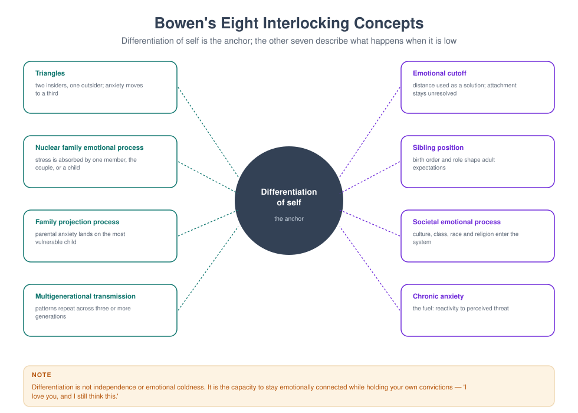
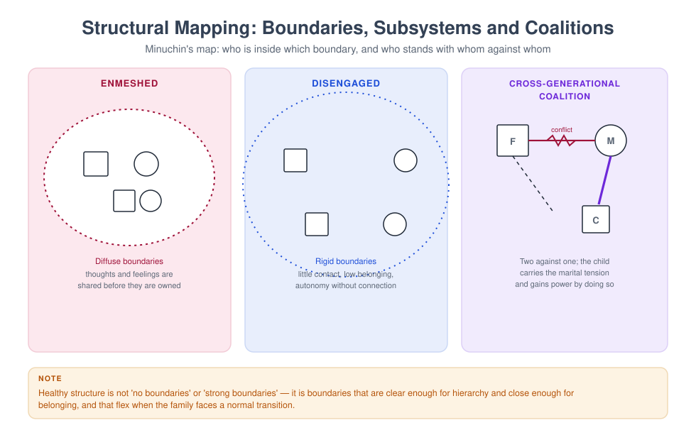
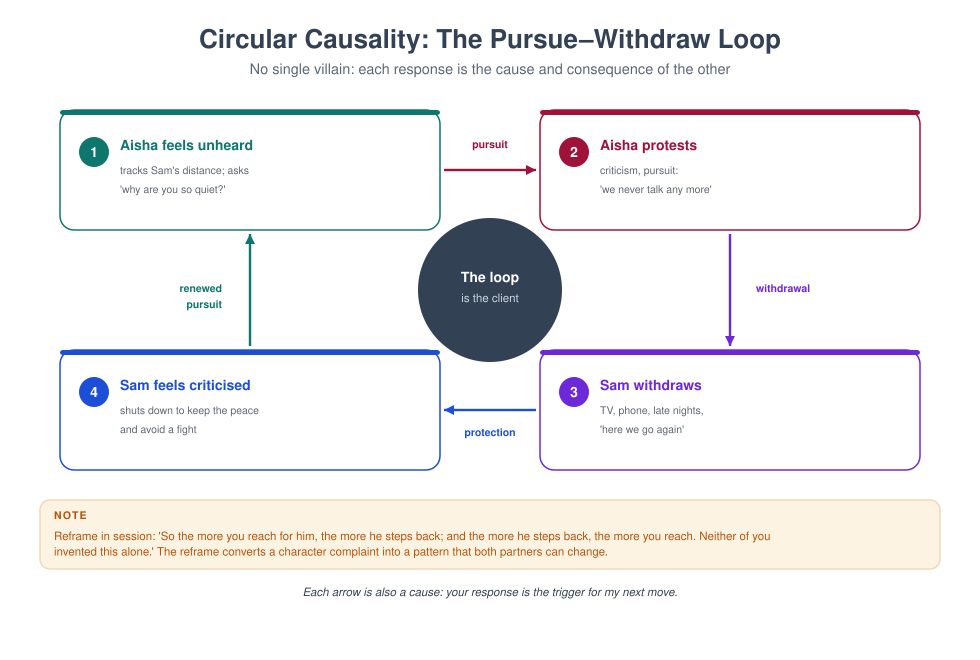
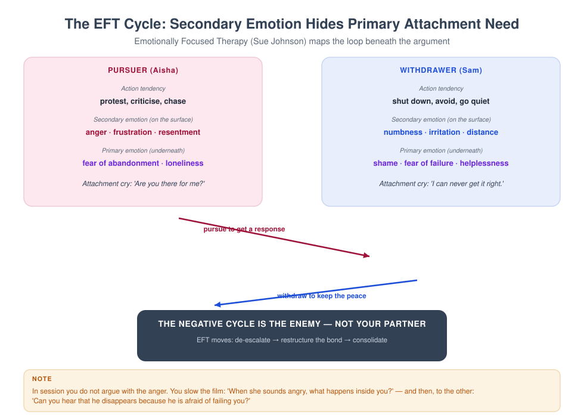
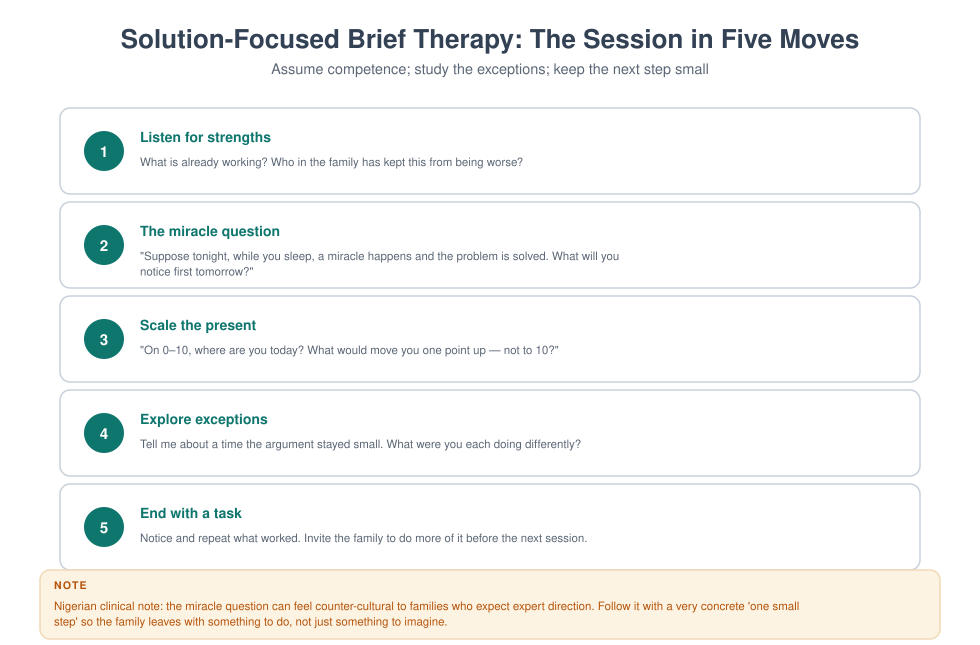
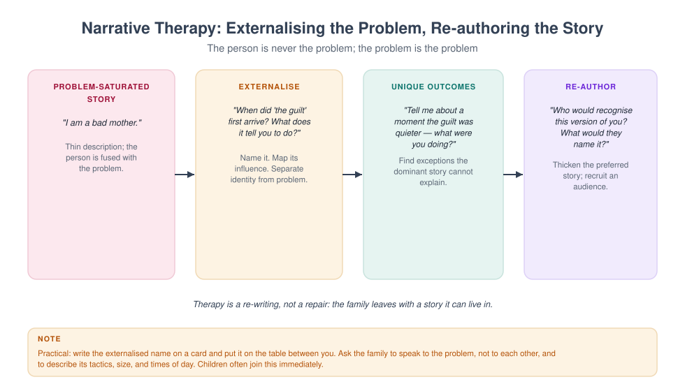

# MFT 702 — Theories of Family Therapy

> **MSc Marriage and Family Therapy** · Semester One · 1.71 Units · 14 teaching weeks · Prerequisite: MFT 701

**Course leader's summary.** Nine major schools, each treated as an answer to a specific question. You
will learn each model well enough to *do* a first session in it, critique it, and integrate it — and you
will practise moving between models on the same family until the choice becomes deliberate rather than
habitual.

---

## How to use this book

Theory is learned in three passes. **Pass one:** understand the model's core question and its
intervention. **Pass two:** apply it to a case you know. **Pass three:** critique it and ask what it
cannot see. Each week in this book gives you all three, plus the practical that makes the pass real. Do
not memorise lists of techniques; memorise *what problem each model believes it is solving*.

---

## 1. Course description

There is no single "correct" family therapy. There are traditions, each with a theory of how problems
develop, a theory of change, a preferred focus of attention, and a characteristic set of techniques. A
clinician who knows only one model does not have a theory; they have a habit.

This course therefore pursues three aims: **comparative competence** (you can describe and demonstrate
each major model), **critical appraisal** (you can name each model's evidence base and its blind spots),
and **integration** (you can combine two models coherently in one case rather than dithering between
them).

**Organising question.** For each model, ask: *What does this model believe is the problem, and what
does it therefore do first?*

---

## 2. Learning outcomes

| # | Outcome | Assessed |
|---|---|---|
| LO1 | Describe the theoretical foundations, core concepts and change mechanisms of nine major models | Exam |
| LO2 | Demonstrate a model-consistent first session for at least three models | Skills assessment |
| LO3 | Compare models on focus, technique, role of the therapist and evidence | Comparative matrix |
| LO4 | Identify the blind spots and cultural assumptions of each model | Essay |
| LO5 | Construct a coherent integrative plan for a single case using two models | Case assignment |
| LO6 | Justify model choice with reference to the client, the evidence and your own competence | Viva |

---

## 3. Assessment

| Component | Weight | Due |
|---|---|---|
| Comparative matrix (nine models × six dimensions) | 20% | Week 7 |
| Observed model-consistent session (20 min) | 20% | Weeks 8–10 |
| Integrative case study (2,500 words) | 30% | Week 12 |
| Written examination | 30% | Week 15 |

---

## 4. The fourteen-week plan

| Week | Model / topic | Practical | Key text |
|---|---|---|---|
| 1 | How to compare theories: six dimensions | Matrix construction | Nichols ch. 1 |
| 2 | Psychoanalytic and object-relations family therapy | Genogram + interpretation exercise | Scharff & Scharff |
| 3 | Bowen's multigenerational theory | Detriangling role-play | Bowen (1978) |
| 4 | Structural family therapy | Enactment and boundary-making | Minuchin (1974) |
| 5 | Strategic and MRI brief therapy | Directive design | Haley & Madanes |
| 6 | Milan systemic therapy | Circular questioning | Palazzoli et al. (1980) |
| 7 | Experiential and human validation (Satir, Whitaker) | Sculpture exercise | Satir (1988) |
| 8 | Cognitive-behavioural and behavioural couple therapy | Behavioural exchange design | Epstein & Baucom |
| 9 | Emotionally focused therapy | EFT enactment | Johnson (2019) |
| 10 | Solution-focused brief therapy | Miracle question and scaling | de Shazer (1985) |
| 11 | Narrative therapy | Externalising conversation | White (2007) |
| 12 | Integration: combine two models without incoherence | Case integration workshop | Lebow (2014) |
| 13 | Evidence, culture and critique of each model | Debate | Sprenkle et al. |
| 14 | Your theoretical position | Position paper presentation | — |

---

## Week 1 — How to compare theories: six dimensions

Every model in this course will be described on the same six axes. Learn to fill the grid from memory and you will
be able to enter any family therapy conversation — an interview, a case conference, a viva — with something more
useful than an opinion. Learn the models as nine separate stories and you will have nine stories and no method.

### 1.1 The lecture in ninety minutes

| Minutes | Segment | What the lecturer does | What students do |
|---|---|---|---|
| 0–10 | The problem with model surveys | Two clinicians, one family, incompatible first questions | Predict what each will do in the first five minutes |
| 10–25 | The six dimensions | Define each, with a counter-example | Fill two rows of the matrix from memory |
| 25–40 | Theory of problem as master dimension | Show how the other five follow from it | Derive a model's techniques from its theory of problem |
| 40–55 | Three levels of knowing a model | Describe, demonstrate, critique | Rate themselves on each level for one model |
| 55–70 | Comparing three models on one case | Fill the grid live from the Adeyemi material | Add a fourth model |
| 70–85 | The reduction test and the charity test | Apply both to a claim about a model | Test two claims in pairs |
| 85–90 | Set the assessment | The matrix, its due date and its marking | Plan their matrix file |

### 1.2 Why comparison is a skill

A clinician who knows one model does not have a theory; they have a habit. That sentence is the premise of the course,
and this week explains why it is true and what to do about it.

**What comparison is for.** Four uses, each practical.

*First, it makes the first session deliberate.* The first five minutes of a family session are shaped by a model
whether or not the therapist has chosen one. The structural therapist moves to the hierarchy; the narrative therapist
asks what name the family would give the problem; the emotionally focused therapist watches for the cycle. Comparison
allows the therapist to know which of these they are doing, and to choose.

*Second, it protects against the single-story error.* Every model has a characteristic blind spot, and the blind spot
is usually the same as its strength. A therapist who cannot name the blind spot of their preferred model cannot see
the family that the model is failing.

*Third, it makes referral and supervision possible.* Knowing that a family needs something you do not do is the
beginning of professional judgement. Knowing it in the vocabulary of the field — "this family needs a structural
first phase and then narrative work" — makes the referral legible to a colleague.

*Fourth, it is examinable, and it is examined everywhere.* The comparative matrix, the viva, the case study: all three
assessments in this course are applications of the six dimensions. Students who build the matrix properly in Week 1
are doing the exam in October.

**What comparison is not.** It is not a listing of techniques, a history of ideas, or an argument about which model
is best. It is a method for answering a specific question about any model: *what does this model believe the problem
is, and what does it therefore do first?*

### 1.2a How to study nine models in fourteen weeks

The course is short and the field is large, so the method matters as much as the effort. Five practices distinguish
students who can use the models from students who can list them.

**Practice 1 — one primary text per model, chosen for size.** Not the complete works; a single book or long chapter
that the model's author wrote for practitioners. For each model in this course, the reading list gives one such text.
Read it in the week, at speed, for the model's own vocabulary; the secondary summaries will then have something to
attach to.

**Practice 2 — the one-sentence discipline.** At the end of each reading session, write the theory of problem in one
sentence, in the author's terms, and then write a second sentence saying what the author believes is *not* the
problem. The second sentence is what distinguishes models, because every model defines itself against a predecessor.

**Practice 3 — apply the model to a family you know.** Not a hypothetical family: the Adeyemi case, or a family from
placement, or the running case in the seminars. Each week, write one page applying the new model to the same family.
By Week 11 you will have eleven pages on one family, which is the best comparative document you will ever own,
because the family is held constant and only the lens changes.

**Practice 4 — record yourself at level 2 once per model.** Twenty minutes with a role-played family, in the model's
terms, recorded. Watch it with the model's signature techniques written in front of you and count how often you used
them. Most students find that they used the techniques of the model they learned first, whatever model they were
attempting, which is the clearest possible demonstration of why deliberate practice exists.

**Practice 5 — keep a disagreement file.** Every time a model's claim conflicts with another's, or with the evidence,
or with your own experience, write the conflict down in two sentences with the date. Bring the file to the seminars.
The disagreements are the material of the essay, and they are what the viva will test.

**What the practices have in common.** They all convert reading into something that can be observed: a sentence, a
page, a recording, a note. Reading alone produces the illusion of knowledge that the first seminar exposes, and the
practices are designed to expose it earlier, in private, where it costs nothing.

### 1.3 The six dimensions

The grid is the spine of the course. Each dimension is a question with a determinate answer for each model, and the
answers are not independent: the first dimension generates most of the others.

| Dimension | The question it answers |
|---|---|
| **Theory of problem** | How does this model believe problems develop and persist? |
| **Unit of focus** | Individual, dyad, family structure, meaning system, or context? |
| **Theory of change** | What must happen for things to improve? |
| **Therapist position** | Director, coach, collaborator, witness, expert? |
| **Signature techniques** | What does this model characteristically do? |
| **Evidence base** | What is the strength and quality of supporting research? |

**Dimension 1 — theory of problem.** How does this model believe problems develop and persist? This is the master
dimension. A model that believes problems are maintained by structure will intervene in structure; a model that
believes they are maintained by meaning will intervene in meaning; a model that believes they are maintained by
unexpressed emotion will intervene in emotion. Everything else follows, and a student who cannot state the theory of
problem in one sentence has not learned the model.

**Dimension 2 — unit of focus.** What is the model looking at? The individual in context, the dyad, the triadic or
hierarchical structure, the family's meaning system, the multigenerational transmission, or the wider context of
institutions and culture. The unit determines what counts as data and what counts as noise. To the structural
therapist, a mother's tearfulness is data about the family's organisation; to the emotion-focused therapist, the
organisation is data about the tearfulness.

**Dimension 3 — theory of change.** What must happen for things to improve, and in what order? Some models believe
insight precedes change; some that change precedes insight; some that a small difference is sufficient; some that
the system must be destabilised before it can reorganise. This dimension predicts the shape of the therapy — its
length, its pacing, and what the therapist will do when nothing is happening.

**Dimension 4 — therapist position.** Director, coach, collaborator, witness, expert, non-expert, consultant. The
position determines who speaks, who decides, and what the family is told about what is happening. It is the dimension
most visible to families, and the one trainees most often adopt by accident.

**Dimension 5 — signature techniques.** What does this model characteristically do? Enactment, reframing, circular
questioning, genogram, sculpture, externalising, miracle question, behavioural exchange, two-chair work. Techniques
are the easiest dimension to learn and the least useful on their own, because a technique divorced from its theory of
problem is a gesture.

**Dimension 6 — evidence base.** What is the strength and quality of the research support, for what presentations, and
with what limits? This dimension is the one most often omitted in textbooks and most likely to be tested in a viva,
because a clinician's claim about evidence is a claim about what they owe a family.

**Two further dimensions worth adding to the matrix.** The six are the required grid; two more make it a professional
instrument.

*Dimension 7 — cultural assumptions.* Every model carries a picture of a healthy family, and that picture has a
culture. A model that prizes individuation will read a three-generational household differently from a model that
prizes interdependence. The question is not whether the model has cultural assumptions — all do — but what they are,
and what they make the model unable to see.

*Dimension 8 — the characteristic blind spot.* What does this model systematically not notice? The blind spot is not
a defect to be apologised for; it is the shadow of the model's strength, and it is the most useful thing a
comparative therapist knows.

### 1.4 Theory of problem as the master dimension

The claim that the first dimension generates the others is testable in an exercise that takes ten minutes and is worth
a term of reading.

**The exercise.** Write down, in one sentence, what a model believes maintains the problem. Then derive, without
looking anything up, what its unit of focus must be, what its theory of change must be, what position its therapist
must occupy, and two techniques it must use.

**Worked derivation 1 — structural.** *Theory of problem:* difficulties are maintained by the family's organisation —
unclear hierarchies, inappropriate boundaries, cross-generational coalitions. *Unit of focus:* the whole family as a
structure, with subsystems. *Theory of change:* the structure must change in the room, through action, before
understanding follows. *Therapist position:* active director, at times stage-manager. *Techniques:* enactment,
unbalancing, boundary-making, spatial rearrangements.

**Worked derivation 2 — narrative.** *Theory of problem:* difficulties are maintained by the dominant stories that
families and institutions hold about their members, and by the practices those stories make possible. *Unit of
focus:* the meaning system, and the social context in which meanings circulate. *Theory of change:* the story must be
made visible, the person separated from the problem, and a preferred account thickened. *Therapist position:*
collaborative, curious, decentred but influential. *Techniques:* externalising, re-authoring, unique outcomes,
definitional ceremonies.

**Worked derivation 3 — emotion-focused.** *Theory of problem:* distress is maintained by rigid negative interactional
cycles that organise around unexpressed primary emotion and unmet attachment needs. *Unit of focus:* the couple's
cycle, and the attachment bond that the cycle protects. *Theory of change:* the cycle must be slowed, the primary
emotion accessed and expressed, and a new cycle enacted in the room. *Therapist position:* active, empathic, a
process consultant who stages the encounter. *Techniques:* tracking the cycle, reframing in terms of the cycle, the
enactment, and the "hold me tight" conversation.

**What the derivations demonstrate.** That a model is a system, not a list. Students who can generate the five other
dimensions from the first have understood a model; students who have memorised six columns have not. The examination
will ask for a derivation, in some form, every year.

### 1.4a The six dimensions as questions you can ask a family

The grid is usually taught as an instrument for reading textbooks. It is more useful as an instrument for the room,
because each dimension can be converted into a question that changes what the family tells you.

**From theory of problem to a question about maintenance.** *Model reading:* the model believes something specific
maintains the problem. *Question:* "What keeps this going, do you think? Not how it started — what keeps it going
now?" Families answer this question with a mechanism, and the mechanism they describe is often more accurate than the
formulation in the referral.

**From unit of focus to a question about who matters.** *Question:* "Who else is affected by this — and who else has
an opinion about it?" In families where the meaningful unit is wider than the household, this question recruits the
grandmother, the aunt or the pastor into the conversation before the therapist has decided they are relevant.

**From theory of change to a question about what has helped before.** *Question:* "When it has been better, even for
a week, what made the difference?" This question tests the model's theory of change against the family's own
experience: if the family's answer is "we agreed one thing and stuck to it", a structural first move is indicated; if
it is "we stopped talking about it and it faded", a solution-focused approach has better odds.

**From therapist position to a question about what the family wants from you.** *Question:* "Some families want me to
tell them what to do; others want me to help them work it out. Which would be more useful to you?" The answer is not
binding, and asking it prevents the commonest early rupture: a family expecting direction receiving exploration, or
the reverse.

**From signature technique to a question about what the family has already tried.** *Question:* "What have you tried,
and what happened?" This is the shortest route to the model's technique, because the family's failed solutions are
usually the inverse of what the model would do.

**From evidence base to a question about the family's own data.** *Question:* "Would you be willing to rate how things
are each week, so we can see whether this is working rather than guessing?" The evidence dimension made operational.

**The point of the exercise.** A dimension that cannot generate a question is a dimension the student has learned
verbally. The test of understanding a model is not that you can describe its unit of focus but that you know what to
ask a family in order to work with it.

### 1.5 Three levels of knowing a model

A student can be at three different levels with the same model, and the levels are assessed separately.

**Level 1 — describe.** You can state the theory of problem, the unit of focus, the theory of change, the therapist
position, two or three techniques and the evidence base, in your own words, without notes. This is the level required
for the written examination, and it is the level at which most textbooks stop.

**Level 2 — demonstrate.** You can conduct twenty minutes of a model-consistent session with a role-played family, so
that an observer who knows the model can identify it from the transcript without being told. This is the level
required for the observed session, and it is much harder than describing, because it requires knowing what the model
sounds like: the actual sentences, the pacing, the shape of the first ten minutes.

**Level 3 — critique.** You can state the model's blind spot, its cultural assumptions, the presentations for which
the evidence is strong and weak, and what you would do when the model fails. This is the level required for the essay
and the viva, and it is the level at which a clinician becomes safe to practise, because it is the level at which
they know when to stop.

**The diagnostic.** For each model in this course, rate yourself 0–3 on each level: 0 (cannot), 1 (with notes),
2 (reliably), 3 (can teach it). Bring the grid to the Week 7 practical. Most students overrate level 1 and underrate
level 2, and the pattern is worth knowing about oneself.

**Why the levels matter for the matrix.** The comparative matrix is a level 1 instrument. It is necessary and it is
not sufficient. A student who can fill the matrix and cannot demonstrate a single model has learned a taxonomy, not a
therapy.

### 1.6 Comparing three models on one family

The Adeyemi family, from MFT 701, is the running case. The grid below is filled for three models, and the fourth
column is the week's exercise.

| Dimension | Structural | Bowen | Solution-focused |
|---|---|---|---|
| Theory of problem | Maintained by unclear hierarchy, diffuse or rigid boundaries, cross-generational coalitions | Maintained by anxiety transmitted across generations and absorbed by the most vulnerable member; triangles | Maintained by a problem-saturated description and by the family's attention to what is not working |
| Unit of focus | Whole family as a structure, with subsystems and boundaries | Multigenerational emotional system; triangles; differentiation | The family's description of the problem and its preferred future |
| Theory of change | Restructure in the room; action before insight | Lower reactivity, raise differentiation, detriangle | Build a description of the solution and amplify existing exceptions |
| Therapist position | Active director, stage-manager | Coach, neutral observer of process | Curious collaborator, expert in process not in lives |
| Signature techniques | Enactment, unbalancing, boundary-making | Genogram, coaching, detriangling questions | Miracle question, scaling, exception-seeking |
| Evidence base | Moderate: strong for adolescent behaviour problems and eating disorders in adapted forms | Thin: influential, widely taught, little trial evidence | Moderate for depression and behaviour problems in brief formats; strong evidence for the *components* (goal setting, scaling) |
| Cultural assumption | A family should have a clear hierarchy with parents in charge | Differentiation is a good; the individual should think for themselves | The family can describe a preferred future and act on it |
| Blind spot | Can impose a structure the family experiences as foreign; may miss meaning, loss and material conditions | Slow; may intellectualise; may under-attend to practical and institutional pressure | May bypass the function of the symptom and the history that sustains it |

**What the grid shows at a glance.** Three competent clinicians, one family, three different first sessions — and
none of them is wrong. The grid also shows why model loyalty is a temperamental matter: the structural column appeals
to therapists who want to act, the Bowen column to therapists who want to understand, the solution-focused column to
therapists who want to build. The professional question is not which temperament is best but which the family needs.

**The fourth column.** Fill it for narrative therapy before the seminar, from the reading, and bring it. The exercise
is deliberately placed before the seminar so that students discover what they cannot yet do.

### 1.6a The matrix as a clinical instrument: choosing under pressure

In a real clinic the matrix is used in ninety seconds, in a corridor, with a referral in your hand. Three ways it
earns its keep.

**Case 1 — the referral that does not fit your model.** A family is referred for a child's behaviour problems. You
work structurally. The referral letter says the parents separated two years ago, the child sees the father fortnightly,
and the mother reports that the boy "is fine with his father and impossible with me". The matrix question is: whose
unit of focus does this fit? The structural lens would look at the mother–son subsystem; the matrix reminds you that
the child's split presentation across two households is a different unit, and that a model with a place for
triangulation across households (or a systemic model that treats the two households as one system) may be indicated.
The matrix has not told you what to do; it has stopped you from doing the obvious thing.

**Case 2 — the family that has already had two therapies.** A couple arrives having had behavioural couple therapy
(which they found mechanical) and then six sessions of a psychodynamic approach (which they found slow). The matrix
question is: what theory of change have they already tested and rejected, and what remains? A therapist who knows the
grid can offer a third mechanism deliberately — an emotion-focused or narrative approach — rather than repeating
what has failed, and can say why: "You have tried changing what you do and you have tried understanding where it came
from. There is a third route: changing what happens between you in the moment."

**Case 3 — the model you cannot deliver.** A family presents with an adolescent's anorexia. You are trained in
structural and narrative work and not in family-based treatment. The matrix's evidence column says the specific
evidence is strongest for a model you do not practise. The professional response is visible in the grid: refer, or
co-work, or seek training — and say so to the family. The matrix is at its most useful when it tells you that you are
not the right clinician.

**What all three cases share.** The matrix is not a decision procedure that produces an answer. It is a discipline
that widens the options visible to a therapist under pressure, which is where most clinical errors are made.

### 1.7 The reduction test and the charity test

Two habits of thought that prevent most of the errors in this course.

**The reduction test.** When you are tempted to say that a model is "just" something — "structural therapy is just
common sense about who is in charge", "narrative therapy is just reframing with better marketing" — apply the
reduction test: does the reduction preserve the model's distinctive claim about what maintains the problem? If not,
the reduction is a dismissal in disguise. Structural therapy's claim is not that hierarchy is obvious; it is that
hierarchy is enacted in the room, in the present, in observable space, and that changing the enactment changes the
family. That claim is not common sense, and it can be tested.

**The charity test.** When you are tempted to defend a model against a criticism, apply the charity test: state the
criticism in its strongest form, in the critic's own terms, before answering it. A model defended against a weak
version of the objection has not been defended. This is the discipline that the essay assessment rewards, and it is
the discipline that distinguishes a professional from a partisan.

**How the two tests work together.** The reduction test stops you dismissing a model too quickly; the charity test
stops you defending one too quickly. Between them they produce the posture this course is trying to teach: interested,
informed, uncommitted to a conclusion, and able to act.

> **PRACTICAL** — Take one criticism of each of the three models in 1.6 — for example, "structural therapy is
> manipulative", "Bowen theory is untestable", "solution-focused therapy ignores suffering". State each in its
> strongest form in two sentences, then write the best available answer in two sentences. Bring all six sentences to
> the seminar.

### 1.8 The same ten minutes, three times

A transcript exercise that makes the grid concrete. The family is the Adeyemis; the first ten minutes are written
three times, in the voice of three models, and the differences are marked.

**Version A — structural.**

> **Therapist:** Before we start, I want to know who is in charge of the school question in this house, because
> somebody has to be. Mrs Adeyemi, when the school telephones, who decides what happens?
>
> **Mother:** I do. He is not here.
>

> **Therapist:** And when he is here, at the weekend?
>
> **Mother:** Then he decides, and then he tells me I have done it wrong.
>

> **Therapist:** So in this house there are two governments, and Amara lives in both of them. (to Amara) Which one do
> you go to first?
>
> **Amara:** My mum. She says yes.
>

> **Therapist:** (to the parents) I want the two of you to sit together for the next ten minutes and decide one thing
> about Monday, while Amara and I listen. Not negotiate — decide.

**What this version does.** It establishes the hierarchy question in the first ninety seconds, names the coalition,
addresses the child directly with a question that reveals the coalition, and moves immediately to an enactment. It
uses space and action. Note what is absent: no history, no feelings, no exploration of what the family has tried.

**Version B — Bowen.**

> **Therapist:** I want to start with each of you, one at a time, and I want to ask about the anxiety in this house
> rather than about the school. Mrs Adeyemi, when Amara says she is not going, what happens inside you?
>
> **Mother:** I panic. My chest. Then I am angry.
>

> **Therapist:** And when you panic, what do you do?
>
> **Mother:** I telephone the school. I fix it. I have always fixed things.
>

> **Therapist:** You have always fixed things. Who taught you that?
>
> **Mother:** (pause) Nobody taught me. I had to.
>

> **Therapist:** And Mr Adeyemi, when you come home on Friday and hear about the week, what happens inside you?
>
> **Father:** I am tired. I say what she should have done.
>

> **Therapist:** And what happens then?
>
> **Father:** She says I am never here. Then we do not talk.

**What this version does.** It slows everything down, asks about inner process rather than behaviour, links the
mother's reactivity to her history without interpreting it, and brings the father in as a person with a process rather
than as an absent authority. It gives no task in ten minutes and does not intend to.

**Version C — solution-focused.**

> **Therapist:** I want to ask a different kind of question before we talk about the problem. Suppose tonight,
> while you are asleep, the school situation is sorted. What is the first thing you notice tomorrow morning that
> tells you something has changed?
>
> **Mother:** (pause) I would wake up and not feel sick.
>

> **Therapist:** You would wake up and not feel sick. What would you do then, that you do not do now?
>
> **Mother:** I would make breakfast. I would call her once, normally, and then I would sit down.
>

> **Therapist:** Amara, what would your mother see you doing?
>
> **Amara:** I would get up.
>

> **Therapist:** You would get up. When was the last morning that happened, even a bit?
>
> **Amara:** September. When my aunty's wedding was on.
>

> **Therapist:** What was different about that morning?

**What this version does.** It begins with a preferred future rather than a problem, produces a behavioural
description, recruits the adolescent, and finds an exception inside three minutes. Note that it does not deny the
problem: the mother's "not feel sick" is a precise description of suffering, elicited without a single question about
the problem.

**What the comparison teaches.** All three versions are recognisably competent. They differ in what they treat as
data, in what they do with the first ten minutes, and in what they leave for later. A student who can hear which model
is speaking, from the transcript alone, has reached level 1 and is on the way to level 2.

**The exercise.** Read the three versions aloud in groups, one student per version, without announcing which model.
The listeners identify the model and name the two sentences that gave it away. The sentences are almost always the
same: the structural version gives itself away with a decision; the Bowen version with a question about inner
process; the solution-focused version with a question about a future.

### 1.9 Laboratory: building the matrix

The week's practical runs in class and continues for six weeks. It is worth 20% of the course, and it is the single
most useful document a student will produce this term.

**The specification.** A spreadsheet or table with nine rows (the nine schools in this course) and eight columns (the
six required dimensions plus cultural assumptions and blind spot). One to three sentences per cell. Every cell must
be in the student's own words: copied text is not accepted, and the plagiarism check will find it.

**The build schedule.** One row per week, completed before the seminar; the row for a model is discussed in the
seminar and revised afterwards. By Week 7, nine rows are complete and the matrix is submitted with a covering note.

**The covering note (500 words).** Three questions: which model was hardest to fill and why; which cell did you
change your mind about during the term; and what does the matrix as a whole tell you about the field that you did not
know in Week 1?

**Marking rubric.**

| Criterion | Weight | Full marks |
|---|---|---|
| Completeness | 20% | Nine models × eight dimensions, no empty cells, no copied text |
| Fidelity to each model | 30% | The theory of problem of each model is stated in that model's own terms, not reduced to another's |
| Derivative coherence | 20% | Techniques and therapist position are visibly derived from each model's theory of problem |
| Evidence accuracy | 15% | The evidence cell distinguishes what is strong, moderate and thin, and does not overstate |
| Critical columns | 15% | Cultural assumptions and blind spots are specific, not generic ("all models have biases") |

**The two commonest failures.** The first is a matrix in which every model's theory of problem is a paraphrase of the
same idea — "the problem is maintained by the family's patterns" appears nine times, which tells the marker that no
model has been understood. The second is an evidence column that says "limited evidence" for every model, which is
true of none of them and useless in all.

**A worked cell, to show the standard.** For Milan systemic therapy under *theory of problem*: "Problems are
maintained by the family's belief system and by the punctuation of events that the family and its helpers share; the
symptom is a communication in a system that has become rigid around a premise nobody has examined." That cell is
specific, it is in the model's terms, and it could not be transplanted into another model's row.

### 1.9a An annotated matrix row, and a row that fails

Two rows for Milan systemic therapy: one that would earn full marks, one that would earn a bare pass. The comparison
is the quickest way to teach the standard.

**The row that works.**

> *Theory of problem:* The family's difficulties are maintained by a belief system — a premise held by the family and
> shared with its helpers — and by the punctuation of events that keeps the premise unexamined; the symptom is a
> communication in a system that has become rigid around the premise.
>
> *Unit of focus:* The family's meanings, and the observing system that includes the therapy team and the referring
> agency.
>
> *Theory of change:* The premise must be made visible and disturbed; change follows from new information and
> difference, not from instruction.
>
> *Therapist position:* Curious, neutral (in the Milan sense of neutral toward all descriptions), working with a team
> behind a screen or, in later versions, with a reflecting team.
>
> *Signature techniques:* Circular questioning, positive connotation, rituals, the hypothesising-team intervention, the
> letter.
>
> *Evidence base:* Thin as a model in randomised trials; the components — circular questioning, reflecting teams,
> systemic hypothesising — are widely used and studied qualitatively; there is no strong specific evidence for
> Milan systemic therapy as a package with any presentation, and the honest cell says so.

**Why it works.** The theory of problem is in Milan's own vocabulary ("premise", "punctuation", "communication"), the
theory of change is derived from it rather than added, the therapist position includes the team because the team is
constitutive of the model, and the evidence cell distinguishes the package from the components and declines to
inflate either.

**The row that fails.**

> *Theory of problem:* Family problems come from bad communication.
>
> *Unit of focus:* The family.
>
> *Theory of change:* Better communication.
>
> *Therapist position:* Neutral.
>
> *Signature techniques:* Circular questions, reframing.
>
> *Evidence base:* Limited.

**Why it fails, cell by cell.** "Bad communication" could describe five models on this course and therefore describes
none. "The family" is the unit of focus for every model in the book. "Better communication" is a restatement of the
problem, not a theory of change. "Neutral" is a word Milan borrowed and redefined; the row does not say what the
redefinition is. "Reframing" is not a Milan technique in the technical sense. And "limited" in the evidence cell is
the flat answer that tells the marker the student has not read anything.

**The lesson, stated once.** A matrix row is good when a reader who knows the model could identify it from the row
alone, with the model's name removed. Try that test on your own rows each week: cover the name and see whether the row
is identifiable. If it could be any of three models, rewrite it.

### 1.10 Six errors in comparing models

1. **The catalogue.** Learning nine lists of techniques and no theories. Fix: derive the techniques from the theory of
   problem for every model, out loud, before you write the row.
2. **The reduction.** "They are all doing the same thing with different words." Sometimes a useful hypothesis and
   always an untested one. Fix: the reduction test in 1.7, applied to the model's distinctive claim.
3. **The straw model.** Comparing the strongest version of your own model with the weakest version of another's. Fix:
   read one primary text per model, not only the summary in a textbook.
4. **The flat evidence column.** Treating all models as equally evidenced or equally unevidenced. Fix: distinguish
   between *specific* evidence (a model tested for a presentation) and *component* evidence (an element used across
   models), and say which you mean.
5. **The cultural silence.** Filling eight columns and leaving out the assumptions that make the model possible. Fix:
   for each model, ask what kind of family its picture of health describes, and who that picture excludes.
6. **The premature commitment.** Choosing a favourite model in Week 2 and reading everything thereafter as support
   for it. Fix: the essay requires you to argue against your own preferred model; do that draft early.

### 1.10a The viva question bank

The viva in Week 15 examines the matrix, the case study and the position paper. These are the questions it is built
from, and they can be practised in pairs from Week 1.

**On comparison.** "Compare two models' theories of change and say which you would choose for this family, and why."
"Which two models on your matrix have the most similar theory of problem, and what follows from the similarity?"
"Which cell in your matrix was hardest to fill, and what does that tell you about the model?"

**On fidelity.** "Demonstrate, in words, how a Milan therapist would respond to this sentence." "What would a
solution-focused therapist do differently in the first five minutes, and why?" "Which sentence in this transcript is
not consistent with the model, and what would the model's author have said instead?"

**On evidence.** "What is the strongest evidence for this model, and with which presentation?" "What would you say to
a family who asked whether this approach works?" "Where is the evidence thinnest, and what do you do about that in
practice?"

**On critique.** "What is this model's blind spot?" "What cultural assumptions does this model carry, and how would
they land with this family?" "What would have to happen in a session for you to conclude that the model was the wrong
choice?"

**On integration.** "Combine two models for this case and justify the combination, the sequence and the point at
which you would switch." "What would incoherence look like in your plan, and how would you avoid it?"

**On self.** "Which model are you most tempted by, and what does that temptation tell you?" "What are you not yet able
to do at level 2?" "What will you have changed your mind about by the end of the course?"

**How to practise.** Take one question per seminar, answer it in ninety seconds without notes, and let a peer ask the
follow-up. The viva is twenty minutes of exactly this, and the students who do it weekly are unrecognisable by Week 12.

### 1.11 Culture, faith and the comparative gaze

Comparison is not culturally neutral. Three cautions.

**The models were made in particular places.** Structural therapy in the Philadelphia of the 1960s, Milan in the
Italian psychiatric reform, solution-focused therapy in Milwaukee, narrative therapy in Adelaide and Auckland,
emotion-focused therapy in Ottawa. Each carries the assumptions of its setting, including assumptions about
authority, individuality, the state, the family form, and the therapist's mandate. A model exported without those
assumptions examined will misread families, and will do so most confidently where the family is least like the
model's origin.

**The comparative gaze can become a ranking.** A matrix invites the question "which is best?", and the answer will
always be shaped by the culture of the assessor. A model that prizes individuation will rank a model that prizes
hierarchy as backward; a model that prizes hierarchy will rank the first as naive. The professional discipline is to
hold the matrix as descriptive, and to answer "best for whom, for what, in whose judgement?"

**Faith enters at the level of the model's anthropology.** Every model carries an implicit account of what a person
is: a system of internal objects, a differentiated self, a member of a structure, a storyteller, an attachment-seeking
organism. Families whose faith gives them a different anthropology — a person as a soul under authority, as a member
of a covenant community — will experience some models as congruent and others as alien. The comparative question is
therefore also a theological one, and it belongs in the matrix: which model's picture of a person can this family
recognise?

> **DEBATE** — "Any attempt to compare models on a single grid will favour the models that fit the grid's
> assumptions." Argue for and against, using one model from this course that resists the six dimensions.

### 1.11a Where each model's theory of problem came from

A short historical note for each of the nine schools, because a model's origin explains its blind spot more reliably
than its textbook description does.

| Model | Origin and founding problem | What the origin explains about the blind spot |
|---|---|---|
| Psychoanalytic family therapy | Post-war Britain; the problem was the internal world carried into relationships | Attends to depth; under-attends to structure, money and institutions |
| Bowen | Post-war America; the problem was the transmission of anxiety across generations | Attends to the multigenerational system; treats the present context thinly |
| Structural | Philadelphia, 1960s; the problem was the organisation of poor, multi-problem families | Attends to hierarchy and action; can miss meaning, loss and culture |
| Strategic / MRI | Palo Alto, 1960s; the problem was the attempted solution that maintains the symptom | Attends to sequence and to what works; can be manipulative and under-attends to consent |
| Milan | Italy, 1970s; the problem was the family's premises and the helpers' punctuation | Attends to belief and to the observing team; can be intellectual and slow |
| Experiential | America, 1960s–70s; the problem was the absence of genuine contact and feeling | Attends to immediacy and the therapist's use of self; thin on evidence and structure |
| Behavioural / CBT couple | America and Britain, 1970s; the problem was the reinforcement of aversive exchange | Attends to observable behaviour; can under-attend to meaning and attachment |
| EFT | Ottawa, 1980s; the problem was the rigid cycle organised around unmet attachment need | Attends to emotion and attachment; may under-attend to material conditions |
| Solution-focused | Milwaukee, 1980s; the problem was the problem-saturated description | Attends to solutions; can bypass suffering and history |
| Narrative | Adelaide and Auckland, 1980s–90s; the problem was the internalisation of dominant stories | Attends to meaning and power; can remain at the level of description |

**How to use the table.** In the viva, the question "what is this model's blind spot?" is answered best by pointing to
the problem the model was built to solve. Every model is a solution to a historical problem, and it inherits the
blindness of that problem. A structural therapist in 1960s Philadelphia was not asked to think about colonial
internalisation; a narrative therapist in 1990s Auckland was not asked to manage a psychosis relapse. The model is not
at fault; the therapist who applies it outside its problem is.

### 1.12 Evidence note: what comparison can and cannot establish

The comparative literature is large and its findings are less exciting than students expect.

**What is established.** Bona fide models produce broadly similar outcomes across many presentations; differences,
where they appear, are usually small and often confined to specific presentations or sub-groups. The strongest
specific effects are where a model targets a well-defined mechanism in a well-defined condition — family-based
treatment for adolescent anorexia is the standard example. Therapist effects are substantial, and the alliance is
among the more robust predictors across models.

**What is not established.** That any one of the nine schools is superior overall; that model allegiance predicts
outcome; that training in more models produces better outcomes. The comparative question "which model is best?" has
no general answer in the literature, and clinicians who claim one are usually reporting their own experience.

**What follows for the matrix.** The evidence column should be filled with three questions in mind: what is the
evidence for this model as a whole; what is the evidence for this model with a specific presentation; and what is the
evidence for the components the model uses. A model can be weakly evidenced overall and strongly evidenced for one
presentation — this is common — and a matrix that records only the first number will mislead the student who relies on
it in a viva.

**The professional claim.** "I am using this model with this family because it targets the mechanism I believe is
maintaining the problem, because there is evidence for it with this presentation, and because it is within my
competence — and I will measure whether it is working." That sentence is defensible in any of the three assessments,
and it is the sentence this course is designed to produce.

### 1.13 Key terms

| Term | Definition |
|---|---|
| Theory of problem | A model's account of how difficulties develop and what maintains them |
| Unit of focus | What the model treats as the system of interest (individual, dyad, structure, meaning, context) |
| Theory of change | A model's account of what must happen, and in what order, for improvement |
| Therapist position | The role the model requires of the therapist, and the authority it confers |
| Signature technique | A characteristic method that follows from the model's theory of problem |
| Evidence base | The strength, quality and specificity of research support for a model |
| Blind spot | What a model systematically fails to notice, usually the shadow of its strength |
| Reduction test | Whether a proposed simplification preserves the model's distinctive claim |
| Charity test | Stating an objection in its strongest form before answering it |
| Level 1 / 2 / 3 | Describe, demonstrate, critique — three separable competences with a model |
| Model fidelity | The degree to which a session is recognisably conducted in the model's terms |
| Component evidence | Evidence for an element used across models, as distinct from evidence for a whole model |

### 1.13a Two student matrices, and what the marker sees

Two submissions, both technically complete, with very different marks. The comparison is worth an hour of seminar
time.

**Submission A.** Nine rows, all cells filled, all in the student's own words, each model described in its own
vocabulary. The evidence column distinguishes model-level from component evidence. The blind-spot column names
specific consequences: "structural work with a family whose grandmother holds executive authority will read her
authority as a boundary violation and will fail at the point of implementation". The cultural column is specific:
"assumes a nuclear household with two parents available for enactment".

**Submission B.** Nine rows, all cells filled, all in generic language. "Theory of problem: dysfunctional family
patterns. Unit: the family system. Theory of change: restructure the system. Position: active. Techniques: enactment,
reframing, questions. Evidence: mixed." The blind-spot column says "may not suit all families". The cultural column
says "must be culturally sensitive".

**What the marker sees.** Submission A demonstrates that nine models have been read and differentiated; submission B
demonstrates that nine models have been noticed. The difference is visible in three specific places, and students
should check their own drafts against them.

*First, the vocabulary test.* Does the row use words that belong to the model, or words that belong to the field? "Bad
communication" belongs to the field; "punctuation" belongs to Milan; "the attempted solution" belongs to the strategic
school; "the cycle" belongs to EFT. A matrix written in the field's vocabulary cannot distinguish the models, because
the field's vocabulary is the lowest common denominator of all of them.

*Second, the consequence test.* Does the blind-spot column name a consequence, or a sentiment? "May not suit all
families" is a sentiment. "Will fail at implementation when the family's authority structure is not the one the model
assumes" is a consequence, and it tells the reader what to watch for.

*Third, the honesty test.* Does the evidence column record what is actually known, including the awkward parts — that
Bowen theory has little trial evidence, that solution-focused therapy has better evidence for its components than for
its package, that EFT's evidence is strongest for couple distress and thinner for other presentations? A matrix that
is uniformly cautious is as uninformative as one that is uniformly enthusiastic.

### 1.14 Self-test

1. Name the six dimensions of comparison, and the two the course adds.
2. Why is the theory of problem described as the master dimension?
3. Derive the therapist position and two techniques for the Bowen model from its theory of problem.
4. What are the three levels of knowing a model, and which assessment tests each?
5. What is the reduction test, and what does it protect against?
6. What is the charity test, and why does the essay require it?
7. What three questions should the evidence column answer?
8. Give one cultural assumption carried by each of the structural and solution-focused models.

**Answers.** 1. Theory of problem; unit of focus; theory of change; therapist position; signature techniques; evidence
base — plus cultural assumptions and the characteristic blind spot. 2. Because the account of what maintains a problem
determines what the model attends to, what it does, what role the therapist takes, and what counts as change; the
other five dimensions can be derived from it. 3. Position: coach, neutral observer of process. Techniques: the
genogram and coaching the parents to lower their own reactivity (detriangling questions). 4. Describe (written
examination), demonstrate (observed session), critique (essay and viva). 5. A test of whether a proposed
simplification preserves the model's distinctive claim; it protects against dismissal disguised as summary. 6.
Stating an objection in its strongest form before answering it; the essay requires it because a model defended against
a weak objection has not been defended. 7. What is the evidence for the model as a whole; for this model with this
presentation; and for the components the model uses. 8. Structural: that a family should have a clear hierarchy with
parents in charge. Solution-focused: that a family can describe a preferred future and act on it.

### 1.15 Reflective task

Before the seminar, write 300 words on the following: which of the nine models in this course do you already believe,
and why do you believe it? Most students discover that they hold a model without having chosen it — usually the one
taught by the most persuasive lecturer, or the one that fitted their own family. Name it, state the evidence you
actually have for it, and state one thing the model cannot see. Bring the paragraph; it will be revised in Week 14.

### 1.16 Readings for this week

* **Nichols & Davis**, chapter 1, for the survey of the field and the standard comparison frame.
* **Lebow (2014)**, *Couple and Family Therapy: An Integrative Map of the Territory*, chapters 1–2, for a systematic
  comparison that treats the models as answers to clinical questions.
* **Gurman & Kniskern** or **Sprenkle, Davis & Lebow (2009)**, for the common-factors argument that will challenge the
  matrix you are building.
* **One primary text for a model you think you already know**, read for an hour, to test whether you know it at level
  1 or only at the level of the summary.
* **Carr (2019)**, the opening chapters, for the history and the structure of the field.
* **The course plan on the previous page**, read against this week's grid: for each of the nine weeks, write the one
  question you expect that model to ask, and bring the nine questions to the seminar. The exercise takes ten minutes
  and gives you a set of hypotheses to test against the reading, which is a much better use of the first week than
  trying to remember nine definitions you have not yet met.

*Next: [Week 2 — Psychoanalytic and object-relations family therapy](#week-2--psychoanalytic-and-object-relations-family-therapy)*

---

## Week 2 — Psychoanalytic and object-relations family therapy

**The question it asks.** *What unconscious processes, carried from earlier relationships, are being re-enacted in
this family now?*

### 2.1 The lecture in ninety minutes

| Minutes | Segment | What the lecturer does | What students do |
|---|---|---|---|
| 0–10 | Why start here | The first family therapists were psychoanalysts, and their problem is still live | Name one thing in a family that only this model explains well |
| 10–25 | Object relations in plain language | Internal working models, with two examples from the case bank | Map one family's internal objects |
| 25–40 | Projection and projective identification | The mechanism, demonstrated on a transcript | Locate the projection in a recorded session |
| 40–55 | Transference and countertransference in family work | Why the therapist's feeling is data | Identify their own response to a role-play |
| 55–70 | Interpretation, used sparingly | Four rules for an interpretation that will land | Draft and test one interpretation |
| 70–85 | The Tavistock and group-analytic traditions | Work with the family as an unconscious system | Compare with the individual model |
| 85–90 | Critique and the matrix row | What the model cannot see | Fill the row |

### 2.2 Core concepts

The model's vocabulary is old and its mechanisms are still in use across the field, including by therapists who
believe they do not use them. Learn the five concepts precisely.

**Object relations.** The idea that a person's early relationships are internalised as working models of self and
other — a "mother who cannot be relied on", a "self who must not need anyone" — and that these internal models shape
how later relationships are perceived and conducted. Family work extends the idea: each member brings a set of
internal objects into the household, and the family's relationships are a negotiation between them.

**Projection.** Disowning a feeling in oneself and locating it in another person. A father who cannot tolerate his own
fearfulness experiences his daughter as fragile and protects her excessively. The mechanism is not deception; it is
usually unconscious, and it is why a family's description of one member often tells you more about the describer than
the described.

**Projective identification.** Projection plus pressure: not only is a disowned part located in the other, but the
other is recruited, often subtly, to behave in accordance with it. The mother who cannot bear her own helplessness
treats her son as helpless, organises his day, speaks for him, and in time he presents as helpless — and both are
sincere. This is the model's central explanatory mechanism for the identified patient, and it is the mechanism most
often misapplied, because it is used to explain away the family's account.

**Splitting.** Experiencing people as all-good or all-bad, with the two views held separately rather than integrated.
In families it appears as the alignment in which one parent is idealised and the other denigrated, or in which one
child is the good one and another the bad one. The splitting is maintained by the family's anxiety: a whole object is
harder to hold than two halves.

**Repetition compulsion.** The re-enactment of earlier relational patterns in new relationships, including with the
therapist and the therapy. A family that has dismissed three therapists will dismiss a fourth, and the repetition is
information.

**The family as a shared unconscious system.** The synthesising idea of the school: the family is not a collection of
individual psyches but a system with its own unconscious assumptions, shared myths, and defended-against feelings, and
one member often carries the feeling the system cannot hold. This is the clearest statement of the model's theory of
problem, and it is what distinguishes the school from a set of individual psychodynamic sessions conducted in the same
room.

### 2.2a Four concepts, one family

The concepts become learnable when they are applied to a household the student can picture. The Adeyemis, read
object-relations.

**The internal objects each partner brought.** The mother's father died when she was 19 and she raised four siblings
while her own mother was unwell. Her internal model of a reliable other is a person who nonetheless cannot be leaned
on, and her model of herself is a person who copes. The father's mother died when he was 16 and he left for Lagos that
year. His internal model of loss is that the way to survive it is to leave, and his model of himself is a provider who
is not needed at home. Neither model is a pathology; both are adaptations that made sense in an earlier
circumstance.

**The projection.** The mother experiences her own unmanageable grief and helplessness — about her father, about her
own mother, about the years of coping alone — and locates it in Amara, who is described as fragile, unable to cope,
and needing to be at home. The language the mother uses about her daughter ("she cannot face it", "she is not strong
enough") is language a person might use about themselves.

**The projective identification.** The mother's care does not merely describe fragility; it organises the morning so
that Amara is never required to manage anything. Amara is spoken for, protected from the school's letters, and relieved
of the consequences. In time, Amara behaves as described — staying in her room, unable to leave — and both mother and
daughter are entirely sincere.

**The splitting.** The family's account divides the adults cleanly. The mother holds the practical and the emotional
labour and is seen as strong; the father is seen as absent and uncomprehending. Each holds one half of a whole
picture, and neither can see that the mother's strength is a defence and the father's absence is a grief.

**The repetition.** The mother is 19 again, in effect, managing a household's feeling for other people. The father is
16 again, leaving a house in which someone has been lost. The repetition is not a curse; it is the human tendency to
return to the pattern that once worked, especially under stress.

**What the formulation gives and what it costs.** It gives a compassionate account of both parents and a mechanism for
the daughter's presentation that explains why behavioural plans have failed. It costs attention to the school's
timetable, the family's money, the father's employment, and the possibility that Amara's refusal is a reasonable
response to something nobody has asked about. Both halves of that sentence belong in the formulation.

### 2.3 Therapy: the shape and the mechanism

**The shape.** Longer-term than most of the models in this course, less structured, and less task-oriented. Sessions
are typically weekly and open-ended; the therapist's attention is on what is happening between the members and between
the family and the therapist; the work moves slowly and is expected to.

**The mechanism.** Two elements, both contested and both useful.

*First, containment.* The therapist holds difficult feelings without evacuating them — that is, without immediately
turning them into advice, reassurance or a task. The family that has never had a feeling held will discover, in the
holding, that the feeling can be survived. The mechanism is experiential rather than interpretive, and it is the part
of the model that transfers most readily to other approaches.

*Second, interpretation.* The therapist offers an account of the pattern, including its unconscious dimensions, in a
form the family can hear. Interpretation is not insight delivered; it is a hypothesis offered tentatively, and it
works when the family's response is recognition rather than explanation.

**Transference and countertransference.** The family's feelings towards the therapist and the therapist's towards the
family are treated as data about the family's relational world. A therapist who feels useless with a family should ask
what the family does with people who try to help — a question that is far more informative than the therapist's
self-criticism. A therapist who feels protective of one member should ask who else in the system feels that way, and
who does not.

**Why this matters even to students who will not practise this way.** Every model in this course uses the therapist's
response as information. This school articulated the principle first, and it is the reason supervision in family
therapy attends so closely to the therapist's feelings.

### 2.3a How long is this therapy, and who can have it?

The model's length is not incidental; it is part of its theory of change, and a student who cannot discuss it cannot
defend the matrix row.

**The classical claim.** Change of the kind this model seeks — a shift in internal models, in what the family can bear
to feel, in the therapist's and family's capacity to stay with difficulty — is slow. The school's own logic implies
months rather than weeks, and its founders generally wrote about treatment lasting a year or more.

**What the modern practitioner does with that claim.** Three options, each defensible.

*Option 1 — practise it as designed, in a service that can fund it.* Specialist psychotherapy services exist and are
justifiable. The professional obligation is to be honest about the cost and the access, and to measure outcomes rather
than assume them.

*Option 2 — use the model's mechanisms in a shorter therapy.* Containment, the therapist's response as data, the
observation of what is not said, and one well-timed interpretation can all be used within a twelve-session contract.
This is what most graduates will actually do, and it is not a betrayal of the model; it is the model's components
deployed without its frame.

*Option 3 — use it as a second phase.* Some families need a structural or behavioural first phase (see MFT 701 Week
13) and can use a psychodynamic phase afterwards, when the presenting crisis is settled and the family has the
resources for slower work. This is the commonest integration in practice, and it is worth being able to describe.

**What none of the three options permits.** Practising a slow, open-ended therapy with a family who cannot afford it,
cannot reach the clinic, or needs a crisis resolved this week, and calling the mismatch "resistance". The model's
silence about access is a limitation, not a licence.

**The question for the viva.** "You have twelve sessions with this family. What would you keep from this model and
what would you drop?" A strong answer keeps the mechanisms and drops the length, names the risk (that the family
experiences a short therapy as another person who did not stay), and says how it would be measured.

### 2.4 Signature technique: interpretation, used sparingly

An interpretation is a statement that links present behaviour to an unconscious process, offered tentatively, in the
family's language, at a moment when it can be heard. Four rules separate an interpretation from an accusation.

**Rule 1 — link, do not label.** "When your mother talks about her own mother, you answer for her" is a link between
an event and a behaviour. "You are enmeshed" is a label. Links can be tested; labels have to be accepted or refused.

**Rule 2 — offer, do not pronounce.** "I wonder whether..." and "I notice... could it be that..." are the grammar of
interpretation. A statement delivered as fact invites compliance or defiance, and the model's own theory says the
family's response to a pronouncement is also the family's work.

**Rule 3 — interpret the pattern, not the person.** "Something seems to happen in this room when your father begins
to speak about his own father" is a statement about the system. "You are protective of your father" is a statement
about a person, and it recruits the person's defence.

**Rule 4 — interpret one step beyond what the family already knows.** An interpretation the family has already made is
tedious; one that is two steps away is a lecture. The therapist's judgement is about the size of the step, and the
family's response is the evidence.

**The worked example from the course material.** "I notice that whenever your mother speaks about her own mother, you
begin to speak for her. I wonder whether that is how the family has always managed her sadness." The interpretation
has four parts: an observation (the sequence), a link (speaking for her), a hypothesis (the family's way of managing a
feeling), and a tentative frame ("I wonder"). The son's answer — whether "yes, someone has to" or "no, she loses her
words" — will be more informative than the interpretation itself.

**What to do when the interpretation is rejected.** Say "that may be wrong", and stay curious. A rejected
interpretation is not a failure; it is data about the family's defences and about the therapist's timing. The model's
own logic requires the therapist to survive the rejection without withdrawing, because the survival is itself the
therapeutic act.

### 2.5 Contribution, and what the field kept

The school's contribution is larger than its current evidence base, and students should be able to say what has been
absorbed into the wider field.

**Kept: the respect for what is not said.** Every model now attends to what a family cannot speak about. The
psychoanalytic school made this a principle rather than an accident.

**Kept: the therapist's emotional response as data.** Now standard across models, and traceable to this one.

**Kept: the idea that a symptom can carry a feeling the family cannot hold.** This is the ancestor of the Milan
positive connotation, the structural identification of the identified patient, and the systemic idea of function.

**Kept: the family as a shared unconscious system.** The notion of a family myth, a family secret and a shared
assumption is now ordinary across the field, and it began here.

**Kept: containment as a mechanism.** Whatever the model, the therapist who can stay with a family's distress without
converting it into a task is doing something this school described first.

**What the field discarded, and why.** Long open-ended treatment as a default; the assumption that insight is
necessary for change; the pathologising vocabulary ("the intrusive mother", "the schizophrenogenic mother"); the
indifference to material context; and the absence of outcome measurement. Each discard is a lesson in what happens to
a model that does not examine its own assumptions.

### 2.5a The Tavistock tradition and group-analytic family therapy

Two institutional traditions shaped this school, and a student who cannot place them cannot read the literature.

**The Tavistock.** The Tavistock Clinic and the Tavistock Institute in London produced both the group-relations
tradition and a substantial body of family therapy. The distinctive features are the attention to unconscious group
process, the use of a work-group and basic-assumption frame, and — clinically — an interest in the family's shared
assumptions and in the therapist's use of their own reaction. Tavistock-trained family therapists typically work in
long-term, once-weekly formats, often with co-therapists, and often with an observing team.

**Group-analytic family therapy.** Derived from Foulkes's group analysis, this approach treats the family as a small
group with a group matrix — a shared field of communication and meaning — and works with the group's dynamics as much
as with individual members. The therapist's task is to facilitate the group's own capacity to think, rather than to
interpret individual behaviour. The vocabulary is different from the classical school and the practice is often
shorter and more active.

**What the two traditions contribute to the matrix cell.** Both extend the unit of focus: not the individual internal
world alone, but the family's shared unconscious field. Both make the therapist's membership of the system explicit.
Both raise the question of the observing team, which Milan later developed into a technique.

**What they share with the classical school.** The assumption that what is not said is the most important material; the
attention to the therapist's emotional response; and a long time frame.

**What a student should take from this section.** Two or three named traditions, one distinguishing feature of each,
and one sentence on how they differ from the classical model. That is sufficient for level 1, and it is more than most
candidates can offer.

### 2.6 Blind spots, stated precisely

**Blind spot 1 — the vocabulary blames parents.** The classical language locates pathology in maternal behaviour, and
the history of the school includes theories that caused real harm to mothers of children with psychosis. The modern
practitioner can retain the mechanisms and must discard the blaming grammar; the test is whether the family
experiences the interpretation as an accusation.

**Blind spot 2 — thin evidence in its classical form.** There is little randomised evidence for long-term
psychoanalytic family therapy as a package. There is better evidence for psychodynamic psychotherapy in individual
form for some presentations, and there is evidence for components — mentalisation, reflective functioning,
containment — that the school anticipated. The matrix cell should record this distinction.

**Blind spot 3 — cost, time and access.** An open-ended weekly therapy is unavailable to most families in most
services. A model that requires conditions most families cannot have is not wrong; it is limited, and the limit
belongs in the matrix.

**Blind spot 4 — the material and the institutional.** A formulation that locates the difficulty in the family's
internal world can miss a landlord, an employer, an immigration status or a school. The model's unit of focus is the
internal and the relational; the external is under-described.

**Blind spot 5 — the therapist's authority is under-examined.** The interpretive position is a powerful one, and the
model has historically been less attentive than the Milan or narrative schools to the power the interpreter holds.

> **CASE** — A young man cannot keep a job; his mother calls his employers before he does. Object-relations reading:
> the mother's own abandonment anxiety is projected into her son's incompetence, and his failure keeps her needed.
> Interpretation may be less useful than an experiment: agree that she will not call, and predict that both will feel
> anxious for two weeks. The prediction turns insight into something testable.

### 2.6a What the school got wrong, in its own history

A professional course owes students the history of a model's errors, because the errors are the clearest guide to
where a mechanism can be misapplied.

**The schizophrenogenic mother.** From the 1940s to the 1970s, a body of theory held that schizophrenia in a young
person was caused by a particular kind of mother — cold, domineering, covertly rejecting. The idea was influential,
was taught in good faith, and caused enormous harm: mothers were blamed for a condition now understood as
neurodevelopmental, families were divided by the accusation, and a generation of clinicians was trained to see maternal
care as the cause of serious mental illness.

**Why the idea was plausible.** It fitted the model's mechanism (the family as an unconscious system; the symptom as
the container of an unheld feeling), it was supported by clinical observation of distressed families, and it explained
the observations that others could not — that these families often did look unusual. What it lacked was any
consideration of direction of causation: families in which a young person is psychotic look unusual because they are
living with psychosis.

**What the field learned, and what it cost to learn it.** Three lessons, all now standard.

*First, observation of a distressed family cannot establish causation.* The family's state may be a response to the
difficulty rather than its source. This is the single most important methodological caution in family therapy, and it
applies to every model in this course, not only this one.

*Second, a mechanism that explains everything explains nothing.* The concept of the family as a shared unconscious
system is powerful precisely because it can be applied to any family, which means it cannot discriminate between them
without additional constraints.

*Third, the vocabulary of a model has consequences for families.* "The intrusive mother" was not a neutral description;
it was a diagnosis delivered to a person who was already struggling, and it shaped what services offered and what
families believed about themselves.

**How a modern practitioner uses the school despite its history.** By keeping the mechanisms — projection, projective
identification, containment, the therapist's response as data — while refusing the vocabulary of blame, and by asking,
of every interpretation, whether the family would experience it as an accusation. That test is the professional
inheritance of this history, and it should be applied to the models in Weeks 3 to 11 as rigorously as to this one.

### 2.7 Annotated transcript: an interpretation that lands, and one that does not

The same family, the Okonkwos, is seen by the same therapist in two sequences. The first interpretation is heard; the
second is not, and the difference is instructive.

**Sequence A — session three.**

> **T1 Therapist:** Can I say something I have noticed, and you will tell me whether it is right? When your wife talks
> about Ebuka's mornings, you look at the window. When she stops, you look back.

> **T2 Father:** (pause) I did not know I did that.

> **T3 Therapist:** I wonder whether the window is where you go when the conversation is about something you cannot
> fix from Lagos.

> **T4 Father:** (long pause) It is. She tells me and I cannot do anything, so I stop hearing it.

> **T5 Therapist:** And then she has told you and you have not heard it, and she is alone with it. That might be the
> thing that is hardest in this house.

> **T6 Mother:** (quietly) Yes.

**Annotations.** *T1* is an observation, offered with an explicit invitation to correct it. The observation is
specific and behavioural — looking at the window — which is what allows the father to recognise it rather than dispute
it. Note that the therapist does not begin with the concept.

*T3* is the interpretation, and it is one step beyond what the father has said. It links the behaviour to a feeling
(helplessness) and to a circumstance (Lagos), which keeps the interpretation attached to reality rather than to the
father's character. The grammar is tentative.

*T4* is the moment the interpretation lands, and the marker of landing is not agreement but *new information*: the
father describes a process the therapist had only hypothesised.

*T5* does the systemic work. The interpretation has been about one man's behaviour; T5 places it back in the loop,
naming the consequence for the mother without blaming the father. This is the discipline that distinguishes
object-relations family work from individual interpretation conducted in company.

**Sequence B — the same therapist, one week later, with the same family.**

> **T7 Therapist:** I have been thinking about last week, and I think I understand what is happening. Ebuka is carrying
> your sadness about his grandmother, because neither of you has been able to grieve, and children always carry what
> the parents cannot.

> **T8 Mother:** (silence)

> **T9 Father:** He is nine. He does not know anything about grieving.

> **T10 Therapist:** I did not mean that he understands it. I meant that he feels it.

> **T11 Father:** (to his wife) This is why I did not want to come.

**Annotations, and what went wrong.** *T7* breaks three of the four rules. It is a pronouncement ("I think I
understand what is happening"), not an offer; it is two steps beyond what the family knows, not one; and it interprets
a person — Ebuka — rather than a pattern, in Ebuka's absence. The sentence "children always carry what the parents
cannot" is a general law delivered to a family, and general laws invite families to defend themselves against the
therapist's theory.

*T9* is not resistance; it is a reasonable objection to an interpretation that has not been earned. The father's
defence is accurate: the therapist has claimed knowledge of his son that the therapist does not have.

*T10* repeats the interpretation in other words, which is the commonest response to a failed interpretation and the
least useful. *T11* is the cost: the father, whose engagement cost the therapist three sessions of careful work,
withdraws.

**The repair, done properly at the start of the next session.**

> **T12 Therapist:** Last week I said something about Ebuka carrying your sadness, and it did not fit. I have been
> thinking about why. I think I was talking about my idea rather than about what either of you had told me. I would
> like to go back to what your husband said — that Ebuka is nine and does not know about grieving — because I think he
> was right, and I want to understand what he meant.

**Why the repair works.** It names the error without self-abasement, credits the person who objected, returns the
authority to the family, and asks a genuine question. In this model, the therapist's survival of an error — and the
family's experience of a therapist who can be corrected — is itself the therapeutic mechanism.

### 2.7a What the therapist brings: the use of self in a slow model

In this model more than most, the therapist's own history is an instrument, and an unexamined instrument is a hazard.

**The claim.** The therapist's emotional response is data (2.2), and it is also contamination if it is not examined.
A therapist who was parentified as a child will feel a strong pull to protect a parentified adolescent, and the pull
will arrive before the thought. The model's answer is not to eliminate the pull but to know it, which requires the
therapist to have done some of the work the model asks of families.

**Three disciplines, in order of importance.**

*First, know your own object-relations pattern.* The genogram of MFT 701 and the cultural genogram are the beginning;
personal therapy, where it is available and appropriate, is the standard the tradition itself assumes. A therapist who
cannot name their own central relational pattern will enact it with families, reliably and invisibly.

*Second, use supervision as the place where the countertransference is read.* The countertransference log of 2.8a is
the instrument; supervision is where the fourth column is interrogated. A supervisor's most useful question is often
"and whose feeling do you think that was?"

*Third, notice the families you dread.* The family you avoid booking, the one you feel relief about when they cancel,
the one you describe in the team meeting with a sigh — each is information about your own pattern, and each is a
training opportunity rather than a personal failing.

**The boundary of the discipline.** Using the self is not the same as disclosing the self. A therapist's decision to
share something personal should be a clinical decision with a rationale, not an expression of the countertransference.
The model's own tradition is cautious here, and rightly: the family came for its own work.

**The protection.** Where a therapist's own history is activated repeatedly and strongly by a family, the professional
response is supervision, a reduction in the caseload if possible, and personal therapy taken seriously as part of the
cost of doing this work rather than as a personal indulgence. This model, of all the models
in this course, requires the therapist to be a person who has been attended to, and the requirement is not a luxury;
it is a competence.

### 2.8 Laboratory: finding the projection

A ninety-minute practical in three parts.

**Part 1 (20 minutes) — the transcript.** Students receive a four-page transcript of a first session with a family in
which a 14-year-old is described by both parents as "the angry one". The transcript contains eleven instances of one
mechanism: the parents describe their daughter's anger in language that describes their own unexpressed anger
("she is always simmering", "she cannot let anything go", "she explodes over nothing"). Students mark every instance
and write the sentence the therapist could say.

**Part 2 (40 minutes) — the role-play.** Triads: two parents and a therapist. The parents are given a brief: each is
carrying a disowned feeling (one shame, one anger), and neither knows the other's brief. The therapist's task is to
find the projection without naming it as a projection, using observation, tentative linking and the family's own
language. The observers score against the rubric.

**Part 3 (30 minutes) — the debrief.** Each therapist reports what they felt towards each parent, and the group maps
those feelings onto the briefs. The exercise usually demonstrates the model's central claim: the therapist's
countertransference arrived before the therapist's understanding.

**Marking rubric.**

| Criterion | Weight | Full marks |
|---|---|---|
| Observation before interpretation | 25% | At least three specific behavioural observations quoted before any interpretation |
| Tentative form | 20% | Interpretations offered as hypotheses, with the family's correction invited |
| Pattern, not person | 20% | Statements about sequences and the system rather than about a member's character |
| One-step calibration | 20% | The interpretation is one step beyond the family's own account, not two |
| Survival of rejection | 15% | The therapist stays curious after a rejection, and does not repeat the interpretation in other words |

**The commonest failure.** Students interpret in the first ten minutes, before they have observed anything. The
marker's note is always the same: an interpretation without an observation is a theory about the family, and families
can tell the difference.

### 2.8a The countertransference log

The model's most transferable instrument is a single page, kept after every session. Four columns and a line.

| Column | What to record |
|---|---|
| What I felt | The dominant feeling in the session, with the moment it began |
| What I wanted to do | The impulse — to reassure, to rescue, to withdraw, to argue, to finish early |
| What I did | What actually happened, which is often different |
| Whose feeling it might be | A hypothesis: mine; one member's; the family's shared feeling; or a response to what I represent |

**The line at the bottom.** "What I will ask about next time."

**Why the log works.** It converts an unmanageable inner experience into a hypothesis that can be tested in the next
session, which is exactly the move the model requires. It takes four minutes, it is the most useful supervision
material a trainee can bring, and it protects against the two commonest countertransference errors: acting on the
feeling without noticing it, and dismissing the feeling as irrelevant.

**An example, from the Okonkwo material.** *Felt:* irritation, then guilt, whenever the father spoke. *Wanted to do:*
interrupt him, and then over-include him. *Did:* asked the mother a question instead. *Whose feeling:* possibly the
mother's — the irritation at a man who arrives on Friday and comments on the week; possibly mine, from a family in
which the father was absent; possibly the family's shared feeling about a father who is not there. *Next time:* ask the
father what it is like to arrive on Friday into a week he has not seen.

**The discipline.** The fourth column must offer more than one hypothesis. A log in which every feeling is the
family's is not a log; it is a way of avoiding one's own history, and supervision will find it out.

### 2.9 Six errors in object-relations family work

1. **The interpretation without an observation.** A theory about the family delivered before anything has been
   noticed. Fix: three specific observations, quoted, before any interpretation.
2. **The labelling vocabulary.** "Enmeshed", "intrusive", "over-identified" used as descriptions of a person. Fix:
   describe the sequence, and let the family supply the adjective.
3. **The interpretation two steps ahead.** Naming a mechanism the family has given no evidence of needing to hear.
   Fix: one step, and check the response before taking the next.
4. **Interpreting an absent member.** Explaining a child to their parents in the child's absence. Fix: if the person
   is not in the room, speak about what the parents notice, and invite the person into the next session.
5. **The failed interpretation repeated in other words.** The commonest response to rejection and the least useful.
   Fix: say "that may be wrong", stay curious, and return to the observation.
6. **The endless therapy.** Continuation because ending has not been planned, justified by the depth of the work.
   Fix: a stated review point, a theory of what would count as enough, and the discipline to say so to the family
   before they have to ask.

### 2.9a Two sessions with the same family, one object-relations and one not

A comparison that shows what the model adds, using the Ogundipe couple from MFT 701's case bank.

**The family.** Married fourteen years, two children. The wife says the husband is "never really there"; the husband
says the wife is "never satisfied". Twice in fourteen years there has been a pushing incident, both when he had been
drinking. She has not told her family. He is affectionate with the children and dismissive of his wife's account.

**A structural reading.** The couple subsystem is weak, the wife is in a coalition with the children, the husband is
peripheral, and the wife's escalating demands are an attempt to bring him into the marriage. The first move is to
strengthen the couple boundary with a protected weekly conversation and a task that requires coordination.

**An object-relations reading.** The wife's internal model is of a person who must manage alone, learned in a family
in which her mother was depressed and her father absent; she experiences her husband's withdrawal as confirmation that
she is unlovable when she needs something, and she escalates in order to extract evidence to the contrary. The husband's
internal model is of a person whose needs are dangerous, learned in a family where his own mother's neediness was
punished; he experiences his wife's demands as an attack and withdraws. Each is confirmed in the other's least
available state. The pushing incidents are not explained by this formulation and must be handled separately and first.

**What the object-relations reading adds.** Three things. It explains *why* the escalation is so intense relative to
the presenting complaint — the wife is not arguing about the school run, she is arguing about whether she is lovable.
It identifies the mechanism by which each partner's behaviour confirms the other's model, which is more explanatory
than "the couple subsystem is weak". And it gives the therapist a specific countertransference prediction: the
therapist will feel, towards this couple, an impulse to side with whoever seems more abandoned, and will need to notice
it.

**What it risks.** Both formulations are about the couple's internal worlds, and neither mentions the alcohol, the
pushing, or the wife's concealment from her family — which are facts about safety and about power, not about internal
objects. The safety work comes first in either case, and the object-relations reading must not be allowed to soften it.

**The exercise.** Write the first three sentences of a session in each of the two models, then write the sentence that
would open the session if the therapist had read both. Most students' third sentence is better than either of the
first two, which is the case for comparison in one paragraph.

### 2.10 Culture, faith and the unconscious

The model's cultural assumptions are specific and consequential.

**It assumes that the individual internal world is the primary unit.** Many families understand a difficulty as
arising between people, or between the family and the spiritual world, rather than inside a person. An interpretation
offered in the vocabulary of internal objects may be heard as an accusation of individual pathology, and a family whose
account is relational or spiritual will find the model's grammar foreign.

**It assumes that the therapist's authority to interpret is welcome.** In families where the therapist is young, of a
different gender or ethnicity, or in a context where professional authority is contested, the interpretive position
must be earned rather than assumed. The model's silence on this is a limitation, not permission.

**It assumes a particular kind of family boundary.** The concepts of enmeshment and intrusion carry a picture of the
healthy family as separate individuals in a clear boundary. Families in which three generations share a household, or
in which a grandmother holds executive authority, may be described in the classical vocabulary as pathological when
they are simply structured differently.

**Care with the spiritual register.** A family may experience a difficulty as an attack, a punishment or a test, and
may understand the "unconscious" as the spiritual realm. The mechanism of projection can be offered in the family's own
register: "it is as though the worry has been placed in him, and now he carries it for the house." That sentence is
the model's insight without the model's vocabulary, and it is more likely to be heard.

**What the model offers families whose faith is central.** A respect for what cannot be said, and for the reality of
the unseen. A therapist who can sit with a family's spiritual account without reducing it to psychology is doing
something the model requires, even if the school's founders would have described it differently.

> **DEBATE** — "A theory that locates the problem in the parents' unconscious is a theory that blames parents." Argue
> for and against, using one case in which the interpretation helped and one in which it harmed.

### 2.10a Working with a family whose culture does not use the model's vocabulary

An exercise in translation, which is what cross-cultural practice with this model actually requires.

**The family's account.** A mother describes her son as "carrying something from his father's house", and says the boy
"has been like this since the burial". She does not use the word grief, and she does not describe an internal world. She
describes a transmissible substance — something carried, something from a house, something that arrived at a date.

**The model's account.** A disowned feeling has been located in the child and he has been recruited to carry it; the
family's shared unconscious has organised around an unmourned loss.

**The translation.** "It sounds as though something came into this house at the burial and it has been in him since. I
want to understand what it is, and who else in the family is carrying it — because I think more than one person is."
The sentence preserves the family's own account, uses their vocabulary, and adds the model's central move (that a
feeling is distributed in the system and carried by one member) without importing the model's words.

**What the therapist must not do.** Do not correct the family's account ("what you are describing is grief"), do not
adopt it literally and abandon the clinical task ("the burial must have been done improperly"), and do not use the
translation as a technique, which families detect. The translation is a way of taking the family's account seriously
enough to work inside it.

**The follow-up questions, in the family's register.** "When he carries it, what happens in the house?" "Who else has
carried something like this?" "What would have to happen for it to be put down?" Each question is the model's
mechanism asked in the family's language, and each will produce material that a question about "feelings" would not
have produced.

**The general principle for this week.** This model's power is in its attention to what cannot be said. Its danger is
in its vocabulary. The therapist who can use the mechanism and speak the family's language has the best of it; the
therapist who requires the family to adopt the model's language has mistaken a tool for a creed.

### 2.11 Evidence note: what is actually known

The matrix cell for this model must be honest, and honesty here means separating three different claims.

**Claim 1 — long-term psychoanalytic family therapy as a package.** There is very little randomised evidence, and no
body of trials comparable to the couple-therapy literature. The evidence that exists is largely case-based, qualitative
and drawn from specialist clinics with selected families. The honest cell says: "no adequate trial evidence for the
package as delivered classically".

**Claim 2 — psychodynamic psychotherapy in individual form.** Here the evidence is better: trials and meta-analyses
support psychodynamic psychotherapy for depression, some anxiety presentations and personality difficulties, with
effects that appear durable after treatment ends. This is evidence for a relative of the model, not for the model.

**Claim 3 — the components.** Mentalisation-based treatment has trial evidence in borderline personality disorder;
reflective functioning is a measured construct with predictive validity; the concept of containment has informed
therapeutic work in psychosis. Attachment theory, which grew in adjacent soil, is among the best-evidenced frameworks
in the field. A student who can distinguish these three claims can defend the row; a student who says "psychoanalytic
family therapy is not evidenced" has said something true and uninformative.

**How to use the model responsibly.** As a source of mechanisms — containment, the therapist's response as data, the
idea that a symptom can carry an unspoken feeling — rather than as a whole treatment to be delivered. Used this way,
it is compatible with the evidence-based models in this course, and it is why the school is taught in Week 2 rather
than abandoned.

### 2.12a A reading exercise: three paragraphs of Bion

The model's most difficult concept is containment, and the difficulty is worth meeting directly, because a student who
can explain it plainly can explain anything in this course.

**The passage.** Take two pages of Bion — the account of the infant's fear projected into the mother, who receives it,
modifies it, and returns it in bearable form. Read it three times: once for the sense, once for the words you do not
know, once for what it would mean in a session.

**The plain translation, written in five sentences.**

> A person who cannot bear a feeling does not simply hide it; they put it into somebody else. If the other person can
> take it without being destroyed by it — can feel it, think about it, and give it back in a smaller form — the first
> person gradually learns that feelings can be survived. If the other person cannot, the feeling comes back
> unmodified, or the other person becomes ill with it. The therapist's job, in this model, is to be the second kind of
> person. That is why the therapist's own support matters: you cannot hold a feeling you have no room for.

**What the five sentences leave out, and must.** The developmental theory, the metapsychology, and the claim that this
process is the origin of thought. Those are Bion's; the five sentences are what a family session needs.

**The exercise.** Read the passage, write your own five sentences, and then test them against a session: find one
moment in your recorded work where a family member put a feeling into you, and describe what you did with it. Most
students discover that they evacuated it — into advice, into reassurance, into a change of subject — within ninety
seconds. That discovery is the most useful thing this week can produce, because it is the beginning of a skill that no
model owns and every model needs.

### 2.12 Key terms

| Term | Definition |
|---|---|
| Object relations | Internalised working models of self and other formed in early relationships |
| Projection | Disowning a feeling and locating it in another person |
| Projective identification | Projection plus pressure, recruiting the other to behave in accordance with it |
| Splitting | Experiencing people as wholly good or wholly bad, the views held separately |
| Repetition compulsion | The re-enactment of earlier relational patterns in new relationships |
| Containment | Holding a feeling without evacuating it into advice, reassurance or action |
| Transference | The family's feelings towards the therapist, read as data about their relational world |
| Countertransference | The therapist's feelings towards the family, read as data |
| Interpretation | A tentative statement linking present behaviour to an unconscious process |
| Working through | The repeated return to a pattern until it can be held differently |
| Reflective function | The capacity to understand behaviour in terms of mental states |
| Family myth | A shared, unquestioned belief that organises a family's account of itself |

### 2.13a The model in three sentences, and what each sentence costs

The matrix row has to be written in the student's own words. Three sentences are enough for a good row, and each
carries a cost that the blind-spot column must record.

**Sentence 1 — the theory of problem.** "Difficulties are maintained by internalised relationship patterns from
earlier in the family's history, which are re-enacted in the present, with one member often carrying a feeling the
family cannot hold." *The cost:* the account locates the problem in the family's internal world, which can obscure
material conditions, institutions and power.

**Sentence 2 — the theory of change.** "Change comes through containment and through carefully timed interpretation:
the family discovers that a feeling can be held rather than evacuated, and the pattern becomes thinkable rather than
compulsive." *The cost:* the mechanism is slow, and there is little trial evidence for the package as delivered; the
clinician must claim component evidence, not outcome evidence.

**Sentence 3 — the therapist position.** "The therapist is a participant-observer whose own emotional response is data,
and whose authority to interpret must be earned in the room." *The cost:* the position assumes a family able to tolerate
and interested in interpretation, and it has historically under-examined its own power.

**How to use the three sentences.** In the matrix, in the viva, and in the first supervision session of a placement,
because they are short enough to be remembered under pressure and complete enough to be challenged. A student who can
say them from memory, and who can name the cost of each, has level 1 and is ready for level 2.

### 2.13 Self-test

1. What are the five core concepts of the school?
2. What is the difference between projection and projective identification?
3. Give the four rules for an interpretation that will land.
4. Why is the therapist's countertransference treated as data?
5. What does "containment" mean, and why is it a mechanism rather than a technique?
6. State the model's theory of problem in one sentence.
7. What are the three separate evidence claims that a good matrix cell distinguishes?
8. Name three cultural assumptions the model carries, and say what each would make hard to see in a
   three-generational household.

**Answers.** 1. Object relations; projection; projective identification; splitting; repetition compulsion (with the
family as a shared unconscious system). 2. Projection locates a disowned feeling in another; projective
identification also pressures the other to behave in accordance with it. 3. Link rather than label; offer rather than
pronounce; interpret the pattern rather than the person; go one step beyond what the family knows. 4. Because it is
information about the family's relational world, and because it is otherwise a source of enactment. 5. Holding a
difficulty without converting it into advice or action; it is a mechanism because the family's experience of having a
feeling survived is itself the change. 6. Difficulties are maintained by unconscious processes and internalised
relationship patterns that are re-enacted in the family now, with one member often carrying a feeling the system
cannot hold. 7. The package; the closely related individual modality; and the components. 8. That the individual
internal world is the primary unit; that the therapist's authority to interpret is welcome; that the healthy family
is one of separate individuals with clear boundaries.

### 2.14 Reflective task

Think of a family you know well — your own, or one from placement — in which one member is described by the others in
a way that seems to say more about the describers than the described. Write 300 words on what the description does for
the family, and then write the sentence you would say as a therapist, following the four rules. Bring both to the
seminar. Most students find that the sentence is much harder to write than the analysis, which is the point of the
week.

### 2.15 Readings for this week

* **Scharff & Scharff**, *Object Relations Family Therapy*, chapters 1–4, for the model's own account of its method.
* **Scharff & Savege Scharff (eds.)**, *The Primer of Object Relations Therapy*, for a shorter introduction.
* **Bion (1962)**, *Learning from Experience*, for containment — difficult, and worth two hours.
* **Winnicott**, any of the collected papers on the holding environment, read for the language rather than the theory.
* **Fonagy & Target**, on reflective functioning and mentalisation, for the component that has the best evidence.
* **Shedler (2010)**, "The efficacy of psychodynamic psychotherapy", *American Psychologist*, with the critiques that
  followed it, for how to read an evidence claim about this tradition — and read the critiques first, because the
  strongest form of the objection is the one the essay will require you to state.

*Next: [Week 3 — Bowen's multigenerational theory](#week-3--bowens-multigenerational-theory)*

---

## Week 3 — Bowen's multigenerational theory

**The question.** *How is anxiety transmitted across generations, and who in the system absorbs it?*

### 3.1 The lecture in ninety minutes

| Minutes | Segment | What the lecturer does | What students do |
|---|---|---|---|
| 0–10 | Anxiety as the organising concept | Two families, same event, different anxiety | Predict which will absorb it in a child |
| 10–30 | The eight concepts | Build the diagram on the board, one concept at a time | Add the eighth before it is named |
| 30–45 | Differentiation, defined precisely | Distinguish from autonomy, from coldness, from individuation | Score three statements on a differentiation scale |
| 45–60 | Triangles, demonstrated | A live triangle with three volunteers | Name the triangle in a transcript |
| 60–72 | The coach, not the fixer | Demonstrate coaching vs advising | Coach a peer for six minutes |
| 72–85 | Detriangling | The three moves, practised | Role-play with feedback |
| 85–90 | Critique and matrix row | What the theory cannot see | Fill the row |

### 3.2 Core concepts

Bowen's theory is a system of eight interlocking concepts, and it is taught badly when they are presented as a list. They
are interlocking because each one explains a different part of a single process: anxiety, generated in a family, is
absorbed by the most vulnerable member, and the pattern that does the absorbing is transmitted down the generations.

**Differentiation of self.** The capacity to remain a separate thinking person while emotionally connected to others —
to be close without fusing and separate without cutting off. It is measured on a scale from low (where feeling and
thinking are fused, and the person's functioning is governed by the emotional atmosphere) to high (where the person can
hold a position under pressure). Two clarifications that students need.

*Differentiation is not autonomy.* An autonomous person may be entirely cut off and quite undifferentiated, in Bowen's
sense: the person who leaves and never returns has not resolved the fusion, they have moved away from it.

*Differentiation is not coldness.* The most differentiated person in a family is often the warmest, because they can
stay close to a difficult person without being destabilised by them.

**Triangles.** A two-person system under tension recruits a third. The third may be a person (a child, a mother-in-law,
a lover), an activity (work, drink, a sport) or a symptom. The triangle stabilises the dyad by moving the tension onto
the third point, and it is the basic unit of Bowen's clinical thinking: **the family's emotional process is always
triadic, and the therapist who sees only the dyad will miss where the tension has gone.**

**The nuclear family emotional process.** The four ways a couple handles anxiety: marital conflict, dysfunction in one
spouse, projection onto a child, and emotional distance. Most couples use more than one, in sequence, and the sequence
is predictable — conflict, then distance, then a child who becomes the focus.

**The family projection process.** The mechanism by which parental anxiety is transmitted to a child: the parent
perceives the child as vulnerable, treats the child as vulnerable, and the child comes to function as vulnerable. It is
not blame; it is a description of a process that runs largely outside awareness, and it is the closest Bowen comes to
the object-relations idea of projective identification (Week 2).

**Emotional cutoff.** The way a person manages unresolved attachment by reducing contact — leaving, emigrating,
refusing to speak, moving to another city. Cutoff looks like independence and functions as avoidance; it is transmitted,
so that the children of a cut-off person often have no relationship with half their family.

**Multigenerational transmission.** The process by which differences in differentiation between children are
transmitted and amplified across generations, so that a small difference in one generation may become a substantial
difference three generations later. This is the concept that gives the theory its time frame and its genogram.

**Sibling position.** The idea, drawn from Toman's work, that position in the sibling group shapes personality and
expectations, and that spouses often marry someone in a complementary position. It is the theory's weakest empirical
component, and the one students most enjoy.

**Societal emotional process.** Bowen's extension of the theory to whole societies, in which anxiety produces
regression in the social contract. It is speculative, it is fascinating, and it is not examinable as a clinical
method; mention it in the essay and get on with the family.

**Chronic anxiety.** Anxiety that is not attached to a specific threat and that circulates in the system, driving the
processes above. Acute anxiety is a response to an event; chronic anxiety is a property of the system, and it is what
the therapist treats.

### 3.2a The eight concepts as one process

Bowen's concepts are usually presented as a list, and the list obscures the argument. The argument is a single
sentence, and each concept is a part of it.

**The sentence.** *A family is an emotional unit; the unit's chronic anxiety is transmitted to the most vulnerable
member through the patterns the family habitually uses, and the differences in how members handle that anxiety are
amplified across generations.*

**Where each concept sits in the sentence.**

*Chronic anxiety* is the fuel. It is the quantity that the system must handle, and it does not need a cause; it
circulates.

*Differentiation of self* is the capacity that determines how much anxiety a person can carry without becoming
symptomatic or passing it on. It is the theory's individual-level variable, and the distribution of differentiation
across the family is what makes some members more vulnerable.

*Triangles* are the mechanism of distribution. Anxiety that is too much for a dyad is moved to a third point, and the
third point is chosen by availability, not by fault: the child who is at home, the relative who listens, the
son who has always been the sensitive one.

*The nuclear family emotional process* is the repertoire of the couple — the four ways a two-person system handles its
anxiety — and it is where the distribution begins.

*The family projection process* is the specific route by which anxiety reaches a child, and it is the concept that
explains why the identified patient is usually a child rather than an adult.

*Emotional cutoff* is the route by which anxiety is managed by distance, and it is why the theory insists on the
genogram: the person who left is still in the system.

*Multigenerational transmission* is the time dimension: the amplification of small differences over generations, which
is why the theory needs three generations to be testable.

*Sibling position* is a minor, weaker addition, best understood as an attempt to account for the specific shape of
personality within a family.

*Societal emotional process* is the theory extended to a whole society, and it is speculative.

**Why the integration matters for practice.** A therapist who has learned the concepts as a list will diagnose a family
with a checklist ("this family has triangles and a cutoff"). A therapist who has learned the process will see one
thing happening — anxiety moving through a system — and will ask where it is now, where it was before, and what would
let one member hold more of it without passing it on. The second therapist can work with a family in which none of the
textbook features is present, which is most families.

**The test of understanding.** Explain to a colleague, in ninety seconds and without the vocabulary, what this theory
claims happens in a family under stress. If the explanation requires the word "triangle", the understanding is verbal;
if it does not, it is real. The same test works for every model in this course, and it is worth applying to each.

### 3.3 Differentiation, tested

Because differentiation is the theory's central construct and the easiest to romanticise, students should be able to
recognise it in behaviour rather than in a definition.

**Four statements. Score each for differentiation (high, medium, low), and explain.**

> *(a)* "I love my mother, and I will not discuss my marriage with her."
> *(b)* "I have not spoken to my father in nine years and I am at peace with it."
> *(c)* "Whatever my husband decides is fine with me; I do not want to cause trouble."
> *(d)* "My sister's anger frightens me, so I tell her what she wants to hear and then do what I think is right."

**The answers the theory implies.** *(a)* High: contact maintained, position held, no cutoff and no fusion. *(b)*
Low, despite the appearance of independence: cutoff is not differentiation, and "at peace" is often the story a cutoff
tells about itself. *(c)* Low: the self has dissolved into the other's preference. *(d)* Low-to-medium: the position is
held, but secretly, which is a common form of undifferentiation — the person cannot say the position in the room.

**Why the exercise matters.** Students new to the theory tend to score *(b)* highest, because it looks like autonomy.
The correction — that cutoff is the classic undifferentiated move — is one of the most useful corrections in the
course, because it also describes a pattern common in therapists, who sometimes choose a profession in order to manage
a family they have left.

**The fifth statement, for discussion.** "I can tell my father that I disagree with him, hear his anger, and still
spend Sunday with him." This is the theory's picture of differentiation, and it is a behaviour rather than a feeling.
Note that it is also a sentence very few people can say about a parent, which tells you why the theory's therapy takes
as long as it does.

### 3.3a Four families, one anxiety: predicting who absorbs it

An exercise that teaches the nuclear family emotional process better than any definition. Four families face the same
event; predict where the anxiety will land, and why.

**Family 1.** A couple married twelve years, both working, one child (11). The husband's company announces
redundancies; his department is at risk. Neither partner discusses worry well; both are practical. *Prediction:* the
anxiety is most likely to appear as marital conflict about money, or as distance — longer hours, separate evenings —
and only if those routes are closed will it appear in the child, typically as a school or sleep difficulty within a
term.

**Family 2.** A couple married eight years, one child (4) who has always been "delicate". The mother's own mother is
seriously ill. *Prediction:* the child's delicacy is already the family's established third point; the new anxiety will
intensify the existing projection, and the presenting complaint in six months will be about the child's health or
behaviour rather than about the grandmother's illness.

**Family 3.** A widowed mother, 58, and her son, 27, who lives at home and has never left. She has just retired.
*Prediction:* the retirement removes the structure that kept the dyad's intensity tolerable; the anxiety will appear as
the son's stagnation (under-functioning) and the mother's increasing management of his life (over-functioning), and it
will present as a problem about his career or his marriage prospects.

**Family 4.** A couple with three children (16, 13, 8) whose eldest has just left for university. The parents have not
been alone together for eighteen years. *Prediction:* the departure of the over-functioning eldest removes the buffer;
the anxiety will appear as marital distance or conflict, and the second child may become the new focus — which the
family will experience as a new problem in the middle child rather than as a shift in the system.

**What the four predictions share.** In each, the anxiety does not disappear; it moves. The model's clinical value is
that it tells the therapist where to look for the movement, and that it predicts a presenting complaint that may have
nothing to do with the original stressor. A therapist who only treats the presenting complaint will treat the third
point and leave the anxiety where it was.

**The follow-up question for each family.** "If this had not happened, what would the family have been worried about?"
The answer names the chronic anxiety, which is what the therapy is actually for.

### 3.4 Triangles, and how to see one

A triangle is not a coalition. A coalition is two against one; a triangle is a three-person configuration in which
tension between two is displaced onto the third. The distinction matters because they require different interventions.

**Four common triangle shapes, with the diagnostic question for each.**

*The child in the middle.* The spouses' tension is displaced onto a child, who is either the problem or the solution.
*Question:* "When the two of you disagree, what happens to the children?" The family will describe a child who
intervenes, a child who becomes ill, or a child who is sent to a grandparent.

*The outside third.* A mother-in-law, a lover, a friend, a therapist, or an activity. *Question:* "When you and your
wife are not getting on, who do you talk to?" The answer identifies the third point.

*The distant third.* Work, drink, a screen, a sport. The third point is not a person, which is why it is often missed.
*Question:* "What happens in the evening when the two of you have not spoken?" The answer frequently names a room, a
telephone or a bottle.

*The professional triangle.* The therapist recruited as the third point — the family member who telephones between
sessions, the one who wants to talk alone, the one who says "you understand me". *Question, asked of oneself:*
"Whose side am I being invited to join, and what would it cost me to refuse?" This is the triangle the trainee is most
likely to enter and least likely to notice.

**How to name a triangle without entering it.** The three moves of 3.6, in one sentence each: describe the
configuration neutrally ("when the two of you are not speaking, he is the one who carries it"), ask about the person's
own reactivity ("what happens inside you when your mother says that?"), and refuse the invitation to adjudicate ("I am
not going to say who is right; I am interested in what happens between the three of you"). The refusal is the
intervention.

### 3.4a The matrix row, written

The row a good student would hand in, with the two extra columns the course requires.

| Dimension | Bowen's multigenerational theory |
|---|---|
| Theory of problem | Chronic anxiety in an emotional unit is transmitted through triangles, the family projection process and cutoff, and is absorbed by the most vulnerable member; differences in differentiation are amplified across generations |
| Unit of focus | The multigenerational emotional system, with the triangle as its basic unit and the genogram as its map |
| Theory of change | Lower reactivity and raise differentiation in at least one member, who then changes the system by changing their own functioning in it |
| Therapist position | Coach: neutral, interested, thinking, not responsible for the family's decisions; often working with one motivated person |
| Signature techniques | Genogram; detriangling (name, ask about reactivity, refuse to take a side); coaching; experiments in contact |
| Evidence base | Thin for the therapy — very few trials; stronger for the construct of differentiation, which has correlational support and validated measures |
| Cultural assumptions | That the client has the freedom and privacy to change their own functioning; that differentiation rather than interdependence is the desirable end |
| Blind spot | Slow; can under-weight structure, gender, money and institutions; can mistake a coaching relationship for a therapy; may intellectualise |

**What makes the row defensible.** The theory of problem is in Bowen's own terms, not the field's; the techniques are
derived from it rather than listed beside it; the evidence cell separates the therapy from the construct; and the blind
spot names a consequence ("can mistake a coaching relationship for a therapy") rather than a sentiment.

**The sentence for the viva.** "I use this model as a lens for the multigenerational pattern and as a coaching method
for the family member who presents alone; I do not claim trial evidence for it as a treatment, and I measure whether it
is working in my own caseload." That sentence would earn full marks and is worth memorising.

### 3.5 Therapy: the coach, not the fixer

Bowen therapy is unusual among the models in this course in that it is often conducted with one person, and in that it
aims at the person's differentiation rather than at the family's symptom.

**The stance.** The therapist is a coach: an interested, neutral, thinking presence who helps the client observe the
system and their own part in it, and who does not take responsibility for the family's decisions. The coach does not
advise, does not arbitrate, and does not become the family's new organiser.

**The method, in four steps.** Each is a skill that can be practised.

*Step 1 — map the system.* The genogram of MFT 701, with the eight concepts in mind: where is the anxiety, who absorbs
it, where are the triangles, who is cut off, what is the multigenerational pattern.

*Step 2 — identify the client's own reactivity.* Not the family's behaviour, the client's response: what happens in
the client's body and mind when the difficult person does the difficult thing. The question is always "what happens
inside you?", asked with genuine curiosity and repeated as often as necessary.

*Step 3 — design a small experiment in contact.* The client does one thing differently in the system, and observes the
result. The classic experiment is staying in contact while holding a position: "tell your mother what you have decided,
without defending it, and stay on the telephone for ten minutes afterwards."

*Step 4 — debrief the reactivity, not the outcome.* The experiment's success is not whether the mother approved; it is
whether the client stayed themselves. This is the hardest idea in the model for both clients and trainees, who want the
experiment to work in the family's terms.

**Why the model uses one person.** Because differentiation is a property of a person, and because a family will often
send its most motivated member. The model's wager is that a change in one member's functioning changes the system, and
the wager is often correct.

**What the coach does not do.** Does not take the family's side against the client, or the client's against the family.
Does not tell the client what to say to their mother. Does not treat the family's symptom as the target of the work.
And does not accept the invitation to become the client's new third point.

### 3.5a Coaching, demonstrated in five exchanges

An excerpted coaching sequence with a client who is not the identified patient — the husband of a couple, seen alone
because the wife declined to attend. The presenting complaint is his wife's anger and the couple's distance.

> **C1 Client:** She says I do not listen. I listen. She starts shouting and I leave the room.
> **C2 Therapist:** What happens inside you when she starts shouting?
> **C3 Client:** My chest goes tight. I want to get out.
> **C4 Therapist:** So you leave — not because you do not care, but because it is unbearable. Does she know that?
> **C5 Client:** (pause) No. She thinks I do not care.
> **C6 Therapist:** I am not going to tell you who is right about the listening. I am interested in what would let you
> stay in the room for two minutes when your chest goes tight — two minutes, not twenty.
> **C7 Client:** I could count.
> **C8 Therapist:** You could count. And what would you say, if you stayed?
> **C9 Client:** That I am not leaving because I do not care. That I am leaving because I cannot take it.

**Annotations.** *C2* and *C4* are the model's core move: the client's own reactivity named, and re-described in a
way that is both accurate and generous. Note that the therapist does not accept the client's framing ("she starts
shouting") and does not dispute it; she simply moves the camera.

*C6* is the refusal and the experiment in one sentence. It declines to adjudicate the listening dispute, and it
proposes a small, testable change in the client's own functioning. The word "two minutes" is doing clinical work: a
task the client can actually do, and one whose success does not depend on his wife.

*C9* is the outcome of coaching, and it is a sentence the client could not have said at C1. Whether he says it to his
wife is a separate question; the model's wager is that the capacity comes first, and that the marriage changes when
one member stops leaving.

**What the therapist did not do.** Did not schedule a joint session to "sort it out"; did not suggest he explain
himself to his wife that evening; and did not interpret his leaving as a repetition of his own family's pattern,
although it almost certainly is. The interpretation could come later, when the client's capacity to stay has been
established; offered now, it would be a theory about him rather than a resource for him.

### 3.6 Signature technique: detriangling

Detriangling is the practical core of the model, and it is three moves, not one.

**Move 1 — name the triangle neutrally.** "When your mother criticises your sister, your brother telephones you, and
then you telephone your sister. Is that what happens?" The description uses the family's own sequence, names all three
points, and contains no evaluation. Naming is not interpreting; it is holding up a mirror.

**Move 2 — ask about the client's own reactivity.** "And when your brother telephones you, what happens inside you?"
The question moves the attention from the family's behaviour to the client's part, which is the only part the client
can change.

**Move 3 — refuse to take a side, and stay.** "I am not going to tell you whether your sister is right. I am
interested in what happens to you when you are in the middle of it, and what it would look like to stay in contact
with both of them without carrying the message." The refusal is delivered warmly, and the warmth is what distinguishes
neutrality from coldness.

**The script from the course material.** "When your mother criticises your sister, what happens inside you? What would
it look like to stay interested without taking a side and without leaving?" Note the three elements: a question about
reactivity, a question about staying, and the pairing of "without taking a side" with "without leaving", which is the
whole of detriangling in seven words.

**What the client usually does.** Offers to fix it, offers to confront somebody, or asks the therapist to say who is
right. Each is an invitation to enter the triangle, and each is declined with the same question: "what would it look
like if you did neither?"

**What progress looks like.** Not the family's harmony. The client reports staying on the telephone for twenty minutes
without defending, without advising and without leaving; the mother reports that something is different; the sister is
unaffected, and that is not the measure. The measure is the client's capacity to be in the system without being run by
it, and it is observable in behaviour.

### 3.6a Six experiments in contact, and how to design a seventh

The model's therapy is delivered through small, real experiments in the family system. Six that recur in practice, with
the design logic behind each.

**Experiment 1 — the position, held.** The client tells a difficult relative what they have decided, without
defending it, and stays in contact for a stated period afterwards. *Design logic:* the task tests whether the client
can hold a position in the presence of the other's anxiety, which is the operational definition of differentiation.
*The debrief question:* "what happened inside you at the moment you stopped explaining?"

**Experiment 2 — the question instead of the rescue.** The client, instead of solving a relative's problem, asks them
what they intend to do. *Design logic:* it interrupts the over-functioning/under-functioning pair at the point where
the client usually takes over. *The debrief question:* "what did they do when you did not take it?"

**Experiment 3 — the message not carried.** The client declines to pass information between two relatives and tells
both that they are doing so. *Design logic:* it removes the client as the third point of a triangle while keeping the
relationship with both, which is detriangling in action. *The debrief question:* "who was most unsettled, and what did
you feel responsible for?"

**Experiment 4 — the visit without the agenda.** The client visits a parent with no purpose other than the visit.
*Design logic:* it tests whether contact is possible without a task, which is often the difference between a fused
relationship and a differentiated one. *The debrief question:* "what did you do in the silences?"

**Experiment 5 — the cut-off approached.** The client makes contact with someone they have not spoken to for years,
with no expectation of resolution. *Design logic:* cutoff is managed by distance; the experiment replaces distance with
contact and lets the client discover what remains. *The debrief question:* "what did you notice in yourself in the
first five minutes?"

**Experiment 6 — the observer's diary.** The client records, for two weeks, every occasion on which they felt
responsible for another adult's feelings. *Design logic:* it develops the observing capacity before any behavioural
change, and it produces the data for the next experiment. *The debrief question:* "what did you notice about the
pattern of the occasions?"

**How to design a seventh.** Four constraints, in order. *It must be small enough to happen this week.* *It must
concern the client's own functioning, not another person's.* *It must be observable, so that the client can report what
happened rather than how they felt about it.* *It must be safe* — no experiment that risks violence, retaliation,
eviction or the loss of a needed relationship, and no experiment with a family member who is violent.

**What the therapist does not do.** Does not design an experiment that requires another person to change, does not
promise that the family will respond well, and does not treat a difficult result as a failure. The model's criterion is
the client's capacity, not the family's compliance, and the therapist says so before the experiment begins.

### 3.7 Annotated transcript: detriangling in the room

A nine-turn sequence from a session with the Adeyemi mother, seen alone in session seven. The immediate issue is the
mother's phone call with her own mother, aged 71, who lives nearby.

> **T1 Mother:** My mother called last night about my brother. He has not sent money for the rent and she is upset,
> and she tells me, and then I cannot sleep.

> **T2 Therapist:** So your mother is upset about your brother, she telephones you, and you are awake at two.

> **T3 Mother:** I am always the one. She cannot say it to him.

> **T4 Therapist:** Let me check the shape of it. Your mother is worried about your brother, she tells you, you carry
> it — and does she tell your sister as well, or only you?

> **T5 Mother:** Only me. I am the eldest.

> **T6 Therapist:** Only you. And when she says these things, what happens inside you? Not what you say — what happens.

> **T7 Mother:** (pause) I feel I have failed. She looked after four of us alone and never complained, and I cannot
> even manage one phone call.

> **T8 Therapist:** (gently) That is a strong standard you are holding yourself to. Your mother managed four children
> after your father died — and she is now seventy-one, phoning you at night about a grown man's rent. What would it
> look like to be interested in her worry without being responsible for it?

> **T9 Mother:** (long pause) I could ask her what she wants me to do. Instead of doing it.

**Annotations.** *T2* reflects the sequence back, and the repetition of the three points — mother, brother, client — is
the naming move of 3.6, performed without any evaluation.

*T4* is the diagnostic question that establishes the triangle's exclusivity ("only me"), and *T5* answers it with the
family's own account of the pattern: the eldest carries it. The therapist does not interpret the eldest-child role,
which the client has already named.

*T6* is the reactivity question, and the phrase "not what you say — what happens" is doing important work: it prevents
the client from giving a report of the phone call and requires an account of her inner process.

*T7* is the payload: not anger at the mother, not resentment of the brother, but shame — a sense of failure measured
against an impossible standard. This is what the therapist was listening for, and it is why the detriangling sequence
was built before the interpretation.

*T8* holds two facts together: the mother's real achievement and her present behaviour. Note the respect in the first
half and the plain description in the second, offered together. The client's own history is now in the room without
being used against her.

*T9* is the client's own move, not the therapist's, and it is the sign that the detriangling has worked: she has
found a position that is neither compliant nor cut off. The therapist's next move is to test it — "when would you say
that?" — and to predict what will happen inside her when she does.

**What the therapist avoided.** She did not say "your mother is being manipulative"; she did not suggest the client
confront her brother; and she did not reassure her that she is a good daughter. Each of these would have entered the
triangle at a different point. The neutrality is not indifference: T8 is warm, and the warmth is what allows the
challenge.

### 3.8 Laboratory: three moves, three rounds

The week's practical, ninety minutes, in triads with rotation.

**Round 1 — name the triangle (10 minutes each).** The client describes a family difficulty. The therapist's only task
is to describe the three-point configuration neutrally, in the client's own words, and to check it. No questions about
feelings, no interpretations, no advice. The difficulty of this round surprises students: most describe the dyad and
forget the third point, and most add an evaluative word without noticing.

**Round 2 — ask about reactivity (10 minutes each).** Continuing the same material, the therapist asks only questions
about the client's own response. The prohibition on advice is absolute. The client is instructed to notice when they
begin to answer with a report of somebody else's behaviour, and to say so.

**Round 3 — refuse the invitation (10 minutes each).** The client is instructed to ask the therapist, at some point, to
say who is right. The therapist declines, warmly, and stays with the question about the client's part. The observers
score the neutrality of the refusal, not its firmness.

**Marking rubric.**

| Criterion | Weight | Full marks |
|---|---|---|
| Naming | 25% | All three points named, in the client's words, without evaluation |
| Reactivity questions | 25% | Questions about the client's inner response, sustained for at least five exchanges |
| Refusal | 25% | The invitation declined warmly, without coldness or moralising, and the session continues |
| Staying | 15% | The therapist does not move into advice, and does not become the new third point |
| Self-observation | 10% | The therapist can say afterwards when they were pulled, and by what |

**What students find hardest.** The refusal. Trainees are trained to be helpful, and refusing to adjudicate feels
unhelpful. The correction is the model's central insight: adjudication is what the family already does, and the
therapist's value lies in not doing it. The client's rating of the therapist's neutrality is the check.

### 3.8a The supervision question that keeps the coach honest

The model imposes a discipline on the therapist that is easy to state and hard to practise: *do not do for the client
what the client's family does for them.*

**What that means in practice.** The over-functioning client will invite the therapist to organise, to advise, to
decide, to hold the plan. If the therapist accepts, the therapy reproduces the family's pattern with a new
over-functioning partner, and the client's under-functioning is confirmed. The model's answer is the coaching stance,
and its safeguard is supervision.

**Three questions to ask in supervision, weekly.**

*Question 1 — what did I do for this client that they could have done?* Not a question about kindness; a question about
function. If the answer is "I wrote the letter, I telephoned the mother, I made the plan", the therapy is reproducing
the pattern.

*Question 2 — which of my client's relatives did I become this week?* Every therapist is recruited into a role. Naming
the role — the rescuer, the organiser, the one who understands, the absent father — is the fastest route out of it.

*Question 3 — what did I feel when the client did not change?* The feeling is usually the client's own, or the
family's, and it is data. A therapist who feels let down by a client who did not complete an experiment is holding
something the client's family also holds.

**Why the model needs this more than most.** Other models have the family in the room, and the family will correct the
therapist's function within a session. The Bowen coach may see one person for months, and the only corrective available
is supervision. That is a structural risk of the model, and it is why the theory's own literature insists that the
therapist do family-of-origin work: the therapist who knows their own over-functioning is less likely to reproduce it
invisibly.

### 3.9 Six errors in Bowen work

1. **Teaching the theory instead of doing it.** Explaining differentiation to a family who came about a school refusal.
   Fix: the concepts are the therapist's map, not the family's curriculum.
2. **Neutrality as coldness.** Refusing to take a side in a way the family experiences as abandonment. Fix: warmth
   plus refusal; the two are not in tension.
3. **Cutoff mistaken for differentiation.** Praising a client's decision to have nothing to do with a parent. Fix: ask
   what happens inside them when the parent's name is mentioned.
4. **The genogram as the therapy.** Six sessions of history and no experiment. Fix: every genogram session ends with
   one small experiment in contact.
5. **The missing system.** Coaching an individual for months while never inviting the family, when the family is
   available and the symptom is acute. Fix: the model permits individual work; it does not require it.
6. **The unexamined coach.** Using the model to manage the therapist's own family of origin without noticing. Fix: the
   family-of-origin work the theory requires of the client, the theory also requires of the therapist.

### 3.9a Two genograms, one pattern

The model's most useful instrument is the genogram read for transmission. Two versions of the same family, drawn three
years apart.

**The first drawing.** The Adeyemi family, three generations: the maternal grandfather dead at 47 when the mother was
19; the mother the eldest of five; the paternal grandmother dead in 2022; the father the third of six and the only one
who left the region. The presenting problem is Amara's school refusal. A student reading this map would notice the two
deaths and the two eldest children, and would hypothesise a pattern of eldest children carrying the family's
responsibility.

**The second drawing, three years later.** Amara is now 19 and at university; the presenting problem is the mother's
exhaustion and the father's retirement. The map has gained: a maternal aunt who has been seriously ill, whose care has
fallen to the mother; a paternal uncle who has returned to the region after twenty years and expects to be received;
and a younger brother, now 14, who has begun to refuse school on Mondays.

**What the second drawing shows that the first could not.** The pattern has reproduced: a school refusal in the
younger child, at the point where the mother's care of the wider family has intensified and the father has been at
home, unoccupied, for the first time in twenty years. The over-functioning/under-functioning pair has re-formed in a
new configuration. The multigenerational transmission is not a mystical claim; it is a description of a family that
solves the same problem the same way, and the genogram makes it visible.

**The clinical use of the second drawing.** The therapist's task is not to prevent the repetition by insight; it is to
change one element of it. The specific question is: "when your mother is caring for your aunt, who notices that your
brother is struggling?" If the answer is "nobody until the school telephones", the intervention is a small structural
change (a weekly conversation between the parents about the children, before the school calls) rather than an
interpretation of the pattern.

**What the pair of drawings teaches.** A genogram is not a fixed document; it is a moving picture, and the most useful
thing a therapist can do with a family over years is to redraw it. The model's distinctive contribution is the claim
that you can predict, from the earlier drawing, where the anxiety will go next — and the pair above is an unusually
clear demonstration of that claim working.

### 3.10 Culture, faith and the multigenerational frame

Bowen's theory is unusually well suited to some cultural contexts and unusually poorly suited to others, and a student
should be able to say which and why.

**Where it fits well.** In families where the multigenerational system is strong and present — three-generation
households, families with obligations to a wider lineage, families in which the dead are named and remembered — the
model's attention to transmission, triangles and cutoff describes what families already know. Many families in Nigeria
will recognise the concept of the family projection process without being taught it; they may have a proverb for it.

**Where it strains.** Three assumptions.

*The assumption of choice.* The model's therapy asks a client to change their own functioning in the system, which
assumes a degree of freedom that some clients do not have: a young wife in a household where her mother-in-law holds
authority, a man whose immigration status depends on his brother, a daughter whose school fees are paid by an uncle.
The experiment "stay in contact and hold your position" may be unavailable, and the therapist must ask what the client
can actually do.

*The assumption of mobility and privacy.* Telephone calls, separate households and the possibility of a private
conversation are privileges. Coaching a client to have a difficult conversation assumes a place to have it.

*The assumption that differentiation is the goal.* Families that value interdependence, duty and the subordination of
individual preference may experience the model's aim as a recommendation of selfishness. The therapist's translation
matters: "managing your own reaction" can be offered as a duty to the family — a way of being more useful, not less
connected — and that framing is honest as well as strategic.

**The spiritual dimension.** Many families' multigenerational frame includes the dead, the ancestors and the
obligations that survive a death. The genogram of MFT 701 already includes the dead; the Bowen work adds the question
of what is still owed. "What does your family still owe your father?" is a Bowen question in a family's own register,
and it often produces material that a question about differentiation would not.

> **DEBATE** — "Bowen's theory asks clients to become the kind of person that Western individualism approves of."
> Argue for and against, with reference to a family you know.

### 3.11 Evidence note: clinical theory, thin trials

The honest matrix cell for this model has three parts, and students who state all three do well in the viva.

**What the evidence is.** Largely clinical and theoretical. Bowen's own writing is case-based; the theory has generated
a substantial literature of practice and a body of process research on differentiation, but very few randomised trials
of Bowen family systems therapy as a treatment. The evidence for the *construct* of differentiation is stronger than
for the therapy: measures of differentiation and of chronic anxiety have been developed and used in research, and
differentiation has been associated with individual and relationship wellbeing in correlational studies.

**What can be claimed.** That the theory is a coherent, generative account of multigenerational patterns; that the
construct of differentiation has some empirical support as a correlate of wellbeing; that the model's insistence on the
therapist's own family-of-origin work is a contribution to training that has been widely adopted, including by models
with better trial evidence.

**What cannot be claimed.** That Bowen family systems therapy has been shown in trials to outperform other treatments
for any presentation. A clinician who says so is overstating, and a marker will say so.

**How to practise it responsibly.** Use it as a *lens and a coaching method* rather than as a claim of efficacy: the
genogram, the triangle analysis and the reactivity questions are widely used and compatible with the better-evidenced
models; the coaching stance is a defensible way to work with the family member who presents alone; and the outcome
measurement required in MFT 701 Week 11 makes the claim testable in your own caseload. That is the honest position,
and it is more useful than either enthusiasm or dismissal.

### 3.11a Where Bowen and structural disagree, on one family

The two models are often taught as alternatives. They are better understood as answers to different questions, and the
comparison sharpens both.

**The case.** The Okonkwos: mother (38), father (41) working in Lagos and home at weekends, Ebuka (9) with escalating
morning defiance, a new baby, and the paternal grandmother dead two years ago after caring for Ebuka daily for five
years.

**The structural reading.** The parental subsystem is functionally single in the week and doubled at the weekend; the
mother–son dyad has become the household's executive; the father's weekend interventions are uncoordinated with the
mother's and confirm his marginality. The first move: a joint session with the parents to agree one position and one
sentence about Monday, then a reorganisation of the morning routine so that the parental subsystem is in charge.

**The Bowen reading.** The father's mother died when he was sixteen and he left home that year; the mother is the
eldest of five who raised her siblings after her own father's death. Both manage anxiety by over-functioning, and the
family's chronic anxiety has been absorbed by Ebuka since his grandmother's death, which was also the loss of his
primary daytime carer. The first move: coach each parent, beginning with whichever is more motivated, to observe their
own reactivity and to stay in contact with Ebuka without managing him; expect the anxiety to move, possibly to the
marriage or the new baby, and predict where.

**Where they agree.** Both see the father's absence as central, both see the mother as overloaded, both see Ebuka as
carrying something that belongs to the adults, and both would predict trouble in the marriage if the child's symptom
resolved.

**Where they disagree.** On the target: the structure of the household, or the parents' own functioning. On the unit:
the family in the room, or the parent who is most motivated. On the pace: a reorganisation this week, or a change in
reactivity over months. On the criterion of success: a decision held and a routine changed, or a parent who can stay in
contact with a difficult feeling without managing it.

**What a therapist does with the disagreement.** Chooses on the family's circumstances: the school's timetable makes a
structural first move almost mandatory, and the family's history makes the Bowen work necessary afterwards. States the
choice and the review point, as in MFT 701 Week 13. And keeps the other model's prediction in view, because if the
structure changes and the anxiety simply moves, the Bowen reading has been vindicated and the second phase is
indicated.

**The lesson for the matrix.** The two rows are not competing descriptions of the same thing; they are different
levels of description of one system, and the competent clinician can hold both without choosing a favourite. That
capacity is what Week 13 of MFT 701 called deliberateness, and it is what the Week 12 integration assessment in this
course examines.

### 3.12 Key terms

| Term | Definition |
|---|---|
| Differentiation of self | The capacity to stay connected while thinking and acting for oneself |
| Fusion | The state in which thinking and feeling are so merged that the person is run by the emotional atmosphere |
| Triangle | A three-person configuration in which dyadic tension is displaced onto a third point |
| Nuclear family emotional process | The four patterns a couple uses to manage anxiety: conflict, spouse dysfunction, projection to a child, distance |
| Family projection process | The transmission of parental anxiety to a child, who comes to function as vulnerable |
| Emotional cutoff | Reducing contact as a way of managing unresolved attachment |
| Multigenerational transmission | The amplification of small differences in differentiation across generations |
| Sibling position | The influence of position in the sibling group on personality and partner choice |
| Chronic anxiety | Anxiety not attached to a specific threat, circulating in the system |
| Societal emotional process | Bowen's extension of the theory to whole societies under anxiety |
| Coaching | The therapist's stance: neutral, interested, thinking, not responsible for the family's decisions |
| Detriangling | The three moves by which the client is helped out of a triangle without being cut off |
| Over-functioning / under-functioning | The reciprocal pattern in which one person takes responsibility and another relinquishes it |

### 3.13 Self-test

1. Name the eight concepts.
2. Why is a cutoff not evidence of differentiation?
3. What is the difference between a triangle and a coalition?
4. Give the three moves of detriangling.
5. What are the four nuclear family emotional processes?
6. Why does the model often work with one person?
7. What are the three parts of an honest evidence claim for this model?
8. Name two assumptions of the model that strain in a household where a grandmother holds authority, and say what
   you would do about each in practice.

**Answers.** 1. Differentiation; triangles; nuclear family emotional process; family projection process; emotional
cutoff; multigenerational transmission; sibling position; societal emotional process (with chronic anxiety as the
driver). 2. Because cutoff manages unresolved attachment by reducing contact; the fused attachment remains, and the
person is still governed by it. 3. A coalition is two against one; a triangle is a three-person configuration in which
dyadic tension is displaced onto a third point, who may not be "against" anyone. 4. Name the triangle neutrally; ask
about the client's own reactivity; refuse to take a side and stay. 5. Marital conflict; dysfunction in one spouse;
projection onto a child; emotional distance. 6. Because differentiation is a property of a person and families often
send their most motivated member; the wager is that a change in one member changes the system. 7. That the theory is
coherent and generative; that the construct of differentiation has correlational support; that there are very few
trials of the therapy itself. 8. That the client has the freedom to hold a position in the system, and that
differentiation rather than interdependence is the goal.

### 3.14 Reflective task

Draw the triangle you occupy most often in your own family, name all three points, and describe your own reactivity in
one paragraph. Then write the sentence you would say to yourself as your own coach, following the three moves of
detriangling. Most students find the third move — refusing to take a side — impossible to apply to themselves, because
they are already on one. That difficulty is the model's point: the therapist's own triangles are the ones that will
run the therapy.

### 3.15 Readings for this week

* **Bowen (1978)**, *Family Therapy in Clinical Practice*, especially the chapters on triangles and on the
  multigenerational transmission process.
* **Kerr & Bowen (1988)**, *Family Evaluation*, chapters 4–9 — the clearest systematic statement of the theory.
* **Papero (1990)**, *Bowen Family Systems Theory*, for a short, accurate introduction.
* **Titelman (ed.)**, *Differentiation of Self*, for the research literature on the central construct.
* **Any published account of Bowen's own coaching of a single client**, read for the stance rather than the content:
  notice how rarely he advises, how often he asks what the client noticed in themselves, and how long he is willing to
  wait for the client's own move.

*Next: [Week 4 — Structural family therapy](#week-4--structural-family-therapy)*

---

## Week 4 — Structural family therapy

**The question.** *What is the organisation of this family, and how does its structure maintain the problem?*

### 4.1 The lecture in ninety minutes

| Minutes | Segment | What the lecturer does | What students do |
|---|---|---|---|
| 0–10 | The idea in one sentence | Structure is what repeats, and it is visible | Name the repeated sequence in a case |
| 10–25 | Structure, subsystem, boundary, hierarchy | Draw a family map with all four | Draw their own family's map |
| 25–40 | Enactment, demonstrated | Bring a disagreement into the room | Practise one enactment in triads |
| 40–55 | Unbalancing and intensity | Two interventions, with the ethics of each | Decide when unbalancing is legitimate |
| 55–70 | Joining before challenging | Why the challenge fails without the join | Script the first two minutes of a challenge |
| 70–85 | The structural first session | Minute-by-minute architecture | Sequence the moves for the Adeyemis |
| 85–90 | Critique and matrix row | What the model cannot see | Fill the row |

### 4.2 Core concepts

Structural family therapy, associated with Salvador Minuchin and the Philadelphia Child Guidance Clinic, is the most
teachable of the classical models and the most easily misused. Its concepts are simple; its practice requires timing.

**Structure.** The repetitive patterns of interaction that organise a family: who speaks to whom, who decides, who is
consulted, who is protected, who is left out. Structure is not a diagram imposed on a family; it is what an observer
would see if they watched the household for a fortnight. Two consequences follow.

*Structure is visible in the room.* Every family enacts its structure in the first ten minutes of a session, which is
why the model works in the present tense and in the session itself.

*Structure is maintained by everyone.* The mother who manages alone, the father who is peripheral, the child who
intervenes and the grandmother who overrides are all participating in a pattern that none of them designed, and each
would describe their own part as reasonable.

**Subsystems.** Units within the family organised by boundaries: the couple, the parental subsystem, the sibling group,
and each individual. The crucial distinction is between the *couple* subsystem and the *parental* subsystem — a family
can have a strong parental subsystem and a weak couple subsystem, and the two require different work.

**Boundaries.** The rules governing participation and closeness: who is included, who is excluded, what may be said in
front of whom. Boundaries are described as clear, diffuse or rigid. *Clear* boundaries allow both contact and
separateness; *diffuse* boundaries allow too much of one and too little of the other; *rigid* boundaries are the
opposite. The words "enmeshed" and "disengaged" describe the two extremes, and they are descriptions of a relationship,
not of a person.

**Hierarchy.** The distribution of authority and responsibility, especially between generations. Structural therapy
assumes that a family in which children hold executive authority, or in which a grandparent and a parent compete for it,
will produce symptoms. The assumption is normative, and the norm is culturally specified — a point developed in 4.10.

**Alignment and coalition.** An alignment is a joining of members for a purpose ("the two of you agree about the
school"); a coalition is a joining against a third ("the two of you against your father"). Coalitions across
generational lines are the model's classic pathology, and the child in a cross-generational coalition is the classic
identified patient.

**Complementarity.** The idea that behaviours are reciprocal: the more one member over-functions, the more another
under-functions. The concept is useful because it converts a complaint about a person ("he is useless") into a
description of a pair ("the two of you have arranged it so that one carries the responsibility and one carries the
blame").

**The identified patient.** The member who carries the symptom, understood not as the site of the pathology but as the
place where a structural problem becomes visible. The model's most important claim at the level of practice: **treat
the structure, and the symptom will follow** — or, more accurately, treat the structure and you will find out whether
the symptom was serving the structure.

### 4.2a Reading a family's structure in ten minutes

The model's core skill is observation, and observation can be taught as a list of what to watch. Six things, in the
order they become visible.

**Seating.** Who chose where to sit, who sat beside whom, who left a gap, who took the chair nearest the door. Families
arrange themselves without deciding to, and the arrangement is data. Ask, later, what would happen if they swapped
places — the answer is often an explicit statement of the structure.

**Turn-taking.** Who speaks first, who speaks most, who is interrupted, who is never interrupted, who translates for
whom. The therapist's own interruptions are part of the data: a therapist who interrupts the mother to hear the father
is already restructuring.

**Speaking for.** Who answers a question addressed to someone else. A mother who answers for her son is not necessarily
intrusive; she may be the household's designated spokesperson, and the pattern tells you who holds the responsibility
for the family's presentation to the outside world.

**The referral.** Who telephoned, and who decided that the family would come. The person who made the referral often
holds the executive position, whatever the family says about its hierarchy.

**The silence.** Who does not speak, and what happens when the therapist addresses them. A silence that is comfortable
is a boundary; a silence that produces tension in others is a coalition; a silence that produces a change of subject is
a secret.

**The identified patient's position.** Where is the symptomatic member in relation to the others, and what happens in
the room when they speak? A child who is discussed throughout the session without being addressed is in a specific
structural position, and the position is the diagnosis.

**The exercise.** Watch ten minutes of any recorded family session, and write the six observations before writing any
interpretation. Students who do this find that the structure is legible within five minutes, and that their
interpretations change when the observation comes first.

### 4.3 Therapy: join, then challenge

The model's method has two phases, and the order is not negotiable.

**Joining** is the therapist's deliberate accommodation to the family's style, rules and language, in order to be
accepted as a participant in the system. It is not warmth, though warmth helps; it is a technical operation. The
therapist joins by:

*adopting the family's language* ("you call it stubbornness; I will use that word for now");
*respecting its hierarchy* (addressing the person who holds authority first, and asking permission where it is
expected);
*accepting its account without endorsing its conclusions* ("that sounds exhausting, and I can see why you are angry");
*and tracking its style* (pace, volume, directness, humour).

Joining without a plan is friendliness. Joining is done so that the challenge can be survived.

**Challenging** is the therapist's deliberate disruption of the structure: moving the conversation, blocking a
coalition, marking a hierarchy, raising intensity until the pattern becomes undeniable, and requiring the family to do
something different in the room.

**The rule that students must internalise.** A challenge delivered without a join is experienced as an accusation, and
the family will either comply and hide, or leave. A join without a challenge is a pleasant conversation with no
therapy in it. The skill is the sequence and the timing, and it is learned by watching recordings, not by reading.

**Three moves of a challenge, in order.**

*Mark the structure.* "I notice that when your wife begins to describe the morning, you look at your phone." The
observation is neutral, specific and behavioural.

*Change the spatial or conversational arrangement.* "I would like you to tell her that, not me." The move is enacted,
not discussed.

*Hold the intensity.* The family will attempt to return to the familiar pattern within seconds. The therapist's task is
to keep the new arrangement in place long enough for something to happen — usually no more than a minute or two, and
often uncomfortable.

### 4.3a Joining, technique by technique

Joining is the least glamorous and most decisive skill in the model. Five operations, each observable.

**Operation 1 — adopt the family's vocabulary.** Use their words for the problem for at least the first session, even
when their words are inaccurate. "Stubborn" is the family's word; the therapist who substitutes "oppositional" in the
first ten minutes has told the family that their account is not the one that counts. The therapist's own vocabulary can
be introduced later, once the join exists.

**Operation 2 — respect the hierarchy you find.** Speak first to the person the family treats as the head, ask
permission where permission would be expected, and do not assume that the most talkative member holds the authority.
In many families the person who telephones is not the person who decides, and a therapist who addresses only the
telephoner has joined the wrong subsystem.

**Operation 3 — accept the account without endorsing the conclusion.** "That sounds exhausting" accepts the experience
and does not agree that the child is bad, the husband is useless, or the diagnosis is correct. The distinction is
subtle, it is the whole of neutrality in this model, and families test it: a therapist who agrees too quickly is
recruited, and a therapist who disagrees too quickly is expelled.

**Operation 4 — track the family's style.** Pace, volume, directness, humour, formality and the use of silence are all
style, and a therapist whose style is markedly different will be experienced as foreign whatever the content. A
therapist who speaks quickly with a slow family, or warmly with a formal one, is not joined however accurate the
formulation.

**Operation 5 — be useful early, in the family's terms.** A practical question, a piece of information, an offer to
write to the school: something that shows the therapist can be helpful, before the therapist asks the family to change.
The model's practitioners are often directive early for exactly this reason.

**What joining is not.** It is not agreement, not flattery, not adopting the family's view of the identified patient,
and not pretending to be a member. It is the construction of a working relationship in which the therapist will be
allowed to challenge, and the test of a successful join is that the first challenge is survived.

**The diagnostic question.** After twenty minutes, ask yourself: *if I said something difficult now, would this family
stay?* If the answer is no, the join is not complete, whatever the warmth in the room.

### 4.4 Signature techniques

Four techniques carry most of the model's practice. Each is a move in the session, and each has a hazard.

**Enactment.** The therapist asks two members to deal with each other directly while the therapist watches and coaches
from the side. *The script:* "Say that to her, not to me. I will listen." *Why it works:* it converts a report about
the relationship into the relationship, in the room, where it can be changed. *The hazard:* an enactment begun before
the therapist has joined will produce a fight, and the therapist will be blamed for it. The judgement is about timing,
and the marker of good timing is that the family can survive the enactment without the therapist rescuing it.

**Unbalancing.** The therapist deliberately supports one member — usually the one with less power, or the one who is
being scapegoated — in order to shift the system's equilibrium. *The script:* "I want to hear from her for a few
minutes, and I would like the rest of you to listen without correcting her." *Why it works:* a system that is stuck in
one distribution needs a temporary imbalance to move. *The hazard:* unbalancing looks like taking sides, and a therapist
who unbalances without explaining it, or who unbalances and stays unbalanced, loses the other members. The ethical
requirement is that the unbalancing serves the family's flexibility rather than the therapist's sympathy.

**Boundary-making.** The therapist marks and enforces a boundary in the room. *The script:* "This is a conversation for
the two of you; the children will wait outside for ten minutes, and then I will bring them back and tell them what we
decided." *Why it works:* it enacts the structure that is being proposed, rather than describing it. *The hazard:*
boundary-making that excludes a member without explanation is experienced as exclusion; the explanation is part of the
technique.

**Intensity.** The therapist raises the emotional temperature until the pattern cannot be avoided. *The script from the
course material:* "This is the fourth time you have laughed when your wife described the miscarriage. What is that
laugh?" *Why it works:* some patterns are maintained by the family's ability to keep the conversation at a safe
distance, and intensity removes the distance. *The hazard:* intensity is the technique most likely to harm. It requires
a strong join, a clear clinical purpose, and the therapist's confidence that the family can survive it. Used to express
the therapist's frustration, it is abuse with a theoretical justification.

### 4.5 The structural first session

A minute-by-minute architecture, which students can rehearse and which transfers to almost any model.

**Minutes 1–5: join and set the frame.** Greet each person by name, establish the practical frame (time, confidentiality
— see MFT 701 Week 12), and ask the opening question. The opening question is diagnostic: "What brings you here?" is
asked to the whole family, not to the person who telephoned.

**Minutes 5–15: watch the structure.** Do not intervene. Ask each member what they think the problem is, and observe
who interrupts, who defers, who speaks for whom, who is silent, and where each person is sitting. The structure shows
itself in the first ten minutes to a therapist who is not busy asking a list of questions.

**Minutes 15–25: map and mark.** Draw the family map — in your notes, and if useful on paper for the family — with
subsystems, boundaries, and alignments. Then mark one structural feature aloud, neutrally: "I notice that when your
mother begins to describe the morning, you look at your phone."

**Minutes 25–40: the first enactment.** Move two members into direct conversation about something concrete, and coach
from the side. This is where the model's work happens, and it is where the session is most likely to go wrong.

**Minutes 40–50: one structural change.** Agree something that changes the arrangement: a decision the parents make
together, a boundary about who speaks to the school, a rule that holds for a week. It must be specific, behavioural and
owned by the family.

**Minutes 50–60: close, with the change named.** Summarise the structure you saw, the change you are proposing, and the
task. Ask each member whether they can do it, and record what they said.

**What the architecture is for.** It front-loads observation and back-loads intervention, which is the opposite of what
anxious trainees do. The structure cannot be challenged before it has been seen, and it cannot be seen while the
therapist is talking.

### 4.5a The structural map, drawn and used

The map is a working instrument, not an illustration. Four symbols, one page, and three questions.

**The symbols.** A rectangle for each person, with the identified patient marked. A line between members for a
relationship, with a double line for a close one, a broken line for a distant one, and a zigzag for a conflicted one. A
heavier line around a subsystem that holds authority. An arrow for a coalition.

**The three questions the map answers.** *Where is the authority?* (the heavier line). *Where does the tension go?*
(the zigzag and the arrow). *Who is outside?* (the person with broken lines and no subsystem).

**A worked map, for the Okonkwos.** The mother and Ebuka are enclosed in a subsystem marked with the heavier line,
which shows that the executive authority in the week is the mother–son pair rather than the parental pair. The father
is connected to the mother by a broken line labelled "weekends", and to Ebuka by a dotted line labelled "Friday
evening". The new baby is attached to the mother with a double line and no connection to the father, which is a
prediction about the next presenting problem. The maternal aunt is drawn outside the household with a double line to
the mother, labelled "support", and no connection to anyone else.

**What the map predicts.** That the father's attempts to intervene will be experienced as an intrusion, because he is
structurally outside the executive subsystem. That the baby will become the next focus of the mother–child pair. And
that the aunt is the family's only external resource, which makes her both an asset and a risk if the relationship
fails.

**How to use the map with the family.** Draw it on paper in front of them, roughly, and ask them to correct it. The
corrections are the assessment, and the moment when a member says "no, put him closer" is a moment of structural
information that no questionnaire would produce.

**What the map is not.** It is not a diagnosis and not a plan. It is a description of the arrangement that the therapist
believes is maintaining the problem, drawn so that it can be checked, challenged and changed.

### 4.6 The Adeyemi first move, worked in full

The course material gives the structural reading and two moves. Here is the sequence, with the reasoning and the
likely obstacles.

**The reading.** The parental subsystem is weak — functionally single in the week, doubled and uncoordinated at the
weekend. The mother–daughter coalition crosses the generational line: Amara negotiates with her mother, and her mother's
authority is contested by the father's weekend interventions. The father is structurally peripheral and reacts with
criticism when pulled in, which confirms his marginality. The younger brother is peripheral, observant, and describes
the household's emotional temperature accurately.

**Move 1 — the parents alone.** A session with the two parents, by telephone if the father cannot travel, to plan one
consistent rule and one shared evening. The purpose is structural: to create a parental subsystem that exists before
the session with Amara, so that there is something for her to encounter.

*The obstacle.* The father may experience this as being summoned to be told off. *The structural answer:* join first —
acknowledge the cost of working away, and ask him what he would want his daughter to know about his work. Then the
task: "I want the two of you to decide one thing together, and I want the two of you to tell her, in the same words."

**Move 2 — the joint session.** The parents tell Amara the plan together, while the therapist blocks her attempts to
negotiate with her mother alone.

*The script.* "Amara, your parents have decided something and they are going to tell you together. I want you to listen
first and then say what you think." Then, when Amara turns to her mother: "Turn back to both of them. This is their
decision."

*The obstacle.* Amara will test the coalition — she will appeal to her mother, and her mother will respond. The
therapist's task is to block the appeal without humiliating either of them: "I know it is easier to ask your mum. Ask
them both."

**Move 3 — the follow-up.** A task that requires the parents to act together during the week, and a review at which the
therapist asks the parents first, and asks the brother what he noticed. The brother's answer is the model's outcome
measure: if the structure has changed, the household's emotional temperature changes, and the peripheral member is
usually the first to report it.

**What would falsify the reading.** If the parents agree a rule and hold it for two weeks and the mornings do not
change at all, the coalition is not the maintaining mechanism (compare MFT 701 Week 13's testability requirement). The
next hypothesis would be the mother's grief and the daughter's role as her companion — a Bowen or object-relations
reading — and the plan would change accordingly.

### 4.6a Two structural first sessions, one that works and one that does not

**The session that works.** A family of four: parents, a 15-year-old son referred for "aggression", and a 12-year-old
daughter. The therapist joins for twenty minutes, noting that the mother answers every question, the father looks at the
mother before speaking, and the son has not been addressed. In minute nineteen the therapist says: "I would like to hear
from your son for a few minutes, and I would like the two of you to listen without correcting him." The parents agree.
The son speaks for four minutes and describes a household in which his father is "always at work and then always angry".
The therapist says, to the father: "He has just told you something. What do you want to say to him?" The father, after a
long silence, says: "I did not know he thought that." The session ends with a task: father and son, one hour, on
Saturday, without the mother. The mother objects; the therapist acknowledges the objection and holds the task.

**Why it works.** The join was long enough. The first move was a boundary: it moved the conversation from the
mother–therapist dyad to the father–son dyad, which is where the structural problem was. The task enacted the boundary
in the week. And the therapist held the arrangement through the mother's objection, which is the unbalancing that the
system needed, delivered without criticising her.

**The session that does not work.** The same family, a different therapist. Ten minutes of joining. At minute eleven the
therapist says: "I think the problem is that the two of you are not united as parents, and your son is running the
house." The mother defends herself, the father agrees with the therapist, the son becomes silent, and the therapist
spends the remaining forty minutes managing the conflict she has produced. The session ends with an apology from the
mother and no task.

**Why it fails.** The challenge came before the join could survive it. The formulation was delivered as a verdict ("I
think the problem is") rather than enacted. The father's agreement positioned the therapist in a coalition against the
mother, which confirmed the structure rather than changing it. And the identified patient was discussed rather than
addressed, which is the pattern the family came with.

**The difference, in one sentence.** The first therapist changed the arrangement and let the family discover the
problem; the second described the problem and let the family defend itself. That sentence is the model, and it is the
reason the laboratory is structured around three attempts rather than around a discussion of technique.

### 4.7 Annotated transcript: an enactment that works

A twelve-turn sequence from a first session with the Ogundipes, whose presenting complaint is the wife's "anger" and
the husband's "distance". The therapist has joined for twenty minutes and is now making the first structural move.

> **T1 Therapist:** I want to try something different. Mrs Ogundipe, you have told me three times what happens when you
> ask him about the money. I would like you to tell him, not me, and I will sit back.

> **T2 Wife:** (to therapist) He will not answer.

> **T3 Therapist:** Maybe. Tell him anyway. (waits)

> **T4 Wife:** (to husband, after a pause) When I ask you about the money you go quiet, and then I am shouting at
> nothing.

> **T5 Husband:** I am not going quiet. I am thinking.

> **T6 Wife:** You are thinking for three days?

> **T7 Therapist:** (to husband) Answer her. Not me.

> **T8 Husband:** (long pause) I do not know what to say, so I say nothing.

> **T9 Wife:** And I am supposed to guess that?

> **T10 Therapist:** (to wife) Ask him what he needs from you in that moment.

> **T11 Wife:** (pause) What do you need from me when you go quiet?

> **T12 Husband:** (quietly) Ten minutes. Not a solution. Ten minutes.

**Annotations.** *T1* announces the move, names the pattern the therapist has observed ("three times"), and instructs
the two members to address each other. The therapist's withdrawal — "I will sit back" — is the structural operation:
the therapist leaves the executive position so that the couple can occupy it.

*T2* is the first test. The wife addresses the therapist, which is the pattern the enactment is designed to interrupt.
*T3* does not argue, does not reassure, and does not repeat the instruction at length; it holds the arrangement with
two words and a wait. Holding is the technique, and the wait is the intervention.

*T6* is the moment the escalation begins, and *T7* redirects the husband without criticising the wife — a small act of
unbalancing toward the more passive member, in the service of the enactment rather than of either person.

*T11* is the payoff, and it is the therapist's prompt that produces it: a question that requires the wife to be curious
rather than accusatory, addressed to her husband rather than to the therapist. *T12* is the sentence the couple came
for, and neither could have said it in a session conducted as a series of reports to the therapist.

**What the therapist did not do.** Did not interpret the husband's silence (an object-relations move), did not teach a
communication skill (a behavioural move), and did not ask about the couple's families of origin (a Bowen move). Each of
those is a legitimate intervention in its own model; each would have interrupted the enactment.

**What the therapist watched for.** Whether the couple could survive sixty seconds of direct conversation without the
therapist rescuing them. They could, just, and the enactment was extended. If they had not been able to, the
therapist's task would have been to shorten the next enactment, not to abandon the technique.

### 4.7a When the enactment fails, in three ways

Enactments fail more often than they succeed in training, and the failures are instructive.

**Failure 1 — the couple addresses the therapist.** Both members continue to speak to the therapist while ostensibly
speaking to each other, and the therapist becomes the relay. *The correction:* do not paraphrase and do not answer. Say
"tell her" and wait, however long the silence. The wait is the intervention, and trainees find it almost unbearable:
the average trainee breaks a silence at four seconds, and the family needs twelve.

**Failure 2 — the enactment escalates into a fight.** The volume rises, one member threatens, and the therapist
intervenes to protect. *The correction, in the moment:* stop the enactment, name what happened without blame ("this is
getting hot; let us pause"), and return to it later in shorter form. *The correction, in the design:* shorter
enactments, a narrower topic, and an explicit agreement before beginning — "say one sentence, then let him answer, and I
will keep the time."

**Failure 3 — the enactment is polite and nothing happens.** The couple performs a calm exchange, agrees, and the
session ends pleasantly. *The diagnosis:* the topic was too safe, or the therapist's join was so comfortable that
nothing was at stake. *The correction:* choose a subject on which the couple genuinely disagree, and state the stakes —
"you have told me two different things about Saturday; I want to hear you disagree about it."

**The principle behind all three corrections.** An enactment is a controlled exposure to the relationship itself. It
needs enough reality to produce the pattern, and enough structure to survive it. The therapist's judgement is entirely
about that balance, which is why the technique cannot be learned from a book and why the laboratory uses three attempts
rather than one.

### 4.8 Laboratory: one enactment, three attempts

The practical runs in triads with a strict structure, because enactment is the technique trainees most often perform
badly and most often mistake for a conversation.

**Setup.** A role-played couple with a live disagreement (money, a mother-in-law, a child's school). The therapist has
five minutes to join, and then must attempt one enactment.

**Attempt 1 — no join.** The therapist moves to the enactment within ninety seconds. The couple deflects, the
therapist insists, and the exercise is stopped at four minutes. The observers note what happened in the couple's
bodies and voices.

**Attempt 2 — join, then enactment, then rescue.** The therapist joins for five minutes, begins the enactment, and then
intervenes after twenty seconds to smooth the conflict. The exercise is stopped. The debrief question: "what did the
rescue do to the arrangement?"

**Attempt 3 — join, enact, hold.** The therapist joins, moves to the enactment, and holds the arrangement for two
minutes without rescuing, coaching only when a member addresses the therapist instead of the partner.

**Marking rubric.**

| Criterion | Weight | Full marks |
|---|---|---|
| Joining | 20% | The family's language, hierarchy and style accommodated before any challenge |
| The move itself | 25% | A clear, announced instruction to address each other, with the therapist visibly withdrawing |
| Holding | 25% | The arrangement maintained for at least ninety seconds; redirects rather than rescues |
| Coaching from the side | 15% | Prompts that require curiosity or specificity, not prompts that supply the content |
| Debrief | 15% | Can describe what the enactment revealed and what would have made it unsafe |

**The commonest failure, and why it matters.** Rescuing. Trainees intervene at the first sign of discomfort, and the
intervention converts the enactment back into a report. The correction is not to become comfortable with distress; it
is to distinguish *distress that the family can survive* from *distress that requires stopping*, and to hold the first
while stopping the second. That distinction is the whole of the technique, and it is learned by watching recordings of
oneself.

### 4.8a The matrix row, written

| Dimension | Structural family therapy |
|---|---|
| Theory of problem | Difficulties are maintained by the family's organisation: unclear or inverted hierarchy, diffuse or rigid boundaries, and cross-generational coalitions that recruit a member into adult conflict |
| Unit of focus | The whole family as a structure with subsystems and boundaries, observed in the session |
| Theory of change | Restructure in the room; action precedes insight, and a different arrangement produces a different experience |
| Therapist position | Active director and stage-manager who joins and then challenges; uses self as a lever, explicitly |
| Signature techniques | Enactment, unbalancing, boundary-making, intensity, spatial arrangement |
| Evidence base | Moderate to strong for child and adolescent behaviour problems, adolescent substance misuse and eating disorders, usually as a component of a family-based programme; thin as a stand-alone treatment for adult and couple presentations |
| Cultural assumptions | That a two-parent hierarchy with clear generational boundaries is the healthy form; that the household is the relevant unit; that the therapist has the mandate to restructure |
| Blind spot | Can impose a norm the family does not hold; can be experienced as controlling; under-attends to inner life, history, gender and material conditions |

**The viva sentence.** "I use structural work when the maintenance pattern is organisational and can be acted on in the
room, with the caveat that the hierarchy I strengthen must be the family's own and must not be maintained by fear — and
I measure whether the restructuring holds in the week."

### 4.9 Six errors in structural work

1. **The challenge without the join.** Moving to restructuring in the first ten minutes. Fix: twenty minutes of
   observation and accommodation before the first challenge, and no exceptions for experienced therapists.
2. **The rescue.** Intervening at the first sign of conflict, converting the enactment back into a report. Fix: hold
   for ninety seconds; redirect only when a member addresses the therapist instead of the partner.
3. **The imposed norm.** Restructuring a family toward a two-parent, hierarchical, Western nuclear arrangement that the
   family does not hold and cannot enact. Fix: ask what the family's own hierarchy is, and work with it.
4. **Unbalancing that becomes siding.** Supporting one member for so long that the others experience the therapist as
   their opponent. Fix: state the purpose of the unbalancing, keep it temporary, and rebalance before the session ends.
5. **The missing symptom check.** Restructuring for six sessions and never asking whether the presenting problem has
   changed. Fix: the review question at every third session, with the family's own measure.
6. **Intensity as irritation.** Raising the emotional temperature because the therapist is frustrated. Fix: intensity
   requires a stated clinical purpose and a strong join; without both, it is abuse with a rationale.

### 4.10 Culture, faith and the structural norm

This model carries the clearest normative picture of a family in the whole course, and the picture is culturally
specific. A student who cannot critique it should not use it.

**The norm.** Minuchin's model assumes a family with a parental subsystem that holds executive authority, clear
boundaries between the generations, and children who are not involved in adult conflicts. The picture is of a nuclear
household with two parents, in a society where the state, the school and the clinic are external.

**Where the norm does not fit.** Four common configurations.

*The three-generational household.* When a grandmother holds executive authority over the children and the mother
implements it, the structural therapist's "strengthen the parental subsystem" may mean removing the grandmother's
authority — which is a cultural intervention disguised as a structural one. The correct move is to ask what the
family's hierarchy is, and to work with its own distribution of authority: "In this house, who decides about school?
And who does your mother consult?" The structural problem is not that the grandmother has authority; it is that the
authority is unclear, or contested, or exercised without coordination.

*The household divided by migration.* A father working in another city is structurally peripheral by circumstance, not
by disengagement. The model's language ("peripheral father") can imply a choice. The correct formulation names the
arrangement and its cost, and works with the arrangement rather than against it — for example, by building a parental
subsystem that operates by telephone at an agreed time, and by making the weekend a structural event rather than an
afterthought.

*The extended family as the executive.* In many families the decisions about a child are made by a lineage group — the
father's brothers, the mother's eldest sister, a family head. A structural therapist who works only with the household
will restructure a subsystem that does not hold the authority. The correct move is to map the decision-making network
and to invite its relevant members, or to work with the household's account of them.

*Gender and authority.* The model's "hierarchy" can be read as an endorsement of the father's authority, which is
harmful where the father's authority is coercive. The ethical floor of MFT 701 Week 12 applies: the model must not be
used to strengthen a hierarchy that is maintained by fear.

**How to use the model well across cultures.** Three practices.

*Ask for the family's own map.* "If I drew this family the way you see it, who would be at the top, who would be at the
sides, and who would be in the middle?" Families produce a structure, and the structure is the one to work with.

*Distinguish clarity from content.* The model's real claim is not that a particular hierarchy is correct but that
unclear hierarchy produces symptoms. That claim survives translation: a family in which nobody knows who decides, or in
which two people both believe they decide, will produce difficulty, whatever the cultural form.

*Let the family judge the change.* A restructuring that the family experiences as a loss of its own values will not
hold. The test is not whether the therapist's map is elegant but whether the family can enact the new arrangement
without feeling that it has betrayed itself.

> **DEBATE** — "Structural family therapy is the most culturally risky model in this course." Argue for and against,
> using the three-generational household as your case.

### 4.10a Two critiques, stated in their strongest form

**Critique 1 — the model is manipulative.** The therapist forms a diagnosis that is not shared with the family,
deliberately unbalances the system, raises intensity without consent, and arranges the family's seating and
conversation to produce a predetermined change. In its strongest form: *the model treats the family as an object to be
reorganised, and its techniques are effective precisely because the family does not know what is being done.*

*The strongest answer.* The model's practitioners argue that the family is told what is happening in the room ("I want
you to say that to her, not to me"), that the restructuring is offered rather than imposed (families refuse tasks, and
the refusal is information), and that the alternative — a therapist who explains a formulation and asks the family to
agree with it — presumes a verbal, middle-class competence that many families do not have. The response is respectable
and incomplete: the charge of manipulation has force wherever the therapist's purpose is concealed, and the corrective
is transparency about the move, not concealment of it.

**Critique 2 — the model imposes a cultural norm.** The theory assumes a hierarchy in which parents hold executive
authority, a household with two parents present, and clear generational boundaries. In its strongest form: *the model
treats the Western nuclear family as healthy and everything else as an approximation of it, and its interventions
therefore pathologise extended, transnational and matrifocal families.*

*The strongest answer.* The theory's actual claim is narrower than its reputation: it claims that *unclear* hierarchy
produces symptoms, not that a particular hierarchy is correct. That claim survives translation, and the model can be
used with a three-generational household by working with the hierarchy the family actually holds. The response is
again respectable and again incomplete: the model's case examples and its normative vocabulary carry the stronger
claim, and a clinician who uses the model without auditing that vocabulary will reproduce it.

**What the two critiques have in common.** Both concern power: the therapist's power to define and reorganise, and the
model's power to define what a family should look like. The mature use of the model requires the therapist to be
explicit about both, which is the same requirement MFT 701 Week 12 set for every model in the field.

### 4.11 Evidence note: the strongest evidence among the classical models

Structural family therapy has better trial evidence than most of the classical models, and the evidence is specific.

**Where the evidence is strong.** Structural and structural-adjacent family approaches are supported for child and
adolescent behaviour problems, for substance misuse in adolescence (including multidimensional family therapy, which
descends from the structural tradition), and for eating disorders in adapted forms. Minuchin's own work on anorexia
and on psychosomatic families is historically important, though the early studies do not meet current methodological
standards.

**Where the evidence is moderate.** Family-based interventions for delinquency and for school refusal, where structural
elements are combined with behavioural and multisystemic components. The evidence rarely supports structural therapy
alone; it supports structural work as a component of a multi-component approach.

**Where the evidence is thin.** Structural family therapy as a stand-alone treatment for adult individual
presentations, for couple distress (where behavioural and emotion-focused models have better evidence), and for
complex trauma.

**What the matrix cell should say.** "Moderate to strong for child and adolescent behaviour problems, substance misuse
and eating disorders, usually as a component of a broader family-based programme; thin as a stand-alone treatment for
adult and couple presentations." That cell is specific, it is honest, and it would survive a viva.

**The practitioner's claim.** "I am using structural work with this family because the maintenance pattern is
organisational and I can act on it in the room, and because there is evidence for family-based structural approaches
with this kind of presentation — and I will measure the outcome in six weeks." The claim is modest, accurate and
defensible, which is what the course is trying to teach.

### 4.11a Structural work with a family in which the father is absent by circumstance

The commonest structural mistake in a Nigerian clinic, and the correction.

**The case.** A family of five: mother (39, trader), three children (14, 11, 6), and a father who works in Abuja and
returns every six to eight weeks. The referral is the 14-year-old's withdrawal and falling grades. The mother
describes herself as "the only parent". The father, reached by telephone, is courteous, worried, and entirely absent
from the household's daily operation.

**The bad structural reading.** "Peripheral father; weak parental subsystem; mother–adolescent enmeshment." The reading
is accurate as a description and wrong as a formulation, because it treats a circumstance as a choice and implies that
the father should be present, which he cannot be.

**The better formulation.** The household's executive subsystem is the mother, alone, for seven weeks in eight. The
father holds authority without information: his decisions are made from a distance, on the basis of a summary, and
they arrive as interruptions. The adolescent's withdrawal coincides with the father's last visit, at which a school
decision was made without the mother's agreement. The structural problem is not the father's absence; it is the
**uncoordinated decision-making across the two locations.**

**The structural intervention, adapted.**

*First, make the two-location system explicit.* Draw the map with the father in a separate box labelled "Abuja,
six weeks", connected to the mother by a line labelled "telephone, Sundays" and to the children by a dotted line
labelled "visits". The family corrects the map, and the corrections are the assessment.

*Second, create a decision-making channel that works at a distance.* A weekly fifteen-minute call between the parents,
at a fixed time, whose purpose is decisions rather than reports, and at which the children are not present. The
structural claim is that a parental subsystem can exist across two locations if it has a routine.

*Third, use the visit as a structural event.* The father's returns should be planned with the mother before he arrives:
what will be decided, who will be told, and what the children will experience. A visit that is unplanned is a
disruption; a visit that is planned is an executive meeting with affection in it.

*Fourth, give the adolescent a legitimate position.* The 14-year-old is currently the household's third adult — informed
of the finances, consulted about the younger children, and therefore unable to be a child. The structural move is to
return that responsibility to the mother and the aunt, explicitly, and to say why: "you have been carrying something
that is not yours to carry."

**What the model contributes here.** Not a demand that the father be present, which would be an imposition of the
model's norm, but a precise description of a two-location structure and a set of moves that make it work. The
correction of the commonest error — reading a circumstance as a deficit — is the whole of culturally competent
structural work.

### 4.12 Key terms

| Term | Definition |
|---|---|
| Structure | The repetitive patterns of interaction that organise a family |
| Subsystem | A unit within the family defined by a boundary (couple, parental, sibling, individual) |
| Boundary | The rules governing participation, closeness and inclusion |
| Diffuse boundary / enmeshment | Too little separateness; participation and feeling shared without limit |
| Rigid boundary / disengagement | Too little contact; members isolated from one another's experience |
| Hierarchy | The distribution of authority and responsibility, especially between generations |
| Alignment | A joining of members for a purpose |
| Coalition | A joining of two or more members against a third |
| Cross-generational coalition | A coalition across the generational line, typically a parent and child against the other parent |
| Complementarity | The reciprocal relation between behaviours, so that over-functioning in one produces under-functioning in another |
| Identified patient | The member who carries the symptom, understood as the place where a structural problem becomes visible |
| Joining | The therapist's deliberate accommodation to a family's style and rules in order to be accepted |
| Enactment | Bringing a relationship into the room by instructing members to deal with each other directly |
| Unbalancing | Deliberately supporting one member to shift the system's equilibrium |
| Intensity | Raising the emotional temperature until the pattern cannot be avoided |

### 4.13 Self-test

1. What is structure, and why is it visible in the session?
2. Distinguish a coalition from an alignment, and give a cross-generational example.
3. What is the difference between the couple subsystem and the parental subsystem?
4. Why must joining precede challenging?
5. Describe enactment, unbalancing, boundary-making and intensity, with one hazard for each.
6. What is the structural reading of the Adeyemi family, and what would falsify it?
7. What are the two elements of an honest evidence claim for this model?
8. Name three configurations in which the model's norm of hierarchy does not fit a family you might see.

**Answers.** 1. The repetitive interaction patterns that organise a family; because families enact them in the room —
who speaks, who is interrupted, who sits where, who answers for whom. 2. An alignment is a joining for a purpose; a
coalition is a joining against a third. Cross-generational example: a mother and daughter allied against the father's
authority. 3. The couple subsystem concerns the partners' relationship; the parental subsystem concerns their joint
executive authority over the children. A family can have a strong parental subsystem and a weak couple. 4. Because a
challenge delivered without a join is experienced as an accusation, and the family will comply and hide or leave. 5.
Enactment (hazard: begun too early, it produces a fight); unbalancing (hazard: it becomes siding); boundary-making
(hazard: exclusion without explanation); intensity (hazard: it becomes the therapist's frustration expressed through
technique). 6. Weak parental subsystem, mother–daughter cross-generational coalition, peripheral father who criticises
when pulled in; falsified if a jointly agreed rule held for two weeks changes nothing in the mornings. 7. That the
evidence is moderate to strong for child and adolescent behaviour problems, substance misuse and eating disorders, and
thin as a stand-alone treatment for adult and couple presentations. 8. The three-generational household; the household
divided by migration; the extended family as the executive; and any family where the father's authority is coercive.

### 4.13a The task, and the four tests of a good one

Structural work almost always ends with a task, and the task is where most structural therapy fails outside the room.

**The four tests.**

*Test 1 — does it enact the structure rather than describe it?* "Agree one sentence and both say it" enacts a parental
subsystem. "Try to communicate better" describes an aspiration and enacts nothing.

*Test 2 — is it specific enough to fail?* A task that cannot fail cannot succeed either. "Have a conversation this
week" cannot be evaluated; "on Wednesday, after the children are in bed, spend fifteen minutes on the school decision,
and nobody leaves the room" can.

*Test 3 — does it require the subsystem you are trying to strengthen?* If the goal is a parental subsystem, the task
must require the parents to act together, not each of them to act on the child.

*Test 4 — can this family do it in this week?* The task must fit the household's actual week — shifts, travel,
school runs, the grandmother's presence. A task designed for a family with an empty evening will fail, and the failure
will be read as resistance.

**The commonest task failures.** The task that is really advice ("try to be firmer"); the task that requires a person
to feel something ("tell her how you feel"); the task that is too big to start ("spend every evening together"); and the
task that the therapist has not checked with the family ("I would like you to..." followed by silence and no question).

**How to close a session with a task.** State it; ask each member whether they can do it; ask what might get in the way;
ask what they will do if it does; write it down; and give the family the note. Then, at the next session, ask about the
task first, before anything else, because the family will read the therapist's attention as the measure of what matters.

### 4.14 Reflective task

Draw the structural map of your own family of origin: subsystems, boundaries, the hierarchy, and one coalition. Then
write 250 words on which feature of the map you found hardest to draw, and why. Students usually find that the hardest
feature is a boundary they have never described — a silence, an exclusion, an alliance nobody names — and that the
difficulty of drawing it is the difficulty of working with it in someone else's family.

### 4.15 Readings for this week

* **Minuchin (1974)**, *Families and Family Therapy*, the whole of it, and twice for the transcripts.
* **Minuchin & Fishman (1981)**, *Family Therapy Techniques*, for enactment, unbalancing and intensity, demonstrated in
  dialogue.
* **Minuchin, Rosman & Baker (1978)**, *Psychosomatic Families*, for the historical application to anorexia.
* **Colapinto**, any review chapter on structural family therapy, for the systematic summary.
* **A recorded session by Minuchin**, watched twice: once for what he says, once for what he does with his body, his
  seating and his timing.

*Next: [Week 5 — Strategic and MRI brief therapy](#week-5--strategic-and-mri-brief-therapy)*

---

## Week 5 — Strategic and MRI brief therapy

**The question.** *What is the family doing that keeps the problem going — especially their attempted solutions?*

### 5.1 The lecture in ninety minutes

| Minutes | Segment | What the lecturer does | What students do |
|---|---|---|---|
| 0–10 | The Palo Alto problem | Why a group of researchers stopped asking why and started asking what | Name the attempted solution in one case |
| 10–25 | Four core concepts | Attempted solution; function of the symptom; resistance as interaction; brevity | Trace the loop through a transcript |
| 25–40 | Reframing | A reframe built live, with rules | Draft three reframes for one behaviour |
| 40–55 | Directives and ordeals | Design and consent, demonstrated | Design one directive with a safety check |
| 55–70 | Paradox, and its ethics | Prescribing the symptom: when, how, never | Decide three cases under supervision |
| 70–85 | The brief architecture | The five-session frame, termination by design | Plan a four-session contract |
| 85–90 | Critique and matrix row | Manipulation, evidence, depth | Fill the row |

### 5.1a The Palo Alto context, in five sentences

A short historical note, because the school's assumptions are explained by the problem it was built to solve.

> In the 1950s and 1960s, a group of researchers at the Mental Research Institute in Palo Alto — Bateson, Jackson,
> Weakland, Watzlawick, Haley — studied communication in families, and concluded that a problem is not a thing inside a
> person but a pattern between people, maintained by what each does in response to the other. They noticed that families
> arrive having already tried to solve the problem, that the attempts are sensible, and that they are the reason the
> problem persists. They therefore stopped asking why a family has a problem and began asking what the family is doing
> that keeps it going, and they shortened therapy accordingly. The school's optimism — that a small, well-designed
> interruption can change a system quickly — is the direct product of that shift.

**What the five sentences omit.** The research programme's debt to cybernetics (MFT 701 Week 1), the disputes that split
the group (Haley left to develop strategic therapy; the MRI group developed the brief model), and the fact that the
school's founders were working with a clinic population for whom long therapy was unavailable.

**Why the origin matters.** The model's characteristic strength — precision about the present loop — and its
characteristic weakness — thinness about history, trauma and grief — both follow from the problem it was designed to
solve. That is true of every model in this course, and the week's matrix row should record it.

### 5.2 Core concepts

The strategic and MRI schools — associated with the Mental Research Institute at Palo Alto, with Jay Haley, John
Weakland, Paul Watzlawick, Don Jackson and Cloe Madanes — produced the first genuinely brief family therapies, and
their central idea is still the most economical explanation of why problems persist.

**The problem is maintained by current interaction.** Not by history, not by an internal object, not by a
multigenerational pattern: by what is happening now, in the loop between the members. The past explains how the loop
began; it does not maintain it, and changing it does not require working through the past.

**The attempted solution maintains the problem.** This is the school's signature idea, and it is learnt best by
example. A mother who wakes her son five times each morning to get him to school is solving the problem of his not
getting up; her solution ensures that he never has to get up himself, and the problem persists. A couple who avoid
discussing money in order to prevent arguments have a marriage in which money cannot be discussed, and the avoidance is
now a problem in its own right. The attempted solution is usually sensible, kindly and nearly effective, which is why it
continues.

**The function of the symptom.** The symptom may serve a purpose in the system: it may prevent a worse conflict, keep a
person at home, discharge an obligation, or hold a family together. The concept is powerful and speculative; it is the
place where the school has most often overreached, and students should be able to state both the insight and the
overreach.

**Resistance is a response to the therapist, not a property of the family.** If the family does not follow a task, the
therapist's formulation, framing or timing was wrong. This is a refreshing idea after models that describe families as
"resistant", and it has an obvious failure mode: it can leave the therapist endlessly responsible for everything that
goes wrong.

**Brevity by design.** Therapy is short not because families are undeserving of long work but because a focused
intervention on a maintained loop can produce change quickly, and because a short contract sets an expectation of
change. The school's practitioners often set a limit of five or ten sessions at the outset.

**First-order and second-order change.** Watzlawick's distinction: first-order change alters behaviour within a system
that stays the same (more of the same, or less of it); second-order change alters the system's rules, so that the
behaviour that was a solution is no longer necessary. The distinction is the school's theory of change, and the
interventions are designed to produce the second.

### 5.2a Six attempted solutions that recur

The concept is easy to understand and hard to spot in a live session. Six patterns that recur across presentations, with
the theme that unites them.

**Pattern 1 — the repetition of the request.** The parent asks, asks again, raises the volume, and asks a fifth time. The
theme: *responsibility is carried by the asker.* The child learns that the request can be waited out, and the parent
learns that only escalation works.

**Pattern 2 — the protective explanation.** The family explains the absence, the failure, the behaviour, to the school,
the employer or the relatives. The theme: *the consequence is absorbed by the family.* The member never meets the
consequence of their own decision.

**Pattern 3 — the supervision of the incapable.** One member is treated as unable to manage a task, and another
accompanies, reminds, checks and completes it. The theme: *competence is not permitted to be tested.* The pattern is
always kindly meant, and it prevents the discovery that the member could manage.

**Pattern 4 — the reconciliation that prevents resolution.** After each conflict, one member makes peace — a meal, a gift,
a joke, a silence — before the disagreement has been resolved. The theme: *the conflict is ended by the person who
cannot bear it.* The disagreement returns, unaddressed, and the peacemaking becomes part of the cycle.

**Pattern 5 — the avoidance of the subject.** The family does not discuss money, the father's drink, the daughter's
boyfriend, the grandmother's illness. The theme: *the topic is too dangerous to name.* The avoidance protects the family
from a conflict and ensures that the topic governs the household from a distance.

**Pattern 6 — the increase in surveillance.** A parent who is worried checks the telephone, the school bag, the friends,
the whereabouts. The theme: *trust is replaced by control.* The adolescent responds by concealing, which increases the
worry, which increases the surveillance.

**The exercise.** For each pattern, write the one-sentence reframe and the one-sentence directive that would follow. The
reframe names the theme without blame ("the two of you have arranged it so that one carries the asking and one carries
the waiting"); the directive interrupts it ("for one week, ask once, and then write down what happens").

**What the exercise teaches.** That the attempted solution is usually visible in the first ten minutes, in the way the
family describes what they have already done. A therapist who listens for the theme rather than for the story will have a
formulation by the end of the first session, which is what the model requires.

### 5.3 Therapy: the active strategist

The therapist in this model does four things, in order, and each is a designed move rather than a conversational
development.

**Step 1 — define the problem in behavioural terms, and find who is affected.** A specific behaviour, in a specific
context, with a specific person doing it. "He is lazy" is not a problem definition; "he does not get out of bed before
the fifth request, on school days, and his mother then dresses him" is.

**Step 2 — trace the attempted solutions and their persistence.** What has the family done about it, in what order, and
what happened? The list is usually long, and the interventions are usually variations on one theme. The theme is the
target.

**Step 3 — find the smallest intervention that interrupts the loop.** The school's preference is for the smallest
sufficient move, delivered as a task, with a clear rationale. Big interventions are reserved for entrenched loops.

**Step 4 — set a limit and review.** A stated number of sessions, an explicit review, and termination by design rather
than by drift. The limit is itself an intervention: it tells the family that change is expected soon.

**The stance.** Active, pragmatic, often directive, and deliberately focused on the present. The therapist takes
responsibility for the design of change, and the family takes responsibility for carrying it out. This allocation is
the source of the model's efficiency and of its characteristic ethical risk (5.6).

**What the therapist deliberately does not do.** Does not explore the family's history beyond what is needed to
understand the loop; does not interpret the family's dynamics for insight; does not wait for the family to arrive at a
plan; and does not treat the family's reluctance as a topic in itself.

### 5.3a Listening for the attempted solution

A practical exercise that teaches the model's core perceptual skill in fifteen minutes, done in pairs with a script.

**The script.** One partner reads a four-paragraph account of a family problem, in the family's voice, without
interruption. The account contains the presenting complaint, the history, and — buried in the middle — a list of what the
family has done. The listener takes notes on one question only: *what have they already tried, and what is the theme?*

**A sample account, condensed.** "Our son is 13 and will not do his homework. He says the teachers do not explain. We
have spoken to the school twice. My husband sits with him every evening, which ends in shouting. I have tried taking the
games console away, but he then does nothing at all and the teachers complain. We have tried a tutor, which he liked for
three weeks. We have tried a reward chart. Last term his report was poor and I cried in front of him, which I regret. He
is not a bad boy. His father says I make excuses for him."

**The attempted solutions, extracted.** Speaking to the school twice; the father sitting with him every evening;
removing the console; a tutor; a reward chart; crying in front of him. **The theme:** every attempt is an increase in
supervision and pressure, applied by an adult, addressed to the boy's behaviour rather than to the task. The boy's
response is to do nothing.

**The reframe that follows.** "You have tried everything that can be done *to* him — sitting with him, removing things,
paying a tutor, talking to the school. He has learned that the homework is something adults do with him or about him.
What would it look like if the homework were something he had to fail at, once, in a way you did not rescue?"

**The directive that follows.** "For two weeks, nobody sits with him. He does the work or he does not. You will not
speak to the school about homework, and you will not remove anything. You will keep a note of what he says at breakfast
about the day before." The design interrupts the theme (supervision and pressure), which is what makes it a strategic
intervention rather than a suggestion.

**The debrief question.** "Could you have written the theme without the notes?" Most trainees cannot on the first
attempt, because they listen to the story rather than to the list of attempts. The exercise is repeated weekly, with a
different script, until the listener can produce the theme in one sentence on first hearing. That ability — to hear the
attempted solutions inside a family's narrative — is the whole of the model's assessment, and it is a trainable skill
rather than a talent.

### 5.4 Signature techniques

**Reframing.** Offering a new frame for the same facts, such that a different response becomes possible. *The example
from the course material:* "Your daughter's tantrums may be her way of keeping you two in the same room." The reframe
is not a reassurance; it is a claim about the function of the behaviour, offered as a possibility, and its purpose is to
change what the parents do rather than to make them feel better.

*The three rules of a good reframe.* It must be plausible (the family can entertain it); it must be in the family's
own language and values (a reframe that imports the therapist's values will be rejected); and it must point to a
different action (a reframe that produces only a feeling is a compliment).

**Directives.** A task for the week, designed to interrupt the loop. Directives are of two kinds.

*Straightforward directives* instruct the family to do something different: "for one week, do not wake him more than
twice; if he is not up, let him be late, and do not write a note for the school." The design requires that the family
can do it, that the consequence is survivable, and that the therapist has thought through what will happen.

*Indirect directives* are the paradoxical family (5.5), and they require supervision.

**Ordeals.** A task that must be performed whenever the symptom occurs, making the symptom more costly than the change.
Haley's classic example is a task that must be completed before the symptom is allowed to happen. Ordeals are
legitimate where the symptom is voluntary and low-risk (a bedtime ritual, a complaint, a habit) and are never
legitimate where the symptom is a compulsion, an addiction with medical risk, or a self-harm behaviour.

**The pretend technique.** "For one week, pretend to have the symptom on purpose, for ten minutes a night, at a time
you choose." The technique changes the symptom from something that happens to the family into something the family
controls, and it produces information: a symptom that cannot be produced on demand is a different kind of symptom.

**Prediction and observation tasks.** "Between now and next week, notice the times when the problem does not happen, and
write down what is different." These tasks gather data, change attention, and are almost always safe — which makes them
the right first task for a trainee.

### 5.4a A reframe, built in four steps

Reframing is the model's most portable technique and the one trainees most often mistake for a compliment. Four steps,
worked on one behaviour.

**The behaviour.** A 15-year-old has been stealing small amounts of money from her mother's purse.

**Step 1 — get the family's meaning.** "What do you think it means when she takes the money?" The mother's answer: "she
has no respect." The meaning is moral, and it is the frame that must be changed.

**Step 2 — find the alternative meaning that is both plausible and useful.** Look for a function: what does the theft
do, or what does it express? In this case, the girl has no money of her own, her friends have money, and she has never
asked for any. The alternative meaning: *the theft is a way of getting something she cannot ask for.*

**Step 3 — offer it in the family's own values, tentatively.** "In this family, asking for money for yourself may be
harder than taking it. I wonder whether what looks like disrespect is actually a girl who cannot say 'I need
something'." Note the three elements: the family's values ("in this family"), the tentative grammar ("I wonder"), and
the link to a different action (asking).

**Step 4 — attach an action.** A reframe that produces no change of behaviour is a sentiment. The action here: "for two
weeks, she has a set amount each week, given without comment, and she does not have to explain it. If she takes
anything else, you will know that it is not about the money."

**What makes the reframe work.** It does not deny the theft, does not excuse it, and does not require the mother to
abandon her values. It changes the behaviour from a moral fact into a communication, which makes a different response
available. The mother can now do something other than police and punish.

**What would make it a bad reframe.** "She is stealing because she needs your love" — implausible, sentimental, and
importing the therapist's theory. "She is stealing because teenagers do that" — dismissive of the mother's concern. "She
is stealing because you work too much" — blaming, and it points to no action the mother can take.

**The test.** A good reframe produces a change in what the family does in the next seven days. If the family says "that
is interesting" and nothing changes, the reframe was a compliment.

### 5.5 Paradox, and its ethics

Prescribing the symptom is the school's most controversial technique and its most misused. It deserves a full section.

**What it is.** The therapist instructs the family to continue, or deliberately to produce, the behaviour they want to
stop — with a rationale, for a limited time, and with careful framing.

**Why it can work.** Three mechanisms, none fully established. It removes the struggle: when the therapist stops
pushing for change, the family's resistance to change disappears with the pressure. It places the behaviour under
voluntary control, which changes the family's relationship to it. And it exposes the system: when the family is asked
to produce the symptom deliberately, the members discover what the symptom does for them.

**When it is defensible.** Where the loop is entrenched and the family's attempted solutions have all failed; where the
symptom is voluntary and low-risk; where the therapist has a strong join and the family's trust; where there is
supervision; and where the therapist has a plan for what happens if the symptom escalates.

**When it is indefensible.** Where there is any risk of harm — self-harm, violence, substance use with medical risk,
an eating disorder, a psychosis; where the family has not consented to the frame and would feel tricked if they
understood it; where the therapist is working alone without supervision; and where the therapist's motive is to
demonstrate cleverness.

**The consent question, stated plainly.** A paradoxical intervention works partly by not being fully explained. The
ethical position is that the family must be able to understand the frame if they think about it, must not be deceived
about anything material, and must be able to refuse. "I am going to ask you to do something that will seem strange, and
I will explain why afterwards" is honest; a directive whose rationale the therapist conceals is not.

> **CAUTION** — No trainee in this course should use a paradoxical directive without prior discussion in supervision
> and a documented rationale. The technique's literature is thin, its failure modes are serious, and its reputation
> has damaged the field.

### 5.6 The brief architecture: a five-session frame

The model is practised as a short, focused therapy with a defined end. Here is a workable structure.

**Session 1 — define, trace, reframe, task.** Ninety minutes or a standard hour. Define the problem behaviourally,
trace the attempted solutions, offer one reframe, and give one task. Book the next session and state the total number
of sessions you propose.

**Session 2 — review the task, refine, second task.** The task is the first agenda item. What happened, what did the
family notice, what got in the way? Then adjust the design and give the second task, which should be a development of
the first rather than a replacement.

**Session 3 — the loop in the room.** By now the maintain pattern should be visible in the session. Work with it
directly: an enactment, a reframe delivered in the moment, or a directive designed from what has just happened.

**Session 4 — consolidate.** What has changed, what has not, what would maintain the change? The family is asked to
describe the difference in their own words, which is the school's version of the MFT 701 Week 14 ending review.

**Session 5 — review and finish.** The outcome, measured if possible; the plan if the problem returns; the ending,
named. A sixth session is added only if the review identifies a specific, time-limited piece of work, and the reason is
recorded.

**Why the architecture works.** It front-loads the definition and the first task, which is where brief therapy earns
its brevity; it uses the second session to correct the therapist's errors; and it makes the ending a design feature
rather than a failure.

**The risk of the architecture.** It can become a formula applied to families who need something else — a family in
which the presenting problem is the tip of a trauma, a violence, or a bereavement. The assessment question is not "how
many sessions?" but "is the maintaining pattern accessible to a focused intervention?" and the honest answer is
sometimes no.

### 5.6a The five-session frame, worked through one case

The architecture is easier to teach through a single case carried from session one to session five, with the therapist's
decision at each point.

**The case.** A couple, married six years, two children (4 and 2). The presenting complaint: "we never finish an
argument; one of us walks out." The wife walks out; the husband follows her from room to room.

**Session 1 — define, trace, reframe, task.**
*Definition:* on most weekends, an argument begins about the children's bedtime; the wife leaves the room; the husband
follows; the argument continues in the corridor and ends unresolved; both are exhausted by Sunday night.
*Traced solutions:* the wife leaving (to end it), the husband following (to finish it), a rule that they will not argue
in front of the children (which produces the corridor), and going to bed separately (which ends the evening).
*Reframe:* "You are both trying to end the argument, and you are using opposite methods. One of you ends it by leaving,
one by staying. The corridor is where the two methods meet."
*Task:* for one week, when the argument begins, the wife stays in the room for two minutes without speaking, and the
husband does not move towards her. Two minutes, timed.

**Session 2 — review and refine.** The task produced one completed two-minute silence, and one failure. The failure is
more informative: the husband moved, the wife left, and both reported the same feeling — "if I stay still, something
worse will happen". The refinement: the two minutes are now spent with a stated topic ("the bedtime plan"), so that
silence is not required, only the absence of leaving.

**Session 3 — the loop in the room.** The therapist asks them to discuss the bedtime plan for five minutes without
leaving their chairs. The pattern appears within ninety seconds: the wife leans back, the husband leans forward. The
therapist names the movement, which the couple had never noticed, and asks what each was feeling at the moment of the
lean. The answer, from both, is fear of the other's disappearance.

**Session 4 — consolidate.** Both report that the corridor has not been used for two weeks. The therapist asks them to
explain the change to each other, which produces a description the couple can own. A second task is agreed: one
conversation a week about the children's week, on a stated evening, for twenty minutes.

**Session 5 — review and finish.** The measure (a simple weekly rating of "how much of the weekend was spent arguing")
has fallen from 8 to 3. The therapist names the ending, reviews what changed, and writes down what the couple will do if
the pattern returns.

**What the case demonstrates.** The model's power is in the first and third sessions: a definition precise enough to
work with, and a loop made visible in the room. Sessions two, four and five are consolidation, and they could be
compressed into one if the service required it. The case also demonstrates the model's limit: the couple's fear of the
other's disappearance is an attachment issue that this formulation named but did not treat, and a longer therapy would
have taken it up.

### 5.7 The Adeyemi loop, traced

An application that shows the model's method on the running case.

**The behavioural definition.** On school days, Amara does not get out of bed before the fourth or fifth request; the
mother then telephones the school with an explanation; Amara stays at home; the mother is angry and guilty for the rest
of the day.

**The attempted solutions, in order.** Asking; then insisting; then shouting; then removing the telephone; then
telephoning the school; then taking leave from work to supervise the mornings; then involving the school counsellor;
then prayer and fasting. Each was sensible; each was a variation on one theme: *the mother takes responsibility for the
morning.*

**The loop.** The mother's responsibility removes the consequence from Amara; the absence of consequence makes the
refusal costless; the refusal increases the mother's anxiety; the anxiety increases her responsibility; and the
morning repeats with less hope and more resentment.

**The reframe.** "You have been protecting her from the consequences of her own decision, because you are frightened of
what the school will do and of what people will think. Protecting her has meant carrying the whole morning yourself.
That is not a failure of love; it is love in a form that has stopped working."

**The directive.** "For two weeks, you will make one request at six o'clock, and a second at half past. If she is not
up by seven, you will go to work. You will not telephone the school. You will let her be absent without an explanation,
and you will let the school's letter arrive." The design includes the consequences the mother fears, which is why the
reframe comes first and why the therapist must have discussed the school's reaction with her.

**What the model sees and what it misses.** It sees the loop precisely and it produces a task that could change it
within a fortnight. It does not see the mother's grief, the father's absence, the grandmother's death, or the meaning of
school for Amara — and a task delivered without those would be cruel. The mature use of this model is therefore almost
always in combination, which is the subject of Week 12.

### 5.7a The matrix row, written

| Dimension | Strategic / MRI brief therapy |
|---|---|
| Theory of problem | The problem is maintained by current interaction, especially the family's attempted solutions, which are sensible, nearly effective and therefore repeated |
| Unit of focus | The behavioural loop between the members, in the present, around a specific problem |
| Theory of change | Interrupt the loop, usually with a task, so that second-order change becomes possible; insight is not required |
| Therapist position | Active strategist who designs interventions, takes responsibility for the design, and sets a limit |
| Signature techniques | Reframing; straightforward directives; ordeals; the pretend technique; prediction and observation tasks; paradoxical directives under supervision |
| Evidence base | Moderate for brief strategic family approaches in adolescent behaviour problems and substance misuse; strong component evidence (goals, tasks, brief contracts); paradoxical techniques unevidenced |
| Cultural assumptions | That the therapist has a mandate to direct; that a behavioural task is a legitimate form of help; that brevity is a virtue |
| Blind spot | Can be manipulative; can be superficial where trauma, grief or severe mental illness is present; the function of the symptom is speculative; may fit a family's problem to the service's budget |

**The viva sentence.** "I use this model where the maintaining pattern is behavioural and the family wants something
practical, I design the smallest intervention that interrupts the loop, I hold the ethics of direction explicitly, and I
review at session four."

### 5.8 Annotated transcript: building a directive with a reluctant father

A ten-turn sequence from a second session with the Okonkwos. The task is not delivered; it is negotiated, which is the
skill this transcript exists to teach.

> **T1 Therapist:** Last week I asked you both to notice the mornings. What did you notice?

> **T2 Mother:** I noticed I do it all. Five times. And on Saturday he did it once and Ebuka got up.

> **T3 Therapist:** Once. And it worked.

> **T4 Mother:** It worked for him.

> **T5 Therapist:** Mr Okonkwo, what did you do that was different?

> **T6 Father:** I do not know. I said, "Ebuka, I am going to work" and I went downstairs.

> **T7 Therapist:** And he got up.

> **T8 Father:** He got up. (pause) Because he knows I will leave.

> **T9 Therapist:** That is the whole task, and you did it by accident. I want to ask you both to do it on purpose, and
> I want to ask you something difficult: for two weeks, the morning belongs to your husband. Mrs Okonkwo, you will stay
> in bed until seven. Not because you are lazy — because the two of you have arranged it so that you carry a
> responsibility that is not only yours.

> **T10 Mother:** (long pause) If I stay in bed, and she is late —

> **T11 Therapist:** Then she is late, and the school telephones your husband.

**Annotations.** *T1* makes the task the first agenda item, which is the model's discipline: the family learns that the
therapist's attention is on what happens between sessions.

*T2–T8* is the discovery of the intervention inside the family's own material. The therapist did not design a task from
theory; she asked what happened and found that the father's ordinary behaviour was already the intervention. This is
the school's method at its best, and it is far more persuasive to a family than an imported technique.

*T8* is the father's own explanation, and the therapist's *T9* uses it verbatim. The phrase "the morning belongs to your
husband" is the task in four words, and it is a structural idea delivered as a brief-therapy directive — a small
demonstration that the models overlap in practice more than they do in their literature.

*T9* also does the reframe's work in the same breath: "not because you are lazy — because the two of you have arranged
it". The mother is not blamed, the arrangement is named, and the task follows from the naming.

*T10* is the objection, and it is the moment most trainees lose the directive: they reassure ("it will be fine"), or
they withdraw the task ("perhaps we start with one day"). *T11* instead completes the design by naming the consequence,
which is what the mother needs in order to be able to agree.

**What the therapist did not do.** Did not explain the theory; did not say "this is a strategic intervention"; did not
ask the father whether he was willing (she asked the mother, who held the obstructing behaviour); and did not pretend
the task was easy.

**The follow-up, two weeks later.** The father reported three mornings of five in which Ebuka was up before seven. The
mother reported that she had stayed in bed for four mornings and had telephoned the school once. The therapist's
question was not "did it work?" but "what did you learn about the arrangement?" — which is the model's version of
consolidation, and the bridge to the next task.

### 5.9 Laboratory: design one directive

The week's practical, ninety minutes, and the assessment's rehearsal.

**Stage 1 (15 minutes) — the case.** Each student brings a disguised family from placement or the case bank, with the
problem defined behaviourally and the attempted solutions listed. Pairs exchange cases.

**Stage 2 (25 minutes) — the design.** For the partner's case, design one directive that makes the current attempted
solution impossible to continue, without instructing the family to do the opposite in so many words. The design must
state: the task in one sentence, the rationale the family will be given, the safety check, the likely objection, and the
response to the objection.

**Stage 3 (25 minutes) — delivery.** Deliver the directive to the partner, who plays the family and objects at least
twice. The observer scores against the rubric.

**Stage 4 (25 minutes) — the group judgment.** Each directive is presented to the group, which judges three things
only: is it clear? is it doable in this family's week? is it safe? A directive that fails any of the three is
redesigned in front of the group.

**Marking rubric.**

| Criterion | Weight | Full marks |
|---|---|---|
| Definition | 15% | The problem is behavioural, with a context, a person and a consequence |
| Loop analysis | 20% | The attempted solutions are traced and their common theme named |
| Design | 25% | The directive interrupts the theme; is specific; and is achievable in the family's actual week |
| Delivery | 20% | One sentence, clear rationale, both objections handled without withdrawal or reassurance |
| Safety | 20% | The risks named, the consequences thought through, and no risk of harm to any member |

**The commonest failure.** A directive that requires the family to feel something rather than to do something. "Tell
her how you feel when she shouts" is not a strategic directive; it is an invitation, and the model's power lies in
behaviour that can be observed and reviewed.

### 5.9a Three directives that failed, and why

The failures teach the design better than the successes.

**Failure 1 — the task nobody could do.** A father on night shifts was asked to have breakfast with his son every
morning for two weeks. He managed twice. The task failed because it was designed for a household with a different week.
*The correction:* the therapist's question before designing any task — "walk me through your week, hour by hour" — is
not optional, and it is the single most common omission in trainee designs.

**Failure 2 — the task that required a feeling.** A wife was asked to "let him see that you are hurt rather than angry".
She reported that she had tried and that "it came out as anger again". The task failed because it asked for an internal
state rather than an observable behaviour.
*The correction:* convert the feeling into a behaviour — "say one sentence: 'I am hurt, not angry' — whether or not it
sounds true" — which is doable, observable and reviewable.

**Failure 3 — the task that took sides.** A mother was asked to stop defending her son when the father criticised him.
The father was delighted; the mother felt accused; the son concluded that the therapist had joined the father.
*The correction:* the task was correct in its analysis and wrong in its distribution. A better design requires both
parents to change something, so that neither is the identified problem: "when either of you criticises, the other will
ask one question before responding."

**What the three failures have in common.** Each was designed from a correct formulation and without sufficient
attention to the family's week, the observability of the behaviour, or the distribution of the change. Those three
considerations are the design checklist, and they are worth writing on the whiteboard during the laboratory.

**The professional habit.** Before delivering any task, the therapist says it aloud and asks three questions silently:
*can this family do it in this week? Can I tell on Tuesday whether they did it? Does it require everyone to change
something, or does it identify one person as the problem?* A task that fails any of the three is redesigned in the
session, in front of the family, which is itself a demonstration of the model's pragmatism.

### 5.10 Six errors in strategic work

1. **The clever intervention.** A design that impresses the therapist and confuses the family. Fix: the family must be
   able to say the task back in one sentence; if they cannot, it is too clever.
2. **The unearned paradox.** Prescribing a symptom without a join, supervision or a safety analysis. Fix: no paradox
   without supervision and a documented rationale, as a course rule.
3. **The directive without consequences.** A task whose failure has no consequence, which therefore cannot be
   evaluated. Fix: build the consequence in, as T11 did in 5.8.
4. **The missing function.** Treating the symptom as pure nuisance when it is doing something for the family. Fix: ask
   what would be lost if the symptom stopped, and listen to the answer.
5. **Brevity as a budget decision.** Ending at five sessions because the service allows five. Fix: the limit is a
   clinical decision, stated to the family with a rationale, and reviewable.
6. **The therapist's responsibility for everything.** Using "resistance is my problem" to take on responsibility for
   every failure, including the family's choices. Fix: the model allocates responsibility; state the allocation aloud
   and hold it.

### 5.11 Culture, faith and the strategic stance

The model's cultural profile is distinctive: it is unusually portable in some respects and unusually risky in others.

**Where it travels well.** The model's core question — what is the family doing that keeps this going? — requires no
cultural vocabulary, and its interventions are behavioural, brief and practical. In services with high demand and
limited sessions, in families who want a solution rather than an exploration, and in settings where a directive from a
professional is expected and welcome, the model fits.

**Where it is risky.** Three features.

*The directive assumes a mandate.* A therapist who tells a family to change the morning routine is exercising authority.
In families where the therapist's authority is contested, or where the therapist is young, female, or from a different
ethnic or religious community, the directive may be heard as impertinence. The model's answer is joining, and the model
understates how much joining a directive requires.

*The reframe imports values.* "Your daughter's tantrums may be her way of keeping you two in the same room" is a
systemic reframe, and it is also a claim that the child's behaviour is about the parents. A family whose account is
that the child is spiritually attacked, or that the behaviour is disobedience, will hear the reframe as a
reinterpretation of their whole world. The reframe must be built from the family's own values: "in this family,
children hold the peace between adults; that is a heavy thing for a nine-year-old to carry" performs the same function
in the family's register.

*The function of the symptom can be a spiritual claim in disguise.* The idea that a symptom serves the system is close
to the idea that a symptom has a meaning or a purpose, which many families hold in a theological form. The therapist
should be alert to the congruence and to its risks: a family may hear "she is doing it on purpose", which is the
opposite of the model's claim.

**The spiritual frame as a resource.** Where a family's account is spiritual, a directive can be designed within it: a
prayer to be said at a specific time, a fast undertaken with a stated purpose, a conversation with the pastor to be
arranged by the father. The model's method is agnostic about content; it asks only whether the intervention interrupts
the loop.

> **DEBATE** — "Brief therapy is the model most suited to under-resourced services and the model most likely to do harm
> in them." Argue both sides.

### 5.11a Where the strategic and the Milan schools part company

The two schools are often treated as one "systemic" tradition. They are distinct, and the distinction is examinable.

**On the therapist's knowledge.** The strategic therapist acts as though they know what maintains the problem and
designs accordingly. The Milan therapist proceeds as though the family's premises are unknown and uses hypothesising to
discover them, treating the team's certainty as the thing to be disturbed.

**On the direction of intervention.** The strategic school intervenes in behaviour; the Milan school intervenes in
meaning, using questions and, originally, long intervals between sessions.

**On paradox.** Both use it, and differently. The strategic paradox prescribes the symptom to interrupt a loop. The Milan
positive connotation attributes a benign motive to the whole family system, and the intervention is the reframe rather
than a task.

**On the family's role.** The strategic therapist gives the family a task to carry out. The Milan therapist gives the
family a new description to think about, and expects the thinking to do the work.

**On brevity.** Both are brief by the standards of the era, and the strategic school is more aggressively so; Milan
sessions were sometimes spaced by a month precisely because the intervention was cognitive.

**Why the distinction matters for the matrix.** A student who fills both rows with "systemic, task-based, brief" has not
distinguished them and will lose marks. The distinguishing column is the theory of change: behaviour, in one case;
premise, in the other.

### 5.12 Evidence note: what the trials support

The evidence for this school is better than its reputation among depth-oriented clinicians and worse than its
practitioners' confidence.

**What is well supported.** Brief strategic and structural-strategic family therapy has trial evidence in adolescent
behaviour problems and substance misuse — notably brief strategic family therapy for Hispanic adolescents in the United
States, where trials showed reductions in substance use and behaviour problems. Problem-solving and brief family
interventions have evidence in depression and in some anxiety presentations. The *components* — clear behavioural goals,
between-session tasks, reframing, brief contracts — are supported across models and are now standard in most
evidence-based protocols.

**What is not supported.** Paradoxical interventions have very little trial evidence, and their use rests on case
literature and clinical argument. The "function of the symptom" is a clinical heuristic, not an established mechanism.
Ordeals have essentially no evidence base and are best understood as a historical technique with a narrow, low-risk
application.

**What the matrix cell should say.** "Moderate evidence for brief strategic family approaches in adolescent behaviour
problems and substance misuse; component evidence strong (goals, tasks, brief contracts); paradoxical techniques
unevidenced and to be used only under supervision."

**The practitioner's claim.** "I am offering a focused intervention because the maintaining pattern is behavioural and
the family wants something practical, I will review at session four, and I will be honest that the techniques I use are
supported mainly by their components rather than by trials of the package." That sentence is the standard for this
week, and it is defensible in the examination.

### 5.12a The ethics of direction, stated as five rules

This model exercises more direct authority over families than any other in the first semester. Five rules make that
authority defensible.

**Rule 1 — say what you are doing, and why.** "I am going to suggest something that may seem strange" is not a
disclosure of technique; it is honesty about the fact that a technique is being used. Families are entitled to know that
they are in a designed intervention rather than a conversation.

**Rule 2 — never design a task the family cannot refuse.** A refusal is information about the design, and a family that
cannot refuse is being managed rather than treated. Ask, every time: "can you do this, or would something else fit
better?"

**Rule 3 — the risk of harm overrides the elegance of the design.** No task that could produce violence, eviction, job
loss, school exclusion or a medical risk, however neat the loop analysis. Where the consequence is serious, the design
must be discussed with the family and, where relevant, with the school or employer in advance.

**Rule 4 — paradox requires supervision, a rationale and a limit.** Stated in 5.5 and repeated here as a course rule,
because this is where trainees most often overreach. A paradoxical directive is documented, time-limited, and reviewed.

**Rule 5 — the family's account of the outcome is the outcome.** A task that produced a change the therapist wanted and
the family did not want is not a success. Ask, at the review: "what changed, and was it the change you wanted?" The
answer frequently revises the formulation.

**Why five rules rather than a principle.** Because the model's ethical risk is not a matter of intention but of
practice, and practices are regulated by specific rules. A therapist who can recite the five rules, and who can say
which one a given design tests, is safer than a therapist who is merely well-meaning.

**The connection to MFT 701 Week 12.** The confidentiality, competence and record-keeping obligations apply in full.
The additional obligation of this model is transparency about direction, and it is the one that the model's own history
makes necessary.

### 5.13 Key terms

| Term | Definition |
|---|---|
| Attempted solution | The family's reasonable response that has become part of the problem |
| First-order change | Change within the system's rules, which leaves the system the same |
| Second-order change | Change of the system's rules, so that the attempted solution is no longer needed |
| Function of the symptom | The purpose the symptom serves in the system — a heuristic, not an established mechanism |
| Reframe | A new frame for the same facts that makes a different response possible |
| Directive | A between-session task designed to interrupt the maintaining loop |
| Ordeal | A task performed whenever the symptom occurs, making the symptom costly |
| Paradoxical directive | An instruction to continue or produce the symptom, for a limited time and with a rationale |
| Pretend technique | A task asking the family to produce the symptom deliberately for a set period |
| Resistance (strategic) | A response to the therapist's approach rather than a property of the family |
| Brief contract | A stated number of sessions with a review and an end by design |
| Positive connotation | A Milan descendant of reframing: attributing a benign purpose to the family's behaviour |

### 5.14 Self-test

1. What is an attempted solution, and give two examples?
2. Distinguish first-order from second-order change.
3. What are the three rules of a good reframe?
4. When is a paradoxical directive defensible, and when is it not?
5. What is the difference between a directive and an ordeal, and what makes an ordeal unsafe?
6. Give the five-session architecture and the purpose of each session.
7. Trace the Adeyemi loop and state the directive that follows.
8. What does the evidence support, and what does it not?

**Answers.** 1. A reasonable response that maintains the problem: a mother who wakes a child five times, ensuring he
never has to get up; a couple who avoid discussing money to prevent arguments, so that money cannot be discussed. 2.
First-order changes behaviour within the system's rules; second-order changes the rules so that the attempted solution
is no longer needed. 3. Plausible; in the family's own language and values; pointing to a different action. 4.
Defensible where the loop is entrenched, the symptom voluntary and low-risk, the join strong, supervision available, and
a plan exists for escalation; indefensible where there is risk of harm, no consent, no supervision, or the therapist's
vanity is the motive. 5. A directive instructs a different behaviour; an ordeal requires a task whenever the symptom
occurs. An ordeal is unsafe where the symptom is a compulsion, an addiction with medical risk, or self-harm. 6.
Session 1 define, trace, reframe, task; session 2 review and refine; session 3 work the loop in the room; session 4
consolidate; session 5 review and finish. 7. The mother's responsibility removes the consequence, the refusal becomes
costless, her anxiety rises, and the loop tightens; the directive is one request at six and one at half past, then go to
work, and do not telephone the school. 8. Moderate evidence for brief strategic family approaches in adolescent
behaviour problems and substance misuse, strong component evidence, and essentially no trial evidence for paradoxical
techniques or ordeals.

### 5.15 Reflective task

Think of a difficulty in your own life that you have tried to solve more than three times, in more than three ways, with
the same result. Name the theme of your attempted solutions in one sentence, and then design the smallest intervention
that would break the theme — for yourself, not for anyone else. Most students find this exercise uncomfortable and
productive in equal measure, because the model's central insight is easier to apply to a family than to oneself.

### 5.16 Readings for this week

* **Watzlawick, Weakland & Fisch (1974)**, *Change: Principles of Problem Formation and Problem Resolution*, the
  foundational text, and short.
* **Haley (1976)**, *Problem-Solving Therapy*, for directives and the strategic stance.
* **Haley (1980)**, *Leaving Home*, for the architecture of brief work with young adults.
* **Madanes (1981)**, *Strategic Family Therapy*, for the techniques with cases.
* **Watzlawick, Beavin & Jackson (1967)**, *Pragmatics of Human Communication*, chapters 5–6, for the theory of
  punctuation that underlies this week.
* **Any controlled trial of brief strategic family therapy**, read with the six questions from MFT 701 Week 11.

*Next: [Week 6 — Milan systemic therapy](#week-6--milan-systemic-therapy)*

---

## Week 6 — Milan systemic therapy

**The question.** *How do the family's beliefs and premises organise their behaviour — and how can curiosity disturb
them?*

### 6.1 The lecture in ninety minutes

| Minutes | Segment | What the lecturer does | What students do |
|---|---|---|---|
| 0–10 | From Palo Alto to Milan | What the Milan team changed, and why it mattered | Name the difference from Week 5 |
| 10–25 | Premises and the family belief system | Two families, one premise each | State the premise in a transcript |
| 25–40 | Hypothesising, circularity, neutrality | The three-part stance, defined precisely | Write three hypotheses for one family |
| 40–60 | Circular questioning | Six types, demonstrated | Ask only circular questions for ten minutes |
| 60–72 | Positive connotation | The logic and the hazard | Reframe three behaviours as system-serving |
| 72–85 | The reflecting team | The modern, non-directive version | Reflect in a fishbowl |
| 85–90 | Critique and matrix row | Neutrality in violence; cost | Fill the row |

### 6.2 Core concepts

The Milan school — Selvini Palazzoli, Boscolo, Cecchin and Prata, working in Milan from the 1960s — took the Palo Alto
insight about loops and added an account of *meaning*. The result is the most epistemically sophisticated model in this
course, and the one whose central skill has spread furthest beyond its own practitioners.

**The family as a meaning-making system.** A family is organised not only by behaviour but by the premises it holds:
unexamined assumptions about what a family is, what a man or a woman owes, what love looks like, what must never be
said. The behaviour follows the premise. A family whose premise is "conflict destroys love" will produce a household in
which nothing can be discussed; the silence is not a failure of communication, it is the premise being obeyed.

**Premises are shared, and they are held by the helpers too.** The Milan team's most radical claim: the referring
agency, the school and the clinic hold premises that participate in the problem. A school that defines a child as
"disruptive" and a family that defines him as "spirited" are in a conflict of premises, and the conflict is part of the
system that maintains the difficulty.

**Hypothesising.** The therapist and team form provisional explanations — several at once — and hold them lightly. A
hypothesis is not a diagnosis; it is a guide to questions, to be abandoned when the answers do not fit. The discipline
is to have at least two hypotheses at all times, so that no single one becomes a conviction.

**Circularity.** The therapist's capacity to think in loops and relationships rather than in causes and essences: to ask
about differences, about who does what with whom, and about how each person sees the relationships between the others.
Circularity is the model's method *and* its epistemology: the therapist is part of the system being described, not
outside it.

**Neutrality.** Not indifference, and not the absence of values: a curiosity directed at all the descriptions in the
system, including the therapist's own. The Milan sense is "neutral toward the *effects* of the intervention, and
committed to exploring all the premises in the room". The distinction matters ethically (6.7).

**Positive connotation.** Attributing a benign, system-serving purpose to the family's behaviour — including the
symptom — so that the family's resistance is not engaged. "Your daughter's crises may be the way this family stays
together" is a positive connotation. Its logic is that a family cannot be blamed for doing something that holds the
family together; its hazard is that it can be heard as a licence.

**Rituals.** Prescribed actions, often involving the whole family, performed between sessions and framed as marking a
transition or honouring a rule. Rituals were the early Milan intervention of choice, and they are the ancestor of the
modern therapeutic ritual in narrative and systemic practice.

**The reflecting team.** Tom Andersen's development, adopted by later Milan practitioners: the team talks about the
family in the family's presence, offering reflections as possibilities rather than verdicts, while the family listens.
The family then chooses what was useful. The format is the most direct institutionalisation of the model's
epistemology — multiple descriptions, no final authority — and it has spread into training, supervision and everyday
practice.

**The "irreverent" later style.** Cecchin's later insistence that the therapist should be irreverent toward all
hypotheses, including their own, and that the aim is to keep the conversation going rather than to arrive at a truth.
This is the point at which the model becomes closer to social constructionism than to systems theory.

### 6.2a The family premise, found in three questions

The concept of the premise is the model's most distinctive idea and the hardest to teach. Three questions that surface
one in a first session.

**Question 1 — the rule question.** "What is the one thing in this family that nobody is allowed to say?" The question
is disarming, and families usually answer it with a laugh and then with something true. The answer is a premise in the
family's own words: "you cannot criticise my mother"; "we do not talk about money"; "nobody in this family is allowed to
be weak".

**Question 2 — the inheritance question.** "What did each of you learn in the house you grew up in about what a family
must never do?" The answers are the premises the parents brought, and the differences between them are often the
marriage's central difficulty.

**Question 3 — the cost question.** "What has it cost this family to keep that rule?" The question is the one that makes
the premise workable, because a premise that costs nothing can be left alone. The mother who says "it has cost me my
daughter" has named the premise's price, and the session has a subject.

**A worked example, from the Adeyemis.** The rule question produces "nobody is allowed to say that my mother cannot
manage". The inheritance question produces, from the mother, "in my house, you did not complain, because my mother had
lost her husband and we had no right to add to it"; and from the father, "in my house, you did not stay if there was
trouble". The cost question produces, from the mother, "it has cost me my daughter's confidence in me".

**What the three questions produce.** A premise stated in the family's own words ("nobody is allowed to say that my
mother cannot manage"), its transmission ("we had no right to add to it"), and its price ("my daughter's confidence").
That is the material for a positive connotation, a circular inquiry, and a plan.

**What the therapist does with it.** Does not argue with the premise, does not interpret it, and does not ask the family
to abandon it. Instead: "so the rule has been that nobody adds to what she is carrying. And the cost has been that your
daughter could not tell you what she was carrying. What would it take to change the rule without dishonouring your
mother?" The premise is respected; the rule is opened; the family does the rest.

### 6.3 The three-part stance

Hypothesising, circularity and neutrality are taught as a single stance with three facets, and each facet has a
practice.

**Hypothesising, in practice.** Arrive with three hypotheses, share some of them with the family as questions, and
revise constantly. The discipline is to notice when you have stopped hypothesising and started believing.

*Three hypotheses for the Adeyemis, held at once.* (1) The school refusal protects the mother from a conversation about
her own grief. (2) The refusal is Amara's protest at being the family's emotional manager, and her absence forces the
parents to talk to each other. (3) The refusal is an ordinary adolescent difficulty that the school's escalation has
inflated into a crisis, and the family's response to the institution is the problem. Each is plausible; each generates
different questions; the answers discriminate between them.

**Circularity, in practice.** Ask about differences, relationships and comparisons rather than about facts. The
questions in 6.5 are the technique.

**Neutrality, in practice.** Be equally curious about every description, including the one you find least sympathetic.
When you notice that you have stopped being curious about a particular member, that is the moment to ask them a
question.

**Why the three belong together.** A hypothesis held without circularity becomes a conviction; circularity pursued
without neutrality becomes an interrogation of one member; neutrality without a hypothesis becomes a pleasant,
aimless conversation. The stance is the combination, and it is what the model's observers look for when they assess a
trainee.

### 6.4 Positive connotation, and its logic

Positive connotation is the model's most distinctive intervention and the one most often performed as a compliment. It
is a technical move with a specific structure.

**The structure.** It attributes a *purpose* to a *behaviour* in the service of the *system*, and it addresses the
whole family rather than one member. "The two of you have kept the argument about the school between you, and it has
meant that neither of you has had to face the thing you are both most afraid of" — the behaviour (the argument), the
purpose (avoiding a topic), and the system (the couple) are all named.

**The logic.** A family that is blamed for a symptom must defend itself, and the defence consumes the therapy. A family
that is told its behaviour serves the family's cohesion cannot defend itself in the same way, because the statement is
respectful. The resistance that the strategic school tried to interrupt is here dissolved by a description the family
can accept.

**The hazard, stated plainly.** Positive connotation can be heard as permission: "the therapist says our daughter's
crises keep the family together, so we will keep having them." The safeguard is the second half of the intervention —
having connoted the behaviour positively, the therapist prescribes something that changes it, or asks what would allow
the family to have the cohesion without the symptom. A positive connotation without a second move is an aesthetic
gesture.

**The ethical limit.** Positive connotation is unacceptable where the behaviour is harmful: violence, abuse, an eating
disorder in acute phase, self-harm. A therapist who says "your husband's violence has been the way this family avoids
its conflicts" has produced a sentence that is theoretically elegant and professionally indefensible. The model's own
literature is thin on this, and MFT 701 Week 12 supplies the rule: the professional obligation overrides the technique.

### 6.4a A positive connotation, built line by line

The technique is easy to describe and hard to perform. This section builds one slowly, with the sentences a trainee can
actually say, and then shows the same sequence performed badly.

**The family.** The Okonkwo household: Ebuka (9), his mother Ada (34), his father Chuka (39), and a baby of eleven
months. Ebuka's defiance has worsened since the baby arrived. He refuses to do homework, answers his mother sharply, and
has twice walked out of the house at night. The parents argue about discipline in front of him, and the paternal
grandmother, who died in 2023, was the person who used to settle these disputes.

**Step one — describe the behaviour precisely.** Not "Ebuka is defiant", which is a verdict, but "when his mother asks
him to do homework he says no, and when she raises her voice he leaves the room; twice he has gone into the street". The
description is behavioural, dated and observable, and it contains no motive.

**Step two — state the system, including the problem.** "This is a family in which the father works nights, the mother
is alone with two children all evening, and the person who used to settle disagreements has died." The statement is
factual, and it puts the behaviour in a context without excusing it.

**Step three — attribute a purpose that serves the system.** "I want to say something that may sound strange. It seems
to me that Ebuka's behaviour is doing something for this family. When he refuses, his parents come together — they
argue, but they argue with each other about him rather than about the fact that they are both exhausted and that the
grandmother is not here to help. In a way that nobody intended, his defiance is the thing that keeps the family talking
about the same subject."

**Step four — attach the second move.** "If that is even partly right, then the question is what the family would need
in order to come together without Ebuka having to provide the occasion. And that is a bigger question than homework."
The second move converts a compliment into a connotation: it names the price, and it introduces the idea that the
behaviour can be retired.

**Step five — deliver it tentatively and then be quiet.** "I may be wrong about this. I would be interested in what each
of you thinks." Then wait. The family's response is the material for the next twenty minutes, and a therapist who fills
the silence has wasted the intervention.

**The same sequence, performed badly.**

*Bad step one.* "Ebuka is a very difficult child who is testing his mother." This is a verdict with a motive attached,
and the family will spend the session defending or attacking it.

*Bad step two.* "This is a family where the mother is overwhelmed." A description of one member, delivered as a fact,
which will be heard as criticism by the mother and as an alliance by the father.

*Bad step three.* "Ebuka is being naughty because he wants attention." A psychological explanation of an individual, not
a systemic connotation: it locates the purpose in the child's wish rather than in the family's organisation.

*Bad step four.* No second move. The family hears "your son is being difficult for good reasons", which is a
justification, and the session ends with the parents feeling that the therapist has taken the child's side.

*Bad step five.* The therapist explains the connotation at length, defends it against the father's objection, and wins
the argument. The family leaves with a formulation they did not ask for.

**The four sentences that distinguish the good version.** "It seems to me that…" (tentative); "in a way that nobody
intended…" (non-blaming); "the question then is…" (second move); "I may be wrong" (revisable). A trainee who memorises
these four phrases and uses them in order will perform the technique recognisably, and the nuance can be added later.

### 6.5 Circular questioning

The model's most transferable skill. Six types, each with a purpose and an example.

**Type 1 — the difference question.** Asking about differences between people, times or behaviours. *"What is the
difference between the way your mother treats you and the way she treats your sister?"* Purpose: it makes a
relationship visible without asking anyone to describe a feeling.

**Type 2 — the relationship question, asked of a third party.** *"If your brother were here, what would he say your
father does when you cry?"* Purpose: it obtains a description of a relationship the speaker is not in, which is often
freer and more informative than a self-report.

**Type 3 — the ranking or scaling question.** *"On a scale of one to ten, how close are your parents? And how close
would they say they are?"* Purpose: it produces a comparison, and the difference between the two answers is the data.

**Type 4 — the before-and-after question.** *"What was different in the house before your father lost his job?"*
Purpose: it locates a change in time and invites a description of the pattern rather than of the event.

**Type 5 — the hypothetical or future question.** *"Suppose the school problem were solved, what would be the next
thing the family would have to deal with?"* Purpose: it tests the function hypothesis, and the family's answer is often
the most useful sentence of the session.

**Type 6 — the observer question.** *"Who in the family is most worried about your mother's sadness?"* and *"Who would
notice first if things improved?"* Purpose: it maps the family's emotional distribution and its alliances in a single
move.

**How to tell a circular question from a factual one.** A factual question asks what happened; a circular question asks
about a difference, a relationship or a comparison. "Does your mother cry?" is factual. "Who notices first when your
mother is about to cry?" is circular. "Why does your mother cry?" is neither; it is an invitation to a theory.

**The practice standard.** The laboratory requires ten minutes of circular questions with 80% genuinely circular. Most
trainees achieve 50% on the first attempt, because under pressure they revert to facts — and the observer's count is
the most useful feedback in the week.

### 6.5a Twenty circular questions, grouped

A resource for the laboratory, and a revision list for the examination.

**About worry and noticing.** Who is most worried about X? Who would notice first if X improved? Who does X confide in,
and who does X protect from it? Who in the family would say this problem is not serious?

**About differences.** What is the difference between how your mother treats you and how she treats your brother? What
is different about the days when it is better? What is the difference between what your father says and what he does?

**About relationships seen from outside.** If your sister were here, what would she say is the trouble? What would your
grandmother say about how this family handles money? If I asked your teacher, what would she say has changed in you?

**About time.** What was different in the house before the move? When did you first notice that your wife had stopped
asking? What will be different in a year if nothing changes?

**About the future and the hypothetical.** Suppose the problem were solved tonight, who would notice first tomorrow?
Suppose your son were suddenly fine, what would the family have to deal with next? If you had to choose one person in
this room to solve this, who would it be, and why?

**About the system's own view.** Who in this family carries the worry, and who carries the practical things? Who would
be most upset if the problem disappeared? Which of you would find the change hardest?

**How to use the list.** Not as a script: as a repertoire. Choose the family's least powerful member and ask them two
questions from "about relationships seen from outside". Then choose the family's most certain member and ask them
"who would be most upset if the problem disappeared?" The two answers will tell you more about the system than an hour
of history.

**The one question to remember.** "Who would be most upset if the problem disappeared?" It is the model's most powerful
single question, it tests the function of the symptom without asserting it, and the family's answer is often a silence
followed by a name.

### 6.6 Annotated transcript: circular questions in a first session

A twelve-turn sequence with the Ogundipe family: mother (44), father (47), daughter (16) — the identified patient, who
has been "withdrawn" for six months — and son (12). The therapist asks only circular questions for the first ten
minutes.

> **T1 Therapist:** I want to start somewhere unusual. Before I ask anyone what the problem is, I want to ask what each
> of you would say the others are most worried about. Mrs Ogundipe, what is your husband most worried about?

> **T2 Mother:** (pause) He is worried about her. He thinks she is depressed.

> **T3 Therapist:** And what would he say you are most worried about?

> **T4 Mother:** That she will not talk to me any more.

> **T5 Therapist:** Mr Ogundipe, your wife says you think your daughter is depressed. Who in the family is most worried
> about her?

> **T6 Father:** Her mother. Definitely.

> **T7 Therapist:** And who would your daughter say is most worried?

> **T8 Father:** (pause) Her mother.

> **T9 Therapist:** (to daughter) Your father has just said something about you as though you were not here. Let me ask
> you. When your mother is worried about you, what does she do that your father does not do?

> **T10 Daughter:** She comes into my room.

> **T11 Therapist:** And when she comes into your room, who notices first — your father, or your brother?

> **T12 Daughter:** (small smile) My brother. He listens at the door.

**Annotations.** *T1* is the observer question, used as an opening. It does two things at once: it refuses the
conventional "tell me about the problem", and it establishes that the therapist is interested in relationships rather
than in reports. The mother's answer at *T2* is already a description of a relationship.

*T3* is a reciprocal question, and it produces an asymmetry that is clinically interesting: the husband is worried about
the daughter, the wife is worried about the relationship with the daughter. The difference between the two worries is
the material for the session.

*T5–T8* is a nested comparison: the father's view of who worries, and his prediction of his daughter's view. The fact
that the two are identical is not surprising; the fact that he answers both without hesitation suggests a settled
picture of the family that nobody has tested.

*T9* is the most important move in the transcript, and it is a correction delivered as an invitation. The father has
spoken about his daughter in her presence; the therapist names it lightly ("as though you were not here") and hands the
question to the daughter. This is circularity in the service of inclusion: the model's questions are designed to
distribute speech, not only to gather information.

*T11* is a relational question asked of the least powerful member about two others, and *T12* produces a moment of
humour and a piece of structural information — the brother is the household's listener, and he is the family's
information channel. Nobody had mentioned him.

**What the therapist did not do.** Did not ask what the daughter felt; did not ask the parents to explain their worries
in more detail; did not offer a formulation. The questions were the intervention, and the family's own account of
itself has already changed by the end of ten minutes.

### 6.7 Neutrality, and its ethical limit

The model's most contested concept, and the one on which the essay will focus.

**What neutrality is in Milan.** Cecchin's definition: curiosity toward all the descriptions in the system, including
the therapist's own, and neutrality toward the *effects* of one's interventions. It is an epistemic discipline, not a
moral position, and it has two purposes: it keeps the therapist's hypotheses provisional, and it prevents the family
from organising itself around the therapist's preferences.

**What neutrality is not.** It is not the absence of values, not the suspension of judgement, and not a refusal to
intervene. A therapist who is neutral about whether a child is safe has misunderstood the concept.

**Where the model's literature is insufficient.** In cases of violence, abuse and coercion, the model's own texts are
thin. The theoretical claim — that all descriptions in the system are equally available for curiosity — has been read as
a claim that all descriptions are equally valid, which is a different and dangerous proposition. The distinction that
resolves it: *curiosity is owed to every person; validity is not.* A therapist can be curious about a violent man's
account of his marriage, and must not treat his account and his wife's account as equally credible descriptions of
whether she is safe.

**The three-part rule for practice.**

*Rule 1 — neutrality toward meaning, not toward harm.* Be equally curious about all descriptions of the relationships;
be unequivocal about the safety of the people in the room.

*Rule 2 — say the safety position aloud.* Where violence is present, state the position in plain language, once, and
then continue the systemic work. Silence about harm in the name of neutrality is the failure mode.

*Rule 3 — the therapist's own premise is also subject to curiosity.* "I notice I have assumed that a wife should be
able to speak freely in her own home. What does this family assume?" The question is not rhetorical; asking it has
changed the therapy in more than one published case.

> **CAUTION** — Circular questions about a violent incident ("what does your wife do that makes you lose your temper?")
> invite the victim to be described as the cause. Ask them to the person who used violence, about their own behaviour,
> and never in a form that distributes responsibility to the person who was hurt.

### 6.7a Neutrality in a crisis: a three-minute script

The moment the model's critics point to, and the one trainees most often get wrong. A workable sequence, rehearsed in
the laboratory.

**The situation.** A couple's argument has escalated; one partner has pushed the other against a wall. Both are in the
room. The therapist is working systemically, and the couple wants to talk about the argument's causes.

**Minute one — stop the systemic work.** "I am going to pause the questions for a moment, because something you have
described matters more than the argument." The sentence does not abandon the model; it names a limit the model has, and
it says plainly that the therapy has a hierarchy of concerns.

**Minute one, continued — state the position once.** "What you have described is physical force. In this room I am not
neutral about that. Nobody is expected to be safe by being careful, and it is not your job to make sure it does not
happen again." The second sentence is addressed to both partners, and it is the sentence that prevents the victim from
being recruited into the work of prevention.

**Minute two — name the process, not the person.** "What I am curious about, and will want to ask about, is what happens
in this relationship in the hour before the argument. That is not the same as saying the argument is anyone's fault."
Curiosity is reinstated with its limit visibly marked.

**Minute three — make the safety plan concrete.** Where does each partner go when the argument begins to escalate; who
can be telephoned; what happens to the children; and what will the couple do tonight. Then return to the couple's own
account, with the plan in place.

**What not to do.** Do not ask "what did you do that made him angry?"; do not offer a systemic formulation that
distributes responsibility before the safety position is stated; do not offer the position as a preference ("I would
prefer that we…") — it is a limit, and it is stated without apology.

**The follow-up.** Record the position in the notes, with the date and words used, and revisit it at the next session.
A stated position that is never mentioned again is a rhetorical gesture; a stated position that is revisited is a
structure.

### 6.8 The reflecting team, and the modern non-directive version

The Milan format's most important descendant, and the version most trainees will actually use.

**The original format.** A team observes behind a one-way screen; the therapist interviews; the team telephones or the
session breaks; the team's intervention (a positive connotation and a prescription) is delivered by the therapist. The
family receives one authoritative description.

**The reflecting team.** Tom Andersen's revision: the team talks *in front of* the family, offering several
descriptions as possibilities, and the family listens and then chooses what was useful. The authority moves from the
team to the family, which is a direct expression of the model's epistemology.

**How to run one in a training clinic, in six steps.**

1. *Prepare the family.* Explain the format, obtain consent, and say what will happen and what will not be recorded.
2. *Interview for twenty to thirty minutes,* while the team listens without speaking.
3. *Swap.* The therapist joins the team; the family listens to the team's reflections.
4. *Reflect in hypotheses, not verdicts.* Each team member offers a description, in the first person, briefly, and
   without arguing with one another.
5. *Swap back.* The therapist asks the family which reflections fitted, which did not, and what they would add.
6. *Close with the family's choice.* What will they take from the reflections, and what will they do differently?

**The rules of good reflection.** Speak about the family with respect, in the family's own language where possible;
offer several descriptions rather than one; avoid advice; keep each contribution short; and do not use the format to
deliver a verdict that the interviewer did not want to give.

**Why the format is valuable beyond the model.** It makes the therapist's thinking visible and revisable; it
distributes authority; it models uncertainty; and it gives the family an experience of being thought about carefully by
several people, which many families describe as the most useful part of the therapy.

**The cost.** It requires two or three clinicians, which most services cannot spare. The practical adaptation for a
single therapist is a *reflecting conversation* with a colleague by telephone or in a later session, or a written
reflection read to the family — both are legitimate descendants of the format and both are used in training clinics.

### 6.8a A reflecting team, run with three trainees

A fishbowl adaptation for a course without a one-way screen, and the debrief that makes it teachable.

**The setup.** Four trainees and a tutor. One trainee interviews a volunteer family (recruited from the course, briefed
with a scenario); the other three observe from the corner of the room, in the family's sight. After twenty-five minutes
the interviewer joins the observers, and the four talk for seven minutes while the family listens. The interviewer then
returns to the family for five minutes to ask what fitted.

**The observers' brief.** Each offers one description, in the first person, of no more than forty seconds, using the
family's own words where possible. No advice, no diagnosis, no agreement with one another, and no argument. The tutor
keeps time and stops any contribution that becomes a verdict.

**What actually happens, in the first attempt.** The observers almost always begin with interpretations of the family
("I thought the mother was depressed"), then, corrected, move to descriptions of relationships ("I noticed the father
answered for his wife three times"), and finally, in the last two minutes, produce the kind of reflection the format is
for ("I wondered whether the father answers for his wife because he is protecting her from something, and I noticed
that the wife did not correct him"). The progression is the pedagogy: the trainees learn that the useful reflections
are relational and tentative, and they learn it by hearing themselves.

**The family's part.** The volunteer family is asked three questions afterwards: which reflection fitted, which did
not, and what they would add. In the course's first run, the family chose the reflection the observers thought was
weakest, and could say exactly why — which is the lesson about authority that the format is designed to teach.

**The debrief, in the order that works.** First the family speaks, then the observers, then the interviewer. The
interviewer's question is always the same: what did you hear that you could not have said yourself? The answer is
usually a description that the interviewer had formed and suppressed, and the discovery that the team can say it is the
beginning of an understanding of what the format is for.

**The written variant, for a single therapist.** Write three reflections after the session, in the first person, and
read them aloud at the start of the next: "I have been thinking about our conversation, and three things occurred to
me…" The family chooses. It is a thin version of the format and it works; several published single-therapist
adaptations describe exactly this.

### 6.9 Laboratory: ten minutes of circular questions

The week's practical, sixty minutes, in triads, with a strict rule that makes the skill visible.

**Setup.** Two peers play a family (a parent and an adolescent), briefed with a simple scenario and one premise each —
for example, the parent believes that a good child does not answer back; the adolescent believes that the parent's
silence means disapproval. The therapist may ask only circular questions for ten minutes. The observer counts.

**The count.** The observer classifies every question as *circular* (about difference, relationship or comparison),
*factual* (about what happened or what someone is like), or *leading* (containing the answer). The target is 80%
circular. The count is read out at the end without comment, and the therapist's reaction to the count is often the most
instructive part of the exercise.

**The debrief questions.** Where did you revert to facts, and what was happening in the room at that moment? Which
circular question produced the most information? Which one did the family find uncomfortable, and why?

**Marking rubric.**

| Criterion | Weight | Full marks |
|---|---|---|
| Circularity | 35% | At least 80% of questions genuinely circular; all six types used at least once |
| Use of difference | 20% | Questions about differences between people, times and relationships, not about essences |
| Distribution | 20% | Speech distributed; the least powerful member asked as often as the most |
| Neutrality | 15% | Curiosity visible toward every member's description, including the least sympathetic |
| No interpretation | 10% | The therapist offers no formulation, no advice and no reassurance |

**Why the last criterion matters.** Trainees who are anxious to be helpful begin to interpret in minute four, and the
interpretation converts a circular interview into a conventional one. The prohibition is the pedagogy: it forces the
therapist to stay in the question, which is where the model's work is done.

### 6.10 Six errors in Milan work

1. **The circular question used as an interrogation.** A sequence of clever questions with no warmth, which the family
   experiences as an examination. Fix: questions in the service of curiosity, with the family's answers acknowledged.
2. **The abandoned hypothesis.** Arriving with one hypothesis and asking only the questions that confirm it. Fix: three
   hypotheses at all times, and a deliberate question for each.
3. **The compliment mistaken for a connotation.** "You are a very caring family" is not a positive connotation. Fix: the
   structure of behaviour, purpose and system, with a second move attached.
4. **Neutrality as silence about harm.** Refusing to name a safety concern because naming it would be non-neutral. Fix:
   the three-part rule in 6.7.
5. **The reflecting team as a verdict.** A team that agrees on one description and delivers it. Fix: several
   descriptions, in the first person, offered as possibilities.
6. **The expensive format.** Refusing to work without a team, and therefore not working. Fix: the single-therapist
   adaptations, used deliberately and recorded.

### 6.10a Three circular interviews that failed

A failure typology, drawn from recordings in a training clinic, because the model's failures are more instructive than
its successes.

**Failure one — the beautiful interview.** A trainee produced forty flawless circular questions in thirty-five minutes.
The family answered every one. Nothing changed, and the family did not return. The debrief found the cause: every
question was asked of the parents, and the fourteen-year-old, who had said nothing at all, had been described
throughout. The interview was elegant and the system had not been entered, because the person with the least power had
not been given a voice. *The rule broken:* distribution. Circularity without distribution is a questionnaire.

**Failure two — the hypothesis with a destination.** A trainee arrived with a hypothesis about a family's enmeshment and
asked fifteen questions that each confirmed it. The family, obliging, produced evidence. At minute twenty the trainee
delivered a positive connotation of the mother's over-involvement which the mother heard as a diagnosis of her
parenting. The father's single remark — "she has been like this since her own mother died" — was the material for a
second hypothesis that was never formed, because the trainee had one. *The rule broken:* hypothesising. One hypothesis
is not a hypothesis; it is a conclusion with questions attached.

**Failure three — the neutrality that was silence.** A family presented with a father who had broken a door in an
argument. The trainee, determined to be neutral, asked circular questions about everyone's view of the door, and did not
say that a broken door in a household with two children is a safety matter. The mother answered carefully and did not
come back; the father later attended alone and said the therapist "seemed to think it was normal". *The rule broken:*
the ethical limit. Curiosity about all descriptions, offered without a stated position on harm, is heard as collusion.

**The pattern across the three.** Each failure is a virtue taken too far: circularity without distribution; hypothesising
without plurality; neutrality without a position. That sentence is the week's summary, and it is worth writing at the
top of the page in the examination.

**How to catch each one in the room.** For distribution: count who has been asked, and ask the person who has been
asked least — usually the child, or the father who has said nothing. For plurality: ask a question whose answer would
falsify the hypothesis, aloud, as a genuine enquiry. For neutrality: state the safety position once, in plain language,
at the point where the material requires it, and then continue.

### 6.11 Culture, faith and the Milan stance

The model's cultural profile is subtle: its epistemology travels well, and its historical practice less so.

**Where it travels well.** Curiosity toward all descriptions is a resource in cross-cultural work, because it prevents
the therapist from treating their own cultural account as the standard. The circular question is also unusually
effective across difference: it asks about relationships, which every family has, rather than about feelings, which are
described differently in different cultures. A question such as "who would notice first if things improved?" works in
any family, in any language, with any premise.

**Where it strains.** Three features.

*The team format assumes a particular kind of clinic.* A one-way screen, a team of three and a family willing to be
observed are the conditions of a European training institute. In a community clinic, a rural hospital or a family's
home, the format is unavailable, and a therapist who insists on it will not work.

*The premise that all descriptions are equally available for curiosity* can look like a refusal to take a position in
families where a religious authority has already pronounced. The therapist's curiosity is not a challenge to that
authority, and it must not be presented as one.

*The abstention from advice* can be experienced as unhelpfulness in families who expect direction, particularly where
the therapist is younger than the parents. The model's answer is that the questions are the help; the honest answer is
that some families need something else first, and a therapist who cannot give it will lose them.

**Faith and the reflecting team.** The format is unusually hospitable to a family's spiritual account, because it
allows several descriptions to coexist. A team that includes a family's spiritual explanation among its reflections —
"one thing I wondered about was what the family's faith says about this" — is doing the model properly, and is more
likely to be heard than a therapist who either adopts or contests the account.

> **DEBATE** — "Milan neutrality is a luxury of well-resourced clinics and an evasion in under-resourced ones." Argue
> both sides with reference to a case.

### 6.11a Hypothesising about a family's faith, without appropriating it

The Milan stance is often taught as though religion were one more premise to be circulated. This section offers a
discipline for doing it well.

**The distinction.** A family's faith can be *a premise* ("we do not let the sun go down on our anger"), *a resource*
(the church's marriage group, the imam's counsel), *an authority* (a teaching that settles a question the family cannot
settle), or *a site of conflict* (one spouse's practice has changed). The therapist's questions, and their ethics,
differ for each.

**Hypothesising about a premise.** "In this family, what does your faith say must never happen between a husband and a
wife?" The answer names the premise in the family's own vocabulary, and it can then be circulated: "who in the family
holds that most firmly? who would say it is the thing that has held the marriage together?" No interpretation is
offered, and the premise is not relativised.

**Hypothesising about a resource.** "Who in your congregation knows what is happening at home, and what have they
said?" The question often reveals an untapped resource and occasionally a second problem: a family that has told nobody,
because the appearance of the marriage is part of its religious obligation.

**Hypothesising about an authority.** "If your pastor were sitting here, what would he say about this?" The question is
circular, hypothetical and respectful, and it produces the family's own account of the authority's position — which is
often more nuanced than the therapist assumed, and sometimes more severe.

**Hypothesising about a conflict.** "When your practice changed, what did your husband do that told you he had
noticed?" The question locates the change in the relationship rather than in doctrine, and it keeps the therapist out of
the theological argument.

**The three prohibitions.** Do not adjudicate a theological question; do not use the family's faith as evidence for a
psychological formulation ("her guilt is really religious scrupulosity"); and do not offer a spiritual interpretation of
your own unless the family has invited it.

**The one invitation that is usually welcome.** "If it would be useful, I can ask whether your church's counselling
team has worked with families in this situation." The offer is practical, it respects the family's own structures, and
it makes the therapist's position clear: an ally of the family's resources, not a rival to its faith.

### 6.12 Evidence note: a stance rather than a treatment

The matrix cell for this model requires care, because the model's influence is greater than its trial evidence and its
components are more evidenced than its package.

**What the evidence is.** There are very few randomised trials of Milan systemic therapy as a package. The early Milan
work is reported as case series, often with dramatic outcomes and no comparison group. The model's later developments
are documented in theoretical and clinical literature rather than in trials.

**What the components have.** Circular questioning and systemic hypothesising are widely used and studied qualitatively;
reflecting teams have a modest research literature, mostly qualitative and process-focused, with some evidence that
families value the format; systemic practice more broadly has trial evidence in several presentations (MFT 701 Week
11). The concept of the family premise is a clinical heuristic rather than an established mechanism.

**What the matrix cell should say.** "No adequate trial evidence for the package; strong influence on the field through
the circular question and the reflecting team, both of which have qualitative support; the stance is a component of
practice across models rather than a treatment in its own right."

**The practitioner's claim.** "I use the stance — hypothesising, circularity, neutrality — because it improves the
quality of my questions and reduces my certainty, and I use the reflecting team where a team exists, because families
report it as useful. I do not claim that Milan systemic therapy is an evidence-based treatment for a specific
presentation, and I measure my own outcomes." That sentence is honest, defensible and — in the viva — distinctive,
because most candidates overstate.

### 6.13 Key terms

| Term | Definition |
|---|---|
| Premise | An unexamined family assumption that organises behaviour |
| Hypothesising | Holding several provisional explanations at once and revising them |
| Circularity | Thinking and asking in loops, differences and relationships rather than causes and essences |
| Neutrality (Milan) | Curiosity toward all descriptions in the system, including the therapist's |
| Positive connotation | Attributing a benign, system-serving purpose to a behaviour, with a second move attached |
| Circular question | A question about difference, relationship or comparison |
| Observer question | A question asking who notices, who worries, who would see a change first |
| Ritual | A prescribed action performed between sessions, marking a rule or a transition |
| Reflecting team | A team that reflects in the family's presence, offering possibilities rather than verdicts |
| Irreverence | Cecchin's later stance: holding no hypothesis, including one's own, as final |
| Second-order cybernetics | The observer is part of the observed system (MFT 701 Week 1) |
| Team break | The interval in which the team forms its intervention |

### 6.14 Self-test

1. What are the three parts of the Milan stance, and what does each protect against?
2. What is a premise, and give one example from a family you know?
3. Distinguish a circular question from a factual one, with an example of each.
4. Name the six types of circular question.
5. What is the structure of a positive connotation, and what must accompany it?
6. What is the ethical limit of neutrality, and how is it stated in practice?
7. How does a reflecting team differ from the original Milan format?
8. What are the three parts of an honest evidence claim for this model?

**Answers.** 1. Hypothesising (protects against conviction), circularity (protects against linear and essentialist
thinking), neutrality (protects against the therapist's preferences organising the family). 2. An unexamined assumption
that organises behaviour, e.g. "conflict destroys love", which produces a household where nothing can be discussed. 3.
"Does your mother cry?" is factual; "who notices first when your mother is about to cry?" is circular. 4. Difference;
relationship asked of a third party; ranking or scaling; before-and-after; hypothetical or future; observer. 5. It
attributes a purpose to a behaviour in the service of the system; it must be accompanied by a second move that changes
something, or it is a compliment. 6. Curiosity is owed to every person but validity is not equally owed to every
account; where harm is present the safety position is stated aloud once, plainly, and the systemic work continues. 7.
The original delivered one authoritative team intervention; the reflecting team offers several descriptions in the
family's presence and lets the family choose. 8. No adequate trial evidence for the package; qualitative and
process support for the circular question and the reflecting team; the stance is a component of practice across models.

### 6.15 Reflective task

Take a disagreement in your own family and write down every member's description of it, in their own words, without
evaluating any of them. Then write one paragraph on which description you found hardest to be curious about, and why.
Bring both to the seminar. The exercise is the model's stance applied to the therapist, and most students discover that
their curiosity has a boundary which coincides with their own history.

### 6.16 Readings for this week

* **Palazzoli, Boscolo, Cecchin & Prata (1978)**, *Paradox and Counterparadox*, the original statement, read for the
  team format and the rituals.
* **Palazzoli, Cirillo, Selvini & Sorrentino (1989)**, *Family Games*, for the later elaboration.
* **Cecchin (1987)**, "Hypothesizing, circularity, neutrality revisited", *Family Process* — the single most important
  paper for this week.
* **Tomm (1987a, 1987b)**, "Interventive interviewing", parts I and II, *Family Process*, for the classification of
  circular questions.
* **Andersen (1987)**, "The reflecting team: dialogue and meta-dialogue in clinical work", *Family Process*.
* **A recorded reflecting team session**, watched for how the team speaks about a family in the family's presence.

Read the Cecchin paper first and twice: the second reading is the one in which the three concepts stop being a
checklist and become a stance. Read Tomm with a transcript beside you and mark every question by type — the exercise
takes an hour and changes how you listen. Read Andersen for the format's ethics rather than its mechanics. The Palazzoli
texts are best read as history: they show a brilliant clinical team inventing a method, including its mistakes, and the
later chapters show the team revising itself. For the essay, cite Cecchin and Tomm for the stance and Andersen for the
format, and be candid that the package has no trial evidence and that its components are supported qualitatively. A
reading log with three sentences per source — what it argues, what it assumes, what it cannot show — is the most useful
artefact you can bring to the seminar, and it will serve you again in the viva, where examiners ask less about what Milan therapy is than about what you do when its stance meets a family in danger, a family of another faith, or a clinic with no team and no screen.

*Next: [Week 7 — Experiential and human validation models](#week-7--experiential-and-human-validation-models)*

---

## Week 7 — Experiential and human validation models

**The question.** *What would happen if this family could feel and say the truth to each other, right
now?*

**Key figures.** Virginia Satir (family sculpture, communication stances, self-worth, "the five freedoms");
Carl Whitaker (symbolic-experiential therapy, absurdity, the therapist's use of self); Kempler and the
Gestalt-influenced tradition.

**Core concepts.** Growth rather than pathology; the present moment as the site of change; expression of
authentic feeling; the therapist's own aliveness as a therapeutic instrument; family sculpture as
non-verbal enactment of structure.

**Signature techniques.**
- **Family sculpture:** family physically arrange themselves to show the emotional map; then rearrange.
- **Communication stances** (Satir): placating, blaming, super-reasonable, irrelevant, and congruent.
- **Here-and-now enactment:** "Tell her now. I want to see what happens to your face when you say it."

**Contribution.** Humanised the field; insisted on warmth, humour and the person of the therapist. Many
of its insights survive inside EFT and other emotion-focused models.

**Blind spots.** Dependent on the charisma and health of the therapist; thin manualisation; risk of
emotional flooding without containment.

> **CASE** — In a family session, the father has not cried in 20 years. Whitaker-influenced response:
> the therapist does not push the tears, but stays with the father's jaw and breathing, wondering aloud
> about what it costs to hold it. When the father finally speaks, the therapist keeps the room still long
> enough for others to respond. The intervention is *pace*, not technique.

---

## Week 8 — Cognitive-behavioural and behavioural couple therapy

**The question.** *What behaviours and beliefs maintain the distress, and how can they be changed
directly?*

**Core concepts.** Behavioural exchange and communication training (TBCT); cognitive restructuring of
relationship standards and attributions; the role of selective attention (noticing negatives and missing
positives); homework as the engine of change; skills deficit versus skills performance.

**Therapy.** Structured, time-limited, with agenda and homework. Skills are taught and rehearsed in the
room, then practised between sessions. Integrative behavioural couples therapy addresses both behaviour
and acceptance, with attention to culture and values.

**Signature techniques.**
- **Behavioural exchange:** each partner lists small, achievable caring behaviours; each does them daily.
- **Communication training:** speaker–listener with a talking object (see Figure 35, MFT 716).
- **Attribution retraining:** "When he is late, what do you assume? What else could it mean?"
- **Problem-solving:** define one problem, generate options, choose, trial, review.

**Evidence.** Among the strongest in the field; effective for relationship distress, with good evidence
for depression treated in a couple format.

**Blind spots.** Can feel mechanistic; may under-weight emotion and attachment; assumes a degree of
motivation and literacy; "skills" can be performed in session and abandoned at home.

> **PRACTICAL** — With a peer, design a behavioural exchange contract: three behaviours each, defined
> observably, cheap, daily, and mutually agreeable. Then critique it: what could make this fail in a
> real family within two weeks?

---

## Week 9 — Emotionally focused therapy

**The question.** *What attachment need is underneath the anger, and how can the cycle be de-escalated
so the bond can be repaired?*

**Core concepts.** Attachment theory as the map (see Figure 17); the negative cycle (pursue–withdraw,
attack–defend, both-withdraw); primary versus secondary emotion; the "attachment cry"; softening
events; the therapist as a process consultant and secure base.

**Therapy in three stages.** 1) **De-escalation** — identify the cycle, access primary emotion, reframe
the problem as the cycle. 2) **Restructuring** — withdrawer re-engagement, pursuer softening, enactment of
new responses. 3) **Consolidation** — integrate, problem-solve, prepare for recurrence.

**Signature techniques.**
- **Tracking the cycle:** "What happens inside you when she says that?"
- **Deepening primary emotion:** "Under the anger — is there something like fear of being alone?"
- **Enactment:** "Can you tell him that now, looking at him?"
- **Softening:** the pursuer's protest turns into an attachment expression, and the withdrawer responds.

**Evidence.** Among the most robust in couple therapy (over 30 trials, large effect sizes, durability in
follow-up). Considered a first-line couple therapy for relational distress.

**Blind spots.** Requires a specific in-session emotional intensity and skills; less suited to ongoing
coercive control; cultural calibration needed (the language of "needs" may feel self-indulgent to some
families).

> **CASE** — Aisha and Sam. Third session: the therapist slows a familiar argument to 20% speed. Aisha's
> anger is reframed as protest; Sam's silence as fear of failing. The first enactment — Aisha, quietly:
> "I get loud because I think you are leaving" — is the turning point. The next eight sessions are the
> work of making that statement safe to repeat at home.

---

## Week 10 — Solution-focused brief therapy

**The question.** *What is already working, and what would one small step look like?*

**Core concepts.** Solution talk versus problem talk; the miracle question; scaling; exceptions;
coping questions; the client as expert; small, observable change; "if it works, do more of it".

**Therapy.** Conversational, non-normative, often 3–6 sessions. The therapist listens for competence and
deliberately amplifies it; homework is usually "notice what works".

**Signature techniques.**
- **Miracle question:** "Suppose tonight a miracle happens and the problem is solved. What will you
  notice first tomorrow morning? Who else will notice?"
- **Scaling:** "On 0–10, where are you? What would one point higher look like this week?"
- **Exception questions:** "Tell me about a time the arguing stayed small. What were you doing
  differently?"
- **Coping question:** "With everything you have faced, how have you managed to keep going?"

**Evidence.** Good evidence for depression, with brief formats showing effects comparable to longer
treatments in some trials; widely used in child protection and school settings.

**Blind spots.** Can bypass necessary grief or trauma work; risks ignoring risk; may feel invalidating
when a family needs to tell the story of what happened.

> **PRACTICAL** — Full miracle-question sequence in pairs (8 minutes), then a one-point scaling and a
> concrete task. Observer records: did the therapist ask for *concrete behavioural detail*, and did the
> client's posture change?

---

## Week 11 — Narrative therapy

**The question.** *Which story is dominating this family's life, and who wrote it?*

**Core concepts.** The person is not the problem; the problem is the problem; dominant and preferred
stories; thin versus thick descriptions; unique outcomes; externalising conversations; re-membering;
definitional ceremonies; the therapist as decentred but influential.

**Signature techniques.**
- **Externalising:** "When did 'the guilt' first arrive in your life? What does it whisper to you?"
- **Mapping the influence:** "When does it have the most power? When does it lose power?"
- **Unique outcomes:** "Tell me about a moment when 'the shouting' was quieter."
- **Re-authoring:** "If you were to name this new version of yourself, what would you call it? Who would
  recognise it?"
- **Letter-writing** and **outsider-witness groups** to thicken the preferred story.

**Contribution.** The most culturally adaptable of the schools; central in work with children, with
communities, and with people who have been defined by a diagnosis.

**Blind spots.** Can under-attend to material reality and risk; the linguistic sophistication can be
inaccessible; evidence base is growing but smaller than EFT or CBT.

> **CASE** — A mother referred by the school as "negligent". The therapist does not argue with the label
> but asks when "the exhaustion" took over, what it makes possible, what it prevents. Within thirty
> minutes the mother has described three occasions when she "fought the exhaustion and won", including a
> week when she arranged a rota with her sister. The referral, still true, is no longer the whole story.

---

## Week 12 — Integration without incoherence

**The question.** *How do you combine models so the client is not paying for your confusion?*

Three legitimate forms of integration:

1. **Assimilative integration.** A home model, enriched by techniques from elsewhere. Most clinicians
   work this way. The home model keeps the formulation coherent.
2. **Sequential integration.** Different models at different phases — for example structural work to
   establish safety and hierarchy, then EFT for the couple's bond, then solution-focused work to
   consolidate.
3. **Theoretically integrated models.** Purpose-built blends (integrative behavioural couples therapy;
   attachment-based family therapy), coherent because they were designed together.

**Rules for staying coherent.**

| Rule | Why |
|---|---|
| One formulation, one primary target | Prevents scattergun technique |
| Name the model out loud in supervision | Makes your reasoning auditable |
| Change model for a reason you can state | "Because the conflict escalates when we go near feelings" |
| Do not mix incompatible theories of change in one move | Reframing and behavioural contracting pull in different directions |
| Review at fixed intervals | Integration fails by drifting, not by decision |

**Trap to avoid: technique salad.** Symptom-tracking from CBT, a miracle question, a family sculpture and
an externalising conversation in one session does not make you integrative; it makes you unpredictable,
and the family cannot tell what is expected of them.

> **ASSIGNMENT (30%)** — One disguised case; two models; one formulation each; a reasoned choice of
> sequence; a predicted risk of the combination; a plan for how you would know it is not working.

---

## Week 13 — Evidence, culture and critique

| Model | Strongest evidence | Weakest evidence | Main cultural critique |
|---|---|---|---|
| Structural | Child/adolescent behaviour; substance misuse | Adult mood disorders | Imposes a particular family hierarchy |
| Bowen | Clinical tradition; modest outcome data | Few RCTs | Assumes mobility and choice; slow |
| Strategic/MRI | Some RCTs in child problems | Paradoxical techniques | Manipulative; may ignore trauma |
| Milan | Weak in classical form | Rituals, team format | Neutrality unethical in violence |
| Experiential | Moderate, largely process research | Manualisation | Charisma-dependent; middle-class |
| CB couple therapy | Strong | Severe relational trauma | Mechanistic; literacy-dependent |
| EFT | Strong, replicated | Coercive control | Individualist language of needs |
| Solution-focused | Moderate (depression, brief formats) | Severe mental illness | Can bypass grief and risk |
| Narrative | Growing; strong qualitative base | Large trials | Requires verbal fluency |

**The reflexive question.** For each row, ask: *whose family is this model describing?* Models were
developed largely with white, Western, middle-class, two-parent families in clinic settings. When you
apply them to a polygynous household, a three-generation compound, a family separated by migration, or a
family whose authority structure is religious rather than developmental, you must translate — and say
that you are translating.

---

## Week 14 — Your theoretical position

Write 1,500 words: your home model, why it fits you, what it cannot do, the models you borrow from and
under what conditions, and how you will know when to change your mind. Defend it in a ten-minute viva.

---

## Integration: nine models on one page

| Model | Problem is… | Change happens by… | Therapist is… | First move |
|---|---|---|---|---|
| Object relations | Unconscious re-enactment | Making the unconscious usable in the room | Container/interpreter | Notice the transference; interpret gently |
| Bowen | Undifferentiated anxiety across generations | Differentiation of self | Coach | Genogram + detriangling |
| Structural | Dysfunctional organisation | Restructuring in the session | Director/joiner | Enactment; strengthen hierarchy |
| Strategic | Attempted solutions | Interrupting the sequence | Strategist | Task, reframe, directive |
| Milan | Meaning premises | Curiosity disturbing belief | Curious team member | Circular questions |
| Experiential | Blocked feeling and authenticity | Present-moment expression | Real person | Sculpture; here-and-now |
| CB couple | Behaviour and attribution | Skills and rehearsal | Teacher/coach | Behavioural exchange |
| EFT | Attachment injury and cycle | Accessing primary emotion; enacting new responses | Process consultant | Track and reframe the cycle |
| Solution-focused | Problem-saturated attention | Amplifying existing solutions | Collaborator | Miracle/scale question |
| Narrative | Dominant story | Externalising and re-authoring | Decentred, influential | Externalising question |

---

## Glossary

**Circular questioning** — questions about differences and relationships that reveal pattern rather than fact.
**Differentiation of self** — the capacity to stay emotionally connected while holding one's own position.
**Enactment** — directing family members to speak to each other in the session rather than through the therapist.
**Externalising** — locating a problem outside a person, as a thing with tactics and a history.
**Negative connotation / positive connotation** — interpreting behaviour as serving the system, rather than as defective.
**Paradoxical directive** — prescribing the symptom in order to change its function (used rarely, with supervision).
**Reframe** — relabelling behaviour within a new frame that makes change possible.
**Restructuring** — changing the family's organisation in the session through enactment and boundary work.
**Scaling** — asking a family to rate a state on a numerical scale to make change visible and specific.
**Unique outcome** — a moment when the dominant story did not hold, used as a foothold for a preferred story.

---

## Self-assessment

### Multiple choice

**1.** "The problem is the problem; the person is not the problem" is a principle of:
(a) structural (b) narrative (c) Bowen (d) strategic

**2.** A therapist says, "For the next week, I want you to argue for exactly fifteen minutes at 8 p.m.,
then stop." This is closest to:
(a) narrative (b) EFT (c) strategic (d) solution-focused

**3.** Positive connotation is associated with:
(a) Milan (b) CB couple therapy (c) object relations (d) solution-focused

**4.** Which model places differentiation of self at its centre?
(a) structural (b) Bowen (c) EFT (d) Milan

**5.** "Who would notice first if the problem were solved?" is a technique from:
(a) structural (b) solution-focused (c) narrative (d) experiential

**6.** In EFT, the behaviour that conceals a primary attachment emotion is called:
(a) enactment (b) secondary emotion (c) reframe (d) restructuring

**7.** Which model is most associated with family sculpture?
(a) Satir (b) Haley (c) Minuchin (d) White

**8.** "Unbalancing" is a technique of:
(a) structural therapy (b) solution-focused therapy (c) object relations (d) narrative therapy

**9.** Which model has the strongest replicated randomised evidence in couple therapy?
(a) Bowen (b) Milan (c) EFT (d) experiential

**10.** Assimilative integration means:
(a) blending theories equally (b) using a home model enriched by borrowed techniques
(c) alternating models by session (d) refusing to commit to a model

### Answer key
1 b · 2 c · 3 a · 4 b · 5 b · 6 b · 7 a · 8 a · 9 c · 10 b

### Short answer

1. State the theory of change of structural therapy in two sentences, then name one case type where it
   is a poor fit and say why.
2. Write three circular questions you would ask a family in which a father has just lost his job.
3. What is the difference between positive connotation and reframing?
4. Give two reasons why narrative therapy suits work with children.
5. Name two incompatible assumptions that would make a structural-plus-narrative formulation incoherent.

### Essay (choose one, 2,000 words)

1. Compare structural and EFT approaches to the same couple case. Which would you choose first and why?
2. "Neutrality is a luxury the powerful can afford." Discuss with reference to Milan therapy and
   domestic violence.
3. Critically evaluate the claim that theoretical integration is a sign of maturity rather than
   confusion.

---

## Further reading

**Comparative**
- Nichols, M. P., & Davis, S. (2021). *Family Therapy: Concepts and Methods* (12th ed.). Pearson.
- Lebow, J. L. (2014). *Couple and Family Therapy: An Integrative Map of the Territory*. APA.
- Gurman, Lebow & Snyder (Eds.). (2015). *Clinical Handbook of Couple Therapy* (5th ed.). Guilford.

**Primary texts**
- Bowen, M. (1978). *Family Therapy in Clinical Practice*. Aronson.
- Minuchin, S. (1974). *Families and Family Therapy*. Harvard University Press.
- Haley, J. (1987). *Problem-Solving Therapy* (2nd ed.). Jossey-Bass.
- Palazzoli, M. S., Cecchin, G., Boscolo, L., & Prata, G. (1980). *Paradox and Counterparadox*. Aronson.
- Satir, V. (1988). *The New Peoplemaking*. Science and Behavior Books.
- White, M. (2007). *Maps of Narrative Practice*. Norton.
- de Shazer, S. (1985). *Keys to Solution in Brief Therapy*. Norton.
- Johnson, S. M. (2019). *Attachment Theory in Practice*. Guilford.
- Epstein, N. B., & Baucom, D. H. (2002). *Enhanced Cognitive-Behavioral Therapy for Couples*. APA.

---

*Next: [MFT 703 — Human Development Across the Lifespan](MFT-703-human-development-across-the-lifespan.md)*
