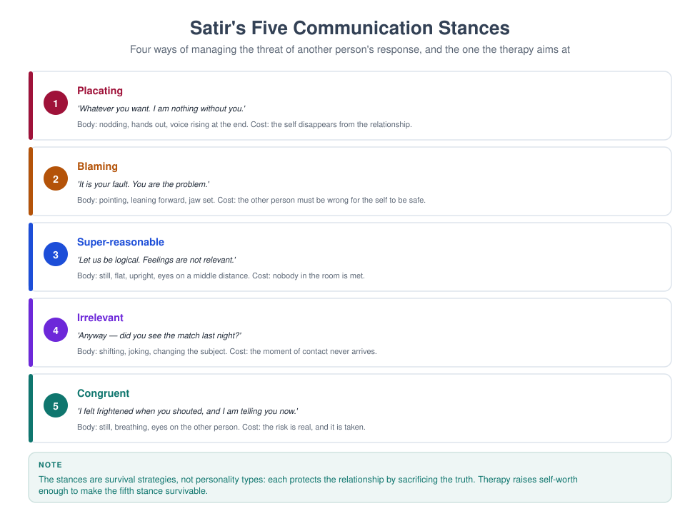

# MFT 702 — Theories of Family Therapy

> **MSc Marriage and Family Therapy** · Semester One · 1.71 Units · 14 teaching weeks · Prerequisite: MFT 701

**Course leader's summary.** Nine major schools, each treated as an answer to a specific question. You
will learn each model well enough to *do* a first session in it, critique it, and integrate it — and you
will practise moving between models on the same family until the choice becomes deliberate rather than
habitual.

---

## How to use this book

Theory is learned in three passes. **Pass one:** understand the model's core question and its
intervention. **Pass two:** apply it to a case you know. **Pass three:** critique it and ask what it
cannot see. Each week in this book gives you all three, plus the practical that makes the pass real. Do
not memorise lists of techniques; memorise *what problem each model believes it is solving*.

---

## 1. Course description

There is no single "correct" family therapy. There are traditions, each with a theory of how problems
develop, a theory of change, a preferred focus of attention, and a characteristic set of techniques. A
clinician who knows only one model does not have a theory; they have a habit.

This course therefore pursues three aims: **comparative competence** (you can describe and demonstrate
each major model), **critical appraisal** (you can name each model's evidence base and its blind spots),
and **integration** (you can combine two models coherently in one case rather than dithering between
them).

**Organising question.** For each model, ask: *What does this model believe is the problem, and what
does it therefore do first?*

---

## 2. Learning outcomes

| # | Outcome | Assessed |
|---|---|---|
| LO1 | Describe the theoretical foundations, core concepts and change mechanisms of nine major models | Exam |
| LO2 | Demonstrate a model-consistent first session for at least three models | Skills assessment |
| LO3 | Compare models on focus, technique, role of the therapist and evidence | Comparative matrix |
| LO4 | Identify the blind spots and cultural assumptions of each model | Essay |
| LO5 | Construct a coherent integrative plan for a single case using two models | Case assignment |
| LO6 | Justify model choice with reference to the client, the evidence and your own competence | Viva |

---

## 3. Assessment

| Component | Weight | Due |
|---|---|---|
| Comparative matrix (nine models × six dimensions) | 20% | Week 7 |
| Observed model-consistent session (20 min) | 20% | Weeks 8–10 |
| Integrative case study (2,500 words) | 30% | Week 12 |
| Written examination | 30% | Week 15 |

---

## 4. The fourteen-week plan

| Week | Model / topic | Practical | Key text |
|---|---|---|---|
| 1 | How to compare theories: six dimensions | Matrix construction | Nichols ch. 1 |
| 2 | Psychoanalytic and object-relations family therapy | Genogram + interpretation exercise | Scharff & Scharff |
| 3 | Bowen's multigenerational theory | Detriangling role-play | Bowen (1978) |
| 4 | Structural family therapy | Enactment and boundary-making | Minuchin (1974) |
| 5 | Strategic and MRI brief therapy | Directive design | Haley & Madanes |
| 6 | Milan systemic therapy | Circular questioning | Palazzoli et al. (1980) |
| 7 | Experiential and human validation (Satir, Whitaker) | Sculpture exercise | Satir (1988) |
| 8 | Cognitive-behavioural and behavioural couple therapy | Behavioural exchange design | Epstein & Baucom |
| 9 | Emotionally focused therapy | EFT enactment | Johnson (2019) |
| 10 | Solution-focused brief therapy | Miracle question and scaling | de Shazer (1985) |
| 11 | Narrative therapy | Externalising conversation | White (2007) |
| 12 | Integration: combine two models without incoherence | Case integration workshop | Lebow (2014) |
| 13 | Evidence, culture and critique of each model | Debate | Sprenkle et al. |
| 14 | Your theoretical position | Position paper presentation | — |

---

## Week 1 — How to compare theories: six dimensions

Every model in this course will be described on the same six axes. Learn to fill the grid from memory and you will
be able to enter any family therapy conversation — an interview, a case conference, a viva — with something more
useful than an opinion. Learn the models as nine separate stories and you will have nine stories and no method.

### 1.1 The lecture in ninety minutes

| Minutes | Segment | What the lecturer does | What students do |
|---|---|---|---|
| 0–10 | The problem with model surveys | Two clinicians, one family, incompatible first questions | Predict what each will do in the first five minutes |
| 10–25 | The six dimensions | Define each, with a counter-example | Fill two rows of the matrix from memory |
| 25–40 | Theory of problem as master dimension | Show how the other five follow from it | Derive a model's techniques from its theory of problem |
| 40–55 | Three levels of knowing a model | Describe, demonstrate, critique | Rate themselves on each level for one model |
| 55–70 | Comparing three models on one case | Fill the grid live from the Adeyemi material | Add a fourth model |
| 70–85 | The reduction test and the charity test | Apply both to a claim about a model | Test two claims in pairs |
| 85–90 | Set the assessment | The matrix, its due date and its marking | Plan their matrix file |

### 1.2 Why comparison is a skill

A clinician who knows one model does not have a theory; they have a habit. That sentence is the premise of the course,
and this week explains why it is true and what to do about it.

**What comparison is for.** Four uses, each practical.

*First, it makes the first session deliberate.* The first five minutes of a family session are shaped by a model
whether or not the therapist has chosen one. The structural therapist moves to the hierarchy; the narrative therapist
asks what name the family would give the problem; the emotionally focused therapist watches for the cycle. Comparison
allows the therapist to know which of these they are doing, and to choose.

*Second, it protects against the single-story error.* Every model has a characteristic blind spot, and the blind spot
is usually the same as its strength. A therapist who cannot name the blind spot of their preferred model cannot see
the family that the model is failing.

*Third, it makes referral and supervision possible.* Knowing that a family needs something you do not do is the
beginning of professional judgement. Knowing it in the vocabulary of the field — "this family needs a structural
first phase and then narrative work" — makes the referral legible to a colleague.

*Fourth, it is examinable, and it is examined everywhere.* The comparative matrix, the viva, the case study: all three
assessments in this course are applications of the six dimensions. Students who build the matrix properly in Week 1
are doing the exam in October.

**What comparison is not.** It is not a listing of techniques, a history of ideas, or an argument about which model
is best. It is a method for answering a specific question about any model: *what does this model believe the problem
is, and what does it therefore do first?*

### 1.2a How to study nine models in fourteen weeks

The course is short and the field is large, so the method matters as much as the effort. Five practices distinguish
students who can use the models from students who can list them.

**Practice 1 — one primary text per model, chosen for size.** Not the complete works; a single book or long chapter
that the model's author wrote for practitioners. For each model in this course, the reading list gives one such text.
Read it in the week, at speed, for the model's own vocabulary; the secondary summaries will then have something to
attach to.

**Practice 2 — the one-sentence discipline.** At the end of each reading session, write the theory of problem in one
sentence, in the author's terms, and then write a second sentence saying what the author believes is *not* the
problem. The second sentence is what distinguishes models, because every model defines itself against a predecessor.

**Practice 3 — apply the model to a family you know.** Not a hypothetical family: the Adeyemi case, or a family from
placement, or the running case in the seminars. Each week, write one page applying the new model to the same family.
By Week 11 you will have eleven pages on one family, which is the best comparative document you will ever own,
because the family is held constant and only the lens changes.

**Practice 4 — record yourself at level 2 once per model.** Twenty minutes with a role-played family, in the model's
terms, recorded. Watch it with the model's signature techniques written in front of you and count how often you used
them. Most students find that they used the techniques of the model they learned first, whatever model they were
attempting, which is the clearest possible demonstration of why deliberate practice exists.

**Practice 5 — keep a disagreement file.** Every time a model's claim conflicts with another's, or with the evidence,
or with your own experience, write the conflict down in two sentences with the date. Bring the file to the seminars.
The disagreements are the material of the essay, and they are what the viva will test.

**What the practices have in common.** They all convert reading into something that can be observed: a sentence, a
page, a recording, a note. Reading alone produces the illusion of knowledge that the first seminar exposes, and the
practices are designed to expose it earlier, in private, where it costs nothing.

### 1.3 The six dimensions

The grid is the spine of the course. Each dimension is a question with a determinate answer for each model, and the
answers are not independent: the first dimension generates most of the others.

| Dimension | The question it answers |
|---|---|
| **Theory of problem** | How does this model believe problems develop and persist? |
| **Unit of focus** | Individual, dyad, family structure, meaning system, or context? |
| **Theory of change** | What must happen for things to improve? |
| **Therapist position** | Director, coach, collaborator, witness, expert? |
| **Signature techniques** | What does this model characteristically do? |
| **Evidence base** | What is the strength and quality of supporting research? |

**Dimension 1 — theory of problem.** How does this model believe problems develop and persist? This is the master
dimension. A model that believes problems are maintained by structure will intervene in structure; a model that
believes they are maintained by meaning will intervene in meaning; a model that believes they are maintained by
unexpressed emotion will intervene in emotion. Everything else follows, and a student who cannot state the theory of
problem in one sentence has not learned the model.

**Dimension 2 — unit of focus.** What is the model looking at? The individual in context, the dyad, the triadic or
hierarchical structure, the family's meaning system, the multigenerational transmission, or the wider context of
institutions and culture. The unit determines what counts as data and what counts as noise. To the structural
therapist, a mother's tearfulness is data about the family's organisation; to the emotion-focused therapist, the
organisation is data about the tearfulness.

**Dimension 3 — theory of change.** What must happen for things to improve, and in what order? Some models believe
insight precedes change; some that change precedes insight; some that a small difference is sufficient; some that
the system must be destabilised before it can reorganise. This dimension predicts the shape of the therapy — its
length, its pacing, and what the therapist will do when nothing is happening.

**Dimension 4 — therapist position.** Director, coach, collaborator, witness, expert, non-expert, consultant. The
position determines who speaks, who decides, and what the family is told about what is happening. It is the dimension
most visible to families, and the one trainees most often adopt by accident.

**Dimension 5 — signature techniques.** What does this model characteristically do? Enactment, reframing, circular
questioning, genogram, sculpture, externalising, miracle question, behavioural exchange, two-chair work. Techniques
are the easiest dimension to learn and the least useful on their own, because a technique divorced from its theory of
problem is a gesture.

**Dimension 6 — evidence base.** What is the strength and quality of the research support, for what presentations, and
with what limits? This dimension is the one most often omitted in textbooks and most likely to be tested in a viva,
because a clinician's claim about evidence is a claim about what they owe a family.

**Two further dimensions worth adding to the matrix.** The six are the required grid; two more make it a professional
instrument.

*Dimension 7 — cultural assumptions.* Every model carries a picture of a healthy family, and that picture has a
culture. A model that prizes individuation will read a three-generational household differently from a model that
prizes interdependence. The question is not whether the model has cultural assumptions — all do — but what they are,
and what they make the model unable to see.

*Dimension 8 — the characteristic blind spot.* What does this model systematically not notice? The blind spot is not
a defect to be apologised for; it is the shadow of the model's strength, and it is the most useful thing a
comparative therapist knows.

### 1.4 Theory of problem as the master dimension

The claim that the first dimension generates the others is testable in an exercise that takes ten minutes and is worth
a term of reading.

**The exercise.** Write down, in one sentence, what a model believes maintains the problem. Then derive, without
looking anything up, what its unit of focus must be, what its theory of change must be, what position its therapist
must occupy, and two techniques it must use.

**Worked derivation 1 — structural.** *Theory of problem:* difficulties are maintained by the family's organisation —
unclear hierarchies, inappropriate boundaries, cross-generational coalitions. *Unit of focus:* the whole family as a
structure, with subsystems. *Theory of change:* the structure must change in the room, through action, before
understanding follows. *Therapist position:* active director, at times stage-manager. *Techniques:* enactment,
unbalancing, boundary-making, spatial rearrangements.

**Worked derivation 2 — narrative.** *Theory of problem:* difficulties are maintained by the dominant stories that
families and institutions hold about their members, and by the practices those stories make possible. *Unit of
focus:* the meaning system, and the social context in which meanings circulate. *Theory of change:* the story must be
made visible, the person separated from the problem, and a preferred account thickened. *Therapist position:*
collaborative, curious, decentred but influential. *Techniques:* externalising, re-authoring, unique outcomes,
definitional ceremonies.

**Worked derivation 3 — emotion-focused.** *Theory of problem:* distress is maintained by rigid negative interactional
cycles that organise around unexpressed primary emotion and unmet attachment needs. *Unit of focus:* the couple's
cycle, and the attachment bond that the cycle protects. *Theory of change:* the cycle must be slowed, the primary
emotion accessed and expressed, and a new cycle enacted in the room. *Therapist position:* active, empathic, a
process consultant who stages the encounter. *Techniques:* tracking the cycle, reframing in terms of the cycle, the
enactment, and the "hold me tight" conversation.

**What the derivations demonstrate.** That a model is a system, not a list. Students who can generate the five other
dimensions from the first have understood a model; students who have memorised six columns have not. The examination
will ask for a derivation, in some form, every year.

### 1.4a The six dimensions as questions you can ask a family

The grid is usually taught as an instrument for reading textbooks. It is more useful as an instrument for the room,
because each dimension can be converted into a question that changes what the family tells you.

**From theory of problem to a question about maintenance.** *Model reading:* the model believes something specific
maintains the problem. *Question:* "What keeps this going, do you think? Not how it started — what keeps it going
now?" Families answer this question with a mechanism, and the mechanism they describe is often more accurate than the
formulation in the referral.

**From unit of focus to a question about who matters.** *Question:* "Who else is affected by this — and who else has
an opinion about it?" In families where the meaningful unit is wider than the household, this question recruits the
grandmother, the aunt or the pastor into the conversation before the therapist has decided they are relevant.

**From theory of change to a question about what has helped before.** *Question:* "When it has been better, even for
a week, what made the difference?" This question tests the model's theory of change against the family's own
experience: if the family's answer is "we agreed one thing and stuck to it", a structural first move is indicated; if
it is "we stopped talking about it and it faded", a solution-focused approach has better odds.

**From therapist position to a question about what the family wants from you.** *Question:* "Some families want me to
tell them what to do; others want me to help them work it out. Which would be more useful to you?" The answer is not
binding, and asking it prevents the commonest early rupture: a family expecting direction receiving exploration, or
the reverse.

**From signature technique to a question about what the family has already tried.** *Question:* "What have you tried,
and what happened?" This is the shortest route to the model's technique, because the family's failed solutions are
usually the inverse of what the model would do.

**From evidence base to a question about the family's own data.** *Question:* "Would you be willing to rate how things
are each week, so we can see whether this is working rather than guessing?" The evidence dimension made operational.

**The point of the exercise.** A dimension that cannot generate a question is a dimension the student has learned
verbally. The test of understanding a model is not that you can describe its unit of focus but that you know what to
ask a family in order to work with it.

### 1.5 Three levels of knowing a model

A student can be at three different levels with the same model, and the levels are assessed separately.

**Level 1 — describe.** You can state the theory of problem, the unit of focus, the theory of change, the therapist
position, two or three techniques and the evidence base, in your own words, without notes. This is the level required
for the written examination, and it is the level at which most textbooks stop.

**Level 2 — demonstrate.** You can conduct twenty minutes of a model-consistent session with a role-played family, so
that an observer who knows the model can identify it from the transcript without being told. This is the level
required for the observed session, and it is much harder than describing, because it requires knowing what the model
sounds like: the actual sentences, the pacing, the shape of the first ten minutes.

**Level 3 — critique.** You can state the model's blind spot, its cultural assumptions, the presentations for which
the evidence is strong and weak, and what you would do when the model fails. This is the level required for the essay
and the viva, and it is the level at which a clinician becomes safe to practise, because it is the level at which
they know when to stop.

**The diagnostic.** For each model in this course, rate yourself 0–3 on each level: 0 (cannot), 1 (with notes),
2 (reliably), 3 (can teach it). Bring the grid to the Week 7 practical. Most students overrate level 1 and underrate
level 2, and the pattern is worth knowing about oneself.

**Why the levels matter for the matrix.** The comparative matrix is a level 1 instrument. It is necessary and it is
not sufficient. A student who can fill the matrix and cannot demonstrate a single model has learned a taxonomy, not a
therapy.

### 1.6 Comparing three models on one family

The Adeyemi family, from MFT 701, is the running case. The grid below is filled for three models, and the fourth
column is the week's exercise.

| Dimension | Structural | Bowen | Solution-focused |
|---|---|---|---|
| Theory of problem | Maintained by unclear hierarchy, diffuse or rigid boundaries, cross-generational coalitions | Maintained by anxiety transmitted across generations and absorbed by the most vulnerable member; triangles | Maintained by a problem-saturated description and by the family's attention to what is not working |
| Unit of focus | Whole family as a structure, with subsystems and boundaries | Multigenerational emotional system; triangles; differentiation | The family's description of the problem and its preferred future |
| Theory of change | Restructure in the room; action before insight | Lower reactivity, raise differentiation, detriangle | Build a description of the solution and amplify existing exceptions |
| Therapist position | Active director, stage-manager | Coach, neutral observer of process | Curious collaborator, expert in process not in lives |
| Signature techniques | Enactment, unbalancing, boundary-making | Genogram, coaching, detriangling questions | Miracle question, scaling, exception-seeking |
| Evidence base | Moderate: strong for adolescent behaviour problems and eating disorders in adapted forms | Thin: influential, widely taught, little trial evidence | Moderate for depression and behaviour problems in brief formats; strong evidence for the *components* (goal setting, scaling) |
| Cultural assumption | A family should have a clear hierarchy with parents in charge | Differentiation is a good; the individual should think for themselves | The family can describe a preferred future and act on it |
| Blind spot | Can impose a structure the family experiences as foreign; may miss meaning, loss and material conditions | Slow; may intellectualise; may under-attend to practical and institutional pressure | May bypass the function of the symptom and the history that sustains it |

**What the grid shows at a glance.** Three competent clinicians, one family, three different first sessions — and
none of them is wrong. The grid also shows why model loyalty is a temperamental matter: the structural column appeals
to therapists who want to act, the Bowen column to therapists who want to understand, the solution-focused column to
therapists who want to build. The professional question is not which temperament is best but which the family needs.

**The fourth column.** Fill it for narrative therapy before the seminar, from the reading, and bring it. The exercise
is deliberately placed before the seminar so that students discover what they cannot yet do.

### 1.6a The matrix as a clinical instrument: choosing under pressure

In a real clinic the matrix is used in ninety seconds, in a corridor, with a referral in your hand. Three ways it
earns its keep.

**Case 1 — the referral that does not fit your model.** A family is referred for a child's behaviour problems. You
work structurally. The referral letter says the parents separated two years ago, the child sees the father fortnightly,
and the mother reports that the boy "is fine with his father and impossible with me". The matrix question is: whose
unit of focus does this fit? The structural lens would look at the mother–son subsystem; the matrix reminds you that
the child's split presentation across two households is a different unit, and that a model with a place for
triangulation across households (or a systemic model that treats the two households as one system) may be indicated.
The matrix has not told you what to do; it has stopped you from doing the obvious thing.

**Case 2 — the family that has already had two therapies.** A couple arrives having had behavioural couple therapy
(which they found mechanical) and then six sessions of a psychodynamic approach (which they found slow). The matrix
question is: what theory of change have they already tested and rejected, and what remains? A therapist who knows the
grid can offer a third mechanism deliberately — an emotion-focused or narrative approach — rather than repeating
what has failed, and can say why: "You have tried changing what you do and you have tried understanding where it came
from. There is a third route: changing what happens between you in the moment."

**Case 3 — the model you cannot deliver.** A family presents with an adolescent's anorexia. You are trained in
structural and narrative work and not in family-based treatment. The matrix's evidence column says the specific
evidence is strongest for a model you do not practise. The professional response is visible in the grid: refer, or
co-work, or seek training — and say so to the family. The matrix is at its most useful when it tells you that you are
not the right clinician.

**What all three cases share.** The matrix is not a decision procedure that produces an answer. It is a discipline
that widens the options visible to a therapist under pressure, which is where most clinical errors are made.

### 1.7 The reduction test and the charity test

Two habits of thought that prevent most of the errors in this course.

**The reduction test.** When you are tempted to say that a model is "just" something — "structural therapy is just
common sense about who is in charge", "narrative therapy is just reframing with better marketing" — apply the
reduction test: does the reduction preserve the model's distinctive claim about what maintains the problem? If not,
the reduction is a dismissal in disguise. Structural therapy's claim is not that hierarchy is obvious; it is that
hierarchy is enacted in the room, in the present, in observable space, and that changing the enactment changes the
family. That claim is not common sense, and it can be tested.

**The charity test.** When you are tempted to defend a model against a criticism, apply the charity test: state the
criticism in its strongest form, in the critic's own terms, before answering it. A model defended against a weak
version of the objection has not been defended. This is the discipline that the essay assessment rewards, and it is
the discipline that distinguishes a professional from a partisan.

**How the two tests work together.** The reduction test stops you dismissing a model too quickly; the charity test
stops you defending one too quickly. Between them they produce the posture this course is trying to teach: interested,
informed, uncommitted to a conclusion, and able to act.

> **PRACTICAL** — Take one criticism of each of the three models in 1.6 — for example, "structural therapy is
> manipulative", "Bowen theory is untestable", "solution-focused therapy ignores suffering". State each in its
> strongest form in two sentences, then write the best available answer in two sentences. Bring all six sentences to
> the seminar.

### 1.8 The same ten minutes, three times

A transcript exercise that makes the grid concrete. The family is the Adeyemis; the first ten minutes are written
three times, in the voice of three models, and the differences are marked.

**Version A — structural.**

> **Therapist:** Before we start, I want to know who is in charge of the school question in this house, because
> somebody has to be. Mrs Adeyemi, when the school telephones, who decides what happens?
>
> **Mother:** I do. He is not here.
>

> **Therapist:** And when he is here, at the weekend?
>
> **Mother:** Then he decides, and then he tells me I have done it wrong.
>

> **Therapist:** So in this house there are two governments, and Amara lives in both of them. (to Amara) Which one do
> you go to first?
>
> **Amara:** My mum. She says yes.
>

> **Therapist:** (to the parents) I want the two of you to sit together for the next ten minutes and decide one thing
> about Monday, while Amara and I listen. Not negotiate — decide.

**What this version does.** It establishes the hierarchy question in the first ninety seconds, names the coalition,
addresses the child directly with a question that reveals the coalition, and moves immediately to an enactment. It
uses space and action. Note what is absent: no history, no feelings, no exploration of what the family has tried.

**Version B — Bowen.**

> **Therapist:** I want to start with each of you, one at a time, and I want to ask about the anxiety in this house
> rather than about the school. Mrs Adeyemi, when Amara says she is not going, what happens inside you?
>
> **Mother:** I panic. My chest. Then I am angry.
>

> **Therapist:** And when you panic, what do you do?
>
> **Mother:** I telephone the school. I fix it. I have always fixed things.
>

> **Therapist:** You have always fixed things. Who taught you that?
>
> **Mother:** (pause) Nobody taught me. I had to.
>

> **Therapist:** And Mr Adeyemi, when you come home on Friday and hear about the week, what happens inside you?
>
> **Father:** I am tired. I say what she should have done.
>

> **Therapist:** And what happens then?
>
> **Father:** She says I am never here. Then we do not talk.

**What this version does.** It slows everything down, asks about inner process rather than behaviour, links the
mother's reactivity to her history without interpreting it, and brings the father in as a person with a process rather
than as an absent authority. It gives no task in ten minutes and does not intend to.

**Version C — solution-focused.**

> **Therapist:** I want to ask a different kind of question before we talk about the problem. Suppose tonight,
> while you are asleep, the school situation is sorted. What is the first thing you notice tomorrow morning that
> tells you something has changed?
>
> **Mother:** (pause) I would wake up and not feel sick.
>

> **Therapist:** You would wake up and not feel sick. What would you do then, that you do not do now?
>
> **Mother:** I would make breakfast. I would call her once, normally, and then I would sit down.
>

> **Therapist:** Amara, what would your mother see you doing?
>
> **Amara:** I would get up.
>

> **Therapist:** You would get up. When was the last morning that happened, even a bit?
>
> **Amara:** September. When my aunty's wedding was on.
>

> **Therapist:** What was different about that morning?

**What this version does.** It begins with a preferred future rather than a problem, produces a behavioural
description, recruits the adolescent, and finds an exception inside three minutes. Note that it does not deny the
problem: the mother's "not feel sick" is a precise description of suffering, elicited without a single question about
the problem.

**What the comparison teaches.** All three versions are recognisably competent. They differ in what they treat as
data, in what they do with the first ten minutes, and in what they leave for later. A student who can hear which model
is speaking, from the transcript alone, has reached level 1 and is on the way to level 2.

**The exercise.** Read the three versions aloud in groups, one student per version, without announcing which model.
The listeners identify the model and name the two sentences that gave it away. The sentences are almost always the
same: the structural version gives itself away with a decision; the Bowen version with a question about inner
process; the solution-focused version with a question about a future.

### 1.9 Laboratory: building the matrix

The week's practical runs in class and continues for six weeks. It is worth 20% of the course, and it is the single
most useful document a student will produce this term.

**The specification.** A spreadsheet or table with nine rows (the nine schools in this course) and eight columns (the
six required dimensions plus cultural assumptions and blind spot). One to three sentences per cell. Every cell must
be in the student's own words: copied text is not accepted, and the plagiarism check will find it.

**The build schedule.** One row per week, completed before the seminar; the row for a model is discussed in the
seminar and revised afterwards. By Week 7, nine rows are complete and the matrix is submitted with a covering note.

**The covering note (500 words).** Three questions: which model was hardest to fill and why; which cell did you
change your mind about during the term; and what does the matrix as a whole tell you about the field that you did not
know in Week 1?

**Marking rubric.**

| Criterion | Weight | Full marks |
|---|---|---|
| Completeness | 20% | Nine models × eight dimensions, no empty cells, no copied text |
| Fidelity to each model | 30% | The theory of problem of each model is stated in that model's own terms, not reduced to another's |
| Derivative coherence | 20% | Techniques and therapist position are visibly derived from each model's theory of problem |
| Evidence accuracy | 15% | The evidence cell distinguishes what is strong, moderate and thin, and does not overstate |
| Critical columns | 15% | Cultural assumptions and blind spots are specific, not generic ("all models have biases") |

**The two commonest failures.** The first is a matrix in which every model's theory of problem is a paraphrase of the
same idea — "the problem is maintained by the family's patterns" appears nine times, which tells the marker that no
model has been understood. The second is an evidence column that says "limited evidence" for every model, which is
true of none of them and useless in all.

**A worked cell, to show the standard.** For Milan systemic therapy under *theory of problem*: "Problems are
maintained by the family's belief system and by the punctuation of events that the family and its helpers share; the
symptom is a communication in a system that has become rigid around a premise nobody has examined." That cell is
specific, it is in the model's terms, and it could not be transplanted into another model's row.

### 1.9a An annotated matrix row, and a row that fails

Two rows for Milan systemic therapy: one that would earn full marks, one that would earn a bare pass. The comparison
is the quickest way to teach the standard.

**The row that works.**

> *Theory of problem:* The family's difficulties are maintained by a belief system — a premise held by the family and
> shared with its helpers — and by the punctuation of events that keeps the premise unexamined; the symptom is a
> communication in a system that has become rigid around the premise.
>
> *Unit of focus:* The family's meanings, and the observing system that includes the therapy team and the referring
> agency.
>
> *Theory of change:* The premise must be made visible and disturbed; change follows from new information and
> difference, not from instruction.
>
> *Therapist position:* Curious, neutral (in the Milan sense of neutral toward all descriptions), working with a team
> behind a screen or, in later versions, with a reflecting team.
>
> *Signature techniques:* Circular questioning, positive connotation, rituals, the hypothesising-team intervention, the
> letter.
>
> *Evidence base:* Thin as a model in randomised trials; the components — circular questioning, reflecting teams,
> systemic hypothesising — are widely used and studied qualitatively; there is no strong specific evidence for
> Milan systemic therapy as a package with any presentation, and the honest cell says so.

**Why it works.** The theory of problem is in Milan's own vocabulary ("premise", "punctuation", "communication"), the
theory of change is derived from it rather than added, the therapist position includes the team because the team is
constitutive of the model, and the evidence cell distinguishes the package from the components and declines to
inflate either.

**The row that fails.**

> *Theory of problem:* Family problems come from bad communication.
>
> *Unit of focus:* The family.
>
> *Theory of change:* Better communication.
>
> *Therapist position:* Neutral.
>
> *Signature techniques:* Circular questions, reframing.
>
> *Evidence base:* Limited.

**Why it fails, cell by cell.** "Bad communication" could describe five models on this course and therefore describes
none. "The family" is the unit of focus for every model in the book. "Better communication" is a restatement of the
problem, not a theory of change. "Neutral" is a word Milan borrowed and redefined; the row does not say what the
redefinition is. "Reframing" is not a Milan technique in the technical sense. And "limited" in the evidence cell is
the flat answer that tells the marker the student has not read anything.

**The lesson, stated once.** A matrix row is good when a reader who knows the model could identify it from the row
alone, with the model's name removed. Try that test on your own rows each week: cover the name and see whether the row
is identifiable. If it could be any of three models, rewrite it.

### 1.10 Six errors in comparing models

1. **The catalogue.** Learning nine lists of techniques and no theories. Fix: derive the techniques from the theory of
   problem for every model, out loud, before you write the row.
2. **The reduction.** "They are all doing the same thing with different words." Sometimes a useful hypothesis and
   always an untested one. Fix: the reduction test in 1.7, applied to the model's distinctive claim.
3. **The straw model.** Comparing the strongest version of your own model with the weakest version of another's. Fix:
   read one primary text per model, not only the summary in a textbook.
4. **The flat evidence column.** Treating all models as equally evidenced or equally unevidenced. Fix: distinguish
   between *specific* evidence (a model tested for a presentation) and *component* evidence (an element used across
   models), and say which you mean.
5. **The cultural silence.** Filling eight columns and leaving out the assumptions that make the model possible. Fix:
   for each model, ask what kind of family its picture of health describes, and who that picture excludes.
6. **The premature commitment.** Choosing a favourite model in Week 2 and reading everything thereafter as support
   for it. Fix: the essay requires you to argue against your own preferred model; do that draft early.

### 1.10a The viva question bank

The viva in Week 15 examines the matrix, the case study and the position paper. These are the questions it is built
from, and they can be practised in pairs from Week 1.

**On comparison.** "Compare two models' theories of change and say which you would choose for this family, and why."
"Which two models on your matrix have the most similar theory of problem, and what follows from the similarity?"
"Which cell in your matrix was hardest to fill, and what does that tell you about the model?"

**On fidelity.** "Demonstrate, in words, how a Milan therapist would respond to this sentence." "What would a
solution-focused therapist do differently in the first five minutes, and why?" "Which sentence in this transcript is
not consistent with the model, and what would the model's author have said instead?"

**On evidence.** "What is the strongest evidence for this model, and with which presentation?" "What would you say to
a family who asked whether this approach works?" "Where is the evidence thinnest, and what do you do about that in
practice?"

**On critique.** "What is this model's blind spot?" "What cultural assumptions does this model carry, and how would
they land with this family?" "What would have to happen in a session for you to conclude that the model was the wrong
choice?"

**On integration.** "Combine two models for this case and justify the combination, the sequence and the point at
which you would switch." "What would incoherence look like in your plan, and how would you avoid it?"

**On self.** "Which model are you most tempted by, and what does that temptation tell you?" "What are you not yet able
to do at level 2?" "What will you have changed your mind about by the end of the course?"

**How to practise.** Take one question per seminar, answer it in ninety seconds without notes, and let a peer ask the
follow-up. The viva is twenty minutes of exactly this, and the students who do it weekly are unrecognisable by Week 12.

### 1.11 Culture, faith and the comparative gaze

Comparison is not culturally neutral. Three cautions.

**The models were made in particular places.** Structural therapy in the Philadelphia of the 1960s, Milan in the
Italian psychiatric reform, solution-focused therapy in Milwaukee, narrative therapy in Adelaide and Auckland,
emotion-focused therapy in Ottawa. Each carries the assumptions of its setting, including assumptions about
authority, individuality, the state, the family form, and the therapist's mandate. A model exported without those
assumptions examined will misread families, and will do so most confidently where the family is least like the
model's origin.

**The comparative gaze can become a ranking.** A matrix invites the question "which is best?", and the answer will
always be shaped by the culture of the assessor. A model that prizes individuation will rank a model that prizes
hierarchy as backward; a model that prizes hierarchy will rank the first as naive. The professional discipline is to
hold the matrix as descriptive, and to answer "best for whom, for what, in whose judgement?"

**Faith enters at the level of the model's anthropology.** Every model carries an implicit account of what a person
is: a system of internal objects, a differentiated self, a member of a structure, a storyteller, an attachment-seeking
organism. Families whose faith gives them a different anthropology — a person as a soul under authority, as a member
of a covenant community — will experience some models as congruent and others as alien. The comparative question is
therefore also a theological one, and it belongs in the matrix: which model's picture of a person can this family
recognise?

> **DEBATE** — "Any attempt to compare models on a single grid will favour the models that fit the grid's
> assumptions." Argue for and against, using one model from this course that resists the six dimensions.

### 1.11a Where each model's theory of problem came from

A short historical note for each of the nine schools, because a model's origin explains its blind spot more reliably
than its textbook description does.

| Model | Origin and founding problem | What the origin explains about the blind spot |
|---|---|---|
| Psychoanalytic family therapy | Post-war Britain; the problem was the internal world carried into relationships | Attends to depth; under-attends to structure, money and institutions |
| Bowen | Post-war America; the problem was the transmission of anxiety across generations | Attends to the multigenerational system; treats the present context thinly |
| Structural | Philadelphia, 1960s; the problem was the organisation of poor, multi-problem families | Attends to hierarchy and action; can miss meaning, loss and culture |
| Strategic / MRI | Palo Alto, 1960s; the problem was the attempted solution that maintains the symptom | Attends to sequence and to what works; can be manipulative and under-attends to consent |
| Milan | Italy, 1970s; the problem was the family's premises and the helpers' punctuation | Attends to belief and to the observing team; can be intellectual and slow |
| Experiential | America, 1960s–70s; the problem was the absence of genuine contact and feeling | Attends to immediacy and the therapist's use of self; thin on evidence and structure |
| Behavioural / CBT couple | America and Britain, 1970s; the problem was the reinforcement of aversive exchange | Attends to observable behaviour; can under-attend to meaning and attachment |
| EFT | Ottawa, 1980s; the problem was the rigid cycle organised around unmet attachment need | Attends to emotion and attachment; may under-attend to material conditions |
| Solution-focused | Milwaukee, 1980s; the problem was the problem-saturated description | Attends to solutions; can bypass suffering and history |
| Narrative | Adelaide and Auckland, 1980s–90s; the problem was the internalisation of dominant stories | Attends to meaning and power; can remain at the level of description |

**How to use the table.** In the viva, the question "what is this model's blind spot?" is answered best by pointing to
the problem the model was built to solve. Every model is a solution to a historical problem, and it inherits the
blindness of that problem. A structural therapist in 1960s Philadelphia was not asked to think about colonial
internalisation; a narrative therapist in 1990s Auckland was not asked to manage a psychosis relapse. The model is not
at fault; the therapist who applies it outside its problem is.

### 1.12 Evidence note: what comparison can and cannot establish

The comparative literature is large and its findings are less exciting than students expect.

**What is established.** Bona fide models produce broadly similar outcomes across many presentations; differences,
where they appear, are usually small and often confined to specific presentations or sub-groups. The strongest
specific effects are where a model targets a well-defined mechanism in a well-defined condition — family-based
treatment for adolescent anorexia is the standard example. Therapist effects are substantial, and the alliance is
among the more robust predictors across models.

**What is not established.** That any one of the nine schools is superior overall; that model allegiance predicts
outcome; that training in more models produces better outcomes. The comparative question "which model is best?" has
no general answer in the literature, and clinicians who claim one are usually reporting their own experience.

**What follows for the matrix.** The evidence column should be filled with three questions in mind: what is the
evidence for this model as a whole; what is the evidence for this model with a specific presentation; and what is the
evidence for the components the model uses. A model can be weakly evidenced overall and strongly evidenced for one
presentation — this is common — and a matrix that records only the first number will mislead the student who relies on
it in a viva.

**The professional claim.** "I am using this model with this family because it targets the mechanism I believe is
maintaining the problem, because there is evidence for it with this presentation, and because it is within my
competence — and I will measure whether it is working." That sentence is defensible in any of the three assessments,
and it is the sentence this course is designed to produce.

### 1.13 Key terms

| Term | Definition |
|---|---|
| Theory of problem | A model's account of how difficulties develop and what maintains them |
| Unit of focus | What the model treats as the system of interest (individual, dyad, structure, meaning, context) |
| Theory of change | A model's account of what must happen, and in what order, for improvement |
| Therapist position | The role the model requires of the therapist, and the authority it confers |
| Signature technique | A characteristic method that follows from the model's theory of problem |
| Evidence base | The strength, quality and specificity of research support for a model |
| Blind spot | What a model systematically fails to notice, usually the shadow of its strength |
| Reduction test | Whether a proposed simplification preserves the model's distinctive claim |
| Charity test | Stating an objection in its strongest form before answering it |
| Level 1 / 2 / 3 | Describe, demonstrate, critique — three separable competences with a model |
| Model fidelity | The degree to which a session is recognisably conducted in the model's terms |
| Component evidence | Evidence for an element used across models, as distinct from evidence for a whole model |

### 1.13a Two student matrices, and what the marker sees

Two submissions, both technically complete, with very different marks. The comparison is worth an hour of seminar
time.

**Submission A.** Nine rows, all cells filled, all in the student's own words, each model described in its own
vocabulary. The evidence column distinguishes model-level from component evidence. The blind-spot column names
specific consequences: "structural work with a family whose grandmother holds executive authority will read her
authority as a boundary violation and will fail at the point of implementation". The cultural column is specific:
"assumes a nuclear household with two parents available for enactment".

**Submission B.** Nine rows, all cells filled, all in generic language. "Theory of problem: dysfunctional family
patterns. Unit: the family system. Theory of change: restructure the system. Position: active. Techniques: enactment,
reframing, questions. Evidence: mixed." The blind-spot column says "may not suit all families". The cultural column
says "must be culturally sensitive".

**What the marker sees.** Submission A demonstrates that nine models have been read and differentiated; submission B
demonstrates that nine models have been noticed. The difference is visible in three specific places, and students
should check their own drafts against them.

*First, the vocabulary test.* Does the row use words that belong to the model, or words that belong to the field? "Bad
communication" belongs to the field; "punctuation" belongs to Milan; "the attempted solution" belongs to the strategic
school; "the cycle" belongs to EFT. A matrix written in the field's vocabulary cannot distinguish the models, because
the field's vocabulary is the lowest common denominator of all of them.

*Second, the consequence test.* Does the blind-spot column name a consequence, or a sentiment? "May not suit all
families" is a sentiment. "Will fail at implementation when the family's authority structure is not the one the model
assumes" is a consequence, and it tells the reader what to watch for.

*Third, the honesty test.* Does the evidence column record what is actually known, including the awkward parts — that
Bowen theory has little trial evidence, that solution-focused therapy has better evidence for its components than for
its package, that EFT's evidence is strongest for couple distress and thinner for other presentations? A matrix that
is uniformly cautious is as uninformative as one that is uniformly enthusiastic.

### 1.14 Self-test

1. Name the six dimensions of comparison, and the two the course adds.
2. Why is the theory of problem described as the master dimension?
3. Derive the therapist position and two techniques for the Bowen model from its theory of problem.
4. What are the three levels of knowing a model, and which assessment tests each?
5. What is the reduction test, and what does it protect against?
6. What is the charity test, and why does the essay require it?
7. What three questions should the evidence column answer?
8. Give one cultural assumption carried by each of the structural and solution-focused models.

**Answers.** 1. Theory of problem; unit of focus; theory of change; therapist position; signature techniques; evidence
base — plus cultural assumptions and the characteristic blind spot. 2. Because the account of what maintains a problem
determines what the model attends to, what it does, what role the therapist takes, and what counts as change; the
other five dimensions can be derived from it. 3. Position: coach, neutral observer of process. Techniques: the
genogram and coaching the parents to lower their own reactivity (detriangling questions). 4. Describe (written
examination), demonstrate (observed session), critique (essay and viva). 5. A test of whether a proposed
simplification preserves the model's distinctive claim; it protects against dismissal disguised as summary. 6.
Stating an objection in its strongest form before answering it; the essay requires it because a model defended against
a weak objection has not been defended. 7. What is the evidence for the model as a whole; for this model with this
presentation; and for the components the model uses. 8. Structural: that a family should have a clear hierarchy with
parents in charge. Solution-focused: that a family can describe a preferred future and act on it.

### 1.15 Reflective task

Before the seminar, write 300 words on the following: which of the nine models in this course do you already believe,
and why do you believe it? Most students discover that they hold a model without having chosen it — usually the one
taught by the most persuasive lecturer, or the one that fitted their own family. Name it, state the evidence you
actually have for it, and state one thing the model cannot see. Bring the paragraph; it will be revised in Week 14.

### 1.16 Readings for this week

* **Nichols & Davis**, chapter 1, for the survey of the field and the standard comparison frame.
* **Lebow (2014)**, *Couple and Family Therapy: An Integrative Map of the Territory*, chapters 1–2, for a systematic
  comparison that treats the models as answers to clinical questions.
* **Gurman & Kniskern** or **Sprenkle, Davis & Lebow (2009)**, for the common-factors argument that will challenge the
  matrix you are building.
* **One primary text for a model you think you already know**, read for an hour, to test whether you know it at level
  1 or only at the level of the summary.
* **Carr (2019)**, the opening chapters, for the history and the structure of the field.
* **The course plan on the previous page**, read against this week's grid: for each of the nine weeks, write the one
  question you expect that model to ask, and bring the nine questions to the seminar. The exercise takes ten minutes
  and gives you a set of hypotheses to test against the reading, which is a much better use of the first week than
  trying to remember nine definitions you have not yet met.

*Next: [Week 2 — Psychoanalytic and object-relations family therapy](#week-2--psychoanalytic-and-object-relations-family-therapy)*

---

## Week 2 — Psychoanalytic and object-relations family therapy

**The question it asks.** *What unconscious processes, carried from earlier relationships, are being re-enacted in
this family now?*

### 2.1 The lecture in ninety minutes

| Minutes | Segment | What the lecturer does | What students do |
|---|---|---|---|
| 0–10 | Why start here | The first family therapists were psychoanalysts, and their problem is still live | Name one thing in a family that only this model explains well |
| 10–25 | Object relations in plain language | Internal working models, with two examples from the case bank | Map one family's internal objects |
| 25–40 | Projection and projective identification | The mechanism, demonstrated on a transcript | Locate the projection in a recorded session |
| 40–55 | Transference and countertransference in family work | Why the therapist's feeling is data | Identify their own response to a role-play |
| 55–70 | Interpretation, used sparingly | Four rules for an interpretation that will land | Draft and test one interpretation |
| 70–85 | The Tavistock and group-analytic traditions | Work with the family as an unconscious system | Compare with the individual model |
| 85–90 | Critique and the matrix row | What the model cannot see | Fill the row |

### 2.2 Core concepts

The model's vocabulary is old and its mechanisms are still in use across the field, including by therapists who
believe they do not use them. Learn the five concepts precisely.

**Object relations.** The idea that a person's early relationships are internalised as working models of self and
other — a "mother who cannot be relied on", a "self who must not need anyone" — and that these internal models shape
how later relationships are perceived and conducted. Family work extends the idea: each member brings a set of
internal objects into the household, and the family's relationships are a negotiation between them.

**Projection.** Disowning a feeling in oneself and locating it in another person. A father who cannot tolerate his own
fearfulness experiences his daughter as fragile and protects her excessively. The mechanism is not deception; it is
usually unconscious, and it is why a family's description of one member often tells you more about the describer than
the described.

**Projective identification.** Projection plus pressure: not only is a disowned part located in the other, but the
other is recruited, often subtly, to behave in accordance with it. The mother who cannot bear her own helplessness
treats her son as helpless, organises his day, speaks for him, and in time he presents as helpless — and both are
sincere. This is the model's central explanatory mechanism for the identified patient, and it is the mechanism most
often misapplied, because it is used to explain away the family's account.

**Splitting.** Experiencing people as all-good or all-bad, with the two views held separately rather than integrated.
In families it appears as the alignment in which one parent is idealised and the other denigrated, or in which one
child is the good one and another the bad one. The splitting is maintained by the family's anxiety: a whole object is
harder to hold than two halves.

**Repetition compulsion.** The re-enactment of earlier relational patterns in new relationships, including with the
therapist and the therapy. A family that has dismissed three therapists will dismiss a fourth, and the repetition is
information.

**The family as a shared unconscious system.** The synthesising idea of the school: the family is not a collection of
individual psyches but a system with its own unconscious assumptions, shared myths, and defended-against feelings, and
one member often carries the feeling the system cannot hold. This is the clearest statement of the model's theory of
problem, and it is what distinguishes the school from a set of individual psychodynamic sessions conducted in the same
room.

### 2.2a Four concepts, one family

The concepts become learnable when they are applied to a household the student can picture. The Adeyemis, read
object-relations.

**The internal objects each partner brought.** The mother's father died when she was 19 and she raised four siblings
while her own mother was unwell. Her internal model of a reliable other is a person who nonetheless cannot be leaned
on, and her model of herself is a person who copes. The father's mother died when he was 16 and he left for Lagos that
year. His internal model of loss is that the way to survive it is to leave, and his model of himself is a provider who
is not needed at home. Neither model is a pathology; both are adaptations that made sense in an earlier
circumstance.

**The projection.** The mother experiences her own unmanageable grief and helplessness — about her father, about her
own mother, about the years of coping alone — and locates it in Amara, who is described as fragile, unable to cope,
and needing to be at home. The language the mother uses about her daughter ("she cannot face it", "she is not strong
enough") is language a person might use about themselves.

**The projective identification.** The mother's care does not merely describe fragility; it organises the morning so
that Amara is never required to manage anything. Amara is spoken for, protected from the school's letters, and relieved
of the consequences. In time, Amara behaves as described — staying in her room, unable to leave — and both mother and
daughter are entirely sincere.

**The splitting.** The family's account divides the adults cleanly. The mother holds the practical and the emotional
labour and is seen as strong; the father is seen as absent and uncomprehending. Each holds one half of a whole
picture, and neither can see that the mother's strength is a defence and the father's absence is a grief.

**The repetition.** The mother is 19 again, in effect, managing a household's feeling for other people. The father is
16 again, leaving a house in which someone has been lost. The repetition is not a curse; it is the human tendency to
return to the pattern that once worked, especially under stress.

**What the formulation gives and what it costs.** It gives a compassionate account of both parents and a mechanism for
the daughter's presentation that explains why behavioural plans have failed. It costs attention to the school's
timetable, the family's money, the father's employment, and the possibility that Amara's refusal is a reasonable
response to something nobody has asked about. Both halves of that sentence belong in the formulation.

### 2.3 Therapy: the shape and the mechanism

**The shape.** Longer-term than most of the models in this course, less structured, and less task-oriented. Sessions
are typically weekly and open-ended; the therapist's attention is on what is happening between the members and between
the family and the therapist; the work moves slowly and is expected to.

**The mechanism.** Two elements, both contested and both useful.

*First, containment.* The therapist holds difficult feelings without evacuating them — that is, without immediately
turning them into advice, reassurance or a task. The family that has never had a feeling held will discover, in the
holding, that the feeling can be survived. The mechanism is experiential rather than interpretive, and it is the part
of the model that transfers most readily to other approaches.

*Second, interpretation.* The therapist offers an account of the pattern, including its unconscious dimensions, in a
form the family can hear. Interpretation is not insight delivered; it is a hypothesis offered tentatively, and it
works when the family's response is recognition rather than explanation.

**Transference and countertransference.** The family's feelings towards the therapist and the therapist's towards the
family are treated as data about the family's relational world. A therapist who feels useless with a family should ask
what the family does with people who try to help — a question that is far more informative than the therapist's
self-criticism. A therapist who feels protective of one member should ask who else in the system feels that way, and
who does not.

**Why this matters even to students who will not practise this way.** Every model in this course uses the therapist's
response as information. This school articulated the principle first, and it is the reason supervision in family
therapy attends so closely to the therapist's feelings.

### 2.3a How long is this therapy, and who can have it?

The model's length is not incidental; it is part of its theory of change, and a student who cannot discuss it cannot
defend the matrix row.

**The classical claim.** Change of the kind this model seeks — a shift in internal models, in what the family can bear
to feel, in the therapist's and family's capacity to stay with difficulty — is slow. The school's own logic implies
months rather than weeks, and its founders generally wrote about treatment lasting a year or more.

**What the modern practitioner does with that claim.** Three options, each defensible.

*Option 1 — practise it as designed, in a service that can fund it.* Specialist psychotherapy services exist and are
justifiable. The professional obligation is to be honest about the cost and the access, and to measure outcomes rather
than assume them.

*Option 2 — use the model's mechanisms in a shorter therapy.* Containment, the therapist's response as data, the
observation of what is not said, and one well-timed interpretation can all be used within a twelve-session contract.
This is what most graduates will actually do, and it is not a betrayal of the model; it is the model's components
deployed without its frame.

*Option 3 — use it as a second phase.* Some families need a structural or behavioural first phase (see MFT 701 Week
13) and can use a psychodynamic phase afterwards, when the presenting crisis is settled and the family has the
resources for slower work. This is the commonest integration in practice, and it is worth being able to describe.

**What none of the three options permits.** Practising a slow, open-ended therapy with a family who cannot afford it,
cannot reach the clinic, or needs a crisis resolved this week, and calling the mismatch "resistance". The model's
silence about access is a limitation, not a licence.

**The question for the viva.** "You have twelve sessions with this family. What would you keep from this model and
what would you drop?" A strong answer keeps the mechanisms and drops the length, names the risk (that the family
experiences a short therapy as another person who did not stay), and says how it would be measured.

### 2.4 Signature technique: interpretation, used sparingly

An interpretation is a statement that links present behaviour to an unconscious process, offered tentatively, in the
family's language, at a moment when it can be heard. Four rules separate an interpretation from an accusation.

**Rule 1 — link, do not label.** "When your mother talks about her own mother, you answer for her" is a link between
an event and a behaviour. "You are enmeshed" is a label. Links can be tested; labels have to be accepted or refused.

**Rule 2 — offer, do not pronounce.** "I wonder whether..." and "I notice... could it be that..." are the grammar of
interpretation. A statement delivered as fact invites compliance or defiance, and the model's own theory says the
family's response to a pronouncement is also the family's work.

**Rule 3 — interpret the pattern, not the person.** "Something seems to happen in this room when your father begins
to speak about his own father" is a statement about the system. "You are protective of your father" is a statement
about a person, and it recruits the person's defence.

**Rule 4 — interpret one step beyond what the family already knows.** An interpretation the family has already made is
tedious; one that is two steps away is a lecture. The therapist's judgement is about the size of the step, and the
family's response is the evidence.

**The worked example from the course material.** "I notice that whenever your mother speaks about her own mother, you
begin to speak for her. I wonder whether that is how the family has always managed her sadness." The interpretation
has four parts: an observation (the sequence), a link (speaking for her), a hypothesis (the family's way of managing a
feeling), and a tentative frame ("I wonder"). The son's answer — whether "yes, someone has to" or "no, she loses her
words" — will be more informative than the interpretation itself.

**What to do when the interpretation is rejected.** Say "that may be wrong", and stay curious. A rejected
interpretation is not a failure; it is data about the family's defences and about the therapist's timing. The model's
own logic requires the therapist to survive the rejection without withdrawing, because the survival is itself the
therapeutic act.

### 2.5 Contribution, and what the field kept

The school's contribution is larger than its current evidence base, and students should be able to say what has been
absorbed into the wider field.

**Kept: the respect for what is not said.** Every model now attends to what a family cannot speak about. The
psychoanalytic school made this a principle rather than an accident.

**Kept: the therapist's emotional response as data.** Now standard across models, and traceable to this one.

**Kept: the idea that a symptom can carry a feeling the family cannot hold.** This is the ancestor of the Milan
positive connotation, the structural identification of the identified patient, and the systemic idea of function.

**Kept: the family as a shared unconscious system.** The notion of a family myth, a family secret and a shared
assumption is now ordinary across the field, and it began here.

**Kept: containment as a mechanism.** Whatever the model, the therapist who can stay with a family's distress without
converting it into a task is doing something this school described first.

**What the field discarded, and why.** Long open-ended treatment as a default; the assumption that insight is
necessary for change; the pathologising vocabulary ("the intrusive mother", "the schizophrenogenic mother"); the
indifference to material context; and the absence of outcome measurement. Each discard is a lesson in what happens to
a model that does not examine its own assumptions.

### 2.5a The Tavistock tradition and group-analytic family therapy

Two institutional traditions shaped this school, and a student who cannot place them cannot read the literature.

**The Tavistock.** The Tavistock Clinic and the Tavistock Institute in London produced both the group-relations
tradition and a substantial body of family therapy. The distinctive features are the attention to unconscious group
process, the use of a work-group and basic-assumption frame, and — clinically — an interest in the family's shared
assumptions and in the therapist's use of their own reaction. Tavistock-trained family therapists typically work in
long-term, once-weekly formats, often with co-therapists, and often with an observing team.

**Group-analytic family therapy.** Derived from Foulkes's group analysis, this approach treats the family as a small
group with a group matrix — a shared field of communication and meaning — and works with the group's dynamics as much
as with individual members. The therapist's task is to facilitate the group's own capacity to think, rather than to
interpret individual behaviour. The vocabulary is different from the classical school and the practice is often
shorter and more active.

**What the two traditions contribute to the matrix cell.** Both extend the unit of focus: not the individual internal
world alone, but the family's shared unconscious field. Both make the therapist's membership of the system explicit.
Both raise the question of the observing team, which Milan later developed into a technique.

**What they share with the classical school.** The assumption that what is not said is the most important material; the
attention to the therapist's emotional response; and a long time frame.

**What a student should take from this section.** Two or three named traditions, one distinguishing feature of each,
and one sentence on how they differ from the classical model. That is sufficient for level 1, and it is more than most
candidates can offer.

### 2.6 Blind spots, stated precisely

**Blind spot 1 — the vocabulary blames parents.** The classical language locates pathology in maternal behaviour, and
the history of the school includes theories that caused real harm to mothers of children with psychosis. The modern
practitioner can retain the mechanisms and must discard the blaming grammar; the test is whether the family
experiences the interpretation as an accusation.

**Blind spot 2 — thin evidence in its classical form.** There is little randomised evidence for long-term
psychoanalytic family therapy as a package. There is better evidence for psychodynamic psychotherapy in individual
form for some presentations, and there is evidence for components — mentalisation, reflective functioning,
containment — that the school anticipated. The matrix cell should record this distinction.

**Blind spot 3 — cost, time and access.** An open-ended weekly therapy is unavailable to most families in most
services. A model that requires conditions most families cannot have is not wrong; it is limited, and the limit
belongs in the matrix.

**Blind spot 4 — the material and the institutional.** A formulation that locates the difficulty in the family's
internal world can miss a landlord, an employer, an immigration status or a school. The model's unit of focus is the
internal and the relational; the external is under-described.

**Blind spot 5 — the therapist's authority is under-examined.** The interpretive position is a powerful one, and the
model has historically been less attentive than the Milan or narrative schools to the power the interpreter holds.

> **CASE** — A young man cannot keep a job; his mother calls his employers before he does. Object-relations reading:
> the mother's own abandonment anxiety is projected into her son's incompetence, and his failure keeps her needed.
> Interpretation may be less useful than an experiment: agree that she will not call, and predict that both will feel
> anxious for two weeks. The prediction turns insight into something testable.

### 2.6a What the school got wrong, in its own history

A professional course owes students the history of a model's errors, because the errors are the clearest guide to
where a mechanism can be misapplied.

**The schizophrenogenic mother.** From the 1940s to the 1970s, a body of theory held that schizophrenia in a young
person was caused by a particular kind of mother — cold, domineering, covertly rejecting. The idea was influential,
was taught in good faith, and caused enormous harm: mothers were blamed for a condition now understood as
neurodevelopmental, families were divided by the accusation, and a generation of clinicians was trained to see maternal
care as the cause of serious mental illness.

**Why the idea was plausible.** It fitted the model's mechanism (the family as an unconscious system; the symptom as
the container of an unheld feeling), it was supported by clinical observation of distressed families, and it explained
the observations that others could not — that these families often did look unusual. What it lacked was any
consideration of direction of causation: families in which a young person is psychotic look unusual because they are
living with psychosis.

**What the field learned, and what it cost to learn it.** Three lessons, all now standard.

*First, observation of a distressed family cannot establish causation.* The family's state may be a response to the
difficulty rather than its source. This is the single most important methodological caution in family therapy, and it
applies to every model in this course, not only this one.

*Second, a mechanism that explains everything explains nothing.* The concept of the family as a shared unconscious
system is powerful precisely because it can be applied to any family, which means it cannot discriminate between them
without additional constraints.

*Third, the vocabulary of a model has consequences for families.* "The intrusive mother" was not a neutral description;
it was a diagnosis delivered to a person who was already struggling, and it shaped what services offered and what
families believed about themselves.

**How a modern practitioner uses the school despite its history.** By keeping the mechanisms — projection, projective
identification, containment, the therapist's response as data — while refusing the vocabulary of blame, and by asking,
of every interpretation, whether the family would experience it as an accusation. That test is the professional
inheritance of this history, and it should be applied to the models in Weeks 3 to 11 as rigorously as to this one.

### 2.7 Annotated transcript: an interpretation that lands, and one that does not

The same family, the Okonkwos, is seen by the same therapist in two sequences. The first interpretation is heard; the
second is not, and the difference is instructive.

**Sequence A — session three.**

> **T1 Therapist:** Can I say something I have noticed, and you will tell me whether it is right? When your wife talks
> about Ebuka's mornings, you look at the window. When she stops, you look back.

> **T2 Father:** (pause) I did not know I did that.

> **T3 Therapist:** I wonder whether the window is where you go when the conversation is about something you cannot
> fix from Lagos.

> **T4 Father:** (long pause) It is. She tells me and I cannot do anything, so I stop hearing it.

> **T5 Therapist:** And then she has told you and you have not heard it, and she is alone with it. That might be the
> thing that is hardest in this house.

> **T6 Mother:** (quietly) Yes.

**Annotations.** *T1* is an observation, offered with an explicit invitation to correct it. The observation is
specific and behavioural — looking at the window — which is what allows the father to recognise it rather than dispute
it. Note that the therapist does not begin with the concept.

*T3* is the interpretation, and it is one step beyond what the father has said. It links the behaviour to a feeling
(helplessness) and to a circumstance (Lagos), which keeps the interpretation attached to reality rather than to the
father's character. The grammar is tentative.

*T4* is the moment the interpretation lands, and the marker of landing is not agreement but *new information*: the
father describes a process the therapist had only hypothesised.

*T5* does the systemic work. The interpretation has been about one man's behaviour; T5 places it back in the loop,
naming the consequence for the mother without blaming the father. This is the discipline that distinguishes
object-relations family work from individual interpretation conducted in company.

**Sequence B — the same therapist, one week later, with the same family.**

> **T7 Therapist:** I have been thinking about last week, and I think I understand what is happening. Ebuka is carrying
> your sadness about his grandmother, because neither of you has been able to grieve, and children always carry what
> the parents cannot.

> **T8 Mother:** (silence)

> **T9 Father:** He is nine. He does not know anything about grieving.

> **T10 Therapist:** I did not mean that he understands it. I meant that he feels it.

> **T11 Father:** (to his wife) This is why I did not want to come.

**Annotations, and what went wrong.** *T7* breaks three of the four rules. It is a pronouncement ("I think I
understand what is happening"), not an offer; it is two steps beyond what the family knows, not one; and it interprets
a person — Ebuka — rather than a pattern, in Ebuka's absence. The sentence "children always carry what the parents
cannot" is a general law delivered to a family, and general laws invite families to defend themselves against the
therapist's theory.

*T9* is not resistance; it is a reasonable objection to an interpretation that has not been earned. The father's
defence is accurate: the therapist has claimed knowledge of his son that the therapist does not have.

*T10* repeats the interpretation in other words, which is the commonest response to a failed interpretation and the
least useful. *T11* is the cost: the father, whose engagement cost the therapist three sessions of careful work,
withdraws.

**The repair, done properly at the start of the next session.**

> **T12 Therapist:** Last week I said something about Ebuka carrying your sadness, and it did not fit. I have been
> thinking about why. I think I was talking about my idea rather than about what either of you had told me. I would
> like to go back to what your husband said — that Ebuka is nine and does not know about grieving — because I think he
> was right, and I want to understand what he meant.

**Why the repair works.** It names the error without self-abasement, credits the person who objected, returns the
authority to the family, and asks a genuine question. In this model, the therapist's survival of an error — and the
family's experience of a therapist who can be corrected — is itself the therapeutic mechanism.

### 2.7a What the therapist brings: the use of self in a slow model

In this model more than most, the therapist's own history is an instrument, and an unexamined instrument is a hazard.

**The claim.** The therapist's emotional response is data (2.2), and it is also contamination if it is not examined.
A therapist who was parentified as a child will feel a strong pull to protect a parentified adolescent, and the pull
will arrive before the thought. The model's answer is not to eliminate the pull but to know it, which requires the
therapist to have done some of the work the model asks of families.

**Three disciplines, in order of importance.**

*First, know your own object-relations pattern.* The genogram of MFT 701 and the cultural genogram are the beginning;
personal therapy, where it is available and appropriate, is the standard the tradition itself assumes. A therapist who
cannot name their own central relational pattern will enact it with families, reliably and invisibly.

*Second, use supervision as the place where the countertransference is read.* The countertransference log of 2.8a is
the instrument; supervision is where the fourth column is interrogated. A supervisor's most useful question is often
"and whose feeling do you think that was?"

*Third, notice the families you dread.* The family you avoid booking, the one you feel relief about when they cancel,
the one you describe in the team meeting with a sigh — each is information about your own pattern, and each is a
training opportunity rather than a personal failing.

**The boundary of the discipline.** Using the self is not the same as disclosing the self. A therapist's decision to
share something personal should be a clinical decision with a rationale, not an expression of the countertransference.
The model's own tradition is cautious here, and rightly: the family came for its own work.

**The protection.** Where a therapist's own history is activated repeatedly and strongly by a family, the professional
response is supervision, a reduction in the caseload if possible, and personal therapy taken seriously as part of the
cost of doing this work rather than as a personal indulgence. This model, of all the models
in this course, requires the therapist to be a person who has been attended to, and the requirement is not a luxury;
it is a competence.

### 2.8 Laboratory: finding the projection

A ninety-minute practical in three parts.

**Part 1 (20 minutes) — the transcript.** Students receive a four-page transcript of a first session with a family in
which a 14-year-old is described by both parents as "the angry one". The transcript contains eleven instances of one
mechanism: the parents describe their daughter's anger in language that describes their own unexpressed anger
("she is always simmering", "she cannot let anything go", "she explodes over nothing"). Students mark every instance
and write the sentence the therapist could say.

**Part 2 (40 minutes) — the role-play.** Triads: two parents and a therapist. The parents are given a brief: each is
carrying a disowned feeling (one shame, one anger), and neither knows the other's brief. The therapist's task is to
find the projection without naming it as a projection, using observation, tentative linking and the family's own
language. The observers score against the rubric.

**Part 3 (30 minutes) — the debrief.** Each therapist reports what they felt towards each parent, and the group maps
those feelings onto the briefs. The exercise usually demonstrates the model's central claim: the therapist's
countertransference arrived before the therapist's understanding.

**Marking rubric.**

| Criterion | Weight | Full marks |
|---|---|---|
| Observation before interpretation | 25% | At least three specific behavioural observations quoted before any interpretation |
| Tentative form | 20% | Interpretations offered as hypotheses, with the family's correction invited |
| Pattern, not person | 20% | Statements about sequences and the system rather than about a member's character |
| One-step calibration | 20% | The interpretation is one step beyond the family's own account, not two |
| Survival of rejection | 15% | The therapist stays curious after a rejection, and does not repeat the interpretation in other words |

**The commonest failure.** Students interpret in the first ten minutes, before they have observed anything. The
marker's note is always the same: an interpretation without an observation is a theory about the family, and families
can tell the difference.

### 2.8a The countertransference log

The model's most transferable instrument is a single page, kept after every session. Four columns and a line.

| Column | What to record |
|---|---|
| What I felt | The dominant feeling in the session, with the moment it began |
| What I wanted to do | The impulse — to reassure, to rescue, to withdraw, to argue, to finish early |
| What I did | What actually happened, which is often different |
| Whose feeling it might be | A hypothesis: mine; one member's; the family's shared feeling; or a response to what I represent |

**The line at the bottom.** "What I will ask about next time."

**Why the log works.** It converts an unmanageable inner experience into a hypothesis that can be tested in the next
session, which is exactly the move the model requires. It takes four minutes, it is the most useful supervision
material a trainee can bring, and it protects against the two commonest countertransference errors: acting on the
feeling without noticing it, and dismissing the feeling as irrelevant.

**An example, from the Okonkwo material.** *Felt:* irritation, then guilt, whenever the father spoke. *Wanted to do:*
interrupt him, and then over-include him. *Did:* asked the mother a question instead. *Whose feeling:* possibly the
mother's — the irritation at a man who arrives on Friday and comments on the week; possibly mine, from a family in
which the father was absent; possibly the family's shared feeling about a father who is not there. *Next time:* ask the
father what it is like to arrive on Friday into a week he has not seen.

**The discipline.** The fourth column must offer more than one hypothesis. A log in which every feeling is the
family's is not a log; it is a way of avoiding one's own history, and supervision will find it out.

### 2.9 Six errors in object-relations family work

1. **The interpretation without an observation.** A theory about the family delivered before anything has been
   noticed. Fix: three specific observations, quoted, before any interpretation.
2. **The labelling vocabulary.** "Enmeshed", "intrusive", "over-identified" used as descriptions of a person. Fix:
   describe the sequence, and let the family supply the adjective.
3. **The interpretation two steps ahead.** Naming a mechanism the family has given no evidence of needing to hear.
   Fix: one step, and check the response before taking the next.
4. **Interpreting an absent member.** Explaining a child to their parents in the child's absence. Fix: if the person
   is not in the room, speak about what the parents notice, and invite the person into the next session.
5. **The failed interpretation repeated in other words.** The commonest response to rejection and the least useful.
   Fix: say "that may be wrong", stay curious, and return to the observation.
6. **The endless therapy.** Continuation because ending has not been planned, justified by the depth of the work.
   Fix: a stated review point, a theory of what would count as enough, and the discipline to say so to the family
   before they have to ask.

### 2.9a Two sessions with the same family, one object-relations and one not

A comparison that shows what the model adds, using the Ogundipe couple from MFT 701's case bank.

**The family.** Married fourteen years, two children. The wife says the husband is "never really there"; the husband
says the wife is "never satisfied". Twice in fourteen years there has been a pushing incident, both when he had been
drinking. She has not told her family. He is affectionate with the children and dismissive of his wife's account.

**A structural reading.** The couple subsystem is weak, the wife is in a coalition with the children, the husband is
peripheral, and the wife's escalating demands are an attempt to bring him into the marriage. The first move is to
strengthen the couple boundary with a protected weekly conversation and a task that requires coordination.

**An object-relations reading.** The wife's internal model is of a person who must manage alone, learned in a family
in which her mother was depressed and her father absent; she experiences her husband's withdrawal as confirmation that
she is unlovable when she needs something, and she escalates in order to extract evidence to the contrary. The husband's
internal model is of a person whose needs are dangerous, learned in a family where his own mother's neediness was
punished; he experiences his wife's demands as an attack and withdraws. Each is confirmed in the other's least
available state. The pushing incidents are not explained by this formulation and must be handled separately and first.

**What the object-relations reading adds.** Three things. It explains *why* the escalation is so intense relative to
the presenting complaint — the wife is not arguing about the school run, she is arguing about whether she is lovable.
It identifies the mechanism by which each partner's behaviour confirms the other's model, which is more explanatory
than "the couple subsystem is weak". And it gives the therapist a specific countertransference prediction: the
therapist will feel, towards this couple, an impulse to side with whoever seems more abandoned, and will need to notice
it.

**What it risks.** Both formulations are about the couple's internal worlds, and neither mentions the alcohol, the
pushing, or the wife's concealment from her family — which are facts about safety and about power, not about internal
objects. The safety work comes first in either case, and the object-relations reading must not be allowed to soften it.

**The exercise.** Write the first three sentences of a session in each of the two models, then write the sentence that
would open the session if the therapist had read both. Most students' third sentence is better than either of the
first two, which is the case for comparison in one paragraph.

### 2.10 Culture, faith and the unconscious

The model's cultural assumptions are specific and consequential.

**It assumes that the individual internal world is the primary unit.** Many families understand a difficulty as
arising between people, or between the family and the spiritual world, rather than inside a person. An interpretation
offered in the vocabulary of internal objects may be heard as an accusation of individual pathology, and a family whose
account is relational or spiritual will find the model's grammar foreign.

**It assumes that the therapist's authority to interpret is welcome.** In families where the therapist is young, of a
different gender or ethnicity, or in a context where professional authority is contested, the interpretive position
must be earned rather than assumed. The model's silence on this is a limitation, not permission.

**It assumes a particular kind of family boundary.** The concepts of enmeshment and intrusion carry a picture of the
healthy family as separate individuals in a clear boundary. Families in which three generations share a household, or
in which a grandmother holds executive authority, may be described in the classical vocabulary as pathological when
they are simply structured differently.

**Care with the spiritual register.** A family may experience a difficulty as an attack, a punishment or a test, and
may understand the "unconscious" as the spiritual realm. The mechanism of projection can be offered in the family's own
register: "it is as though the worry has been placed in him, and now he carries it for the house." That sentence is
the model's insight without the model's vocabulary, and it is more likely to be heard.

**What the model offers families whose faith is central.** A respect for what cannot be said, and for the reality of
the unseen. A therapist who can sit with a family's spiritual account without reducing it to psychology is doing
something the model requires, even if the school's founders would have described it differently.

> **DEBATE** — "A theory that locates the problem in the parents' unconscious is a theory that blames parents." Argue
> for and against, using one case in which the interpretation helped and one in which it harmed.

### 2.10a Working with a family whose culture does not use the model's vocabulary

An exercise in translation, which is what cross-cultural practice with this model actually requires.

**The family's account.** A mother describes her son as "carrying something from his father's house", and says the boy
"has been like this since the burial". She does not use the word grief, and she does not describe an internal world. She
describes a transmissible substance — something carried, something from a house, something that arrived at a date.

**The model's account.** A disowned feeling has been located in the child and he has been recruited to carry it; the
family's shared unconscious has organised around an unmourned loss.

**The translation.** "It sounds as though something came into this house at the burial and it has been in him since. I
want to understand what it is, and who else in the family is carrying it — because I think more than one person is."
The sentence preserves the family's own account, uses their vocabulary, and adds the model's central move (that a
feeling is distributed in the system and carried by one member) without importing the model's words.

**What the therapist must not do.** Do not correct the family's account ("what you are describing is grief"), do not
adopt it literally and abandon the clinical task ("the burial must have been done improperly"), and do not use the
translation as a technique, which families detect. The translation is a way of taking the family's account seriously
enough to work inside it.

**The follow-up questions, in the family's register.** "When he carries it, what happens in the house?" "Who else has
carried something like this?" "What would have to happen for it to be put down?" Each question is the model's
mechanism asked in the family's language, and each will produce material that a question about "feelings" would not
have produced.

**The general principle for this week.** This model's power is in its attention to what cannot be said. Its danger is
in its vocabulary. The therapist who can use the mechanism and speak the family's language has the best of it; the
therapist who requires the family to adopt the model's language has mistaken a tool for a creed.

### 2.11 Evidence note: what is actually known

The matrix cell for this model must be honest, and honesty here means separating three different claims.

**Claim 1 — long-term psychoanalytic family therapy as a package.** There is very little randomised evidence, and no
body of trials comparable to the couple-therapy literature. The evidence that exists is largely case-based, qualitative
and drawn from specialist clinics with selected families. The honest cell says: "no adequate trial evidence for the
package as delivered classically".

**Claim 2 — psychodynamic psychotherapy in individual form.** Here the evidence is better: trials and meta-analyses
support psychodynamic psychotherapy for depression, some anxiety presentations and personality difficulties, with
effects that appear durable after treatment ends. This is evidence for a relative of the model, not for the model.

**Claim 3 — the components.** Mentalisation-based treatment has trial evidence in borderline personality disorder;
reflective functioning is a measured construct with predictive validity; the concept of containment has informed
therapeutic work in psychosis. Attachment theory, which grew in adjacent soil, is among the best-evidenced frameworks
in the field. A student who can distinguish these three claims can defend the row; a student who says "psychoanalytic
family therapy is not evidenced" has said something true and uninformative.

**How to use the model responsibly.** As a source of mechanisms — containment, the therapist's response as data, the
idea that a symptom can carry an unspoken feeling — rather than as a whole treatment to be delivered. Used this way,
it is compatible with the evidence-based models in this course, and it is why the school is taught in Week 2 rather
than abandoned.

### 2.12a A reading exercise: three paragraphs of Bion

The model's most difficult concept is containment, and the difficulty is worth meeting directly, because a student who
can explain it plainly can explain anything in this course.

**The passage.** Take two pages of Bion — the account of the infant's fear projected into the mother, who receives it,
modifies it, and returns it in bearable form. Read it three times: once for the sense, once for the words you do not
know, once for what it would mean in a session.

**The plain translation, written in five sentences.**

> A person who cannot bear a feeling does not simply hide it; they put it into somebody else. If the other person can
> take it without being destroyed by it — can feel it, think about it, and give it back in a smaller form — the first
> person gradually learns that feelings can be survived. If the other person cannot, the feeling comes back
> unmodified, or the other person becomes ill with it. The therapist's job, in this model, is to be the second kind of
> person. That is why the therapist's own support matters: you cannot hold a feeling you have no room for.

**What the five sentences leave out, and must.** The developmental theory, the metapsychology, and the claim that this
process is the origin of thought. Those are Bion's; the five sentences are what a family session needs.

**The exercise.** Read the passage, write your own five sentences, and then test them against a session: find one
moment in your recorded work where a family member put a feeling into you, and describe what you did with it. Most
students discover that they evacuated it — into advice, into reassurance, into a change of subject — within ninety
seconds. That discovery is the most useful thing this week can produce, because it is the beginning of a skill that no
model owns and every model needs.

### 2.12 Key terms

| Term | Definition |
|---|---|
| Object relations | Internalised working models of self and other formed in early relationships |
| Projection | Disowning a feeling and locating it in another person |
| Projective identification | Projection plus pressure, recruiting the other to behave in accordance with it |
| Splitting | Experiencing people as wholly good or wholly bad, the views held separately |
| Repetition compulsion | The re-enactment of earlier relational patterns in new relationships |
| Containment | Holding a feeling without evacuating it into advice, reassurance or action |
| Transference | The family's feelings towards the therapist, read as data about their relational world |
| Countertransference | The therapist's feelings towards the family, read as data |
| Interpretation | A tentative statement linking present behaviour to an unconscious process |
| Working through | The repeated return to a pattern until it can be held differently |
| Reflective function | The capacity to understand behaviour in terms of mental states |
| Family myth | A shared, unquestioned belief that organises a family's account of itself |

### 2.13a The model in three sentences, and what each sentence costs

The matrix row has to be written in the student's own words. Three sentences are enough for a good row, and each
carries a cost that the blind-spot column must record.

**Sentence 1 — the theory of problem.** "Difficulties are maintained by internalised relationship patterns from
earlier in the family's history, which are re-enacted in the present, with one member often carrying a feeling the
family cannot hold." *The cost:* the account locates the problem in the family's internal world, which can obscure
material conditions, institutions and power.

**Sentence 2 — the theory of change.** "Change comes through containment and through carefully timed interpretation:
the family discovers that a feeling can be held rather than evacuated, and the pattern becomes thinkable rather than
compulsive." *The cost:* the mechanism is slow, and there is little trial evidence for the package as delivered; the
clinician must claim component evidence, not outcome evidence.

**Sentence 3 — the therapist position.** "The therapist is a participant-observer whose own emotional response is data,
and whose authority to interpret must be earned in the room." *The cost:* the position assumes a family able to tolerate
and interested in interpretation, and it has historically under-examined its own power.

**How to use the three sentences.** In the matrix, in the viva, and in the first supervision session of a placement,
because they are short enough to be remembered under pressure and complete enough to be challenged. A student who can
say them from memory, and who can name the cost of each, has level 1 and is ready for level 2.

### 2.13 Self-test

1. What are the five core concepts of the school?
2. What is the difference between projection and projective identification?
3. Give the four rules for an interpretation that will land.
4. Why is the therapist's countertransference treated as data?
5. What does "containment" mean, and why is it a mechanism rather than a technique?
6. State the model's theory of problem in one sentence.
7. What are the three separate evidence claims that a good matrix cell distinguishes?
8. Name three cultural assumptions the model carries, and say what each would make hard to see in a
   three-generational household.

**Answers.** 1. Object relations; projection; projective identification; splitting; repetition compulsion (with the
family as a shared unconscious system). 2. Projection locates a disowned feeling in another; projective
identification also pressures the other to behave in accordance with it. 3. Link rather than label; offer rather than
pronounce; interpret the pattern rather than the person; go one step beyond what the family knows. 4. Because it is
information about the family's relational world, and because it is otherwise a source of enactment. 5. Holding a
difficulty without converting it into advice or action; it is a mechanism because the family's experience of having a
feeling survived is itself the change. 6. Difficulties are maintained by unconscious processes and internalised
relationship patterns that are re-enacted in the family now, with one member often carrying a feeling the system
cannot hold. 7. The package; the closely related individual modality; and the components. 8. That the individual
internal world is the primary unit; that the therapist's authority to interpret is welcome; that the healthy family
is one of separate individuals with clear boundaries.

### 2.14 Reflective task

Think of a family you know well — your own, or one from placement — in which one member is described by the others in
a way that seems to say more about the describers than the described. Write 300 words on what the description does for
the family, and then write the sentence you would say as a therapist, following the four rules. Bring both to the
seminar. Most students find that the sentence is much harder to write than the analysis, which is the point of the
week.

### 2.15 Readings for this week

* **Scharff & Scharff**, *Object Relations Family Therapy*, chapters 1–4, for the model's own account of its method.
* **Scharff & Savege Scharff (eds.)**, *The Primer of Object Relations Therapy*, for a shorter introduction.
* **Bion (1962)**, *Learning from Experience*, for containment — difficult, and worth two hours.
* **Winnicott**, any of the collected papers on the holding environment, read for the language rather than the theory.
* **Fonagy & Target**, on reflective functioning and mentalisation, for the component that has the best evidence.
* **Shedler (2010)**, "The efficacy of psychodynamic psychotherapy", *American Psychologist*, with the critiques that
  followed it, for how to read an evidence claim about this tradition — and read the critiques first, because the
  strongest form of the objection is the one the essay will require you to state.

*Next: [Week 3 — Bowen's multigenerational theory](#week-3--bowens-multigenerational-theory)*

---

## Week 3 — Bowen's multigenerational theory

**The question.** *How is anxiety transmitted across generations, and who in the system absorbs it?*

### 3.1 The lecture in ninety minutes

| Minutes | Segment | What the lecturer does | What students do |
|---|---|---|---|
| 0–10 | Anxiety as the organising concept | Two families, same event, different anxiety | Predict which will absorb it in a child |
| 10–30 | The eight concepts | Build the diagram on the board, one concept at a time | Add the eighth before it is named |
| 30–45 | Differentiation, defined precisely | Distinguish from autonomy, from coldness, from individuation | Score three statements on a differentiation scale |
| 45–60 | Triangles, demonstrated | A live triangle with three volunteers | Name the triangle in a transcript |
| 60–72 | The coach, not the fixer | Demonstrate coaching vs advising | Coach a peer for six minutes |
| 72–85 | Detriangling | The three moves, practised | Role-play with feedback |
| 85–90 | Critique and matrix row | What the theory cannot see | Fill the row |

### 3.2 Core concepts

Bowen's theory is a system of eight interlocking concepts, and it is taught badly when they are presented as a list. They
are interlocking because each one explains a different part of a single process: anxiety, generated in a family, is
absorbed by the most vulnerable member, and the pattern that does the absorbing is transmitted down the generations.

**Differentiation of self.** The capacity to remain a separate thinking person while emotionally connected to others —
to be close without fusing and separate without cutting off. It is measured on a scale from low (where feeling and
thinking are fused, and the person's functioning is governed by the emotional atmosphere) to high (where the person can
hold a position under pressure). Two clarifications that students need.

*Differentiation is not autonomy.* An autonomous person may be entirely cut off and quite undifferentiated, in Bowen's
sense: the person who leaves and never returns has not resolved the fusion, they have moved away from it.

*Differentiation is not coldness.* The most differentiated person in a family is often the warmest, because they can
stay close to a difficult person without being destabilised by them.

**Triangles.** A two-person system under tension recruits a third. The third may be a person (a child, a mother-in-law,
a lover), an activity (work, drink, a sport) or a symptom. The triangle stabilises the dyad by moving the tension onto
the third point, and it is the basic unit of Bowen's clinical thinking: **the family's emotional process is always
triadic, and the therapist who sees only the dyad will miss where the tension has gone.**

**The nuclear family emotional process.** The four ways a couple handles anxiety: marital conflict, dysfunction in one
spouse, projection onto a child, and emotional distance. Most couples use more than one, in sequence, and the sequence
is predictable — conflict, then distance, then a child who becomes the focus.

**The family projection process.** The mechanism by which parental anxiety is transmitted to a child: the parent
perceives the child as vulnerable, treats the child as vulnerable, and the child comes to function as vulnerable. It is
not blame; it is a description of a process that runs largely outside awareness, and it is the closest Bowen comes to
the object-relations idea of projective identification (Week 2).

**Emotional cutoff.** The way a person manages unresolved attachment by reducing contact — leaving, emigrating,
refusing to speak, moving to another city. Cutoff looks like independence and functions as avoidance; it is transmitted,
so that the children of a cut-off person often have no relationship with half their family.

**Multigenerational transmission.** The process by which differences in differentiation between children are
transmitted and amplified across generations, so that a small difference in one generation may become a substantial
difference three generations later. This is the concept that gives the theory its time frame and its genogram.

**Sibling position.** The idea, drawn from Toman's work, that position in the sibling group shapes personality and
expectations, and that spouses often marry someone in a complementary position. It is the theory's weakest empirical
component, and the one students most enjoy.

**Societal emotional process.** Bowen's extension of the theory to whole societies, in which anxiety produces
regression in the social contract. It is speculative, it is fascinating, and it is not examinable as a clinical
method; mention it in the essay and get on with the family.

**Chronic anxiety.** Anxiety that is not attached to a specific threat and that circulates in the system, driving the
processes above. Acute anxiety is a response to an event; chronic anxiety is a property of the system, and it is what
the therapist treats.

### 3.2a The eight concepts as one process

Bowen's concepts are usually presented as a list, and the list obscures the argument. The argument is a single
sentence, and each concept is a part of it.

**The sentence.** *A family is an emotional unit; the unit's chronic anxiety is transmitted to the most vulnerable
member through the patterns the family habitually uses, and the differences in how members handle that anxiety are
amplified across generations.*

**Where each concept sits in the sentence.**

*Chronic anxiety* is the fuel. It is the quantity that the system must handle, and it does not need a cause; it
circulates.

*Differentiation of self* is the capacity that determines how much anxiety a person can carry without becoming
symptomatic or passing it on. It is the theory's individual-level variable, and the distribution of differentiation
across the family is what makes some members more vulnerable.

*Triangles* are the mechanism of distribution. Anxiety that is too much for a dyad is moved to a third point, and the
third point is chosen by availability, not by fault: the child who is at home, the relative who listens, the
son who has always been the sensitive one.

*The nuclear family emotional process* is the repertoire of the couple — the four ways a two-person system handles its
anxiety — and it is where the distribution begins.

*The family projection process* is the specific route by which anxiety reaches a child, and it is the concept that
explains why the identified patient is usually a child rather than an adult.

*Emotional cutoff* is the route by which anxiety is managed by distance, and it is why the theory insists on the
genogram: the person who left is still in the system.

*Multigenerational transmission* is the time dimension: the amplification of small differences over generations, which
is why the theory needs three generations to be testable.

*Sibling position* is a minor, weaker addition, best understood as an attempt to account for the specific shape of
personality within a family.

*Societal emotional process* is the theory extended to a whole society, and it is speculative.

**Why the integration matters for practice.** A therapist who has learned the concepts as a list will diagnose a family
with a checklist ("this family has triangles and a cutoff"). A therapist who has learned the process will see one
thing happening — anxiety moving through a system — and will ask where it is now, where it was before, and what would
let one member hold more of it without passing it on. The second therapist can work with a family in which none of the
textbook features is present, which is most families.

**The test of understanding.** Explain to a colleague, in ninety seconds and without the vocabulary, what this theory
claims happens in a family under stress. If the explanation requires the word "triangle", the understanding is verbal;
if it does not, it is real. The same test works for every model in this course, and it is worth applying to each.

### 3.3 Differentiation, tested

Because differentiation is the theory's central construct and the easiest to romanticise, students should be able to
recognise it in behaviour rather than in a definition.

**Four statements. Score each for differentiation (high, medium, low), and explain.**

> *(a)* "I love my mother, and I will not discuss my marriage with her."
> *(b)* "I have not spoken to my father in nine years and I am at peace with it."
> *(c)* "Whatever my husband decides is fine with me; I do not want to cause trouble."
> *(d)* "My sister's anger frightens me, so I tell her what she wants to hear and then do what I think is right."

**The answers the theory implies.** *(a)* High: contact maintained, position held, no cutoff and no fusion. *(b)*
Low, despite the appearance of independence: cutoff is not differentiation, and "at peace" is often the story a cutoff
tells about itself. *(c)* Low: the self has dissolved into the other's preference. *(d)* Low-to-medium: the position is
held, but secretly, which is a common form of undifferentiation — the person cannot say the position in the room.

**Why the exercise matters.** Students new to the theory tend to score *(b)* highest, because it looks like autonomy.
The correction — that cutoff is the classic undifferentiated move — is one of the most useful corrections in the
course, because it also describes a pattern common in therapists, who sometimes choose a profession in order to manage
a family they have left.

**The fifth statement, for discussion.** "I can tell my father that I disagree with him, hear his anger, and still
spend Sunday with him." This is the theory's picture of differentiation, and it is a behaviour rather than a feeling.
Note that it is also a sentence very few people can say about a parent, which tells you why the theory's therapy takes
as long as it does.

### 3.3a Four families, one anxiety: predicting who absorbs it

An exercise that teaches the nuclear family emotional process better than any definition. Four families face the same
event; predict where the anxiety will land, and why.

**Family 1.** A couple married twelve years, both working, one child (11). The husband's company announces
redundancies; his department is at risk. Neither partner discusses worry well; both are practical. *Prediction:* the
anxiety is most likely to appear as marital conflict about money, or as distance — longer hours, separate evenings —
and only if those routes are closed will it appear in the child, typically as a school or sleep difficulty within a
term.

**Family 2.** A couple married eight years, one child (4) who has always been "delicate". The mother's own mother is
seriously ill. *Prediction:* the child's delicacy is already the family's established third point; the new anxiety will
intensify the existing projection, and the presenting complaint in six months will be about the child's health or
behaviour rather than about the grandmother's illness.

**Family 3.** A widowed mother, 58, and her son, 27, who lives at home and has never left. She has just retired.
*Prediction:* the retirement removes the structure that kept the dyad's intensity tolerable; the anxiety will appear as
the son's stagnation (under-functioning) and the mother's increasing management of his life (over-functioning), and it
will present as a problem about his career or his marriage prospects.

**Family 4.** A couple with three children (16, 13, 8) whose eldest has just left for university. The parents have not
been alone together for eighteen years. *Prediction:* the departure of the over-functioning eldest removes the buffer;
the anxiety will appear as marital distance or conflict, and the second child may become the new focus — which the
family will experience as a new problem in the middle child rather than as a shift in the system.

**What the four predictions share.** In each, the anxiety does not disappear; it moves. The model's clinical value is
that it tells the therapist where to look for the movement, and that it predicts a presenting complaint that may have
nothing to do with the original stressor. A therapist who only treats the presenting complaint will treat the third
point and leave the anxiety where it was.

**The follow-up question for each family.** "If this had not happened, what would the family have been worried about?"
The answer names the chronic anxiety, which is what the therapy is actually for.

### 3.4 Triangles, and how to see one

A triangle is not a coalition. A coalition is two against one; a triangle is a three-person configuration in which
tension between two is displaced onto the third. The distinction matters because they require different interventions.

**Four common triangle shapes, with the diagnostic question for each.**

*The child in the middle.* The spouses' tension is displaced onto a child, who is either the problem or the solution.
*Question:* "When the two of you disagree, what happens to the children?" The family will describe a child who
intervenes, a child who becomes ill, or a child who is sent to a grandparent.

*The outside third.* A mother-in-law, a lover, a friend, a therapist, or an activity. *Question:* "When you and your
wife are not getting on, who do you talk to?" The answer identifies the third point.

*The distant third.* Work, drink, a screen, a sport. The third point is not a person, which is why it is often missed.
*Question:* "What happens in the evening when the two of you have not spoken?" The answer frequently names a room, a
telephone or a bottle.

*The professional triangle.* The therapist recruited as the third point — the family member who telephones between
sessions, the one who wants to talk alone, the one who says "you understand me". *Question, asked of oneself:*
"Whose side am I being invited to join, and what would it cost me to refuse?" This is the triangle the trainee is most
likely to enter and least likely to notice.

**How to name a triangle without entering it.** The three moves of 3.6, in one sentence each: describe the
configuration neutrally ("when the two of you are not speaking, he is the one who carries it"), ask about the person's
own reactivity ("what happens inside you when your mother says that?"), and refuse the invitation to adjudicate ("I am
not going to say who is right; I am interested in what happens between the three of you"). The refusal is the
intervention.

### 3.4a The matrix row, written

The row a good student would hand in, with the two extra columns the course requires.

| Dimension | Bowen's multigenerational theory |
|---|---|
| Theory of problem | Chronic anxiety in an emotional unit is transmitted through triangles, the family projection process and cutoff, and is absorbed by the most vulnerable member; differences in differentiation are amplified across generations |
| Unit of focus | The multigenerational emotional system, with the triangle as its basic unit and the genogram as its map |
| Theory of change | Lower reactivity and raise differentiation in at least one member, who then changes the system by changing their own functioning in it |
| Therapist position | Coach: neutral, interested, thinking, not responsible for the family's decisions; often working with one motivated person |
| Signature techniques | Genogram; detriangling (name, ask about reactivity, refuse to take a side); coaching; experiments in contact |
| Evidence base | Thin for the therapy — very few trials; stronger for the construct of differentiation, which has correlational support and validated measures |
| Cultural assumptions | That the client has the freedom and privacy to change their own functioning; that differentiation rather than interdependence is the desirable end |
| Blind spot | Slow; can under-weight structure, gender, money and institutions; can mistake a coaching relationship for a therapy; may intellectualise |

**What makes the row defensible.** The theory of problem is in Bowen's own terms, not the field's; the techniques are
derived from it rather than listed beside it; the evidence cell separates the therapy from the construct; and the blind
spot names a consequence ("can mistake a coaching relationship for a therapy") rather than a sentiment.

**The sentence for the viva.** "I use this model as a lens for the multigenerational pattern and as a coaching method
for the family member who presents alone; I do not claim trial evidence for it as a treatment, and I measure whether it
is working in my own caseload." That sentence would earn full marks and is worth memorising.

### 3.5 Therapy: the coach, not the fixer

Bowen therapy is unusual among the models in this course in that it is often conducted with one person, and in that it
aims at the person's differentiation rather than at the family's symptom.

**The stance.** The therapist is a coach: an interested, neutral, thinking presence who helps the client observe the
system and their own part in it, and who does not take responsibility for the family's decisions. The coach does not
advise, does not arbitrate, and does not become the family's new organiser.

**The method, in four steps.** Each is a skill that can be practised.

*Step 1 — map the system.* The genogram of MFT 701, with the eight concepts in mind: where is the anxiety, who absorbs
it, where are the triangles, who is cut off, what is the multigenerational pattern.

*Step 2 — identify the client's own reactivity.* Not the family's behaviour, the client's response: what happens in
the client's body and mind when the difficult person does the difficult thing. The question is always "what happens
inside you?", asked with genuine curiosity and repeated as often as necessary.

*Step 3 — design a small experiment in contact.* The client does one thing differently in the system, and observes the
result. The classic experiment is staying in contact while holding a position: "tell your mother what you have decided,
without defending it, and stay on the telephone for ten minutes afterwards."

*Step 4 — debrief the reactivity, not the outcome.* The experiment's success is not whether the mother approved; it is
whether the client stayed themselves. This is the hardest idea in the model for both clients and trainees, who want the
experiment to work in the family's terms.

**Why the model uses one person.** Because differentiation is a property of a person, and because a family will often
send its most motivated member. The model's wager is that a change in one member's functioning changes the system, and
the wager is often correct.

**What the coach does not do.** Does not take the family's side against the client, or the client's against the family.
Does not tell the client what to say to their mother. Does not treat the family's symptom as the target of the work.
And does not accept the invitation to become the client's new third point.

### 3.5a Coaching, demonstrated in five exchanges

An excerpted coaching sequence with a client who is not the identified patient — the husband of a couple, seen alone
because the wife declined to attend. The presenting complaint is his wife's anger and the couple's distance.

> **C1 Client:** She says I do not listen. I listen. She starts shouting and I leave the room.
> **C2 Therapist:** What happens inside you when she starts shouting?
> **C3 Client:** My chest goes tight. I want to get out.
> **C4 Therapist:** So you leave — not because you do not care, but because it is unbearable. Does she know that?
> **C5 Client:** (pause) No. She thinks I do not care.
> **C6 Therapist:** I am not going to tell you who is right about the listening. I am interested in what would let you
> stay in the room for two minutes when your chest goes tight — two minutes, not twenty.
> **C7 Client:** I could count.
> **C8 Therapist:** You could count. And what would you say, if you stayed?
> **C9 Client:** That I am not leaving because I do not care. That I am leaving because I cannot take it.

**Annotations.** *C2* and *C4* are the model's core move: the client's own reactivity named, and re-described in a
way that is both accurate and generous. Note that the therapist does not accept the client's framing ("she starts
shouting") and does not dispute it; she simply moves the camera.

*C6* is the refusal and the experiment in one sentence. It declines to adjudicate the listening dispute, and it
proposes a small, testable change in the client's own functioning. The word "two minutes" is doing clinical work: a
task the client can actually do, and one whose success does not depend on his wife.

*C9* is the outcome of coaching, and it is a sentence the client could not have said at C1. Whether he says it to his
wife is a separate question; the model's wager is that the capacity comes first, and that the marriage changes when
one member stops leaving.

**What the therapist did not do.** Did not schedule a joint session to "sort it out"; did not suggest he explain
himself to his wife that evening; and did not interpret his leaving as a repetition of his own family's pattern,
although it almost certainly is. The interpretation could come later, when the client's capacity to stay has been
established; offered now, it would be a theory about him rather than a resource for him.

### 3.6 Signature technique: detriangling

Detriangling is the practical core of the model, and it is three moves, not one.

**Move 1 — name the triangle neutrally.** "When your mother criticises your sister, your brother telephones you, and
then you telephone your sister. Is that what happens?" The description uses the family's own sequence, names all three
points, and contains no evaluation. Naming is not interpreting; it is holding up a mirror.

**Move 2 — ask about the client's own reactivity.** "And when your brother telephones you, what happens inside you?"
The question moves the attention from the family's behaviour to the client's part, which is the only part the client
can change.

**Move 3 — refuse to take a side, and stay.** "I am not going to tell you whether your sister is right. I am
interested in what happens to you when you are in the middle of it, and what it would look like to stay in contact
with both of them without carrying the message." The refusal is delivered warmly, and the warmth is what distinguishes
neutrality from coldness.

**The script from the course material.** "When your mother criticises your sister, what happens inside you? What would
it look like to stay interested without taking a side and without leaving?" Note the three elements: a question about
reactivity, a question about staying, and the pairing of "without taking a side" with "without leaving", which is the
whole of detriangling in seven words.

**What the client usually does.** Offers to fix it, offers to confront somebody, or asks the therapist to say who is
right. Each is an invitation to enter the triangle, and each is declined with the same question: "what would it look
like if you did neither?"

**What progress looks like.** Not the family's harmony. The client reports staying on the telephone for twenty minutes
without defending, without advising and without leaving; the mother reports that something is different; the sister is
unaffected, and that is not the measure. The measure is the client's capacity to be in the system without being run by
it, and it is observable in behaviour.

### 3.6a Six experiments in contact, and how to design a seventh

The model's therapy is delivered through small, real experiments in the family system. Six that recur in practice, with
the design logic behind each.

**Experiment 1 — the position, held.** The client tells a difficult relative what they have decided, without
defending it, and stays in contact for a stated period afterwards. *Design logic:* the task tests whether the client
can hold a position in the presence of the other's anxiety, which is the operational definition of differentiation.
*The debrief question:* "what happened inside you at the moment you stopped explaining?"

**Experiment 2 — the question instead of the rescue.** The client, instead of solving a relative's problem, asks them
what they intend to do. *Design logic:* it interrupts the over-functioning/under-functioning pair at the point where
the client usually takes over. *The debrief question:* "what did they do when you did not take it?"

**Experiment 3 — the message not carried.** The client declines to pass information between two relatives and tells
both that they are doing so. *Design logic:* it removes the client as the third point of a triangle while keeping the
relationship with both, which is detriangling in action. *The debrief question:* "who was most unsettled, and what did
you feel responsible for?"

**Experiment 4 — the visit without the agenda.** The client visits a parent with no purpose other than the visit.
*Design logic:* it tests whether contact is possible without a task, which is often the difference between a fused
relationship and a differentiated one. *The debrief question:* "what did you do in the silences?"

**Experiment 5 — the cut-off approached.** The client makes contact with someone they have not spoken to for years,
with no expectation of resolution. *Design logic:* cutoff is managed by distance; the experiment replaces distance with
contact and lets the client discover what remains. *The debrief question:* "what did you notice in yourself in the
first five minutes?"

**Experiment 6 — the observer's diary.** The client records, for two weeks, every occasion on which they felt
responsible for another adult's feelings. *Design logic:* it develops the observing capacity before any behavioural
change, and it produces the data for the next experiment. *The debrief question:* "what did you notice about the
pattern of the occasions?"

**How to design a seventh.** Four constraints, in order. *It must be small enough to happen this week.* *It must
concern the client's own functioning, not another person's.* *It must be observable, so that the client can report what
happened rather than how they felt about it.* *It must be safe* — no experiment that risks violence, retaliation,
eviction or the loss of a needed relationship, and no experiment with a family member who is violent.

**What the therapist does not do.** Does not design an experiment that requires another person to change, does not
promise that the family will respond well, and does not treat a difficult result as a failure. The model's criterion is
the client's capacity, not the family's compliance, and the therapist says so before the experiment begins.

### 3.7 Annotated transcript: detriangling in the room

A nine-turn sequence from a session with the Adeyemi mother, seen alone in session seven. The immediate issue is the
mother's phone call with her own mother, aged 71, who lives nearby.

> **T1 Mother:** My mother called last night about my brother. He has not sent money for the rent and she is upset,
> and she tells me, and then I cannot sleep.

> **T2 Therapist:** So your mother is upset about your brother, she telephones you, and you are awake at two.

> **T3 Mother:** I am always the one. She cannot say it to him.

> **T4 Therapist:** Let me check the shape of it. Your mother is worried about your brother, she tells you, you carry
> it — and does she tell your sister as well, or only you?

> **T5 Mother:** Only me. I am the eldest.

> **T6 Therapist:** Only you. And when she says these things, what happens inside you? Not what you say — what happens.

> **T7 Mother:** (pause) I feel I have failed. She looked after four of us alone and never complained, and I cannot
> even manage one phone call.

> **T8 Therapist:** (gently) That is a strong standard you are holding yourself to. Your mother managed four children
> after your father died — and she is now seventy-one, phoning you at night about a grown man's rent. What would it
> look like to be interested in her worry without being responsible for it?

> **T9 Mother:** (long pause) I could ask her what she wants me to do. Instead of doing it.

**Annotations.** *T2* reflects the sequence back, and the repetition of the three points — mother, brother, client — is
the naming move of 3.6, performed without any evaluation.

*T4* is the diagnostic question that establishes the triangle's exclusivity ("only me"), and *T5* answers it with the
family's own account of the pattern: the eldest carries it. The therapist does not interpret the eldest-child role,
which the client has already named.

*T6* is the reactivity question, and the phrase "not what you say — what happens" is doing important work: it prevents
the client from giving a report of the phone call and requires an account of her inner process.

*T7* is the payload: not anger at the mother, not resentment of the brother, but shame — a sense of failure measured
against an impossible standard. This is what the therapist was listening for, and it is why the detriangling sequence
was built before the interpretation.

*T8* holds two facts together: the mother's real achievement and her present behaviour. Note the respect in the first
half and the plain description in the second, offered together. The client's own history is now in the room without
being used against her.

*T9* is the client's own move, not the therapist's, and it is the sign that the detriangling has worked: she has
found a position that is neither compliant nor cut off. The therapist's next move is to test it — "when would you say
that?" — and to predict what will happen inside her when she does.

**What the therapist avoided.** She did not say "your mother is being manipulative"; she did not suggest the client
confront her brother; and she did not reassure her that she is a good daughter. Each of these would have entered the
triangle at a different point. The neutrality is not indifference: T8 is warm, and the warmth is what allows the
challenge.

### 3.8 Laboratory: three moves, three rounds

The week's practical, ninety minutes, in triads with rotation.

**Round 1 — name the triangle (10 minutes each).** The client describes a family difficulty. The therapist's only task
is to describe the three-point configuration neutrally, in the client's own words, and to check it. No questions about
feelings, no interpretations, no advice. The difficulty of this round surprises students: most describe the dyad and
forget the third point, and most add an evaluative word without noticing.

**Round 2 — ask about reactivity (10 minutes each).** Continuing the same material, the therapist asks only questions
about the client's own response. The prohibition on advice is absolute. The client is instructed to notice when they
begin to answer with a report of somebody else's behaviour, and to say so.

**Round 3 — refuse the invitation (10 minutes each).** The client is instructed to ask the therapist, at some point, to
say who is right. The therapist declines, warmly, and stays with the question about the client's part. The observers
score the neutrality of the refusal, not its firmness.

**Marking rubric.**

| Criterion | Weight | Full marks |
|---|---|---|
| Naming | 25% | All three points named, in the client's words, without evaluation |
| Reactivity questions | 25% | Questions about the client's inner response, sustained for at least five exchanges |
| Refusal | 25% | The invitation declined warmly, without coldness or moralising, and the session continues |
| Staying | 15% | The therapist does not move into advice, and does not become the new third point |
| Self-observation | 10% | The therapist can say afterwards when they were pulled, and by what |

**What students find hardest.** The refusal. Trainees are trained to be helpful, and refusing to adjudicate feels
unhelpful. The correction is the model's central insight: adjudication is what the family already does, and the
therapist's value lies in not doing it. The client's rating of the therapist's neutrality is the check.

### 3.8a The supervision question that keeps the coach honest

The model imposes a discipline on the therapist that is easy to state and hard to practise: *do not do for the client
what the client's family does for them.*

**What that means in practice.** The over-functioning client will invite the therapist to organise, to advise, to
decide, to hold the plan. If the therapist accepts, the therapy reproduces the family's pattern with a new
over-functioning partner, and the client's under-functioning is confirmed. The model's answer is the coaching stance,
and its safeguard is supervision.

**Three questions to ask in supervision, weekly.**

*Question 1 — what did I do for this client that they could have done?* Not a question about kindness; a question about
function. If the answer is "I wrote the letter, I telephoned the mother, I made the plan", the therapy is reproducing
the pattern.

*Question 2 — which of my client's relatives did I become this week?* Every therapist is recruited into a role. Naming
the role — the rescuer, the organiser, the one who understands, the absent father — is the fastest route out of it.

*Question 3 — what did I feel when the client did not change?* The feeling is usually the client's own, or the
family's, and it is data. A therapist who feels let down by a client who did not complete an experiment is holding
something the client's family also holds.

**Why the model needs this more than most.** Other models have the family in the room, and the family will correct the
therapist's function within a session. The Bowen coach may see one person for months, and the only corrective available
is supervision. That is a structural risk of the model, and it is why the theory's own literature insists that the
therapist do family-of-origin work: the therapist who knows their own over-functioning is less likely to reproduce it
invisibly.

### 3.9 Six errors in Bowen work

1. **Teaching the theory instead of doing it.** Explaining differentiation to a family who came about a school refusal.
   Fix: the concepts are the therapist's map, not the family's curriculum.
2. **Neutrality as coldness.** Refusing to take a side in a way the family experiences as abandonment. Fix: warmth
   plus refusal; the two are not in tension.
3. **Cutoff mistaken for differentiation.** Praising a client's decision to have nothing to do with a parent. Fix: ask
   what happens inside them when the parent's name is mentioned.
4. **The genogram as the therapy.** Six sessions of history and no experiment. Fix: every genogram session ends with
   one small experiment in contact.
5. **The missing system.** Coaching an individual for months while never inviting the family, when the family is
   available and the symptom is acute. Fix: the model permits individual work; it does not require it.
6. **The unexamined coach.** Using the model to manage the therapist's own family of origin without noticing. Fix: the
   family-of-origin work the theory requires of the client, the theory also requires of the therapist.

### 3.9a Two genograms, one pattern

The model's most useful instrument is the genogram read for transmission. Two versions of the same family, drawn three
years apart.

**The first drawing.** The Adeyemi family, three generations: the maternal grandfather dead at 47 when the mother was
19; the mother the eldest of five; the paternal grandmother dead in 2022; the father the third of six and the only one
who left the region. The presenting problem is Amara's school refusal. A student reading this map would notice the two
deaths and the two eldest children, and would hypothesise a pattern of eldest children carrying the family's
responsibility.

**The second drawing, three years later.** Amara is now 19 and at university; the presenting problem is the mother's
exhaustion and the father's retirement. The map has gained: a maternal aunt who has been seriously ill, whose care has
fallen to the mother; a paternal uncle who has returned to the region after twenty years and expects to be received;
and a younger brother, now 14, who has begun to refuse school on Mondays.

**What the second drawing shows that the first could not.** The pattern has reproduced: a school refusal in the
younger child, at the point where the mother's care of the wider family has intensified and the father has been at
home, unoccupied, for the first time in twenty years. The over-functioning/under-functioning pair has re-formed in a
new configuration. The multigenerational transmission is not a mystical claim; it is a description of a family that
solves the same problem the same way, and the genogram makes it visible.

**The clinical use of the second drawing.** The therapist's task is not to prevent the repetition by insight; it is to
change one element of it. The specific question is: "when your mother is caring for your aunt, who notices that your
brother is struggling?" If the answer is "nobody until the school telephones", the intervention is a small structural
change (a weekly conversation between the parents about the children, before the school calls) rather than an
interpretation of the pattern.

**What the pair of drawings teaches.** A genogram is not a fixed document; it is a moving picture, and the most useful
thing a therapist can do with a family over years is to redraw it. The model's distinctive contribution is the claim
that you can predict, from the earlier drawing, where the anxiety will go next — and the pair above is an unusually
clear demonstration of that claim working.

### 3.10 Culture, faith and the multigenerational frame

Bowen's theory is unusually well suited to some cultural contexts and unusually poorly suited to others, and a student
should be able to say which and why.

**Where it fits well.** In families where the multigenerational system is strong and present — three-generation
households, families with obligations to a wider lineage, families in which the dead are named and remembered — the
model's attention to transmission, triangles and cutoff describes what families already know. Many families in Nigeria
will recognise the concept of the family projection process without being taught it; they may have a proverb for it.

**Where it strains.** Three assumptions.

*The assumption of choice.* The model's therapy asks a client to change their own functioning in the system, which
assumes a degree of freedom that some clients do not have: a young wife in a household where her mother-in-law holds
authority, a man whose immigration status depends on his brother, a daughter whose school fees are paid by an uncle.
The experiment "stay in contact and hold your position" may be unavailable, and the therapist must ask what the client
can actually do.

*The assumption of mobility and privacy.* Telephone calls, separate households and the possibility of a private
conversation are privileges. Coaching a client to have a difficult conversation assumes a place to have it.

*The assumption that differentiation is the goal.* Families that value interdependence, duty and the subordination of
individual preference may experience the model's aim as a recommendation of selfishness. The therapist's translation
matters: "managing your own reaction" can be offered as a duty to the family — a way of being more useful, not less
connected — and that framing is honest as well as strategic.

**The spiritual dimension.** Many families' multigenerational frame includes the dead, the ancestors and the
obligations that survive a death. The genogram of MFT 701 already includes the dead; the Bowen work adds the question
of what is still owed. "What does your family still owe your father?" is a Bowen question in a family's own register,
and it often produces material that a question about differentiation would not.

> **DEBATE** — "Bowen's theory asks clients to become the kind of person that Western individualism approves of."
> Argue for and against, with reference to a family you know.

### 3.11 Evidence note: clinical theory, thin trials

The honest matrix cell for this model has three parts, and students who state all three do well in the viva.

**What the evidence is.** Largely clinical and theoretical. Bowen's own writing is case-based; the theory has generated
a substantial literature of practice and a body of process research on differentiation, but very few randomised trials
of Bowen family systems therapy as a treatment. The evidence for the *construct* of differentiation is stronger than
for the therapy: measures of differentiation and of chronic anxiety have been developed and used in research, and
differentiation has been associated with individual and relationship wellbeing in correlational studies.

**What can be claimed.** That the theory is a coherent, generative account of multigenerational patterns; that the
construct of differentiation has some empirical support as a correlate of wellbeing; that the model's insistence on the
therapist's own family-of-origin work is a contribution to training that has been widely adopted, including by models
with better trial evidence.

**What cannot be claimed.** That Bowen family systems therapy has been shown in trials to outperform other treatments
for any presentation. A clinician who says so is overstating, and a marker will say so.

**How to practise it responsibly.** Use it as a *lens and a coaching method* rather than as a claim of efficacy: the
genogram, the triangle analysis and the reactivity questions are widely used and compatible with the better-evidenced
models; the coaching stance is a defensible way to work with the family member who presents alone; and the outcome
measurement required in MFT 701 Week 11 makes the claim testable in your own caseload. That is the honest position,
and it is more useful than either enthusiasm or dismissal.

### 3.11a Where Bowen and structural disagree, on one family

The two models are often taught as alternatives. They are better understood as answers to different questions, and the
comparison sharpens both.

**The case.** The Okonkwos: mother (38), father (41) working in Lagos and home at weekends, Ebuka (9) with escalating
morning defiance, a new baby, and the paternal grandmother dead two years ago after caring for Ebuka daily for five
years.

**The structural reading.** The parental subsystem is functionally single in the week and doubled at the weekend; the
mother–son dyad has become the household's executive; the father's weekend interventions are uncoordinated with the
mother's and confirm his marginality. The first move: a joint session with the parents to agree one position and one
sentence about Monday, then a reorganisation of the morning routine so that the parental subsystem is in charge.

**The Bowen reading.** The father's mother died when he was sixteen and he left home that year; the mother is the
eldest of five who raised her siblings after her own father's death. Both manage anxiety by over-functioning, and the
family's chronic anxiety has been absorbed by Ebuka since his grandmother's death, which was also the loss of his
primary daytime carer. The first move: coach each parent, beginning with whichever is more motivated, to observe their
own reactivity and to stay in contact with Ebuka without managing him; expect the anxiety to move, possibly to the
marriage or the new baby, and predict where.

**Where they agree.** Both see the father's absence as central, both see the mother as overloaded, both see Ebuka as
carrying something that belongs to the adults, and both would predict trouble in the marriage if the child's symptom
resolved.

**Where they disagree.** On the target: the structure of the household, or the parents' own functioning. On the unit:
the family in the room, or the parent who is most motivated. On the pace: a reorganisation this week, or a change in
reactivity over months. On the criterion of success: a decision held and a routine changed, or a parent who can stay in
contact with a difficult feeling without managing it.

**What a therapist does with the disagreement.** Chooses on the family's circumstances: the school's timetable makes a
structural first move almost mandatory, and the family's history makes the Bowen work necessary afterwards. States the
choice and the review point, as in MFT 701 Week 13. And keeps the other model's prediction in view, because if the
structure changes and the anxiety simply moves, the Bowen reading has been vindicated and the second phase is
indicated.

**The lesson for the matrix.** The two rows are not competing descriptions of the same thing; they are different
levels of description of one system, and the competent clinician can hold both without choosing a favourite. That
capacity is what Week 13 of MFT 701 called deliberateness, and it is what the Week 12 integration assessment in this
course examines.

### 3.12 Key terms

| Term | Definition |
|---|---|
| Differentiation of self | The capacity to stay connected while thinking and acting for oneself |
| Fusion | The state in which thinking and feeling are so merged that the person is run by the emotional atmosphere |
| Triangle | A three-person configuration in which dyadic tension is displaced onto a third point |
| Nuclear family emotional process | The four patterns a couple uses to manage anxiety: conflict, spouse dysfunction, projection to a child, distance |
| Family projection process | The transmission of parental anxiety to a child, who comes to function as vulnerable |
| Emotional cutoff | Reducing contact as a way of managing unresolved attachment |
| Multigenerational transmission | The amplification of small differences in differentiation across generations |
| Sibling position | The influence of position in the sibling group on personality and partner choice |
| Chronic anxiety | Anxiety not attached to a specific threat, circulating in the system |
| Societal emotional process | Bowen's extension of the theory to whole societies under anxiety |
| Coaching | The therapist's stance: neutral, interested, thinking, not responsible for the family's decisions |
| Detriangling | The three moves by which the client is helped out of a triangle without being cut off |
| Over-functioning / under-functioning | The reciprocal pattern in which one person takes responsibility and another relinquishes it |

### 3.13 Self-test

1. Name the eight concepts.
2. Why is a cutoff not evidence of differentiation?
3. What is the difference between a triangle and a coalition?
4. Give the three moves of detriangling.
5. What are the four nuclear family emotional processes?
6. Why does the model often work with one person?
7. What are the three parts of an honest evidence claim for this model?
8. Name two assumptions of the model that strain in a household where a grandmother holds authority, and say what
   you would do about each in practice.

**Answers.** 1. Differentiation; triangles; nuclear family emotional process; family projection process; emotional
cutoff; multigenerational transmission; sibling position; societal emotional process (with chronic anxiety as the
driver). 2. Because cutoff manages unresolved attachment by reducing contact; the fused attachment remains, and the
person is still governed by it. 3. A coalition is two against one; a triangle is a three-person configuration in which
dyadic tension is displaced onto a third point, who may not be "against" anyone. 4. Name the triangle neutrally; ask
about the client's own reactivity; refuse to take a side and stay. 5. Marital conflict; dysfunction in one spouse;
projection onto a child; emotional distance. 6. Because differentiation is a property of a person and families often
send their most motivated member; the wager is that a change in one member changes the system. 7. That the theory is
coherent and generative; that the construct of differentiation has correlational support; that there are very few
trials of the therapy itself. 8. That the client has the freedom to hold a position in the system, and that
differentiation rather than interdependence is the goal.

### 3.14 Reflective task

Draw the triangle you occupy most often in your own family, name all three points, and describe your own reactivity in
one paragraph. Then write the sentence you would say to yourself as your own coach, following the three moves of
detriangling. Most students find the third move — refusing to take a side — impossible to apply to themselves, because
they are already on one. That difficulty is the model's point: the therapist's own triangles are the ones that will
run the therapy.

### 3.15 Readings for this week

* **Bowen (1978)**, *Family Therapy in Clinical Practice*, especially the chapters on triangles and on the
  multigenerational transmission process.
* **Kerr & Bowen (1988)**, *Family Evaluation*, chapters 4–9 — the clearest systematic statement of the theory.
* **Papero (1990)**, *Bowen Family Systems Theory*, for a short, accurate introduction.
* **Titelman (ed.)**, *Differentiation of Self*, for the research literature on the central construct.
* **Any published account of Bowen's own coaching of a single client**, read for the stance rather than the content:
  notice how rarely he advises, how often he asks what the client noticed in themselves, and how long he is willing to
  wait for the client's own move.

*Next: [Week 4 — Structural family therapy](#week-4--structural-family-therapy)*

---

## Week 4 — Structural family therapy

**The question.** *What is the organisation of this family, and how does its structure maintain the problem?*

### 4.1 The lecture in ninety minutes

| Minutes | Segment | What the lecturer does | What students do |
|---|---|---|---|
| 0–10 | The idea in one sentence | Structure is what repeats, and it is visible | Name the repeated sequence in a case |
| 10–25 | Structure, subsystem, boundary, hierarchy | Draw a family map with all four | Draw their own family's map |
| 25–40 | Enactment, demonstrated | Bring a disagreement into the room | Practise one enactment in triads |
| 40–55 | Unbalancing and intensity | Two interventions, with the ethics of each | Decide when unbalancing is legitimate |
| 55–70 | Joining before challenging | Why the challenge fails without the join | Script the first two minutes of a challenge |
| 70–85 | The structural first session | Minute-by-minute architecture | Sequence the moves for the Adeyemis |
| 85–90 | Critique and matrix row | What the model cannot see | Fill the row |

### 4.2 Core concepts

Structural family therapy, associated with Salvador Minuchin and the Philadelphia Child Guidance Clinic, is the most
teachable of the classical models and the most easily misused. Its concepts are simple; its practice requires timing.

**Structure.** The repetitive patterns of interaction that organise a family: who speaks to whom, who decides, who is
consulted, who is protected, who is left out. Structure is not a diagram imposed on a family; it is what an observer
would see if they watched the household for a fortnight. Two consequences follow.

*Structure is visible in the room.* Every family enacts its structure in the first ten minutes of a session, which is
why the model works in the present tense and in the session itself.

*Structure is maintained by everyone.* The mother who manages alone, the father who is peripheral, the child who
intervenes and the grandmother who overrides are all participating in a pattern that none of them designed, and each
would describe their own part as reasonable.

**Subsystems.** Units within the family organised by boundaries: the couple, the parental subsystem, the sibling group,
and each individual. The crucial distinction is between the *couple* subsystem and the *parental* subsystem — a family
can have a strong parental subsystem and a weak couple subsystem, and the two require different work.

**Boundaries.** The rules governing participation and closeness: who is included, who is excluded, what may be said in
front of whom. Boundaries are described as clear, diffuse or rigid. *Clear* boundaries allow both contact and
separateness; *diffuse* boundaries allow too much of one and too little of the other; *rigid* boundaries are the
opposite. The words "enmeshed" and "disengaged" describe the two extremes, and they are descriptions of a relationship,
not of a person.

**Hierarchy.** The distribution of authority and responsibility, especially between generations. Structural therapy
assumes that a family in which children hold executive authority, or in which a grandparent and a parent compete for it,
will produce symptoms. The assumption is normative, and the norm is culturally specified — a point developed in 4.10.

**Alignment and coalition.** An alignment is a joining of members for a purpose ("the two of you agree about the
school"); a coalition is a joining against a third ("the two of you against your father"). Coalitions across
generational lines are the model's classic pathology, and the child in a cross-generational coalition is the classic
identified patient.

**Complementarity.** The idea that behaviours are reciprocal: the more one member over-functions, the more another
under-functions. The concept is useful because it converts a complaint about a person ("he is useless") into a
description of a pair ("the two of you have arranged it so that one carries the responsibility and one carries the
blame").

**The identified patient.** The member who carries the symptom, understood not as the site of the pathology but as the
place where a structural problem becomes visible. The model's most important claim at the level of practice: **treat
the structure, and the symptom will follow** — or, more accurately, treat the structure and you will find out whether
the symptom was serving the structure.

### 4.2a Reading a family's structure in ten minutes

The model's core skill is observation, and observation can be taught as a list of what to watch. Six things, in the
order they become visible.

**Seating.** Who chose where to sit, who sat beside whom, who left a gap, who took the chair nearest the door. Families
arrange themselves without deciding to, and the arrangement is data. Ask, later, what would happen if they swapped
places — the answer is often an explicit statement of the structure.

**Turn-taking.** Who speaks first, who speaks most, who is interrupted, who is never interrupted, who translates for
whom. The therapist's own interruptions are part of the data: a therapist who interrupts the mother to hear the father
is already restructuring.

**Speaking for.** Who answers a question addressed to someone else. A mother who answers for her son is not necessarily
intrusive; she may be the household's designated spokesperson, and the pattern tells you who holds the responsibility
for the family's presentation to the outside world.

**The referral.** Who telephoned, and who decided that the family would come. The person who made the referral often
holds the executive position, whatever the family says about its hierarchy.

**The silence.** Who does not speak, and what happens when the therapist addresses them. A silence that is comfortable
is a boundary; a silence that produces tension in others is a coalition; a silence that produces a change of subject is
a secret.

**The identified patient's position.** Where is the symptomatic member in relation to the others, and what happens in
the room when they speak? A child who is discussed throughout the session without being addressed is in a specific
structural position, and the position is the diagnosis.

**The exercise.** Watch ten minutes of any recorded family session, and write the six observations before writing any
interpretation. Students who do this find that the structure is legible within five minutes, and that their
interpretations change when the observation comes first.

### 4.3 Therapy: join, then challenge

The model's method has two phases, and the order is not negotiable.

**Joining** is the therapist's deliberate accommodation to the family's style, rules and language, in order to be
accepted as a participant in the system. It is not warmth, though warmth helps; it is a technical operation. The
therapist joins by:

*adopting the family's language* ("you call it stubbornness; I will use that word for now");
*respecting its hierarchy* (addressing the person who holds authority first, and asking permission where it is
expected);
*accepting its account without endorsing its conclusions* ("that sounds exhausting, and I can see why you are angry");
*and tracking its style* (pace, volume, directness, humour).

Joining without a plan is friendliness. Joining is done so that the challenge can be survived.

**Challenging** is the therapist's deliberate disruption of the structure: moving the conversation, blocking a
coalition, marking a hierarchy, raising intensity until the pattern becomes undeniable, and requiring the family to do
something different in the room.

**The rule that students must internalise.** A challenge delivered without a join is experienced as an accusation, and
the family will either comply and hide, or leave. A join without a challenge is a pleasant conversation with no
therapy in it. The skill is the sequence and the timing, and it is learned by watching recordings, not by reading.

**Three moves of a challenge, in order.**

*Mark the structure.* "I notice that when your wife begins to describe the morning, you look at your phone." The
observation is neutral, specific and behavioural.

*Change the spatial or conversational arrangement.* "I would like you to tell her that, not me." The move is enacted,
not discussed.

*Hold the intensity.* The family will attempt to return to the familiar pattern within seconds. The therapist's task is
to keep the new arrangement in place long enough for something to happen — usually no more than a minute or two, and
often uncomfortable.

### 4.3a Joining, technique by technique

Joining is the least glamorous and most decisive skill in the model. Five operations, each observable.

**Operation 1 — adopt the family's vocabulary.** Use their words for the problem for at least the first session, even
when their words are inaccurate. "Stubborn" is the family's word; the therapist who substitutes "oppositional" in the
first ten minutes has told the family that their account is not the one that counts. The therapist's own vocabulary can
be introduced later, once the join exists.

**Operation 2 — respect the hierarchy you find.** Speak first to the person the family treats as the head, ask
permission where permission would be expected, and do not assume that the most talkative member holds the authority.
In many families the person who telephones is not the person who decides, and a therapist who addresses only the
telephoner has joined the wrong subsystem.

**Operation 3 — accept the account without endorsing the conclusion.** "That sounds exhausting" accepts the experience
and does not agree that the child is bad, the husband is useless, or the diagnosis is correct. The distinction is
subtle, it is the whole of neutrality in this model, and families test it: a therapist who agrees too quickly is
recruited, and a therapist who disagrees too quickly is expelled.

**Operation 4 — track the family's style.** Pace, volume, directness, humour, formality and the use of silence are all
style, and a therapist whose style is markedly different will be experienced as foreign whatever the content. A
therapist who speaks quickly with a slow family, or warmly with a formal one, is not joined however accurate the
formulation.

**Operation 5 — be useful early, in the family's terms.** A practical question, a piece of information, an offer to
write to the school: something that shows the therapist can be helpful, before the therapist asks the family to change.
The model's practitioners are often directive early for exactly this reason.

**What joining is not.** It is not agreement, not flattery, not adopting the family's view of the identified patient,
and not pretending to be a member. It is the construction of a working relationship in which the therapist will be
allowed to challenge, and the test of a successful join is that the first challenge is survived.

**The diagnostic question.** After twenty minutes, ask yourself: *if I said something difficult now, would this family
stay?* If the answer is no, the join is not complete, whatever the warmth in the room.

### 4.4 Signature techniques

Four techniques carry most of the model's practice. Each is a move in the session, and each has a hazard.

**Enactment.** The therapist asks two members to deal with each other directly while the therapist watches and coaches
from the side. *The script:* "Say that to her, not to me. I will listen." *Why it works:* it converts a report about
the relationship into the relationship, in the room, where it can be changed. *The hazard:* an enactment begun before
the therapist has joined will produce a fight, and the therapist will be blamed for it. The judgement is about timing,
and the marker of good timing is that the family can survive the enactment without the therapist rescuing it.

**Unbalancing.** The therapist deliberately supports one member — usually the one with less power, or the one who is
being scapegoated — in order to shift the system's equilibrium. *The script:* "I want to hear from her for a few
minutes, and I would like the rest of you to listen without correcting her." *Why it works:* a system that is stuck in
one distribution needs a temporary imbalance to move. *The hazard:* unbalancing looks like taking sides, and a therapist
who unbalances without explaining it, or who unbalances and stays unbalanced, loses the other members. The ethical
requirement is that the unbalancing serves the family's flexibility rather than the therapist's sympathy.

**Boundary-making.** The therapist marks and enforces a boundary in the room. *The script:* "This is a conversation for
the two of you; the children will wait outside for ten minutes, and then I will bring them back and tell them what we
decided." *Why it works:* it enacts the structure that is being proposed, rather than describing it. *The hazard:*
boundary-making that excludes a member without explanation is experienced as exclusion; the explanation is part of the
technique.

**Intensity.** The therapist raises the emotional temperature until the pattern cannot be avoided. *The script from the
course material:* "This is the fourth time you have laughed when your wife described the miscarriage. What is that
laugh?" *Why it works:* some patterns are maintained by the family's ability to keep the conversation at a safe
distance, and intensity removes the distance. *The hazard:* intensity is the technique most likely to harm. It requires
a strong join, a clear clinical purpose, and the therapist's confidence that the family can survive it. Used to express
the therapist's frustration, it is abuse with a theoretical justification.

### 4.5 The structural first session

A minute-by-minute architecture, which students can rehearse and which transfers to almost any model.

**Minutes 1–5: join and set the frame.** Greet each person by name, establish the practical frame (time, confidentiality
— see MFT 701 Week 12), and ask the opening question. The opening question is diagnostic: "What brings you here?" is
asked to the whole family, not to the person who telephoned.

**Minutes 5–15: watch the structure.** Do not intervene. Ask each member what they think the problem is, and observe
who interrupts, who defers, who speaks for whom, who is silent, and where each person is sitting. The structure shows
itself in the first ten minutes to a therapist who is not busy asking a list of questions.

**Minutes 15–25: map and mark.** Draw the family map — in your notes, and if useful on paper for the family — with
subsystems, boundaries, and alignments. Then mark one structural feature aloud, neutrally: "I notice that when your
mother begins to describe the morning, you look at your phone."

**Minutes 25–40: the first enactment.** Move two members into direct conversation about something concrete, and coach
from the side. This is where the model's work happens, and it is where the session is most likely to go wrong.

**Minutes 40–50: one structural change.** Agree something that changes the arrangement: a decision the parents make
together, a boundary about who speaks to the school, a rule that holds for a week. It must be specific, behavioural and
owned by the family.

**Minutes 50–60: close, with the change named.** Summarise the structure you saw, the change you are proposing, and the
task. Ask each member whether they can do it, and record what they said.

**What the architecture is for.** It front-loads observation and back-loads intervention, which is the opposite of what
anxious trainees do. The structure cannot be challenged before it has been seen, and it cannot be seen while the
therapist is talking.

### 4.5a The structural map, drawn and used

The map is a working instrument, not an illustration. Four symbols, one page, and three questions.

**The symbols.** A rectangle for each person, with the identified patient marked. A line between members for a
relationship, with a double line for a close one, a broken line for a distant one, and a zigzag for a conflicted one. A
heavier line around a subsystem that holds authority. An arrow for a coalition.

**The three questions the map answers.** *Where is the authority?* (the heavier line). *Where does the tension go?*
(the zigzag and the arrow). *Who is outside?* (the person with broken lines and no subsystem).

**A worked map, for the Okonkwos.** The mother and Ebuka are enclosed in a subsystem marked with the heavier line,
which shows that the executive authority in the week is the mother–son pair rather than the parental pair. The father
is connected to the mother by a broken line labelled "weekends", and to Ebuka by a dotted line labelled "Friday
evening". The new baby is attached to the mother with a double line and no connection to the father, which is a
prediction about the next presenting problem. The maternal aunt is drawn outside the household with a double line to
the mother, labelled "support", and no connection to anyone else.

**What the map predicts.** That the father's attempts to intervene will be experienced as an intrusion, because he is
structurally outside the executive subsystem. That the baby will become the next focus of the mother–child pair. And
that the aunt is the family's only external resource, which makes her both an asset and a risk if the relationship
fails.

**How to use the map with the family.** Draw it on paper in front of them, roughly, and ask them to correct it. The
corrections are the assessment, and the moment when a member says "no, put him closer" is a moment of structural
information that no questionnaire would produce.

**What the map is not.** It is not a diagnosis and not a plan. It is a description of the arrangement that the therapist
believes is maintaining the problem, drawn so that it can be checked, challenged and changed.

### 4.6 The Adeyemi first move, worked in full

The course material gives the structural reading and two moves. Here is the sequence, with the reasoning and the
likely obstacles.

**The reading.** The parental subsystem is weak — functionally single in the week, doubled and uncoordinated at the
weekend. The mother–daughter coalition crosses the generational line: Amara negotiates with her mother, and her mother's
authority is contested by the father's weekend interventions. The father is structurally peripheral and reacts with
criticism when pulled in, which confirms his marginality. The younger brother is peripheral, observant, and describes
the household's emotional temperature accurately.

**Move 1 — the parents alone.** A session with the two parents, by telephone if the father cannot travel, to plan one
consistent rule and one shared evening. The purpose is structural: to create a parental subsystem that exists before
the session with Amara, so that there is something for her to encounter.

*The obstacle.* The father may experience this as being summoned to be told off. *The structural answer:* join first —
acknowledge the cost of working away, and ask him what he would want his daughter to know about his work. Then the
task: "I want the two of you to decide one thing together, and I want the two of you to tell her, in the same words."

**Move 2 — the joint session.** The parents tell Amara the plan together, while the therapist blocks her attempts to
negotiate with her mother alone.

*The script.* "Amara, your parents have decided something and they are going to tell you together. I want you to listen
first and then say what you think." Then, when Amara turns to her mother: "Turn back to both of them. This is their
decision."

*The obstacle.* Amara will test the coalition — she will appeal to her mother, and her mother will respond. The
therapist's task is to block the appeal without humiliating either of them: "I know it is easier to ask your mum. Ask
them both."

**Move 3 — the follow-up.** A task that requires the parents to act together during the week, and a review at which the
therapist asks the parents first, and asks the brother what he noticed. The brother's answer is the model's outcome
measure: if the structure has changed, the household's emotional temperature changes, and the peripheral member is
usually the first to report it.

**What would falsify the reading.** If the parents agree a rule and hold it for two weeks and the mornings do not
change at all, the coalition is not the maintaining mechanism (compare MFT 701 Week 13's testability requirement). The
next hypothesis would be the mother's grief and the daughter's role as her companion — a Bowen or object-relations
reading — and the plan would change accordingly.

### 4.6a Two structural first sessions, one that works and one that does not

**The session that works.** A family of four: parents, a 15-year-old son referred for "aggression", and a 12-year-old
daughter. The therapist joins for twenty minutes, noting that the mother answers every question, the father looks at the
mother before speaking, and the son has not been addressed. In minute nineteen the therapist says: "I would like to hear
from your son for a few minutes, and I would like the two of you to listen without correcting him." The parents agree.
The son speaks for four minutes and describes a household in which his father is "always at work and then always angry".
The therapist says, to the father: "He has just told you something. What do you want to say to him?" The father, after a
long silence, says: "I did not know he thought that." The session ends with a task: father and son, one hour, on
Saturday, without the mother. The mother objects; the therapist acknowledges the objection and holds the task.

**Why it works.** The join was long enough. The first move was a boundary: it moved the conversation from the
mother–therapist dyad to the father–son dyad, which is where the structural problem was. The task enacted the boundary
in the week. And the therapist held the arrangement through the mother's objection, which is the unbalancing that the
system needed, delivered without criticising her.

**The session that does not work.** The same family, a different therapist. Ten minutes of joining. At minute eleven the
therapist says: "I think the problem is that the two of you are not united as parents, and your son is running the
house." The mother defends herself, the father agrees with the therapist, the son becomes silent, and the therapist
spends the remaining forty minutes managing the conflict she has produced. The session ends with an apology from the
mother and no task.

**Why it fails.** The challenge came before the join could survive it. The formulation was delivered as a verdict ("I
think the problem is") rather than enacted. The father's agreement positioned the therapist in a coalition against the
mother, which confirmed the structure rather than changing it. And the identified patient was discussed rather than
addressed, which is the pattern the family came with.

**The difference, in one sentence.** The first therapist changed the arrangement and let the family discover the
problem; the second described the problem and let the family defend itself. That sentence is the model, and it is the
reason the laboratory is structured around three attempts rather than around a discussion of technique.

### 4.7 Annotated transcript: an enactment that works

A twelve-turn sequence from a first session with the Ogundipes, whose presenting complaint is the wife's "anger" and
the husband's "distance". The therapist has joined for twenty minutes and is now making the first structural move.

> **T1 Therapist:** I want to try something different. Mrs Ogundipe, you have told me three times what happens when you
> ask him about the money. I would like you to tell him, not me, and I will sit back.

> **T2 Wife:** (to therapist) He will not answer.

> **T3 Therapist:** Maybe. Tell him anyway. (waits)

> **T4 Wife:** (to husband, after a pause) When I ask you about the money you go quiet, and then I am shouting at
> nothing.

> **T5 Husband:** I am not going quiet. I am thinking.

> **T6 Wife:** You are thinking for three days?

> **T7 Therapist:** (to husband) Answer her. Not me.

> **T8 Husband:** (long pause) I do not know what to say, so I say nothing.

> **T9 Wife:** And I am supposed to guess that?

> **T10 Therapist:** (to wife) Ask him what he needs from you in that moment.

> **T11 Wife:** (pause) What do you need from me when you go quiet?

> **T12 Husband:** (quietly) Ten minutes. Not a solution. Ten minutes.

**Annotations.** *T1* announces the move, names the pattern the therapist has observed ("three times"), and instructs
the two members to address each other. The therapist's withdrawal — "I will sit back" — is the structural operation:
the therapist leaves the executive position so that the couple can occupy it.

*T2* is the first test. The wife addresses the therapist, which is the pattern the enactment is designed to interrupt.
*T3* does not argue, does not reassure, and does not repeat the instruction at length; it holds the arrangement with
two words and a wait. Holding is the technique, and the wait is the intervention.

*T6* is the moment the escalation begins, and *T7* redirects the husband without criticising the wife — a small act of
unbalancing toward the more passive member, in the service of the enactment rather than of either person.

*T11* is the payoff, and it is the therapist's prompt that produces it: a question that requires the wife to be curious
rather than accusatory, addressed to her husband rather than to the therapist. *T12* is the sentence the couple came
for, and neither could have said it in a session conducted as a series of reports to the therapist.

**What the therapist did not do.** Did not interpret the husband's silence (an object-relations move), did not teach a
communication skill (a behavioural move), and did not ask about the couple's families of origin (a Bowen move). Each of
those is a legitimate intervention in its own model; each would have interrupted the enactment.

**What the therapist watched for.** Whether the couple could survive sixty seconds of direct conversation without the
therapist rescuing them. They could, just, and the enactment was extended. If they had not been able to, the
therapist's task would have been to shorten the next enactment, not to abandon the technique.

### 4.7a When the enactment fails, in three ways

Enactments fail more often than they succeed in training, and the failures are instructive.

**Failure 1 — the couple addresses the therapist.** Both members continue to speak to the therapist while ostensibly
speaking to each other, and the therapist becomes the relay. *The correction:* do not paraphrase and do not answer. Say
"tell her" and wait, however long the silence. The wait is the intervention, and trainees find it almost unbearable:
the average trainee breaks a silence at four seconds, and the family needs twelve.

**Failure 2 — the enactment escalates into a fight.** The volume rises, one member threatens, and the therapist
intervenes to protect. *The correction, in the moment:* stop the enactment, name what happened without blame ("this is
getting hot; let us pause"), and return to it later in shorter form. *The correction, in the design:* shorter
enactments, a narrower topic, and an explicit agreement before beginning — "say one sentence, then let him answer, and I
will keep the time."

**Failure 3 — the enactment is polite and nothing happens.** The couple performs a calm exchange, agrees, and the
session ends pleasantly. *The diagnosis:* the topic was too safe, or the therapist's join was so comfortable that
nothing was at stake. *The correction:* choose a subject on which the couple genuinely disagree, and state the stakes —
"you have told me two different things about Saturday; I want to hear you disagree about it."

**The principle behind all three corrections.** An enactment is a controlled exposure to the relationship itself. It
needs enough reality to produce the pattern, and enough structure to survive it. The therapist's judgement is entirely
about that balance, which is why the technique cannot be learned from a book and why the laboratory uses three attempts
rather than one.

### 4.8 Laboratory: one enactment, three attempts

The practical runs in triads with a strict structure, because enactment is the technique trainees most often perform
badly and most often mistake for a conversation.

**Setup.** A role-played couple with a live disagreement (money, a mother-in-law, a child's school). The therapist has
five minutes to join, and then must attempt one enactment.

**Attempt 1 — no join.** The therapist moves to the enactment within ninety seconds. The couple deflects, the
therapist insists, and the exercise is stopped at four minutes. The observers note what happened in the couple's
bodies and voices.

**Attempt 2 — join, then enactment, then rescue.** The therapist joins for five minutes, begins the enactment, and then
intervenes after twenty seconds to smooth the conflict. The exercise is stopped. The debrief question: "what did the
rescue do to the arrangement?"

**Attempt 3 — join, enact, hold.** The therapist joins, moves to the enactment, and holds the arrangement for two
minutes without rescuing, coaching only when a member addresses the therapist instead of the partner.

**Marking rubric.**

| Criterion | Weight | Full marks |
|---|---|---|
| Joining | 20% | The family's language, hierarchy and style accommodated before any challenge |
| The move itself | 25% | A clear, announced instruction to address each other, with the therapist visibly withdrawing |
| Holding | 25% | The arrangement maintained for at least ninety seconds; redirects rather than rescues |
| Coaching from the side | 15% | Prompts that require curiosity or specificity, not prompts that supply the content |
| Debrief | 15% | Can describe what the enactment revealed and what would have made it unsafe |

**The commonest failure, and why it matters.** Rescuing. Trainees intervene at the first sign of discomfort, and the
intervention converts the enactment back into a report. The correction is not to become comfortable with distress; it
is to distinguish *distress that the family can survive* from *distress that requires stopping*, and to hold the first
while stopping the second. That distinction is the whole of the technique, and it is learned by watching recordings of
oneself.

### 4.8a The matrix row, written

| Dimension | Structural family therapy |
|---|---|
| Theory of problem | Difficulties are maintained by the family's organisation: unclear or inverted hierarchy, diffuse or rigid boundaries, and cross-generational coalitions that recruit a member into adult conflict |
| Unit of focus | The whole family as a structure with subsystems and boundaries, observed in the session |
| Theory of change | Restructure in the room; action precedes insight, and a different arrangement produces a different experience |
| Therapist position | Active director and stage-manager who joins and then challenges; uses self as a lever, explicitly |
| Signature techniques | Enactment, unbalancing, boundary-making, intensity, spatial arrangement |
| Evidence base | Moderate to strong for child and adolescent behaviour problems, adolescent substance misuse and eating disorders, usually as a component of a family-based programme; thin as a stand-alone treatment for adult and couple presentations |
| Cultural assumptions | That a two-parent hierarchy with clear generational boundaries is the healthy form; that the household is the relevant unit; that the therapist has the mandate to restructure |
| Blind spot | Can impose a norm the family does not hold; can be experienced as controlling; under-attends to inner life, history, gender and material conditions |

**The viva sentence.** "I use structural work when the maintenance pattern is organisational and can be acted on in the
room, with the caveat that the hierarchy I strengthen must be the family's own and must not be maintained by fear — and
I measure whether the restructuring holds in the week."

### 4.9 Six errors in structural work

1. **The challenge without the join.** Moving to restructuring in the first ten minutes. Fix: twenty minutes of
   observation and accommodation before the first challenge, and no exceptions for experienced therapists.
2. **The rescue.** Intervening at the first sign of conflict, converting the enactment back into a report. Fix: hold
   for ninety seconds; redirect only when a member addresses the therapist instead of the partner.
3. **The imposed norm.** Restructuring a family toward a two-parent, hierarchical, Western nuclear arrangement that the
   family does not hold and cannot enact. Fix: ask what the family's own hierarchy is, and work with it.
4. **Unbalancing that becomes siding.** Supporting one member for so long that the others experience the therapist as
   their opponent. Fix: state the purpose of the unbalancing, keep it temporary, and rebalance before the session ends.
5. **The missing symptom check.** Restructuring for six sessions and never asking whether the presenting problem has
   changed. Fix: the review question at every third session, with the family's own measure.
6. **Intensity as irritation.** Raising the emotional temperature because the therapist is frustrated. Fix: intensity
   requires a stated clinical purpose and a strong join; without both, it is abuse with a rationale.

### 4.10 Culture, faith and the structural norm

This model carries the clearest normative picture of a family in the whole course, and the picture is culturally
specific. A student who cannot critique it should not use it.

**The norm.** Minuchin's model assumes a family with a parental subsystem that holds executive authority, clear
boundaries between the generations, and children who are not involved in adult conflicts. The picture is of a nuclear
household with two parents, in a society where the state, the school and the clinic are external.

**Where the norm does not fit.** Four common configurations.

*The three-generational household.* When a grandmother holds executive authority over the children and the mother
implements it, the structural therapist's "strengthen the parental subsystem" may mean removing the grandmother's
authority — which is a cultural intervention disguised as a structural one. The correct move is to ask what the
family's hierarchy is, and to work with its own distribution of authority: "In this house, who decides about school?
And who does your mother consult?" The structural problem is not that the grandmother has authority; it is that the
authority is unclear, or contested, or exercised without coordination.

*The household divided by migration.* A father working in another city is structurally peripheral by circumstance, not
by disengagement. The model's language ("peripheral father") can imply a choice. The correct formulation names the
arrangement and its cost, and works with the arrangement rather than against it — for example, by building a parental
subsystem that operates by telephone at an agreed time, and by making the weekend a structural event rather than an
afterthought.

*The extended family as the executive.* In many families the decisions about a child are made by a lineage group — the
father's brothers, the mother's eldest sister, a family head. A structural therapist who works only with the household
will restructure a subsystem that does not hold the authority. The correct move is to map the decision-making network
and to invite its relevant members, or to work with the household's account of them.

*Gender and authority.* The model's "hierarchy" can be read as an endorsement of the father's authority, which is
harmful where the father's authority is coercive. The ethical floor of MFT 701 Week 12 applies: the model must not be
used to strengthen a hierarchy that is maintained by fear.

**How to use the model well across cultures.** Three practices.

*Ask for the family's own map.* "If I drew this family the way you see it, who would be at the top, who would be at the
sides, and who would be in the middle?" Families produce a structure, and the structure is the one to work with.

*Distinguish clarity from content.* The model's real claim is not that a particular hierarchy is correct but that
unclear hierarchy produces symptoms. That claim survives translation: a family in which nobody knows who decides, or in
which two people both believe they decide, will produce difficulty, whatever the cultural form.

*Let the family judge the change.* A restructuring that the family experiences as a loss of its own values will not
hold. The test is not whether the therapist's map is elegant but whether the family can enact the new arrangement
without feeling that it has betrayed itself.

> **DEBATE** — "Structural family therapy is the most culturally risky model in this course." Argue for and against,
> using the three-generational household as your case.

### 4.10a Two critiques, stated in their strongest form

**Critique 1 — the model is manipulative.** The therapist forms a diagnosis that is not shared with the family,
deliberately unbalances the system, raises intensity without consent, and arranges the family's seating and
conversation to produce a predetermined change. In its strongest form: *the model treats the family as an object to be
reorganised, and its techniques are effective precisely because the family does not know what is being done.*

*The strongest answer.* The model's practitioners argue that the family is told what is happening in the room ("I want
you to say that to her, not to me"), that the restructuring is offered rather than imposed (families refuse tasks, and
the refusal is information), and that the alternative — a therapist who explains a formulation and asks the family to
agree with it — presumes a verbal, middle-class competence that many families do not have. The response is respectable
and incomplete: the charge of manipulation has force wherever the therapist's purpose is concealed, and the corrective
is transparency about the move, not concealment of it.

**Critique 2 — the model imposes a cultural norm.** The theory assumes a hierarchy in which parents hold executive
authority, a household with two parents present, and clear generational boundaries. In its strongest form: *the model
treats the Western nuclear family as healthy and everything else as an approximation of it, and its interventions
therefore pathologise extended, transnational and matrifocal families.*

*The strongest answer.* The theory's actual claim is narrower than its reputation: it claims that *unclear* hierarchy
produces symptoms, not that a particular hierarchy is correct. That claim survives translation, and the model can be
used with a three-generational household by working with the hierarchy the family actually holds. The response is
again respectable and again incomplete: the model's case examples and its normative vocabulary carry the stronger
claim, and a clinician who uses the model without auditing that vocabulary will reproduce it.

**What the two critiques have in common.** Both concern power: the therapist's power to define and reorganise, and the
model's power to define what a family should look like. The mature use of the model requires the therapist to be
explicit about both, which is the same requirement MFT 701 Week 12 set for every model in the field.

### 4.11 Evidence note: the strongest evidence among the classical models

Structural family therapy has better trial evidence than most of the classical models, and the evidence is specific.

**Where the evidence is strong.** Structural and structural-adjacent family approaches are supported for child and
adolescent behaviour problems, for substance misuse in adolescence (including multidimensional family therapy, which
descends from the structural tradition), and for eating disorders in adapted forms. Minuchin's own work on anorexia
and on psychosomatic families is historically important, though the early studies do not meet current methodological
standards.

**Where the evidence is moderate.** Family-based interventions for delinquency and for school refusal, where structural
elements are combined with behavioural and multisystemic components. The evidence rarely supports structural therapy
alone; it supports structural work as a component of a multi-component approach.

**Where the evidence is thin.** Structural family therapy as a stand-alone treatment for adult individual
presentations, for couple distress (where behavioural and emotion-focused models have better evidence), and for
complex trauma.

**What the matrix cell should say.** "Moderate to strong for child and adolescent behaviour problems, substance misuse
and eating disorders, usually as a component of a broader family-based programme; thin as a stand-alone treatment for
adult and couple presentations." That cell is specific, it is honest, and it would survive a viva.

**The practitioner's claim.** "I am using structural work with this family because the maintenance pattern is
organisational and I can act on it in the room, and because there is evidence for family-based structural approaches
with this kind of presentation — and I will measure the outcome in six weeks." The claim is modest, accurate and
defensible, which is what the course is trying to teach.

### 4.11a Structural work with a family in which the father is absent by circumstance

The commonest structural mistake in a Nigerian clinic, and the correction.

**The case.** A family of five: mother (39, trader), three children (14, 11, 6), and a father who works in Abuja and
returns every six to eight weeks. The referral is the 14-year-old's withdrawal and falling grades. The mother
describes herself as "the only parent". The father, reached by telephone, is courteous, worried, and entirely absent
from the household's daily operation.

**The bad structural reading.** "Peripheral father; weak parental subsystem; mother–adolescent enmeshment." The reading
is accurate as a description and wrong as a formulation, because it treats a circumstance as a choice and implies that
the father should be present, which he cannot be.

**The better formulation.** The household's executive subsystem is the mother, alone, for seven weeks in eight. The
father holds authority without information: his decisions are made from a distance, on the basis of a summary, and
they arrive as interruptions. The adolescent's withdrawal coincides with the father's last visit, at which a school
decision was made without the mother's agreement. The structural problem is not the father's absence; it is the
**uncoordinated decision-making across the two locations.**

**The structural intervention, adapted.**

*First, make the two-location system explicit.* Draw the map with the father in a separate box labelled "Abuja,
six weeks", connected to the mother by a line labelled "telephone, Sundays" and to the children by a dotted line
labelled "visits". The family corrects the map, and the corrections are the assessment.

*Second, create a decision-making channel that works at a distance.* A weekly fifteen-minute call between the parents,
at a fixed time, whose purpose is decisions rather than reports, and at which the children are not present. The
structural claim is that a parental subsystem can exist across two locations if it has a routine.

*Third, use the visit as a structural event.* The father's returns should be planned with the mother before he arrives:
what will be decided, who will be told, and what the children will experience. A visit that is unplanned is a
disruption; a visit that is planned is an executive meeting with affection in it.

*Fourth, give the adolescent a legitimate position.* The 14-year-old is currently the household's third adult — informed
of the finances, consulted about the younger children, and therefore unable to be a child. The structural move is to
return that responsibility to the mother and the aunt, explicitly, and to say why: "you have been carrying something
that is not yours to carry."

**What the model contributes here.** Not a demand that the father be present, which would be an imposition of the
model's norm, but a precise description of a two-location structure and a set of moves that make it work. The
correction of the commonest error — reading a circumstance as a deficit — is the whole of culturally competent
structural work.

### 4.12 Key terms

| Term | Definition |
|---|---|
| Structure | The repetitive patterns of interaction that organise a family |
| Subsystem | A unit within the family defined by a boundary (couple, parental, sibling, individual) |
| Boundary | The rules governing participation, closeness and inclusion |
| Diffuse boundary / enmeshment | Too little separateness; participation and feeling shared without limit |
| Rigid boundary / disengagement | Too little contact; members isolated from one another's experience |
| Hierarchy | The distribution of authority and responsibility, especially between generations |
| Alignment | A joining of members for a purpose |
| Coalition | A joining of two or more members against a third |
| Cross-generational coalition | A coalition across the generational line, typically a parent and child against the other parent |
| Complementarity | The reciprocal relation between behaviours, so that over-functioning in one produces under-functioning in another |
| Identified patient | The member who carries the symptom, understood as the place where a structural problem becomes visible |
| Joining | The therapist's deliberate accommodation to a family's style and rules in order to be accepted |
| Enactment | Bringing a relationship into the room by instructing members to deal with each other directly |
| Unbalancing | Deliberately supporting one member to shift the system's equilibrium |
| Intensity | Raising the emotional temperature until the pattern cannot be avoided |

### 4.13 Self-test

1. What is structure, and why is it visible in the session?
2. Distinguish a coalition from an alignment, and give a cross-generational example.
3. What is the difference between the couple subsystem and the parental subsystem?
4. Why must joining precede challenging?
5. Describe enactment, unbalancing, boundary-making and intensity, with one hazard for each.
6. What is the structural reading of the Adeyemi family, and what would falsify it?
7. What are the two elements of an honest evidence claim for this model?
8. Name three configurations in which the model's norm of hierarchy does not fit a family you might see.

**Answers.** 1. The repetitive interaction patterns that organise a family; because families enact them in the room —
who speaks, who is interrupted, who sits where, who answers for whom. 2. An alignment is a joining for a purpose; a
coalition is a joining against a third. Cross-generational example: a mother and daughter allied against the father's
authority. 3. The couple subsystem concerns the partners' relationship; the parental subsystem concerns their joint
executive authority over the children. A family can have a strong parental subsystem and a weak couple. 4. Because a
challenge delivered without a join is experienced as an accusation, and the family will comply and hide or leave. 5.
Enactment (hazard: begun too early, it produces a fight); unbalancing (hazard: it becomes siding); boundary-making
(hazard: exclusion without explanation); intensity (hazard: it becomes the therapist's frustration expressed through
technique). 6. Weak parental subsystem, mother–daughter cross-generational coalition, peripheral father who criticises
when pulled in; falsified if a jointly agreed rule held for two weeks changes nothing in the mornings. 7. That the
evidence is moderate to strong for child and adolescent behaviour problems, substance misuse and eating disorders, and
thin as a stand-alone treatment for adult and couple presentations. 8. The three-generational household; the household
divided by migration; the extended family as the executive; and any family where the father's authority is coercive.

### 4.13a The task, and the four tests of a good one

Structural work almost always ends with a task, and the task is where most structural therapy fails outside the room.

**The four tests.**

*Test 1 — does it enact the structure rather than describe it?* "Agree one sentence and both say it" enacts a parental
subsystem. "Try to communicate better" describes an aspiration and enacts nothing.

*Test 2 — is it specific enough to fail?* A task that cannot fail cannot succeed either. "Have a conversation this
week" cannot be evaluated; "on Wednesday, after the children are in bed, spend fifteen minutes on the school decision,
and nobody leaves the room" can.

*Test 3 — does it require the subsystem you are trying to strengthen?* If the goal is a parental subsystem, the task
must require the parents to act together, not each of them to act on the child.

*Test 4 — can this family do it in this week?* The task must fit the household's actual week — shifts, travel,
school runs, the grandmother's presence. A task designed for a family with an empty evening will fail, and the failure
will be read as resistance.

**The commonest task failures.** The task that is really advice ("try to be firmer"); the task that requires a person
to feel something ("tell her how you feel"); the task that is too big to start ("spend every evening together"); and the
task that the therapist has not checked with the family ("I would like you to..." followed by silence and no question).

**How to close a session with a task.** State it; ask each member whether they can do it; ask what might get in the way;
ask what they will do if it does; write it down; and give the family the note. Then, at the next session, ask about the
task first, before anything else, because the family will read the therapist's attention as the measure of what matters.

### 4.14 Reflective task

Draw the structural map of your own family of origin: subsystems, boundaries, the hierarchy, and one coalition. Then
write 250 words on which feature of the map you found hardest to draw, and why. Students usually find that the hardest
feature is a boundary they have never described — a silence, an exclusion, an alliance nobody names — and that the
difficulty of drawing it is the difficulty of working with it in someone else's family.

### 4.15 Readings for this week

* **Minuchin (1974)**, *Families and Family Therapy*, the whole of it, and twice for the transcripts.
* **Minuchin & Fishman (1981)**, *Family Therapy Techniques*, for enactment, unbalancing and intensity, demonstrated in
  dialogue.
* **Minuchin, Rosman & Baker (1978)**, *Psychosomatic Families*, for the historical application to anorexia.
* **Colapinto**, any review chapter on structural family therapy, for the systematic summary.
* **A recorded session by Minuchin**, watched twice: once for what he says, once for what he does with his body, his
  seating and his timing.

*Next: [Week 5 — Strategic and MRI brief therapy](#week-5--strategic-and-mri-brief-therapy)*

---

## Week 5 — Strategic and MRI brief therapy

**The question.** *What is the family doing that keeps the problem going — especially their attempted solutions?*

### 5.1 The lecture in ninety minutes

| Minutes | Segment | What the lecturer does | What students do |
|---|---|---|---|
| 0–10 | The Palo Alto problem | Why a group of researchers stopped asking why and started asking what | Name the attempted solution in one case |
| 10–25 | Four core concepts | Attempted solution; function of the symptom; resistance as interaction; brevity | Trace the loop through a transcript |
| 25–40 | Reframing | A reframe built live, with rules | Draft three reframes for one behaviour |
| 40–55 | Directives and ordeals | Design and consent, demonstrated | Design one directive with a safety check |
| 55–70 | Paradox, and its ethics | Prescribing the symptom: when, how, never | Decide three cases under supervision |
| 70–85 | The brief architecture | The five-session frame, termination by design | Plan a four-session contract |
| 85–90 | Critique and matrix row | Manipulation, evidence, depth | Fill the row |

### 5.1a The Palo Alto context, in five sentences

A short historical note, because the school's assumptions are explained by the problem it was built to solve.

> In the 1950s and 1960s, a group of researchers at the Mental Research Institute in Palo Alto — Bateson, Jackson,
> Weakland, Watzlawick, Haley — studied communication in families, and concluded that a problem is not a thing inside a
> person but a pattern between people, maintained by what each does in response to the other. They noticed that families
> arrive having already tried to solve the problem, that the attempts are sensible, and that they are the reason the
> problem persists. They therefore stopped asking why a family has a problem and began asking what the family is doing
> that keeps it going, and they shortened therapy accordingly. The school's optimism — that a small, well-designed
> interruption can change a system quickly — is the direct product of that shift.

**What the five sentences omit.** The research programme's debt to cybernetics (MFT 701 Week 1), the disputes that split
the group (Haley left to develop strategic therapy; the MRI group developed the brief model), and the fact that the
school's founders were working with a clinic population for whom long therapy was unavailable.

**Why the origin matters.** The model's characteristic strength — precision about the present loop — and its
characteristic weakness — thinness about history, trauma and grief — both follow from the problem it was designed to
solve. That is true of every model in this course, and the week's matrix row should record it.

### 5.2 Core concepts

The strategic and MRI schools — associated with the Mental Research Institute at Palo Alto, with Jay Haley, John
Weakland, Paul Watzlawick, Don Jackson and Cloe Madanes — produced the first genuinely brief family therapies, and
their central idea is still the most economical explanation of why problems persist.

**The problem is maintained by current interaction.** Not by history, not by an internal object, not by a
multigenerational pattern: by what is happening now, in the loop between the members. The past explains how the loop
began; it does not maintain it, and changing it does not require working through the past.

**The attempted solution maintains the problem.** This is the school's signature idea, and it is learnt best by
example. A mother who wakes her son five times each morning to get him to school is solving the problem of his not
getting up; her solution ensures that he never has to get up himself, and the problem persists. A couple who avoid
discussing money in order to prevent arguments have a marriage in which money cannot be discussed, and the avoidance is
now a problem in its own right. The attempted solution is usually sensible, kindly and nearly effective, which is why it
continues.

**The function of the symptom.** The symptom may serve a purpose in the system: it may prevent a worse conflict, keep a
person at home, discharge an obligation, or hold a family together. The concept is powerful and speculative; it is the
place where the school has most often overreached, and students should be able to state both the insight and the
overreach.

**Resistance is a response to the therapist, not a property of the family.** If the family does not follow a task, the
therapist's formulation, framing or timing was wrong. This is a refreshing idea after models that describe families as
"resistant", and it has an obvious failure mode: it can leave the therapist endlessly responsible for everything that
goes wrong.

**Brevity by design.** Therapy is short not because families are undeserving of long work but because a focused
intervention on a maintained loop can produce change quickly, and because a short contract sets an expectation of
change. The school's practitioners often set a limit of five or ten sessions at the outset.

**First-order and second-order change.** Watzlawick's distinction: first-order change alters behaviour within a system
that stays the same (more of the same, or less of it); second-order change alters the system's rules, so that the
behaviour that was a solution is no longer necessary. The distinction is the school's theory of change, and the
interventions are designed to produce the second.

### 5.2a Six attempted solutions that recur

The concept is easy to understand and hard to spot in a live session. Six patterns that recur across presentations, with
the theme that unites them.

**Pattern 1 — the repetition of the request.** The parent asks, asks again, raises the volume, and asks a fifth time. The
theme: *responsibility is carried by the asker.* The child learns that the request can be waited out, and the parent
learns that only escalation works.

**Pattern 2 — the protective explanation.** The family explains the absence, the failure, the behaviour, to the school,
the employer or the relatives. The theme: *the consequence is absorbed by the family.* The member never meets the
consequence of their own decision.

**Pattern 3 — the supervision of the incapable.** One member is treated as unable to manage a task, and another
accompanies, reminds, checks and completes it. The theme: *competence is not permitted to be tested.* The pattern is
always kindly meant, and it prevents the discovery that the member could manage.

**Pattern 4 — the reconciliation that prevents resolution.** After each conflict, one member makes peace — a meal, a gift,
a joke, a silence — before the disagreement has been resolved. The theme: *the conflict is ended by the person who
cannot bear it.* The disagreement returns, unaddressed, and the peacemaking becomes part of the cycle.

**Pattern 5 — the avoidance of the subject.** The family does not discuss money, the father's drink, the daughter's
boyfriend, the grandmother's illness. The theme: *the topic is too dangerous to name.* The avoidance protects the family
from a conflict and ensures that the topic governs the household from a distance.

**Pattern 6 — the increase in surveillance.** A parent who is worried checks the telephone, the school bag, the friends,
the whereabouts. The theme: *trust is replaced by control.* The adolescent responds by concealing, which increases the
worry, which increases the surveillance.

**The exercise.** For each pattern, write the one-sentence reframe and the one-sentence directive that would follow. The
reframe names the theme without blame ("the two of you have arranged it so that one carries the asking and one carries
the waiting"); the directive interrupts it ("for one week, ask once, and then write down what happens").

**What the exercise teaches.** That the attempted solution is usually visible in the first ten minutes, in the way the
family describes what they have already done. A therapist who listens for the theme rather than for the story will have a
formulation by the end of the first session, which is what the model requires.

### 5.3 Therapy: the active strategist

The therapist in this model does four things, in order, and each is a designed move rather than a conversational
development.

**Step 1 — define the problem in behavioural terms, and find who is affected.** A specific behaviour, in a specific
context, with a specific person doing it. "He is lazy" is not a problem definition; "he does not get out of bed before
the fifth request, on school days, and his mother then dresses him" is.

**Step 2 — trace the attempted solutions and their persistence.** What has the family done about it, in what order, and
what happened? The list is usually long, and the interventions are usually variations on one theme. The theme is the
target.

**Step 3 — find the smallest intervention that interrupts the loop.** The school's preference is for the smallest
sufficient move, delivered as a task, with a clear rationale. Big interventions are reserved for entrenched loops.

**Step 4 — set a limit and review.** A stated number of sessions, an explicit review, and termination by design rather
than by drift. The limit is itself an intervention: it tells the family that change is expected soon.

**The stance.** Active, pragmatic, often directive, and deliberately focused on the present. The therapist takes
responsibility for the design of change, and the family takes responsibility for carrying it out. This allocation is
the source of the model's efficiency and of its characteristic ethical risk (5.6).

**What the therapist deliberately does not do.** Does not explore the family's history beyond what is needed to
understand the loop; does not interpret the family's dynamics for insight; does not wait for the family to arrive at a
plan; and does not treat the family's reluctance as a topic in itself.

### 5.3a Listening for the attempted solution

A practical exercise that teaches the model's core perceptual skill in fifteen minutes, done in pairs with a script.

**The script.** One partner reads a four-paragraph account of a family problem, in the family's voice, without
interruption. The account contains the presenting complaint, the history, and — buried in the middle — a list of what the
family has done. The listener takes notes on one question only: *what have they already tried, and what is the theme?*

**A sample account, condensed.** "Our son is 13 and will not do his homework. He says the teachers do not explain. We
have spoken to the school twice. My husband sits with him every evening, which ends in shouting. I have tried taking the
games console away, but he then does nothing at all and the teachers complain. We have tried a tutor, which he liked for
three weeks. We have tried a reward chart. Last term his report was poor and I cried in front of him, which I regret. He
is not a bad boy. His father says I make excuses for him."

**The attempted solutions, extracted.** Speaking to the school twice; the father sitting with him every evening;
removing the console; a tutor; a reward chart; crying in front of him. **The theme:** every attempt is an increase in
supervision and pressure, applied by an adult, addressed to the boy's behaviour rather than to the task. The boy's
response is to do nothing.

**The reframe that follows.** "You have tried everything that can be done *to* him — sitting with him, removing things,
paying a tutor, talking to the school. He has learned that the homework is something adults do with him or about him.
What would it look like if the homework were something he had to fail at, once, in a way you did not rescue?"

**The directive that follows.** "For two weeks, nobody sits with him. He does the work or he does not. You will not
speak to the school about homework, and you will not remove anything. You will keep a note of what he says at breakfast
about the day before." The design interrupts the theme (supervision and pressure), which is what makes it a strategic
intervention rather than a suggestion.

**The debrief question.** "Could you have written the theme without the notes?" Most trainees cannot on the first
attempt, because they listen to the story rather than to the list of attempts. The exercise is repeated weekly, with a
different script, until the listener can produce the theme in one sentence on first hearing. That ability — to hear the
attempted solutions inside a family's narrative — is the whole of the model's assessment, and it is a trainable skill
rather than a talent.

### 5.4 Signature techniques

**Reframing.** Offering a new frame for the same facts, such that a different response becomes possible. *The example
from the course material:* "Your daughter's tantrums may be her way of keeping you two in the same room." The reframe
is not a reassurance; it is a claim about the function of the behaviour, offered as a possibility, and its purpose is to
change what the parents do rather than to make them feel better.

*The three rules of a good reframe.* It must be plausible (the family can entertain it); it must be in the family's
own language and values (a reframe that imports the therapist's values will be rejected); and it must point to a
different action (a reframe that produces only a feeling is a compliment).

**Directives.** A task for the week, designed to interrupt the loop. Directives are of two kinds.

*Straightforward directives* instruct the family to do something different: "for one week, do not wake him more than
twice; if he is not up, let him be late, and do not write a note for the school." The design requires that the family
can do it, that the consequence is survivable, and that the therapist has thought through what will happen.

*Indirect directives* are the paradoxical family (5.5), and they require supervision.

**Ordeals.** A task that must be performed whenever the symptom occurs, making the symptom more costly than the change.
Haley's classic example is a task that must be completed before the symptom is allowed to happen. Ordeals are
legitimate where the symptom is voluntary and low-risk (a bedtime ritual, a complaint, a habit) and are never
legitimate where the symptom is a compulsion, an addiction with medical risk, or a self-harm behaviour.

**The pretend technique.** "For one week, pretend to have the symptom on purpose, for ten minutes a night, at a time
you choose." The technique changes the symptom from something that happens to the family into something the family
controls, and it produces information: a symptom that cannot be produced on demand is a different kind of symptom.

**Prediction and observation tasks.** "Between now and next week, notice the times when the problem does not happen, and
write down what is different." These tasks gather data, change attention, and are almost always safe — which makes them
the right first task for a trainee.

### 5.4a A reframe, built in four steps

Reframing is the model's most portable technique and the one trainees most often mistake for a compliment. Four steps,
worked on one behaviour.

**The behaviour.** A 15-year-old has been stealing small amounts of money from her mother's purse.

**Step 1 — get the family's meaning.** "What do you think it means when she takes the money?" The mother's answer: "she
has no respect." The meaning is moral, and it is the frame that must be changed.

**Step 2 — find the alternative meaning that is both plausible and useful.** Look for a function: what does the theft
do, or what does it express? In this case, the girl has no money of her own, her friends have money, and she has never
asked for any. The alternative meaning: *the theft is a way of getting something she cannot ask for.*

**Step 3 — offer it in the family's own values, tentatively.** "In this family, asking for money for yourself may be
harder than taking it. I wonder whether what looks like disrespect is actually a girl who cannot say 'I need
something'." Note the three elements: the family's values ("in this family"), the tentative grammar ("I wonder"), and
the link to a different action (asking).

**Step 4 — attach an action.** A reframe that produces no change of behaviour is a sentiment. The action here: "for two
weeks, she has a set amount each week, given without comment, and she does not have to explain it. If she takes
anything else, you will know that it is not about the money."

**What makes the reframe work.** It does not deny the theft, does not excuse it, and does not require the mother to
abandon her values. It changes the behaviour from a moral fact into a communication, which makes a different response
available. The mother can now do something other than police and punish.

**What would make it a bad reframe.** "She is stealing because she needs your love" — implausible, sentimental, and
importing the therapist's theory. "She is stealing because teenagers do that" — dismissive of the mother's concern. "She
is stealing because you work too much" — blaming, and it points to no action the mother can take.

**The test.** A good reframe produces a change in what the family does in the next seven days. If the family says "that
is interesting" and nothing changes, the reframe was a compliment.

### 5.5 Paradox, and its ethics

Prescribing the symptom is the school's most controversial technique and its most misused. It deserves a full section.

**What it is.** The therapist instructs the family to continue, or deliberately to produce, the behaviour they want to
stop — with a rationale, for a limited time, and with careful framing.

**Why it can work.** Three mechanisms, none fully established. It removes the struggle: when the therapist stops
pushing for change, the family's resistance to change disappears with the pressure. It places the behaviour under
voluntary control, which changes the family's relationship to it. And it exposes the system: when the family is asked
to produce the symptom deliberately, the members discover what the symptom does for them.

**When it is defensible.** Where the loop is entrenched and the family's attempted solutions have all failed; where the
symptom is voluntary and low-risk; where the therapist has a strong join and the family's trust; where there is
supervision; and where the therapist has a plan for what happens if the symptom escalates.

**When it is indefensible.** Where there is any risk of harm — self-harm, violence, substance use with medical risk,
an eating disorder, a psychosis; where the family has not consented to the frame and would feel tricked if they
understood it; where the therapist is working alone without supervision; and where the therapist's motive is to
demonstrate cleverness.

**The consent question, stated plainly.** A paradoxical intervention works partly by not being fully explained. The
ethical position is that the family must be able to understand the frame if they think about it, must not be deceived
about anything material, and must be able to refuse. "I am going to ask you to do something that will seem strange, and
I will explain why afterwards" is honest; a directive whose rationale the therapist conceals is not.

> **CAUTION** — No trainee in this course should use a paradoxical directive without prior discussion in supervision
> and a documented rationale. The technique's literature is thin, its failure modes are serious, and its reputation
> has damaged the field.

### 5.6 The brief architecture: a five-session frame

The model is practised as a short, focused therapy with a defined end. Here is a workable structure.

**Session 1 — define, trace, reframe, task.** Ninety minutes or a standard hour. Define the problem behaviourally,
trace the attempted solutions, offer one reframe, and give one task. Book the next session and state the total number
of sessions you propose.

**Session 2 — review the task, refine, second task.** The task is the first agenda item. What happened, what did the
family notice, what got in the way? Then adjust the design and give the second task, which should be a development of
the first rather than a replacement.

**Session 3 — the loop in the room.** By now the maintain pattern should be visible in the session. Work with it
directly: an enactment, a reframe delivered in the moment, or a directive designed from what has just happened.

**Session 4 — consolidate.** What has changed, what has not, what would maintain the change? The family is asked to
describe the difference in their own words, which is the school's version of the MFT 701 Week 14 ending review.

**Session 5 — review and finish.** The outcome, measured if possible; the plan if the problem returns; the ending,
named. A sixth session is added only if the review identifies a specific, time-limited piece of work, and the reason is
recorded.

**Why the architecture works.** It front-loads the definition and the first task, which is where brief therapy earns
its brevity; it uses the second session to correct the therapist's errors; and it makes the ending a design feature
rather than a failure.

**The risk of the architecture.** It can become a formula applied to families who need something else — a family in
which the presenting problem is the tip of a trauma, a violence, or a bereavement. The assessment question is not "how
many sessions?" but "is the maintaining pattern accessible to a focused intervention?" and the honest answer is
sometimes no.

### 5.6a The five-session frame, worked through one case

The architecture is easier to teach through a single case carried from session one to session five, with the therapist's
decision at each point.

**The case.** A couple, married six years, two children (4 and 2). The presenting complaint: "we never finish an
argument; one of us walks out." The wife walks out; the husband follows her from room to room.

**Session 1 — define, trace, reframe, task.**
*Definition:* on most weekends, an argument begins about the children's bedtime; the wife leaves the room; the husband
follows; the argument continues in the corridor and ends unresolved; both are exhausted by Sunday night.
*Traced solutions:* the wife leaving (to end it), the husband following (to finish it), a rule that they will not argue
in front of the children (which produces the corridor), and going to bed separately (which ends the evening).
*Reframe:* "You are both trying to end the argument, and you are using opposite methods. One of you ends it by leaving,
one by staying. The corridor is where the two methods meet."
*Task:* for one week, when the argument begins, the wife stays in the room for two minutes without speaking, and the
husband does not move towards her. Two minutes, timed.

**Session 2 — review and refine.** The task produced one completed two-minute silence, and one failure. The failure is
more informative: the husband moved, the wife left, and both reported the same feeling — "if I stay still, something
worse will happen". The refinement: the two minutes are now spent with a stated topic ("the bedtime plan"), so that
silence is not required, only the absence of leaving.

**Session 3 — the loop in the room.** The therapist asks them to discuss the bedtime plan for five minutes without
leaving their chairs. The pattern appears within ninety seconds: the wife leans back, the husband leans forward. The
therapist names the movement, which the couple had never noticed, and asks what each was feeling at the moment of the
lean. The answer, from both, is fear of the other's disappearance.

**Session 4 — consolidate.** Both report that the corridor has not been used for two weeks. The therapist asks them to
explain the change to each other, which produces a description the couple can own. A second task is agreed: one
conversation a week about the children's week, on a stated evening, for twenty minutes.

**Session 5 — review and finish.** The measure (a simple weekly rating of "how much of the weekend was spent arguing")
has fallen from 8 to 3. The therapist names the ending, reviews what changed, and writes down what the couple will do if
the pattern returns.

**What the case demonstrates.** The model's power is in the first and third sessions: a definition precise enough to
work with, and a loop made visible in the room. Sessions two, four and five are consolidation, and they could be
compressed into one if the service required it. The case also demonstrates the model's limit: the couple's fear of the
other's disappearance is an attachment issue that this formulation named but did not treat, and a longer therapy would
have taken it up.

### 5.7 The Adeyemi loop, traced

An application that shows the model's method on the running case.

**The behavioural definition.** On school days, Amara does not get out of bed before the fourth or fifth request; the
mother then telephones the school with an explanation; Amara stays at home; the mother is angry and guilty for the rest
of the day.

**The attempted solutions, in order.** Asking; then insisting; then shouting; then removing the telephone; then
telephoning the school; then taking leave from work to supervise the mornings; then involving the school counsellor;
then prayer and fasting. Each was sensible; each was a variation on one theme: *the mother takes responsibility for the
morning.*

**The loop.** The mother's responsibility removes the consequence from Amara; the absence of consequence makes the
refusal costless; the refusal increases the mother's anxiety; the anxiety increases her responsibility; and the
morning repeats with less hope and more resentment.

**The reframe.** "You have been protecting her from the consequences of her own decision, because you are frightened of
what the school will do and of what people will think. Protecting her has meant carrying the whole morning yourself.
That is not a failure of love; it is love in a form that has stopped working."

**The directive.** "For two weeks, you will make one request at six o'clock, and a second at half past. If she is not
up by seven, you will go to work. You will not telephone the school. You will let her be absent without an explanation,
and you will let the school's letter arrive." The design includes the consequences the mother fears, which is why the
reframe comes first and why the therapist must have discussed the school's reaction with her.

**What the model sees and what it misses.** It sees the loop precisely and it produces a task that could change it
within a fortnight. It does not see the mother's grief, the father's absence, the grandmother's death, or the meaning of
school for Amara — and a task delivered without those would be cruel. The mature use of this model is therefore almost
always in combination, which is the subject of Week 12.

### 5.7a The matrix row, written

| Dimension | Strategic / MRI brief therapy |
|---|---|
| Theory of problem | The problem is maintained by current interaction, especially the family's attempted solutions, which are sensible, nearly effective and therefore repeated |
| Unit of focus | The behavioural loop between the members, in the present, around a specific problem |
| Theory of change | Interrupt the loop, usually with a task, so that second-order change becomes possible; insight is not required |
| Therapist position | Active strategist who designs interventions, takes responsibility for the design, and sets a limit |
| Signature techniques | Reframing; straightforward directives; ordeals; the pretend technique; prediction and observation tasks; paradoxical directives under supervision |
| Evidence base | Moderate for brief strategic family approaches in adolescent behaviour problems and substance misuse; strong component evidence (goals, tasks, brief contracts); paradoxical techniques unevidenced |
| Cultural assumptions | That the therapist has a mandate to direct; that a behavioural task is a legitimate form of help; that brevity is a virtue |
| Blind spot | Can be manipulative; can be superficial where trauma, grief or severe mental illness is present; the function of the symptom is speculative; may fit a family's problem to the service's budget |

**The viva sentence.** "I use this model where the maintaining pattern is behavioural and the family wants something
practical, I design the smallest intervention that interrupts the loop, I hold the ethics of direction explicitly, and I
review at session four."

### 5.8 Annotated transcript: building a directive with a reluctant father

A ten-turn sequence from a second session with the Okonkwos. The task is not delivered; it is negotiated, which is the
skill this transcript exists to teach.

> **T1 Therapist:** Last week I asked you both to notice the mornings. What did you notice?

> **T2 Mother:** I noticed I do it all. Five times. And on Saturday he did it once and Ebuka got up.

> **T3 Therapist:** Once. And it worked.

> **T4 Mother:** It worked for him.

> **T5 Therapist:** Mr Okonkwo, what did you do that was different?

> **T6 Father:** I do not know. I said, "Ebuka, I am going to work" and I went downstairs.

> **T7 Therapist:** And he got up.

> **T8 Father:** He got up. (pause) Because he knows I will leave.

> **T9 Therapist:** That is the whole task, and you did it by accident. I want to ask you both to do it on purpose, and
> I want to ask you something difficult: for two weeks, the morning belongs to your husband. Mrs Okonkwo, you will stay
> in bed until seven. Not because you are lazy — because the two of you have arranged it so that you carry a
> responsibility that is not only yours.

> **T10 Mother:** (long pause) If I stay in bed, and she is late —

> **T11 Therapist:** Then she is late, and the school telephones your husband.

**Annotations.** *T1* makes the task the first agenda item, which is the model's discipline: the family learns that the
therapist's attention is on what happens between sessions.

*T2–T8* is the discovery of the intervention inside the family's own material. The therapist did not design a task from
theory; she asked what happened and found that the father's ordinary behaviour was already the intervention. This is
the school's method at its best, and it is far more persuasive to a family than an imported technique.

*T8* is the father's own explanation, and the therapist's *T9* uses it verbatim. The phrase "the morning belongs to your
husband" is the task in four words, and it is a structural idea delivered as a brief-therapy directive — a small
demonstration that the models overlap in practice more than they do in their literature.

*T9* also does the reframe's work in the same breath: "not because you are lazy — because the two of you have arranged
it". The mother is not blamed, the arrangement is named, and the task follows from the naming.

*T10* is the objection, and it is the moment most trainees lose the directive: they reassure ("it will be fine"), or
they withdraw the task ("perhaps we start with one day"). *T11* instead completes the design by naming the consequence,
which is what the mother needs in order to be able to agree.

**What the therapist did not do.** Did not explain the theory; did not say "this is a strategic intervention"; did not
ask the father whether he was willing (she asked the mother, who held the obstructing behaviour); and did not pretend
the task was easy.

**The follow-up, two weeks later.** The father reported three mornings of five in which Ebuka was up before seven. The
mother reported that she had stayed in bed for four mornings and had telephoned the school once. The therapist's
question was not "did it work?" but "what did you learn about the arrangement?" — which is the model's version of
consolidation, and the bridge to the next task.

### 5.9 Laboratory: design one directive

The week's practical, ninety minutes, and the assessment's rehearsal.

**Stage 1 (15 minutes) — the case.** Each student brings a disguised family from placement or the case bank, with the
problem defined behaviourally and the attempted solutions listed. Pairs exchange cases.

**Stage 2 (25 minutes) — the design.** For the partner's case, design one directive that makes the current attempted
solution impossible to continue, without instructing the family to do the opposite in so many words. The design must
state: the task in one sentence, the rationale the family will be given, the safety check, the likely objection, and the
response to the objection.

**Stage 3 (25 minutes) — delivery.** Deliver the directive to the partner, who plays the family and objects at least
twice. The observer scores against the rubric.

**Stage 4 (25 minutes) — the group judgment.** Each directive is presented to the group, which judges three things
only: is it clear? is it doable in this family's week? is it safe? A directive that fails any of the three is
redesigned in front of the group.

**Marking rubric.**

| Criterion | Weight | Full marks |
|---|---|---|
| Definition | 15% | The problem is behavioural, with a context, a person and a consequence |
| Loop analysis | 20% | The attempted solutions are traced and their common theme named |
| Design | 25% | The directive interrupts the theme; is specific; and is achievable in the family's actual week |
| Delivery | 20% | One sentence, clear rationale, both objections handled without withdrawal or reassurance |
| Safety | 20% | The risks named, the consequences thought through, and no risk of harm to any member |

**The commonest failure.** A directive that requires the family to feel something rather than to do something. "Tell
her how you feel when she shouts" is not a strategic directive; it is an invitation, and the model's power lies in
behaviour that can be observed and reviewed.

### 5.9a Three directives that failed, and why

The failures teach the design better than the successes.

**Failure 1 — the task nobody could do.** A father on night shifts was asked to have breakfast with his son every
morning for two weeks. He managed twice. The task failed because it was designed for a household with a different week.
*The correction:* the therapist's question before designing any task — "walk me through your week, hour by hour" — is
not optional, and it is the single most common omission in trainee designs.

**Failure 2 — the task that required a feeling.** A wife was asked to "let him see that you are hurt rather than angry".
She reported that she had tried and that "it came out as anger again". The task failed because it asked for an internal
state rather than an observable behaviour.
*The correction:* convert the feeling into a behaviour — "say one sentence: 'I am hurt, not angry' — whether or not it
sounds true" — which is doable, observable and reviewable.

**Failure 3 — the task that took sides.** A mother was asked to stop defending her son when the father criticised him.
The father was delighted; the mother felt accused; the son concluded that the therapist had joined the father.
*The correction:* the task was correct in its analysis and wrong in its distribution. A better design requires both
parents to change something, so that neither is the identified problem: "when either of you criticises, the other will
ask one question before responding."

**What the three failures have in common.** Each was designed from a correct formulation and without sufficient
attention to the family's week, the observability of the behaviour, or the distribution of the change. Those three
considerations are the design checklist, and they are worth writing on the whiteboard during the laboratory.

**The professional habit.** Before delivering any task, the therapist says it aloud and asks three questions silently:
*can this family do it in this week? Can I tell on Tuesday whether they did it? Does it require everyone to change
something, or does it identify one person as the problem?* A task that fails any of the three is redesigned in the
session, in front of the family, which is itself a demonstration of the model's pragmatism.

### 5.10 Six errors in strategic work

1. **The clever intervention.** A design that impresses the therapist and confuses the family. Fix: the family must be
   able to say the task back in one sentence; if they cannot, it is too clever.
2. **The unearned paradox.** Prescribing a symptom without a join, supervision or a safety analysis. Fix: no paradox
   without supervision and a documented rationale, as a course rule.
3. **The directive without consequences.** A task whose failure has no consequence, which therefore cannot be
   evaluated. Fix: build the consequence in, as T11 did in 5.8.
4. **The missing function.** Treating the symptom as pure nuisance when it is doing something for the family. Fix: ask
   what would be lost if the symptom stopped, and listen to the answer.
5. **Brevity as a budget decision.** Ending at five sessions because the service allows five. Fix: the limit is a
   clinical decision, stated to the family with a rationale, and reviewable.
6. **The therapist's responsibility for everything.** Using "resistance is my problem" to take on responsibility for
   every failure, including the family's choices. Fix: the model allocates responsibility; state the allocation aloud
   and hold it.

### 5.11 Culture, faith and the strategic stance

The model's cultural profile is distinctive: it is unusually portable in some respects and unusually risky in others.

**Where it travels well.** The model's core question — what is the family doing that keeps this going? — requires no
cultural vocabulary, and its interventions are behavioural, brief and practical. In services with high demand and
limited sessions, in families who want a solution rather than an exploration, and in settings where a directive from a
professional is expected and welcome, the model fits.

**Where it is risky.** Three features.

*The directive assumes a mandate.* A therapist who tells a family to change the morning routine is exercising authority.
In families where the therapist's authority is contested, or where the therapist is young, female, or from a different
ethnic or religious community, the directive may be heard as impertinence. The model's answer is joining, and the model
understates how much joining a directive requires.

*The reframe imports values.* "Your daughter's tantrums may be her way of keeping you two in the same room" is a
systemic reframe, and it is also a claim that the child's behaviour is about the parents. A family whose account is
that the child is spiritually attacked, or that the behaviour is disobedience, will hear the reframe as a
reinterpretation of their whole world. The reframe must be built from the family's own values: "in this family,
children hold the peace between adults; that is a heavy thing for a nine-year-old to carry" performs the same function
in the family's register.

*The function of the symptom can be a spiritual claim in disguise.* The idea that a symptom serves the system is close
to the idea that a symptom has a meaning or a purpose, which many families hold in a theological form. The therapist
should be alert to the congruence and to its risks: a family may hear "she is doing it on purpose", which is the
opposite of the model's claim.

**The spiritual frame as a resource.** Where a family's account is spiritual, a directive can be designed within it: a
prayer to be said at a specific time, a fast undertaken with a stated purpose, a conversation with the pastor to be
arranged by the father. The model's method is agnostic about content; it asks only whether the intervention interrupts
the loop.

> **DEBATE** — "Brief therapy is the model most suited to under-resourced services and the model most likely to do harm
> in them." Argue both sides.

### 5.11a Where the strategic and the Milan schools part company

The two schools are often treated as one "systemic" tradition. They are distinct, and the distinction is examinable.

**On the therapist's knowledge.** The strategic therapist acts as though they know what maintains the problem and
designs accordingly. The Milan therapist proceeds as though the family's premises are unknown and uses hypothesising to
discover them, treating the team's certainty as the thing to be disturbed.

**On the direction of intervention.** The strategic school intervenes in behaviour; the Milan school intervenes in
meaning, using questions and, originally, long intervals between sessions.

**On paradox.** Both use it, and differently. The strategic paradox prescribes the symptom to interrupt a loop. The Milan
positive connotation attributes a benign motive to the whole family system, and the intervention is the reframe rather
than a task.

**On the family's role.** The strategic therapist gives the family a task to carry out. The Milan therapist gives the
family a new description to think about, and expects the thinking to do the work.

**On brevity.** Both are brief by the standards of the era, and the strategic school is more aggressively so; Milan
sessions were sometimes spaced by a month precisely because the intervention was cognitive.

**Why the distinction matters for the matrix.** A student who fills both rows with "systemic, task-based, brief" has not
distinguished them and will lose marks. The distinguishing column is the theory of change: behaviour, in one case;
premise, in the other.

### 5.12 Evidence note: what the trials support

The evidence for this school is better than its reputation among depth-oriented clinicians and worse than its
practitioners' confidence.

**What is well supported.** Brief strategic and structural-strategic family therapy has trial evidence in adolescent
behaviour problems and substance misuse — notably brief strategic family therapy for Hispanic adolescents in the United
States, where trials showed reductions in substance use and behaviour problems. Problem-solving and brief family
interventions have evidence in depression and in some anxiety presentations. The *components* — clear behavioural goals,
between-session tasks, reframing, brief contracts — are supported across models and are now standard in most
evidence-based protocols.

**What is not supported.** Paradoxical interventions have very little trial evidence, and their use rests on case
literature and clinical argument. The "function of the symptom" is a clinical heuristic, not an established mechanism.
Ordeals have essentially no evidence base and are best understood as a historical technique with a narrow, low-risk
application.

**What the matrix cell should say.** "Moderate evidence for brief strategic family approaches in adolescent behaviour
problems and substance misuse; component evidence strong (goals, tasks, brief contracts); paradoxical techniques
unevidenced and to be used only under supervision."

**The practitioner's claim.** "I am offering a focused intervention because the maintaining pattern is behavioural and
the family wants something practical, I will review at session four, and I will be honest that the techniques I use are
supported mainly by their components rather than by trials of the package." That sentence is the standard for this
week, and it is defensible in the examination.

### 5.12a The ethics of direction, stated as five rules

This model exercises more direct authority over families than any other in the first semester. Five rules make that
authority defensible.

**Rule 1 — say what you are doing, and why.** "I am going to suggest something that may seem strange" is not a
disclosure of technique; it is honesty about the fact that a technique is being used. Families are entitled to know that
they are in a designed intervention rather than a conversation.

**Rule 2 — never design a task the family cannot refuse.** A refusal is information about the design, and a family that
cannot refuse is being managed rather than treated. Ask, every time: "can you do this, or would something else fit
better?"

**Rule 3 — the risk of harm overrides the elegance of the design.** No task that could produce violence, eviction, job
loss, school exclusion or a medical risk, however neat the loop analysis. Where the consequence is serious, the design
must be discussed with the family and, where relevant, with the school or employer in advance.

**Rule 4 — paradox requires supervision, a rationale and a limit.** Stated in 5.5 and repeated here as a course rule,
because this is where trainees most often overreach. A paradoxical directive is documented, time-limited, and reviewed.

**Rule 5 — the family's account of the outcome is the outcome.** A task that produced a change the therapist wanted and
the family did not want is not a success. Ask, at the review: "what changed, and was it the change you wanted?" The
answer frequently revises the formulation.

**Why five rules rather than a principle.** Because the model's ethical risk is not a matter of intention but of
practice, and practices are regulated by specific rules. A therapist who can recite the five rules, and who can say
which one a given design tests, is safer than a therapist who is merely well-meaning.

**The connection to MFT 701 Week 12.** The confidentiality, competence and record-keeping obligations apply in full.
The additional obligation of this model is transparency about direction, and it is the one that the model's own history
makes necessary.

### 5.13 Key terms

| Term | Definition |
|---|---|
| Attempted solution | The family's reasonable response that has become part of the problem |
| First-order change | Change within the system's rules, which leaves the system the same |
| Second-order change | Change of the system's rules, so that the attempted solution is no longer needed |
| Function of the symptom | The purpose the symptom serves in the system — a heuristic, not an established mechanism |
| Reframe | A new frame for the same facts that makes a different response possible |
| Directive | A between-session task designed to interrupt the maintaining loop |
| Ordeal | A task performed whenever the symptom occurs, making the symptom costly |
| Paradoxical directive | An instruction to continue or produce the symptom, for a limited time and with a rationale |
| Pretend technique | A task asking the family to produce the symptom deliberately for a set period |
| Resistance (strategic) | A response to the therapist's approach rather than a property of the family |
| Brief contract | A stated number of sessions with a review and an end by design |
| Positive connotation | A Milan descendant of reframing: attributing a benign purpose to the family's behaviour |

### 5.14 Self-test

1. What is an attempted solution, and give two examples?
2. Distinguish first-order from second-order change.
3. What are the three rules of a good reframe?
4. When is a paradoxical directive defensible, and when is it not?
5. What is the difference between a directive and an ordeal, and what makes an ordeal unsafe?
6. Give the five-session architecture and the purpose of each session.
7. Trace the Adeyemi loop and state the directive that follows.
8. What does the evidence support, and what does it not?

**Answers.** 1. A reasonable response that maintains the problem: a mother who wakes a child five times, ensuring he
never has to get up; a couple who avoid discussing money to prevent arguments, so that money cannot be discussed. 2.
First-order changes behaviour within the system's rules; second-order changes the rules so that the attempted solution
is no longer needed. 3. Plausible; in the family's own language and values; pointing to a different action. 4.
Defensible where the loop is entrenched, the symptom voluntary and low-risk, the join strong, supervision available, and
a plan exists for escalation; indefensible where there is risk of harm, no consent, no supervision, or the therapist's
vanity is the motive. 5. A directive instructs a different behaviour; an ordeal requires a task whenever the symptom
occurs. An ordeal is unsafe where the symptom is a compulsion, an addiction with medical risk, or self-harm. 6.
Session 1 define, trace, reframe, task; session 2 review and refine; session 3 work the loop in the room; session 4
consolidate; session 5 review and finish. 7. The mother's responsibility removes the consequence, the refusal becomes
costless, her anxiety rises, and the loop tightens; the directive is one request at six and one at half past, then go to
work, and do not telephone the school. 8. Moderate evidence for brief strategic family approaches in adolescent
behaviour problems and substance misuse, strong component evidence, and essentially no trial evidence for paradoxical
techniques or ordeals.

### 5.15 Reflective task

Think of a difficulty in your own life that you have tried to solve more than three times, in more than three ways, with
the same result. Name the theme of your attempted solutions in one sentence, and then design the smallest intervention
that would break the theme — for yourself, not for anyone else. Most students find this exercise uncomfortable and
productive in equal measure, because the model's central insight is easier to apply to a family than to oneself.

### 5.16 Readings for this week

* **Watzlawick, Weakland & Fisch (1974)**, *Change: Principles of Problem Formation and Problem Resolution*, the
  foundational text, and short.
* **Haley (1976)**, *Problem-Solving Therapy*, for directives and the strategic stance.
* **Haley (1980)**, *Leaving Home*, for the architecture of brief work with young adults.
* **Madanes (1981)**, *Strategic Family Therapy*, for the techniques with cases.
* **Watzlawick, Beavin & Jackson (1967)**, *Pragmatics of Human Communication*, chapters 5–6, for the theory of
  punctuation that underlies this week.
* **Any controlled trial of brief strategic family therapy**, read with the six questions from MFT 701 Week 11.

*Next: [Week 6 — Milan systemic therapy](#week-6--milan-systemic-therapy)*

---

## Week 6 — Milan systemic therapy

**The question.** *How do the family's beliefs and premises organise their behaviour — and how can curiosity disturb
them?*

### 6.1 The lecture in ninety minutes

| Minutes | Segment | What the lecturer does | What students do |
|---|---|---|---|
| 0–10 | From Palo Alto to Milan | What the Milan team changed, and why it mattered | Name the difference from Week 5 |
| 10–25 | Premises and the family belief system | Two families, one premise each | State the premise in a transcript |
| 25–40 | Hypothesising, circularity, neutrality | The three-part stance, defined precisely | Write three hypotheses for one family |
| 40–60 | Circular questioning | Six types, demonstrated | Ask only circular questions for ten minutes |
| 60–72 | Positive connotation | The logic and the hazard | Reframe three behaviours as system-serving |
| 72–85 | The reflecting team | The modern, non-directive version | Reflect in a fishbowl |
| 85–90 | Critique and matrix row | Neutrality in violence; cost | Fill the row |

### 6.2 Core concepts

The Milan school — Selvini Palazzoli, Boscolo, Cecchin and Prata, working in Milan from the 1960s — took the Palo Alto
insight about loops and added an account of *meaning*. The result is the most epistemically sophisticated model in this
course, and the one whose central skill has spread furthest beyond its own practitioners.

**The family as a meaning-making system.** A family is organised not only by behaviour but by the premises it holds:
unexamined assumptions about what a family is, what a man or a woman owes, what love looks like, what must never be
said. The behaviour follows the premise. A family whose premise is "conflict destroys love" will produce a household in
which nothing can be discussed; the silence is not a failure of communication, it is the premise being obeyed.

**Premises are shared, and they are held by the helpers too.** The Milan team's most radical claim: the referring
agency, the school and the clinic hold premises that participate in the problem. A school that defines a child as
"disruptive" and a family that defines him as "spirited" are in a conflict of premises, and the conflict is part of the
system that maintains the difficulty.

**Hypothesising.** The therapist and team form provisional explanations — several at once — and hold them lightly. A
hypothesis is not a diagnosis; it is a guide to questions, to be abandoned when the answers do not fit. The discipline
is to have at least two hypotheses at all times, so that no single one becomes a conviction.

**Circularity.** The therapist's capacity to think in loops and relationships rather than in causes and essences: to ask
about differences, about who does what with whom, and about how each person sees the relationships between the others.
Circularity is the model's method *and* its epistemology: the therapist is part of the system being described, not
outside it.

**Neutrality.** Not indifference, and not the absence of values: a curiosity directed at all the descriptions in the
system, including the therapist's own. The Milan sense is "neutral toward the *effects* of the intervention, and
committed to exploring all the premises in the room". The distinction matters ethically (6.7).

**Positive connotation.** Attributing a benign, system-serving purpose to the family's behaviour — including the
symptom — so that the family's resistance is not engaged. "Your daughter's crises may be the way this family stays
together" is a positive connotation. Its logic is that a family cannot be blamed for doing something that holds the
family together; its hazard is that it can be heard as a licence.

**Rituals.** Prescribed actions, often involving the whole family, performed between sessions and framed as marking a
transition or honouring a rule. Rituals were the early Milan intervention of choice, and they are the ancestor of the
modern therapeutic ritual in narrative and systemic practice.

**The reflecting team.** Tom Andersen's development, adopted by later Milan practitioners: the team talks about the
family in the family's presence, offering reflections as possibilities rather than verdicts, while the family listens.
The family then chooses what was useful. The format is the most direct institutionalisation of the model's
epistemology — multiple descriptions, no final authority — and it has spread into training, supervision and everyday
practice.

**The "irreverent" later style.** Cecchin's later insistence that the therapist should be irreverent toward all
hypotheses, including their own, and that the aim is to keep the conversation going rather than to arrive at a truth.
This is the point at which the model becomes closer to social constructionism than to systems theory.

### 6.2a The family premise, found in three questions

The concept of the premise is the model's most distinctive idea and the hardest to teach. Three questions that surface
one in a first session.

**Question 1 — the rule question.** "What is the one thing in this family that nobody is allowed to say?" The question
is disarming, and families usually answer it with a laugh and then with something true. The answer is a premise in the
family's own words: "you cannot criticise my mother"; "we do not talk about money"; "nobody in this family is allowed to
be weak".

**Question 2 — the inheritance question.** "What did each of you learn in the house you grew up in about what a family
must never do?" The answers are the premises the parents brought, and the differences between them are often the
marriage's central difficulty.

**Question 3 — the cost question.** "What has it cost this family to keep that rule?" The question is the one that makes
the premise workable, because a premise that costs nothing can be left alone. The mother who says "it has cost me my
daughter" has named the premise's price, and the session has a subject.

**A worked example, from the Adeyemis.** The rule question produces "nobody is allowed to say that my mother cannot
manage". The inheritance question produces, from the mother, "in my house, you did not complain, because my mother had
lost her husband and we had no right to add to it"; and from the father, "in my house, you did not stay if there was
trouble". The cost question produces, from the mother, "it has cost me my daughter's confidence in me".

**What the three questions produce.** A premise stated in the family's own words ("nobody is allowed to say that my
mother cannot manage"), its transmission ("we had no right to add to it"), and its price ("my daughter's confidence").
That is the material for a positive connotation, a circular inquiry, and a plan.

**What the therapist does with it.** Does not argue with the premise, does not interpret it, and does not ask the family
to abandon it. Instead: "so the rule has been that nobody adds to what she is carrying. And the cost has been that your
daughter could not tell you what she was carrying. What would it take to change the rule without dishonouring your
mother?" The premise is respected; the rule is opened; the family does the rest.

### 6.3 The three-part stance

Hypothesising, circularity and neutrality are taught as a single stance with three facets, and each facet has a
practice.

**Hypothesising, in practice.** Arrive with three hypotheses, share some of them with the family as questions, and
revise constantly. The discipline is to notice when you have stopped hypothesising and started believing.

*Three hypotheses for the Adeyemis, held at once.* (1) The school refusal protects the mother from a conversation about
her own grief. (2) The refusal is Amara's protest at being the family's emotional manager, and her absence forces the
parents to talk to each other. (3) The refusal is an ordinary adolescent difficulty that the school's escalation has
inflated into a crisis, and the family's response to the institution is the problem. Each is plausible; each generates
different questions; the answers discriminate between them.

**Circularity, in practice.** Ask about differences, relationships and comparisons rather than about facts. The
questions in 6.5 are the technique.

**Neutrality, in practice.** Be equally curious about every description, including the one you find least sympathetic.
When you notice that you have stopped being curious about a particular member, that is the moment to ask them a
question.

**Why the three belong together.** A hypothesis held without circularity becomes a conviction; circularity pursued
without neutrality becomes an interrogation of one member; neutrality without a hypothesis becomes a pleasant,
aimless conversation. The stance is the combination, and it is what the model's observers look for when they assess a
trainee.

### 6.4 Positive connotation, and its logic

Positive connotation is the model's most distinctive intervention and the one most often performed as a compliment. It
is a technical move with a specific structure.

**The structure.** It attributes a *purpose* to a *behaviour* in the service of the *system*, and it addresses the
whole family rather than one member. "The two of you have kept the argument about the school between you, and it has
meant that neither of you has had to face the thing you are both most afraid of" — the behaviour (the argument), the
purpose (avoiding a topic), and the system (the couple) are all named.

**The logic.** A family that is blamed for a symptom must defend itself, and the defence consumes the therapy. A family
that is told its behaviour serves the family's cohesion cannot defend itself in the same way, because the statement is
respectful. The resistance that the strategic school tried to interrupt is here dissolved by a description the family
can accept.

**The hazard, stated plainly.** Positive connotation can be heard as permission: "the therapist says our daughter's
crises keep the family together, so we will keep having them." The safeguard is the second half of the intervention —
having connoted the behaviour positively, the therapist prescribes something that changes it, or asks what would allow
the family to have the cohesion without the symptom. A positive connotation without a second move is an aesthetic
gesture.

**The ethical limit.** Positive connotation is unacceptable where the behaviour is harmful: violence, abuse, an eating
disorder in acute phase, self-harm. A therapist who says "your husband's violence has been the way this family avoids
its conflicts" has produced a sentence that is theoretically elegant and professionally indefensible. The model's own
literature is thin on this, and MFT 701 Week 12 supplies the rule: the professional obligation overrides the technique.

### 6.4a A positive connotation, built line by line

The technique is easy to describe and hard to perform. This section builds one slowly, with the sentences a trainee can
actually say, and then shows the same sequence performed badly.

**The family.** The Okonkwo household: Ebuka (9), his mother Ada (34), his father Chuka (39), and a baby of eleven
months. Ebuka's defiance has worsened since the baby arrived. He refuses to do homework, answers his mother sharply, and
has twice walked out of the house at night. The parents argue about discipline in front of him, and the paternal
grandmother, who died in 2023, was the person who used to settle these disputes.

**Step one — describe the behaviour precisely.** Not "Ebuka is defiant", which is a verdict, but "when his mother asks
him to do homework he says no, and when she raises her voice he leaves the room; twice he has gone into the street". The
description is behavioural, dated and observable, and it contains no motive.

**Step two — state the system, including the problem.** "This is a family in which the father works nights, the mother
is alone with two children all evening, and the person who used to settle disagreements has died." The statement is
factual, and it puts the behaviour in a context without excusing it.

**Step three — attribute a purpose that serves the system.** "I want to say something that may sound strange. It seems
to me that Ebuka's behaviour is doing something for this family. When he refuses, his parents come together — they
argue, but they argue with each other about him rather than about the fact that they are both exhausted and that the
grandmother is not here to help. In a way that nobody intended, his defiance is the thing that keeps the family talking
about the same subject."

**Step four — attach the second move.** "If that is even partly right, then the question is what the family would need
in order to come together without Ebuka having to provide the occasion. And that is a bigger question than homework."
The second move converts a compliment into a connotation: it names the price, and it introduces the idea that the
behaviour can be retired.

**Step five — deliver it tentatively and then be quiet.** "I may be wrong about this. I would be interested in what each
of you thinks." Then wait. The family's response is the material for the next twenty minutes, and a therapist who fills
the silence has wasted the intervention.

**The same sequence, performed badly.**

*Bad step one.* "Ebuka is a very difficult child who is testing his mother." This is a verdict with a motive attached,
and the family will spend the session defending or attacking it.

*Bad step two.* "This is a family where the mother is overwhelmed." A description of one member, delivered as a fact,
which will be heard as criticism by the mother and as an alliance by the father.

*Bad step three.* "Ebuka is being naughty because he wants attention." A psychological explanation of an individual, not
a systemic connotation: it locates the purpose in the child's wish rather than in the family's organisation.

*Bad step four.* No second move. The family hears "your son is being difficult for good reasons", which is a
justification, and the session ends with the parents feeling that the therapist has taken the child's side.

*Bad step five.* The therapist explains the connotation at length, defends it against the father's objection, and wins
the argument. The family leaves with a formulation they did not ask for.

**The four sentences that distinguish the good version.** "It seems to me that…" (tentative); "in a way that nobody
intended…" (non-blaming); "the question then is…" (second move); "I may be wrong" (revisable). A trainee who memorises
these four phrases and uses them in order will perform the technique recognisably, and the nuance can be added later.

### 6.5 Circular questioning

The model's most transferable skill. Six types, each with a purpose and an example.

**Type 1 — the difference question.** Asking about differences between people, times or behaviours. *"What is the
difference between the way your mother treats you and the way she treats your sister?"* Purpose: it makes a
relationship visible without asking anyone to describe a feeling.

**Type 2 — the relationship question, asked of a third party.** *"If your brother were here, what would he say your
father does when you cry?"* Purpose: it obtains a description of a relationship the speaker is not in, which is often
freer and more informative than a self-report.

**Type 3 — the ranking or scaling question.** *"On a scale of one to ten, how close are your parents? And how close
would they say they are?"* Purpose: it produces a comparison, and the difference between the two answers is the data.

**Type 4 — the before-and-after question.** *"What was different in the house before your father lost his job?"*
Purpose: it locates a change in time and invites a description of the pattern rather than of the event.

**Type 5 — the hypothetical or future question.** *"Suppose the school problem were solved, what would be the next
thing the family would have to deal with?"* Purpose: it tests the function hypothesis, and the family's answer is often
the most useful sentence of the session.

**Type 6 — the observer question.** *"Who in the family is most worried about your mother's sadness?"* and *"Who would
notice first if things improved?"* Purpose: it maps the family's emotional distribution and its alliances in a single
move.

**How to tell a circular question from a factual one.** A factual question asks what happened; a circular question asks
about a difference, a relationship or a comparison. "Does your mother cry?" is factual. "Who notices first when your
mother is about to cry?" is circular. "Why does your mother cry?" is neither; it is an invitation to a theory.

**The practice standard.** The laboratory requires ten minutes of circular questions with 80% genuinely circular. Most
trainees achieve 50% on the first attempt, because under pressure they revert to facts — and the observer's count is
the most useful feedback in the week.

### 6.5a Twenty circular questions, grouped

A resource for the laboratory, and a revision list for the examination.

**About worry and noticing.** Who is most worried about X? Who would notice first if X improved? Who does X confide in,
and who does X protect from it? Who in the family would say this problem is not serious?

**About differences.** What is the difference between how your mother treats you and how she treats your brother? What
is different about the days when it is better? What is the difference between what your father says and what he does?

**About relationships seen from outside.** If your sister were here, what would she say is the trouble? What would your
grandmother say about how this family handles money? If I asked your teacher, what would she say has changed in you?

**About time.** What was different in the house before the move? When did you first notice that your wife had stopped
asking? What will be different in a year if nothing changes?

**About the future and the hypothetical.** Suppose the problem were solved tonight, who would notice first tomorrow?
Suppose your son were suddenly fine, what would the family have to deal with next? If you had to choose one person in
this room to solve this, who would it be, and why?

**About the system's own view.** Who in this family carries the worry, and who carries the practical things? Who would
be most upset if the problem disappeared? Which of you would find the change hardest?

**How to use the list.** Not as a script: as a repertoire. Choose the family's least powerful member and ask them two
questions from "about relationships seen from outside". Then choose the family's most certain member and ask them
"who would be most upset if the problem disappeared?" The two answers will tell you more about the system than an hour
of history.

**The one question to remember.** "Who would be most upset if the problem disappeared?" It is the model's most powerful
single question, it tests the function of the symptom without asserting it, and the family's answer is often a silence
followed by a name.

### 6.6 Annotated transcript: circular questions in a first session

A twelve-turn sequence with the Ogundipe family: mother (44), father (47), daughter (16) — the identified patient, who
has been "withdrawn" for six months — and son (12). The therapist asks only circular questions for the first ten
minutes.

> **T1 Therapist:** I want to start somewhere unusual. Before I ask anyone what the problem is, I want to ask what each
> of you would say the others are most worried about. Mrs Ogundipe, what is your husband most worried about?

> **T2 Mother:** (pause) He is worried about her. He thinks she is depressed.

> **T3 Therapist:** And what would he say you are most worried about?

> **T4 Mother:** That she will not talk to me any more.

> **T5 Therapist:** Mr Ogundipe, your wife says you think your daughter is depressed. Who in the family is most worried
> about her?

> **T6 Father:** Her mother. Definitely.

> **T7 Therapist:** And who would your daughter say is most worried?

> **T8 Father:** (pause) Her mother.

> **T9 Therapist:** (to daughter) Your father has just said something about you as though you were not here. Let me ask
> you. When your mother is worried about you, what does she do that your father does not do?

> **T10 Daughter:** She comes into my room.

> **T11 Therapist:** And when she comes into your room, who notices first — your father, or your brother?

> **T12 Daughter:** (small smile) My brother. He listens at the door.

**Annotations.** *T1* is the observer question, used as an opening. It does two things at once: it refuses the
conventional "tell me about the problem", and it establishes that the therapist is interested in relationships rather
than in reports. The mother's answer at *T2* is already a description of a relationship.

*T3* is a reciprocal question, and it produces an asymmetry that is clinically interesting: the husband is worried about
the daughter, the wife is worried about the relationship with the daughter. The difference between the two worries is
the material for the session.

*T5–T8* is a nested comparison: the father's view of who worries, and his prediction of his daughter's view. The fact
that the two are identical is not surprising; the fact that he answers both without hesitation suggests a settled
picture of the family that nobody has tested.

*T9* is the most important move in the transcript, and it is a correction delivered as an invitation. The father has
spoken about his daughter in her presence; the therapist names it lightly ("as though you were not here") and hands the
question to the daughter. This is circularity in the service of inclusion: the model's questions are designed to
distribute speech, not only to gather information.

*T11* is a relational question asked of the least powerful member about two others, and *T12* produces a moment of
humour and a piece of structural information — the brother is the household's listener, and he is the family's
information channel. Nobody had mentioned him.

**What the therapist did not do.** Did not ask what the daughter felt; did not ask the parents to explain their worries
in more detail; did not offer a formulation. The questions were the intervention, and the family's own account of
itself has already changed by the end of ten minutes.

### 6.7 Neutrality, and its ethical limit

The model's most contested concept, and the one on which the essay will focus.

**What neutrality is in Milan.** Cecchin's definition: curiosity toward all the descriptions in the system, including
the therapist's own, and neutrality toward the *effects* of one's interventions. It is an epistemic discipline, not a
moral position, and it has two purposes: it keeps the therapist's hypotheses provisional, and it prevents the family
from organising itself around the therapist's preferences.

**What neutrality is not.** It is not the absence of values, not the suspension of judgement, and not a refusal to
intervene. A therapist who is neutral about whether a child is safe has misunderstood the concept.

**Where the model's literature is insufficient.** In cases of violence, abuse and coercion, the model's own texts are
thin. The theoretical claim — that all descriptions in the system are equally available for curiosity — has been read as
a claim that all descriptions are equally valid, which is a different and dangerous proposition. The distinction that
resolves it: *curiosity is owed to every person; validity is not.* A therapist can be curious about a violent man's
account of his marriage, and must not treat his account and his wife's account as equally credible descriptions of
whether she is safe.

**The three-part rule for practice.**

*Rule 1 — neutrality toward meaning, not toward harm.* Be equally curious about all descriptions of the relationships;
be unequivocal about the safety of the people in the room.

*Rule 2 — say the safety position aloud.* Where violence is present, state the position in plain language, once, and
then continue the systemic work. Silence about harm in the name of neutrality is the failure mode.

*Rule 3 — the therapist's own premise is also subject to curiosity.* "I notice I have assumed that a wife should be
able to speak freely in her own home. What does this family assume?" The question is not rhetorical; asking it has
changed the therapy in more than one published case.

> **CAUTION** — Circular questions about a violent incident ("what does your wife do that makes you lose your temper?")
> invite the victim to be described as the cause. Ask them to the person who used violence, about their own behaviour,
> and never in a form that distributes responsibility to the person who was hurt.

### 6.7a Neutrality in a crisis: a three-minute script

The moment the model's critics point to, and the one trainees most often get wrong. A workable sequence, rehearsed in
the laboratory.

**The situation.** A couple's argument has escalated; one partner has pushed the other against a wall. Both are in the
room. The therapist is working systemically, and the couple wants to talk about the argument's causes.

**Minute one — stop the systemic work.** "I am going to pause the questions for a moment, because something you have
described matters more than the argument." The sentence does not abandon the model; it names a limit the model has, and
it says plainly that the therapy has a hierarchy of concerns.

**Minute one, continued — state the position once.** "What you have described is physical force. In this room I am not
neutral about that. Nobody is expected to be safe by being careful, and it is not your job to make sure it does not
happen again." The second sentence is addressed to both partners, and it is the sentence that prevents the victim from
being recruited into the work of prevention.

**Minute two — name the process, not the person.** "What I am curious about, and will want to ask about, is what happens
in this relationship in the hour before the argument. That is not the same as saying the argument is anyone's fault."
Curiosity is reinstated with its limit visibly marked.

**Minute three — make the safety plan concrete.** Where does each partner go when the argument begins to escalate; who
can be telephoned; what happens to the children; and what will the couple do tonight. Then return to the couple's own
account, with the plan in place.

**What not to do.** Do not ask "what did you do that made him angry?"; do not offer a systemic formulation that
distributes responsibility before the safety position is stated; do not offer the position as a preference ("I would
prefer that we…") — it is a limit, and it is stated without apology.

**The follow-up.** Record the position in the notes, with the date and words used, and revisit it at the next session.
A stated position that is never mentioned again is a rhetorical gesture; a stated position that is revisited is a
structure.

### 6.8 The reflecting team, and the modern non-directive version

The Milan format's most important descendant, and the version most trainees will actually use.

**The original format.** A team observes behind a one-way screen; the therapist interviews; the team telephones or the
session breaks; the team's intervention (a positive connotation and a prescription) is delivered by the therapist. The
family receives one authoritative description.

**The reflecting team.** Tom Andersen's revision: the team talks *in front of* the family, offering several
descriptions as possibilities, and the family listens and then chooses what was useful. The authority moves from the
team to the family, which is a direct expression of the model's epistemology.

**How to run one in a training clinic, in six steps.**

1. *Prepare the family.* Explain the format, obtain consent, and say what will happen and what will not be recorded.
2. *Interview for twenty to thirty minutes,* while the team listens without speaking.
3. *Swap.* The therapist joins the team; the family listens to the team's reflections.
4. *Reflect in hypotheses, not verdicts.* Each team member offers a description, in the first person, briefly, and
   without arguing with one another.
5. *Swap back.* The therapist asks the family which reflections fitted, which did not, and what they would add.
6. *Close with the family's choice.* What will they take from the reflections, and what will they do differently?

**The rules of good reflection.** Speak about the family with respect, in the family's own language where possible;
offer several descriptions rather than one; avoid advice; keep each contribution short; and do not use the format to
deliver a verdict that the interviewer did not want to give.

**Why the format is valuable beyond the model.** It makes the therapist's thinking visible and revisable; it
distributes authority; it models uncertainty; and it gives the family an experience of being thought about carefully by
several people, which many families describe as the most useful part of the therapy.

**The cost.** It requires two or three clinicians, which most services cannot spare. The practical adaptation for a
single therapist is a *reflecting conversation* with a colleague by telephone or in a later session, or a written
reflection read to the family — both are legitimate descendants of the format and both are used in training clinics.

### 6.8a A reflecting team, run with three trainees

A fishbowl adaptation for a course without a one-way screen, and the debrief that makes it teachable.

**The setup.** Four trainees and a tutor. One trainee interviews a volunteer family (recruited from the course, briefed
with a scenario); the other three observe from the corner of the room, in the family's sight. After twenty-five minutes
the interviewer joins the observers, and the four talk for seven minutes while the family listens. The interviewer then
returns to the family for five minutes to ask what fitted.

**The observers' brief.** Each offers one description, in the first person, of no more than forty seconds, using the
family's own words where possible. No advice, no diagnosis, no agreement with one another, and no argument. The tutor
keeps time and stops any contribution that becomes a verdict.

**What actually happens, in the first attempt.** The observers almost always begin with interpretations of the family
("I thought the mother was depressed"), then, corrected, move to descriptions of relationships ("I noticed the father
answered for his wife three times"), and finally, in the last two minutes, produce the kind of reflection the format is
for ("I wondered whether the father answers for his wife because he is protecting her from something, and I noticed
that the wife did not correct him"). The progression is the pedagogy: the trainees learn that the useful reflections
are relational and tentative, and they learn it by hearing themselves.

**The family's part.** The volunteer family is asked three questions afterwards: which reflection fitted, which did
not, and what they would add. In the course's first run, the family chose the reflection the observers thought was
weakest, and could say exactly why — which is the lesson about authority that the format is designed to teach.

**The debrief, in the order that works.** First the family speaks, then the observers, then the interviewer. The
interviewer's question is always the same: what did you hear that you could not have said yourself? The answer is
usually a description that the interviewer had formed and suppressed, and the discovery that the team can say it is the
beginning of an understanding of what the format is for.

**The written variant, for a single therapist.** Write three reflections after the session, in the first person, and
read them aloud at the start of the next: "I have been thinking about our conversation, and three things occurred to
me…" The family chooses. It is a thin version of the format and it works; several published single-therapist
adaptations describe exactly this.

### 6.9 Laboratory: ten minutes of circular questions

The week's practical, sixty minutes, in triads, with a strict rule that makes the skill visible.

**Setup.** Two peers play a family (a parent and an adolescent), briefed with a simple scenario and one premise each —
for example, the parent believes that a good child does not answer back; the adolescent believes that the parent's
silence means disapproval. The therapist may ask only circular questions for ten minutes. The observer counts.

**The count.** The observer classifies every question as *circular* (about difference, relationship or comparison),
*factual* (about what happened or what someone is like), or *leading* (containing the answer). The target is 80%
circular. The count is read out at the end without comment, and the therapist's reaction to the count is often the most
instructive part of the exercise.

**The debrief questions.** Where did you revert to facts, and what was happening in the room at that moment? Which
circular question produced the most information? Which one did the family find uncomfortable, and why?

**Marking rubric.**

| Criterion | Weight | Full marks |
|---|---|---|
| Circularity | 35% | At least 80% of questions genuinely circular; all six types used at least once |
| Use of difference | 20% | Questions about differences between people, times and relationships, not about essences |
| Distribution | 20% | Speech distributed; the least powerful member asked as often as the most |
| Neutrality | 15% | Curiosity visible toward every member's description, including the least sympathetic |
| No interpretation | 10% | The therapist offers no formulation, no advice and no reassurance |

**Why the last criterion matters.** Trainees who are anxious to be helpful begin to interpret in minute four, and the
interpretation converts a circular interview into a conventional one. The prohibition is the pedagogy: it forces the
therapist to stay in the question, which is where the model's work is done.

### 6.10 Six errors in Milan work

1. **The circular question used as an interrogation.** A sequence of clever questions with no warmth, which the family
   experiences as an examination. Fix: questions in the service of curiosity, with the family's answers acknowledged.
2. **The abandoned hypothesis.** Arriving with one hypothesis and asking only the questions that confirm it. Fix: three
   hypotheses at all times, and a deliberate question for each.
3. **The compliment mistaken for a connotation.** "You are a very caring family" is not a positive connotation. Fix: the
   structure of behaviour, purpose and system, with a second move attached.
4. **Neutrality as silence about harm.** Refusing to name a safety concern because naming it would be non-neutral. Fix:
   the three-part rule in 6.7.
5. **The reflecting team as a verdict.** A team that agrees on one description and delivers it. Fix: several
   descriptions, in the first person, offered as possibilities.
6. **The expensive format.** Refusing to work without a team, and therefore not working. Fix: the single-therapist
   adaptations, used deliberately and recorded.

### 6.10a Three circular interviews that failed

A failure typology, drawn from recordings in a training clinic, because the model's failures are more instructive than
its successes.

**Failure one — the beautiful interview.** A trainee produced forty flawless circular questions in thirty-five minutes.
The family answered every one. Nothing changed, and the family did not return. The debrief found the cause: every
question was asked of the parents, and the fourteen-year-old, who had said nothing at all, had been described
throughout. The interview was elegant and the system had not been entered, because the person with the least power had
not been given a voice. *The rule broken:* distribution. Circularity without distribution is a questionnaire.

**Failure two — the hypothesis with a destination.** A trainee arrived with a hypothesis about a family's enmeshment and
asked fifteen questions that each confirmed it. The family, obliging, produced evidence. At minute twenty the trainee
delivered a positive connotation of the mother's over-involvement which the mother heard as a diagnosis of her
parenting. The father's single remark — "she has been like this since her own mother died" — was the material for a
second hypothesis that was never formed, because the trainee had one. *The rule broken:* hypothesising. One hypothesis
is not a hypothesis; it is a conclusion with questions attached.

**Failure three — the neutrality that was silence.** A family presented with a father who had broken a door in an
argument. The trainee, determined to be neutral, asked circular questions about everyone's view of the door, and did not
say that a broken door in a household with two children is a safety matter. The mother answered carefully and did not
come back; the father later attended alone and said the therapist "seemed to think it was normal". *The rule broken:*
the ethical limit. Curiosity about all descriptions, offered without a stated position on harm, is heard as collusion.

**The pattern across the three.** Each failure is a virtue taken too far: circularity without distribution; hypothesising
without plurality; neutrality without a position. That sentence is the week's summary, and it is worth writing at the
top of the page in the examination.

**How to catch each one in the room.** For distribution: count who has been asked, and ask the person who has been
asked least — usually the child, or the father who has said nothing. For plurality: ask a question whose answer would
falsify the hypothesis, aloud, as a genuine enquiry. For neutrality: state the safety position once, in plain language,
at the point where the material requires it, and then continue.

### 6.11 Culture, faith and the Milan stance

The model's cultural profile is subtle: its epistemology travels well, and its historical practice less so.

**Where it travels well.** Curiosity toward all descriptions is a resource in cross-cultural work, because it prevents
the therapist from treating their own cultural account as the standard. The circular question is also unusually
effective across difference: it asks about relationships, which every family has, rather than about feelings, which are
described differently in different cultures. A question such as "who would notice first if things improved?" works in
any family, in any language, with any premise.

**Where it strains.** Three features.

*The team format assumes a particular kind of clinic.* A one-way screen, a team of three and a family willing to be
observed are the conditions of a European training institute. In a community clinic, a rural hospital or a family's
home, the format is unavailable, and a therapist who insists on it will not work.

*The premise that all descriptions are equally available for curiosity* can look like a refusal to take a position in
families where a religious authority has already pronounced. The therapist's curiosity is not a challenge to that
authority, and it must not be presented as one.

*The abstention from advice* can be experienced as unhelpfulness in families who expect direction, particularly where
the therapist is younger than the parents. The model's answer is that the questions are the help; the honest answer is
that some families need something else first, and a therapist who cannot give it will lose them.

**Faith and the reflecting team.** The format is unusually hospitable to a family's spiritual account, because it
allows several descriptions to coexist. A team that includes a family's spiritual explanation among its reflections —
"one thing I wondered about was what the family's faith says about this" — is doing the model properly, and is more
likely to be heard than a therapist who either adopts or contests the account.

> **DEBATE** — "Milan neutrality is a luxury of well-resourced clinics and an evasion in under-resourced ones." Argue
> both sides with reference to a case.

### 6.11a Hypothesising about a family's faith, without appropriating it

The Milan stance is often taught as though religion were one more premise to be circulated. This section offers a
discipline for doing it well.

**The distinction.** A family's faith can be *a premise* ("we do not let the sun go down on our anger"), *a resource*
(the church's marriage group, the imam's counsel), *an authority* (a teaching that settles a question the family cannot
settle), or *a site of conflict* (one spouse's practice has changed). The therapist's questions, and their ethics,
differ for each.

**Hypothesising about a premise.** "In this family, what does your faith say must never happen between a husband and a
wife?" The answer names the premise in the family's own vocabulary, and it can then be circulated: "who in the family
holds that most firmly? who would say it is the thing that has held the marriage together?" No interpretation is
offered, and the premise is not relativised.

**Hypothesising about a resource.** "Who in your congregation knows what is happening at home, and what have they
said?" The question often reveals an untapped resource and occasionally a second problem: a family that has told nobody,
because the appearance of the marriage is part of its religious obligation.

**Hypothesising about an authority.** "If your pastor were sitting here, what would he say about this?" The question is
circular, hypothetical and respectful, and it produces the family's own account of the authority's position — which is
often more nuanced than the therapist assumed, and sometimes more severe.

**Hypothesising about a conflict.** "When your practice changed, what did your husband do that told you he had
noticed?" The question locates the change in the relationship rather than in doctrine, and it keeps the therapist out of
the theological argument.

**The three prohibitions.** Do not adjudicate a theological question; do not use the family's faith as evidence for a
psychological formulation ("her guilt is really religious scrupulosity"); and do not offer a spiritual interpretation of
your own unless the family has invited it.

**The one invitation that is usually welcome.** "If it would be useful, I can ask whether your church's counselling
team has worked with families in this situation." The offer is practical, it respects the family's own structures, and
it makes the therapist's position clear: an ally of the family's resources, not a rival to its faith.

### 6.12 Evidence note: a stance rather than a treatment

The matrix cell for this model requires care, because the model's influence is greater than its trial evidence and its
components are more evidenced than its package.

**What the evidence is.** There are very few randomised trials of Milan systemic therapy as a package. The early Milan
work is reported as case series, often with dramatic outcomes and no comparison group. The model's later developments
are documented in theoretical and clinical literature rather than in trials.

**What the components have.** Circular questioning and systemic hypothesising are widely used and studied qualitatively;
reflecting teams have a modest research literature, mostly qualitative and process-focused, with some evidence that
families value the format; systemic practice more broadly has trial evidence in several presentations (MFT 701 Week
11). The concept of the family premise is a clinical heuristic rather than an established mechanism.

**What the matrix cell should say.** "No adequate trial evidence for the package; strong influence on the field through
the circular question and the reflecting team, both of which have qualitative support; the stance is a component of
practice across models rather than a treatment in its own right."

**The practitioner's claim.** "I use the stance — hypothesising, circularity, neutrality — because it improves the
quality of my questions and reduces my certainty, and I use the reflecting team where a team exists, because families
report it as useful. I do not claim that Milan systemic therapy is an evidence-based treatment for a specific
presentation, and I measure my own outcomes." That sentence is honest, defensible and — in the viva — distinctive,
because most candidates overstate.

### 6.13 Key terms

| Term | Definition |
|---|---|
| Premise | An unexamined family assumption that organises behaviour |
| Hypothesising | Holding several provisional explanations at once and revising them |
| Circularity | Thinking and asking in loops, differences and relationships rather than causes and essences |
| Neutrality (Milan) | Curiosity toward all descriptions in the system, including the therapist's |
| Positive connotation | Attributing a benign, system-serving purpose to a behaviour, with a second move attached |
| Circular question | A question about difference, relationship or comparison |
| Observer question | A question asking who notices, who worries, who would see a change first |
| Ritual | A prescribed action performed between sessions, marking a rule or a transition |
| Reflecting team | A team that reflects in the family's presence, offering possibilities rather than verdicts |
| Irreverence | Cecchin's later stance: holding no hypothesis, including one's own, as final |
| Second-order cybernetics | The observer is part of the observed system (MFT 701 Week 1) |
| Team break | The interval in which the team forms its intervention |

### 6.14 Self-test

1. What are the three parts of the Milan stance, and what does each protect against?
2. What is a premise, and give one example from a family you know?
3. Distinguish a circular question from a factual one, with an example of each.
4. Name the six types of circular question.
5. What is the structure of a positive connotation, and what must accompany it?
6. What is the ethical limit of neutrality, and how is it stated in practice?
7. How does a reflecting team differ from the original Milan format?
8. What are the three parts of an honest evidence claim for this model?

**Answers.** 1. Hypothesising (protects against conviction), circularity (protects against linear and essentialist
thinking), neutrality (protects against the therapist's preferences organising the family). 2. An unexamined assumption
that organises behaviour, e.g. "conflict destroys love", which produces a household where nothing can be discussed. 3.
"Does your mother cry?" is factual; "who notices first when your mother is about to cry?" is circular. 4. Difference;
relationship asked of a third party; ranking or scaling; before-and-after; hypothetical or future; observer. 5. It
attributes a purpose to a behaviour in the service of the system; it must be accompanied by a second move that changes
something, or it is a compliment. 6. Curiosity is owed to every person but validity is not equally owed to every
account; where harm is present the safety position is stated aloud once, plainly, and the systemic work continues. 7.
The original delivered one authoritative team intervention; the reflecting team offers several descriptions in the
family's presence and lets the family choose. 8. No adequate trial evidence for the package; qualitative and
process support for the circular question and the reflecting team; the stance is a component of practice across models.

### 6.15 Reflective task

Take a disagreement in your own family and write down every member's description of it, in their own words, without
evaluating any of them. Then write one paragraph on which description you found hardest to be curious about, and why.
Bring both to the seminar. The exercise is the model's stance applied to the therapist, and most students discover that
their curiosity has a boundary which coincides with their own history.

### 6.16 Readings for this week

* **Palazzoli, Boscolo, Cecchin & Prata (1978)**, *Paradox and Counterparadox*, the original statement, read for the
  team format and the rituals.
* **Palazzoli, Cirillo, Selvini & Sorrentino (1989)**, *Family Games*, for the later elaboration.
* **Cecchin (1987)**, "Hypothesizing, circularity, neutrality revisited", *Family Process* — the single most important
  paper for this week.
* **Tomm (1987a, 1987b)**, "Interventive interviewing", parts I and II, *Family Process*, for the classification of
  circular questions.
* **Andersen (1987)**, "The reflecting team: dialogue and meta-dialogue in clinical work", *Family Process*.
* **A recorded reflecting team session**, watched for how the team speaks about a family in the family's presence.

Read the Cecchin paper first and twice: the second reading is the one in which the three concepts stop being a
checklist and become a stance. Read Tomm with a transcript beside you and mark every question by type — the exercise
takes an hour and changes how you listen. Read Andersen for the format's ethics rather than its mechanics. The Palazzoli
texts are best read as history: they show a brilliant clinical team inventing a method, including its mistakes, and the
later chapters show the team revising itself. For the essay, cite Cecchin and Tomm for the stance and Andersen for the
format, and be candid that the package has no trial evidence and that its components are supported qualitatively. A
reading log with three sentences per source — what it argues, what it assumes, what it cannot show — is the most useful
artefact you can bring to the seminar, and it will serve you again in the viva, where examiners ask less about what Milan therapy is than about what you do when its stance meets a family in danger, a family of another faith, or a clinic with no team and no screen.

*Next: [Week 7 — Experiential and human validation models](#week-7--experiential-and-human-validation-models)*

---

## Week 7 — Experiential and human validation models

**The question.** *What would happen if this family could feel and say the truth to each other, right now?*

**Key figures.** Virginia Satir (family sculpture, communication stances, self-worth, "the five freedoms");
Carl Whitaker (symbolic-experiential therapy, absurdity, the therapist's use of self); Kempler and the
Gestalt-influenced tradition.

**Core concepts.** Growth rather than pathology; the present moment as the site of change; expression of
authentic feeling; the therapist's own aliveness as a therapeutic instrument; family sculpture as
non-verbal enactment of structure.

**Signature techniques.**
- **Family sculpture:** family physically arrange themselves to show the emotional map; then rearrange.
- **Communication stances** (Satir): placating, blaming, super-reasonable, irrelevant, and congruent.
- **Here-and-now enactment:** "Tell her now. I want to see what happens to your face when you say it."

**Contribution.** Humanised the field; insisted on warmth, humour and the person of the therapist. Many
of its insights survive inside EFT and other emotion-focused models.

**Blind spots.** Dependent on the charisma and health of the therapist; thin manualisation; risk of
emotional flooding without containment.

### 7.1 The lecture in ninety minutes

| Minutes | Segment | What the lecturer does | What students do |
|---|---|---|---|
| 0–10 | From Milan to the living room | Where the model came from, and why it distrusted technique | Name the difference from Week 6 |
| 10–25 | Satir: self-worth and the stances | The five stances, demonstrated with three chairs | Identify each stance in a recorded clip |
| 25–40 | Whitaker: the therapist as instrument | Absurdity, the use of self, the risk of charisma | Write one sentence on their own therapeutic presence |
| 40–55 | Sculpture | A volunteer family, sculpted twice | Sketch the sculpture and what changed |
| 55–70 | Here-and-now enactment | The grammar of the invitation, four moves | Practise the invitation in pairs |
| 70–80 | Flooding and containment | When feeling overwhelms the room | Design a containment move |
| 80–90 | Critique and matrix row | The model's evidential and ethical position | Fill the row |

**The teaching idea that carries the week.** This is the first model in the course that cannot be taught by
explaining it. Every other model so far could be conveyed in a lecture and practised afterwards; this one
must be *seen* — in a recording, in a live demonstration, or in the lecturer's own way of being in the room.
A lecturer who explains experiential therapy in a flat voice has taught the opposite of the model.

**What the lecture must therefore do.** Demonstrate. Sit in a chair and show a blaming stance, then a
placating one, then a congruent one, and let the class feel the difference in their bodies before any
theory is offered. The theory lands afterwards, when the experience has given it something to attach to.

### 7.1a Whitaker's absurdity, demonstrated three ways

The model's most misunderstood technique, because it sounds like licence to be strange. Three demonstrations
that a lecturer can perform in five minutes each, with the principle behind each one.

**Demonstration one — the exaggerated agreement.** A student complains that their flatmate never washes up.
The lecturer replies, with genuine interest: "you are right, and I think it is worse than you say. I think the
flatmate is running a campaign, and the campaign is working." The student laughs, and then says what the
flatmate might actually be doing. *The principle:* absurdity disrupts the problem-saturated account without
contradicting it, and the disruption produces new information.

**Demonstration two — the deliberate wrong question.** To the same complaint, the lecturer asks: "when the
flatmate does wash up, what do you do that rewards it?" The question is logically odd — nobody is trained by
a flatmate's dishwashing — and it makes the student think about their own part in the pattern. *The
principle:* a question that is slightly off-centre is harder to answer with a rehearsed complaint.

**Demonstration three — the therapist's own absurdity.** The lecturer says, of their own reaction: "I notice I
am oddly invested in this. I think I want the flatmate to be the villain." The room relaxes. *The principle:*
the therapist's willingness to be a person, including a faintly ridiculous one, lowers the family's need to
defend themselves.

**The rule that separates absurdity from harm.** Whitaker's play is always warm, always in the service of
contact, and never aimed at a person's dignity. An absurdity that makes the family laugh *with* each other is
the model; an absurdity that makes them laugh *at* someone is bullying with a theoretical justification.

### 7.2 Core concepts

**Growth rather than pathology.** The model's premise is that families are not broken but blocked: the
capacity for growth, intimacy and honesty is present and has been suppressed by fear, habit and the
requirements of survival. The therapist's task is not to repair a defect but to create the conditions in
which the family's own capacity can appear. This is a strong claim, and it has a clinical consequence: the
therapist asks less "what is wrong here?" and more "what is being prevented from happening, and by what?"

**The present moment as the site of change.** Every model in this course works with the present to some
degree; this one makes the present the *only* site of change. The past explains; the present alters. When a
wife describes last Tuesday's argument, the experiential therapist is interested in what happens in her
body as she describes it, and in what happens between her and her husband while she is describing it. The
question "what is happening right now?" is not a technique among others; it is the model's epistemology.

**Self-worth as the organising variable.** Satir's central construct. A person with low self-worth cannot
say what is true without fearing the loss of the relationship, and so develops a stance that protects the
relationship at the expense of the truth. The stances are therefore not personality types but survival
strategies, and the therapy aims at a self-worth sturdy enough to bear congruence.

**The five stances.** *Placating*: "whatever you want, I am nothing without you." *Blaming*: "it is your
fault, you are the problem." *Super-reasonable*: "let us be logical, feelings are irrelevant."
*Irrelevant*: the deflection into humour, distraction or another topic. *Congruent*: the person's words,
feelings and body agree, and the person speaks for themselves rather than about someone else. The four
incongruent stances share one function: they avoid the risk of a direct statement.

**The therapist's aliveness as an instrument.** Whitaker's contribution and the model's most contested
feature. The therapist's own spontaneity, boredom, warmth, irritation and playfulness are not noise to be
filtered out but information and intervention. A therapist who is present as a person offers the family an
experience that no technique can produce: an adult who is neither pretending nor withdrawing. The hazard
follows immediately: the model's effectiveness depends on the health of the therapist's own person, and a
charismatic therapist can produce impressive sessions and dependent families.

**Symbolic-experiential therapy.** Whitaker's term for a therapy that works at the level of symbol and
experience rather than instruction. The therapist joins the family's absurdity, names the unspeakable
lightly, and uses the session itself as the event. "The therapy is not a conversation about the family's
life; the therapy is a piece of the family's life."

**Human validation.** The model's ethical core: the family's experience is accepted as valid before it is
changed. This is not agreement with every account; it is the refusal to begin by correcting. The stance is
closer to Milan neutrality than it first appears, with the difference that the experiential therapist shows
their own reaction rather than concealing it behind curiosity.

**Enactment.** Bringing the relationship into the room and letting it happen in front of the therapist:
"tell him now", "show me with your hands", "say that again looking at her". Enactment is the model's bridge
between feeling and structure — a concept the structural school (Week 4) also uses, with a different
purpose: there, to change boundaries; here, to make contact.

**Family sculpture.** Satir's signature: the family arranges itself physically into a tableau that
represents the emotional map, and then rearranges it. The sculpture externalises what cannot be said, it
makes the family's structure visible to the family, and — crucially — the body remembers what the mind
edits.

**The five freedoms.** Satir's statement of the model's values: the freedom to see and hear what is here
rather than what should be; to say what one feels and thinks rather than what one should; to feel what one
feels rather than what one should; to ask for what one wants rather than waiting for permission; and to
risk in the direction of one's own growth rather than choosing safety.

### 7.2a Two Satir maps, learned by drawing them

The model's concepts are easier to hold if they are drawn. Two maps, both of which a trainee can reproduce
from memory, and both of which are useful in a live session.

**Map one — the self-worth iceberg.** Draw a small triangle above a waterline: at the tip, "behaviour" (what
the family sees); below the line, in descending order, "coping stance", "feelings", "feelings about
feelings", "perceptions and expectations", and at the base "self-worth". The map makes a single point
visually: every argument the family brings is the visible tip of a structure of which self-worth is the
floor. The clinical use is a question: "when your wife criticises you, what happens below your behaviour?"
Most clients can answer it, and the answer is a feeling about a feeling.

**Map two — the temperature reading.** Satir's structured check-in, drawn as five small boxes: appreciations,
new information, puzzles, complaints with recommendations, and hopes and wishes. The drawing is a session
plan; the sequence is deliberate, moving from the easiest material (appreciation) to the riskiest (wishes),
so that the family's capacity to speak is built before it is tested. A trainee who runs a temperature
reading in a family session has performed the model's core move in twelve minutes, and can then reflect on
what happened when the sequence reached "complaints".

**Why drawing matters for this model in particular.** Experiential therapy is often taught as a set of
feelings, which makes it hard to revise. Both maps convert the feelings into a structure with parts, and a
structure can be taught, practised, marked and criticised. Draw them by hand during the lecture, not from a
slide: the awkwardness of the drawing is itself a demonstration of the model's attitude to technique.

**The exercise.** In pairs, draw the iceberg from memory in ninety seconds, then explain it to the partner
without using the words "self-esteem", "confidence" or "trauma". The prohibition forces the explanation back
to the model's own vocabulary — behaviour, stance, feeling, expectation — and the vocabulary is what the
examination will test.

### 7.3 The therapy: warmth, pace and the person of the therapist

Experiential therapy is the least procedural model in the course. Its method is a set of attitudes enacted in
the room, and its most important variable is the therapist's own state.

**The stance, in five commitments.**

1. *Contact before content.* The session begins with each person being seen: "before we start, I want to know
   how each of you is, today, in one sentence." The greeting is not a formality; it establishes the model's
   premise that people are met before problems are solved.
2. *The present tense.* Descriptions of the past are received, and then the work moves to now: "what happens
   in your body as you say that?" "Say it to him rather than about him."
3. *The therapist's own response, offered sparingly.* "I noticed I felt heavy as you were speaking." The
   disclosure is an instrument, not a confession: it must be brief, about the relation, and in the service of
   the family's work.
4. *Pace.* Whitaker's most-quoted contribution: the therapist slows down, waits, and does not fill the silence.
   The case in the week's stub — the father who has not cried in twenty years — is resolved by pace, not by
   technique.
5. *Play and absurdity.* Humour is permitted, and often necessary. A family that can laugh together in the
   session has already had an experience of connection that the therapy can build on.

**What the therapist is doing technically, while appearing not to work.** Tracking the level of arousal in the
room; noticing which member's body has changed; choosing the moment to invite a statement; holding the frame
so that the feeling is contained; and ending each session with the family settled rather than raw. The model
looks spontaneous and is in fact highly disciplined.

**The two hands metaphor.** A useful image for trainees: one hand holds the feeling (warmth, contact,
permission), the other holds the frame (time, safety, containment, ending). Therapists trained in
technique-heavy models tend to use only the second hand; therapists drawn to this model tend to use only the
first. Competence is the simultaneous use of both.

**The dependency hazard, stated plainly.** Because the instrument is the therapist's person, the therapy can
become a relationship the family cannot leave, and the therapist can begin to need the family's response.
Signs: sessions that run long by twenty minutes; the therapist's disappointment when a family cancels; the
sense that the therapy is the therapist's growth project. The safeguards are supervision that examines the
therapist's own material, a caseload that includes non-experiential work, and a written formulation that can
be examined by someone else.

### 7.3a Where the therapist's own history enters the room

The model requires the therapist to be a person. That requirement has a training consequence that the
literature discusses less often than it should: the practitioner's own emotional history will shape what they
notice, invite and avoid.

**The three patterns most often seen in training.**

*The rescuer.* A therapist whose own family required them to manage a parent's distress will move quickly
toward comforting, will interrupt expressions of anger, and will produce sessions that feel warm and change
nothing. The family leaves soothed and returns with the same problem.

*The distancer.* A therapist who grew up in a family where feeling was dangerous will keep the session
intellectual, will ask about patterns instead of inviting contact, and will describe their work as
"systemic" in a way that conceals avoidance. Milan training (Week 6) is a comfortable home for this pattern.

*The performer.* A therapist who was rewarded for being interesting will produce sessions that are memorable
for the therapist's interventions and not for the family's change. The families most at risk are those with
least power to resist, and the therapist's caseload will show families who return, admire the therapist, and
do not improve.

**The discipline that catches each one.** Record sessions and review them with a supervisor who is asked a
specific question: "what did I avoid in that session?"; keep an outcome measure so that warmth is not
mistaken for effectiveness; and, once a term, ask two families directly what they experienced as unhelpful.

**A written exercise for the trainee.** Write half a page on the feeling you find hardest to sit with in a
session — anger, tears, silence, neediness, sexual material, boredom — and one sentence on where you learned
to find it hard. Bring it to supervision. This is not therapy, and it should not become therapy; it is the
minimum professional maintenance that a model with this premise requires of its practitioners.

### 7.4 Techniques, with the grammar of each

**Family sculpture.** Ask the family to arrange themselves physically to represent how things are: who stands
near whom, who turns away, who is lifted up, who is left at the edge. Then ask each member, in turn, how it
feels to be in that position. Then ask the sculptor to change one thing — usually one thing only — and let
the family stand in the new arrangement long enough to feel it. Finally, ask what the new arrangement would
require of each person in ordinary life.

*The grammar:* sculpt; feel; alter one element; feel again; translate into a sentence about daily life. The
technique fails when the therapist sculpts for the family, or moves too fast through the last step.

**Communication stances.** Name the stance being used, ask the person to try its alternative, and let the
room feel the difference. "When your wife says 'whatever you want', what happens to you?" — asked of the
husband — makes the placating visible. Then: "can you say what you actually want, in one sentence, looking at
her?" The invitation is always small and behavioural. A trainee can rehearse the whole technique in one sentence: name the stance without blaming it, ask the other person what it does to them, and then offer one small alternative and wait.

**Here-and-now enactment.** Four moves: *notice* ("I see your jaw tighten when she says that"); *invite*
("can you say that to her, rather than about her?"); *hold* ("stay with it a moment"); *harvest* ("what
happened in the room just then?"). The harvest is the part trainees skip, and it is the part that turns an
emotional moment into learning.

**The temperature reading.** The structured check-in described in 7.2a: appreciations, new information,
puzzles, complaints with recommendations, hopes and wishes. Useful at the start of a session, at the start of
a group, and as a whole session in a family that has stopped speaking.

**Parts party.** A Satir technique for internal conflict: the person names the parts of themselves in tension
("the part that wants to leave", "the part that cannot"), gives each a voice in the room, and lets the
family hear the internal argument. Used carefully, it converts a person's self-attack into something the
family can witness with compassion.

**Family reconstruction.** Satir's longer method for working with a parent's family of origin, using guided
enactment of three generations. It belongs to intensive workshops rather than weekly clinic work and is
included here because it explains the model's theory of transmission: the parent's unmet needs are the
material the child is asked to manage.

**The aesthetic use of the room.** Chairs, distance, height, standing and sitting — the model treats the
physical arrangement as data and as intervention. A therapist who moves a chair has made an intervention;
the model knows this and uses it deliberately.

### 7.4a A sculpture, drawn and then read

Sculpture is the technique trainees find hardest to describe in writing, so this section gives a worked
example with a diagram in words and a reading of it.

**The family.** The Ogundipe family (mother 44, father 47, daughter 16 withdrawn for six months, son 12).

**The first sculpture, as the daughter arranges it.** The daughter places herself in a corner, facing the
wall. She places her mother two steps behind her, facing her back. She places her father at the far side of
the room, near the door, facing the room. She places her brother beside the father. The therapist asks each
person to hold the position for thirty seconds without speaking.

**The reading, in the family's own words.** Mother: "I am looking at her back and I cannot reach her."
Father: "I am by the door because somebody has to be able to leave." Son: "I am with my father because it is
quieter there." Daughter: "I am against the wall because then nobody is behind me."

**What the sculpture made visible that three sessions of talk had not.** The father's position by the door is
not indifference, which is how the mother had described it, but an exit strategy that he had never named;
the mother's position is pursuit, which she had named as care; and the daughter's wall is a defence against
being approached from behind, which relates to an incident the family had not mentioned.

**The alteration.** The therapist asks the daughter to change one thing. She moves her mother from behind her
to beside her, still facing the wall, and says "this is better, but I still want the wall." The therapist
asks her to stay there for a minute.

**The second reading.** Mother: "I can breathe." Daughter: "It is not so tight." Father, unprompted: "I would
come closer if I thought there was room." The therapist writes that sentence down and reads it back at the
next session as the family's own formulation of the change.

**The translation step.** "What would have to happen at home for your mother to be beside you rather than
behind you?" The daughter's answer — "she would have to knock" — is the therapy's first behavioural task and
it came from the family, not the therapist.

**The drawing task for the seminar.** Draw the two sculptures as simple floor plans on one page: circles for
people, arrows for facing, distances to scale. Bring the drawing, not a description. The exercise teaches the
technique's key skill, which is spatial observation, and it produces a record that a supervisor can read in
ten seconds. Draw the second sculpture on a tracing sheet over the first, so that the change appears as a
movement on the page rather than as a claim in a report: two circles that were apart are now adjacent, one
arrow has reversed, and one person has been given a chair. That single sheet will do more for a case
discussion than three pages of prose, and it is the record the family will ask to keep.

### 7.5 The first session: contact, safety and the first invitation

An experiential first session has a different shape from the structured first sessions of Weeks 4–6.

**Phase one, the meeting (ten minutes).** Everyone is greeted by name and asked one question that is not about
the problem: what they did today, how school was, what they would be doing if they were not here. The purpose
is twofold: the therapist learns how each person occupies a room, and the family learns that this therapy
begins with people rather than with the problem.

**Phase two, the account (ten minutes).** Each member is asked, in turn, what they would want the therapist to
know, and each is asked to say it without being interrupted. The therapist tracks the body: who leans
forward, who looks at whom, who speaks for whom. The tracking notes are the material for the invitation that
follows.

**Phase three, the first invitation (fifteen minutes).** One observation, offered tentatively, becomes an
invitation to make contact. "I noticed that when your wife described the last argument, you looked at the
floor and your jaw moved. I wondered whether there was something you wanted to say to her that did not get
said." If the invitation is declined, it is accepted gracefully, and the session continues. The model's
principle: an invitation is offered, never extracted.

**Phase four, the harvest (ten minutes).** "What happened in the room in the last ten minutes?" Each member
answers. The therapist does not interpret the answers; the family's own description of the moment is the
session's most valuable product.

**Phase five, the frame (ten minutes).** What the therapy will be, how often, and what each person can expect;
one small piece of contact to practise at home, chosen by the family rather than prescribed; and a clear
ending. The model's homework tends to be relational rather than behavioural: "one conversation this week in
which nobody is interrupted for three minutes", rather than a chart.

**What the therapist does not do in session one.** Does not take a full history; does not construct a
genogram; does not explain the model; does not attempt a sculpture in the first meeting unless the family
invites it; and does not press for tears. The first session's task is to establish that feeling can be
spoken in this room without anyone being harmed by it.

**The diagnostic question the therapist is asking silently.** Can this family tolerate contact? Some families
cannot, yet, and a therapist who begins with enactment in such a family will lose them. The test is small:
offer one sentence of feeling and watch the response. If the response is deflection, the therapy begins with
the deflection — which is itself the material.

### 7.5a A first-session opening, scripted in eleven sentences

What the model sounds like before any technique appears. Read aloud in pairs; the sentences are short because
the model's openings are.

"Thank you for coming, all of you. Before we talk about why you are here, I would like to know each of you a
little. Tunde, what did your day look like before you came? Funke? Amara? Segun? Good. Now I would like each
of you to tell me one thing you would want me to know, and I would like the others to listen without
correcting. Amara, would you start? Thank you. What I noticed while you were speaking was that your mother
looked at you the whole time and your father looked at the floor. I am not going to make anything of that yet.
I want to ask one question: what would each of you want to be different in this house in six months? Good.
Then let us begin there, and I will go slowly."

### 7.6 Case: the Adeyemis and the unsaid sentence

The week's case, developed across four sessions, with the model's decisions marked.

**The presentation.** Amara Adeyemi (14) has refused school for five weeks. Her mother, Funke (41), has taken
leave from work. Her father, Tunde (46), is in Lagos on a contract and attends by telephone. Her brother,
Segun (11), is present and silent.

**Session one.** The therapist greets everyone, including Segun, and asks each person what they did this
morning. Segun says "nothing"; his mother answers for him. The therapist notes it and does not comment. In
the account phase, Funke describes the school refusal in detail; Tunde, on speaker, says the problem is
"laziness" and that his wife is "too soft". Amara says nothing at all. The therapist's first invitation is to
Segun, not to Amara: "Segun, when your mother and father talk about this, what happens in the house?"
Segun says: "Mummy cries in the kitchen and Daddy's phone goes quiet." The sentence reorganises the session,
and the therapist's harvest question is simply "did everyone hear that?"

**The model's decision.** The first invitation went to the quietest member, because the model's premise is
that the family's truth is distributed and the therapist's task is to make it speakable. The choice was not
neutral: it privileged the child's observation over the parents' explanation.

**Session two.** The therapist begins with the temperature reading: appreciations first. Tunde's
appreciation of his wife — "she has carried this alone" — is the first warm sentence he has said in the
family's hearing. Funke cries. The therapist slows down, does not speak for forty seconds, and then asks
Funke what she would want to say to her husband if the phone were not between them.

**The enactment.** Funke: "I want to say that I am angry with you, and I do not know how to say it because
you are doing the job for us." Tunde: silence, then, "I did not know." The therapist asks him to say it again
to his wife rather than to the room, and he does. The harvest: Amara says "that is the first time I have heard
you two talk without shouting".

**Session three.** The sculpture. Amara places her mother beside her, her father at the door of the room,
Segun behind the father, and herself facing a window. In the reading, Tunde says "I am at the door because I
am always about to leave". Funke says "I am beside her because if I am not, she disappears". Amara says "I am
looking out of the window because that is where I want to be". The therapist asks Amara to change one thing;
she moves her father from the door to a chair near the window, and says "he can sit there when he is home".

**Session four.** The translation: what would have to happen at home for the sentence "I am angry with you
and I am saying it" to be possible? The family's answer is a weekly twenty-minute conversation on Sunday
evenings, no phones, on the balcony, with the children free to join. The therapist resists improving the plan.
Amara returns to school in week seven of the therapy. The family continues for four more sessions.

**What the case teaches.** That the model's interventions are small and precisely timed; that the therapist's
main tool was pace, not technique; that a child's sentence can carry more information than two adults'
accounts; and that a plan owned by the family is more likely to survive than a plan designed by the
therapist.

### 7.6a The same family, with the therapy done badly

A second version, for contrast, with the errors marked in the margin.

**Session one, badly.** The therapist takes a forty-minute history of the school refusal, asks the parents to
describe the family of origin, and concludes with a formulation: "Amara's symptom is a way of keeping the
family together while her father is away." Amara is not asked a question. Segun is not addressed. Tunde, on
speaker, is asked to "reflect on his absence".

*Errors.* The history before contact; the formulation delivered rather than co-constructed; the child
described rather than asked; the father shamed, which in a family already organised around shame guarantees
defensive withdrawal; and a systemic hypothesis offered without a single circular question.

**Session two, badly.** The therapist attempts a sculpture in the second meeting, directing the arrangement
herself. Amara refuses to move, and the therapist interprets the refusal as resistance: "you are showing us
how hard it is to let anyone near you." Amara stops speaking for the rest of the session.

*Errors.* The technique before the relationship; the therapist sculpting for the family; the interpretation of
refusal as pathology rather than as information about the pace; and the absence of a harvest question in
which the family could have told the therapist what the moment was like.

**Session three, badly.** The therapist asks Tunde, on speaker, "when did you last cry?" Tunde says nothing
for a long time and then ends the call. Funke apologises. The therapist explains the importance of emotional
expression and the family does not return.

*Errors.* The demand for feeling without contact or safety; the question asked in front of the children and
down a telephone line; the lecture after the withdrawal; and no repair attempt.

**The lesson in one sentence.** In this model, the therapist's timing is the technique, and a correct
intervention at the wrong moment is an error of the same magnitude as a wrong intervention.

### 7.7 Annotated transcript: one enactment, minute by minute

Sixteen turns from session two of the Adeyemi case. The transcript is short because the model's work is slow.

> **T1 Therapist:** Before we start — Funke, you said on the phone that this has been a hard week.

> **T2 Funke:** Segun was ill, and Tunde could not come, and Amara would not come out of her room.

> **T3 Therapist:** (pause) When you say "Tunde could not come" — what happens in your body as you say it?

> **T4 Funke:** I get tight. Here. (touches chest)

> **T5 Therapist:** Stay with that for a moment. What is the tightness?

> **T6 Funke:** It is anger. I am angry.

> **T7 Therapist:** And where does the anger go when it is tight like that?

> **T8 Funke:** Nowhere. It goes into the cooking.

> **T9 Therapist:** (to Tunde, on speaker) Tunde, did you hear what your wife just said?

> **T10 Tunde:** I heard.

> **T11 Therapist:** She said the anger goes into the cooking. What is it like for you to hear that?

> **T12 Tunde:** (long pause) I do not know what to do with it.

> **T13 Therapist:** I am not asking you to do anything with it yet. I am asking whether you can say
> something to her about hearing it.

> **T14 Tunde:** (pause) Funke. I am sorry that you are carrying it alone.

> **T15 Therapist:** (to the room, quietly) Let us stay here for a moment. Nobody needs to say anything.

> **T16 Therapist:** Funke, what happened when he said that?

**Annotations.** *T1* is contact: one member is asked about their week before the problem is discussed, and the
choice of member is deliberate — the mother is the family's manager and has not been met as a person.

*T3* is the model's central intervention: the move from narrative to the body. The question does not ask what
she felt then; it asks what happens in her body now, as she says it. *T4* is the answer the model is looking
for — a sensation rather than a theory.

*T5–T6* is the discipline of staying with a sensation rather than moving to its explanation. The therapist
does not say "so you feel angry", which would close the exploration; she asks what the tightness is, and the
client names it herself.

*T8* is the session's most valuable sentence, and it was not planned. "It goes into the cooking" is a precise
description of a family process — anger converted into service — in the client's own idiom, and the therapist
immediately makes it public within the family (*T9*), which is a Milan move (Week 6) deployed inside an
experiential session.

*T11–T13* is the enactment's grammar: notice, invite, hold. The therapist declines to make the husband
responsible for the emotion (*T13*), which lowers the threat enough for him to speak (*T14*). The apology is
short, awkward and effective, in the way that genuine contact usually is.

*T15* is pace: the therapist protects the moment from being filled. Forty seconds of silence in a family
session feels like five minutes to a trainee, and that discomfort is precisely the thing to be trained out.

*T16* is the harvest: the moment is converted into something the family can describe, and the description is
what they will remember.

**What the trainee should notice.** The transcript contains no interpretation, one piece of information about
the therapist's inner state (none at all, in fact), and four questions that are about the present. The
technique here is almost entirely restraint, and restraint is the hardest thing in this book to teach.

### 7.8 Laboratory: the four-move enactment

Sixty minutes, triads, one technique drilled until it is automatic.

**Setup.** A peer plays a family member describing a recent grievance; a second peer observes; the therapist
practises the four moves — notice, invite, hold, harvest — with a different content each round. Three rounds
of eight minutes, then rotate.

**The observation sheet.** For each round the observer records: the noticing sentence (verbatim); the
invitation (verbatim, and whether it was an invitation or a demand); how long the therapist held silence
(seconds, counted); and the harvest question.

**The three rules of the drill.** The noticing must refer to something observable — breath, jaw, hands, gaze,
posture — and not to a feeling the therapist has inferred. The invitation must be answerable with no. The
silence must be at least ten seconds, timed.

**Marking rubric.**

| Criterion | Weight | Full marks |
|---|---|---|
| Noticing | 25% | Concrete, behavioural, offered tentatively and not as diagnosis |
| Invitation | 25% | Small, answerable, about contact rather than about content or advice |
| Holding | 25% | At least ten seconds of silence after the invitation; no filling, no rescuing |
| Harvesting | 25% | The moment converted into the family's own description afterwards |

**Debrief questions.** Which move was hardest, and why? What did you feel in the silence, and what did you do
with that feeling? What would you have said if the invitation had been refused?

**The refusal rehearsal.** Half the pairs practise refusal deliberately: the client says "no, I do not want to
talk about that", and the therapist must respond without persuasion or withdrawal. The good response is
something like: "that is fair. What is it like to be asked?" The rehearsal exists because refusals are common
and trainees handle them by pushing; a therapist who can stay warm through a refusal has acquired the model's
most portable skill.

### 7.9 Six errors in experiential work

1. **Enactment without a frame.** Inviting feeling before the family has a shared understanding of what the
   session is for, and without a plan for containment. Fix: contact first, and a stated ending time.
2. **The demand disguised as an invitation.** "Tell her how you feel" said in a tone that makes refusal
   impossible. Fix: the invitation is answerable with no, and the no is worked with.
3. **Flooding without containment.** A session in which a member sobs for twenty minutes and leaves raw.
   Fix: the model's own discipline — slow the pace, ground the body, end settled, plan the next contact.
4. **The therapist's disclosure as the main event.** Sessions in which the therapist's feelings become the
   material. Fix: brief, relational, in the service of the family's work, and examined in supervision.
5. **Charisma mistaken for effectiveness.** Families who admire the therapist and do not change. Fix: outcome
   measurement, and supervision that asks about dependency.
6. **The anti-technical stance as an excuse.** "I work with whatever comes up" used to avoid formulation,
   planning or evaluation. Fix: a written formulation after session three, and a review at every sixth.

### 7.10 Culture, faith and the model's critique

**Where the model travels well.** Its emphasis on the person, on warmth and on the family's own language is
congenial in cultures where relationship precedes task. Nigerian and other African family work often begins
with greeting, food, and the recognition of each person's standing, and an experiential therapist can work
with that structure rather than against it. The model's insistence that the therapist is a person, not a
technician, also fits contexts where the therapist is expected to be a human being with a life, a faith and a
family.

**Where it strains.** Three places.

*The expression of feeling as an unquestioned good.* In many families, restraint is a virtue and public
emotional display is a loss of dignity, particularly for men and for elders. A therapist who treats
expression as health will pathologise a family's competence. The adjustment is not to abandon the model but
to ask what expression means in this family, and to accept a smaller, more private form of contact.

*The individual self as the unit of self-worth.* Satir's language of self-worth, autonomy and the "five
freedoms" carries a particular cultural assumption about the individuated self. Families organised around
duty, hierarchy and interdependence are not thereby deficient, and a therapist who uses "congruence" to mean
"say what you want regardless of the cost to the family" has imported a value and called it health.

*The elder's authority.* Enactment between a young therapist and a senior family member can be read as
disrespect. The model's answer is that the therapist addresses the elder with formal respect and enquires
about the younger members' experience, rather than inviting the elder to be confronted.

**Faith and the experiential model.** The model is hospitable to spiritual experience because it takes
feeling and symbol seriously. A family's prayer, its sense of a presence in the room, its grief rituals, can
all be worked with as experience rather than as belief. The caution is symmetrical: the therapist must not
use the family's faith as an emotional technique, and must not substitute their own spiritual experience for
the family's.

> **DEBATE** — "Satir's 'five freedoms' are a Western liberal anthropology dressed as universal health." Argue
> both sides, then say what you would keep.

### 7.10a The two strongest critiques, and the model's answers

**Critique one: it cannot be manualised, and therefore cannot be tested.** The intervention is the therapist's
person, and the person varies. Two therapists trained in the same institute will conduct visibly different
sessions, and the model has no specification against which fidelity could be measured. To a research funder
this is close to a disqualification.

*The model's answer.* Manualisation is one route to evidence, not the only one; common-factor research
(Week 11) shows that the therapist's alliance and qualities account for substantial variance, which is the
model's central claim; and the model's techniques can be specified even where the stance cannot. Family
sculpture, the temperature reading and the four-move enactment are all describable, trainable and measurable.

*The fair verdict.* The critique is broadly right about the package and wrong about the components. The
model should be taught as a stance with a small set of specifiable techniques, and evaluated as such.

**Critique two: it is unsafe for families in which expression has been dangerous.** A family with a violent
member, a family in which one person's emotions have historically governed the household, a family in which a
child has been scapegoated — in each, an invitation to express feeling can produce harm, and the model's
literature gives little guidance on screening.

*The model's answer.* The original texts assume voluntary, non-violent families and a therapist with the skill
to contain; where those conditions are absent, the model's own emphasis on safety and pace should govern, and
the therapist should not invite material they cannot hold. The honest verdict is that this answer is
insufficient: the model needs a screening protocol, and it does not have one.

*What a contemporary practitioner should add.* A standard pre-therapy screen for violence and coercion, a
containment plan written before the first enactment, and a rule that no enactment is attempted in a session
where the therapist has reason to believe a member will be harmed for what is said, at home or afterwards. That rule is not in the model's canon; it is a professional obligation that overrides the technique, and it should be written into the service's policy as well as the therapist's practice.

### 7.11 Evidence note: what is known and what is claimed

**The evidence base.** Experiential family therapy, in Satir's and Whitaker's forms, has very little
randomised trial evidence. The classic literature is case-based and theoretical. Satir's approach has been
studied mainly through training outcome research and qualitative work; Whitaker's symbolic-experiential
therapy likewise.

**What has been inherited and tested.** The model's central mechanisms have been absorbed into
emotionally focused therapy (MFT 709) and into common-factor research: emotional engagement in session,
therapeutic presence, the processing of affect, and enactment are all studied constructs. EFT has a
substantial trial literature, and its manuals cite the experiential tradition as an ancestor. The evidence
for those mechanisms therefore supports the model's *components* without supporting the model as a package.

**What the matrix cell should say.** "No RCT evidence for Satir or Whitaker as packages; the model's
mechanisms (affect regulation in session, enactment, therapeutic presence) are supported through EFT and
common-factor research; the techniques are teachable and observable; the therapist-variable problem is the
central limitation."

**The practitioner's claim, in a defensible form.** "I use the model's discipline of contact, pace and
enactment because it deepens the session's emotional processing, and I measure outcomes and alliance because
the model's evidence base does not tell me whether I am effective with this family." That sentence is what a
viva examiner will want, and it is honest about the gap.

### 7.12 Key terms

| Term | Definition |
|---|---|
| Congruence | Words, feeling and body agreeing; speaking for oneself |
| Incongruent stance | Placating, blaming, super-reasonable or irrelevant; a strategy that protects the relationship by hiding the truth |
| Self-worth | Satir's organising variable; the capacity to bear the risk of speaking truly |
| Family sculpture | Physical arrangement of the family representing the emotional map, then rearranged |
| Enactment | Bringing the relationship into the present session and letting it happen |
| Temperature reading | Five-part structured check-in: appreciations, information, puzzles, complaints, wishes |
| Parts party | Naming and voicing internal parts in tension |
| Family reconstruction | Satir's guided three-generation enactment method |
| Symbolic-experiential | Whitaker's term for therapy that works through symbol and experience |
| Use of self | The therapist's own presence, feeling and spontaneity as the instrument |
| Pace | The deliberate slowing of the session; the model's core discipline |
| Containment | The frame that makes emotional intensity safe and endable |

### 7.13 Self-test

1. Name the five stances and the function they share.
2. What is the difference between an invitation and a demand, and how is the difference tested?
3. Give the four moves of an enactment and the sentence that performs each.
4. Why is the harvest the step trainees skip, and what does it produce?
5. What is the model's central evidence problem?
6. State the two strongest critiques and the fairest verdict on each.
7. What does "use of self" require of the therapist professionally?
8. Name three adaptations for a family in which emotional restraint is a value.

**Answers.** 1. Placating, blaming, super-reasonable, irrelevant, congruent; the first four protect the
relationship by hiding the truth, and the fifth risks the truth for the sake of contact. 2. An invitation can
be answered with no without consequence to the relationship; it is tested by the therapist's response to a
refusal — no persuasion, no withdrawal, curiosity about the refusal. 3. Notice ("I see your jaw tighten when
she says that"); invite ("can you say that to her rather than about her?"); hold ("stay with it a moment");
harvest ("what happened in the room just then?"). 4. Because it feels like an anticlimax after intensity; it
converts the moment into the family's own description, which is what carries the learning out of the room. 5.
No manualisation and no RCTs, so the package cannot be tested or fidelity-checked, while its mechanisms are
supported through EFT and common-factor research. 6. Critique one — untestable package; fairest verdict, right
about the package, wrong about the components. Critique two — unsafe where expression has been dangerous;
fairest verdict, the model's answer is insufficient and a screening protocol must be added. 7. It requires
supervision of the therapist's own material, outcome measurement against dependency, and a caseload that
includes non-experiential work. 8. Any three of: ask what expression means in this family; accept a smaller
private form of contact; avoid confrontation of elders; use enactment in pairs rather than the whole family;
use writing or drawing instead of speech for the hardest material.

### 7.14 Reflective task

Think of a moment in your own family when somebody said something true and the room changed. Write it in three
paragraphs: what was said; what happened in the bodies of the people present; and what the family did with it
afterwards. Do not analyse it and do not draw a conclusion. Bring it to the seminar, and notice which
paragraph was hardest to write — that is usually the one that tells you something about your own practice. If nothing was hard to write, write about that instead, and be suspicious of it.

### 7.15 Readings for this week

* **Satir (1972)**, *Peoplemaking*, the accessible statement of the stances and self-worth, read for the
  vocabulary rather than the theory.
* **Satir & Baldwin (1983)**, *Satir Step by Step*, a session-by-session account, the best source for the
  techniques in action.
* **Whitaker & Keith (1981)**, "Symbolic-experiential family therapy", in Gurman & Kniskern, for the
  therapist's use of self and the model's attitude to technique.
* **Napier & Whitaker (1978)**, *The Family Crucible*, the model's most readable casebook and the book most
  students remember.
* **Bitter (1988)**, "Family mapping and family sculpture", for the technique described systematically.
* **Greenberg & Johnson (1988)**, *Emotionally Focused Therapy for Couples*, read the opening chapters for how
  the tradition became manualised and testable — the bridge to MFT 709.

Read *The Family Crucible* as a novel and then again as a technique manual; the second reading is the one that
shows how much of the therapy is timing. Keep a note of every silence in the transcripts you read, and count
them. For the essay, cite Satir and Whitaker for the model, Greenberg and Johnson for the mechanism, and the
common-factor literature for the therapist variable, and be explicit that the package has no trial evidence.
The reading log question for this week is different from last week's: not "what does the argument assume?" but
"what would this therapist have to be like for this to work?" Answer it in five sentences and bring the answer to supervision, because it is the question the model asks of everyone who practises it.

*Next: [Week 8 — Cognitive-behavioural and behavioural couple therapy](#week-8--cognitive-behavioural-and-behavioural-couple-therapy)*

---

## Week 8 — Cognitive-behavioural and behavioural couple therapy

**The question.** *What behaviours and beliefs maintain the distress, and how can they be changed directly?*

**Core concepts.** Behavioural exchange and communication training (TBCT); cognitive restructuring of
relationship standards and attributions; the role of selective attention (noticing negatives and missing
positives); homework as the engine of change; skills deficit versus skills performance.

**Therapy.** Structured, time-limited, with agenda and homework. Skills are taught and rehearsed in the
room, then practised between sessions. Integrative behavioural couples therapy addresses both behaviour
and acceptance, with attention to culture and values.

**Signature techniques.**
- **Behavioural exchange:** each partner lists small, achievable caring behaviours; each does them daily.
- **Communication training:** speaker–listener with a talking object (see Figure 35, MFT 716).
- **Attribution retraining:** "When he is late, what do you assume? What else could it mean?"
- **Problem-solving:** define one problem, generate options, choose, trial, review.

**Evidence.** Among the strongest in the field; effective for relationship distress, with good evidence
for depression treated in a couple format.

**Blind spots.** Can feel mechanistic; may under-weight emotion and attachment; assumes a degree of
motivation and literacy; "skills" can be performed in session and abandoned at home.

> **PRACTICAL** — With a peer, design a behavioural exchange contract: three behaviours each, defined
> observably, cheap, daily, and mutually agreeable. Then critique it: what could make this fail in a
> real family within two weeks?

### 8.1 The lecture in ninety minutes

| Minutes | Segment | What the lecturer does | What students do |
|---|---|---|---|
| 0–10 | From insight to behaviour | Why the behavioural turn happened, and what it gave up | Name one thing every previous model left to chance |
| 10–25 | The behavioural exchange | Two lists, one week, and the arithmetic of small positives | Draft a three-item exchange contract |
| 25–40 | Communication training | Model speaker–listener with a volunteer; break it deliberately | Run four turns with a talking object |
| 40–55 | Attribution and standards | Where the distress actually lives: in the interpretation | Re-attribute three real complaints |
| 55–70 | Problem-solving | The six steps, demonstrated on a live problem | Solve one problem in six minutes |
| 70–82 | IBCT: acceptance beside change | When change strategies fail and what replaces them | Rewrite one demand as a soft disclosure |
| 82–90 | Evidence and limits | The strongest evidence base in the course, and its blind spots | Fill the matrix row |

**The teaching decision that makes the week work.** Behavioural couple therapy is the easiest model in
this book to demonstrate and the hardest to demonstrate *well*. A lecturer who shows speaker–listener
badly makes the model look absurd; a lecturer who shows it well makes it look easy and then has to explain
why trainees find it hard. The solution is to demonstrate it twice: once as a caricature (rigid, mechanical,
with the therapist policing the rules), and once as it is meant to be (warm, brief, with the therapist
tracking the couple's emotional response to the structure). The class then has two reference points, and
the difference between them is the week's content.

**What the lecture should establish early.** That the model is not a denial of feeling. Behavioural couple
therapy works because behaviour and attribution carry feeling; a couple who exchange three small acts of
care daily are not being trained like dogs, they are being given evidence against a belief that nothing
will ever change. The model's logic is that the evidence comes first and the feeling follows, which is the
inverse of Week 7's logic — and the two models are best taught against each other.

### 8.2 Core concepts

**The behavioural premise.** Distress is maintained by observable behaviour and by the interpretations that
accompany it, and both can be changed directly. The model does not deny history, attachment or meaning; it
declines to work on them first. The claim is strategic: change the daily exchanges and the attributions,
and the emotional climate moves with them.

**Behavioural exchange (the "give-get" or reciprocity model).** Each partner identifies small, frequent,
low-cost behaviours that the other would find pleasing, and performs them at a higher rate. The mechanism
is reciprocal reinforcement: positive behaviour increases the other's positive behaviour, and the couple
begins to experience the relationship as rewarding rather than only as effortful.

**The arithmetic that makes it work.** The behaviours must be *small* (a phone call at lunchtime, not a
holiday), *frequent* (daily, not monthly), *cheap* (no cost to the giver's scarce resources), *observable*
(a described act, not an attitude), and *agreeable to both*. A list of three such behaviours per partner,
performed for two weeks, changes the ratio of positive to negative exchanges more than a single grand
gesture, because the ratio is what the couple's attention is monitoring.

**Selective attention and the negative ratio.** Distressed couples notice negatives and miss positives;
the model's term is *selective attention*, and its consequence is that the couple's account of the
relationship becomes an account of injuries. The therapy's first task is often perceptual rather than
behavioural: teach each partner to see what is actually being done, before asking for anything new.

**Communication training (TBCT).** Traditional behavioural couple therapy pairs behavioural exchange with
training in communication and problem-solving. The couple learns a structure: one speaks, one listens and
reflects, then they swap; problems are defined, options generated, one chosen, a trial agreed, and a review
scheduled. The structure is deliberately artificial, and the artificiality is the point — it interrupts
the couple's established escalation long enough for a different pattern to be possible.

**Attribution retraining.** The cognitive half of the model. Distress is carried less by events than by
the explanations attached to them: "he is late because he does not care" versus "he is late because the
traffic on that road is impossible and he hates being late". The therapy does not ask the couple to be
positive; it asks them to generate alternative explanations and then to test them, which is an evidential
procedure rather than an exercise in optimism.

**Relationship standards.** The cognitive model's deeper layer: each partner holds standards about what a
marriage should be — about intimacy, fairness, autonomy, loyalty, communication — and most of the couple's
conflict is a collision of standards rather than a failure of skill. The therapeutic move is to make the
standards explicit ("what should a husband do when his wife is upset?") and then to negotiate the difference
rather than to adjudicate who is right.

**Skills deficit versus skills performance.** A distinction that determines the treatment. A couple who
cannot listen because they have never been taught a structure has a *deficit*; a couple who can listen
perfectly in the session and never at home has a *performance* problem. Deficits are treated with training;
performance problems are treated by examining what happens at home that makes the skill unavailable —
usually an emotional or contextual variable the behavioural model must then import.

**Homework as the engine.** The model's central delivery mechanism. Change happens between sessions, and
the session's task is to design, rehearse and review the homework. Consequently the session has an agenda,
the homework is written down, the obstacles are predicted, and the review comes first at the next meeting.
A behavioural therapist without homework is not doing the model.

**Integrative behavioural couple therapy (IBCT).** Christensen and Jacobson's revision, which added
acceptance to change. Its premise: some differences are not problems to be solved but incompatibilities to
be tolerated, and the attempt to change them produces the distress. IBCT uses empathic joining around the
difference (each partner's behaviour is described as understandable given its history and its function),
unified detachment (the couple examines the pattern together rather than each other), and tolerance building
(through rehearsal and the deliberate, controlled expression of the difference).

**The DEEP analysis.** IBCT's formulation tool: *Differences* (what actually differs), *Emotional
sensitivity* (what each partner feels when the difference is activated), *External stress* (contexts that
make it worse), and *Pattern* (the dance that has formed around it). A formulation in four columns, and a
useful one to teach because it can be completed in a single session.

### 8.2a Two behavioural ideas, misread and corrected

**Misreading one: "the model is about being nice."** Trainees often reduce behavioural exchange to
pleasantness, and produce contracts that read like greeting-card instructions: "be more affectionate",
"show appreciation", "make time for us". Such items fail because they are unobservable and unverifiable, and
because they ask for a mood rather than an act. The correction is the specificity test — would a camera
record it? — applied to every item on the list.

*The corrected version.* Not "be more affectionate" but "put your hand on my shoulder when you pass me in
the kitchen"; not "show appreciation" but "say thank you when I cook, even if you do not like it"; not "make
time for us" but "twenty minutes on the balcony after the children are asleep, on Thursdays, no phones".
Each item is filmable, cheap, daily and chosen by the person who receives it.

**Misreading two: "attribution retraining is positive thinking."** The technique is not an instruction to
see the best in one's partner, which would be a demand for self-deception. It is a demand for *evidence*: an
event has several possible explanations, a distressed couple habitually selects the most hostile, and the
therapist's task is to restore the full set and then to test which one fits.

*The corrected version, in four steps.* Name the event ("he came home at ten and did not call"). Name the
automatic explanation ("he does not think about me"). Generate three alternatives that are not hostile and
not implausible ("the meeting overran"; "his phone died"; "he was avoiding a conversation he dreads").
Then test: what would each explanation predict, and what actually happened? The couple usually discovers
that they have been running a hostile hypothesis without ever checking it, and the discovery is more
persuasive than any reassurance the therapist could offer.

**The pair of corrections, stated as a rule.** Specificity for behaviour, evidence for cognition. Both are
disciplines rather than attitudes, and both are teachable in a session — which is why this model has the
strongest training literature in the field.

### 8.3 The therapy: a structured course, session by session

The model's shape is unlike anything in Weeks 2–7: it is a course with a syllabus.

**Session one — assessment and formulation.** Both partners are seen together for most of the session, with
a short individual segment each (and a stated policy on secrets, taken from MFT 701 Week 6). The therapist
takes a behavioural history of the presenting complaint: what happens, when, who does what first, what
follows. The DEEP analysis is completed. Two or three questionnaires are administered — a satisfaction
measure and, where depression is present, a mood measure — and the scores are shown to the couple, which is
itself an intervention.

**Session two — the rationale and the first exchange.** The formulation is presented in plain language, the
treatment is described, and the first behavioural exchange is negotiated. The couple leaves with a written
list of three behaviours each and a chart.

**Sessions three to six — skills.** Speaker–listener, then problem-solving, then attribution work. Each
session begins with the homework review, which occupies a third of the time; each ends with a rehearsal of
the next week's task in the room. The therapist teaches by demonstration, then by coaching, then by
observing the couple perform it without help.

**Sessions seven to ten — integration and consolidation.** The couple brings a real problem and runs the
whole procedure while the therapist stays quiet. Attribution work moves to the couple's core standards.
Relapse is planned: what the couple will do when the old pattern returns, and how they will know.

**The typical course.** Twelve to twenty sessions for relationship distress; eight to twelve for a focused
problem; and a planned ending with a review at three and six months. The model's brevity is a design
feature, and the therapist's discipline is to end on time.

**The therapeutic relationship in a structured model.** The alliance matters here as much as anywhere, and
the structure can damage it if the therapist becomes a referee. Three disciplines protect the alliance: the
agenda is agreed with the couple rather than imposed; the therapist names feeling when the structure
produces it ("that was hard to hear; stay with it for a moment"); and the therapist does not adjudicate
whose account of an event is true, only whether the process between them is working.

**What the therapist does when the couple will not do homework.** First, assume the task was badly designed
rather than that the couple is resistant. Second, review the obstacle concretely: what happened at the moment
the task was to be done? Third, shrink the task until it is almost trivial, and rebuild. Fourth, if the
pattern persists across three tasks, the formulation is wrong: something is being protected, and the model
must import the emotional or systemic question it usually defers.

### 8.3a The first three sessions in detail, with the words

**Session one, minute by minute.**

*Minutes 0–5. The frame.* "We will meet for fifty minutes. I will ask each of you about the problem and
about what you have already tried, I will ask you to fill in two short questionnaires, and at the end I will
tell you what I think and what I would suggest. I will also see each of you alone for ten minutes, and I will
tell you both what the rule about secrets is before we start: if either of you tells me something that
affects the other, I will ask you to say it in the room, and I will not carry it for you."

*Minutes 5–20. The behavioural history.* Not "how long have you been unhappy?" but "take last Tuesday. What
happened from the moment you both got home?" The therapist writes a timeline, and marks the points at which
each partner's behaviour changed. Two or three such days give more information than a year of narrative.

*Minutes 20–30. Individual segments.* Each partner is asked two questions: what they would want the other to
know, and what they would not want said in the room. The second question is the one that produces the
material for the formulation, and the therapist's use of it is the ethical test of the model.

*Minutes 30–40. Questionnaires.* Satisfaction and mood. The therapist scores them in the room and says the
numbers aloud. Couples are frequently startled by the gap between their two scores, and the gap is a
finding the therapy will work with.

*Minutes 40–50. The formulation, offered and tested.* "Here is what I think is happening. You are both
working hard and both feeling unappreciated, and the reason is that the things each of you does to show care
are not the things the other notices. When that happens for long enough, each of you begins to explain the
other's behaviour as indifference. I may be wrong; tell me what fits and what does not."

**Session two, the first exchange.** The therapist asks each partner for three behaviours — small, daily,
cheap, observable — that the *other* would find pleasing. The negotiation is explicit: each item is read
aloud, the receiving partner says whether it would help, and items that are too big or too vague are reduced
on the spot. The list is written by hand, in duplicate, and both copies go home.

*The mistake to avoid.* Accepting a list of items that the giver will find easy rather than items the
receiver will find meaningful. The technique's logic requires the receiver's preference to govern, and the
therapist must enforce it or the exchange becomes another occasion for disappointment.

**Session three, the first skills session.** Speaker–listener is introduced with a talking object, in three
steps: the therapist demonstrates with one partner while the other observes; the couple performs four turns
with the therapist coaching; the couple performs four turns without coaching while the therapist stays
silent and takes notes. The debrief asks what the listener found hard, which is where the emotional material
enters and where the model must decide whether it can stay behavioural.

### 8.4 Techniques, specified

**Behavioural exchange contract.** Three items each; written; daily; reviewed weekly; revised when an item
fails. The contract is not a scoreboard and must not become one — the moment a couple begins to audit each
other's compliance, the technique has inverted, and the therapist must step in.

**Speaker–listener.** Rules: the speaker speaks for themselves, in short turns, about one topic; the
listener does not rebut, defend or advise, but reflects back what they heard and checks it; then they swap.
The talking object makes the rule physical, which matters more than it sounds — the object carries the turn,
so neither partner has to concede authority.

**The empathic reflection step.** After reflecting content, the listener is asked to guess the feeling:
"and I think you felt dismissed when I said that". Guessing is permitted and is often wrong; the speaker
corrects. This step is where behavioural communication training and emotion-focused work meet, and it is the
step most often dropped by trainees who are anxious about time.

**Attribution retraining in four moves.** Event, automatic explanation, three alternatives, test. Conducted
in the room, with both partners contributing alternatives for each other's behaviour, which produces the
unusual experience of hearing one's partner generate a charitable explanation aloud.

**Standards clarification.** "What should a wife do when her husband is silent?" "What does a good marriage
look like in your family, and in the family you grew up in?" The two answers are compared, and the
difference between the partners' standards — not between either standard and the therapist's — becomes the
subject.

**Problem-solving, six steps.** Define one problem in behavioural terms; brainstorm options without
evaluation; evaluate; choose one; agree a trial period and a review date; review. The discipline is the
separation of generation from evaluation, which couples in distress cannot do without a structure.

**Positive exchange of the week.** A lighter variant for couples who find the contract aversive: each
partner names one thing the other did that they appreciated, at the start of each session, for four weeks.
It is the temperature reading's first box (Week 7) imported into a behavioural frame, and it is the single
cheapest intervention in this book.

**The relapse plan.** Written in the penultimate session: the early warning signs the couple now recognises,
the two behaviours they will reinstate first, and the point at which they will ask for help again.

### 8.5 The first session with a couple who have stopped speaking

The model's most common presentation in practice is not a couple who fight but a couple who have gone quiet,
and the structured approach has to be adapted.

**The adaptation.** The behavioural history is taken as a history of *absences*: what used to happen that no
longer does; when the last ordinary conversation took place; what each partner does in the evening. The
question "what did you do together in the first year?" is asked in session one, because it establishes that
the behaviour exists and has simply stopped, which is a more hopeful formulation than a deficiency.

**The first exchange, for a silent couple.** Items are chosen for their minimal emotional cost: leaving a
note, making a second cup of tea, sending a message from work about something trivial. The point is not
romance but the re-establishment of a channel with a low threshold. A couple who cannot yet speak can
usually exchange small acts, and the acts make speech easier.

**The first skills session, for a silent couple.** The talking object is introduced without reference to the
problem, using a neutral topic ("plan the weekend"), so that the structure can be learned before it is asked
to carry pain. Trainees find this counter-intuitive and it is the technique's most useful application.

**The question that must be asked in session one.** "Is there anyone in this relationship who is afraid?"
Asked of each partner separately, in the individual segment, and recorded. The behavioural model's evidence
base assumes non-violent couples, and a therapist who begins a communication exercise with a couple in which
one partner is afraid has created a structured opportunity for coercion.

### 8.5a A behavioural exchange contract, designed and then criticised

The week's practical, worked fully so that the seminar can critique a real artefact.

**The couple.** The Ogundipes: mother 44, father 47, married nineteen years, two children, presenting with
"we have nothing to say to each other and everything I do is wrong".

**The draft contract.**

| Giver | Behaviour | Frequency |
|---|---|---|
| Husband | Sends a message from work at lunchtime, no content required | Weekdays |
| Husband | Makes the morning tea and leaves it by her side of the bed | Daily |
| Husband | Watches one episode of her programme with her without his phone | Twice a week |
| Wife | Says thank you when he does something around the house | Daily |
| Wife | Asks him one question about his work at dinner | Weekdays |
| Wife | Leaves his work clothes out on Sunday evening | Weekly |

**The critique, in the way the seminar should conduct it.**

*Item one* is well specified and low cost, and it establishes a channel. Risk: it becomes a compliance test
— if he misses a day, she has evidence of indifference. The therapist's counter: agree in advance that
missed days are expected and are mentioned without commentary.

*Item two* is filmable and cheap, and it is chosen by the receiver. Risk: it is intimate in a way the couple
may not currently tolerate; the husband may feel foolish. Counter: rehearse it in the session — literally,
with a cup — so the awkwardness is spent in the room.

*Item three* asks for a change in his attention, not his behaviour, and it contains a hidden criticism ("and
without his phone"). It will be experienced as a reproach each time it is performed. Better: "we watch one
episode together on Tuesday and Friday, and the phone stays in the kitchen." The reformulation moves the
instruction from him to the situation.

*Item four* is a courtesy that she already performs — she chose it because it is easy, which is exactly the
error identified in 8.3a. It will not change his experience. Better: "asks him, once a week, what he would
like for dinner and cooks it."

*Item five* is good: it is small, daily and it opens a channel that has closed. Risk: it is an interview, and
he may answer in monosyllables; the contract should specify that her question is the whole behaviour, not his
answer.

*Item six* is a service behaviour with a history of resentment — "I do everything for him" is part of the
couple's complaint. Chosen by her, acceptable to him, and it risks confirming the pattern. A better item
would be chosen by *him* from a list she generates: what would he actually notice?

**The three general lessons.** Items must be chosen by the receiver; items must be about situations as well
as persons; and any item that carries a criticism will be heard as one every time it is performed. A
contract that survives these three tests will usually produce measurable change within three weeks, and the
measurement is the couple's own count, not the therapist's impression.

### 8.6 Case: the Adeyemis, in behavioural form

The recurring family, seen through this model, to make the translation from systemic to behavioural
explicit.

**The presentation.** Amara Adeyemi (14) has refused school for five weeks. In a behavioural formulation the
presenting complaint is decomposed: what Amara does at 7 a.m. (stays in bed, says she feels sick); what her
mother does (asks three times, then telephones the school, then stays home); what her father does by
telephone (instructs, threatens, disengages); what the school does (marks the absence, telephones at 10 a.m.).
The pattern is a loop of four elements, and each element is observable.

**The behavioural formulation.** Amara's avoidance is negatively reinforced: staying in bed removes the
aversive stimulus (school). Her mother's repeated asking is reinforced by the occasional success and
extinguished by the usual failure, which produces escalation. The father's telephone instructions are
reinforced by the relief of ending the call. Nobody's behaviour is irrational; every element is maintained by
its consequence.

**The plan, in behavioural terms.** A graded return: three half-days in week one, four in week two, full
attendance by week three, with a specified morning routine and a written script for the mother (one
instruction, one consequence, no repetition), and a scheduled daily telephone call from the father at a fixed
time rather than on demand. The parents' behaviour is the target, not Amara's, and the therapist says so.

**What this model adds that the structural and Milanese weeks did not.** Specificity of the morning, a
measurable outcome (half-days attended), a written script, and a review date. What it loses: the meaning of
the refusal, which Week 6's hypothesising had opened — the therapist never asks what school has come to
represent, and in this family the answer (a bullying incident the parents do not know about) only emerges
because the mother mentions it in the third session.

**The integration the student should note.** The behavioural plan was necessary and insufficient: it
produced attendance in three weeks, and the attendance collapsed in week six when the bullying re-emerged.
The model's own literature acknowledges this — behavioural change without the emotional and contextual
formulation is a repair without a diagnosis.

### 8.6a The same couple in a behavioural formulation, and in a systemic one

A side-by-side comparison, because the examination will ask for it and because the contrast teaches both
models.

**The couple.** The Ogundipes: nineteen years married, two children, presenting with "nothing to say and
everything I do is wrong".

**In behavioural language.** Two low rates of reinforcing behaviour; a high rate of aversive exchange;
selective attention to negatives; a hostile attribution style ("he does it because he can"); the wife's
standard is that a husband should initiate conversation, the husband's is that a wife should be content with
provision; a deficit in the couple's ability to raise a complaint without escalation; and a performance
problem in the skills they can demonstrate in the clinic. The treatment plan writes itself: exchange,
speaker–listener, attribution retraining, standards clarification, review at four weeks with a satisfaction
measure.

**In systemic language (Weeks 4–6).** The couple's pattern is complementary and escalating: she pursues, he
withdraws, she pursues harder, he withdraws further, and each punctuates the sequence at the other's move.
The symptom (the silence) is stabilising: it protects the husband from a conversation about his business
debts and protects the wife from a decision about her mother's care, and neither of these subjects has been
mentioned in nineteen years. The wife's care for her own mother is described by the husband as "her real
marriage". A Milanese hypothesis would be that the silence keeps two unspoken arrangements intact, and a
structural intervention would work on the boundary between the couple and the wife's family of origin.

**What each formulation makes possible.** The behavioural formulation gives specific, measurable,
time-limited actions and a review date. The systemic formulation gives the meaning of the silence and the
reason it has survived, and it predicts that a skills-based intervention will improve the evenings and leave
the marriage's central subject untouched.

**What each formulation cannot see.** The behavioural formulation, as written, contains no account of the
wife's mother, the debts, or the nineteen years; it treats the presenting complaint as the problem. The
systemic formulation contains no measurable action, no review date and no outcome measure; it can describe
the system beautifully for six months without anything changing on a Tuesday evening.

**The integration a competent therapist performs.** Use the systemic formulation to choose the target, and
the behavioural method to change it. Specifically: hypothesise that the silence protects a subject; ask one
circular question about who would be most affected if the couple talked; and then build a behavioural
sequence that makes the first conversation survivable — a topic, a time limit, a structure, and a review.
That sequence is neither a pure contract nor a pure enactment; it is what integration looks like when it is
done rather than declared.

**The examination answer, in three sentences.** "The behavioural model treats the exchange and the
attribution; the systemic model treats the meaning and the function. For this couple, the meaning is a
protected subject and the exchange is a rate of reinforcement; the therapy needs the second to reach the
first. I would formulate systemically, intervene behaviourally, and measure both."

### 8.7 Annotated transcript: attribution retraining with a couple

Twelve turns, from session four with the Ogundipes. The therapist is working on one incident.

> **T1 Therapist:** Let us take one small thing from last week. You said he was late on Wednesday.

> **T2 Wife:** Forty minutes. He did not call.

> **T3 Therapist:** When the forty minutes had passed and the phone had not rung, what went through your
> mind?

> **T4 Wife:** That he was with his friends. That he does it because he can.

> **T5 Therapist:** And that thought — what did it do to you?

> **T6 Wife:** It made me cold. I did not speak to him when he came in.

> **T7 Therapist:** (to husband) What actually happened on Wednesday?

> **T8 Husband:** The generator at the office failed and I could not leave the till.

> **T9 Therapist:** (to wife) So the explanation you had was one of several. Let us see if we can find the
> others. What else could forty minutes and no call mean, in your husband's life as you know it?

> **T10 Wife:** (pause) The traffic on that road. Or his phone. Or — he might have been afraid to call and
> say he was late.

> **T11 Therapist:** (to husband) Which of those is closest?

> **T12 Husband:** The last one. I knew she would be angry, so I thought it was better to arrive than to
> call.

**Annotations.** *T1–T2* establishes a small, recent, dated incident. Small incidents are used deliberately:
the technique needs an event whose explanation can be examined without the whole marriage at stake.

*T3* is the key question. It asks for the *automatic thought*, not for the feeling, and it asks it at the
moment of the event ("when the forty minutes had passed"), which is where attributions live.

*T4* is the hostile attribution, stated plainly and without correction. The therapist's discipline is to
receive it without arguing — an argued attribution becomes a defended one.

*T5–T6* links attribution to behaviour within four turns, which is the technique's logic: the thought
produced a behaviour (coldness) that produced an outcome (a silent evening) that confirmed the thought.

*T7–T8* brings the actual explanation into the room, and the order matters: the therapist hears the wife's
attribution first, in full, before the husband's account is admitted. Hearing the husband first would have
produced a correction; hearing the wife first produces a comparison.

*T9* is the technique proper: "what else could it mean?" — addressed to the wife, who generated three
alternatives including one she had not previously considered, and one of which turned out to be true.

*T11–T12* closes the loop with evidence, and the husband's answer is the session's most useful sentence: he
did not call *because* of her anticipated anger, which means the wife's attribution (indifference) and the
husband's motive (fear) were both present and only one was in her model of him. The therapist writes the
sentence down.

**What the trainee should notice.** The therapist never says "you are being unfair" or "he was stuck at
work". The technique works because the couple produce the alternatives and test them themselves; the
therapist's only intervention of substance is the question at *T9*.

### 8.7a Speaker–listener, three ways it goes wrong

A taxonomy from recorded training sessions, with the correction for each.

**Failure one — the reflecting machine.** The listener repeats the speaker's words accurately and flatly,
with no guess at feeling and no contact. The speaker reports feeling unheard despite the accuracy. *The
cause:* the trainee has learned the form and not the function; reflection is a procedure for demonstrating
attention, and attention is not established by word-matching. *The correction:* add the feeling guess, and
make one deliberate error so the speaker has something to correct — being corrected is evidence of being
listened to.

**Failure two — the therapist's rule-policing.** The therapist interrupts every thirty seconds: "you did not
reflect"; "that was a rebuttal"; "swap now". The couple become pupils, the emotional content disappears, and
the session becomes a lesson in which both partners are failing. *The cause:* the trainee's anxiety about
fidelity, displaced onto the couple. *The correction:* coach silently for two minutes with notes, then
debrief in one paragraph; the structure is a container, not a test.

**Failure three — the disclosure that becomes an accusation.** The speaker uses the structure to deliver a
grievance with perfect form: "when you ignore me at your family's house I feel humiliated, and I need you to
stop". The rules have been followed and the partner has been indicted. *The cause:* the model has no
specification for the *content* of a turn, only its form. *The correction:* a prior step, in which the
speaker is asked to describe one specific incident and one feeling rather than a pattern and a demand, and in
which the therapist checks the sentence with the speaker before the turn begins.

**The general lesson.** Structure protects a couple from their own escalation, and it does not teach them
what to say. That is why the behavioural model works best in combination with a formulation that knows what
the conversation is for.

### 8.8 Laboratory: design, rehearse, review

Sixty minutes, pairs, three tasks in sequence.

**Task one, the exchange contract (twenty minutes).** Each student writes a three-item contract for a couple
they are currently seeing (anonymised) or for a role-played couple played by their partner. The partner plays
the receiver and applies the three tests: could a camera record it; is it daily; does it carry a criticism?
Any item that fails is rewritten twice.

**Task two, speaker–listener under coaching (twenty minutes).** Four turns on a specified topic, with the
observer using a checklist: speaker used "I"; listener reflected content; listener guessed feeling; no
rebuttal; swap occurred at the object. The observer interrupts only when a rule is broken, and counts the
interruptions.

**Task three, the formulation in four columns (twenty minutes).** Complete a DEEP analysis for the same
couple: differences, emotional sensitivities, external stresses, pattern. Then write one sentence that
presents it to the couple without blame.

**Marking rubric.**

| Criterion | Weight | Full marks |
|---|---|---|
| Specificity of behaviours | 30% | Every item filmable, daily, cheap, chosen by the receiver, free of criticism |
| Fidelity to speaker–listener | 25% | Structure maintained under pressure; feeling reflection present; no therapist refereeing |
| Formulation quality | 25% | Four columns complete; emotional sensitivities named without pathologising either partner |
| Review discipline | 20% | Written homework, predicted obstacle, review date, outcome measure named |

**The debrief question that matters.** Which task felt most like a technique and least like a relationship?
The answer is usually the contract, and the discussion that follows is the week's real content: the model
requires the therapist to hold a procedure and a relationship at the same time, and the procedure is easier
to learn than the holding.

### 8.9 Six errors in behavioural couple work

1. **The contract as a scoreboard.** Compliance auditing replaces goodwill, and the couple begin to
   prosecute each other with the list. Fix: agree in advance that missed items are mentioned without
   commentary, and revise rather than enforce.
2. **Teaching skills to a couple who need safety.** Communication training in a relationship containing
   coercion gives the coercive partner a structured instrument. Fix: screen in session one (8.5), and do not
   run the exercise where fear is present.
3. **The therapist as referee.** Adjudicating whose account of an incident is true. Fix: work only on the
   process between them, and say so.
4. **Homework set but not designed.** A task assigned in the last five minutes, without rehearsal and
   without a predicted obstacle. Fix: rehearse in the room and write the obstacle down.
5. **Dropping the feeling.** A technically correct session in which nobody's experience was named. Fix: the
   empathic reflection step, used every time.
6. **Ignoring the standard.** Treating a collision of relationship standards as a skills deficit. Fix: the
   standards clarification, and IBCT's acceptance work where the difference is not solvable.

### 8.10 Culture, faith and the model's critique

**Where the model travels well.** Its structure, explicitness and time-limited frame are congenial to
families who want to know what will happen and how long it will take; its behavioural items can be built
from the family's own practices rather than from a therapist's idea of romance; and its problem-solving
structure is teachable across literacy levels if it is done aloud rather than on paper.

**Where it strains.** First, the model's behavioural items are culturally loaded: "a phone call at
lunchtime" presupposes a job with a lunch break, and "watching a programme together" presupposes a
television and an evening. Contracts built from a Western middle-class repertoire will fail in a household
where the husband works nights and shares a phone. The correction is simple and non-negotiable: the couple
generates the items, and the therapist's role is to test them, not to supply them.

Second, the model's assumption of a dyad can be a poor fit for households with resident grandparents,
polygamous arrangements, or extended family whose opinion governs the couple's decisions. A contract that
ignores the mother-in-law's daily presence will be defeated by it, and the behavioural formulation must
include every person whose behaviour maintains the pattern.

Third, the emphasis on direct communication can conflict with a family's preference for indirectness as a
form of respect. A couple who communicate through an elder are not deficient; they are using a structure
that works, and the therapist's task is to strengthen it rather than to replace it with a Western dyadic
ideal.

**Faith.** Behavioural work is often assumed to be secular, and it need not be. Religious couples frequently
have a repertoire of practices — prayer together, fasting, almsgiving, attendance — that function exactly as
behavioural exchange items: small, daily, shared, meaningful. A therapist who builds the contract from the
couple's devotional practice is using the model properly. The caution is that a therapist must not prescribe
devotional practice as a technique; the couple chooses it, and the therapist's interest is in its
relational effect.

> **DEBATE** — "A model that requires homework, literacy and a motivated dyad is a model for the educated
> middle class." Argue both sides with reference to a household you know.

### 8.10a The two strongest critiques, and the model's answers

**Critique one: it treats symptoms and calls it treatment.** The model changes the ratio of positive
exchanges and the couple's attributions, and it does not address the attachment injuries, the developmental
history or the power arrangement that produced the distress. Gains may therefore be real and shallow, and
the model's own follow-up literature shows relapse in a proportion of couples.

*The model's answer.* The evidence shows that behavioural change is not superficial: couples who change
their exchanges and attributions report durable improvements in satisfaction at follow-up, and the
mechanism is plausible — the couple's daily experience *is* the relationship. IBCT's addition of acceptance
addresses the deeper incompatibilities, and the model has been revised in response to this critique rather
than defending its original form.

*The fair verdict.* The critique is strongest where the presentation is a legacy of trauma, violence or
developmental injury; it is weakest where the presentation is a stable pattern of mutual disappointment. The
model should be selected, not universalised.

**Critique two: it is a technology of adjustment that can leave injustice untouched.** A couple in which the
husband does nothing in the house and the wife is exhausted can be given a contract in which she thanks him
for the two things he does, and the arrangement of labour that produced her exhaustion is never examined.
The model's focus on exchange can therefore make an unequal arrangement more tolerable without making it
fairer.

*The model's answer.* The standards clarification and the fairness literature within the behavioural
tradition address exactly this, and IBCT's "unified detachment" invites the couple to examine the pattern
together. The model does not require the therapist to accept the couple's arrangement as given; it requires
the therapist to work on behaviour that both can change.

*The fair verdict.* The answer is adequate in principle and frequently neglected in practice. The safeguard
is procedural: the formulation must name the distribution of labour, time and money explicitly, and the
therapist must ask whether the presenting complaint is a symptom of an arrangement that one partner has no
power to renegotiate.

### 8.10b Faith, and the limits of a technique

A short section, because the model's secular reputation is misleading.

**What the couple's faith might supply to the model.** A repertoire of shared, repeating, meaningful
behaviours (prayer, fasting, attendance, hospitality); a standard for marriage that is explicit and shared
rather than private and negotiable; a community that reinforces the couple's commitments; and a vocabulary
for repair (forgiveness, repentance, patience) that is richer than the model's own.

**What the model might supply to the couple.** Specificity about what happens on a Tuesday; a structure for
raising a complaint without escalation; an acceptance of difference that is not resignation; and a plan that
can be reviewed. Many religious couples have the vocabulary and not the procedure, and the procedure is what
the model is good at.

**The two errors.** The first is to treat the couple's faith as a resource to be instrumentalised: "pray
together for ten minutes each evening, it will improve your scores". The second is to treat the couple's
faith as an obstacle to be worked around: "let us leave religion out of this". The first instrumentalises
something the couple holds sacred; the second excludes the most important structure in their relationship.

**The rule.** The couple names the practices; the therapist asks what those practices do in the relationship;
and where the couple wants to build on them, the model's technology — specificity, daily frequency,
observability, review — is applied to something the couple already values. A contract in which one item is
"we pray together after the children are asleep, on weeknights" is a behavioural item, a devotional practice
and a relationship standard in one line, and it is usually the item that survives.

### 8.11 Evidence note: the strongest base in the course

**What exists.** Behavioural couple therapy and its cognitive and integrative descendants have the largest
randomised evidence base of any model in this book. Trials and meta-analyses support their effectiveness for
relationship distress, with effect sizes that are substantial and durable for a majority of couples; the
model is recommended in clinical guidelines in several countries. There is also good evidence for couple
therapy as a treatment for depression where relationship distress is present, and for improving
relationship satisfaction alongside individual symptom change.

**What the evidence shows about mechanisms.** Behavioural exchange, communication and problem-solving each
contribute; the cognitive additions improve outcomes for couples whose distress is carried by attributions
and standards; and IBCT performs comparably to traditional behavioural couple therapy with a different
mechanism, which suggests that the common ingredient may be the structured, hopeful, collaborative frame
rather than any single technique.

**What the evidence does not show.** How to select couples who will not benefit; how to prevent the
deterioration seen in a minority; whether the model works as well across cultures and literacy levels as it
does in the trial populations, which were largely Western and educated; and whether the model's gains
survive the removal of the therapist's structure, which is the clinical question every practitioner has.

**The matrix cell.** "Strong randomised evidence for relationship distress and for depression treated in a
couple format; mechanisms partly established; the model's limits are selection, culture and the
generalisation of in-session skills to the home."

**The practitioner's claim.** "I use this model when the couple want a structured, time-limited piece of
work and the presentation is a pattern of exchange and attribution; I measure satisfaction at intake, mid
and end; and I look for the presentations the model handles badly — coercion, trauma, and a distribution of
power one partner cannot renegotiate — and refer or integrate accordingly." That sentence is the model's
honest advertisement.

### 8.12 Key terms

| Term | Definition |
|---|---|
| Behavioural exchange | Reciprocal small positive behaviours, chosen by the receiver, performed daily |
| TBCT | Traditional behavioural couple therapy: exchange plus communication and problem-solving training |
| Selective attention | Noticing negatives and missing positives; a perceptual maintenance mechanism |
| Attribution | The explanation attached to a partner's behaviour |
| Relationship standard | A belief about what a marriage should be, about intimacy, fairness or loyalty |
| Skills deficit | The skill has never been learned |
| Skills performance | The skill exists but is not used at home |
| Speaker–listener | Structured turn-taking with reflection, using a talking object |
| DEEP analysis | Differences, emotional sensitivities, external stress, pattern |
| IBCT | Integrative behavioural couple therapy: acceptance alongside change |
| Unified detachment | The couple examines the pattern together rather than each other |
| Empathic joining | Each partner's behaviour described as understandable given its history and function |
| Graded task | A small step toward a feared or avoided behaviour, reviewed and extended |

### 8.13 Self-test

1. Give the five criteria for a behavioural exchange item, and test one item against them.
2. Distinguish a skills deficit from a skills performance problem, with a treatment consequence for each.
3. What are the four moves of attribution retraining?
4. Name the four columns of a DEEP analysis.
5. Why is the negative ratio important, and what does the therapist do about it?
6. What is IBCT's addition to the model, and what problem in the original did it address?
7. State the two strongest critiques and the fairest verdict on each.
8. What must a therapist ask in session one before running a communication exercise?

**Answers.** 1. Small, frequent/daily, cheap, observable, chosen by the receiver. Test: "be more
affectionate" fails observability and receiver choice; "put your hand on my shoulder when you pass me in the
kitchen" passes all five. 2. A deficit means the skill was never learned and is treated by training; a
performance problem means the skill exists but is unavailable at home and is treated by examining what
happens at home — usually an emotional or contextual variable — rather than by more training. 3. Name the
event; name the automatic explanation; generate three alternatives; test them against what happened. 4.
Differences, emotional sensitivities, external stress, pattern. 5. Because distressed couples monitor
injuries, so the relationship is experienced as mostly negative even when the acts are similar in number;
the therapist first teaches perception — what the partner actually did — and then adds behaviours. 6.
Acceptance of unsolvable differences, through empathic joining, unified detachment and tolerance building;
it addressed the finding that change strategies fail and sometimes worsen distress where the difference is
an incompatibility rather than a deficit. 7. Critique one — symptom-level change, risk of relapse; fairest
verdict, strongest where the presentation involves trauma, violence or developmental injury. Critique two —
a technology of adjustment that leaves injustice untouched; fairest verdict, adequate in principle,
neglected in practice, and the safeguard is to name the distribution of labour, time and money in the
formulation. 8. Whether either partner is afraid.

### 8.14 Reflective task

Write your own behavioural exchange contract, as though your household were the client: three items you
would give and three you would want, each filmable, daily, cheap and free of criticism. Then ask the person
you live with whether the items you chose for them are the ones they would have chosen. The gap between the
two lists is the technique's central lesson, and it is usually larger than students expect.

### 8.15 Readings for this week

* **Jacobson & Margolin (1979)**, *Marital Therapy*, the original behavioural manual, read for the
  technology.
* **Christensen & Jacobson (2000)**, *Reconcilable Differences*, the IBCT statement and the most useful book
  on this shelf for practice.
* **Epstein & Baucom (2002)**, *Enhanced Cognitive-Behavioral Therapy for Couples*, for standards and
  attributions in depth.
* **Baucom, Shoham, Mueser, Daiuto & Stickle (1998)**, the review of empirical status, for the evidence
  claims in 8.11.
* **Christensen, Atkins, Baucom & Yi (2010)**, the IBCT trial, for how the model is tested.
* **Gottman (1999)**, *The Marriage Clinic*, read critically: the observational claims are important and
  some of the statistics have been contested.

Read *Reconcilable Differences* with a couple in mind, and mark every place where the model would have to
import something from Week 7. For the essay, cite the trials rather than the manuals when making outcome
claims, and separate what the model has shown from what its practitioners believe. The reading-log question
this week is: "what would this model have to ignore about this couple in order to work with them?" Your
answer to that question is the beginning of an integrative practice.

*Next: [Week 9 — Emotionally focused therapy](#week-9--emotionally-focused-therapy)*

---

## Week 9 — Emotionally focused therapy

**The question.** *What attachment need is underneath the anger, and how can the cycle be de-escalated
so the bond can be repaired?*

**Core concepts.** Attachment theory as the map (see Figure 17); the negative cycle (pursue–withdraw,
attack–defend, both-withdraw); primary versus secondary emotion; the "attachment cry"; softening
events; the therapist as a process consultant and secure base.

**Therapy in three stages.** 1) **De-escalation** — identify the cycle, access primary emotion,
reframe the problem as the cycle. 2) **Restructuring** — withdrawer re-engagement, pursuer softening,
enactment of new responses. 3) **Consolidation** — integrate, problem-solve, prepare for recurrence.

**Signature techniques.**
- **Tracking the cycle:** "What happens inside you when she says that?"
- **Deepening primary emotion:** "Under the anger — is there something like fear of being alone?"
- **Enactment:** "Can you tell him that now, looking at him?"
- **Softening:** the pursuer's protest turns into an attachment expression, and the withdrawer responds.

**Evidence.** Among the most robust in couple therapy (over 30 trials, large effect sizes, durability in
follow-up). Considered a first-line couple therapy for relational distress.

**Blind spots.** Requires a specific in-session emotional intensity and skills; less suited to ongoing
coercive control; cultural calibration needed (the language of "needs" may feel self-indulgent to some
families).

> **CASE** — Aisha and Sam. Third session: the therapist slows a familiar argument to 20% speed. Aisha's
> anger is reframed as protest; Sam's silence as fear of failing. The first enactment — Aisha, quietly:
> "I get loud because I think you are leaving" — is the turning point. The next eight sessions are the
> work of making that statement safe to repeat at home.

### 9.1 The lecture in ninety minutes

| Minutes | Segment | What the lecturer does | What students do |
|---|---|---|---|
| 0–10 | Why attachment won | The evidence, and the failure of skills training alone | Name the model EFT replaced |
| 10–25 | The map | Attachment needs, fears and strategies, drawn on one page | Map one couple from memory |
| 25–40 | Primary and secondary emotion | The anger/fear distinction, demonstrated with a volunteer | Label six feeling statements |
| 40–60 | The cycle at slow speed | A recorded session, stopped at three points | Identify each move in the EFT Tango |
| 60–75 | Enactment | The four-line grammar, rehearsed in pairs | Perform one enactment |
| 75–85 | Softening | What it is, why it is the turning point, how it fails | Write one softening sentence |
| 85–90 | Evidence and limits | Thirty trials, and the control exception | Fill the matrix row |

**The teaching decision that makes the week work.** EFT cannot be taught by describing the cycle; it has to
be heard. The lecture should play one recorded couple session of eight to ten minutes, stopped three times,
and each stop should ask the class to name what the therapist did in the previous ninety seconds. The
answers, collected on the board, look like a list of ordinary empathic remarks — until the third stop, when
the class realises that the sequence has changed the couple's emotional state and that no interpretation,
instruction or homework was involved.

**The sentence the lecture must land.** "The cycle is the client." Everything else in the model follows:
the problem is not Aisha's anger or Sam's silence but the loop the two of them co-construct; the therapist's
task is not to adjudicate, teach or advise but to slow the loop down until both partners can see it; and the
change that matters is a new emotional response, offered and received, in the room.

### 9.2 Core concepts

**Attachment theory as the map.** EFT is built on Bowlby and on the adult attachment literature (MFT 703).
The premises: the need for secure connection is a primary need, not a derivative of other drives; threats to
the bond — real, anticipated or perceived — activate attachment behaviours that are pre-programmed and
largely involuntary; and the strategies people use when the bond is threatened are the same strategies that
shape their adult relationships. The map gives the therapist a way to hear a couple's hostility as
attachment behaviour rather than as evidence of incompatibility.

**The negative cycle.** Every couple in distress is organised by a repeating sequence that has become the
relationship's real subject. Three common forms: *pursue–withdraw* (one partner moves toward, demanding
contact; the other moves away, seeking safety); *attack–defend* (both move toward, with criticism meeting
counter-criticism); and *both withdraw* (both move away, and the relationship becomes a benign emptiness).
The cycle is not a symptom of the couple's problems; it is their problem, and the model's reframe makes
that explicit.

**Primary and secondary emotion.** EFT's central distinction. *Secondary* emotion is the feeling that
appears first and is expressed: anger, irritation, coldness, contempt. *Primary* emotion is the softer,
more vulnerable feeling underneath: fear of abandonment, shame of not being enough, grief, helplessness.
The secondary emotion is a protective response to the primary, and the therapy's work is to reach the
primary and to make it speakable in the partner's presence. The distinction is not moral — secondary emotion
is not false — but strategic: only the primary emotion evokes care, and only care interrupts the cycle.

**The attachment cry.** The moment in which a partner's protest becomes an explicit statement of need and
fear: "I get loud because I think you are leaving." It is the model's target event, and the therapy is
designed to create the conditions for it. When it happens, the other partner's response is the therapy's
second target: the withdrawer who stays, listens and answers.

**The pursue–withdraw pattern, described from both sides.** The pursuer's experience: "I am alone in this
relationship, I have to fight to be seen, and his silence proves he does not care." The withdrawer's
experience: "nothing I do is right, the criticism is relentless, and withdrawing is the only way to keep the
peace." Both are describing the same loop from opposite ends, and both are accurate.

**The therapist as process consultant.** Not a teacher, not a referee, not a coach: a consultant on the
process between the partners. The therapist tracks the cycle, names it, slows it, keeps the session safe,
and offers the couple an experience of a relationship in which one person's vulnerability is met rather than
punished. The therapist is also, deliberately, a *secure base*: steady, responsive, present, and neither
shocked nor punitive.

**The EFT Tango.** The model's five-move micro-structure, which is what the therapist is actually doing
while appearing to converse: (1) mirror the present process; (2) affect assembly and deepening; (3) choreograph
an enactment; (4) process the enactment; (5) integrate and validate. Most trainees learn the five stages and
then conduct sessions that are all mirroring; the Tango is the antidote, because it makes the enactment
mandatory in almost every cycle.

**Softening.** The turning point of stage two, and the model's signature event. The more blaming partner
moves from protest to an attachment statement, delivered to the other partner, and the other partner
responds from a place of care. When it happens, the couple's cycle is not merely understood but interrupted,
and the change is felt in the room. Softening is not a technique to be performed; it is an event to be
prepared for and then got out of the way of.

**Consolidation.** Stage three: the new pattern is named, practised, made robust, and connected to the
couple's ordinary life; old problems are problem-solved with the new resources; and the couple is prepared
for the cycle's return, which is expected rather than treated as failure.

### 9.2a A map of the cycle, drawn in four boxes

The single most useful artefact a trainee can produce in an EFT session, and the one that makes the model
visible to the couple.

**The four boxes.** Top left: Aisha's *secondary* behaviour ("I raise my voice, I follow him"). Top right:
Sam's *secondary* behaviour ("I go quiet, I leave the room"). Bottom right: Sam's *primary* experience
("I am failing her, I will never be enough, so I disappear"). Bottom left: Aisha's *primary* experience
("I am alone, he is leaving me, so I shout to bring him back"). Arrows run clockwise from behaviour to the
other's primary experience, and back.

**How the map is built in session.** Not at a desk: on a whiteboard or a sheet, with the couple watching, in
the therapist's own words first and then in theirs. The therapist writes the couple's language rather than
clinical language — "you go blank" rather than "dissociation", "you get loud to bring him back" rather than
"protest behaviour".

**How the map is used.** It is shown to the couple as an external object: "this is the thing we are fighting,
not each other." That externalisation is the model's reframe made concrete. The couple is then asked to
correct the map — a correction is the first collaborative act of the therapy — and the corrected version is
photographed or copied for them.

**The two questions that fill the bottom boxes.** "When you get loud, what is happening *under* the loud?"
and "when you go quiet, what is happening under the quiet?" Trainees should notice how hard these questions
are to ask without sounding like an accusation, and how quickly the couple answer when the tone is right.

**What the map does not contain.** No history, no diagnosis, no third parties, no solution. The map's
purpose is to make the cycle the client, and any addition dilutes that purpose. History comes later, or not
at all; solutions come in stage two and three, when the map is already shared.

**A diagnostic use of the map.** If the couple cannot agree on the map after several attempts, or if one
partner's behaviour cannot be described as protective of anything, the therapist should consider whether the
presentation is not a cycle at all: coercive control, active addiction, or a psychiatric condition will each
produce a pattern that looks like a cycle and is not one (see 9.7). That possibility is the model's most
important screening question, and it belongs in the first two sessions.

### 9.2b Attachment strategies, and how they present in a couple session

The model's assessment depends on recognising each partner's strategy in the first twenty minutes, before
any history is taken. Five presentations, each with what the therapist sees and what is underneath.

**Hyperactivating (anxious) strategy.** *What you see:* fast speech, monitoring, repeated questions, protest
when the partner is late, escalating until contact is achieved, difficulty ending a conversation. *What is
underneath:* a working model in which the other person's availability is uncertain and must be continuously
tested. *The therapist's move:* slow the pace, name the protest as protest, and reach the fear underneath
without dismissing the strategy as excessive.

**Deactivating (avoidant) strategy.** *What you see:* brevity, gaze away, a focus on tasks and facts, early
withdrawal from conflict, discomfort with the partner's tears, a tendency to be helpful rather than present.
*What is underneath:* a working model in which need is dangerous and self-sufficiency is safety. *The
therapist's move:* narrow the question, accept small answers, and treat a single vulnerable sentence as a
major achievement.

**Disorganised strategy.** *What you see:* approach and withdrawal in the same minute; intense pursuit
followed by abrupt coldness; contradictory accounts of the same event. *What is underneath:* a history in
which the source of comfort was also the source of fear. *The therapist's move:* predictability above all —
the same time, the same frame, the same tone — and a slower pace, with an eye on trauma work (MFT 719).

**The controlling-caregiving strategy.** *What you see:* one partner managing the other's life, organising,
advising, and experiencing the other's independence as rejection. *What is underneath:* safety achieved by
being needed. *The therapist's move:* reframe the care as the strategy it is, and ask what would happen if
the other partner managed something alone.

**The controlling-punitive strategy.** *What you see:* monitoring, rules, consequences, humiliation, and a
partner who has become cautious. *What is underneath:* often fear of abandonment combined with a need for
control. *The therapist's move:* **this is not a cycle position.** It is a safety matter, and the model's
attachment language must not be used to soften it into a mutual pattern (see 9.7's screening question and
MFT 719).

**Why this table earns its place.** Trainees who can name a strategy in the first ten minutes can predict the
cycle, choose the order of work, and avoid the common error of asking a deactivating partner to do the
emotional labour of an activating one's preferred conversation. The table is also the model's ethical
instrument: it makes the punitive strategy visible as something other than a variant of avoidance.

### 9.3 The therapy: three stages, and what happens in each

**Stage one — de-escalation (sessions 1–8, approximately).** The cycle is identified, made explicit, and
named as the couple's common enemy. Both partners' primary emotion is accessed and articulated, at first in
individual conversation with the therapist and later in each other's presence. The reframe is delivered: the
problem is not that she is angry and he is cold, but that both are afraid of losing the other and neither can
say so. The stage ends when the couple can describe the cycle together, without blaming, and when both can
name their own primary experience.

*What the therapist does in stage one.* Takes an attachment history that is also an assessment (how did each
partner learn to get comfort? who was available? what happened when they were frightened?); tracks the cycle
in the session rather than taking a report of it; slows the interaction to a fraction of its normal speed;
marks each partner's secondary behaviour as it occurs; asks the deepening question and waits; and reframes
the couple's problem as the cycle, repeatedly, in slightly different words.

**Stage two — restructuring (sessions 9–16, approximately).** The withdrawer is helped to re-engage: to
state their own fear and their own withdrawal, to risk staying in the conversation, and to answer the
partner's attachment cry. The pursuer is helped to soften: to move from protest to an explicit attachment
statement, and to hear the withdrawer's answer without reverting to accusation. New cycles are enacted in the
room and then tried at home. The stage ends with a softening event — the one the model considers the
predictor of durable change.

*What the therapist does in stage two.* Choreographs enactments (always with the same grammar: notice,
invite, hold, process); blocks the old pattern in the moment ("wait — that is the old move, can you say what
was underneath it?"); keeps the emotion at a workable intensity; and refuses to let the couple resolve the
moment with an argument.

**Stage three — consolidation (sessions 17–20, approximately).** The new cycle is named and made
describable; the couple's old problems are revisited with the new pattern available; the return of the cycle
is anticipated and planned for; and the therapy ends with an explicit account of what the couple now knows
about themselves. EFT's typical course is eight to twenty sessions for a couple without significant trauma,
and longer where trauma is present.

*What the therapist does in stage three.* Becomes less active; hands the process to the couple; tests the new
pattern under stress (a real, current disagreement); and closes with a review session at three and six
months.

**The four P's of the EFT assessment.** *Pattern* (the cycle), *Primary emotion* (each partner's
vulnerability), *Pursuer/withdrawer positions* (who does which, and whether it is stable or switches), and
*Predisposing attachment history* (what each partner learned). The formulation is written in one page, in the
couple's language, and shared with them in session two or three.

### 9.3a Stage two in slow motion: the withdrawer's re-engagement

Stage one gets the attention in teaching; stage two is where the model's skill lives. A worked sequence with
the Ogundipes (mother 44, father 47), ten minutes of a session, with the therapist's moves named.

**The starting point.** The couple have named the cycle. She pursues with complaints about his evenings; he
withdraws into work and his phone. Both can describe the loop. Neither has yet said anything vulnerable.

**Move one — the invitation to the withdrawer.** "I want to try something different, and it may feel strange.
I am going to ask you to say something to her that you have been keeping in your silence. If it is too much,
we stop." The sentence gives the withdrawer control, which is essential: a withdrawer who is pushed will
withdraw further.

**Move two — the concrete question.** Not "how do you feel?" but "when she says 'you are never here', what
happens in you in the first three seconds?" The narrow time frame and the request for a sequence make the
question answerable by a man who has spent twenty years not answering feeling questions.

**His answer.** "I go tight. And then I think: here we go, I cannot win, so I say nothing." The answer is a
sequence, not a feeling, and it is enough.

**Move three — the deepening.** "And when you think 'I cannot win', what is that like for you about her?"
The question moves from his internal state to his experience of the relationship, which is where attachment
material lives. His answer: "that I am a disappointment to her." The therapist says the word back: "a
disappointment." Silence.

**Move four — the enactment.** "Can you say that to her? Not about her. To her: 'I go quiet because I think
I am a disappointment to you.'" He does, badly, looking at the floor. The therapist does not correct the
delivery; the content is the achievement.

**Move five — processing the enactment with the pursuer.** "What happened in you when he said that?" Her
answer: "I did not know that. I thought he did not care." The therapist reflects the new information and
does not add an interpretation.

**Move six — blocking the old move.** She then says: "but he still does not help with the children." The
therapist blocks, gently: "that is true, and it is a different conversation. Right now, can you stay with
what he just said?" The block is the model's most important discipline: the old pattern will attempt to
reclaim the session within thirty seconds of any vulnerable moment, and the therapist must hold the space.

**Move seven — the pursuer's first softening step.** "Can you tell him what it was like to hear it?" She
says: "it is a relief, and it makes me frightened, because I have been fighting someone who was already
beaten." That sentence is not yet a softening event, and it is its necessary precursor: the pursuer's protest
has begun to be replaced by an accurate picture of the other.

**The sequence's logic.** Re-engagement before softening, and both before any problem-solving. A therapist
who reverses the order produces a couple who understand each other and continue to fight.

### 9.4 Techniques, with the grammar of each

**Tracking and reflecting the cycle.** The therapist narrates the process as it happens, in the couple's
language, without blame: "so you reach for him, and he goes still, and the stiller he goes the louder you
get." The narration is the intervention; it converts a fight into an object that both can see.

**The deepening question.** Four forms: "what happens in you when she says that?" (sequence); "under the
anger, what is there?" (primary emotion); "what is it like to be the one who is always the one who is
blamed?" (position); "what do you do with that feeling?" (strategy). The question is asked slowly, once, and
followed by silence.

**The evocative response.** The therapist does not paraphrase the feeling; the therapist responds to it, in
the first person, briefly: "that sounds unbearably lonely." The response is what deepens the affect, and it
is also what makes the therapist a secure base. It is not a technique for producing tears, and a therapist
who uses it to that end is doing something else.

**Enactment.** The four-line grammar: notice ("I see your jaw, and I think something just happened"); invite
("can you tell her, rather than me?"); hold ("stay there a moment, look at her"); process ("what was it like
to say that, and what was it like to hear it?").

**Catching the bullet.** A specific EFT move for the moment a partner attacks: the therapist intercepts the
criticism, translates it into the need underneath, and offers it back as an attachment statement. "So when
you say he never listens, what I hear underneath is 'I am frightened that I am not important to him'. Is
that close?" The move protects the other partner from the attack and gives the attacker a truer sentence.

**Reframing the cycle as the enemy.** The reframe is repeated in every session in slightly different words,
and the couple is invited to name the cycle themselves: "what would you call this thing that happens between
you?" Couples produce names — "the spiral", "the cold war", "the dance" — and the name is used from then on.

**Softening.** Not a technique but an event, prepared by stage one and choreographed in stage two: the
pursuer's protest converts into an attachment statement delivered with eye contact, the withdrawer stays
present, and the therapist holds the moment and then gets out of it. The failure modes are instructive (see
9.7a).

**The attachment history interview.** Five questions, asked of each partner: who did you go to when you were
frightened as a child? What did they do? What happened when you were upset and nobody came? What did you
learn to do with your own need? What do you still do? The answers produce the couple's predispositions, and
they are the most reliable predictor of which partner will pursue and which will withdraw.

### 9.4a A deepening sequence, scripted in eight turns

The technique most often taught badly, because it looks like ordinary conversation. Eight therapist turns on
one content, with the deepening marked.

*Content: a husband has said that his wife "is never satisfied".*

1. **Sequence.** "What happens in you when she says 'you never do enough'?" — *not* "how do you feel?"
2. **Specificity.** "Where do you notice it — in your chest, your jaw, your hands?"
3. **Word.** "What would you call that feeling, in your own words?"
4. **Deepening.** "And under that — is there anything else?"
5. **Evocative response.** "That sounds exhausting. To be working that hard and to hear that you are not
   enough."
6. **Position.** "What is it like to be the one in this marriage who is always slightly failing?"
7. **Attachment frame.** "When you hear that you are failing, what do you expect will happen next?"
8. **Enactment invitation.** "Can you say that to her — the part about expecting her to leave?"

**What makes it a sequence and not a list.** Each turn follows from the previous answer, and the therapist
never moves on until the answer has been received, repeated in the client's own word, and allowed to sit.
The four commonest errors are: jumping from turn one to turn seven (interpretation); supplying the word at
turn three (the client says "I suppose it is shame?" and the therapist answers it for him); skipping the
evocative response, which is what makes the deepening tolerable; and asking turn eight before turn six has
been answered, which produces a performance rather than a disclosure.

**The exercise.** In pairs, run the eight turns on a mild content, and mark each turn as *the therapist's
question* or *the therapist's response*. A therapist who produces eight questions and no responses is
conducting an interview, not a deepening.

### 9.5 The first session with Aisha and Sam

The week's case, in the model's own sequence.

**The presentation.** Aisha (33) and Sam (36), married six years, two children. Presenting complaint: "we
argue every night about nothing and then he disappears into his phone." Aisha is loud, fast, tearful. Sam is
quiet, polite, and answers in single sentences.

**Minutes 0–10.** The therapist greets both, states the frame, and asks one question that is not about the
problem: "what did you two do together before the children?" Aisha laughs; Sam answers with a specific
memory. The question is not small talk: it establishes the bond as the subject, and it produces a moment of
shared history in a session that will otherwise be about conflict.

**Minutes 10–25.** Each partner describes the problem. The therapist does not intervene in the content, and
watches the process: Aisha's speed, Sam's stillness, the point at which Sam's eyes drop (when Aisha says "he
does not care"), the point at which Aisha's voice rises (when Sam says nothing).

**Minutes 25–35.** The first tracking move. "Can I stop you both for a moment and say what I am seeing? You
[Aisha] get faster as he gets quieter, and the faster you get the quieter he goes. It looks like a loop that
neither of you designed. Is that what it feels like from inside?" Both say yes. Sam adds: "I just want it to
stop." The therapist marks the word: "stop."

**Minutes 35–45.** The deepening, addressed first to Sam, because the withdrawer is the harder case and the
session's structure should not always follow the louder partner. "When she gets faster, what happens in you
in the first few seconds?" Sam: "I go blank." Therapist: "and the blankness — what is it protecting?" Sam,
after a pause: "I think — that I am not enough for her." Aisha's face changes.

**Minutes 45–50.** The therapist does not pursue the enactment yet. Instead, she names what happened: "in
this room, in the last five minutes, something different has been said." She asks Aisha what it was like to
hear it, and Aisha says, "I did not know he thought that", and then, to Sam, "I am not angry because you are
not enough. I am angry because I am alone." The first attachment statement has arrived in session one, and
the therapist's task is to hold it, not to build on it.

**Minutes 50–55.** The frame: eight to twenty sessions, weekly, both partners present; a task that is not
behavioural but observational ("this week, notice the moment the loop starts, and write down what happened
just before"); and the formulation offered in one sentence: "the problem is not that you fight; it is that
when you fight, both of you end up more alone, and the loop is what we are going to work on."

**What the therapist did not do.** Did not take a full history; did not ask about the children's needs; did
not adjudicate a single dispute; did not give advice; and did not attempt an enactment in session one beyond
the moment that arose naturally.

### 9.6 Case: the Adeyemis, read through attachment

The recurring family, this time through the model that best explains the father's absence.

**The presentation.** Amara (14) has refused school for five weeks; her father Tunde is in Lagos; her mother
Funke has taken leave; her brother Segun (11) is silent.

**The attachment reading.** Funke's attachment strategy is *hyperactivation*: she monitors, pursues, and
escalates until contact is achieved, because in her history distance preceded loss. Tunde's strategy is
*deactivation*: he minimises need, works, provides, and stays away, because in his history need was punished.
Amara is living inside the collision: her mother's intensity is experienced as surveillance, her father's
absence as confirmation that she is not worth staying for, and her symptom is a third strategy — she refuses
the world.

**The cycle in this family.** Funke pursues Amara; Amara withdraws; Funke pursues harder and telephones
Tunde; Tunde instructs and disengages; Funke's pursuit intensifies. The parents' marital cycle is enacted
through the child, which is the model's account of how a child's symptom can carry an adult's attachment
dilemma.

**What EFT would do, and in what order.** First, name the cycle with the parents, without the children
present: "when you [Funke] feel alone, you move toward; when you [Tunde] feel criticised, you move away; and
the more each of you does what comes naturally, the more alone you both are." Second, access each parent's
primary emotion: Funke's terror of being left to manage alone, Tunde's shame at failing as a provider and a
father. Third, an enactment between them, with the children absent, in which each says the primary thing to
the other. Fourth, bring the children back into a session where the parents speak from the new position —
which is the model's mechanism for the child's symptom, since a child who sees her parents reach each other
no longer has to hold the family's anxiety in her refusal.

**What the model cannot do here without adaptation.** The father is physically absent, and enactment down a
telephone line is a poor instrument: the couple need face-to-face sessions. EFT's structure assumes both
partners in the room, and a family whose work pattern separates them needs either a block of sessions when
the father is home, video sessions with attention to the medium, or a decision about whether the couple work
can begin at all. This is a practical problem the model's literature rarely addresses and which half the
world's families present.

**The formulation in one sentence.** "This is a family in which both parents are frightened of the same
thing — being left to carry it alone — and they have each developed a strategy that makes the other's fear
worse, while their daughter has found a way of holding the family's attention that costs her her
adolescence." That sentence is EFT's contribution to the case, and it is compatible with every formulation
in Weeks 2 to 8.

### 9.7 Annotated transcript: the softening event

Fourteen turns from the eleventh session with Aisha and Sam — the model's turning point, in the room.

> **T1 Therapist:** We have come a long way. Do you want to try the thing we have been preparing for?

> **T2 Aisha:** (nods) I am frightened I will cry.

> **T3 Therapist:** If you cry, I will stay here, and so will he. Sam, are you able to stay if she cries?

> **T4 Sam:** (quietly) Yes.

> **T5 Therapist:** Aisha, what do you want him to know about the nights when you are loud?

> **T6 Aisha:** (long pause) That I am not angry. That I am terrified. I am terrified that one day you will
> decide that this is too much and you will go, and I will have been right all along.

> **T7 Therapist:** Say the last part to him.

> **T8 Aisha:** (to Sam) I will have been right all along. About not being the kind of person people stay for.

> **T9 Therapist:** (pause) Sam. What is happening in you?

> **T10 Sam:** (long silence) I want to go to her. I always wanted to go to her.

> **T11 Therapist:** Tell her that.

> **T12 Sam:** (to Aisha) I am not going anywhere. I never was. I go quiet because I think I am already
> failing you, and I do not know how to fail in front of you.

> **T13 Therapist:** (pause) Stay with each other for a moment. Nobody needs to say anything.

> **T14 Therapist:** (after a minute) What just happened between you?

**Annotations.** *T1* names the task, which is the model's transparency: the couple know what they are
attempting, and the therapist does not spring it on them.

*T2–T4* is the safety architecture. Her fear of crying is named, the therapist commits to staying, and the
other partner is asked explicitly whether he can stay. That question is doing three things: it prepares the
withdrawer for his role, it makes his staying an act rather than an accident, and it protects the session if
he cannot.

*T5* is the invitation, framed as information for the other partner rather than as an exercise in
expression. "What do you want him to know" is a more workable question than "how do you feel", because it
gives the emotion a destination.

*T6* is the attachment cry in its classic form: the protest ("I am not angry") giving way to fear ("I am
terrified"), and then to the deepest layer ("I will have been right all along"), which is the sentence the
therapy has been working toward for eleven sessions.

*T7* is the smallest and most important instruction in the transcript. The therapist does not comment on
what a good thing has just been said; she asks for it to be said to the person it is about. That single move
converts a disclosure to the therapist into contact between the partners.

*T9–T12* is the withdrawer's response, and the order of the therapist's moves matters: she asks what is
happening *before* asking him to act, so that his action comes from his own experience rather than from
compliance. His sentence ("I do not know how to fail in front of you") is the male withdrawer's primary
emotion in its most usable form: shame.

*T13* is the hold. A therapist who speaks here — to summarise, to praise, to interpret — destroys the event.
One minute of silence in the presence of two people meeting each other is the whole of the technique.

*T14* is the process question, asked afterwards, and it is what makes the event available to the couple as
knowledge rather than as a moment that happened to them.

**What the trainee should notice.** The therapist's total contribution is about forty words. The model's
difficulty is not in knowing what to say; it is in knowing when to say almost nothing, and in having built
the structure that makes the nothing safe.

### 9.7a Three softenings that failed, and why

**Failure one — the manufactured softening.** A trainee, anxious to reach the turning point, asked a
pursuer in session four: "can you tell him you are afraid he will leave?" The client said the sentence, the
withdrawer looked at the floor, and nothing happened. *The cause:* stage one was incomplete. The couple had
not yet experienced the cycle as their common enemy, and the words were the therapist's, not the client's.

**Failure two — the softening that became an indictment.** A pursuer's attachment statement was delivered
with an edge: "I am afraid you will leave, like everybody else in my life." The withdrawer heard an
accusation and defended. *The cause:* the statement contained a second sentence aimed at him. The therapist's
job at that moment is to separate the two sentences and to work with the first alone.

**Failure three — the softening with no response.** The pursuer softened beautifully, the withdrawer said
nothing at all, and the therapist filled the silence with an interpretation. *The cause:* the withdrawer had
not been prepared for stage two — no re-engagement work, no rehearsal of his own fear — and the therapist's
interpretation relieved her own anxiety at the cost of the couple's moment. *The correction:* a rehearsal
session with the withdrawer alone, in which his fear is put into words with the therapist before it is asked
for in the room.

**The general lesson.** Softening cannot be produced; it can be prepared. Every failed softening in the
recordings is a stage-two move attempted before stage one was complete, or a therapist's need met at the
couple's expense.

### 9.8 Laboratory: deepening and enactment

Sixty minutes, triads, two skills only.

**Skill one — the deepening question (twenty-five minutes).** One student speaks about a mild current
frustration with a person they know; the therapist practises the four deepening forms in sequence, with at
least ten seconds of silence after each; the observer counts the seconds and notes whether the therapist
paraphrased, interpreted or responded. The target: three consecutive deepening questions with no
interpretation and no advice.

**Skill two — enactment with processing (thirty-five minutes).** The same triad, with a different content.
The therapist notices a moment, invites the speaker to address the other person (played by the observer),
holds for ten seconds, and then processes both sides. The observer checks the four-line grammar and records
the processing questions verbatim.

**Marking rubric.**

| Criterion | Weight | Full marks |
|---|---|---|
| Deepening | 30% | Four forms used; sequence questions before feeling questions; silence held |
| Evocative response | 15% | Brief, first-person, responsive rather than interpretive |
| Enactment grammar | 30% | Notice, invite, hold, process — all four present and in order |
| Blocking the old move | 15% | At least one attempt to reclaim the session is blocked kindly and firmly |
| No rescue | 10% | No filling of silence, no advice, no premature summarising |

**The debrief question.** Which was harder: asking the deepening question, or saying nothing afterwards? The
answer is always the second, and the seminar's task is to make the second tolerable.

### 9.9 Six errors in EFT practice

1. **Staying in stage one.** Months of beautiful cycle-tracking with no enactment and no softening. Fix: a
   written stage plan, and a review at session eight asking whether both partners can name their own primary
   emotion.
2. **Chasing affect.** Pushing for tears to demonstrate that the model is working. Fix: the evocative
   response rather than the demand, and a supervision question — whose need is being met?
3. **The interpretation in place of the question.** "You are afraid of abandonment" delivered as a
   formulation. Fix: the deepening question, and the client's word rather than the therapist's.
4. **Ignoring the body.** Long verbal sessions with no attention to breath, posture and gaze. Fix: the
   noticing move, and slowing down physically as well as verbally.
5. **Missing coercion.** Running the model with a couple in which one partner is afraid, and treating the
   fear as a cycle position. Fix: the screen, asked of each partner alone, and a different treatment pathway
   (9.7's screening question, and MFT 719).
6. **Softening as a performance.** A therapist who needs the turning point produces it. Fix: stage discipline,
   and a supervisor who asks what the therapist wanted from the session.

### 9.9a The couple who arrive at stage two too early

A common clinical situation and its handling. A couple arrives for session three having had an intense
conversation at home after session two: he cried, she held him, and both now believe the therapy is nearly
finished. The therapist's temptation is to accept the story and move to consolidation.

**Why not.** The event happened without the cycle having been named, without either partner's position having
been understood, and without the therapist present to slow it down. It is a genuine moment and it is fragile:
the first return of the old pattern will be experienced as a betrayal of a promise, and the couple will
conclude that the change was illusory.

**What to do instead.** Honour the event fully — ask for the details, name what each partner did, and let the
couple describe it. Then place it in the map: "so the two of you found a way to do at home what we have been
practising here. What I want to know is what will happen when the loop comes back, because it will." The
answer prepares the couple for recurrence, which is the difference between a good week and a change.

**The general rule.** In EFT the sequence protects the change. A softening that happens off-sequence is not
to be dismissed, and it is not to be mistaken for the work: it is evidence that the couple can do it, and the
therapy's task is to make it repeatable.

### 9.10 Culture, faith and the model's critique

**Where the model travels well.** Attachment is not a Western invention; the need to know that one's
belonging is secure is recognisable in every family system this book has described. The model's focus on
process, its refusal to adjudicate content, and its respect for the couple's own language make it adaptable.
Its central insight — that anger is often protest and silence is often fear — is useful in any culture,
including those in which anger is more available than fear in men and silence more available than protest in
women.

**Where it strains.** Three places, all documented in the model's own literature.

*The language of needs can sound self-indulgent.* Where a couple's moral vocabulary is duty, sacrifice and
endurance, a therapist who asks about "your needs" may be heard as inviting selfishness. The adjustment is to
translate: "what do you owe each other, and what happens to you when you cannot give it?" — the same
structure in the family's own moral language.

*The expression of vulnerability is gendered and cultural.* Many men in many cultures have no permissible
vocabulary for fear and shame in front of a partner, and a model that requires it may produce a session in
which the man is silently failing. The adjustment is the one the model's own theorists recommend: find the
partner's own word for the experience, which may be "respect", "being a man", "failing my father" or
"shame", and use it.

*The couple is assumed to be the decision-making unit.* Where extended family, religious authority or
economic dependence determines the couple's options, the model's work with the dyad can produce a new
emotional understanding that the household cannot accommodate. The adjustment is to include the relevant
third parties in the formulation and, where possible, in a session.

**Faith.** EFT's attachment vocabulary maps onto religious vocabulary with unusual ease: being known, being
held, being faithful, being forgiven. A couple whose faith frames the marriage as a covenant will often find
the model's language of "safe haven" and "secure base" congenial, and the therapist can use their vocabulary
without appropriating it. The caution is the model's own: the therapist is not a pastor, the session is not a
confession, and the spiritual frame belongs to the couple.

> **DEBATE** — "EFT is the best-evidenced couple therapy and therefore should be the default. Discuss what
> that claim leaves out."

### 9.10a The two strongest critiques, and the model's answers

**Critique one: the model's gender politics are unexamined.** In the classic pursue–withdraw formulation, the
woman pursues and the man withdraws, and the therapy's task is to soften her protest and to re-engage him.
Feminist critics have observed that this can pathologise the partner who is protesting an unequal arrangement
and reward the partner who benefits from it: her anger becomes a "secondary emotion", his silence becomes
"fear", and the solution is her vulnerability plus his presence, not a redistribution of labour or power.

*The model's answer.* The formulation is descriptive, not prescriptive; the positions are not gendered in
principle and switch frequently; and the model's later writing addresses power and context explicitly. The
withdrawer's re-engagement is not a reward but a demand — he is asked to become available, which is a change
in the arrangement, not a defence of it.

*The fair verdict.* The critique has force where the presenting problem is an unequal division of labour and
the therapy never names it. The safeguard is procedural: the EFT formulation must include the material
arrangement — who does what, who earns, who decides, who can leave — and the therapist must ask whether the
cycle is a dance between equals or the symptom of an arrangement one partner cannot renegotiate.

**Critique two: the model requires an intensity many settings cannot provide.** Weekly fifty-minute sessions
with both partners, a therapist trained to a high standard, and a couple able to attend together for four to
five months. In a public clinic with a waiting list, or a family in which one partner works away, the model's
conditions are unavailable, and what gets delivered is a diluted version whose evidence does not transfer.

*The model's answer.* EFT has been adapted for shorter formats, for groups, for individuals, and for
telehealth; the trials include brief versions; and the model's stage structure can be used diagnostically even
where full treatment is not possible.

*The fair verdict.* The answer is partly satisfactory. The evidence supports the full model, and the
adaptations are promising rather than established. A therapist delivering a six-session version in a busy
clinic should describe it as an adaptation and measure it, rather than claiming EFT's trial results.

### 9.11 Evidence note: the strongest couple evidence in the course

**What exists.** EFT has a substantial randomised evidence base — over thirty trials at the time of writing,
including several from independent teams — with large effect sizes for relationship distress, high rates of
recovery, and durability at two-year follow-up. It performs well against behavioural couple therapy in
head-to-head trials and is recommended as a first-line couple therapy in several clinical guidelines. There is
also evidence for EFT with couples where one partner has depression, with trauma survivors, and in
family-format adaptations.

**What the evidence shows about mechanism.** Process research supports the model's central claims: the depth
of in-session emotional processing predicts outcome; softening events predict durable change; and the
therapeutic alliance and the therapist's ability to regulate the session's intensity are associated with
outcome. This is unusual in the field — the model has both outcome and process evidence for the same
mechanism.

**What the evidence does not show.** How the model performs where violence or coercive control is present
(it is generally excluded from trials, and should be); how it performs across cultures, since most trials are
Western; how much training is required for the effect (a serious implementation question); and whether the
model's benefits persist beyond two years, which is the limit of most follow-up.

**The matrix cell.** "Strong randomised evidence with large effect sizes and durability; process evidence for
the softening event as the mechanism; first-line status in guidelines; exclusion criteria include ongoing
violence, which is also the model's principal clinical limit."

**The practitioner's claim.** "EFT is the couple model I would choose first for relational distress where
there is no coercion, because it has the best outcome and mechanism evidence in the field; I screen for
violence before starting; I use the stage structure as a map and a discipline; and I measure satisfaction and
alliance at every fourth session." That sentence can be defended in a viva without overstatement.

### 9.12 Key terms

| Term | Definition |
|---|---|
| Negative cycle | The repeating sequence of pursue–withdraw, attack–defend or both-withdraw that organises the couple's distress |
| Secondary emotion | The expressed, protective feeling: anger, contempt, coldness |
| Primary emotion | The vulnerable feeling underneath: fear of abandonment, shame, grief, helplessness |
| Attachment cry | Protest converted into an explicit statement of need and fear |
| Pursuer | The partner who moves toward, demanding contact |
| Withdrawer | The partner who moves away, seeking safety |
| EFT Tango | Five-move micro-structure: mirror, deepen, choreograph, process, integrate |
| Enactment | Turning a disclosure to the therapist into contact between the partners |
| Softening | The pursuer's protest becoming an attachment statement, met by the withdrawer's response |
| Catching the bullet | Intercepting a criticism and translating it into the need beneath |
| De-escalation | Stage one: the cycle identified, primary emotion accessed, the problem reframed |
| Restructuring | Stage two: re-engagement, softening, new cycles enacted |
| Consolidation | Stage three: integration, problem-solving, preparation for recurrence |

### 9.13 Self-test

1. Distinguish primary and secondary emotion, and explain why the distinction is strategic rather than moral.
2. Give the three common forms of the negative cycle.
3. What is the EFT Tango, and why does it matter in training?
4. What is a softening event, and what predicts it?
5. Why is the withdrawer usually worked with first in stage two?
6. State the model's central evidence claim and its principal exclusion.
7. What are the two strongest critiques and the fairest verdict on each?
8. What is the screening question every EFT therapist must ask, and of whom?

**Answers.** 1. Secondary emotion is expressed and protective (anger, contempt); primary is the vulnerable
feeling beneath (fear, shame, grief). The distinction is strategic because only primary emotion evokes care
and interrupts the cycle; the secondary feeling is no less real. 2. Pursue–withdraw, attack–defend,
both-withdraw. 3. A five-move micro-structure — mirror the process, deepen the affect, choreograph an
enactment, process it, integrate and validate — which matters because trainees otherwise mirror for the whole
session and never enact. 4. The pursuer's protest becomes an explicit attachment statement delivered to the
partner, who responds from care; it is predicted by completed de-escalation and by the withdrawer's prior
re-engagement. 5. Because the withdrawer is the harder and more defended position, and because the pursuer's
softening requires a partner who can stay; re-engagement before softening. 6. Over thirty trials, large
effect sizes, durability, first-line status; the principal exclusion is ongoing violence or coercive control.
7. Critique one — unexamined gender politics and the risk of pathologising protest against an unequal
arrangement; fairest verdict, it has force where the material arrangement is never named. Critique two — the
model requires intensity and resources many settings lack; fairest verdict, adaptations are promising not
established, and should be described as adaptations. 8. Whether either partner is afraid — asked of each
partner individually, in the first or second session, and recorded.

### 9.14 Reflective task

Write down the last time you were angry with someone you love. Then write, in three sentences, what was
underneath the anger: what you were afraid of, what you wanted, and what you did instead of saying it. Then
decide whether you could have said the three sentences to that person at the time, and what would have
happened. Bring it to the seminar; the exercise is the model applied to the therapist's own attachment
strategy, and it is the most reliable way to understand why softening is difficult.

### 9.15 Readings for this week

* **Johnson (2004)**, *The Practice of Emotionally Focused Couple Therapy*, the manual, read chapter by
  chapter alongside the stage plan.
* **Johnson & Greenberg (1985)**, the original trial, for how the model was first tested.
* **Greenberg & Johnson (1988)**, *Emotionally Focused Therapy for Couples*, the earlier statement, useful for
  the emotion theory.
* **Johnson (2008)**, *Hold Me Tight*, the popular version, read to see how the model explains itself to
  couples — and to see what it simplifies.
* **Burgess Moser et al. (2015)**, on the mechanism of change, for the process evidence.
* **Wiebe & Johnson (2016)**, the meta-analysis, for the outcome claims.

Read the manual with a transcript in hand and mark every therapist turn as mirroring, deepening,
choreographing, processing or integrating. Twenty minutes of that exercise will do more for your fidelity than
the whole of the manual's theory chapters. For the essay, separate the model's outcome evidence from its
process evidence and say what each establishes. The reading-log question is: "what does this model require the
therapist to feel, and what happens if the therapist cannot?"

*Next: [Week 10 — Solution-focused brief therapy](#week-10--solution-focused-brief-therapy)*

---

## Week 10 — Solution-focused brief therapy

**The question.** *What is already working, and what would one small step look like?*

**Core concepts.** Solution talk versus problem talk; the miracle question; scaling; exceptions;
coping questions; the client as expert; small, observable change; "if it works, do more of it".

**Therapy.** Conversational, non-normative, often 3–6 sessions. The therapist listens for competence and
deliberately amplifies it; homework is usually "notice what works".

**Signature techniques.**
- **Miracle question:** "Suppose tonight a miracle happens and the problem is solved. What will you
  notice first tomorrow morning? Who else will notice?"
- **Scaling:** "On 0–10, where are you? What would one point higher look like this week?"
- **Exception questions:** "Tell me about a time the arguing stayed small. What were you doing
  differently?"
- **Coping question:** "With everything you have faced, how have you managed to keep going?"

**Evidence.** Good evidence for depression, with brief formats showing effects comparable to longer
treatments in some trials; widely used in child protection and school settings.

**Blind spots.** Can bypass necessary grief or trauma work; risks ignoring risk; may feel invalidating
when a family needs to tell the story of what happened.

> **PRACTICAL** — Full miracle-question sequence in pairs (8 minutes), then a one-point scaling and a
> concrete task. Observer records: did the therapist ask for *concrete behavioural detail*, and did the
> client's posture change?

### 10.1 The lecture in ninety minutes

| Minutes | Segment | What the lecturer does | What students do |
|---|---|---|---|
| 0–10 | The wager | Why a therapy with no theory of pathology might still work | Name what solution-focused work refuses to know |
| 10–20 | Problem talk and solution talk | Two transcripts of the same family, ten minutes apart | Mark every problem-focused sentence |
| 20–35 | The miracle question | The full sequence, demonstrated live with a volunteer | Write the six follow-up questions |
| 35–50 | Scaling and exceptions | One number, one exception, one small step | Run a scale with a partner and find an exception |
| 50–60 | The session structure | The five-move spine, used in a real first session | Map a session they have observed |
| 60–72 | The end-of-session task | Compliments and the "notice what works" task | Compose a task for a case |
| 72–82 | Risk and grief | When the model must stop asking about solutions | Design a safety override |
| 82–90 | Evidence and critique | The trials, the transfer problem, the ethical objection | Fill the matrix row |

**The teaching decision that makes the week work.** Solution-focused work is the easiest model in the book
to caricature and the hardest to perform without sentimentality. The lecture should therefore begin with a
critique rather than an endorsement: two transcripts of the same first session, one conducted by a therapist
who asks about problems and one by a solution-focused therapist, and the class is asked which family is more
likely to return — and then which family's *safety* has been assessed. The answer is uncomfortable in both
directions, and that discomfort is the week's engine.

**The sentence the lecture must land.** "The model is not a refusal to hear pain; it is a decision about
where to put the therapist's attention." A student who can say that sentence and then demonstrate the
miracle question without irony has understood the week.

### 10.2 Core concepts

**Solution talk versus problem talk.** The model's founding distinction. Problem talk describes what is
wrong, why, since when, and who is responsible; solution talk describes what would be different, what is
already working, and what the next small step is. Both are forms of conversation, and they have different
effects: problem talk organises attention around injury and blame, solution talk organises it around
competence and possibility. The therapist's craft is to move the conversation from the first to the second
without denying the first.

**Why the distinction is not merely optimistic.** The model's claim is not that problems are unreal; it is
that the description of a problem does not contain the description of its solution, and that time spent
elaborating the former does not automatically produce the latter. A family that has told its story of
failure for two years has an extremely detailed account of what does not work and almost no account of what
does. The therapist's questions build the missing account.

**The client as expert.** The model's epistemological position, taken further than any other in this course.
The family knows its life; the therapist knows only how to ask questions that make the family's knowledge
usable. This has a practical consequence: the therapist does not supply goals, does not decide what counts as
improvement, and does not interpret the family's account. It also has an ethical consequence: the model is
unusually respectful of a family's own values, including values the therapist does not share.

**Exceptions.** The model's central observational claim: the problem is never present 100% of the time, and
the times when it is absent or smaller contain the ingredients of the solution. An exception is not a
compliment; it is data. "Tell me about a morning when the argument did not happen. What were you doing
differently? Who noticed?" The answers are usually small, specific and unfamiliar to the family, which is
precisely their value.

**The miracle question.** The model's signature technique, and the most misunderstood. Its purpose is not to
elicit fantasy but to construct a detailed description of a life without the problem, in behavioural and
relational terms: who would notice, what they would see, what would happen first, what would happen next,
what the family would do differently at breakfast. The description is then used to identify what is already
happening in miniature, and to set a first step.

**Scaling.** A numerical device that converts vague progress into a comparison. "On a scale of nought to
ten, where nought is the worst it has been and ten is the miracle, where are you today?" The number matters
less than the question that follows: what would one point higher look like, and what have you already done
that got you to this number rather than lower? The second question is the one trainees forget, and it is the
one that produces agency.

**Coping questions.** Used where the family's situation is objectively severe — bereavement, chronic
illness, poverty, displacement — and where asking about miracles would be an insult. "With everything you
have carried this year, how have you managed to keep the children in school?" The question presumes
competence and produces evidence of it, and it is the model's instrument for the families that its critics
say it ignores.

**Small, observable change.** The model's theory of change, in one sentence: a small difference, noticed and
repeated, becomes a larger difference, because the family's description of itself changes. The therapist
therefore works in units of one point on a scale and one behaviour at a time, and resists the family's
invitation to plan a transformation.

**"If it works, do more of it; if it does not, do something else."** The model's pragmatism, stated as a
rule. It frees the therapist from theory-driven fidelity and it imposes a discipline: the therapy must
notice what works and stop what does not, which requires measurement rather than conviction.

**Non-normativity.** The model does not hold a theory of healthy family functioning. It does not say what a
family should look like; it asks what this family wants and what is already moving in that direction. That
position is the reason the model is used in child protection, schools and coerced settings, and it is also
the reason its critics distrust it.

**The brief format.** Typically three to six sessions, with the first session doing most of the work. The
model's brevity is not rationing; it is a claim that the useful conversation can be short if it is organised
around solutions. The claim is supported by trials showing brief formats performing comparably to longer
treatments for some presentations, and it is not supported for all (see 10.11).

### 10.2a Two transcripts of the same first ten minutes

The comparison that teaches the model faster than any description. Both are responses to a mother who says:
"my son will not go to school and my husband says it is my fault."

**Transcript A — problem-organised.**

*Therapist:* When did this start? *Mother:* September, when he moved up. *Therapist:* And what do you think
caused it? *Mother:* He was bullied, I think. *Therapist:* Did you tell the school? *Mother:* They did
nothing. *Therapist:* And your husband blames you? *Mother:* He says I am too soft. *Therapist:* Are you?
*Mother:* (pause) I do not know any more. *Therapist:* Tell me about your own childhood.

*What was produced:* a history, a hypothesis, a defensive mother, and a list of failures by the school, the
husband and herself. The therapist is well-informed and the mother is worse off than when she arrived.

**Transcript B — solution-organised.**

*Therapist:* What would you like to be different by the end of our work together? *Mother:* He would go to
school without a fight. *Therapist:* And what would that morning look like — the first ten minutes? *Mother:*
I would wake him once, he would get up, and we would not shout. *Therapist:* Has there ever been a morning
like that, even one? *Mother:* (pause) Last Tuesday, actually. *Therapist:* What was different about
Tuesday? *Mother:* I had laid his uniform out the night before, and I did not go in three times. *Therapist:*
So on Tuesday you prepared the night before and you went in once. What did that do? *Mother:* He was up
before I shouted. *Therapist:* Whose idea was the uniform? *Mother:* Mine. *Therapist:* So you have already
found something that works. What would it take to do that on three mornings this week?

*What was produced:* a goal in behavioural terms, an exception, the mother's own agency, and a task she
designed. The therapist knows almost nothing about the history and the mother leaves with a plan.

**The fair comparison.** Transcript A is doing something B is not: assessing. It obtained the bullying
information, which matters. Transcript B is doing something A is not: constructing. Its weakness is that the
bullying is not mentioned, and if the mother had not volunteered it the therapist would not have known. The
competent practitioner runs B's structure and inserts A's assessment where risk requires it — which is
exactly what 10.7 specifies.

**The exercise.** Read both transcripts and mark, in transcript B, the four points where a less experienced
therapist would have asked a problem question. Then write the sentence you would have used, and decide
whether it was necessary.

### 10.2b The questions this model is actually made of

A repertoire list, because the model is learned as questions rather than as theory. Fifteen questions,
grouped by function, each with the situation in which it earns its place.

**Goal questions.** "What would you like to be different by the time we finish?" — the opening. "And what
would that look like on a Tuesday?" — the translation into behaviour. "Who would notice first, and what would
they see?" — the relational frame.

**Miracle questions.** The eleven-question sequence (10.3a). The one to remember when time is short: "suppose
this were solved while you slept — what would you notice first tomorrow?"

**Exception questions.** "Tell me about a time when it was better, even slightly." "What was different about
that day?" "How did you make that happen?" "Who else noticed, and what did they say?" The third of these is
the one that converts luck into agency.

**Scaling questions.** "Where are you today?" "What has kept it from being lower?" "What would one point
higher look like this week?" "What would your husband say your number is?" — the fourth produces the
disagreement that is often the session's most useful information.

**Coping questions.** "How have you kept going?" "How have you managed to get the children to school through
all this?" "What have you held on to?" "Who has helped, and how?" These are the questions for severe,
unchanging adversity, and they are the model's most humane instrument.

**Difference questions.** "What would your daughter say is different about you this week?" "What is different
about the days when it is better?" "What is the difference between how you handled it on Tuesday and how you
would have handled it a year ago?"

**Ending questions.** "What would tell you that you did not need to come back?" "How will we know the work is
finished?" "What would be a good enough outcome, not a perfect one?"

**The training rule.** A trainee should be able to ask any of these fifteen questions without consulting a
book, in the family's own language, and should know which three to abandon when the situation is severe. That
is the whole of the model's technical content, and it is small enough to be mastered in a term — which is one
reason the model is often taught badly, since it looks as though there is nothing to learn.

### 10.3 The session, in five moves

**Move one — the goal (five minutes).** "What would you like to be different by the end of our work?" The
answer is converted into behavioural and relational terms: who would notice, what would they see, what
would happen first. Vague goals ("I want him to respect me") are not rejected; they are translated ("what
would he do that would show respect?").

**Move two — the miracle question, or its equivalent (ten minutes).** The full sequence: the miracle
overnight; the first thing noticed tomorrow; who else notices; what they would see; what the family would do
differently; what would be different at breakfast, at school, at bedtime. The sequence ends when the
description is concrete enough for a stranger to film it.

**Move three — scaling and exceptions (fifteen minutes).** Where are you now, on nought to ten? What got you
to this number rather than lower? What would one point higher look like? Has there been a time recently when
the number was higher, and what was happening?

**Move four — the compliment and the task (five minutes).** The therapist offers a genuine compliment,
grounded in what the family has said, and a task derived from the family's own material. The task is almost
always observational — "notice the mornings that go better, and what you did" — or a repetition of an
exception — "do on three mornings what you did on Tuesday".

**Move five — the next appointment (two minutes).** Often optional, left to the family, which is itself an
intervention: the model's brevity is communicated by not assuming the family needs to return.

**The structure's discipline.** Each move has a time budget, and the therapist's failure mode is to spend
the session in move one and two and never reach the task. A trainee should be able to complete the five
moves in forty minutes, with ten minutes to spare for whatever the family needs.

### 10.3a The miracle question, built question by question

The technique fails when it is asked as a single question and the family's answer is left undeveloped.
Eleven questions, in order, with what each one produces.

1. **The permission.** "I am going to ask you a strange question. Is that all right?" — *produces consent and
   signals that the unusual is permitted.*
2. **The miracle.** "Suppose tonight, while you are asleep, a miracle happens and the problem that brought you
   here is solved. You do not know it has happened because you are asleep. What is the first thing you notice
   tomorrow morning that tells you something is different?" — *produces a concrete entry point.*
3. **The first detail.** "What would you see in the room?" — *produces sensory specificity.*
4. **The first act.** "What would be the first thing you did differently?" — *produces behaviour.*
5. **The relationship effect.** "Who would be the first person to notice, and what would they see?" —
   *produces the relational frame.*
6. **The other partner's view.** "What would your husband notice about you that he has not seen for a while?"
   — *produces the partner's perspective without asking the partner.*
7. **The child's view.** "If your son were asked, what would he say was different about the house?" —
   *distributes the description across the family.*
8. **The hardest moment.** "What would be different at the part of the day that is hardest?" — *prevents the
   description from being a pleasant morning only.*
9. **The small piece already happening.** "Is any part of that happening already, even a little?" — *the
   pivot to exceptions.*
10. **The scale.** "On a scale of nought to ten, where nought is the worst and ten is the miracle, where are
    you today?" — *produces a baseline.*
11. **The first step.** "What would one point higher look like this week — something you could do, not
    something someone else would have to do?" — *produces the task.*

**The discipline that separates the technique from a parlour trick.** Every question after the second is
asked of the *family's* answer, not of the therapist's imagination, and the therapist does not supply a detail
the family has not produced. "Would you perhaps get up earlier?" is a failure: the family's miracle must be
theirs.

**The two questions that make it work in families.** Questions 6 and 7. The miracle question is often taught
as an individual technique; in a family session, asking each member what the others would notice turns it into
a relational instrument and produces the session's most useful information about the family's shared
hypothesis.

**The counter-indications.** Where a family is in acute crisis, where a member is dying, where the presenting
problem is a recent bereavement, or where the family's situation is severe and unchangeable, the miracle
question can be heard as an insult. Use the coping question instead, and leave the miracle for later or never.

### 10.4 Techniques, with the grammar of each

**The miracle question.** Eleven questions in sequence (10.3a). *Grammar:* permission, miracle, first
sensory detail, first act, who notices, the partner's view, the child's view, the hardest moment, the piece
already happening, the scale, the first step.

**Scaling.** Three questions, in order: where are you; what got you to this number rather than lower; what
would one point higher look like. *Grammar:* the number, the credit, the step. The second question is the
one that changes the session, because it obliges the family to describe what they have already done.

**Exception questions.** Four forms: "tell me about a time when the problem did not happen"; "what was
different about that day?"; "who was there, and what did they do?"; "how did you make that happen?" The last
form is the crucial one — it moves the exception from luck to agency.

**Coping questions.** "With everything you have faced, how have you managed to keep going?" and "how have
you kept the children in school / kept the family together / got up in the mornings?" Used where the
situation cannot be changed quickly, and used with respect rather than as a consolation prize.

**The relationship question.** "What would your wife say is the best thing you do as a father?" The question
produces a competence description from a third position, and families find it easier to accept than a direct
compliment.

**The compliment, grounded.** Not "you are doing a great job" but "you laid his uniform out the night before
and you went in once instead of three times; that is a change you made and it worked." The compliment is
evidence-based, attributed to the family, and specific enough to be repeated.

**The observational task.** "Between now and next time, notice the mornings that go better and what you did
that made them better. Do not change anything; just notice." The task is deliberately modest, and its
function is to train attention, which the next session can then use.

**The repetition task.** "Do on three mornings this week what you did on Tuesday." The task is derived from
the family's own exception and is therefore both plausible and owned.

**The "do something different" task.** For a family stuck in a repetitive pattern: "next time the argument
starts, do something different — anything, as long as it is not what you usually do — and notice what
happens." The task's logic is that a change in one element of a loop changes the loop, and its risks are that
it can look flippant if it is not framed carefully.

**The letter or the note.** A short written summary, given at the end of the session, containing the
compliment, the family's own words about the miracle, and the task. The written form matters in families with
low literacy only if it is read aloud and left with them; where literacy is limited, an audio message or a
photograph of a whiteboard serves the same function.

**The ending question.** "What would tell you that you do not need to come back?" Asked at the first session,
it communicates the model's brevity and gives the family a criterion for ending, which is itself an
intervention.

### 10.4a A scaling exercise, worked in full

The technique's most portable instrument and the one most often performed perfunctorily. A full sequence with
a family, so that the follow-up questions can be seen.

**The family.** The Okonkwos: mother Ada (34), father Chuka (39), Ebuka (9) defiant since the baby arrived.
The presenting complaint is the evening.

**The scale is defined first.** "Nought is the worst evening you can remember — everyone shouting, Ebuka in
the street. Ten is the evening you would like. Where is a normal evening now?" *Mother:* "Three." *Father:*
"Four, maybe." *Therapist:* "So you are not at nought, and you do not agree. That is useful."

**The credit question.** "What has kept it at three and not lower?" *Mother:* "I stopped shouting at bedtime,
because it made him worse." *Therapist:* "That was your decision?" *Mother:* "Yes." *Therapist:* "And it
worked?" *Mother:* "A bit." The exchange looks unremarkable and it has produced a self-attributed change,
which is the technique's whole purpose.

**The difference question.** "When it is a four rather than a three, what is happening?" *Father:* "When I am
home before seven." *Therapist:* "And what do you do when you are home before seven?" *Father:* "I take the
baby so she can cook." *Therapist:* "So two things: you are home, and you take the baby."

**The one-point question.** "What would a four look like on a Tuesday when you are not home before seven?"
*Mother:* "I would not be on my own with both of them." *Therapist:* "Who else could be there?" *Mother:*
"My sister is two streets away." *Therapist:* "Has she ever been there on a Tuesday?" *Mother:* "Once, in
June." *Therapist:* "What happened that evening?" *Mother:* (pause) "It was a four."

**The task.** "So the one point is not a new programme. It is your sister, on a Tuesday, once a fortnight, and
your husband taking the baby when he is home. Which of those can you arrange this week?" The task is the
family's, and the therapist has added nothing that the family did not say.

**The review at the next session.** "Where is the number now?" and, before the answer: "and what have you
done since we last met?" The order matters: the credit question comes before the number, so that the family
describes its own activity before it evaluates it.

**The three errors to avoid.** *Error one:* using the scale without defining the anchors, so that the number
means nothing. *Error two:* asking "why not higher?", which is a criticism dressed as a question. *Error
three:* accepting "a bit better" as the end of the work; the technique requires the specific behaviour, and
the specific behaviour is where the task comes from.

### 10.5 The first session with the Adeyemis

The recurring family, in this model's hands, in forty-five minutes.

**The opening (five minutes).** "I have read the referral, and I would rather hear it from you. What would
you like to be different?" *Funke:* "I want her back at school." *Therapist:* "And what would that look like
on a Monday morning?" *Funke:* "She gets up when I call her, she eats something, and she goes." *Therapist:*
"Who else would notice?" *Funke:* "My husband, on the phone. And Segun."

**The miracle question (ten minutes).** The overnight miracle, and the first thing Funke notices is that
Amara is in the kitchen before her. Amara, asked directly, says she notices her mother not standing outside
her door. Segun, asked what he would notice, says "nobody shouting before seven". The therapist writes all
three answers on the sheet, in the family's words. Tunde, on speaker, is asked what he would notice from
Lagos, and says "the phone calls would stop being about trouble" — a sentence the therapist marks, because
it is the first time the father has described what he wants rather than what is wrong.

**The exceptions (ten minutes).** "Has there been a morning lately that was closer to that?" *Funke:*
"Thursday last week. She got up because Segun went in and told her there was a fight at school she wanted to
see." *Therapist:* "So Segun went in, and she got up. Segun, what did you say?" *Segun:* "I said there was a
fight and she would miss it." *Therapist:* "And it worked. Did you know it worked?" *Segun:* (smiles) "Yes."
The exception is a sibling-mediated entry, which nobody in the family had identified as a resource.

**The scaling (five minutes).** "Nought is the worst week — three weeks ago, when she did not leave the room
at all. Ten is the Monday you described. Where is this week?" *Funke:* "Two." *Amara:* "Four." *Therapist:*
"Amara, what makes it a four?" *Amara:* "I went to the shop twice." *Therapist:* "Who knew that?" *Amara:*
"Nobody." The therapist turns to Funke: "did you know she had been out twice?" Funke did not. The number
disagreement is the session's most useful finding.

**The compliment and the task (ten minutes).** "What I have heard is this: you [Funke] have stopped standing
outside her door in the morning, which is a change you made; Segun has found a way of getting her up that
works, and he did not know it was a method; and Amara has been out of the house twice without telling anyone.
My suggestion is that this week you notice — all three of you — the mornings that go better, and what
happened the night before. And Amara, would you tell your mother when you go out, not to ask permission, just
so she knows? That is the one thing I am asking."

**The ending question.** "What would tell you that you did not need to come back?" *Funke:* "When she has
done a full week." *Therapist:* "So we will meet twice more and then decide."

**The clinical note.** The session contains no history of the school refusal, no exploration of the father's
absence, and no formulation. It has a goal, three exceptions, a sibling resource, a task and an ending
criterion. Whether that is enough depends entirely on what is not being asked — and the next section says
what must be.

### 10.6 Case: what the model did not ask, and the session after

The model's critics are right that a solution-focused first session can leave a serious problem untouched.
This section stages the consequence.

**What was missed.** At the second session, Amara says, in passing, that she is not going back to school
"because of Mr Bello". The therapist asks one question — "what does Mr Bello do?" — and the family's
account changes: a teacher who has twice humiliated her in front of the class, and a school that has done
nothing. The school refusal is not a symptom of family organisation; it is a rational response to an unsafe
classroom.

**What the model would have done had it asked.** A solution-focused therapist does not need a history to ask
about safety; the questions are: "is there anything about school that is frightening, not just boring?";
"who at school knows about this?"; "what would have to change at school for you to feel able to go?" The
answers produce a second set of goals, addressed to the school rather than to the family, and the model's
techniques — scaling, exceptions, small steps — work perfectly well on that target.

**The general principle, stated as a rule.** Before the first solution-focused question, the therapist asks
the risk questions: violence at home, violence at school, self-harm, abuse, hunger, a child not in school and
not safe. The model does not require a full psychosocial history, and it does require a screen. Trainees are
taught the miracle question and not the screen, which is the training's failure rather than the model's.

**The compromised first session, rewritten.** The opening becomes: "before we talk about what you would like
to be different, I want to ask two questions that I ask everybody. Is anyone at home being hurt? And is
anyone at school or anywhere else being hurt or frightened?" Then the goal, the miracle, the exceptions. The
screen costs ninety seconds and it changes the session's status from a conversation to a clinical contact.

**What the second session did.** The therapist went back to the school, with the mother's consent, and used
the model at the boundary: the school's exceptions (which lessons Amara attended), the school's scale (how
safe the classroom felt), and one small step (a change of seating and a named adult). Amara returned to
school in week four. The family work continued for two more sessions. The model was not abandoned; it was
extended.

### 10.7 Annotated transcript: the miracle question with a couple

Fourteen turns, from a first session with the Ogundipes, with the technique's grammar marked.

> **T1 Therapist:** I want to ask you both something unusual, and it will sound strange. Is that all right?

> **T2 Husband:** (laughs) Go ahead.

> **T3 Therapist:** Suppose tonight, while you are asleep, a miracle happens, and the thing that brought you
> here is solved. You do not know, because you are asleep. When you wake tomorrow, what is the first thing you
> notice that tells you something is different?

> **T4 Wife:** (long pause) He would be awake before me.

> **T5 Therapist:** And what would you see?

> **T6 Wife:** The kettle would be on. He never does that.

> **T7 Therapist:** So the kettle, and him awake first. What would you do then?

> **T8 Wife:** I would probably say something stupid like thank you.

> **T9 Therapist:** (to husband) And you — in this miracle, you are up first and the kettle is on. What are
> you doing?

> **T10 Husband:** I do not know. Reading the paper. Waiting for her to come out.

> **T11 Therapist:** Waiting for her. What does waiting look like?

> **T12 Husband:** (pause) I would be sitting at the table, not in the bedroom.

> **T13 Therapist:** So the difference is the table. (pause) On a scale of nought to ten, where nought is the
> worst it has been and ten is this morning with the kettle on, where are you today?

> **T14 Wife:** Two. (pause) But he made tea on Sunday.

**Annotations.** *T1* is the permission, which is not a formality: the technique's strangeness is a real
obstacle, and naming it makes it usable.

*T3* is the miracle question itself, complete: the overnight frame, the explicit statement that they will not
know, and the "first thing you notice" rather than "what would be different", which is the difference between
a description and an abstraction.

*T4* is a good answer and the therapist's discipline is visible at *T5*: she does not move to the next stage
of the sequence. She asks for the sensory detail, and the detail — the kettle — is the material the whole
session will use.

*T7* asks for behaviour, which is the technique's third requirement. *T8*'s self-deprecating answer is left
uncontested; the therapist does not reassure her that it would not be stupid, because the answer is not the
subject.

*T9* turns to the husband, which is the move most trainees miss: the miracle must be described by both
partners, and the husband's fantasy — the table rather than the bedroom — is a much more precise description
of what he wants than anything he has said about the problem.

*T11–T12* is a deepening question, used inside the miracle question, which is a legitimate combination: the
technique produces a description, and the description can be deepened like any other material.

*T13* is the pivot to scaling, asked too early by the textbook's standards and at the right moment here,
because the description was concrete enough to anchor the ten.

*T14* is the gift that the technique is designed to produce: "but he made tea on Sunday" is an exception,
volunteered, and it makes the next fifteen minutes easy.

**What the trainee should notice.** The therapist asks eleven questions and offers no interpretation, no
compliment and no advice until the end. The technique is almost entirely curiosity, organised in a
particular direction — a direction the therapist chose, which is the model's hidden normativity and the
subject of 10.10.

### 10.8 Laboratory: the miracle question and the scale

Sixty minutes, triads, two techniques and a critique.

**Round one — the miracle question (twenty-five minutes).** Eight minutes as therapist, following the eleven
questions. The observer records: how many of the eleven were asked; whether the therapist supplied any detail
the client had not produced; whether the sequence ended with a concrete first step.

**Round two — the scale (fifteen minutes).** Five minutes on the scale with the three questions — number,
credit, one point higher — followed by writing the task in one sentence. The observer checks that the credit
question came before the number at review.

**Round three — the critique (twenty minutes).** The triad takes the transcript from round one and answers
three questions: what did the therapist fail to ask that a careful clinician would ask? what did the client
say that was not followed up? and what would have happened if the client had disclosed harm?

**Marking rubric.**

| Criterion | Weight | Full marks |
|---|---|---|
| Fidelity to the sequence | 25% | All eleven questions present and in order; no supplied details |
| Concreteness | 25% | Every answer converted into a filmable behaviour; sensory detail obtained |
| Credit and agency | 20% | The family's own activity named before the number; task derived from their exception |
| Screen | 20% | Risk questions asked before the first solution question, and recorded |
| Restraint | 10% | No interpretation, no advice, no reassurance beyond the grounded compliment |

**The debrief question.** "What did you want to say to the client and did not?" The answers are usually
reassurances, and the discussion of why the therapist wanted to give them is the week's most useful hour.

### 10.8a A task designed for a family that has heard everything

The hardest audience for the model: a family referred at least twice before, who have been given advice,
charts, contracts and a parenting programme, and who arrive expecting to be told what to do and to fail at it.

**The first move with this family.** Not the miracle question: the credit question. "You have been through
three services and you are still here, on a Tuesday evening, for your son. What has kept you going?" The
question is not flattery; it is accurate, and it produces the family's first experience of being described as
competent rather than as non-compliant.

**The second move.** An audit of what has already been tried, conducted as a search for exceptions rather
than as a critique of services. "Of everything you have tried, what worked for a while?" Families almost
always name something — a chart that worked for a fortnight, a reward that worked for a month, a grandmother's
intervention that worked twice. The therapist writes each item down and asks what the family did that made it
work at all.

**The third move, which is the task.** "Of the things that worked a little, which one could you do again this
week, for four days only?" The restriction to four days is deliberate: it is small, it is bounded, and it
cannot be described as a regime. A family that has failed three programmes will do four days of something they
chose.

**The fourth move, the review.** "You did four days. What did you notice?" The answer may be that nothing
changed; the follow-up is "and what did you notice about yourselves doing it?", which is a different question
and often produces a different answer.

**What this sequence demonstrates.** The model is not a set of techniques for naive families. It is a
discipline for finding agency in families whose agency has been systematically described as deficient, by
services as well as by themselves. Its instrument is the question that presumes competence, asked sincerely,
once.

### 10.9 Six errors in solution-focused work

1. **The miracle question as a party trick.** Asked once, at speed, with no follow-up questions, and the
   family's answer left undeveloped. Fix: the eleven-question sequence, and a concrete first step at the end.
2. **No screen.** The session begins with goals and never asks about violence, self-harm or a child out of
   school. Fix: the ninety-second screen (10.6), asked of every family, every time.
3. **Solution talk imposed on grief.** A bereaved family asked what would be different if the problem were
   solved. Fix: the coping question, and permission to tell the story — the model's own literature allows
   both, and trainees forget the second.
4. **The compliment that flatters.** "You are wonderful parents" — unsupported, generic, and heard as
   management technique. Fix: the grounded compliment, built from something the family said.
5. **The task nobody designed.** "Notice what works" issued as the family leaves, with no specificity about
   what to notice. Fix: name the moments, the days, and who will report what.
6. **The therapy that cannot stop.** A model built for three to six sessions delivered for thirty, because the
   therapist enjoys the conversation. Fix: the ending criterion, asked in session one.

### 10.9a Three sessions where the model was the wrong choice

**The bereaved family.** A father, a mother and two children, three months after the death of a
nine-year-old. The family's task is to grieve together, to tell the story of the death in a way that can be
shared, and to reorganise a household that has lost a child. A solution-focused session would ask what they
want to be different, and the only honest answer is "we want him back". The model is not wrong about
families; it is wrong about this one, in this month. The correct response is a grief-informed family
therapy, with the model's techniques available later, if at all.

**The family in a child protection investigation.** A family referred after a substantiated injury, in which
the parents' account minimises the injury and a toddler is subject to a plan. A solution-focused session that
begins with "what would you like to be different?" invites the parents to set the agenda, and the agenda they
want is the removal of the social worker. The model's non-normativity, which is its virtue in voluntary work,
is a liability where the state has a protective mandate. The correct response is a forensic and protective
process first, with the model's techniques used only after the safety questions are settled.

**The family with a psychotic member.** A young man in an acute episode, his parents frightened and
exhausted. The miracle question presumes a shared reality within which a preferred future can be described;
where reality is contested, the question can be confusing or distressing. The correct response is
psychoeducation, medication liaison, and family work with a different evidence base (MFT 719), with
solution-focused conversations reserved for the parents' own coping.

**The general rule these three share.** The model presumes a family that can name a preferred future, an
agenda that is the family's to set, and a shared reality in which that future can be described. Where any of
the three is absent, another model leads, and this one assists.

### 10.10 Culture, faith and the model's critique

**Where the model travels well.** Its respect for the family's own goals and its refusal to impose a theory of
healthy family life make it unusually adaptable. In settings where families are wary of being judged — child
protection, schools, immigrant families, families referred by a court — the model's non-normativity is a
genuine asset. Its brevity suits families who cannot afford repeated appointments, and its conversational
form suits families whose relationship to formal therapy is sceptical.

**Where it strains.** First, the language of individual goals can misdescribe a family whose decisions are
made collectively. "What would you like to be different?" addressed to a young wife in a household where her
mother-in-law governs the arrangements may produce an answer that is not hers to give. The model's
individualism is implicit and real, and the correction is to ask the question of the family as a unit and to
include the decision-makers.

Second, the miracle question is culturally specific in its optimism. Families living with chronic scarcity,
political violence or displacement may find a question about overnight miracles naive, and the model's own
literature acknowledges this: the coping question exists for exactly these families, and a trainee who knows
only the miracle question has learned half the model.

Third, the model's refusal of a normative theory is not the same as neutrality about harm. A family's
preferred future may include arrangements that are unjust — a daughter withdrawn from school, a wife's
employment forbidden — and the model's non-normativity can leave the therapist without grounds to raise it.
The grounds are professional, not theoretical: the legal and ethical obligations of the practitioner
override the model's preference for the family's agenda.

**Faith.** The model is compatible with religious families and is often used well with them, because the
family's own values carry the goals. A family whose preferred future is "we pray together again" gives the
therapist a goal that is entirely theirs. The two errors are symmetrical: treating the family's faith as a
resource to be exploited for compliance, and treating it as irrelevant to the goals the family names.

> **DEBATE** — "Solution-focused therapy is either the most respectful model in this book or the one that
> most easily abandons the vulnerable. It cannot be both." Resolve the claim.

### 10.10a The two strongest critiques, and the model's answers

**Critique one: it ignores power and risk.** The model asks the family what they want and treats them as the
expert. Where the family contains a coercive member, the person whose goals are being set is the person with
the power, and the model's respect for the family's agenda becomes respect for the abuser's agenda. The same
applies to a family whose "solution" is the withdrawal of a child from school, a marriage arranged against a
daughter's wishes, or the concealment of an injury.

*The model's answer.* The practitioner's legal and professional duties are not suspended by the model;
solution-focused therapists working in child protection use the model within a statutory frame, and the
literature on "mandated clients" addresses exactly this. The model's techniques can be used to engage a
family in a process whose goals are not entirely theirs.

*The fair verdict.* The answer is adequate in principle and depends entirely on the practitioner's
competence. The critique identifies a real hazard for the model's enthusiasts and a real strength for its
cautious users.

**Critique two: the evidence is narrower than its reputation.** Solution-focused brief therapy is widely
described as evidence-based, and the evidence is real but uneven: reasonable support for depression and for
some child and adolescent presentations, weaker and sometimes null findings for others, small samples in many
trials, and a literature that includes enthusiastic small studies with weak designs. The reputation has
outrun the trials in some settings.

*The model's answer.* The approach is brief and cheap, which makes it attractive to services, and its
evidence is comparable to other brief approaches for the same presentations. Where it performs less well —
complex trauma, severe mental illness, some family presentations — other models lead.

*The fair verdict.* The critique is correct and is the reason this week's evidence note is cautious. The
model should be described as "supported for specific presentations in brief formats" rather than as a
general-purpose first-line family therapy.

### 10.11 Evidence note: real, uneven, and often oversold

**What exists.** Randomised trials of solution-focused brief therapy exist for depression, for some anxiety
presentations, for child and adolescent behaviour problems, and for outcomes in school and social care
settings. Several meta-analyses report small to moderate effects, with wide confidence intervals and
substantial heterogeneity. Trials in family formats are fewer than trials in individual formats, and the
family evidence is thinner than the model's reputation suggests.

**What the evidence shows about mechanism.** The model's proposed mechanisms — the construction of a
preferred future, the identification of exceptions, the amplification of agency — have some process support,
and the common factors literature (Week 11) offers an alternative explanation: the model may work largely
through alliance, expectancy and the therapist's optimistic attention. The model's own theorists would not
object to that explanation.

**What the evidence does not show.** That it outperforms other brief approaches for the same presentations;
that it is safe or effective where coercion, violence or acute risk is present; that brief formats are as good
as longer ones for complex family difficulties; and that the model's techniques are separable from the
therapist's manner, which is the practical question for training.

**The matrix cell.** "Small to moderate randomised support for depression and some child and adolescent
presentations in brief formats; family-format evidence thinner; mechanisms plausibly shared with common
factors; not indicated where coercion, acute risk or unresolved grief dominates."

**The practitioner's claim.** "I use solution-focused work where the family has a goal they can name and no
acute risk, because it is brief, respectful and supported for some presentations; I screen first; I use the
coping question rather than the miracle question where the situation cannot change; and I measure outcome
because the evidence is uneven." That sentence is defensible and it is honest about the model's limits.

### 10.12 Key terms

| Term | Definition |
|---|---|
| Solution talk | Conversation about preferred futures, exceptions and small steps |
| Problem talk | Conversation about causes, history and blame |
| Miracle question | A constructed description of life without the problem, in behavioural detail |
| Scaling | A nought-to-ten comparison producing credit, baseline and a next step |
| Exception | A time when the problem was absent or smaller |
| Coping question | An enquiry into how a family has managed despite severe adversity |
| Client as expert | The family holds the knowledge; the therapist holds the questions |
| Grounded compliment | A compliment built from specific evidence the family supplied |
| Observational task | "Notice what works" — training attention before changing behaviour |
| Repetition task | Doing more of what already worked |
| Ending criterion | The family's own answer to "how will we know we are finished?" |
| Non-normativity | The model's refusal to hold a theory of healthy family functioning |

### 10.13 Self-test

1. Distinguish solution talk from problem talk, and state what the distinction does not claim.
2. Give the eleven questions of the miracle sequence, in order.
3. What are the three scaling questions, and which one produces agency?
4. When is the coping question used instead of the miracle question, and why?
5. What is the ninety-second screen, and why must it come first?
6. Name the three families for whom this model is the wrong choice.
7. State the two strongest critiques and the fairest verdict on each.
8. What does the evidence support, and what does it not?

**Answers.** 1. Solution talk concerns preferred futures, exceptions and next steps; problem talk concerns
causes, history and responsibility. The distinction does not claim that problems are unreal or that the
family's pain should be ignored; it claims that describing a problem does not describe its solution. 2.
Permission; the miracle overnight; the first thing noticed; what you would see; the first thing you would do
differently; who notices first and what they see; the partner's view; the child's view; the hardest moment;
the piece already happening; the scale. (The first step is the twelfth question in practice.) 3. Where are
you; what got you to this number rather than lower; what would one point higher look like. The credit
question produces agency. 4. Where the situation is severe and unchangeable — bereavement, chronic illness,
poverty, displacement — because a miracle question would be heard as an insult and the coping question
produces evidence of competence and survival. 5. A short set of risk questions — violence at home, violence
elsewhere, self-harm, abuse, a child not in school and not safe — asked before the first solution question,
because the model's structure will not otherwise produce them and the practitioner's duty is prior to the
model. 6. A recently bereaved family; a family in a child protection investigation where the account
minimises harm; a family with a member in an acute psychotic episode. 7. Critique one — it ignores power and
risk and can adopt the coercive member's agenda; fairest verdict, adequate in principle and dependent on the
practitioner's competence. Critique two — the evidence is narrower than the reputation; fairest verdict,
correct, and the reason to describe the model narrowly. 8. Small to moderate randomised support for depression
and some child and adolescent presentations in brief formats; not established as superior to other brief
approaches, not established for acute risk or complex trauma, and not separable from common factors.

### 10.14 Reflective task

Take a difficulty in your own life that has lasted more than a year. Answer the eleven miracle questions
about it in writing, taking a full twenty minutes. Then answer the credit question: what has kept this from
being worse? Most students find the exercise uncomfortable and then useful, and the discomfort is the point:
it shows you what the model asks a family to do in the first ten minutes of a session, with a stranger, about
something worse.

### 10.15 Readings for this week

* **de Shazer (1985)**, *Keys to Solution in Brief Therapy*, the founding text, read for the questions rather
  than the theory.
* **Berg & Miller (1992)**, *Working with the Problem Drinker*, the model applied to a hard presentation.
* **Berg (1994)**, *Family-Based Services*, the model in child protection and mandated settings, the most
  useful text in this list for public-sector practice.
* **De Jong & Berg (2013)**, *Interviewing for Solutions*, the training manual, with transcripts.
* **Gingerich & Peterson (2013)**, the meta-analysis, for the outcome claims.
* **Franklin et al. (2012)**, the review of school-based applications, for the evidence outside clinics.

Read *Interviewing for Solutions* with a highlighter, marking every question the therapist asks; the model is
best learned as a repertoire of questions rather than as a theory. For the essay, describe the evidence as
"small to moderate, heterogeneous and mostly individual-format" and then say what that means for your
practice. The reading-log question this week is: "what does this model refuse to know, and what happens to a
family because of that refusal?"

*Next: [Week 11 — Narrative therapy](#week-11--narrative-therapy)*

---

## Week 11 — Narrative therapy

**The question.** *Which story is dominating this family's life, and who wrote it?*

**Core concepts.** The person is not the problem; the problem is the problem; dominant and preferred
stories; thin versus thick descriptions; unique outcomes; externalising conversations; re-membering;
definitional ceremonies; the therapist as decentred but influential.

**Signature techniques.**
- **Externalising:** "When did 'the guilt' first arrive in your life? What does it whisper to you?"
- **Mapping the influence:** "When does it have the most power? When does it lose power?"
- **Unique outcomes:** "Tell me about a moment when 'the shouting' was quieter."
- **Re-authoring:** "If you were to name this new version of yourself, what would you call it? Who would
  recognise it?"
- **Letter-writing** and **outsider-witness groups** to thicken the preferred story.

**Contribution.** The most culturally adaptable of the schools; central in work with children, with
communities, and with people who have been defined by a diagnosis.

**Blind spots.** Can under-attend to material reality and risk; the linguistic sophistication can be
inaccessible; evidence base is growing but smaller than EFT or CBT.

> **CASE** — A mother referred by the school as "negligent". The therapist does not argue with the label
> but asks when "the exhaustion" took over, what it makes possible, what it prevents. Within thirty
> minutes the mother has described three occasions when she "fought the exhaustion and won", including a
> week when she arranged a rota with her sister. The referral, still true, is no longer the whole story.

### 11.1 The lecture in ninety minutes

| Minutes | Segment | What the lecturer does | What students do |
|---|---|---|---|
| 0–10 | Why stories | The narrative premise, and the politics behind it | Name a label that has been applied to a family they know |
| 10–25 | Externalising | The exhaustion case, demonstrated with a volunteer | Rewrite three internal descriptions as external |
| 25–40 | Mapping the influence | Two columns: what it makes possible, what it prevents | Map one problem's influence |
| 40–55 | Unique outcomes | Finding a moment outside the dominant story | Identify three unique outcomes in a transcript |
| 55–70 | Re-authoring and naming | The preferred story, given a name by the family | Name and thicken one preferred story |
| 70–80 | Documents and witnesses | Letters, certificates, outsider witnesses | Draft a four-line letter |
| 80–90 | Culture and evidence | The model's politics, its uses, its evidence | Fill the matrix row |

**The teaching decision that makes the week work.** Narrative therapy arrives in the classroom trailing a
reputation for linguistic cleverness, and the fastest way to destroy that reputation is to show a session in
plain language with a family who are not academics. The lecture should therefore use the week's own case —
a mother labelled negligent by a school — and demonstrate the externalising conversation in ordinary
sentences. The class should notice that the therapist never uses the word "narrative", never says
"externalise", and never mentions Foucault.

**The sentence the lecture must land.** "The person is not the problem; the problem is the problem." A
student who can say that sentence and then, in a role play, ask a mother when "the exhaustion" first arrived
and what it whispers to her, has the model. A student who can only explain the theory has nothing.

### 11.2 Core concepts

**Stories organise experience.** The narrative premise: human beings make sense of their lives by telling
stories, and a story selects — it includes some events, omits others, and gives the whole a plot with a
character, a cause and an ending. A family's story about itself is not a neutral description of its history;
it is a selection, and the selection has consequences, because people act according to the story they are
living in.

**Dominant stories.** The account that has become authoritative — often because it was told by someone with
power: a school, a clinic, a court, a grandmother, a diagnosis. The dominant story in the week's case is
"negligent mother", and its authority comes from the school's referral. Dominant stories are not necessarily
false; they are partial, and their partiality is what makes them oppressive.

**Thin and thick descriptions.** A thin description is a label: "negligent", "depressed", "defiant",
"enmeshed". A thick description is a story with events, intentions, contexts and meanings. The model's work
is the thickening of descriptions, and its technique is the question that asks for the particular: "when was
the last time? what did you do? who saw? what did that mean to you?"

**The person is not the problem.** The model's foundational principle, and the one it shares with solution-
focused work (Week 10) while deriving it differently. The problem is a separate entity with its own history,
tactics and effects; the person is the person. The principle is not a kindness; it is a strategic move,
because a person who is identified with a problem must defend themselves, while a person who is in a
relationship with a problem can negotiate.

**Externalising.** The conversational practice that separates the problem from the person and gives it a
name, a shape, a history and an influence. "When did the exhaustion first arrive? What does it make you do?
What does it whisper? When does it lose its grip?" The grammar of externalising is consistent: the problem
is a subject that acts, and the person is an agent who has a relationship with it.

**Mapping the influence.** Two enquiries, in order. First, the influence of the problem on the person's
life: what it makes possible, what it prevents, who it has recruited, what it has cost. Second, the influence
of the person on the problem's life: when it has been resisted, reduced, escaped, outwitted. The first
enquiry establishes the problem's reality and seriousness — which is why the model is not naive optimism —
and the second establishes the person's agency.

**Unique outcomes.** Moments that fall outside the dominant story: the morning the shouting was quieter, the
week the mother arranged a rota, the day the boy went to school. The term replaced "exception" in the
narrative literature to mark a difference of purpose (exceptions feed a solution; unique outcomes feed a
story), and the technique is careful about not claiming too much: a unique outcome is not proof of progress,
it is a crack in a story, and the therapy's work is to widen it.

**Re-authoring.** The construction of a preferred story from the unique outcomes: what the person did, what
it says about what they value, who would recognise it, what it would be called. The preferred story must be
the family's, in the family's language, and it must be thick enough to be lived in — which is why the model
asks for names, witnesses and documents.

**Re-membering.** Michael White's term for the deliberate inclusion of significant figures — living or dead,
present or absent — in the construction of identity. "Who would have known you were capable of this? What
would your grandmother say if she could see you?" The technique is especially powerful in families where an
important figure has died and the family's story has narrowed.

**Definitional ceremonies and outsider witnesses.** Structured occasions in which an audience — a team, a
group, a carefully chosen set of relatives — witnesses the preferred story and reflects on what struck them,
producing a public, shared definition of the person that competes with the dominant one.

**Documents.** Letters, certificates, declarations, written summaries given to the family. The document is
not a clinical record; it is an artefact of the preferred story, and its function is to survive the session
and be re-read at home.

**The therapist as decentred but influential.** The model's position on power: the therapist's influence is
real and cannot be neutralised, so it must be exercised in the service of the family's own authorship. The
therapist asks the questions and does not supply the story; the therapist's interest shapes what is noticed,
and the model's ethic is to make that shaping visible and to hand the authorship back.

**The politics.** Narrative therapy emerged partly as a critique of the power exercised by mental health
systems over the people they describe. Its refusal to diagnose, its interest in the effects of labels, and
its work with communities and with people who have been defined by a diagnosis all follow from that critique.
That origin is the source of its cultural adaptability and of its evidentiary difficulty (see 11.10).

### 11.2a An externalising conversation, line by line

The technique taught as a sequence of eight moves, with the sentences that perform each one, and a family that
is not academic.

**The family.** Mrs Bello, 38, referred by the school after her son missed eleven days. The referral says
"negligent". She has three children, works shifts at a market stall, and her husband died two years ago.

**Move one — find the name in the family's language.** "The school has written something about you that I
want to leave outside this room for now. What I want to understand is what it has been like at home. If the
thing that has been making the mornings impossible had a name, what would you call it?" *She says:
"tiredness. But it is more than tiredness. It is like a heaviness."* The name is hers, not the therapist's.

**Move two — personify, gently.** "This heaviness. When did it first come into your life?" *She says: "after
my husband died, but it got worse when I started the early shift."* The question gives the problem a history,
which is the first step toward its being an entity rather than an identity.

**Move three — map its influence on her.** "What does the heaviness make you do?" *She says: "it makes me
sleep through the alarm. It makes me lie to the school."* "And what does it make you feel about yourself?"
*"That I am a bad mother."* The therapist writes the phrase down. This enquiry is not cruel; it is the
technique's respect, because it takes the problem's power seriously.

**Move four — map its influence on the family.** "Who else does the heaviness affect?" *She says: "my
daughter, she takes the little ones to school now."* "And what does it make her do that she would not
otherwise do?" *"She has grown up too fast."* The mapping is now systemic, and the family's own observation
has become part of the description.

**Move five — turn the enquiry.** "I want to ask you the opposite question now. When has the heaviness been
less strong? When have you had the upper hand over it?" *She says, after a pause: "the week my sister did the
school run."* The unique outcome has arrived, and the therapist does not pounce on it.

**Move six — thicken it.** "Tell me about that week. What did you do to arrange it?" *She says: "I asked her.
I never ask anyone."* "What did asking require of you?" *"Pride. I had to swallow it."* The unique outcome now
has a name (asking), a cost (pride) and an agent (her).

**Move seven — name what it says about what she values.** "You swallowed your pride so that your children
would get to school. What does that tell you about what matters to you?" *She says: "that they come first.
That I am not what they wrote."* The sentence is the preferred story's first line, and it is entirely hers.

**Move eight — plan the thickening.** "What would it take to ask again, this time of a neighbour?" and then
the document: the therapist writes a short letter, in her words, describing the week she asked her sister and
what it cost her, and gives it to her to keep. She reads it twice before leaving.

**What the sequence does and does not do.** It does not deny the eleven missed days, the school's concern, or
the school's duty; the letter is copied to the school with Mrs Bello's consent, and the school's safeguarding
process continues. It does produce a description in which she is an agent with a history of resistance, which
is the model's contribution to a case that other models would describe only as a deficit.

### 11.3 The therapy: what a narrative session looks like

**The structure is loose and the sequence is not.** A narrative session does not follow a five-move protocol;
it follows a conversational logic: the problem is externalised, its influence is mapped, the person's
influence is mapped, unique outcomes are found and thickened, and the preferred story is named and witnessed.
The moves can occur in any order, and a session may spend forty minutes on one of them.

**Session one.** The problem is named and externalised; its influence is mapped on the person and on the
family; the family's influence on it is mapped; one or two unique outcomes are found; and the session ends
with a question to take away rather than a task: "notice this week when you have the upper hand, and what you
do."

**Session two.** The unique outcomes reported are thickened; the preferred story begins to be named; and the
family is asked who else would recognise this version of them. The therapist may propose a witness — a
relative, a friend, a member of a team — with the family's consent.

**Sessions three to five.** The preferred story is built and documented; the family's relationships are
re-membered (who knew, who would know, who is missing from the story); the practical problems that were
present at referral are addressed, now inside a story in which the family is not the problem; and the ending
is planned.

**The typical course.** Five to ten sessions. Narrative therapy is brief in practice, though its literature
is not written in terms of session counts, which is itself an expression of the model's non-manualised
character.

**What the therapist brings to each session.** Curious questions, a notebook, and the discipline of not
knowing the family's story in advance. The therapist's own theoretical language is kept out of the room; the
family's words are used and are written down, because the words are the material from which the preferred
story will be built.

**The risk the therapist manages.** That the conversation becomes an exercise in clever reframing, in which
the family's pain is translated into a story that flatters the therapist's skill. The safeguard is the
mapping of influence: the problem's reality and cost are established in full before any unique outcome is
sought, and a family who have not been allowed to say how bad it is will not have a story worth building.

### 11.3a Mapping the influence, in two columns

The technique that carries the model's seriousness, and the one most often skimmed by trainees anxious to
reach the unique outcome.

**The exercise.** On a sheet, two columns. Left: *the problem's influence on us.* Right: *our influence on the
problem.* The family fills the left column first, in as much detail as they can manage, and the therapist
prompts with five questions: what does it make you do; what does it stop you doing; what does it make you
think about yourself; what does it do to your relationships; what has it cost?

**A worked example.** The Adeyemi family, working with "the worry" (their name for the anxiety that keeps
Amara at home).

*Left column.* It makes Amara check the door twice. It stops her going to the market. It makes her mother
telephone the school every morning. It has cost Funke her job's leave allowance. It makes Segun sleep in his
mother's room. It whispers to Amara that something will happen to her mother if she leaves.

*Right column.* The night Amara went to the shop. The morning Segun made her laugh and she ate breakfast.
The week Funke stopped answering the school's calls and wrote a letter instead. The evening the family
prayed together and Amara slept without checking the door.

**What the columns produce.** A description in which the problem is real, has tactics and costs, and is not
invincible. The right column is thin at first, which is normal and instructive: the family's attention has
been organised by the left column for months, and the therapist's questions are building the missing account.

**The discipline.** The left column is not hurried. A therapist who moves to the right column after two
answers will produce a family who feel managed, and the unique outcomes that follow will be the therapist's
rather than the family's. Fifteen minutes on the left column is not wasted time; it is the condition of the
work.

**The written artefact.** The two columns, copied in the family's words, go home on one sheet. It is the
therapist's most useful document in this model, and it is more persuasive than any explanation of the
technique.

### 11.3b The notebook, and why it is a technique

Narrative therapists write in the session, and the writing is not administration. Four uses, each with a
sentence the therapist can say.

**Use one — the family's words, captured.** The therapist writes the family's phrases as they are spoken and
then reads them back: "you said the heaviness whispers that you are a bad mother. Did I get that right?" The
reading back is a technique in its own right: it demonstrates that the words were heard exactly, and it
converts a spoken phrase into a record. Families frequently correct the therapist's version, and the correction
is more valuable than the original.

**Use two — the two columns, on the page.** The mapping is written where the family can see it, and at the end
of the enquiry the page is shown to them. A family who have never seen their situation described as two columns
often respond to the shape of the page before they respond to the content: the left column is long and the right
column is short, and the disproportion is the session's argument.

**Use three — the document, drafted in front of them.** A letter written in the session, in the family's
presence, is a different object from a letter typed afterwards. The family watch their own words becoming a
document, they correct it as it is written, and they leave with something that was made in the room. The
therapist should read it aloud before handing it over, and should ask whether anything should be changed.

**Use four — the following session's opening.** The notebook's first page for each family holds the phrases
that were promised a follow-up. The session opens with them: "when we last met you said you would notice the
mornings when you had the upper hand. What did you notice?" The notebook makes continuity visible, which matters
in a model whose sessions are conversational and could otherwise drift.

**The caution.** The notebook must not become a file. A family who see the therapist writing a description of
them have the same experience as a family who read a referral, and the therapist's discipline is to write only
what the family would recognise, to show the page, and to say what it is for. That discipline is the model's
ethic applied to its own paperwork.

### 11.4 Techniques, with the grammar of each

**Externalising.** Eight moves: name in the family's language; give it a history; map its influence on the
person; map its influence on the family; turn the enquiry; thicken a unique outcome; name what it says about
what the person values; plan the thickening and record it.

**The problem's name.** Insist gently on the family's word. "The heaviness", "the worry", "the shouting",
"the guilt", "the black dog". The name must be expressible in a sentence with a verb — "the shouting makes me
leave the room" — which is the test of whether it has become an entity.

**The influence questions.** Five, in order: what does it make you do; what does it prevent; what does it make
you think about yourself; what does it do to your relationships; what has it cost.

**Unique outcome questions.** "Tell me about a time when it was not in charge." "What were you doing?" "How
did you manage that?" "Who would have noticed?" "What does that say about what you want?" The last question
is the bridge to re-authoring.

**Re-authoring questions.** "If this version of you had a name, what would it be?" "Who would recognise it?"
"What would they say they see in you?" "What would be the next chapter?"

**Re-membering questions.** "Who would have known you could do that?" "What would your mother say if she were
here?" "Who is missing from this story who should be in it?" Used with care where the missing person's
absence is itself the wound.

**The letter.** Four lines: what the therapist witnessed; the family's own words about the moment; what it
says about what they value; and a question for the next meeting. Signed, dated, given, and copied where
appropriate to a professional who needs to know (with consent).

**The certificate.** A formal document, invented with the family, marking a development the family names — a
year without a particular argument, a child's first full week at school. The certificate works because it is
slightly absurd and entirely serious, and because it can be shown to relatives.

**The outsider witness.** Three or four people, chosen with the family, who listen to the preferred story and
then respond in a fixed sequence: what struck me; what image stayed with me; what does this say about the
person; and why does it matter to me. The sequence prevents advice and produces a public thickening.

**The absent but implicit.** A technique for finding what matters in what has been lost: "you have spoken
about the absence of your father. What does the ache tell you about what a father should be?" The question
reads a value from a gap, and it is one of the model's most delicate instruments.

### 11.5 The first session with a family who have been described

The model's signature presentation: a family who arrive with a professional description already attached.

**The referral.** The Okonkwo family: Ebuka (9), described by two schools as "defiant and possibly
traumatised"; Ada (34), described in the referral as "overwhelmed, possibly depressed"; Chuka (39), described
as "disengaged". The family have read none of this, and the social worker has summarised it to them in one
sentence: "they think we are failing him."

**The opening.** "I have a referral here with several descriptions in it. Before we talk about anything in
it, I want to know how you would describe what has been happening — in your own words, and I will write them
down." The sentence does three things: it names the presence of professional descriptions, it declines to
endorse them, and it hands the authorship over immediately.

**The naming.** The family's word for the problem is "the fighting". Not defiance, not trauma: the fighting.
"The fighting. When did the fighting come into this house?" The therapist uses the family's word from then on
and never uses the referral's.

**The mapping.** What does the fighting make you do? Ada: "it makes me shout and then it makes me cry in the
bathroom." What does it do to your relationship with Ebuka? "It makes me not want to be near him." What does
it do to you and your husband? "It makes us not speak, because we blame each other." What has it cost? "It
has cost me my confidence as a mother, and it has cost him his school."

**The turn.** "When has the fighting been weaker? When have you had the upper hand?" Ada: "last weekend,
when his cousin came. He was different for two days." "What were you doing?" "I was not on my own."

**The thickening.** "So when you are not on your own, the fighting is quieter. Who could you not be on your
own with?" Ada names her sister. "What would it take to ask her?" and then the objection: "she has her own
children." The therapist does not solve the objection; she writes it down and asks what Ada has done in the
past when she has had no help, which produces a second unique outcome: the fortnight when she organised a
rota.

**The naming of the preferred story.** "There seem to be two descriptions of you in this room. One is in the
referral. The other is a woman who, when she had nothing, organised a rota. Which one do you want to build
on?" Ada says: "the second one. But I do not believe it most days." The honesty is important, and the
therapist does not argue with it: "then let us make it thick enough to believe."

**The document.** A four-line letter, written in the session, in Ada's words, describing the rota and what it
required of her. She takes it home. At the second session she says she has read it three times and shown it to
her sister.

**What the session did not do.** Did not assess Ebuka's trauma; did not ask about the paternal grandmother's
death; did not formulate; did not give advice. It established the family as the authors of their own
description, which is the model's precondition for everything else.

### 11.6 Case: the mother described as negligent

The week's case, worked in full, with the referral's language tracked through the therapy.

**The referral.** "Mrs Bello, 38, is failing to ensure her son's attendance. She presents as disorganised and
possibly depressed. A parenting assessment is recommended."

**The first session.** The therapist opens by asking what the family would call the problem if they could name
it, and the name that emerges is "the heaviness". The referral is not discussed. The mapping takes thirty
minutes, and it is detailed and grim: the heaviness makes her sleep through alarms, lie to the school, and
believe she is a bad mother; it has recruited her daughter into the school run; it has cost her the trust of
her son, who now hides his school shoes.

**The turn.** "When has the heaviness been less strong?" Three answers emerge: the week her sister did the
school run; the morning her son made her laugh and she got up; the day she went to the market early and sold
everything before nine.

**The thickening.** Each answer is developed: what she did, what it required, who noticed, what it says about
what she values. The third answer produces the richest material: she is good at her stall, she is known for it,
and the early mornings are the one place where the heaviness has never had the upper hand.

**The preferred story.** The therapist asks: "if there were a description of you that was truer than
'negligent', what would it be?" Mrs Bello says: "a woman who gets up at four". The therapist writes it down
and the phrase is used for the rest of the therapy.

**The practical work, inside the story.** The attendance problem is not ignored. A plan is built from the
preferred story: the early mornings are her strength, so the school run is reorganised around them — the
children go with her to the stall before school, and a neighbour brings them the last stretch. The plan is
hers, it uses her competence rather than her deficit, and it is the kind of plan that a parenting programme
would not have thought of.

**The school.** With consent, the therapist writes to the school, not to dispute the referral but to add a
description: "Mrs Bello gets up at four and has run a stall for eleven years; the attendance plan built on
that has produced nine consecutive days of attendance." The school's file now contains both descriptions.

**The outcome.** Attendance recovers in six weeks. The heaviness does not disappear, and the therapy does not
claim that it has; it is named, mapped, and reduced in influence in the mornings, and a referral for
bereavement work is made for the underlying loss, which the model has been careful not to claim as its own
territory.

**What this case teaches.** That externalising is not a denial of the referral's content — the child had
missed eleven days, and the school was right to be concerned — but a refusal to let the referral be the whole
description. That the preferred story can be practical rather than poetic: "a woman who gets up at four" is a
story with a plan inside it. And that the model's ethics are enacted in the correspondence: the therapist did
not argue with the school, and did not let the school's account go unchallenged.

### 11.7 Annotated transcript: re-authoring with a young person

Sixteen turns with Amara Adeyemi (14), seen alone for one session within the family work, because the family's
story about her had become fixed.

> **T1 Therapist:** Your mother has a name for the thing that keeps you at home. She calls it "the worry". Is
> that your name for it?

> **T2 Amara:** (shrugs) I do not call it anything.

> **T3 Therapist:** If you had to, what would you call it?

> **T4 Amara:** (long pause) The what-if.

> **T5 Therapist:** The what-if. What does the what-if ask you?

> **T6 Amara:** It asks what if something happens to her while I am at school.

> **T7 Therapist:** And what does it make you do?

> **T8 Amara:** It makes me stay. It makes me check the door. It makes me text her.

> **T9 Therapist:** What does it stop you doing?

> **T10 Amara:** Everything. Netball. My friends. It stopped me going to Tola's birthday.

> **T11 Therapist:** I want to ask you a different question. In the last month, was there a day when the
> what-if was quieter?

> **T12 Amara:** (pause) The day of the fight at school. When Segun came in.

> **T13 Therapist:** What was different about that morning?

> **T14 Amara:** I wanted to see it. I forgot to ask the what-if.

> **T15 Therapist:** So on that morning, something you wanted was louder than the what-if. What was it?

> **T16 Amara:** (small pause) That I wanted to be there. With everybody.

**Annotations.** *T1–T4* is the naming, and the therapist's question is careful: she offers the mother's name
and asks whether it is Amara's. Amara's own name — "the what-if" — is better than anything the therapist could
have supplied, and it is the name that will be used.

*T5* is the personification: the problem becomes a subject that asks questions, which is a more usable
formulation for a fourteen-year-old than "anxiety".

*T7–T10* is the mapping, in the two forms that matter for a young person: what it makes you do, and what it
stops you doing. The second is the one that produces the cost, and *T10*'s list — netball, friends, a birthday
— is the material the therapy needs.

*T11* is the turn, and the trainee should notice the framing: not "have you ever felt better?" but "was there a
day when it was quieter?", which presumes that such days exist without asserting that they were victories.

*T12–T14* produce a unique outcome that is specific and testable: the morning of the fight, when curiosity was
louder than fear. *T14*'s phrase — "I forgot to ask the what-if" — is the model's whole theory of change in
seven words, and the therapist's response at *T15* is to treat it as information rather than as a
breakthrough: "something you wanted was louder". The formulation keeps Amara as the agent and the what-if as
the other party.

*T16* is the preferred story's first sentence: "that I wanted to be there, with everybody". It is modest,
credible, and it belongs to her.

**What the therapist did not do.** Did not reassure her that her mother would be safe (which would have been
an argument with the what-if); did not praise her (which would have made the therapist the author); did not
interpret the what-if as separation anxiety; and did not ask about her father, which the family work would
address separately.

### 11.7a Three externalising conversations that failed

**Failure one — the problem without a cost.** A trainee externalised "the anger" with a father in the first
five minutes, moved straight to unique outcomes, and produced a session in which the father described three
occasions of self-control and left without ever having said what the anger had done to his family. The wife
did not speak. *The cause:* the left column was skimmed. The model's seriousness lives in the mapping, and a
technique that skips it becomes a technique for managing the therapist's discomfort.

**Failure two — the polite problem.** A trainee named the problem "the communication difficulty", a phrase no
family uses. The family agreed politely and the conversation went nowhere, because the name had no life in it.
*The cause:* the therapist supplied the name. The test is the family's own sentence: "the communication
difficulty makes me leave the room" is not a sentence anyone says.

**Failure three — the story that indicted someone.** A mother and a fifteen-year-old externalised "the lying"
and the conversation became, within ten minutes, an account of the adolescent's deceit, with the mother as
witness and the therapist as examiner. *The cause:* the problem was named from one member's perspective, and
the therapist did not check that the name was shared. *The correction:* the naming question is asked of every
member — "if this had a name, what would each of you call it?" — and the difference between the names is
itself the material.

**The general lesson.** Externalising requires a name the family recognises, a mapping that takes the problem
seriously, and a check that nobody in the room has been cast as the problem by the naming itself.

### 11.8 Laboratory: externalising, mapping and a letter

Sixty minutes, triads, three tasks and a written artefact.

**Task one — the naming (ten minutes).** One student describes a current difficulty in their own life; the
therapist elicits a name in the client's language and tests it in a sentence with a verb. No further work is
done. The debrief asks what made the name usable.

**Task two — the two columns (twenty-five minutes).** The mapping, with fifteen minutes on the left column
before any turn is attempted. The observer times the columns and counts the prompts used.

**Task three — the letter (twenty-five minutes).** A four-line letter, written in the client's words, and read
aloud. The observer checks: is it in the client's language? does it include a witnessed moment? does it say
what the moment reveals about what the client values? does it end with a question?

**Marking rubric.**

| Criterion | Weight | Full marks |
|---|---|---|
| Naming | 20% | Name in the family's language, usable in a sentence, agreed by all present |
| Mapping the influence | 30% | Left column completed in depth before any turn; at least five prompts used |
| Unique outcome and thickening | 30% | Specific, her own action, what it required, what it says about her values |
| Document | 20% | Four-line letter in the client's words, witnessed, dated, usable at home |

**The debrief question.** "What did it cost you to stay in the left column?" Trainees report discomfort,
boredom and a wish to help; the discussion of that wish is the week's most important teaching about the
difference between the model's respect and the therapist's need to be useful.

### 11.9 Six errors in narrative work

1. **The problem that never costs anything.** Rushing to unique outcomes without mapping the problem's
   influence, producing a session that feels light and leaves the family unheard. Fix: fifteen minutes on the
   left column, minimum.
2. **The therapist's vocabulary.** "Externalising", "re-authoring", "unique outcome", "absent but implicit"
   used in the room. Fix: the family's words only; the technical vocabulary is for supervision.
3. **The clever reframe.** Turning the family's story into something more interesting to the therapist. Fix:
   the question rather than the formulation, and a supervisor who asks who the session was for.
4. **The individual in a family session.** Externalising with one member while the others watch, so that the
   problem's relational effects are never mapped. Fix: name with everyone, map with everyone, and ask each
   member for their name for the problem.
5. **The story without a plan.** A beautiful preferred story with no change in the household's Tuesday. Fix:
   the final questions are practical — who, when, what, and how will we know?
6. **Risk mistaken for a story.** A safeguarding concern treated as a dominant narrative. Fix: the same screen
   as Week 10, performed before the first narrative question, and the referral process honoured.

### 11.9a What the model does with a diagnosis

A specific application, because it is where the model's politics become clinical practice.

**The situation.** A family referred with a child's diagnosis — autism, ADHD, a genetic syndrome, a
psychiatric label — and a file that has become the family's story. The parents introduce themselves through
the diagnosis: "we are the parents of a child with…".

**What the model does not do.** It does not dispute the diagnosis, minimise the impairment, or suggest that
the family's difficulties are a matter of perspective. That would be both clinically wrong and cruel, and it
is not what the model proposes.

**What the model does.** It separates the diagnosis from the description of the child and the family, and it
asks about the diagnosis's influence: "what has the diagnosis made possible? What has it made difficult? Who
in the family has been recruited by it? What does it not describe about your son?" The last question is the
one that opens the work, and parents answer it readily and with relief: the diagnosis does not describe that
he is funny, that he is kind to his sister, that he notices when his mother is sad.

**The two-column mapping, for a diagnosis.** Left: what the label has done — appointments, explanations to
relatives, an identity for the parents, a way of understanding the child's behaviour, sometimes a route to
services. Right: what the family has done that the label does not account for — the adaptations they invented,
the teacher they persuaded, the night they managed a crisis, the language they developed for their child's
states.

**The preferred story.** Not "our child is not autistic", which would be false and would be the therapist's
imposition, but "we are a family who have learned our son's language, and the label is one of the tools we use,
not the whole of him". Families produce versions of this sentence readily, and the sentence changes the
household's relationship to the file.

**The witness.** Where a diagnosis has organised a family's life, an outsider witness who is not a
professional is powerful: a relative, a family friend, another parent. The witness's four-part response
(striking, image, what it says about the person, why it matters to me) produces a public description that
competes with the clinical one, and it is usually the first time the family have heard their competence
described by someone who is not paid to do it.

**The boundary.** Where the diagnosis requires medical management, the model assists and does not substitute.
The narrative work runs alongside the paediatric or psychiatric care, with the family's consent and often with
the consultant's knowledge, and the therapist is explicit that the model addresses meaning and relationship and
not the condition itself.

### 11.10 Culture, faith and the model's critique

**Where the model travels well — better, arguably, than any other in this book.** Its refusal to diagnose, its
insistence that the family are the authors of their own description, and its interest in the effects of
institutional labels are all congenial to communities that have been described by institutions. Narrative
practice originated partly in work with Aboriginal communities in Australia and has been developed in
community and collective settings, in work with refugees, and in settings where the dominant story about a
group is itself the problem. The techniques are also cheap: a conversation, a notebook, a letter.

**Where it strains.** First, the model's linguistic register. The questions are simple, and the theory is
sophisticated, and the theory has a way of migrating into the questions in the hands of an enthusiastic
trainee; a family who are asked when "the problem first recruited them into its service" will conclude that
the therapist is strange. Second, the model's emphasis on the individual's authorship can sit awkwardly with
collective decision-making; in a family where the elders' story is the family's story, the therapist's
invitation to the young wife to re-author her own life may be an invitation to a conflict she cannot win.
Third, the model can under-attend to material reality: a family whose problem is a leaking roof and a
landlord's indifference does not need a new story, and the therapist who offers one is committing the error
that the model's critics name most often.

**Faith.** The model is unusually at home with religious language, because religious communities are
story-bearing communities: scripture, testimony, pilgrimage and ritual are narrative practices. A family's
story of a difficult season may be framed within a larger story of providence, and the therapist who treats
that frame with respect will find it a resource; the therapist who treats it as a defence will lose the
family. The model's caution is also relevant: the therapist must not supply a theological story of their own
and call it the family's preferred narrative.

> **DEBATE** — "Narrative therapy is the model most likely to be loved by therapists and least likely to be
> tested by researchers. Is that a coincidence?" Argue both sides.

### 11.10a The two strongest critiques, and the model's answers

**Critique one: it can talk a family out of a material problem.** The classic objection. A family living in
overcrowded housing, with a child unable to sleep and parents unable to work, can be offered an externalising
conversation about "the crowding", and the conversation is both true and useless. The model's focus on meaning
can produce a therapy that adjusts a family to an injustice instead of naming it.

*The model's answer.* Narrative practice has an explicit tradition of working with material conditions and
with the effects of poverty, and its community work is often advocacy; the model's techniques can be used to
name an injustice as an external problem with an address ("the landlord", "the housing office") and to organise
action against it. The model does not require the therapist to treat material problems as stories.

*The fair verdict.* The answer is adequate, and the risk is real and common. The safeguard is procedural: the
formulation must include the material conditions, and the therapist must ask whether the family's problem can
be changed by a conversation or requires an action, a referral or an advocate.

**Critique two: the evidence is thin relative to the model's influence.** Narrative therapy is widely taught,
widely admired and comparatively little tested. The trials that exist are mostly small, often
practitioner-led, and concentrated in a few presentations (depression in adults, some child and family work,
community applications). There is no large independent trial of narrative family therapy comparable to the EFT
literature.

*The model's answer.* The model's evidence base is growing; its components (externalising, unique outcomes,
the decentred therapist) are congruent with common factors and with the broader evidence on client-directed
work; and the model's refusal of manualisation is a principled position rather than an evasion, since
manualisation would fix the very descriptions the model wants to leave open.

*The fair verdict.* The position is principled and it does not discharge the obligation. A model that is
widely practised with families should be tested, and the honest practitioner will describe narrative work as
"promising, with a small evidence base" and will contribute to outcome data rather than citing the model's
reputation.

### 11.11 Evidence note: promising, thin, and honest about it

**What exists.** Randomised trials of narrative therapy exist for adult depression and for some anxiety
presentations, with small to moderate effects; there is qualitative and small-scale evidence for family and
child applications; and there is a substantial practice literature from community and collective settings.
Trials of narrative *family* therapy are few, small, and mostly single-site.

**What the model's components contribute.** Externalising, unique outcome enquiry and the decentred
therapist's stance are all consistent with the common-factors literature (Week 11's matrix and MFT 728), and
the model is probably effective partly through mechanisms it shares with every other model in this book:
alliance, hope, a coherent explanation, and a therapist who is genuinely interested.

**What the evidence does not show.** That narrative therapy outperforms other family approaches; that its
techniques are separable from the therapist's manner; that it is safe or sufficient where risk, violence or
acute psychiatric illness is present; and how it performs across cultural settings, where its practice
literature is far richer than its trial literature.

**The matrix cell.** "Small randomised support for adult depression and some anxiety presentations; family
evidence is small-scale and largely qualitative; components congruent with common factors; strong practice and
community literature; not indicated as a sole approach where risk or acute illness is present."

**The practitioner's claim.** "I use narrative work where a family has been described by an institution or by
a diagnosis, because it restores authorship quickly and respectfully; I map the problem's influence before I
look for preferred stories; I keep the material conditions in the formulation; and I measure outcome, because
the model's evidence is thin." That sentence is defensible in a viva and honest in a case discussion.

### 11.12 Key terms

| Term | Definition |
|---|---|
| Dominant story | The authoritative account of a family's life, often authored by an institution |
| Thin description | A label; a description without events, intentions or context |
| Thick description | A story with particulars: what happened, who did what, what it meant |
| Externalising | Separating the problem from the person and giving it a name and an influence |
| Mapping the influence | Two enquiries: the problem's influence on the family, and the family's on the problem |
| Unique outcome | A moment that falls outside the dominant story |
| Re-authoring | Building a preferred story from unique outcomes |
| Re-membering | Deliberately including significant figures, living or dead, in the construction of identity |
| Definitional ceremony | A structured occasion in which an audience witnesses and reflects on the preferred story |
| Outsider witness | A chosen audience member who responds in a fixed four-part sequence |
| Absent but implicit | Reading a value from a gap or loss |
| Decentred but influential | The therapist influences the conversation and does not author the story |

### 11.13 Self-test

1. State the model's foundational principle and explain why it is strategic rather than merely kind.
2. Distinguish a thin from a thick description, with an example.
3. Give the five prompts used to map the problem's influence.
4. What are the two columns, and why must the left one be completed first?
5. What is a unique outcome, and what three questions thicken it?
6. What is the four-part outsider witness response?
7. State the two strongest critiques and the fairest verdict on each.
8. What does the model do, and not do, with a child's diagnosis?

**Answers.** 1. "The person is not the problem; the problem is the problem." It is strategic because a person
identified with a problem must defend themselves, while a person in a relationship with a problem can
negotiate it. 2. Thin: "negligent mother". Thick: a story of a woman who lost her husband, took an early shift,
sleeps through alarms, and once swallowed her pride to ask her sister for help. 3. What it makes you do; what
it prevents; what it makes you think about yourself; what it does to your relationships; what it has cost. 4.
The problem's influence on the family, and the family's influence on the problem; the left column first
because the family must be heard in full before any agency is claimed, and because a family who have not said
how bad it is will not build a story. 5. A moment outside the dominant story; thickened by asking what the
person did, what it required of them, and what it says about what they value. 6. What struck me; what image
stayed with me; what this says about the person; why it matters to me. 7. Critique one — it can talk a family
out of a material problem; fairest verdict, the risk is real and the safeguard is to keep material conditions
in the formulation and to act where action is required. Critique two — the evidence is thin relative to its
influence; fairest verdict, principled refusal of manualisation does not discharge the obligation to test and
to measure. 8. It does not dispute the diagnosis or minimise impairment; it separates the diagnosis from the
description of the child, maps the diagnosis's influence in both directions, and asks what the label does not
describe — while medical management continues alongside.

### 11.14 Reflective task

Write the description of yourself that a school, an employer or a clinic would produce if it observed you for
a month. Then write the description your closest friend would produce. Put them side by side and mark which
sentences are thin and which are thick, and which description you would want a stranger to read. The exercise
is the model's politics applied to the practitioner, and it usually produces a sharp sense of why the
referral's language matters.

### 11.15 Readings for this week

* **White & Epston (1990)**, *Narrative Means to Therapeutic Ends*, the founding text, read the chapters on
  externalising and unique outcomes with a transcript beside you.
* **White (2007)**, *Maps of Narrative Practice*, the mature statement, especially the chapters on
  re-authoring and re-membering.
* **Morgan (2000)**, *What is Narrative Therapy?*, the clearest short introduction, suitable for clients as
  well as students.
* **Freedman & Combs (1996)**, *Narrative Therapy*, the American statement, useful for the conversational
  structure.
* **Denborough (2008)**, *Collective Narrative Practice*, for community and collective applications.
* **Lopes et al. (2014)** and the adult depression trials, for the outcome evidence, read critically for
  sample size and independence.

Read *Maps of Narrative Practice* slowly, with a notebook, and copy out the questions rather than the theory;
the questions are the model. For the essay, distinguish the model's politics from its evidence and say what
each can and cannot support. The reading-log question this week is: "whose description of this family is
currently the most powerful, and what would change if mine became as powerful?"

*Next: [Week 12 — Integration without incoherence](#week-12--integration-without-incoherence)*

---

## Week 12 — Integration without incoherence

**The question.** *How do you combine models so the client is not paying for your confusion?*

Three legitimate forms of integration:

1. **Assimilative integration.** A home model, enriched by techniques from elsewhere. Most clinicians
   work this way. The home model keeps the formulation coherent.
2. **Sequential integration.** Different models at different phases — for example structural work to
   establish safety and hierarchy, then EFT for the couple's bond, then solution-focused work to
   consolidate.
3. **Theoretically integrated models.** Purpose-built blends (integrative behavioural couples therapy;
   attachment-based family therapy), coherent because they were designed together.

**Rules for staying coherent.**

| Rule | Why |
|---|---|
| One formulation, one primary target | Prevents scattergun technique |
| Name the model out loud in supervision | Makes your reasoning auditable |
| Change model for a reason you can state | "Because the conflict escalates when we go near feelings" |
| Do not mix incompatible theories of change in one move | Reframing and behavioural contracting pull in different directions |
| Review at fixed intervals | Integration fails by drifting, not by decision |

**Trap to avoid: technique salad.** Symptom-tracking from CBT, a miracle question, a family sculpture and
an externalising conversation in one session does not make you integrative; it makes you unpredictable,
and the family cannot tell what is expected of them.

> **ASSIGNMENT (30%)** — One disguised case; two models; one formulation each; a reasoned choice of
> sequence; a predicted risk of the combination; a plan for how you would know it is not working.

### 12.1 The lecture in ninety minutes

| Minutes | Segment | What the lecturer does | What students do |
|---|---|---|---|
| 0–10 | The problem | Why every practitioner integrates and why most do it badly | Name their own home model, honestly |
| 10–25 | Three forms | Assimilative, sequential, theoretically integrated, with an example each | Classify four published treatments |
| 25–40 | Coherence | The five rules, applied to a live case | Apply the rules to a case they are holding |
| 40–55 | Choosing | The decision tree: risk, target, phase, evidence, fit | Place their case on the tree |
| 55–70 | The handover | What changes when you change model mid-therapy, and how to say it | Write the handover sentence |
| 70–80 | Technique salad | A recording of a session that mixes four models badly | Diagnose it in five minutes |
| 80–90 | Assessment briefing | The 30% case study, its rubric, and what distinction looks like | Sketch the structure of their answer |

**The teaching decision that makes the week work.** This is the week in which the course turns from
description to judgement, and the lecture should therefore be built around a single case that the class
has already met — the Adeyemis — and a single question: which model, in which order, for this family, and
why? The lecturer should write the answer on the board as a sequence and then attack it: where is the
evidence, what is the risk of the second step, what would make you change the plan? The class should leave
with the experience of having built an integration and having had it examined, which is exactly what the
assessment requires.

**The sentence the lecture must land.** "Integration is a sequence of justified decisions, not a
collection of techniques." A student who can state their home model, name the conditions under which they
would leave it, and describe how they would know the decision was wrong has understood the week.

### 12.2 Why every practitioner integrates, and what goes wrong

**The fact.** No practitioner delivers a pure model after the first year of practice. The clinic's
population does not match the model's trials; the family presents three problems when the model addresses
one; the therapist's training was in two traditions; and the model's manual does not cover the case in
front of them. Integration is therefore not a sophisticated option but an inevitability, and the choice is
between doing it deliberately and doing it by drift.

**Drift, described.** A therapist begins with a structural formulation, uses an EFT enactment in session
four because the couple's affect is high, introduces a behavioural contract in session six because the
enactment did not produce change, externalises "the silence" in session eight because the couple are stuck,
and ends with a solution-focused scaling in session ten. Each decision was locally reasonable; the therapy
as a whole has no formulation, no target, and no way for the family or the supervisor to know what is being
attempted. The family experience this as a therapist who is trying things.

**Coherence, described.** The same therapist, with the same repertoire, works from one formulation with
one primary target, and uses a technique from another model at a point where the formulation predicts it
will help — and can say, in supervision, why. "The formulation is a pursue–withdraw cycle with a structural
component: the father's absence leaves the mother enmeshed with the daughter. My primary target is the
couple's cycle. I used a structural move in session three because the boundary between mother and daughter
was blocking the couple work, and I returned to the cycle in session four." That paragraph is integration.

**The four failure modes.**

*Technique salad.* Many techniques, no formulation; the family cannot predict the therapist and the
supervisor cannot audit the reasoning.

*Theory soup.* A formulation that borrows concepts from four models without reconciling them: a family
described as having a disorganised attachment, a triangulated child, an insufficiently differentiated
father and a problem-saturated story, with no statement of which of these is doing the explanatory work.

*The serial monogamist.* A therapist who changes home model every two years, each time convinced that the
new one is the answer, and who has therefore never learned any of them deeply enough to be flexible within
it.

*The purist.* A therapist who delivers one model faithfully to families for whom it is not indicated,
because fidelity has become an identity. This is the rarest failure and the most damaging, because it is
usually accompanied by a formulation that blames the family for not fitting.

**The common thread.** All four fail in the same place: the therapist cannot state, in one paragraph, what
is wrong, what is being targeted, what is being done about it, and how they will know whether it worked.
The remedy is procedural rather than theoretical, which is why this week is practical.

### 12.2a A formulation that travels, and one that does not

Two formulations of the same family, written for a case file, to show what coherence looks like on paper.

**The formulation that does not travel.**

"The Okonkwo family presents with a nine-year-old's defiance, a mother who is overwhelmed and possibly
depressed, a father who is emotionally disengaged, and a family whose boundaries are enmeshed in the
mother–son dyad and disengaged in the marital subsystem. There is unresolved grief following the paternal
grandmother's death, which the family have not processed. The child's behaviour serves a triangulating
function in the marital conflict, and the family's communication is characterised by double binds. The
treatment plan is to work on boundaries, process the grief, improve communication and address the mother's
depression."

*What is wrong with it.* Four models' vocabularies in five sentences (structural boundaries, Bowenian
differentiation, psychodynamic grief, MRI double binds, behavioural communication), no statement of which
concept is doing the explanatory work, four targets and no primary one, and a treatment plan that is a list.
A supervisor reading it cannot tell what the therapist will do in session three, and the therapist cannot
either.

**The formulation that travels.**

"Formulation (structural, primary): this is a family with a weak executive subsystem. Chuka works nights, so
the parents do not act together; Ada manages alone, and her management has become a coalition with Ebuka
that excludes his father. The grandmother who regulated the household died in 2023, and no arrangement has
replaced her. The defiance is the visible edge of the coalition: Ebuka tests Ada and she cannot hold a line
without support, and Chuka's interventions are either absent or too late.

Primary target: the parental subsystem, so that the two of them can act together on one rule, this month.

Secondary observations, not targets: Ada's low mood (screen for depression, refer if indicated); the
family's grief (a bereavement service is available and Ada has been offered it); Ebuka's school (a
behaviour plan is in place and is working).

Evidence of progress at six sessions: the parents give the same answer to the same request on three
consecutive occasions; Ada reports fewer evenings alone with Ebuka; Chuka reports one joint decision per
week.

Risk to the plan: Chuka's nights may make the joint work impossible in person; if so, the plan becomes a
telephone-based executive meeting at a fixed time, and the formulation is unchanged."

*What makes it travel.* One vocabulary, one primary target, secondary observations explicitly not targeted,
a measurable criterion, and an anticipated obstacle with a designed response. A supervisor can read it and
know what will happen in session three; the therapist can read it in a difficult session and remember what
they are doing.

**The lesson for the assessment.** The 30% case study is marked on this distinction. A student who produces
the first paragraph, however impressive its vocabulary, has not integrated anything; a student who produces
the second has done the week's work, in about three hundred words.

### 12.3 The three forms, described properly

**Assimilative integration.** The therapist has a home model — the one in which they are trained, which
organises their formulation and their sense of what a session is for — and incorporates techniques,
concepts or stances from other models into it. The home model absorbs the imports, and the formulation
stays coherent because the home model's logic governs when and why an import is used.

*An example.* A structural therapist working with the Okonkwos. The formulation is structural: a weak
parental subsystem, an enmeshed mother–son dyad, and a grandmother whose death removed the family's
regulator. The therapist borrows a behavioural exchange from Week 8 — not as a behavioural treatment but as
a structural intervention, to give the parents a joint task that enacts their executive function. The
borrowed technique is subordinate to the structural aim, and the therapist can say so.

*What makes it legitimate.* The import has a specified function in the home model's terms; it is used at a
point the formulation predicts; and it is abandoned if it does not serve the aim.

*What makes it dishonest.* The import becomes the therapist's real model while the formulation continues to
use the home model's vocabulary. A therapist who formulates structurally and works behaviourally is
practising behavioural therapy under a structural description, and the description will eventually mislead
them and their supervisor.

**Sequential integration.** Different models are used at different phases of the work, with an explicit
rationale for the sequence. The phases are usually determined by risk and by the family's capacity: safety,
then structure, then affect, then consolidation.

*A worked sequence for a family with violence and a child's symptom.* Phase one, safety and stabilisation
(individual work, safety planning, a group for the person who has used violence — MFT 719). Phase two,
structural family work to re-establish an executive subsystem and a boundary around the children's role in
the parents' conflict. Phase three, EFT for the couple's bond, once coercion is absent and the couple can
tolerate affect. Phase four, solution-focused consolidation, with the ending criterion the family names.

*What makes it legitimate.* Each phase has an entry criterion (what must be true before it begins), an exit
criterion (what indicates it is done), and a stated reason why the next model rather than the same one.
The sequence is written down and reviewed.

*What makes it dishonest.* The sequence is retrospective: the therapist changed models because the last one
was failing, and describes the change afterwards as a plan.

**Theoretically integrated models.** Purpose-built blends, designed as one treatment rather than assembled
by a practitioner. IBCT (Week 8) is one: acceptance and change were designed together, with a shared
formulation and a shared theory of the mechanism. Attachment-based family therapy is another; so is
emotionally focused family therapy; so is multidimensional family therapy for adolescent substance misuse.
These models are coherent by construction, they have manuals, and several have trial evidence.

*The practitioner's relationship to them.* They are preferable to home-made integration where the
presentation matches: a therapist who works with adolescent substance misuse should use a purpose-built
model with evidence rather than assembling one. The limitation is coverage: the built models exist for a
handful of presentations, and most families in a general clinic do not match.

**The fourth form, which the textbook omits.** *Integration by setting.* A therapist working in a public
clinic integrates not only models but constraints: six sessions, no team, a family who travel two hours,
no interpreter. The model that survives these constraints is not the model in the manual, and the
practitioner's honesty about the adaptation is part of the integration. This form is the one most students
will actually practise, and the course should name it.

### 12.3a The five rules, applied

**Rule one — one formulation, one primary target.** The formulation may be complex; the primary target is
singular. "The primary target is the couple's pursue–withdraw cycle. The child's school refusal is being
addressed by the school and by a graded return plan, and I am not targeting it in the family sessions."

*Why it matters.* A therapy with three primary targets has no way to evaluate itself, and the family
experience it as an absence of direction.

*How it fails.* The therapist writes a formulation with four targets and calls them "interrelated", which
is true and unhelpful.

**Rule two — name the model out loud in supervision.** "In sessions one to four I worked structurally; in
session five I switched to EFT because the escalation when we touched the father's absence was beyond what
a structural move could hold." The naming makes the reasoning auditable, and audit is the only defence
against drift.

*How it fails.* The therapist describes what they did without naming the model, so the supervisor cannot see
that two incompatible theories of change are operating in the same session.

**Rule three — change model for a reason you can state.** The reason must be about the case, not about the
therapist. "Because the conflict escalates when we go near feelings" is a case reason. "Because I am better
at EFT" is a therapist reason, and it may still be a legitimate factor, but it must be named as such.

**Rule four — do not mix incompatible theories of change in one move.** This is the rule students find
hardest, because it forbids the most tempting improvisations. A reframe ("your son's defiance is holding
the family together") and a behavioural contract ("three items each, reviewed weekly") in the same session
give the family two incompatible instructions: one says the problem has a function and should be
understood; the other says the problem is a behaviour to be changed. The family will comply with the easier
one and the therapy will lose the harder.

*The repair.* Sequence them, with a stated rationale: "we have understood what the defiance is doing; now
we will change one small piece of it and watch what happens to the family." The two moves are now in a
sequence with a rationale, which is integration rather than salad.

**Rule five — review at fixed intervals.** Every sixth session, a review that asks four questions: is the
primary target still the right one; is the model still the right one; what has changed and what has not;
and what would make me change the plan? The review is written, and it is the audit trail.

*How it fails.* The review happens only when the therapy is failing, which means the therapy has no
monitoring and the review is a post-mortem.

### 12.4 Choosing: the decision tree

The lecturer's tree, in the order a clinician actually uses it in the first two sessions.

**Step one — is there a risk that decides the treatment?** Violence, abuse, self-harm, a child not safe, an
acute psychiatric episode, an addiction that makes talking useless. If yes, the treatment plan begins with
the risk, and the model is chosen accordingly: safety work, statutory process, psychiatric liaison,
detoxification. No model in this book is indicated as a first response to these.

**Step two — what is the family's primary target, in their language?** Not the referral's target: the
family's. A family referred for a child's behaviour who want their marriage back are telling the therapist
something about the target.

**Step three — what is the best-evidenced model for that target?** EFT for relational distress without
coercion; behavioural couple therapy for a structured, time-limited couple piece; structural family therapy
for child and adolescent behaviour in a family with an executive problem; solution-focused work where the
goal is nameable and brief; narrative where a family has been described by an institution. The evidence
narrows the field to two or three plausible models.

**Step four — which of those can this family actually do?** Attendance, language, work patterns, childcare,
literacy, the number of sessions available, whether the family will accept a team. A model the family cannot
attend is not indicated, whatever its evidence.

**Step five — which can I deliver with fidelity?** Training, supervision, the setting's constraints, the
therapist's own capacities. A therapist who has not been trained in EFT should not begin an EFT case with a
complex couple; the honest answer is a referral, a different model, or supervised practice.

**Step six — what will tell me it is working?** A measure, a review date, and a criterion the family helped
set. Without this, step five's answer cannot be tested, and the therapy becomes a matter of conviction.

**The tree's use in the assessment.** The 30% case study asks for exactly this sequence: two models
formulated, one chosen, the choice reasoned, the risk predicted, the failure criterion named. A student who
follows the tree will produce a defensible answer; a student who begins with the model they like best will
produce a list of techniques.

### 12.4a A worked integration: the Adeyemis, five phases

The course's recurring family, integrated deliberately, with the reasoning written out.

**The case in one paragraph.** Amara (14) has refused school for five weeks; her mother Funke (41) has taken
leave; her father Tunde (46) works in Lagos and attends by telephone; her brother Segun (11) is silent and
manages the household's information. There is no violence. There is a bullying incident at school that the
parents do not know about, a paternal grandmother who died in 2023, and a family economy that depends on
Tunde's contract.

**Phase one — assessment and risk (sessions 1–2).** Structural and systemic assessment together with the
risk screen. The formulation: a family in transition, with a developmental stage missed (MFT 703), a weak
executive subsystem because of the father's absence, an enmeshed mother–daughter dyad, and a school problem
that the family's organisation cannot address. Primary target: the school refusal, in its family and school
context.

**Phase two — the school (sessions 2–4).** The model choice here is not a family therapy model at all: a
behavioural graded-return plan, negotiated with the school, with a named adult and a seating change. The
reason for the sequence: no family work will hold while a child is being bullied, and the family's anxiety
is being organised by a real external danger. A purist family therapist would begin with the family system;
the integrated practitioner begins with the school, because the formulation says the school is part of the
system and the risk is there.

**Phase three — structure (sessions 4–8).** Structural family therapy, chosen because the family's
organisation is the second component of the formulation: enactment of a parental subsystem that can act
together, a boundary around the mother–daughter dyad, and the father's authority re-established by
telephone and by a monthly visit. The technique of choice is enactment, and the therapist works in the
session rather than through advice.

**Phase four — the couple's bond (sessions 9–14).** EFT, chosen when the structural work has produced enough
organisation for the couple to tolerate affect, and when Funke and Tunde's cycle — she pursues, he
withdraws — has become the family's main obstacle. The phase's entry criterion is explicit: a fortnight with
no escalation, the father present in person for two sessions, no violence. The work follows Week 9's stages,
abbreviated, with one softening event in session twelve.

**Phase five — consolidation (sessions 15–18).** Solution-focused, chosen because the remaining task is to
consolidate the family's own solutions rather than to produce change: the ending criterion, the exceptions
that now exist, the plan for the next crisis, and a review at three months.

**The risks of this integration, stated.** First, the sequence is long: eighteen sessions is more than the
clinic's budget, and the therapist must be prepared to compress phases three to five if the funded episode
ends. Second, the transition from structural to EFT is the fragile point: a couple who have been organised
by a parental task may experience the emotional work as a regression, and the therapist must frame it as the
next stage rather than as a new therapy. Third, the school phase depends on the school's cooperation, which
may fail, and the formulation must then include the school's refusal as part of the system. Fourth, the
father's absence is a structural fact that no amount of EFT can change: the couple work must be adapted to
the medium, and the therapist must say so rather than pretending a telephone is a room.

**How the therapist would know it is not working.** At the review in session eight: no change in attendance;
no change in the parents' joint action; the couple's cycle unchanged and the escalation worse. At that
point the plan changes — a different primary target, a different model, or a referral — and the change is
recorded with its reason, which is the difference between integration and drift.

### 12.5 The handover: how to change model without losing the family

The practical skill the week exists to teach. A change of model is a change of what the therapist asks,
how the session is structured, and what the family is expected to do; unexplained, it is experienced as
inconsistency or as a verdict that the first approach failed.

**The handover sentence, in four parts.** Name what has been done; name what it has achieved; name what it
has not achieved; name what will be different from now on.

*Worked.* "For the last six sessions we have been working on how the four of you handle the evenings — who
decides, who backs whom up, and what happens when Ebuka tests it. That has changed: the two of you are now
giving the same answer, and the shouting has dropped. What has not changed is the tension between the two
of you, and I think that is now the thing that will pull the old pattern back. So for the next few
sessions I will work with the two of you alone, on that, and the children will come back at the end."

**What makes a handover work.** It is given before the change, not after; it credits the family for what has
been achieved; it is honest about the limitation; and it specifies who will be present and for how long,
which families need in order to tolerate a change.

**What makes it fail.** Announcing a new technique without framing it ("today we are going to try something
different"); changing the session's composition without explanation (asking the children to leave); and
implying that the first phase failed ("we need to start again"), which invites the family to conclude that
the therapy is not working.

**The recorded variant.** For a family who cannot attend a transition session, a written handover of four
paragraphs follows the same structure, and it is read aloud at the start of the next session.

**The supervision note.** The handover double-functions as the audit record: a supervisor reading it can
see the model change, its reason, and its expected effect, which is exactly what Rule two requires.

### 12.5a The first two sessions of an integrated therapy

The plan is written before the work; the first two sessions decide whether it survives. A structure that
serves every form of integration.

**Session one — assessment and the family's own account.** The therapist takes the family's account without
a model's vocabulary, notes the referral's language and the family's language side by side, screens for risk,
and asks the two questions that determine the target: what would you want different, and what have you
already tried? The session ends with a frame — how many sessions, who attends, what will happen next — and
no technique.

**Between sessions one and two — the written formulation.** One page, in the structure of 12.2a: the
formulation in one model's terms; the primary target; the secondary observations that are not targets; the
criterion of progress; the risk to the plan. Written before session two, not after session four.

**Session two — the formulation, offered and tested.** "Here is what I think is happening, and here is what I
propose we work on first. I may be wrong; tell me what fits and what does not." The family's corrections are
recorded, and the formulation is revised in front of them. This is the moment at which the therapy becomes
collaborative, and it is also the moment at which the family learn that the therapist has a plan — which is
what makes the later handovers tolerable.

**Why this order rather than the reverse.** A therapist who begins with technique and formulates later has
already taught the family what the therapy is, and the formulation then arrives as a reinterpretation of
work already done. A therapist who formulates after one session and offers it in the second has a plan the
family can join, correct, and hold the therapist to.

**The exception.** Where risk is present, session one ends with a safety plan and session two begins with
it; the formulation waits until the safety work is in place. The order of the two sessions is a clinical
judgement, and the judgement must be recorded.

### 12.6 Case: the same family, integrated badly

The Adeyemis again, with the integration done by drift, so that the errors can be named.

**Sessions one to three, no formulation.** The therapist takes a history, asks about the school refusal, and
gives advice about routines. The family comply politely and nothing changes.

**Session four, a behavioural contract.** A morning routine is designed — alarms, charts, rewards — and it
collapses within a week because Amara is being bullied at school and the morning is the moment of terror,
not of laziness. The therapist concludes that the family is not motivated.

**Session five, a structural enactment.** The therapist asks the parents to act together in the room. The
father is on speaker. The enactment produces an argument about the telephone, and the therapist, anxious,
moves on.

**Session six, an EFT-style question.** "When you hear your wife say that, what happens in you?" The father
answers in monosyllables; the mother cries; the therapist deepens; the father ends the call. The therapist
concludes that the model needs both partners present.

**Session seven, externalising.** The therapist asks the family to name "the worry". They do, and the
conversation is the best of the seven, and the therapist does not follow it up because the next week brings a
school meeting that consumes the session.

**Session eight, a scaling question.** "Where are you, nought to ten?" The family answer. The therapist
offers a task. The therapy ends at session ten by the family's non-attendance.

**The diagnosis, in the model's own terms.** Six techniques from five models; no formulation; no primary
target; no review; no handover; and no hypothesis about the bullying, which was mentioned in session two and
never followed. The family's experience was of a therapist who tried things, and their conclusion — that
therapy is a series of conversations that do not add up — is entirely reasonable.

**What a supervisor would have caught.** At week two: "what is your formulation, and what are you targeting
first?" At week four: "the contract failed; what does the failure tell you?" At week five: "you changed
model; why, and what did you tell the family?" At week seven: "that was good work; why did you not continue
it?" None of these questions requires expertise; all of them require the therapist to have written the plan
down.

**The counterfactual.** The integrated plan of 12.4a, delivered in the same number of sessions, would have
begun with the school, used the structural work to organise the parents, and used the couple's cycle as the
primary target in the second half. The difference is not talent; it is the presence of a formulation and a
sequence.

### 12.6a When to stop integrating and refer

The professional decision that integration makes easy to postpone: some families need something the
integrative therapist cannot provide, and the honest response is a referral rather than another model.

**The four signals.**

*Signal one — a risk that needs a specialist service.* Violence requiring a perpetrator programme; a child
requiring a safeguarding process; an addiction requiring detoxification; a psychiatric crisis. The therapist
remains involved where appropriate and is not the lead.

*Signal two — a presentation outside the therapist's training.* A couple presenting with a sexual
difficulty, a family with a member with an eating disorder in acute phase, a family requiring a court
report. Integration is not a licence to practise beyond competence, and the assessment rubric rewards
knowing this.

*Signal three — no change after a well-formulated, well-delivered plan.* Two phases, two formulations, a
review at each, and no change. The next step is consultation, not a third model. The most common
professional failure in an integrative practitioner's career is the third, fourth and fifth model applied to
a family who needed a different therapist or a different kind of help.

*Signal four — the therapist's own reaction.* Boredom, dread, resentment, or an unusual wish to be admired
by a particular family. These are data (MFT 735, supervision), and they are frequently the earliest signal
that the work has gone wrong.

**How to make a referral that keeps the family.** Name the reason precisely and without self-blame; name what
has been achieved, so the family do not experience the referral as a verdict; make the referral warm, with a
telephone call and a joint session where possible; and follow up once. The family's experience of being
passed on is determined almost entirely by how the referral is done, not by the fact of it.

**The sentence.** "I am not the right person for this piece of work, and I want to say why, and what I think
you need." It is the most useful sentence in this week, and the hardest to say.

### 12.7 Annotated transcript: the review session

Ten turns from a sixth-session review with the Okonkwos, where the therapist has to decide whether to
continue the structural work or change target — the moment when integration is either done or drifted into.

> **T1 Therapist:** This is our sixth meeting, and I always stop at six and ask four questions. The first is
> whether we are working on the right thing. When you started, you said the thing you wanted different was
> the evenings. Is that still it?

> **T2 Ada:** The evenings are better. It is the weekends that are bad now.

> **T3 Therapist:** So the target may have moved. Tell me about a weekend.

> **T4 Ada:** Saturday he is home all day. And he does nothing with Ebuka, and then by six they are shouting.

> **T5 Therapist:** (to Chuka) What is your view of the weekend?

> **T6 Chuka:** I work all week. Saturday is the only day I have.

> **T7 Therapist:** So the evenings improved because you had a clear arrangement, and the weekends have no
> arrangement at all. Is that fair? (both nod) Then I want to change one thing about the plan. The target is
> no longer the evenings; it is the weekend, and the two of you are the ones who have to decide what it looks
> like. That is the same work we have been doing, on a different day.

> **T8 Ada:** So we are not starting again.

> **T9 Therapist:** No. Same work, new day. And I want to add something: I think the two of you disagree about
> what a father should do on a Saturday, and we have never asked that question. Next week I will ask it.

> **T10 Chuka:** (pause) Nobody has ever asked me that.

**Annotations.** *T1* is the review's first question, and the framing matters: the therapist announces the
review, states its purpose, and asks the family's view before offering their own. The review is a
procedure, not a conversation about how things are going.

*T2–T4* is the information the review is for: the target has moved. The therapist does not defend the
original target or treat the change as a failure; she asks for the detail, which produces the weekend.

*T5–T6* brings in the quiet partner with a question about his view rather than his behaviour, which is the
structural move that keeps him in the therapy.

*T7* is the integration decision, made aloud: the target changes, the model does not, and the reason is given
in the family's language ("the same work, on a different day"). This is Rule three demonstrated: the change
is stated with a reason the family can hear.

*T8* is the family's question, and it is the one every handover must answer: are we starting again? *T9*'s
answer — "same work, new day" — is the sentence that keeps the therapy's continuity intact.

*T9* also adds a second model's concept, carefully subordinated: the disagreement about what a father should
do is a relationship standard (Week 8), imported into a structural therapy as a question to be asked, not as
a behavioural programme. The import is announced in advance, which is what makes it legitimate.

*T10* is why the import was worth making: the father has never been asked what a father should do, and the
question has mobilised him. A therapist who had followed the manual would have missed it; a therapist who
improvised would have missed the framing that made it safe.

**What the trainee should notice.** The whole exchange is eight minutes, it changes the plan, it keeps the
family, and it produces the therapy's best material. Integration of this kind is not a theoretical
achievement; it is a discipline of reviews and handovers, performed in ordinary language.

### 12.7a Two integrations that should not have been attempted

**The incompatible pair.** A therapist working with a couple in which one partner had disclosed a recent
affair combined a behavioural contract (weekly transparency, phone access, a written schedule) with an EFT
deepening of the betrayed partner's attachment fear in the same session. The two moves pull in opposite
directions: the contract addresses the betrayal as a trust-building task, and the EFT work asks the betrayed
partner to express vulnerability to the person who has just wounded them. The session ended with the
betrayed partner in tears and the unfaithful partner describing the contract as surveillance. *The error:*
two theories of change in one move (Rule four). *What would have worked:* a sequence, with the affair work
first (a structured disclosure and a plan, informed by the affair literature), and the attachment work
later, when the disclosure had been absorbed.

**The integration that concealed a risk.** A therapist working with a family referred for a child's
behaviour combined solution-focused work with a narrative externalising of "the tension", and the sessions
were warm and productive. In session nine the mother disclosed that the father had been physically violent.
The externalising had made "the tension" an entity that neither parent owned, and the therapy had spent
eight sessions building a description in which nobody was responsible for anything. *The error:* the model's
non-normativity, used twice over, had produced a description with no agent. *What would have worked:* the
screen in session one, and a formulation in which the violence was named as a person's behaviour rather than
as the family's atmosphere.

**The general lesson.** Integration fails most damagingly not when it is incoherent but when it is
coherent around the wrong formulation. A therapy can be internally consistent, well sequenced and warm, and
still be organised around a description that protects the person causing harm — which is why the review
must include a question that no model asks: what is not in this formulation, and who benefits from its
absence?

### 12.8 Laboratory: the integration audit

Sixty minutes, in threes, using a case each student is currently holding or has observed.

**Task one — the paragraph (fifteen minutes).** Each student writes one paragraph, in five sentences: the
formulation; the primary target; the model being used and why; the model that was considered and rejected and
why; and the evidence that will show whether it is working. The paragraph is read aloud and the other two
students mark it against the five sentences, naming any that are missing or vague.

**Task two — the drift map (twenty minutes).** Using a case of more than four sessions, the student writes
the sequence of models actually used, session by session, and marks each transition with a reason or with a
blank. The blanks are the drift, and the exercise's point is that most students find two or three.

**Task three — the handover (twenty-five minutes).** The student drafts the four-part handover sentence for the
next transition they anticipate, reads it aloud, and the group rewrites it until it names what has been
achieved, what has not, and what will change. The criterion: could the family repeat it back accurately?

**Marking rubric for the 30% case study.**

| Criterion | Weight | Full marks |
|---|---|---|
| Two formulations | 20% | Each model's formulation complete, faithful to its own logic, and distinguishable |
| Choice and reasoning | 25% | The choice follows from risk, target, evidence, feasibility and the therapist's competence |
| Sequence | 20% | Phases with entry and exit criteria; reasons for each model change |
| Predicted risk | 15% | A specific risk of the combination, with a mitigation |
| Failure criterion | 10% | A measure, a review point, and what would prompt a change of plan |
| Coherence | 10% | One primary target throughout; no incompatible theories of change in one move |

**The distinction-level answer.** It names a risk that decides the plan before it discusses models; it
formulates the same family twice without caricaturing either model; it chooses one and says what it is giving
up; it predicts a specific failure and describes what it would do; and it states a criterion that could
actually be met or missed. A merit-level answer formulates both models well and sequences them plausibly. A
pass-level answer describes two models accurately and does not choose between them.

### 12.9 Six errors in integration

1. **Technique salad.** Many moves, no formulation. Fix: the five-sentence paragraph, written before the
   session.
2. **Theory soup.** A formulation with four incompatible vocabularies. Fix: choose the vocabulary that does
   the explanatory work and subordinate the rest to it.
3. **Silent handover.** Changing model without telling the family. Fix: the four-part handover, before the
   change.
4. **The retrospective plan.** Presenting a change made in panic as a designed sequence. Fix: the review at
   fixed intervals, with the plan written at the time.
5. **Incompatible moves in one session.** A reframe and a contract, an enactment and a behavioural chart. Fix:
   sequence them with a stated rationale.
6. **Coherence around the wrong formulation.** A well-integrated therapy that protects the person causing
   harm. Fix: the review question — what is not in this formulation, and who benefits from its absence?

### 12.10 Culture, faith and the ethics of integration

**The cultural case for integration, and against it.** Each model in this course was built with a particular
family in mind, and the practitioner working across cultures is necessarily integrating: a structural
formulation of hierarchy with a narrative technique for a family described by an institution; an EFT cycle with
a translation of "needs" into the family's moral vocabulary. Integration is therefore the normal condition of
cross-cultural practice, and the clinician who claims to deliver a pure model across cultures is either
adapting silently or not noticing.

*The case against.* Integration can also be a way of avoiding a hard cultural question. A therapist who adds a
narrative component whenever a family resists a structural move may be using the second model to avoid examining
whether the first model's account of hierarchy fits this family at all. The safeguard is the same as everywhere
in this week: the reason for the change must be statable and about the case.

**Faith and integration.** Religious families often present with a framework that is itself a theory of the
family: a theology of marriage, a discipline of child-rearing, a community's expectations. The practitioner has
three options, and only two are defensible. *Option one:* treat the framework as the family's premise and work
inside it (compatible with Weeks 4, 6, 11). *Option two:* treat it as a resource to be mobilised (compatible
with Weeks 8, 10). *Option three, indefensible:* treat it as an obstacle to be dismantled by a psychological
model. The integration question is not whether to include the family's faith but whether the therapist's model
can describe the family without implicitly contradicting it.

**The ethics of integration, stated as three obligations.** *Competence:* do not use a model you have not been
trained in on a complex case; use it under supervision, or refer. *Transparency:* tell the family what you are
doing and why, in their language, including when you change. *Accountability:* keep a record that a supervisor
and the family could read, and measure the outcome.

**The obligation the models do not impose.** Every model in this book assumes a practitioner whose formulation
serves the family. Integration adds a risk that no single model has: the therapist's repertoire can be used to
avoid the one thing that is needed — the naming of harm, the referral, the ending, the admission of not
knowing. The review question in 12.9's sixth error is the defence.

> **DEBATE** — "A therapist should be trained deeply in one model before being allowed to integrate at all."
> Argue both sides, and say what "deeply" should mean.

### 12.10a What the evidence says about integration

**The uncomfortable finding.** The common-factors literature (MFT 728, and this book's Week 13 matrix) suggests
that specific models account for a modest proportion of outcome variance, while the alliance, the therapist, the
client's resources and expectancy account for more. If that is right, then integration's main benefit may not be
theoretical at all: it may be the flexibility to maintain an alliance with families whom a single model would
lose.

**What is known about the three forms.** Theoretically integrated models with manuals and trials (IBCT, ABFT,
MDFT) have the strongest evidence, because they can be tested as packages. Sequential integration has modest
support in the form of stepped-care and phase-based designs. Assimilative integration — what most practitioners
do — has almost no direct evidence, and it is difficult to study because the treatment varies by therapist.

**What the evidence cannot settle.** Whether an integrative therapist is better than a faithful one. The
comparisons that exist are confounded by training, caseload and therapist effects, and the honest position is
that integration is a professional necessity with an evidence base that lags behind its prevalence.

**What the practitioner can do.** Three things. Use a purpose-built integrated model where one exists and fits.
Measure outcomes in your own practice, so that your integration is evaluated at the level of your caseload.
And write down the plan, so that a supervisor can see whether the integration is serving the family or the
therapist's curiosity.

### 12.11 Key terms

| Term | Definition |
|---|---|
| Assimilative integration | A home model enriched by imports; the home model governs the formulation |
| Sequential integration | Different models at different phases, with entry and exit criteria |
| Theoretically integrated model | A purpose-built blend with a single formulation and manual |
| Integration by setting | Adaptation to the constraints of the service, the family's geography and the available sessions |
| Primary target | The one thing the therapy is trying to change |
| Handover | The four-part explanation given to a family when the model or target changes |
| Drift | Integration by accumulated local decisions, without a formulation |
| Technique salad | Many techniques, no formulation |
| Theory soup | A formulation borrowing incompatible vocabularies |
| Review | The fixed-interval audit of target, model, change and plan |
| Failure criterion | The pre-specified evidence that the plan is not working |
| Competence obligation | Do not practise a model you are not trained in on a complex case |

### 12.12 Self-test

1. Name the three legitimate forms of integration and one example of each.
2. Give the five rules and the failure each prevents.
3. What are the six steps of the decision tree, in order?
4. Write the four parts of a handover sentence, and say why each part is necessary.
5. What are the two incompatible moves in a single session, and how is the incompatibility repaired?
6. What is the review question that no model asks, and why does it matter?
7. What does the common-factors literature imply about integration?
8. State the three ethical obligations of an integrative practitioner.

**Answers.** 1. Assimilative (a structural therapist using a behavioural task to enact the parental
subsystem); sequential (safety work, then structural, then EFT, then consolidation); theoretically integrated
(IBCT, attachment-based family therapy, multidimensional family therapy). 2. One formulation and one primary
target (prevents scattergun); name the model in supervision (prevents undetected incoherence); change for a
statable reason (prevents therapist-driven drift); no incompatible theories of change in one move (prevents
confused instructions); review at fixed intervals (prevents failure by drift). 3. Risk; the family's primary
target; the best-evidenced model for that target; what the family can actually do; what the therapist can
deliver with fidelity; what will show it is working. 4. What has been done; what it achieved; what it did not
achieve; what will be different — the first credits the family, the second and third make the change honest,
the fourth makes it tolerable. 5. A reframe and a behavioural contract; repaired by sequencing them with a
stated rationale — understand the function first, then change one small piece and observe. 6. "What is not in
this formulation, and who benefits from its absence?" It matters because a coherent therapy can be organised
around a description that protects the person causing harm. 7. That specific models account for a modest
proportion of variance, so integration's benefit may be the flexibility to keep an alliance with families a
single model would lose. 8. Competence, transparency and accountability.

### 12.13 Reflective task

Write the five-sentence paragraph for a case you are holding. Then write a second version in which you chose
the other model you considered, and mark what the family would gain and lose in each. Bring both to the
seminar. The exercise is designed to make the assessment easy and to make the choice visible to you, because
the hardest part of integration is not knowing many models but knowing what you gave up.

### 12.14 Readings for this week

* **Norcross & Goldfried (2019)**, *Handbook of Psychotherapy Integration*, the standard reference, read the
  chapters on assimilative and sequential integration.
* **Stricker & Gold (2006)**, *A Casebook of Psychotherapy Integration*, for worked cases rather than theory.
* **Christensen & Jacobson (2000)**, *Reconcilable Differences*, as an example of a purpose-built integration
  (Week 8).
* **Lebow (2014)**, *Couple and Family Therapy: An Integrative Map of the Field*, the best single guide to
  what is available and how the models relate.
* **Laska, Gurman & Wampold (2014)**, on the common factors, for what the evidence does and does not say about
  models.
* **Diamond & Diamond (2018)**, *Attachment-Based Family Therapy*, for a built model with trials.

Read Lebow first and Norcross second; the map before the theory. For the assessment, use at least one source
that is not a manual, so that the essay's reasoning is about the family rather than about the models. The
reading-log question this week is: "what would I have to give up, personally, to work in a model I do not
like?"

*Next: [Week 13 — Evidence, culture and critique](#week-13--evidence-culture-and-critique)*

---

## Week 13 — Evidence, culture and critique

**The question.** *Which of these nine models would you stake your registration on, and for which family?*

This week assembles the matrix that the previous eleven weeks have been filling in, and then does three things
with it: it examines what "evidence" means in a field where the trials are hard, it asks whose family each
model was built for, and it practises the critique that a viva will require.

### 13.1 The lecture in ninety minutes

| Minutes | Segment | What the lecturer does | What students do |
|---|---|---|---|
| 0–10 | The matrix | Displays the completed table, and refuses to summarise it | Read their own row and mark what surprises them |
| 10–25 | What counts as evidence | RCT, quasi-experiment, case series, process research, practice wisdom | Rank six kinds of claim by strength |
| 25–40 | The common factors | The variance argument, and what it does to the matrix | Argue for and against the matrix's usefulness |
| 40–55 | Whose family | The sample problem: who was in the trials | Name the families in their own caseload who were not |
| 55–70 | Cultural translation | Three translations of one model, worked live | Translate one technique into a family's idiom |
| 70–82 | The critique exercise | A model defended and attacked in four minutes each | Attack and defend in pairs |
| 82–90 | Assessment briefing | The viva, the exam, and what distinction requires | Write their own thesis in one sentence |

**The teaching decision that makes the week work.** The matrix must be displayed as an object of suspicion
rather than as a summary. The lecturer should put it up, ask the class to find the three cells they trust least,
and then examine why: the trials are small, the populations are narrow, the models were delivered by their
inventors, the follow-ups are short. By the end of that examination the class should be able to use the matrix
and to distrust it simultaneously, which is the professional posture the week is for.

**The sentence the lecture must land.** "Every cell in this table is an argument, not a fact." A student who
can say that and then defend a specific cell with a specific study has understood the week.

### 13.2 The matrix, completed and read

| Model | Strongest evidence | Weakest evidence | Main cultural critique |
|---|---|---|---|
| Structural | Child/adolescent behaviour; substance misuse | Adult mood disorders | Imposes a particular family hierarchy |
| Bowen | Clinical tradition; modest outcome data | Few RCTs | Assumes mobility and choice; slow |
| Strategic/MRI | Some RCTs in child problems | Paradoxical techniques | Manipulative; may ignore trauma |
| Milan | Weak in classical form | Rituals, team format | Neutrality unethical in violence |
| Experiential | Moderate, largely process research | Manualisation | Charisma-dependent; middle-class |
| CB couple therapy | Strong | Severe relational trauma | Mechanistic; literacy-dependent |
| EFT | Strong, replicated | Coercive control | Individualist language of needs |
| Solution-focused | Moderate (depression, brief formats) | Severe mental illness | Can bypass grief and risk |
| Narrative | Growing; strong qualitative base | Large trials | Requires verbal fluency |

**How to read a row.** Four columns, and each is a different kind of claim. The first column is an outcome
claim: this model has produced change in a controlled comparison, for this presentation, in these samples. The
second is a limit claim: for this presentation the model has no good evidence, which is not the same as
evidence of no effect. The third is a critique, which is a claim about values and fit rather than about
outcomes. A student who confuses the three will write an essay that mixes them, which is the commonest error in
this course's assessments.

**How to read a column.** Reading down the first column produces a hierarchy of evidence: behavioural couple
therapy and EFT at the top, structural and solution-focused in the middle, Bowen and Milan at the bottom.
Reading down the third column produces a different pattern entirely: the models with the strongest evidence
(behavioural, EFT) attract the sharpest cultural critique, and the models with the weakest evidence (Milan,
narrative) are the ones most often described as culturally adaptable. That inverse relationship is not a
coincidence, and 13.5 explains it.

**The cells that students most often misstate.** *Structural* — the evidence is for child and adolescent
behaviour problems and for substance misuse, mostly in the 1970s and 1980s literature, with later work in
adolescent drug use; it is not evidence for adult mood disorders, where the trials belong to other models.
*Bowen* — the claim is a clinical tradition, and the honest cell says so; there are very few controlled trials.
*Milan* — the classical form has little trial evidence, and the cell must not be filled with the reflecting
team's qualitative literature as though it were an outcome finding. *Solution-focused* — moderate, and weaker
in family formats than in individual ones. *Narrative* — the qualitative literature is substantial and it is
not outcome evidence.

**The empty cells.** The matrix is also instructive where it is blank. There are no large trials of family
therapy for families living in extreme poverty; none for polygynous households; almost none for families
separated by migration; very few for families in which the identified client is an elder. These absences are
not neutral: they mean the evidence base describes a subset of the world's families, and the practitioner who
works with the others is necessarily extrapolating.

### 13.3 What counts as evidence, ranked

**The hierarchy, in the form the profession uses.** Systematic reviews and meta-analyses of randomised
trials; individual randomised controlled trials; quasi-experimental studies with matched or waitlist
comparisons; single-case experimental designs; systematic case studies; process research; practice wisdom and
expert opinion. The hierarchy is about causal inference, and it is a good hierarchy for one question: did this
treatment cause this change?

**The other questions, and the designs that answer them.** *How does it work?* — process research, mediation
analysis, qualitative studies of mechanism. *For whom does it work?* — moderator analyses, subgroup trials,
and the qualitative study of non-responders. *Can it be delivered?* — implementation research, fidelity
studies, and the audit of routine practice. *Is it acceptable to this family?* — qualitative work, and asking
them. The hierarchy ranks designs for the first question and is silent about the others, which is why a
therapist who reads only the hierarchy concludes that only trials produce knowledge.

**The specific problem of family therapy trials.** Four difficulties, each of which lowers the quality of the
evidence even where trials exist. *Blinding is impossible* for the therapist and difficult for the family, so
allegiance and expectancy cannot be excluded. *Allegiance effects* are strong in psychotherapy research: the
model's developer, who usually runs the trial, produces larger effects. *Manualisation and fidelity* vary, and
a trial of "structural family therapy" may deliver something quite different from what the name promises.
*The unit of analysis* is contested: the family is the client, and outcomes are usually measured on one
member's symptoms, which may be the wrong unit.

**The consequence for practice.** A practitioner should ask four questions of every trial they read: who ran
it; what was the comparison; what was measured, and on whom; and how long was the follow-up. Those four
questions will downgrade about half the literature and will make the remaining half usable.

**What case series and single-case designs are for.** Not for establishing efficacy but for establishing
feasibility, mechanism and descriptive detail. Milan therapy's canonical literature is a set of case reports,
and their value is that they show what the model looks like in a room; their limitation is that they cannot
show that it worked better than anything else. Both statements can be true at once, and a student who can hold
them both is ready for the viva.

### 13.4 The common factors, and the variance argument

**The claim.** Across psychotherapy research, the specific techniques of different models account for a
modest share of outcome variance, while factors shared by all models — the alliance, the therapist, the
client's own resources and expectancies, the ritual of therapy itself — account for a larger share. The
estimates are contested and vary by method, and Wampold's context-focused account and the medical-model
account are both live positions in the field.

**What it implies for the matrix.** If the common factors dominate, then the matrix's first column is less
important than it looks: a well-delivered Bowen therapy by an excellent therapist may outperform a badly
delivered EFT by a poor one, and the comparative trials will not detect it because they compare average
therapists delivering manualised treatments. The matrix is therefore a statement about *models as delivered in
trials*, not about *therapy as practised*.

**What it does not imply.** That models do not matter. Three qualifications, all well supported. First, the
variance share is not a claim that technique is irrelevant; some presentations have specific effective
treatments (exposure for phobias; EFT for couple distress) and delivering the wrong one wastes the alliance.
Second, the therapist effect is large, which means the model's delivery matters enormously and the model's
label matters less. Third, the common factors are themselves trainable — alliance ruptures, repairing them,
managing the frame — and a practitioner can improve at them.

**The practitioner's synthesis, in three sentences.** "I will use a model with evidence for this presentation,
because the specific treatment matters for some problems and because families deserve the best-tested option.
I will accept that how I deliver it matters more than which one I chose, and I will therefore invest in
alliance, in my own regulation, and in measuring what happens. And I will not use the common-factors argument
to justify delivering a model I am not trained in, because the argument is about averages and my family is not
an average."

**The assessment's use of the argument.** The 30% case study and the viva both reward a student who can say
what the common factors do and do not permit them to claim. A student who dismisses the matrix ("it is all
common factors") is as limited as one who worships it.

### 13.4a The four levels of evidence in routine practice

A practitioner cannot generate trials, and can generate four kinds of knowledge in their own clinic. Each is
worth naming, because students who believe only trials count will never evaluate their own work.

**Level one — the routine outcome measure.** A satisfaction measure and, where relevant, a symptom measure,
administered at intake, at review and at ending. The measure is not research; it is the minimum condition of
knowing whether the therapy is working, and it takes four minutes. A clinician with two years of measures has
data on their own practice that no trial contains, because it concerns their families.

**Level two — the recorded session.** With consent, a session recorded and reviewed, by the therapist and with a
supervisor, against a specific question: what did I do, and what happened next? This is process research at the
scale of one case, and it is the most efficient form of continuing development available.

**Level three — the systematic case study.** A written account, prospective, with measures, of a case that
illustrates a problem: the family the model did not fit, the adaptation and its outcome, the failure and its
analysis. The case-study literature is thin because practitioners write retrospectively; a prospective case study
with measures is a genuine contribution (MFT 728).

**Level four — the service audit.** The caseload's outcomes, attendance, drop-out and complaint data, examined
annually. An audit can answer questions no trial can: who does not come back, and what do they have in common?
That question is the beginning of most service improvements, and it is answerable from a filing cabinet.

**What the four levels have in common.** Each is a discipline rather than an achievement: a measure repeated, a
recording reviewed, a case written as it happens, a caseload examined. None requires a grant, and each produces
knowledge that transfers to the next family, which is the only test a practitioner's evidence ultimately faces.

### 13.5 Whose family? The sample problem

**The demographic fact.** Most of the trials in this book's matrix were conducted with volunteers, recruited
through clinics and advertisements, in high-income countries, mostly with white, partnered, employed,
heterosexual parents of children living at home. The families in a public clinic in Ibadan, Lagos, Nairobi or
Lagos's suburbs differ from that description in predictable ways: co-resident grandparents, non-marital
households, polygyny, migration, informal employment, religious authority in family decisions, and a
relationship to state services shaped by suspicion.

**The three consequences.**

*Consequence one — transportability is an assumption.* Nothing in the evidence base establishes that a model
tested on one population works on another. The assumption is often reasonable, and it is an assumption. A
practitioner who says "EFT has thirty trials" to a family whose circumstances resemble none of them is making a
claim the trials do not support.

*Consequence two — the mechanisms may not transfer.* EFT's mechanism — the softening event — depends on two
partners being able to speak vulnerably to each other in front of a therapist. In a household where the
marriage's difficulties are adjudicated by an elder, the mechanism may be unavailable not because the couple
are defended but because the structure does not permit the conversation. The model is not wrong; it is
partially inapplicable, and the practitioner must say so.

*Consequence three — the critique is not a reason to abandon the models.* The alternative to a partially tested
model is not no model; it is an untested model, usually the practitioner's own assumptions. The professional
response is to use the best available model, adapt it explicitly, record the adaptation, and measure the
result — which is what 13.6 practises.

**The inverse relationship, explained.** Why do the models with the weakest evidence attract the warmest
cultural reviews? Three reasons. First, the models that refuse to specify a treatment (Milan, narrative) cannot
be manualised and therefore cannot be tested, and their refusal to specify is also what makes them adaptable.
Second, the culturally adaptive models tend to work with meaning rather than with behaviour, and meaning is
where cultural difference is most visible; a behavioural contract looks the same in every culture and is
correspondingly less discussed. Third, the critiques of the well-evidenced models are written by scholars who
are themselves working within the culturally adaptive traditions, which is a sociological fact about the
literature rather than a fact about the models.

**The exercise.** Take the family you know best who resembles none of the trial samples. For each of the nine
models, write one sentence on what would have to change for the model to be used with that family. Then write
one sentence on whether the change is an adaptation or a different treatment.

### 13.6 Translating a model, worked three times

The week's practical skill: taking a technique from a model and adapting it to a family whose circumstances the
trial never saw, explicitly and with a record.

**Translation one — the behavioural exchange in a polygynous household.**

*The technique as written.* Each partner lists three small daily behaviours the other would find pleasing; the
contract is exchanged and reviewed weekly. The technique assumes a dyad, a shared household, and a private
negotiation.

*The family.* A household with two wives, a husband, seven children and a resident grandmother, referred for
conflict between the wives and the children's school attendance.

*The problem with the technique as written.* A contract between the husband and one wife changes the other
wife's position without her consent, and the household's economy is joint, so a private exchange is impossible.

*The translation.* The contract is constructed as a household plan, with all three adults present and the
grandmother consulted. The items are behaviours that each adult will do for the household rather than for a
partner: who collects which child from school on which day; who takes the grandmother to the clinic; what
happens when the husband is travelling. The exchange becomes a coordination agreement, and the technique's
logic — small, daily, observable, chosen by the recipient — is preserved while its dyadic premise is dropped.

*What is recorded.* "Behavioural exchange, adapted: three-adult household plan, coordination items, recipients
defined by child care rather than by partnership. Adaptation recorded because the model's dyadic premise does
not fit the household. Outcome measure: school attendance, and a weekly household coordination meeting."

*What was lost.* The intimacy function of the technique, which was the model's mechanism: reciprocal positive
exchange between partners builds the bond. In a polygynous household, the bond work must be done in another
way, and the therapist should say that the adaptation addresses coordination and not intimacy.

**Translation two — the miracle question in a family with a chronic illness.**

*The technique as written.* Suppose tonight a miracle happens and the problem is solved; what is the first thing
you notice tomorrow?

*The family.* A mother with advanced renal disease, a father who has become her carer, and two adolescents whose
schooling is being disrupted by hospital appointments.

*The problem.* The answer to the miracle question, honestly given, is "I do not have kidney failure", and the
question then becomes an invitation to wish for something impossible.

*The translation.* Use the coping question first — "how have you kept the household going through eighteen
months of dialysis?" — and then a bounded version of the miracle: "suppose the illness stays exactly as it is,
and tomorrow is a good day within it. What is different about that day?" The answer is concrete: who takes her
to the hospital, whether the father gets an hour's sleep, whether the boys do their homework at the kitchen
table. The technique's function — a description of a preferred future in behavioural detail — is preserved, and
the impossible wish is not solicited.

*What is recorded.* "Solution-focused, adapted: bounded miracle ('a good day within the illness'), following two
coping questions. Adaptation recorded because the unbounded version solicits an impossible remedy."

*What was lost.* The hope function of the unbounded question, which for some families is precisely what mobilises
them. The therapist judges that this family would find it cruel, and that judgement is recorded as a judgement.

**Translation three — externalising in a family with low literacy and strong religious authority.**

*The technique as written.* The problem is named in the family's language, personified, and its influence mapped
in conversation; a letter is written.

*The family.* A rural household referred by a clinic; the mother is the identified client and the paternal uncle
is the decision-maker; literacy is limited and the family's account of the problem is spiritual ("a spirit of
fear").

*The problem.* A letter is useless to a family who cannot read it; and externalising a spirit can be heard as
the therapist disputing the family's faith.

*The translation.* The naming uses the family's own spiritual vocabulary without endorsing or contesting it: "the
fear that has been in the house since the uncle's death — the family has a name for it, and I will use their
name." The mapping is done aloud, with stones or marks on paper rather than writing, and the uncle is included
because the family's decisions require him. The document is replaced by an audio recording on a phone, or by a
short summary read aloud at the start of the next session.

*What is recorded.* "Narrative, adapted: naming in the family's spiritual vocabulary; oral mapping; audio
document; paternal uncle included as decision-maker. Adaptation recorded because of literacy and authority
structure."

*What was lost.* The permanence of the written document, which for many families is the technique's most durable
component. The audio recording replaces it partially, and the therapist should check whether the family have a
phone and whether it is shared.

**The general method of translation.** Four steps: identify the technique's mechanism; identify the premise the
premise depends on (a dyad, privacy, literacy, a shared reality, a decision-making couple); check the premise
against the family; preserve the mechanism and change the delivery; record what was changed and what was lost.
The last step is what separates adaptation from improvisation, and it is what a supervisor and an examiner will
look for.

### 13.6a A translation that went wrong

The record of a failed adaptation, because the successes teach less.

**The case.** A family referred after a father's stroke: the mother, three adult children, and the father, who
had been the household's decision-maker and now could not speak. The therapist, trained in EFT, adapted the
model to the family by using the couple's attachment cycle with the parents, with the children present, and
using writing for the father.

**What happened.** The first session produced a great deal of affect from the mother and silence from the
father; the children intervened to interpret for him; and the session ended with the mother in tears and the
father in distress. The second session was cancelled. The family did not return.

**The errors, in order.** First, the couple work was attempted before the family had adapted to the stroke, so
the model's stage one was not complete. Second, the technique's mechanism — a softening event between two
partners who can speak to each other — was unavailable, because the father could not speak, and the adaptation
did not supply a substitute mechanism. Third, the children were present as interpreters, which placed them
inside the parents' attachment conversation, a structural error that any of Weeks 4, 6 or 12 would have caught.
Fourth, no outcome measure and no review point were set, so the therapist learned of the failure only by the
cancellation.

**What should have been done.** A phase of family work on the household's reorganisation after the stroke
(structural, with the children's roles made explicit); a communication aid for the father; the couple's
emotional work deferred until a medium existed; and a supervision conversation about whether this therapist, at
this stage of training, should have taken the case.

**The lesson.** Adapting a technique requires adapting its mechanism, not only its delivery. If the mechanism
cannot be preserved, the technique should not be used, and the therapist should say so — to the supervisor, to
the family, and in the record.

### 13.7 Case: the family the trials never saw

A full case, integrating the week's three themes — evidence, culture and critique — in one family.

**The family.** The Baloguns. Mr Balogun (52) is a long-distance lorry driver who is away for three weeks at a
time. Mrs Balogun (46) runs a food business from the house, cares for her husband's mother (78, with dementia),
and manages four children, of whom the eldest (17) has stopped attending school and the second (14) has been
diagnosed with sickle cell disease. The referral comes from the school, and it names the eldest as "beyond
parental control". The family's church pastor has been involved and has told the parents that the boy's behaviour
is a spiritual matter.

**The evidence question.** Which model, on the matrix, has the best evidence for an adolescent with school
refusal in a family under this kind of strain? The honest answer is that the evidence base has almost nothing to
offer for this configuration: structural family therapy has evidence for adolescent behaviour problems but the
trials involved two-parent households with an available father; solution-focused work has moderate evidence and
its brevity fits, and its samples were volunteers; narrative work has thin evidence and is the best fit for a
family whom two institutions have described. The practitioner's reasoning, stated in the record: "Structural
family therapy for the executive problem, with the father absent and therefore worked with by telephone at fixed
times; solution-focused work for the school attendance, because a graded return is nameable and brief; narrative
work for the church's description, because the boy is currently living inside a label."

**The culture question.** Three features of this family are outside the trial samples. The father's occupation
makes the parental subsystem geographically split. The grandmother's dementia means the household contains a
second dependent adult whose care is the mother's, and whose presence changes what "the parents" means. The
church is a decision-making authority in the family, and its account of the boy's behaviour is not a belief to be
managed but a structure to be worked with.

**The critique question.** What would each model do badly here? Structural work would attempt to strengthen a
parental subsystem that cannot meet in a room, and might pathologise the mother's coalition with her son when it
is in fact her only available support. Solution-focused work would risk asking a family under this strain what
they want to be different, when the honest answer includes "I want my husband at home and my mother-in-law well".
Narrative work would risk making the church's account a "dominant story" to be contested, when the family
experience the church as help.

**The plan.** Six sessions, with a review at three. Session one: the family's account, the risk screen (including
a question about the grandmother's safety and the mother's exhaustion), and the pastor's involvement established
with consent. Session two: a structural formulation, with the father joining by telephone at a fixed time, and a
single executive task — one rule about the eldest's mornings, agreed by both parents, with the mother's authority
explicitly delegated by the father in the call. Sessions three and four: a graded return to school, negotiated
with the school, with the eldest's own goals as the target (he wants to sit his examinations). Sessions five and
six: the church's involvement reframed with the pastor's consent — not as a spiritual problem but as a young man
who needs the men of the church to take an interest in his schooling — and one of them attends session six.

**The outcome, honestly reported.** The eldest returned to school after four weeks, attended erratically for a
term, and sat his examinations. The mother's exhaustion did not change, because nothing in the plan addressed the
household's division of labour, and the therapist recorded that as a limitation of the episode rather than as a
success. The father's absences continued. The church's involvement became the most durable part of the plan.

**What the case demonstrates.** That using a model with evidence requires stating what the evidence covers and
what it does not; that cultural adaptation is a set of explicit decisions rather than a general sensitivity; and
that a therapy can produce a real change and leave the family's central difficulty untouched, which the record
should say.

### 13.7a Two critiques of this course's own matrix

The week should model the critique it teaches, including of the matrix that organises the course.

**Critique one: the matrix measures the wrong thing.** Its first column asks whether a model produced change in
a trial, and the question a family cares about is whether they will be helped. A model with a moderate average
effect may be excellent for some families and useless for others, and the matrix's structure — one cell per
model — hides the heterogeneity that matters. The matrix also ranks packages, and the evidence increasingly
suggests that the therapist and the alliance are the largest determinants, which makes a model-level table a
misleading summary of what determines outcome.

*The reply.* The critique is right and the matrix is still useful, because a model-level summary is what a
curriculum can teach and what a practitioner can choose between. The matrix should be read as a starting point
for a selection decision, not as a verdict on therapy.

**Critique two: the matrix's third column is doing something the first two are not.** The cultural critique
column mixes at least three different kinds of claim: that a model's assumptions are culturally specific; that
its effects may not transfer; and that its values are objectionable. A table that places "imposes a particular
family hierarchy" beside "few RCTs" implies that the two are comparable findings, and they are not: one is
empirical and the other is normative. A rigorous version of the matrix would separate them.

*The reply.* Agreed, and the separation is what 13.2's "how to read a row" attempts. The table is a teaching
device, and its compression is a pedagogical choice with a cost that students should be able to name.

**The exercise.** Rewrite one row of the matrix in the way you think it should be written, with the columns you
would use, and defend the change in five sentences. This is the exercise that separates a student who has
learned the matrix from one who has understood it.

### 13.8 Laboratory: the four-minute defence

Sixty minutes, pairs, three rounds, each round on a different model.

**The format.** Four minutes in which one student defends a model's evidence claim and the other attacks it;
then swap. The defender must cite at least one specific study or body of work. The attacker must find the
weakest element: the sample, the comparison, the measure, the follow-up, the allegiance, the population.

**Round one — a model with strong evidence.** The defender cites the trials and the effect sizes; the attacker
finds the exclusion criteria, the Western samples, the developer-led trials. The lesson: strong evidence has
specific limits, and stating them strengthens rather than weakens the claim.

**Round two — a model with weak evidence.** The defender must not overclaim: the honest defence is a clinical
tradition, process evidence, and a claim about fit. The attacker presses for the missing trial. The lesson: a
weak evidence claim can be made honestly, and the honest version is more persuasive than an inflated one.

**Round three — the model the student dislikes.** The defender must argue for a model they do not use; the
attacker must defend the model they do use. The lesson: the ability to argue the other side is the mark of a
practitioner who has chosen rather than joined.

**Marking rubric.**

| Criterion | Weight | Full marks |
|---|---|---|
| Specific citation | 25% | Names studies or bodies of work, not "research shows" |
| Accurate claim strength | 25% | Does not overstate; distinguishes outcome, limit and critique |
| Engagement with the attack | 25% | Answers the strongest version of the objection, not a straw man |
| Reversal | 25% | Argues the other side convincingly in round three |

**The debrief question.** "What would change your mind about your home model?" Students who cannot answer it
have a commitment rather than a position, and the viva will find out.

### 13.8a A cultural translation checklist

Six questions, asked of any technique before it is used with a family unlike the trial sample.

**One — what does this technique assume about who is present?** A couple, a parenting dyad, a household, a
decision-making elder. If the assumption does not hold, the technique's target must be reconstituted.

**Two — what does it assume about privacy?** A confidential conversation between partners; a room in which
something can be said that others will not hear. Where a household has no privacy, an enactment may be
impossible and dangerous.

**Three — what does it assume about speech, and whose speech?** A family in which the senior man speaks for
everyone will not produce the four-turn enactment the manual describes, and the therapist's invitation to the
youngest member may be heard as the therapist's alliance against the elder.

**Four — what does it assume about literacy, and about documents?** Written contracts, charts, letters and
scales. Where literacy is limited, every document must be read aloud, drawn, or replaced by an audio record.

**Five — what does it assume about time and money?** Weekly attendance, a fixed hour, a partner who can leave
work, a household that can pay for transport. A technique that requires four consecutive weeks of attendance is
not available to a family whose income depends on market days.

**Six — what does it assume about the therapist's authority?** A therapist who can invite, challenge or reframe
is assuming a position the family will grant them. In some families the therapist is a guest, and a guest who
reframes the elders is a guest who is not invited back.

**How to use the checklist.** Complete it in writing for the technique you intend to use, before the session, and
record the adaptations. The checklist is not a demand for cultural correctness; it is a demand for specificity,
and specificity is what makes an adaptation honest.

### 13.9 Annotated transcript: a viva, examined

Twelve turns from a mock viva, with the candidate's answers compressed and the examiner's reasoning annotated.
This is the week's most direct preparation for the assessment.

> **E1 Examiner:** You have said your home model is structural family therapy. Which trial would you cite for
> it?

> **C1 Candidate:** The evidence is strongest for adolescent behaviour problems and substance misuse, from the
> 1970s and 1980s work and later adolescent drug-use trials. I would not cite a single trial as though it settled
> the question, because the trials are old, the samples are narrow and the manuals varied.

> **E2 Examiner:** So you are claiming an evidence base you have just undermined.

> **C2 Candidate:** I am claiming a specific evidence base. It supports structural work with families where
> there is an executive problem and an adolescent behaviour problem. It does not support structural work with
> adult mood disorders, and I would not use it there.

> **E3 Examiner:** Your case is a family with a father who works away. Structural therapy assumes a parental
> subsystem that can meet.

> **C3 Candidate:** Yes. That is the adaptation I would record: the subsystem meets by telephone at a fixed time,
> with the father delegating authority explicitly in the call. The mechanism — a joint executive decision — is
> preserved; the delivery is not.

> **E4 Examiner:** What does the telephone do to the mechanism?

> **C4 Candidate:** It removes the non-verbal channel, so the father cannot see his wife's face when he delegates,
> and the children cannot see the parents together. I would compensate with one face-to-face session when he is
> home, and I would say to the family that the telephone version is a compromise.

> **E5 Examiner:** You have described three models in your plan. Which one is the therapy?

> **C5 Candidate:** The structural work is the therapy for the first half. The graded return is a behavioural
> plan negotiated with the school, which I would describe as a component rather than a therapy. The narrative
> element is the smallest: it is a way of talking about the label, and I would drop it if the sessions were fewer.

> **E6 Examiner:** And if the school refuses to cooperate?

> **C6 Candidate:** Then the school's refusal becomes part of the formulation, and the target changes to what the
> family can control. The review point would catch it, and I would record the change with its reason.

> **E7 Examiner:** What would make you abandon your home model altogether?

> **C7 Candidate:** A presentation where the evidence points elsewhere and the mechanism is unavailable — a couple
> where one partner is afraid, for instance. That is not a structural question; it is a safety question and then an
> EFT or a specialist referral.

**Annotations.** *E1* is the question that separates students who have read from students who have absorbed: it
asks for a citation, and the examiner is testing whether the candidate will produce a vague one. *C1* answers by
naming the population and the era, and by refusing to overclaim — which is the strongest available answer.

*E2* is the trap: the examiner presses the candidate's honesty as though it were a contradiction. *C2* passes
because it distinguishes the specific claim from the general one, and because it says where the model would not be
used. A candidate who became defensive here, or who inflated the claim, would fail the exchange.

*E3–E4* test whether the candidate's adaptation is a real adaptation or a slogan. The distinction the candidate
draws — mechanism preserved, delivery changed, with the loss (the non-verbal channel) named — is the answer the
week has been building toward. *C4* is the answer that earns a distinction, because it names what the telephone
costs.

*E5* tests coherence: three models in a plan invite the accusation of technique salad. *C5* survives by
subordinating the components to one therapy and by saying which one it would drop under constraint.

*E6* tests whether the plan is a plan or a hope. The answer — the refusal becomes part of the formulation — is a
structural answer, and it is correct.

*E7* is the hardest question, and it is the one the course's final week will ask in writing. *C7* answers with a
criterion rather than a feeling: a presentation, a piece of evidence, a mechanism unavailable. That is the form an
answer should take.

**What the trainee should notice.** Every strong answer in this transcript is a qualification. The viva is not
testing conviction; it is testing whether the candidate can hold a position and its limits at the same time.

### 13.10 Six errors in the evidence and culture week

1. **The inflated citation.** "Research shows that EFT works" — for whom, at what effect size, in what
   comparison? Fix: name the population and the strength, and say what the evidence does not cover.
2. **The dismissive common factors.** "It is all the alliance, so the model does not matter." Fix: the
   common-factors argument is about averages and it does not license incompetence in a specific model.
3. **Cultural sensitivity as a general attitude.** "I am culturally sensitive" offered instead of a specific
   adaptation. Fix: name the premise the technique assumes, and say what you changed.
4. **The adaptation that loses the mechanism.** Keeping a technique's form and losing its function (13.6a).
   Fix: state the mechanism, and check whether the adaptation preserves it.
5. **The critique as a substitute for practice.** A student who can deconstruct all nine models and cannot
   conduct a session. Fix: the laboratory, and a case in supervision.
6. **The matrix as a verdict.** Using the table to conclude that two models are worthless. Fix: read the second
   column as a limit claim, not as an absence of effect, and know what a case series can show.

### 13.10a Faith, and the evidence question

A short section at the end of the week, because the three themes meet here.

**The claim to be examined.** Many of the families a practitioner will see hold a religious account of their
difficulties, and the practitioner's models hold a psychological one. The question this week raises is not
whether the two are compatible — they often are — but what the practitioner does when the family's account and
the evidence point in different directions.

**Three situations.** *Situation one:* the family's account is a resource and the evidence agrees — a couple
whose church attends to their marriage, where the evidence supports social support and shared ritual. The
practitioner mobilises both. *Situation two:* the family's account is neither confirmed nor contradicted by the
evidence — a belief about a spiritual cause with no behavioural implications. The practitioner neither endorses
nor contests, and asks what the family will do about it. *Situation three:* the family's account requires
something the evidence contradicts — the withdrawal of a child from school, the refusal of medication for a
psychosis, the attribution of a treatable illness to a spiritual cause. The practitioner states the position
plainly, once, with respect, and follows the professional obligation (MFT 721, and this book's Week 5 for the
ethics of direction).

**What the evidence cannot adjudicate.** Whether a family's faith is true. That is not a clinical question, and
a practitioner who treats it as one has confused two domains. What the evidence can adjudicate is the effect of
specific practices on specific outcomes, and the practitioner's competence is to distinguish the two questions
and to answer only the one they are equipped for.

**The examinable sentence.** "I am not qualified to adjudicate your faith, and I am qualified to tell you what
the evidence says about this treatment, and what I am obliged to do." That sentence is a practitioner's answer,
and it holds the three themes of this week together.

### 13.10b What a critique is for

The week's last section, and the one that decides whether students become practitioners or commentators.

**A critique is an instrument, not a verdict.** The purpose of asking what a model cannot do is to use it better:
to know which family to give it to, which to keep away from it, and what to import when it fails. A critique
that ends in dismissal has produced an opinion; a critique that ends in a selection rule has produced a
practitioner.

**The four questions of a usable critique.** *For whom does this fail?* (the population). *Through what mechanism
does it fail?* (the premise that does not hold). *How would I know it was failing?* (the signal, and its timing).
*What would I do instead, and on what evidence?* A critique that cannot answer the fourth question is a complaint.

**The worked example.** Structural family therapy, critiqued as hierarchical. The usable version: it fails where
the family's hierarchy is not the therapist's to strengthen — a household organised by a grandmother whose
authority the parents cannot contest, or a household in which the parental subsystem is absent because a parent
is dead, imprisoned or abroad. The mechanism of failure is that the technique requires an executive subsystem to
strengthen, and there is none available. The signal is that the enactment produces compliance without change, or
that the parents defer every task to a third party. What the practitioner does instead: works with the actual
authority structure (Milan's neutrality, or a network approach), imports a behavioural task that does not require
a joint parental act, and records the adaptation. That paragraph is a critique in the form this course requires.

**The habit to build.** Every time you finish reading a model, write four sentences: for whom it fails, through
what mechanism, how you would know, and what you would do instead. Nine models, thirty-six sentences, and they
will serve you for a career — and they are the best possible preparation for a viva, because each of them is an
answer waiting for its question.

### 13.11 Evidence note: how to write an evidence claim

The week's final skill, and the one the examination rewards. An evidence claim in family therapy has five parts,
and a claim missing any of them can be dismantled in a viva.

**Part one — the population.** For whom? "For couples in which one partner is depressed and the relationship is
distressed, without violence."

**Part two — the outcome.** What changed? "Relationship satisfaction improved, and depressive symptoms fell."

**Part three — the comparison.** Compared with what? "Compared with a waitlist and, in one trial, with
behavioural couple therapy."

**Part four — the strength.** How strong, and how consistent? "Several trials from more than one team, moderate
to large effects, with attrition that limits the estimates."

**Part five — the limit.** What is not covered? "The trials exclude couples with coercion; the samples are
Western; follow-up is mostly under two years; and the treatments were delivered by trained therapists with
supervision, which most clinics cannot reproduce."

**A worked example, spoken aloud.** "For couples where one partner is depressed and the relationship is also
distressed, and where there is no violence, couple therapy has trial evidence: satisfaction improves and the
depression improves more than with individual treatment in several trials, with moderate to large effects. The
trials exclude coercion and are mostly Western, follow-up is short, and the therapists were trained and
supervised. So I would offer it, I would screen for violence, and I would measure."

That paragraph would pass a viva. It is thirty seconds long, it cites no study by name (which is acceptable in
speech with a body of work this size), and it contains all five parts.

**The three versions of a bad claim.** *The vendor's claim:* "EFT is the gold standard for couples." *The
nihilist's claim:* "there is no real evidence for any of this." *The vagueness claim:* "research suggests family
therapy helps." Each fails in a different way: the first overstates and cannot name a limit; the second
understates and cannot name a study; the third says nothing and would not survive one question.

**The exercise, set as homework.** Write five-part evidence claims for three models, in fewer than eighty words
each, and bring them to the seminar to be attacked.

### 13.12 Key terms

| Term | Definition |
|---|---|
| Evidence hierarchy | The ranking of designs by their capacity for causal inference |
| Allegiance effect | The tendency of a treatment's developer to obtain larger effects |
| Moderator | A variable that changes the size of an effect (age, culture, severity) |
| Mediator | A mechanism through which an effect operates |
| Transportability | Whether an effect found in one population holds in another |
| Common factors | Elements shared by all therapies: alliance, expectancy, therapist, ritual |
| Adaptation | A deliberate change to a technique's delivery that preserves its mechanism |
| Mechanism | The process through which a technique produces change |
| Normative claim | A claim about values rather than about effects |
| Limit claim | A statement that evidence is absent for a presentation, not that the model fails there |
| Sample problem | The narrowness of trial populations relative to the families practitioners see |
| Differentiation of claims | Keeping outcome, limit and normative claims separate in argument |

### 13.13 Self-test

1. Give the three kinds of claim in a matrix row and explain why they must be kept separate.
2. Name four reasons family therapy trials are weaker evidence than they appear.
3. State the common-factors argument, and three things it does not imply.
4. What are the three consequences of the sample problem?
5. Why do the models with the weakest evidence attract the warmest cultural reviews? Give three reasons.
6. Give the four steps of a cultural translation, and the fifth step that makes it an adaptation rather than an
   improvisation.
7. What are the five parts of an evidence claim?
8. What does a practitioner say when the family's faith requires something the evidence contradicts?

**Answers.** 1. An outcome claim (evidence of effect), a limit claim (absence of evidence, not evidence of
absence) and a normative critique (values and fit); separating them prevents an essay from treating a value
objection as an empirical finding. 2. Blinding is impossible; allegiance effects are strong; manualisation and
fidelity vary; the unit of analysis is contested. 3. Shared factors account for a larger share of variance than
specific technique; it does not imply that technique is irrelevant, that models are interchangeable for specific
presentations, or that an untrained therapist may deliver any model. 4. Transportability is an assumption, not a
finding; mechanisms may be unavailable in different structures; and abandoning the models would leave the
practitioner with untested assumptions instead. 5. Their refusal to specify makes them untestable and adaptable;
they work with meaning, where cultural difference is most visible; and their critics write from within those
traditions. 6. Identify the mechanism; identify the premise the mechanism depends on; check the premise against
the family; preserve the mechanism and change the delivery; and record what was changed and what was lost. 7.
Population, outcome, comparison, strength, limit. 8. State the safety or legal position plainly once, with
respect, follow the professional obligation, and do not adjudicate the theological question.

### 13.14 Reflective task

Write your own matrix row for your home model, in the four columns, and then write the sentence you would say if
an examiner asked you to defend the weakest cell. Bring both. The exercise is designed to make the viva
predictable: most students discover that their weakest cell is not the evidence but the cultural critique, and
that they have never had to defend their model against a value objection rather than an empirical one.

### 13.15 Readings for this week

* **Lebow (2014)**, *Couple and Family Therapy: An Integrative Map of the Field*, for the comparative picture.
* **Sexton, Ridley & Kleiner (2004)**, *Handbook of Family Therapy*, for the evidence summaries by model.
* **Sprenkle & Piercy (2005)**, *Research Methods in Family Therapy*, for what the designs can and cannot show.
* **Wampold (2015)**, *The Great Psychotherapy Debate*, for the common-factors argument in its strongest form.
* **Stratton (2005)**, on the evidence base for family therapy, for a balanced overview.
* **Waldegrave (2009)** and the cultural-adaptation literature, for the critique from within the field.
* **Falconier & Epstein (2015)** or equivalent, for cultural adaptation in couple therapy specifically.

Read Wampold with a pencil and mark the places where you disagree; the argument is more useful when it is
contested than when it is accepted. For the assessment, use at least one source that is critical of the model you
intend to defend, so that your defence has already met its strongest objection. The reading-log question this week
is: "what evidence would change my practice, and what would I need to see to believe it?"

*Next: [Week 14 — Your theoretical position](#week-14--your-theoretical-position)*

---

## Week 14 — Your theoretical position

**The question.** *What do you actually believe about families, and what will you do when your belief meets a
family it does not fit?*

This is the course's final week and its most personal. Every previous week asked you to understand a model; this
one asks you to construct a position — not a favourite model, but a reasoned account of what you believe about
how families change, what you will do, what you will not do, and how you will know when you are wrong.

The assessment is a 1,500-word statement defended in a ten-minute viva. Distinction answers do three things:
they state a home model and the reasons for it; they name what it cannot do and what they borrow, with the
conditions of the borrowing; and they specify the evidence that would change their mind. Pass answers describe a
model accurately and stop there.

### 14.1 The lecture in ninety minutes

| Minutes | Segment | What the lecturer does | What students do |
|---|---|---|---|
| 0–10 | What a position is | Not a preference: a claim with reasons and limits | Write their home model in one sentence |
| 10–25 | The three components | Model, anthropology, mechanism — the beliefs underneath | Name their own beliefs under each heading |
| 25–40 | Three worked positions | A structural, an affective and a narrative position, each defended | Mark which one is nearest to theirs and why |
| 40–55 | Borrowing with conditions | When to import, and how to record it | Write one borrowing with its condition |
| 55–70 | The change-of-mind clause | What evidence would move them, and how they would know | Write their own clause |
| 70–82 | The viva | A live mock viva with a volunteer, stopped at each answer | Attack the volunteer's position for four minutes |
| 82–90 | The statement | The exemplar, the rubric, and what distinction looks like | Sketch the structure of their 1,500 words |

**The teaching decision that makes the week work.** The lecture must demonstrate a position rather than describe
one. The lecturer should state their own position in four minutes, in the form the assessment requires, and then
submit to the class's questions. The class will discover that a well-formed position is not a fortress: it has
joints, it names its weak places, and it survives questioning better than a conviction does. That discovery is
the week's purpose, and it cannot be made by reading about it.

**The sentence the lecture must land.** "A theoretical position is what remains of your training when the
technique has failed and you have to decide what to do next." A student who can say that sentence and then
describe their own position in three minutes, without notes, is ready for the viva.

### 14.2 The three components of a position

A theoretical position has three layers, and students who write only the first produce a statement that a viva
will dismantle.

**Component one — the model.** The named tradition in which the therapist formulates and works: structural,
Bowenian, strategic, Milan, experiential, behavioural, EFT, solution-focused, narrative. This is the visible
layer, and it is the least interesting to an examiner, because it can be learned from a book.

**Component two — the anthropology.** Every model carries beliefs about what a family is and what a person is.
Structural work assumes that families organise themselves into subsystems and that symptoms arise from
organisation. Bowen assumes that the individual's differentiation is the unit of development. Behavioural work
assumes that behaviour is maintained by consequences and that change is achievable through skilful
reinforcement. EFT assumes that the need for secure connection is primary. Narrative assumes that people's lives
are storied and that the stories are shaped by power. A position states the anthropological claim explicitly,
because the claim is what produces the model's strengths and its cultural limits.

*The questions that elicit it.* What is a family for? What is a person? What makes a family healthy — and is
"healthy" even the right word? Whose account of a family's life should a therapist privilege, and on what
grounds? What is a symptom?

**Component three — the mechanism.** The position states how change is believed to happen: through insight,
through enacting a new pattern in the room, through emotional processing, through the interruption of
behavioural contingencies, through the construction of a preferred story, through the mobilisation of the
family's own solutions. The mechanism is the layer a viva probes hardest, because a therapist who cannot say how
their therapy works cannot tell when it is not working.

*Why the three layers matter.* They connect. The anthropology justifies the mechanism, and the mechanism
justifies the model. A structural therapist who believes families are organised systems and that change happens
by enacting a different organisation will conduct a structural session and can explain it. A therapist whose
model is structural but whose anthropology is individual (people change when they understand themselves) will
conduct a confused session and will not understand why.

**The written form.** One page, in three paragraphs: what I believe about families; how I believe change
happens; which tradition I use and why. The 1,500-word statement then expands each paragraph with reasons,
examples from your own practice, and the limits.

### 14.2a Three positions, defended

The same three layers, worked for three different therapists, so that the form can be seen.

**Position A — the structural therapist.**

*Personal.* "I came to family therapy through teaching in a secondary school, where I watched the same child be
described as difficult by four teachers and behave differently in each classroom. The experience made me
suspicious of explanations located inside a person." One sentence of origin, and it is doing work: it shows the
examiner that the model was chosen for reasons.

*Anthropology.* "A family is an organisation with subsystems and boundaries, and a child's symptom is often the
organisation's way of managing a problem the adults cannot manage together. A person is an agent whose behaviour
is intelligible in its context."

*Mechanism.* "Change happens when the organisation is enacted differently in the room — when the parents
actually act together, in front of their children and in front of me, and experience what that produces. Insight
follows the enactment; it does not replace it."

*Model.* "Structural family therapy, with two borrowings: a behavioural task when the enactment needs to be
concrete, and a narrative question when a family has been described by an institution."

*Limits, stated.* "It fails where there is no executive subsystem to strengthen, and where the family's
hierarchy is not mine to arrange — households organised by a grandmother, families with a parent abroad or
imprisoned, and families whose authority is religious rather than developmental. It also fails where the
presentation is a couple's attachment injury, which needs a different mechanism (EFT)."

*The viva answer that earns a distinction.* "If a family has no executive subsystem, I do not attempt to build
one. I work with the authority that exists — the grandmother, the uncle, the church — and I use the structural
lens to understand why the parents cannot act together, rather than to instruct them to."

**Position B — the affective therapist.**

*Personal.* "I trained first as a nurse, and I learned that a person's body tells the truth before their
sentence does. I have never been able to conduct a session as though the feeling in the room were irrelevant."

*Anthropology.* "A family is a system of attachments. The need to know that one belongs, and that one's
belonging is secure, is primary; conflict is usually a protest against the threat of losing it. A person is a
relational being whose strategies for managing fear were learned early and are enacted in the present."

*Mechanism.* "Change happens when a primary emotion is expressed to the person it concerns, in a session, and is
met rather than punished. My work is to slow the cycle enough for that to be possible."

*Model.* "Emotionally focused therapy for couples and families, with a structural component for the frames that
make the emotional work safe, and a behavioural component for the practical tasks that the family needs when the
emotional work is done."

*Limits, stated.* "It does not work where one partner is afraid, and it should not be attempted there. It
requires both partners in a room, which excludes many families whose work separates them. And its language of
needs can be heard as self-indulgence by families whose moral vocabulary is duty."

*The viva answer.* "If the couple cannot be in a room together, I do not run a diluted EFT and call it EFT. I
say that the couple work is not currently available, and I do what is possible — structural work with the
household, individual work, and a plan for when the couple can be together."

**Position C — the narrative therapist.**

*Personal.* "I worked for three years in a service where families arrived with files that described them before
they described themselves. I learned that the file is an intervention, and I have been working against it ever
since."

*Anthropology.* "A family is a group of people telling stories about themselves, under conditions of unequal
power. A person is the author of their own life, though frequently not the only author. A symptom is a
description that has become dominant."

*Mechanism.* "Change happens when the dominant description is externalised, its influence is mapped, and a
preferred story is built from the moments the dominant story cannot account for. The therapist's questions
create the space; the family writes."

*Model.* "Narrative therapy, with a structural component where the household's organisation is the problem, and a
solution-focused component where the family needs something brief and concrete."

*Limits, stated.* It can talk a family out of a material problem, and I must keep the material conditions in
the formulation. It requires verbal fluency, which excludes some families. And its evidence base is thin
relative to its influence."

*The viva answer.* "If a family's problem is a landlord and a leaking roof, I do not externalise the damp. I
help them write to the council, and I use the narrative work for the part that is a story about themselves."

**What the three positions share.** A personal reason, a stated anthropology, a stated mechanism, a named model,
two borrowings with conditions, and a limit that is specific. None of them claims to be the best model. Each of
them could be attacked and each would survive, because the joints are visible.

**The exercise.** Write the same seven headings for your own position, in no more than 250 words, and bring it
to the seminar to be attacked. The attack is the education.

### 14.3 Borrowing with conditions

Every practitioner borrows, and the difference between a position and a magpie's collection is the condition
attached to each borrowing. A condition has three parts: the circumstance, the technique, and the reason it
belongs in the home model.

**The form.** "I use [technique] from [model] when [circumstance], because [reason in my own model's terms]."
A borrowing without a condition is a habit; a borrowing with one is a decision that can be examined.

**Six borrowings, worked, from different home models.**

**One — a structural therapist borrowing a behavioural task.** "I use a behavioural exchange from couple therapy
when the parents need something concrete to do together in the week, because a joint task enacts the executive
subsystem I am trying to build, and a task the parents chose themselves is more likely to survive than an
instruction from me."

**Two — a behavioural therapist borrowing an enactment.** "I use an EFT-style enactment when a couple's homework
keeps failing and I suspect the obstacle is emotional, because a performance problem in the model's terms is
often an unspoken feeling, and the enactment is the fastest way to find out whether that is what is happening."

**Three — an EFT therapist borrowing a structural move.** "I use a structural boundary-setting move when a child
is sitting between the parents in the session and answering for them, because the emotional work cannot proceed
while the child is in that position, and moving the chairs is a faster intervention than interpreting it."

**Four — a solution-focused therapist borrowing a narrative question.** "I use an externalising question when a
family arrive with a diagnosis that has become the whole description, because the model's own respect for the
family's goals requires that the family can name a goal that is not the diagnosis, and naming the diagnosis as an
influence rather than an identity produces that."

**Five — a narrative therapist borrowing a scaling question.** "I use a nought-to-ten scale when a family's
preferred story is too new to be described, because a number gives them a way to talk about movement before they
have the language for it, and I record the number in the letter as the family's own evidence."

**Six — a Bowenian therapist borrowing a Milan circular question.** "I use a circular question about who would
notice first when a family's differentiation work has become an individual project for one member, because the
question returns the work to the relationship without my having to instruct anyone."

**What each borrowing has in common.** The technique is subordinate to the home model's aim; the circumstance is
specific; and the reason is stated in the home model's vocabulary. That is what makes the borrowing assimilative
rather than eclectic (Week 12).

**The three tests of a borrowing.** Does it serve the primary target? Can I state the circumstance in advance, so
that the borrowing is a decision rather than an improvisation? And would I abandon it if the home model's aim
were better served another way?

**The record.** Each borrowing should appear in the case notes with its circumstance and its effect. A therapist
who has recorded twenty borrowings has a personal manual, written from their own practice, which is the most
useful document they will ever produce about their own work.

### 14.4 The change-of-mind clause

The component that distinguishes a position from a conviction, and the one examiners use to separate a
distinction from a merit.

**What it must contain.** A specified observation that would count against the position; where that observation
would come from; and what the therapist would do if it appeared. Vague openness ("I am always learning") does not
count, because it cannot be tested.

**Four forms of the clause, each defensible.**

*The outcome form.* "If my routine outcome data showed that families with a particular presentation were not
improving under my home model across a year, I would change the model for that presentation, and I would say so
in supervision before I changed it in the room."

*The mechanism form.* "If a family's change occurred without the mechanism I believe in — if a couple softened
without any emotional enactment, or a structural change happened without any enactment of the subsystem — I would
have to revise my account of how my therapy works, not only my technique."

*The evidence form.* "If a trial appeared showing that a model I do not use outperformed mine for a presentation
I see often, I would seek training in it, and I would not wait for the field to agree."

*The personal form.* "If I noticed that I was avoiding a particular kind of family — the ones who make me feel
incompetent, or the ones I want to be admired by — I would take it to supervision as a signal that my position is
serving me rather than them."

**What makes the clause hard.** It commits the therapist to a possible loss: of a model they are trained in, of
an identity they have built, of the comfort of a familiar way of working. A clause that costs nothing is not a
clause.

**The viva question that tests it.** "Tell me about a case in which your model did not work, and what you did."
Candidates who answer with a case in which the family were resistant have failed the question; candidates who
answer with a case in which their formulation was wrong have passed it. The clause is the written form of that
answer.

### 14.5 Annotated transcript: the viva

Twelve exchanges from a mock viva on a position statement, with the examiners' reasoning annotated. The candidate
is a final-year student whose home model is EFT with structural borrowings.

> **E1:** Read me your position in one sentence.

> **C1:** Families are systems of attachment, and change happens when a primary fear is spoken to the person it
> concerns and met rather than punished; I work in EFT, with structural work to make the room safe enough for
> that.

> **E2:** That is a mechanism, not a position. What do you believe a family is?

> **C2:** A group of people whose first business is keeping each other, and whose conflicts are mostly protests
> about whether they are being kept.

> **E3:** So a family's conflict is never about the practical thing — money, the children, the housework?

> **C3:** No, it is often about the practical thing, and the practical thing is also where the attachment question
> gets fought. My mistake would be to translate every practical dispute into attachment language; I try to ask
> rather than assume.

> **E4:** You have said you borrow from structural therapy. Give me a case and the condition.

> **C4:** A family where the child sat between the parents and answered for both. I moved the chairs so that the
> parents faced each other, and asked the child to sit beside me. The condition is: when a child is in an
> executive position in the room, because the couple work cannot happen while that is the arrangement.

> **E5:** Why is that not just a technique you happen to like?

> **C5:** Because I can state when I would not do it: if the child's position is a cultural norm the family have
> not asked me to change, or if moving the chairs would humiliate a parent in front of the children.

> **E6:** What can your model not do?

> **C6:** It cannot work where one partner is afraid, and it assumes two partners in a room, which excludes
> families separated by work or migration. And its language of needs can sound self-indulgent to a family whose
> vocabulary is duty.

> **E7:** What do you do with such a family?

> **C7:** I translate: not "what do you need?" but "what do you owe each other, and what happens to you when you
> cannot give it?" That is the same enquiry in the family's moral language.

> **E8:** That is an adaptation. Does it still work?

> **C8:** I do not know, and I would want to know. I would measure satisfaction and I would ask the family
> directly whether the conversation had been useful, and I would record it as an adaptation with an unknown
> outcome.

> **E9:** Tell me about a case in which your formulation was wrong.

> **C9:** A couple I formulated as a pursue–withdraw cycle. In the fourth session the wife disclosed that he had
> been checking her phone and following her to work. The cycle was real and it was not the problem; the problem
> was control. I stopped the couple work, named the behaviour, and referred.

> **E10:** What did you learn?

> **C10:** That my screen was too thin, and that attachment language can make control sound mutual. I now ask
> about monitoring, phone access and money in the first session, of each partner separately.

> **E11:** What would change your mind about EFT?

> **C11:** My own outcome data, if a year of couples with the same presentation showed no reliable change; or a
> trial showing a different model outperforming it for that presentation; or a series of cases in which the
> softening event happened and nothing changed, which would make me doubt the mechanism rather than the
> technique.

> **E12:** Last question. What are you not willing to do, whatever the model says?

> **C12:** I will not continue couple work where someone is afraid, and I will not let a model's neutrality
> become silence about harm. And I will not take a case I am not trained for because I want the experience.

**Annotations.** *E1–E2* is the commonest opening and the commonest failure: candidates offer a mechanism when
asked for a position, and the examiner's follow-up reveals that the anthropology is missing. *C2* answers the
question that was asked, and it is short, which is itself a sign of a formed position.

*E3* is a fair challenge and *C3* survives it by conceding the objection's force ("it is often about the
practical thing") and naming the failure mode ("my mistake would be to translate every dispute"). A candidate
who defended the model against the objection would have failed the exchange; a candidate who abandoned it would
also have failed.

*E4–E5* is the borrowing test, and *C5* is the answer that earns a distinction, because it states the conditions
under which the borrowing would not be made. The examiner's question ("why is that not just a technique you like")
is unanswerable without a negative condition.

*E6–E8* is the limits test, and *C8* is the strongest answer in the transcript: "I do not know, and I would want
to know." A candidate who claimed the adaptation worked would have been pressed for evidence and would have had
none; a candidate who admitted the unknown and described how they would find out has demonstrated the
professional posture the week is for.

*E9–E10* is the change-of-mind test in its practical form, and *C9*'s answer — a case where the formulation missed
control — is what a distinction-level viva answer looks like: specific, unflattering to the candidate, and
converted into a change in practice.

*E11* tests the clause itself, and *C11* offers three forms, including the strongest (a doubt about the
mechanism, not only the technique).

*E12* is the question the course has been building toward since Week 1, and *C12*'s answer names the two
non-negotiables — safety and competence — which are the only two a model cannot override.

**What the trainee should notice.** The candidate never defends a model; they defend a position. The examiners
never ask which model is best; they ask what the candidate believes, what they would do, and what would change
their mind. Preparation for the viva is therefore not revision of the nine models; it is the writing of the
seven headings and the rehearsal of the answers to *E2*, *E5*, *E6*, *E9*, *E11* and *E12*.

### 14.6 The statement: an annotated exemplar

The assessment is 1,500 words. The exemplar below is a condensed version — 700 words — with the examiner's
annotations in brackets. Students should write their own, and should read this one for its structure rather than
its content.

---

**My position (condensed exemplar).**

I came to family therapy through community nursing in a city where most of the families I visited were caring for
someone and being described by a service. I learned two things that have organised my practice since. The first
is that a family's competence is usually invisible to the institution that refers it. The second is that the
moment a family are described, they begin to live inside the description. [*The personal reason: one paragraph,
specific, and it explains the model choice that follows.*]

What I believe about families. A family is a group of people who are keeping each other, under conditions they
mostly did not choose: an economy, a religion, a migration, a death. Conflict in families is usually a protest
about whether one is being kept, conducted in the vocabulary available — money, the children, respect, the
housework. A symptom is often the family's most economical solution to a problem the adults cannot name, and it
is held in place by the family's organisation and by the descriptions the family has been given. A person is an
agent, though a constrained one: nobody in a family is free to be anyone, and nobody is only what has been made
of them. [*The anthropology: four sentences, each doing work, and the last one protecting against both
determinism and voluntarism.*]

What I believe about change. Change happens when the description loosens and the organisation moves, and I believe
the order matters less than the loop: a family who see themselves differently will try something different, and a
family who do something different will begin to see themselves differently. My work therefore has two levers: the
questions that make a different description available, and the enactments that make a different organisation
possible in the room. I believe feeling is the medium in which both happen, and I do not believe a session has
done its work if the family have only understood something. [*The mechanism, stated in one vocabulary, with the
two levers named and the role of affect specified.*]

My home model is narrative therapy, because its first move — the person is not the problem — is the one I want to
make in every family I meet, and because its techniques are the ones I can use with the families the institution
has already described. I borrow from structural therapy when the household's organisation is the problem rather
than its story: when a child is in an executive position, or when the parents cannot act together, I work with
the arrangement in the room and the questions come later. The condition on that borrowing is that the family's
authority structure is one they have asked me to change, and not one I have decided is wrong. I borrow from
solution-focused therapy when a family needs something brief and concrete and the story is not the obstacle: a
graded return to school, a scaling question, a task derived from their own exception. [*The model and two
borrowings, each with a circumstance and a condition.*]

What my position cannot do. It cannot work where a family's problem is material and immediate: a leaking roof, an
eviction, a child who is not safe. In those cases I do the practical thing first, and the narrative work waits,
and sometimes it does not happen at all. It requires a degree of verbal facility that not every family has, and I
have adapted it with drawing, with the family's own language, and with audio rather than written documents. And
it has a thin evidence base relative to its influence, which means I cannot claim for it what an EFT therapist
can claim for theirs, and I measure my own outcomes partly because of that. [*The limits, three of them, each
specific and each answered.*]

What would change my mind. If my outcome data showed that the families with a particular presentation were not
improving across a year, I would change the model for that presentation. If a family's change occurred without
the description loosening — if they simply behaved differently and described themselves exactly as before — I
would have to revise my account of the mechanism. And if I noticed that I was choosing narrative work because it
keeps me comfortable — because the questions are safer than the confrontation a structural session would require
— I would take that to supervision as evidence that my position is serving me. [*The change-of-mind clause, three
forms, including the personal one, which is the hardest and the most persuasive.*]

What I will not do. I will not continue a model's work where a child is unsafe, and I will not let a model's
neutrality become silence about harm. I will not take a case I am not trained for because I want the experience.
And I will not describe an adaptation as though it were the model. [*The non-negotiables: safety, competence,
honesty about adaptation.*]

---

**What the annotations are testing.** The examiner is looking for six things: a reason for the model that is not
"it resonated"; an anthropology rather than a technique; a mechanism stated in one vocabulary; borrowings with
circumstances and conditions; limits that are specific and answered; and a change-of-mind clause that would cost
the candidate something. A statement with all six, written in plain language, will earn a distinction even if the
model chosen is not the examiner's.

### 14.6a Four statements that fail, and why

**Failure one — the survey.** A statement that summarises all nine models fairly and chooses none. The examiner
cannot tell what the candidate believes, and the viva's first question ("what do you believe a family is?") will
produce a summary of four anthropologies.

**Failure two — the conversion narrative.** A statement in which the model arrived as a revelation during a
placement and the candidate has been its adherent ever since. It reads as a testimony rather than a position, and
it fails the change-of-mind test, because a convert's model cannot be wrong.

**Failure three — the technique inventory.** A statement listing a repertoire — enactments, scaling, externalising,
genograms — with no formulation and no primary target. It is Week 12's technique salad written down, and the viva
will ask which one the candidate would drop and why.

**Failure four — the model essay.** A statement that describes the model accurately, with citations, and says
nothing about the candidate. It would pass a theory examination and fails this one, because the assessment is not
about the model; it is about the practitioner.

**The common thread.** All four fail to take a position, in the sense this week has used the word: a claim about
families and change that the candidate is willing to be examined on, with its limits visible and its revision
conditions stated. The model is the least important part of that, which is the week's quiet argument against the
course's own syllabus.

### 14.7 Laboratory: the position, attacked

Sixty minutes, in fours, one candidate and three examiners.

**Round one — the three-minute statement (ten minutes).** The candidate states the position from memory: the
anthropology, the mechanism, the model, the two borrowings and the limits. The examiners note which component is
missing.

**Round two — the six questions (thirty minutes).** Each examiner takes two of the viva's standard questions (E2,
E5, E6, E9, E11, E12 from 14.5) and presses for three answers each. The candidate may not repeat an answer.

**Round three — the verdict (twenty minutes).** The examiners state which component was strongest and which was
weakest, and the candidate rewrites the weakest paragraph on the spot, in five sentences. The rewriting is the
exercise's real content.

**Marking rubric.**

| Criterion | Weight | Full marks |
|---|---|---|
| Anthropology | 20% | A claim about what a family and a person are, distinct from a technique |
| Mechanism | 20% | How change happens, in one vocabulary, with the role of affect specified |
| Model and borrowing | 20% | A named home model; borrowings with circumstance and negative condition |
| Limits | 20% | Specific failures, with what the candidate does in each |
| Change of mind | 20% | An observation, its source, and a cost the candidate would bear |

**The debrief question.** "Which answer did you not have?" Every candidate discovers one, and the discovery is what
the remaining weeks of supervision are for.

### 14.8 Six errors in constructing a position

1. **The model as identity.** "I am an EFT therapist" rather than "I work in EFT and here is why". Fix: the
   position is a set of claims, not a membership.
2. **No anthropology.** A mechanism without a claim about families and persons. Fix: the three questions in 14.2.
3. **Borrowings without conditions.** A repertoire described as openness. Fix: the circumstance and the negative
   condition.
4. **Limits that are not limits.** "It does not work for everyone" is not a limit. Fix: a named population and a
   named mechanism of failure.
5. **The costless clause.** "I am always open to new evidence." Fix: an observation, a source and a cost.
6. **The statement as a performance.** A beautiful document with no claim in it. Fix: the viva rehearsal, which
   strips the prose and leaves the position.

### 14.9 Culture, faith and the position

The final week's cultural question is not about a model; it is about the practitioner, and it has three parts.

**Part one — where does the position come from?** Every position has an autobiography, and the honest practitioner
knows its outline: the family they grew up in, the service they trained in, the clients who taught them, the
mistake that changed their practice, the supervisor whose voice they still hear. Knowing the outline is not
indulgence; it is the only defence against a position that is really a repetition. A therapist who became
solution-focused because their family rewarded cheerfulness will practise solution-focused work beautifully with
families who can be cheerful and will miss the ones who cannot.

*The exercise.* Write the autobiography of your position in five sentences, and mark which sentence you would not
want a supervisor to read. That sentence is the position's blind spot.

**Part two — whose position is it?** The models were built in a particular cultural location, and a practitioner
working elsewhere inherits their assumptions. A position statement written in Ibadan, Lagos, Nairobi or Accra
should say which assumptions the practitioner has adopted, which they have rejected, and which they have
translated. The examiner will ask; the honest answer is more persuasive than a claim of cultural neutrality.

*The three sentences to write.* "I work within a Western model, and I have translated its language of individual
needs into my families' language of duty and obligation." "I have kept the model's structure and dropped its
assumption that a couple negotiates privately, because in most of my families the negotiation involves an elder."
"I have not resolved the tension between the model's emphasis on the couple's bond and my families' understanding
of marriage as a contract between households, and I record that as an open question in my practice."

**Part three — what does the practitioner's faith do to the position?** For practitioners whose own religious or
moral commitments are central, this is not a marginal question. Three positions are defensible, and a fourth is
not.

*The bracketing position.* "I keep my convictions out of the room and work within the family's values." Defensible
where the practitioner can genuinely bracket, and dishonest where they cannot; the test is whether the family can
tell.

*The transparent position.* "I tell families where I stand when it is relevant, and I do not impose it." Defensible
and demanding: it requires saying "I am a Christian and I do not want to impose that on you; if it matters to you,
ask me" — and then answering honestly when they ask.

*The shared-values position.* "I work with families whose tradition I share, and I say so." Defensible in
communities where the practitioner's tradition is relevant to the family's trust, and it requires an explicit
policy on referral for families who do not share it.

*The indefensible position.* "My convictions do not affect my work." Nobody's convictions are inert, and a
practitioner who believes otherwise has not examined them. The statement fails not because it is wrong about the
practitioner's intentions but because it is unavailable to supervision.

**The examinable sentence.** "My position is a set of claims I can defend and revise; my convictions are what
make some claims easier for me to see than others; and supervision is where I check the difference." That is the
sentence the final week exists to produce.

> **DEBATE** — "A therapist's theoretical position should be invisible to the family." Argue both sides, and say
> what the family is entitled to know.

### 14.9a Two critiques of the position project, and the replies

The course's last critiques are of the assessment itself, and a student should be able to make them.

**Critique one: the position statement rewards articulacy rather than competence.** A practitioner who cannot
write elegantly will produce a weaker statement than a practitioner who can, and neither the statement nor the viva
measures what the therapist does in a room. Articulacy is a professional skill and it is not the same as clinical
skill, and an assessment that rewards it may be selecting for the wrong thing.

*The reply.* The critique is right about the risk and wrong about the remedy. A practitioner who cannot explain
their reasoning to a colleague, a supervisor, a court or a family is limited in their practice, and the statement
assesses a real competence — the capacity to give an account of one's reasoning — even if it is not the whole of
clinical skill. The safeguard is the rest of the course's assessment: observed sessions, case studies with
recordings, and supervision reports.

**Critique two: the position is a Western genre.** A statement that begins "I believe that a family is…" and
proceeds to a personal anthropology is a recognisably individualist document. In traditions where knowledge is
held collectively, where a practitioner's authority derives from a lineage or a community rather than a personal
synthesis, the genre may be inappropriate, and a student from such a tradition may be penalised for writing in
their own idiom.

*The reply.* The critique identifies a real narrowness, and the assessment should allow other forms: a position
written as a case narrative, a position written as a set of rules for practice, a position co-authored with a
supervisor or a peer group. The requirement is that the reasoning is visible and examinable, not that it takes
one form. Students should ask whether an alternative form would be accepted, and if the answer is no, they should
say so in the seminar.

**The general lesson.** The course's final object of critique is the course. A programme that teaches nine models'
limits and cannot examine its own is not teaching critique; it is teaching deference. The student who can make
these two objections, and answer them, has finished the course.

### 14.10 Annotated transcript: the position after two years of practice

A different kind of transcript: an interview with a practitioner three years post-qualification, condensed, in
which the position is examined in the light of what practice has done to it. Students about to qualify should read
it as a forecast.

> **Q:** Has your position survived practice?

> **A:** The anthropology has, the model has changed. I still believe families are keeping each other, and I still
> believe descriptions organise behaviour. I no longer believe that narrative work is the right first move for most
> of the families I see. I see a lot of families in crisis with housing and money, and the first move there is
> practical.

> **Q:** So you changed your model. Was that a loss?

> **A:** It was a loss of a way of being clever. Narrative work gave me a way of being useful in a session that was
> entirely verbal; I was good at it, and the families liked it, and some of them were not changing. When I started
> measuring, I found that the families I enjoyed most were not the ones who improved most.

> **Q:** What did you do with that?

> **A:** I took it to supervision, and my supervisor asked me a question I still use: "which families do you avoid
> booking?" Mine were the ones with a chaotic, angry father, because I grew up with one. So I had been practising
> the model that kept me comfortable with the families who were easiest, and avoiding the families who needed the
> most.

> **Q:** What is your position now?

> **A:** Structural work first, because it organises the household and it is honest about power; narrative work when
> a family have been described and the description is doing damage; solution-focused when the family need
> something brief. And a rule: the first session includes the practical questions, because the family's material
> situation is not a distraction from the therapy, it is the therapy's context.

> **Q:** What would you say to a student writing their statement now?

> **A:** Write the version you can defend, not the version that sounds impressive. And put the change-of-mind
> clause in honestly, because you will need it, and it is easier to change your mind if you have written down in
> advance what would count.

**The three lessons for a student.** First, the position changes and the change is not a failure; a position that
has not moved in three years of practice may be a position that has not been examined. Second, the outcome measure
is what makes the change possible: without data, the therapist's preference governs the caseload, and preference
is usually about the therapist. Third, the personal question — which families do you avoid? — is the most
productive question in supervision and the one a position statement should make answerable.

### 14.11 Laboratory: the final rehearsal

Sixty minutes, the full simulation, run twice.

**Setup.** Three examiners and one candidate, with the candidate's statement in the examiners' hands. Ten minutes
of viva, three minutes of feedback, then the candidate becomes an examiner and the next student takes the chair.
Four students, two rounds each.

**The examiners' brief.** Ask the six standard questions in order, and do not accept a summary of a model as an
answer. Press each answer once. Stop the candidate if they exceed ninety seconds on any question.

**The candidate's brief.** Answer in under ninety seconds; concede what is true in the objection; and never defend
a model, only a position. The three permitted openings are "I believe", "I do", and "I do not know, and I would
find out by".

**Marking rubric.**

| Criterion | Weight | Full marks |
|---|---|---|
| Position in one sentence | 15% | Anthropology, mechanism and model in a single sentence that can be repeated back |
| Defending without defending the model | 25% | Concedes the objection's force; answers with a circumstance and a condition |
| Limits | 25% | A named population, a named mechanism of failure, and what the candidate does instead |
| Change of mind | 20% | An observation, a source and a cost |
| Non-negotiables | 15% | Safety, competence and honesty about adaptation, stated without prompting |

**The debrief question.** "What did you say that you did not believe?" Every candidate produces one sentence they
had rehearsed rather than thought, and finding it is the exercise's purpose.

### 14.12 Evidence note: what this week can and cannot evidence

The final week is assessed by an argument rather than by data, and it should be honest about that.

**What the evidence says about therapist development.** The research on therapist effects is consistent: some
therapists produce reliably better outcomes than others, and the differences are large — larger, in several
analyses, than the differences between the models they practise. The characteristics associated with better
outcomes include the ability to form an alliance across a range of clients, to monitor outcomes and respond to
deterioration, to tolerate uncertainty, and to use feedback. Deliberate practice and feedback-oriented supervision
are associated with improvement; experience alone is not, and several studies find that therapists do not improve
with experience unless they are given feedback.

**What this implies for the position.** The week's central claim — that a position is a set of revisable claims,
held with visible joints, examined in supervision — is supported by the evidence on feedback and deliberate
practice. A therapist who measures and revises improves; a therapist who practises the model they like for the
clients they enjoy does not, and may deteriorate in the cases they avoid. The position statement is therefore not
an academic exercise; it is a device for making the therapist's own pattern visible.

**What the evidence does not say.** That any particular position is better. The literature does not adjudicate
between structural and narrative therapists; it adjudicates between therapists who monitor their work and those
who do not. That is the week's most useful finding for a student who is anxious about choosing the right model:
the choice matters, and the monitoring matters more.

**The matrix cell for this week.** There is none, and that is the point. The week is about the practitioner, not
the model, and the relevant evidence is the therapist-effects and feedback literature rather than the model
trials. A student who insists on a row for this week has not understood it.

*The three claims a student may safely make.* "Therapist effects are large and consistent." "Feedback-informed
practice is associated with better outcomes, particularly for clients at risk of deterioration." "Experience
without feedback does not reliably produce improvement." Each is defensible, each is modest, and together they
justify the week's method.

### 14.13 Key terms

| Term | Definition |
|---|---|
| Theoretical position | A set of claims about families, change and technique, with stated limits and revision conditions |
| Anthropology (therapeutic) | The beliefs about persons and families that a model carries |
| Mechanism | The account of how change happens in a therapy |
| Home model | The tradition in which a therapist formulates and works |
| Borrowing with condition | An imported technique with a stated circumstance and a reason in the home model's terms |
| Negative condition | The circumstance in which the therapist would not use a borrowing |
| Change-of-mind clause | A pre-specified observation that would count against the position, and its source |
| Adaptation | A deliberate change to delivery that preserves a mechanism, recorded as such |
| Non-negotiable | A limit no model can override: safety and competence |
| Therapist effect | The variance in outcome attributable to the therapist rather than the treatment |
| Feedback-informed practice | Routine outcome monitoring with the results used to change the therapy |
| Deliberate practice | Structured practice of specific skills with feedback, as distinct from experience |

### 14.14 Self-test

1. Name the three components of a position and the question that elicits each.
2. Give the structure of a borrowing with a condition, and the negative condition it requires.
3. What must a change-of-mind clause contain to be a clause rather than a sentiment?
4. Why is "it does not work for everyone" not a limit?
5. What are the three non-negotiable limits on any model, and where do they come from?
6. What does the therapist-effects literature imply for a student choosing a home model?
7. Name two critiques of the position assessment and the fairest reply to each.
8. In the viva, what are you defending?

**Answers.** 1. The model (which tradition and why); the anthropology (what is a family, what is a person — asked
as "what do you believe about families?"); the mechanism (how does change happen — asked as "how does your therapy
work?"). 2. "I use X from Y when Z, because R in my own model's terms"; the negative condition is the circumstance
in which the therapist would not use it, which is what distinguishes a decision from a habit. 3. An observation
that would count against the position, a source for the observation, and a cost the therapist would bear if it
appeared. 4. Because it names no population and no mechanism of failure, and so cannot guide a decision. 5.
Safety, competence, and honesty about adaptation; they come from professional duty and the law, not from any
model. 6. That the therapist's monitoring and feedback matter more than the model's label, so the choice should be
made on evidence and fit and then examined continuously. 7. Critique one — it rewards articulacy rather than
clinical skill; reply, the capacity to give an account of one's reasoning is a professional competence and the
rest of the course assesses practice. Critique two — the personal position is a Western genre; reply, the
requirement is visible reasoning, and alternative forms should be accepted. 8. A position: a set of claims with
limits and revision conditions, not a model.

### 14.15 Reflective task

Write the position statement's hardest paragraph: the one about what your model cannot do, with the population
named, the mechanism of failure named, and what you do instead. Then read it aloud to someone who is not a family
therapist and ask them whether it sounded like an honest person or like a brochure. The answer is the most useful
feedback you will get this term.

### 14.16 Readings for this week

* **Lebow (2014)**, *Couple and Family Therapy: An Integrative Map of the Field*, for the comparative map you are
  choosing within.
* **Wampold & Imel (2015)**, *The Great Psychotherapy Debate*, for the therapist-effects and common-factors
  literature.
* **Miller, Duncan & Hubble (2004)**, *The Heart and Soul of Change*, for feedback-informed practice read as a
  practice manual.
* **Rousmaniere (2017)**, *Deliberate Practice for Psychotherapists*, for how a position is improved rather than
  asserted.
* **Schoen (1983)**, *The Reflective Practitioner*, the source of most of this week's language about professional
  knowing.
* **Your own case notes from the last six months**, read as a dataset: which families did you enjoy, which did you
  avoid, and what does the pattern say about the position you have written?

Read your own notes last and most carefully; they are the only source in this list that is about you. For the
statement, use at least one source that argues against your home model, and cite it in the paragraph on limits,
because a limit supported by a critic's argument is more persuasive than a limit asserted in the first person.

*This is the last of the fourteen teaching weeks. The book continues with the one-page integration summary, the
glossary, the self-assessment and the further reading, all of which are designed to be used in the weeks before
the examination.*

---

## Integration: nine models on one page

| Model | Problem is… | Change happens by… | Therapist is… | First move |
|---|---|---|---|---|
| Object relations | Unconscious re-enactment | Making the unconscious usable in the room | Container/interpreter | Notice the transference; interpret gently |
| Bowen | Undifferentiated anxiety across generations | Differentiation of self | Coach | Genogram + detriangling |
| Structural | Dysfunctional organisation | Restructuring in the session | Director/joiner | Enactment; strengthen hierarchy |
| Strategic | Attempted solutions | Interrupting the sequence | Strategist | Task, reframe, directive |
| Milan | Meaning premises | Curiosity disturbing belief | Curious team member | Circular questions |
| Experiential | Blocked feeling and authenticity | Present-moment expression | Real person | Sculpture; here-and-now |
| CB couple | Behaviour and attribution | Skills and rehearsal | Teacher/coach | Behavioural exchange |
| EFT | Attachment injury and cycle | Accessing primary emotion; enacting new responses | Process consultant | Track and reframe the cycle |
| Solution-focused | Problem-saturated attention | Amplifying existing solutions | Collaborator | Miracle/scale question |
| Narrative | Dominant story | Externalising and re-authoring | Decentred, influential | Externalising question |

---

## Glossary

**Circular questioning** — questions about differences and relationships that reveal pattern rather than fact.
**Differentiation of self** — the capacity to stay emotionally connected while holding one's own position.
**Enactment** — directing family members to speak to each other in the session rather than through the therapist.
**Externalising** — locating a problem outside a person, as a thing with tactics and a history.
**Negative connotation / positive connotation** — interpreting behaviour as serving the system, rather than as defective.
**Paradoxical directive** — prescribing the symptom in order to change its function (used rarely, with supervision).
**Reframe** — relabelling behaviour within a new frame that makes change possible.
**Restructuring** — changing the family's organisation in the session through enactment and boundary work.
**Scaling** — asking a family to rate a state on a numerical scale to make change visible and specific.
**Unique outcome** — a moment when the dominant story did not hold, used as a foothold for a preferred story.

---

## Self-assessment

### Multiple choice

**1.** "The problem is the problem; the person is not the problem" is a principle of:
(a) structural (b) narrative (c) Bowen (d) strategic

**2.** A therapist says, "For the next week, I want you to argue for exactly fifteen minutes at 8 p.m.,
then stop." This is closest to:
(a) narrative (b) EFT (c) strategic (d) solution-focused

**3.** Positive connotation is associated with:
(a) Milan (b) CB couple therapy (c) object relations (d) solution-focused

**4.** Which model places differentiation of self at its centre?
(a) structural (b) Bowen (c) EFT (d) Milan

**5.** "Who would notice first if the problem were solved?" is a technique from:
(a) structural (b) solution-focused (c) narrative (d) experiential

**6.** In EFT, the behaviour that conceals a primary attachment emotion is called:
(a) enactment (b) secondary emotion (c) reframe (d) restructuring

**7.** Which model is most associated with family sculpture?
(a) Satir (b) Haley (c) Minuchin (d) White

**8.** "Unbalancing" is a technique of:
(a) structural therapy (b) solution-focused therapy (c) object relations (d) narrative therapy

**9.** Which model has the strongest replicated randomised evidence in couple therapy?
(a) Bowen (b) Milan (c) EFT (d) experiential

**10.** Assimilative integration means:
(a) blending theories equally (b) using a home model enriched by borrowed techniques
(c) alternating models by session (d) refusing to commit to a model

### Answer key
1 b · 2 c · 3 a · 4 b · 5 b · 6 b · 7 a · 8 a · 9 c · 10 b

### Short answer

1. State the theory of change of structural therapy in two sentences, then name one case type where it
   is a poor fit and say why.
2. Write three circular questions you would ask a family in which a father has just lost his job.
3. What is the difference between positive connotation and reframing?
4. Give two reasons why narrative therapy suits work with children.
5. Name two incompatible assumptions that would make a structural-plus-narrative formulation incoherent.

### Essay (choose one, 2,000 words)

1. Compare structural and EFT approaches to the same couple case. Which would you choose first and why?
2. "Neutrality is a luxury the powerful can afford." Discuss with reference to Milan therapy and
   domestic violence.
3. Critically evaluate the claim that theoretical integration is a sign of maturity rather than
   confusion.

---

## Further reading

**Comparative**
- Nichols, M. P., & Davis, S. (2021). *Family Therapy: Concepts and Methods* (12th ed.). Pearson.
- Lebow, J. L. (2014). *Couple and Family Therapy: An Integrative Map of the Territory*. APA.
- Gurman, Lebow & Snyder (Eds.). (2015). *Clinical Handbook of Couple Therapy* (5th ed.). Guilford.

**Primary texts**
- Bowen, M. (1978). *Family Therapy in Clinical Practice*. Aronson.
- Minuchin, S. (1974). *Families and Family Therapy*. Harvard University Press.
- Haley, J. (1987). *Problem-Solving Therapy* (2nd ed.). Jossey-Bass.
- Palazzoli, M. S., Cecchin, G., Boscolo, L., & Prata, G. (1980). *Paradox and Counterparadox*. Aronson.
- Satir, V. (1988). *The New Peoplemaking*. Science and Behavior Books.
- White, M. (2007). *Maps of Narrative Practice*. Norton.
- de Shazer, S. (1985). *Keys to Solution in Brief Therapy*. Norton.
- Johnson, S. M. (2019). *Attachment Theory in Practice*. Guilford.
- Epstein, N. B., & Baucom, D. H. (2002). *Enhanced Cognitive-Behavioral Therapy for Couples*. APA.

---

*Next: [MFT 703 — Human Development Across the Lifespan](MFT-703-human-development-across-the-lifespan.md)*
