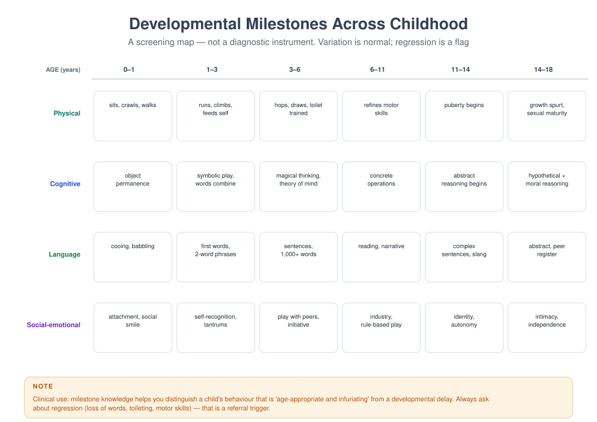

# MFT 703 — Human Development Across the Lifespan

> **MSc Marriage and Family Therapy** · Semester One · 1.71 Units · 15 teaching weeks · Prerequisite: none

**Course leader's summary.** You cannot assess a family without knowing what is developmentally ordinary.
This course covers physical, cognitive, language, social-emotional and moral development from conception
to later life, always in family and cultural context — and it trains you to distinguish *normal variation*,
*delay*, *regression* and *symptom*.

---

## How to use this book

Development is not a list of ages; it is a set of **tasks** and a set of **negotiations** between a person
and their family. Each week here gives you the developmental task, the family task that accompanies it,
what goes wrong, and what it looks like in a consulting room. Use the milestone grid (Figure 23) as a
reference you return to, not as a checklist to memorise.

---

## 1. Course description

Human development is the backbone of family assessment. A two-year-old's tantrum, a nine-year-old's
lying, and a fifteen-year-old's secrecy are not three versions of "defiance": they are three different
developmental moments that require three different responses. Clinicians who do not know this either
pathologise normal development or miss genuine delay.

The course integrates **neurodevelopmental, cognitive, attachment, systemic and cultural** perspectives.
It treats development as *bidirectional*: children shape parents as much as parents shape children, and
families develop too (a theme developed in MFT 719).

---

## 2. Learning outcomes

| # | Outcome | Assessed |
|---|---|---|
| LO1 | Describe physical, cognitive, language and social-emotional milestones from 0–18 and in adulthood | Exam |
| LO2 | Distinguish normal variation, delay, regression and symptom in a presenting concern | Case assignment |
| LO3 | Apply attachment theory to family assessment | Case assignment, exam |
| LO4 | Explain developmental tasks of adulthood and later life and their family implications | Exam |
| LO5 | Evaluate developmental theory critically, including its cultural assumptions | Essay |
| LO6 | Communicate developmental information to parents without jargon or alarm | Skills assessment |

---

## 3. Assessment

| Component | Weight | Due |
|---|---|---|
| Developmental case analysis (2,000 words) | 30% | Week 8 |
| Parent-feedback role-play (10 min, observed) | 20% | Week 11 |
| Written examination | 50% | Week 16 |

---

## 4. The fifteen-week plan

| Week | Topic | Practical |
|---|---|---|
| 1 | Why developmental knowledge is clinical knowledge | Milestone self-audit |
| 2 | Prenatal development, temperament and the transition to parenthood | Temperament interview |
| 3 | Infancy: attachment, synchrony, regulation | Still-face observation |
| 4 | Toddlerhood: autonomy, language, limit-setting | Tantrum consultation role-play |
| 5 | Early childhood: play, theory of mind, initiative | Play observation |
| 6 | Middle childhood: industry, peers, school, self-concept | School-refusal case |
| 7 | Adolescence I: puberty, identity, autonomy | Adolescent interview |
| 8 | Adolescence II: risk, peers, digital life, mental health | Risk/development differential |
| 9 | Adult development: intimacy, work, generativity | Life-structure interview |
| 10 | Couple development across the lifespan | Couple timeline exercise |
| 11 | Parenting across stages; communicating with parents | **Observed parent feedback** |
| 12 | Later life: cognition, loss, caregiving, legacy | Caregiver family meeting |
| 13 | Culture, poverty and development | Critical reading seminar |
| 14 | When development goes wrong: delay, disorder, trauma | Differential diagnosis workshop |
| 15 | Integration: the developmental lens in assessment | Case presentations |

---

## Week 1 — Why developmental knowledge is clinical knowledge

Three clinical errors are prevented by developmental literacy:

1. **Pathologising the ordinary.** A two-year-old who says "no" to everything is doing the developmental
   task of autonomy, not manipulating the family.
2. **Missing the abnormal.** A five-year-old who has lost previously acquired language is not "being
   difficult"; regression is a red flag requiring urgent referral.
3. **Mis-timing the intervention.** A parent is told to "reason with" a three-year-old whose prefrontal
   circuitry cannot yet support the reasoning demanded. The intervention fails and the parent concludes
   they are failing.

**Four categories you must distinguish** — this distinction recurs in every case assignment:

| Category | Definition | Example |
|---|---|---|
| Normal variation | Within the expected range, differing in style and pace | Walking at 11 months vs 15 months |
| Delay | Functioning below the expected range but progressing | No words at 24 months, but progressing |
| Regression | Loss of previously acquired skill | A four-year-old stops speaking |
| Symptom | Behaviour that signals distress rather than development | New soiling at seven after a bereavement |

> **PRACTICAL** — Write your own developmental timeline from memory: first word, first step, a
> significant illness, a move, a loss. Then ask a parent or sibling to correct it. Note which events you
> had forgotten and who remembered them.

### 1.1 The lecture in ninety minutes

| Minutes | Segment | What the lecturer does | What students do |
|---|---|---|---|
| 0–10 | The three errors | Three cases in which developmental ignorance produced harm | Name the error in each case |
| 10–25 | Development as negotiation | The person's task and the family's task, side by side | Write the pair of tasks for one age |
| 25–40 | The four categories | Normal variation, delay, regression, symptom, tested on video clips | Classify eight clips |
| 40–55 | The screening map | The milestone grid, used as a reference rather than a checklist | Locate a real child on the grid |
| 55–70 | What the grid cannot tell you | Culture, opportunity, illness, trauma, family organisation | List five things a milestone cannot show |
| 70–82 | Talking to parents | The sentence that informs without alarming | Rewrite three alarming sentences |
| 82–90 | Why this course is a clinical course | The assessment, the case analysis, the exam | Choose a family for the case analysis |

**The teaching decision that makes the week work.** The week must establish a habit of mind, not a body of
facts: before any behaviour is judged, ask *what is the developmental task here, and whose task is it?* The
lecture should therefore work from three video clips of the same behaviour at different ages — a child
refusing to share at two, at six and at thirteen — and let the class discover that the identical act means
three different things and requires three different responses. The facts about milestones can be read; the
habit must be demonstrated.

**The sentence the lecture must land.** "Behaviour is only meaningful in relation to a developmental task."
A student who can look at a nine-year-old's lying and ask what task the lying is serving — rather than
whether the child is honest — has begun to think developmentally, which is the whole of this course's foundation and the first line of every case analysis they will write for the next fifteen weeks.

### 1.2 Core concepts

**Development as a set of tasks.** Each stage of life presents a person with a task — to become attached,
to become autonomous, to become competent, to become oneself, to become a partner, to become a parent, to
become old — and each task requires a negotiation with the family. The task language comes from Erikson,
and this course uses it because it is clinically usable: it converts a behaviour into a question about
what the person is trying to achieve, and a question about what the family is being asked to allow.

**Development as bidirectional.** The child shapes the parent as surely as the parent shapes the child. A
temperamentally reactive infant produces a more cautious mother; a mother's depression produces a more
withdrawn infant; and the two effects are not separable, which is why the clinical unit is the relationship
rather than the individual. This is the course's central systemic claim, and it is the reason the course
belongs in a family therapy programme rather than in a psychology department.

**Development as a negotiation between tasks.** At every stage there are two tasks: the person's and the
family's. The toddler's task is autonomy; the family's task is to allow autonomy while keeping the child
safe. The adolescent's task is identity; the family's task is to tolerate the adolescent's separateness
without abandoning them. Most presenting problems in family therapy are a stalled negotiation between the
two, and the therapist's developmental question is: which task is stalled, and whose?

**The four categories.** Normal variation (within range, differing in style and pace); delay (below range,
but progressing); regression (loss of an acquired skill); and symptom (behaviour that signals distress
rather than development). The categories are clinical instruments, and their misuse produces the three
errors listed above. The distinction between delay and regression is the most urgent: delay usually allows
assessment over weeks, and regression demands referral within days.

**Normative and non-normative events.** Normative events are those expected at a stage — starting school,
puberty, leaving home, retirement. Non-normative events are unexpected — a parent's death, a move, an
illness, a war, a divorce. The family life cycle literature (MFT 719) describes the normative; the
clinician's task is to assess how a family's non-normative events have intersected with the normative ones,
because that intersection is where most symptoms live.

**The developmental history as a clinical instrument.** A developmental history is not a form; it is the
most efficient way to locate a family's difficulty in time. Not "was he a difficult baby?" but "when did
this start, what else was happening then, and what changed at that point?" The history converts a
presenting complaint into a chronology, and the chronology usually shows that the symptom began at a
transition — which tells the therapist where to look.

**Screening is not diagnosis.** A milestone grid identifies children who need a fuller assessment. It does
not diagnose, and it cannot distinguish a child who is late because of a global delay from one who is late
because of deprivation, illness, trauma or a family in crisis. A clinician who treats the grid as a
diagnostic instrument will refer children who are developing normally and miss children whose development
is being distorted by their circumstances.

**Culture, opportunity and the milestone.** Milestones describe what children do when they are given the
conditions to do it. A child who has not learned to count by six may be delayed, or may never have been
taught; a child who does not speak in the clinic may be shy, or may speak a different language at home, or
may have been told not to speak to strangers. The clinical question is always: what has this child had the
opportunity to learn, from whom, in what language?

**Risk and resilience.** The literature's most useful finding for family therapists: the number of risk
factors matters less than the balance between risk and protective factors, and the single most powerful
protective factor is a relationship with at least one consistently responsive adult. That finding is the
developmental justification for family therapy, and it should be quoted in every assessment that identifies
a child at risk.

### 1.2a The developmental history, asked well

The instrument the whole course depends on, and the one most often performed as a form. Eleven questions,
each with what it is for.

**One — "start at the beginning: was this a planned pregnancy, and how was it for you?"** *For:* the
parents' state at the child's beginning, which predicts a good deal about the relationship's foundation. An
unplanned pregnancy in a hostile household is not a verdict; it is information.

**Two — "how was the birth, and how were the first weeks?"** *For:* birth trauma, prematurity, a mother's
illness, a period of separation. The question also signals that the therapist is interested in the parents'
experience, not only the child's.

**Three — "who was at home in the first year, and who helped?"** *For:* the caregiving network, which in
many families is wider than the parents, and which is often invisible in the referral.

**Four — "when did he first smile, sit, walk, and say a word?"** *For:* the developmental trajectory, asked
in ordinary language rather than as a checklist. Parents remember these with surprising accuracy, and their
confidence in answering is itself informative.

**Five — "was he different from your other children, and in what way?"** *For:* the comparison parents make
spontaneously, and the meaning they have given it.

**Six — "when did you first become worried, and what made you worried then?"** *For:* the starting point of
the parents' concern, which is frequently earlier than the referral, and the event that converted a
characteristic into a problem.

**Seven — "what was happening in the family at that time?"** *For:* the intersection of the child's
development with the family's non-normative events. This is the question that produces the chronology's
turning points.

**Eight — "who has said what about it — school, clinic, family?"** *For:* the descriptions already attached,
and their authority. The answer tells the therapist what the family have been told, by whom, and how they
have absorbed it.

**Nine — "what have you tried, and what happened?"** *For:* the family's own experiments, which are usually
more numerous and more thoughtful than the referral suggests.

**Ten — "what does he do well, and what does he love?"** *For:* the competence description, which the
referral will not contain, and which the therapy will need.

**Eleven — "what would you want me to understand that I have not asked about?"** *For:* the question the
family have been waiting for, which is often where the real referral is.

**How the questions are used in the session.** Not read out in sequence; woven into the first forty minutes,
in the family's language, with the child present where possible and asked directly at least three times.
The therapist writes the chronology on a single sheet with dates, and shows it to the family at the end:
"this is what I have understood; what have I got wrong?" The correction is the first collaborative act.

### 1.3 The clinical method: from behaviour to task

A four-step method that the rest of the course will use, and that a student can apply to any presenting
behaviour.

**Step one — describe the behaviour, precisely and without interpretation.** Not "he is defiant" but "when
his mother asks him to put his shoes on, he says no, sits down, and after ninety seconds his mother puts
them on". The description should be filmable, dated, and observed in more than one setting where possible.

**Step two — locate it developmentally.** What is the expected behaviour at this age, in this culture, for a
child with this history? The milestone grid gives the range; the developmental history gives this child's
trajectory; the family's account gives the meaning. The output of this step is one of five statements:
within normal variation; delayed but progressing; a regression; a symptom of distress; or impossible to
tell without more information.

**Step three — identify the task.** What is the child trying to achieve, and what is the family being asked
to allow? A nine-year-old's defiance may be an attempt at autonomy in a family where autonomy is punished; a
two-year-old's tantrum is the task itself, not a failure of it; a fourteen-year-old's secrecy is the
beginning of a private life. The task is not a hypothesis about cause; it is a description of what the
behaviour is *for*, and it can be stated to the family in their own language.

**Step four — test the formulation against the family's response.** If the behaviour is an autonomy
struggle, the family's response to a small increase in the child's choices should be observable within a
week or two. If it does not change, the formulation is wrong, and the therapist revises it rather than
pressing the family harder. This step is what distinguishes a developmental formulation from a developmental
label.

**Worked, briefly.** The behaviour: a seven-year-old soiling again after two years of continence. Step two:
regression, not delay, and therefore a signal. Step three: the task is not autonomy but the management of an
experience the child cannot name — and the chronology shows the soiling began when the father moved out.
Step four: the formulation predicts that the soiling will reduce as the child is given a way to speak about
the departure, and the prediction can be tested in four sessions.

**The method's use in the case assignment.** The 30% developmental case analysis asks for exactly these four
steps, applied to one child or adolescent, with the developmental history and a formulation. A student who
follows the method will produce a defensible analysis; a student who begins with a diagnosis will produce a
checklist.

### 1.4 Techniques: the four instruments of this course

**The milestone grid, used as a reference.** The grid (Figure 1.1) gives ranges by domain — gross motor,
fine motor, language, social-emotional, cognitive. It is used in three ways: to locate a child's
trajectory; to identify the domains in which the parents' concern is concentrated; and to notice what the
parents have *not* mentioned, which is sometimes the more important finding. It is not used to score a
child, and a therapist who reads the grid out to a parent has misunderstood its purpose.

**The developmental timeline, drawn on one sheet.** A horizontal line with the child's age marked in years,
and above it the events the family describe: births, moves, illnesses, separations, deaths, school changes,
and the points at which the presenting behaviour began or changed. The drawing is done with the family,
in the session, and it is the single most useful artefact of a developmental assessment. Its power is
visual: families see the coincidence of a symptom's onset with an event, which no amount of questioning
produces as convincingly.

**The three-setting comparison.** Ask what the behaviour looks like at home, at school (or nursery, or
church), and with a particular person — usually a grandmother, an aunt or a favourite teacher. The
comparison answers the question the clinic cannot: is this behaviour a property of the child or of a
relationship? A child who is silent at home and fluent at school is not a child with a language disorder.

**The ordinary-language formulation.** The therapist's developmental understanding, converted into one or
two sentences a parent can use: "he is doing what six-year-olds do — testing whether the rules are the same
when you are tired — and the useful response is to keep the rule and not to explain it at length." The
formulation is the intervention, and its quality is judged by whether the parent can repeat it accurately a
week later.

**The developmental question, as a habit.** "What would you expect a child of this age to be doing?" asked
of the parents before the therapist offers an opinion. The question does three things: it elicits the
family's developmental theory (which is often accurate), it reveals the standard against which the child is
being judged, and it positions the therapist as a collaborator rather than an authority.

### 1.4a Two timelines, drawn and read

**Timeline one — a developmental problem that is not a developmental disorder.**

*The case.* Chidi, 6, referred by his school for "immaturity and poor concentration". The family: mother
(29), father (34, works away), a new baby of four months, and a grandmother who has moved in to help.

*The timeline.* Birth, unremarkable. Walking at 14 months, first words at 15 months, sentences at 26
months — all within range. Nursery at three, described as "a pleasure". School at five, settled. At five
years six months: the baby is born. At five years eight months: the grandmother moves in. At five years
nine months: the school reports "immaturity".

*The reading.* Every developmental marker is within range, and there is no regression of an acquired skill.
What changed was the household: a new baby, a grandmother, and a mother whose attention is now divided
three ways. The behaviour the school calls immaturity is a six-year-old's attempt to reclaim a position in
a household that has reorganised without him.

*The formulation, in ordinary language.* "He is not behind. He is doing what a six-year-old does when a
baby arrives and the house fills up: he is trying to get back the place he had. The useful response is not
to expect less of him, which confirms his fear, but to give him a job with the baby that only he can do."

**Timeline two — a developmental problem that is.**

*The case.* Zainab, 4, referred by her nursery for "not talking". The family: mother (33), father (38),
two older children, and a history the referral does not mention.

*The timeline.* First words at 13 months, two-word phrases at 20 months — unremarkable. At three years two
months, the family moved cities. At three years four months, the paternal grandmother died. At three years
five months, Zainab stopped using sentences. At three years eight months, she stopped speaking outside the
home. At four, she speaks in single words to her mother only.

*The reading.* This is a regression: an acquired skill has been lost, and it was lost at a specific point.
The differential is wide — hearing, neurological, trauma, selective mutism — and all of it requires
assessment. The developmental formulation does not name the cause; it establishes the urgency and the
sequence, and it says plainly that a child who has lost language needs to be seen by a paediatrician within
weeks, not months.

*The clinical action.* Referral for hearing and paediatric assessment in the same week; the family work
continues alongside, addressing the move and the bereavement in the child's language; the nursery is asked
to stop asking her to speak and to describe what she does instead.

**What the two timelines teach.** The same presenting description — "not talking", "immature" — and two
completely different clinical situations. The timeline is what distinguishes them, and the timeline takes
fifteen minutes and one sheet of paper. A therapist who skips it will either pathologise Chidi or reassure
Zainab's parents, and both errors are common. The instrument costs fifteen minutes and it is the difference between a developmental assessment and a developmental opinion.

### 1.4b The four categories, tested on eight descriptions

The laboratory's classification exercise, written out so that it can be revised and so that the reasoning
can be examined. Classify each, and state what further information you would need.

**One.** A girl of 15 months has not walked; she pulls to standing, cruises the furniture, and is
unconcerned. *Classification:* normal variation at the late end, with a review date. *Information needed:*
birth history, any illness, family pattern of late walking, and a review in eight weeks.

**Two.** A boy of 26 months has twelve words; he understands instructions, points, and has begun to combine
two words this month. *Classification:* delay, with progress. *Information needed:* hearing test, whether he
is being raised in more than one language, and the parents' account of who speaks to him and how.

**Three.** A girl of four who spoke in sentences has, over three months, stopped using sentences and now
speaks in single words to her mother only. *Classification:* regression. *Action:* paediatric and audiology
referral within the week; do not wait for a review.

**Four.** A boy of seven has begun wetting the bed after four years of being dry, and has become clingy at
bedtime. *Classification:* symptom, with regression of a self-care skill. *Information needed:* what changed
in the household in the last three months — illness, separation, move, a new adult, a bereavement.

**Five.** A girl of nine refuses to do homework, cries when her mother mentions school, and has stopped
seeing her friends. *Classification:* symptom, and the school refusal is the presenting edge. *Information
needed:* what is happening at school, including bullying and a specific adult; and what is happening at home
that makes staying at home attractive.

**Six.** A boy of 13 has begun to close his bedroom door, to be private about his phone, and to prefer
friends to family. *Classification:* normal variation — the developmental task of adolescence. *Information
needed:* whether the privacy is accompanied by withdrawal from all relationships and by a change in
functioning, which would make it a symptom instead.

**Seven.** A girl of 30 months has frequent tantrums lasting up to twenty minutes, several a day, in a
household that has just moved and in which a new baby arrived six weeks ago. *Classification:* normal
variation in behaviour, in a family under two non-normative events at once; the family may need support and
the child does not need a referral. *Information needed:* the parents' own state, and whether the tantrums
endanger anyone.

**Eight.** A boy of five is reported by his school as "unable to concentrate"; at home he plays Lego for
forty minutes, and at his grandmother's house he sits through a two-hour church service. *Classification:*
insufficient information — and the three-setting comparison already suggests that the behaviour is a
property of the classroom relationship rather than of the child. *Information needed:* an observation in the
classroom, the teacher's account, and the seating and task arrangements.

**Why eight descriptions and not one.** Each of the eight is decided by a different piece of information: the
trajectory, the language environment, the loss of a skill, the household's recent events, the school
context, the developmental task of the age, the number of stressors, and the cross-setting comparison.
Students who can classify all eight, and name what they would need to know, have the course's first
instrument.

### 1.5 The first session with a developmental concern

A structure for the assessment session, in five phases, with the words a therapist can use.

**Phase one — the frame (five minutes).** "I am going to ask about your child's development, and about what
has been happening at home, because the two are connected. I will also want to see him, and I may want to
speak to the school with your permission. At the end I will tell you what I think and what I would suggest."
The frame matters more in developmental work than in any other, because parents arrive expecting to be
assessed themselves.

**Phase two — the concern, in the parents' words (ten minutes).** "Tell me about it in your own words, not
the school's." The therapist writes the family's language and the referral's language in two columns, and
notes the difference. The difference is usually informative: the school says "defiance", the mother says
"he is angry with me since his father left".

**Phase three — the developmental history (twenty minutes).** The eleven questions of 1.2a, woven rather
than read, with the child present and asked directly at least three times. The therapist draws the timeline
as the answers arrive, and turns the sheet so the family can see it.

**Phase four — the observation (ten minutes).** Not a test: an observation of the child with a task and with
the parent. A simple task — a puzzle, a drawing, tidying up — is enough to see the child's attention, his
language, his response to a request and his response to his parent's response. The therapist narrates what
she sees aloud, in neutral language: "I notice he looks at you before he answers." The narration is the
assessment, and it is also the intervention, because it teaches the parent to look.

**Phase five — the formulation and the next step (five minutes).** One of the five statements from 1.3, in
ordinary language, plus a next step: a paediatric referral, a school observation, a further session, or a
plan. The formulation must include the family's competence: what they have already done that has helped.

**What the therapist does not do in session one.** Does not score a developmental test; does not name a
diagnosis; does not tell the parents what they should have done; does not reassure them that everything is
fine before the assessment is complete; and does not leave without a next step, and never ends a first session with a family who are unsure whether the therapist believed them.

**The three sentences parents remember.** "This is not your fault, and it is not nothing." "Here is what I
think is happening, in one sentence." "Here is what we will do next, and when."

### 1.6 Case: the Okonkwos, a developmental reading

The course's recurring family, read developmentally, which is a different reading from the one any therapy
model gives.

**The family.** Ebuka (9), his mother Ada (34), his father Chuka (39, works nights), and a baby of eleven
months. The paternal grandmother died in 2023. The presenting complaint is defiance.

**The chronological reading.** Ebuka's developmental history is unremarkable: walking at 13 months, words at
16 months, reading at six, no illnesses, no separations. The family's non-normative events are the
grandmother's death in 2023 and the baby's birth eleven months ago. The defiance began four months after the
baby's birth, and intensified when Chuka changed to night shifts.

**The developmental task.** At nine, the task is industry: to become competent at something that matters, in
the company of peers and adults who recognise the competence. The family's task is to provide a domain in
which the child can be competent, and a structure in which his competence is visible. In this household,
the domain has been removed: the grandmother who taught him to cook died, and the mother's attention is with
the baby. The defiance is not a failure of industry; it is an attempt to be noticed in a household where the
noticing has moved.

**The task-stall, named.** "He is trying to get back into the place he had before the baby and before your
mother died, and the only lever he has found is refusing." The sentence is offered to the parents as a
formulation, and it is testable: if the formulation is right, giving him a recognised role with the baby and
restoring one of the grandmother's activities should reduce the defiance within three weeks.

**What the reading adds to the therapy models.** Week 4 of MFT 702 would describe a boundary problem; Week 6
would hypothesise a function; Week 8 would write a behavioural plan. The developmental reading supplies
something none of them does: the *content* of the intervention. Not "spend more time with him" but "teach
him to cook the one dish your mother taught him, and let him cook it on Sundays", which is the grandmother's
function restored, the child's industry given a domain, and the family's grief given a place.

**The three-week test.** At the review: has he cooked twice? Has the defiance fallen on those days? If the
answer is no to both, the formulation is wrong, and the therapist says so and revises.

### 1.6a The same child, three developmental misreadings

**Misreading one — the diagnosis.** The school's description ("possible ADHD") is accepted, and a referral
for assessment is made without a developmental history. The assessment finds no disorder, three months are
lost, and the family's confidence in services falls. *The error:* a description was treated as a finding.
*The correction:* the timeline first, the referral second, and the referral framed as a question rather than
a conclusion.

**Misreading two — the reassurance.** The therapist, noting that all milestones are within range, tells the
parents that Ebuka is "a normal nine-year-old" and that the behaviour will pass. The parents hear that their
distress is unwarranted, and they do not return. *The error:* the developmental assessment answered a
question nobody had asked (is he delayed?) and ignored the question they had (what is happening to my
family?). *The correction:* both statements, in this order — "his development is on track, and what is
happening at home is real and worth working on".

**Misreading three — the moral reading.** The defiance is treated as a discipline problem, and the
intervention is a firmer consequence. The behaviour worsens, the mother's confidence collapses, and the
father's absences increase. *The error:* a developmental signal was read as a character defect. *The
correction:* the task question — what is the behaviour for? — asked before any consequence is designed.

**The pattern across the three.** Each misreading is produced by skipping one step of the method in 1.3:
the diagnosis skips the description and the timeline; the reassurance skips the task; the moral reading
skips the developmental location. The method is short, and every step of it is load-bearing: skip one and the assessment produces an opinion instead of a formulation.

### 1.7 Annotated transcript: the timeline drawn

Twelve turns from the first session with the Okonkwos, while the therapist draws the timeline. The transcript
shows how a developmental history is actually taken.

> **T1 Therapist:** I want to draw a line, and put on it everything that has happened since Ebuka was born.
> Can we do that together? When was he born?

> **T2 Ada:** March 2016. He was fine, everything was fine.

> **T3 Therapist:** (writing) Fine. When did he walk?

> **T4 Ada:** Thirteen months. He was quick.

> **T5 Therapist:** And talking?

> **T6 Ada:** Sixteen months. He talked early too. His grandmother used to say he talked for the whole
> family.

> **T7 Therapist:** (pause) Tell me about his grandmother.

> **T8 Ada:** She died in 2023. In August. She lived with us.

> **T9 Therapist:** (writing, then turning the sheet) So — here is 2023, and here is August. What happened in
> the house after that?

> **T10 Ada:** Everything changed. She used to cook with him. She used to sit with him in the evening and he
> would tell her everything.

> **T11 Therapist:** And when did the problems start?

> **T12 Ada:** (long pause) After the baby. But — now that I am saying it out loud — he stopped telling me
> things when she died.

**Annotations.** *T1* frames the timeline as a joint activity, which converts an interrogation into a
drawing. The paper is turned toward the family throughout, and *T9*'s "turning the sheet" is the moment the
instrument does its work.

*T3–T6* are the milestones, asked in ordinary language, and they are answered with confidence — which is
itself a finding: this mother knows her child's development, and her competence is visible to the therapist
and, more importantly, to her.

*T7* is the pivot, and it is earned: the therapist follows the grandmother's name rather than the schedule.
The grandmother appears in the mother's answer as a person with a relationship to the child, which is the
most important thing said in the session.

*T9* is the timeline's use: the therapist locates the event in time and asks what happened next, which is a
different question from "how did you feel". *T10* produces the content of the intervention: cooking, and
evening conversation.

*T12* is the session's turning point, and it happens because the timeline made the sequence visible. The
mother corrects her own account — "after the baby… but now that I am saying it out loud" — and the
correction is hers, not the therapist's. That is what a timeline does that a question cannot: it makes the family's own sequence visible to the family, and the correction that follows belongs to them.

**What the trainee should notice.** The therapist asks eleven questions and makes no interpretation. The one
interpretive act in the session is the mother's, produced by the drawing. The instrument does the work, and
the therapist's skill is in holding the paper and following the family's own order of significance.

### 1.8 Laboratory: the timeline and the four categories

Sixty minutes, in pairs and then in the whole group.

**Part one — the timeline from memory (fifteen minutes).** Each student draws their own developmental
timeline, then interviews the partner using the eleven questions, drawing the partner's timeline. The
drawing, not the notes, is the output.

**Part two — classification (twenty-five minutes).** The lecturer presents eight short cases, each a
description of a behaviour with a minimal history. Students classify each as normal variation, delay,
regression, symptom, or insufficient information, and must state what further information they would need.
Two of the eight are deliberately unclassifiable.

**Part three — the sentence (twenty minutes).** For each of four cases, each student writes the
ordinary-language formulation in two sentences and reads it aloud. The group judges whether a parent could
repeat it a week later.

**Marking rubric for the 30% case analysis.**

| Criterion | Weight | Full marks |
|---|---|---|
| Description | 15% | Behaviour described precisely, in more than one setting, without interpretation |
| Developmental location | 25% | Correct category, with the evidence for it and the differential acknowledged |
| Task formulation | 20% | The person's task and the family's task stated, in testable form |
| History and chronology | 20% | Timeline with normative and non-normative events, and the onset located |
| Ordinary language | 10% | A formulation a parent could repeat |
| Limits | 10% | What the formulation cannot tell you, and what would change it |

**The distinction-level answer.** It distinguishes delay from regression with evidence; it names the task in
a sentence the family could use; it locates the onset against the family's events; it states what would
falsify the formulation; and it does not diagnose.

### 1.9 Six errors in developmental assessment

1. **The checklist.** Running the milestone grid as a questionnaire, which produces scores without a child.
   Fix: the grid as a reference, the timeline as the instrument.
2. **The premature diagnosis.** Naming a condition in the first session, which forecloses the assessment and
   organises the family around a label. Fix: the five statements of 1.3, and a referral framed as a question.
3. **The false reassurance.** "He will grow out of it", offered before the assessment is complete. Fix: two
   statements — development is on track, and the family's difficulty is real.
4. **The missed regression.** A lost skill attributed to stubbornness. Fix: regression is a red flag; refer
   within days.
5. **The decontextualised child.** Assessing the child alone, in a clinic, without the household, the school
   or the language. Fix: the three-setting comparison, and at least one session with the caregiving network.
6. **The moral reading.** Treating a developmental signal as a character defect. Fix: the task question,
   asked before any consequence is designed.

### 1.10 Culture, faith and development

**The cultural question, stated baldly.** Almost every developmental milestone in this book was
established by studying children in Europe and North America, and almost every one of them is a statement
about what children do when they are fed, housed, spoken to and played with in a particular way. That does
not make the milestones false; it makes them conditional, and the condition is the child's opportunity.

**Three examples where the condition matters.**

*Language.* The vocabulary and grammar norms in the literature come from children learning a single
language in a household where adults speak to them directly. A child in a multilingual household, or a
household where adults speak to each other and not to children, may be developing normally and score below
the norm. The clinical error is to call this delay; the clinical task is to assess competence in the child's
own language, with a speaker of that language.

*Autonomy.* The two-year-old's task is described in the literature as autonomy, and in many households the
task is instead obedience, and the child who asserts autonomy is corrected earlier and more firmly. The
child is not delayed; the family's developmental curriculum is different. The therapist who treats the
family's curriculum as the problem will lose the family, and the therapist who treats the child's autonomy
as the only healthy outcome will impose a value.

*Sleep and independence.* The literature on infant sleep assumes a separate sleep surface and a
self-settling child. In households where infants sleep with their mothers, the milestone's behavioural
markers are absent and the developmental process is not. A therapist who recommends "sleep training" to such
a family is not offering developmental science; they are offering a cultural practice.

**What the competent practitioner does.** Three things. First, asks the family what is expected of a child
of this age in their household, and what happens when a child does not meet it. Second, assesses competence
in the child's own language, with the family's own tasks, before comparing to a norm. Third, names the
translation when they make one: "in the studies this comes from, children are spoken to directly by adults;
in your house it is different, so I am going to test something else."

**Faith and development.** Religious households have their own developmental curriculum: when a child prays,
fasts, reads scripture, is initiated, and takes a place in the community's rituals. These are developmental
tasks in the family's terms, and they matter to the child's identity as much as school competence does. The
clinician's interest is not in the content of the curriculum but in its fit with the child: a child who is
required to fast before puberty may be perfectly well; a child required to carry an adult's religious
anxiety is not, and the difference is the child's own state, not the practice.

**The examinable sentence.** "The milestones are conditional on opportunity, and the clinical question is
what this child has had the chance to learn, from whom, in what language." A student who can say that and
apply it to a family in front of them has understood the course's cultural premise.

> **DEBATE** — "Developmental norms are a tool of cultural standardisation, and a family therapist should
> use them only with reluctance." Argue both sides, and say what you would lose by abandoning them.

### 1.10a The course's four categories, applied to a family

A worked application of the four categories to the Adeyemi family, because the categories are usually taught
with individual children and used with families.

**Normal variation, in a family.** A fourteen-year-old who wants to spend Saturday with friends rather than
relatives is doing the developmental task of the age. The family experiences it as rejection. The clinical
response is to name the task, to the parents, and to distinguish it from the conflict that may surround it.

**Delay, in a family.** A family in which the parents have not yet made the transition from managing a child
to negotiating with an adolescent: the developmental task of the parents is delayed. The adolescent's
behaviour is age-appropriate and the family's organisation is not, and the formulation must say so without
blaming the parents, who may have had no model of adolescence in their own upbringing.

**Regression, in a family.** A family that had established a workable routine, then lost it when a member
died: the household's functioning has regressed to an earlier, less differentiated arrangement. The
regression is a signal, and it tells the therapist that the family's coping has been overwhelmed rather than
that the family is deficient.

**Symptom, in a family.** A child's school refusal that functions to keep a parent at home during a marital
crisis is a symptom — a signal of the system's distress — and it is neither normal variation nor delay. The
clinical response is to treat the signal as information about the system, which is exactly what Week 4 of
MFT 702 argues.

**Why the family application matters.** Students who learn the categories on individual children classify
individual children and then treat families as if the categories did not apply to them. They do: households
have developmental tasks, and households can be delayed, regressed, symptomatic or simply varied. The
therapist who can say "your family is doing what families do at this stage, and the difficulty is that the
stage has arrived early" has a formulation the parents can use.

### 1.11 Evidence note: what developmental science can and cannot support

**What is well established.** The sequence of gross motor and language milestones, with wide normal ranges;
the importance of responsive caregiving in the first years; the association between early adversity and
later difficulties, with the caveat that the association is probabilistic; the protective effect of at least
one consistent relationship; and the finding that development is bidirectional, with child characteristics
shaping parenting as much as the reverse.

**What is contested.** The size and reversibility of early adversity's effects (the "first thousand days"
literature is stronger on the first claim than the second); the predictive value of infant temperament for
adult personality; the specificity of attachment classifications for later disorder; and the extent to which
screeners improve outcomes, as distinct from identifying children.

**What is often misused in clinical settings.** Milestone checklists presented to parents as though they
were diagnostic; "brain development" arguments used to pressure parents into particular practices; and
attachment language used to describe ordinary family difficulty. A family therapist should be able to
recognise each of these, because each will be used on the families they see.

**What the developmental literature gives a family therapist.** Three things of real value: a timeline
against which to locate a concern; a set of tasks that make behaviour intelligible; and the strongest
evidence base in the field for the claim that relationships are the mechanism of development, which is also
the claim that justifies family therapy.

**The matrix cell, in this course's terms.** "Strong descriptive evidence for sequences and ranges; moderate
evidence for caregiving's role; contested evidence for early-adversity determinism; and no evidence for any
single parenting practice as universally optimal." A student who writes that in an examination will do well.

**The practitioner's claim.** "I use developmental knowledge to locate a behaviour and to distinguish
variation from delay from regression from symptom; I use the timeline as my main instrument; I do not
diagnose from milestones; and I assess competence in the family's own language and tasks before comparing to
a norm." That sentence is the course's professional baseline, and it is also the sentence to say in a case discussion when a colleague reaches for a diagnosis before a history.

### 1.11a What development cannot explain

A short section, because the developmental frame is powerful and can be overreached.

**Development cannot explain a family's meaning.** That a child is nine tells you about industry, peers and
concrete-to-abstract thinking; it does not tell you what the child's defiance means in a household where his
grandmother has died. The developmental frame supplies the stage; the family supplies the meaning. A
therapist who explains the second by the first is committing the error this course exists to prevent in the
opposite direction.

**Development cannot explain a symptom's function.** A regression is a signal, and what it signals may be a
developmental event, a family event, or both. The developmental reading locates the timing; the systemic
reading explains the function. The two are complementary and neither is sufficient.

**Development cannot adjudicate values.** Whether a child should sleep alone, be circumcised, be punished
physically, be taught scripture, or be allowed to choose her own friends are questions about which
developmental science has some evidence and no authority. The practitioner's obligation is to know the
evidence, state it, and distinguish it from their own values — which is the same obligation this book's
later courses will examine in ethics and culture.

**The sentence to keep.** "Development tells me when and what to expect; the family tells me what it means;
and I must not confuse the two, in either direction."

### 1.12 Key terms

| Term | Definition |
|---|---|
| Developmental task | The challenge a stage presents to a person, and the matching negotiation it presents to the family |
| Bidirectional development | Child and caregiver shape each other; neither is the sole cause |
| Normal variation | Behaviour within the expected range, differing in style and pace |
| Delay | Functioning below the expected range, but progressing |
| Regression | Loss of a previously acquired skill; a red flag |
| Symptom | Behaviour signalling distress rather than development |
| Normative event | An event expected at a stage (school entry, puberty, leaving home) |
| Non-normative event | An unexpected event (bereavement, migration, illness, war) |
| Developmental history | A chronology of milestones and family events, used to locate a concern in time |
| Timeline | The one-sheet drawing of the chronology, made with the family |
| Three-setting comparison | Comparing behaviour at home, elsewhere, and with a specific person |
| Opportunity condition | The assumption that milestones describe children who have had the chance to learn |

### 1.13 Self-test

1. Name the three clinical errors that developmental literacy prevents, with an example of each.
2. Distinguish delay from regression, and say why the distinction changes the urgency.
3. What are the four steps of the method in 1.3?
4. Give five of the eleven developmental-history questions and what each is for.
5. Why is the three-setting comparison useful, and what does it rule out?
6. State the bidirectional claim and why it matters to a family therapist.
7. What does the milestone grid not tell you?
8. How does a therapist handle the cultural condition on the milestones?

**Answers.** 1. Pathologising the ordinary (a two-year-old's "no"); missing the abnormal (a five-year-old
who stops speaking); mis-timing the intervention (reasoning with a three-year-old). 2. Delay is below range
but progressing and permits assessment over weeks; regression is the loss of an acquired skill and requires
referral within days. 3. Describe the behaviour precisely; locate it developmentally (one of five
statements); identify the task for the person and the family; test the formulation against the family's
response. 4. Any five: the pregnancy and its context; the birth and first weeks; who was at home and who
helped; milestones in ordinary language; how the child differed from siblings; when the parents first became
worried; what else was happening then; who has said what; what has been tried; what the child does well; what
has not been asked. 5. It establishes whether the behaviour is a property of the child or of a relationship,
and it rules out a generalised language or behavioural disorder when the child is fluent elsewhere. 6. Child
and caregiver shape each other continuously; it matters because the clinical unit is the relationship, and
because blaming either party misreads the evidence. 7. It cannot distinguish causes — deprivation, illness,
trauma, family crisis — nor diagnose; it identifies children who need fuller assessment. 8. Ask what the
family expects of a child of this age; assess competence in the child's language and tasks; name the
translation when comparing to a norm.

### 1.14 Reflective task

Draw your own developmental timeline from memory, then ask the person who raised you to correct it. Write
two paragraphs: one on what you had forgotten, and one on what your family remembered differently. The
exercise is the course's first instrument applied to the student, and most people discover that their own
developmental history is a family story with a particular narrator — which is exactly what the families in
this course will present to them. Keep the corrected timeline: it is the first artefact of your own developmental literacy, and you will read it again in Week 15.

### 1.15 Readings for this week

* **Berk (2017)**, *Development Through the Lifespan*, the reference text for the course, read the opening
  chapters for the frameworks and keep it for the milestones.
* **Erikson (1963)**, *Childhood and Society*, for the task language, read as a historical document as well
  as a theory.
* **Bronfenbrenner (1979)**, *The Ecology of Human Development*, for the nested contexts that make the
  family's environment part of the child's development.
* **Sroufe (2005)**, "Attachment and development", for the evidence on continuity and change.
* **Rogoff (2003)**, *The Cultural Nature of Human Development*, the essential corrective to the norms, and
  the source of this week's cultural argument.
* **Sameroff (2009)**, *The Transactional Model of Development*, for the bidirectional claim in its strongest
  form.

Read Rogoff first and Berk second; the corrective before the reference. For the case analysis, use at least
one source that disputes a norm you are relying on, and say so in the paragraph on limits. The reading-log
question this week is: "which of my own developmental assumptions did this reading make visible?"

*Next: [Week 2 — Prenatal development, temperament and becoming a parent](#week-2--prenatal-development-temperament-and-becoming-a-parent)*

---

## Week 2 — Prenatal development, temperament and becoming a parent

**Prenatal and perinatal.** Brain development, maternal stress and nutrition, birth experience, and the
"fourth trimester". Clinically relevant: prematurity, birth trauma, postnatal depression (which affects
up to 1 in 5 mothers in some settings and is strongly associated with relational and child outcomes),
and paternal postnatal depression.

**Temperament.** Nine dimensions (Thomas & Chess) usually simplified to three profiles: easy, slow-to-
warm, and difficult/feisty. Temperament is *not destiny* but it is **goodness of fit** that matters: a
highly sensitive child in a loud, unpredictable household will struggle more than the same child in a
predictable one.

**The transition to parenthood.** The couple must reorganise: time, sleep, money, division of labour,
sexuality, relationship with grandparents, and identity. Research consistently finds relationship
satisfaction dips after the birth of a child — and that the *quality of the co-parenting alliance*, more
than the amount of conflict, predicts child outcomes.

> **CASE** — A couple presents with "no time for each other" four months after their first baby. The
> developmental frame normalises the strain (this is the most common point of relational collapse), then
> asks the systemic question: which grandparent has been recruited into the parenting triangle, and what
> did the couple stop negotiating when the grandmother moved in?

**Practice.** In pairs, conduct a 10-minute temperament interview with a parent (or peer playing one):
sleep, feeding, reaction to change, intensity, mood. Then identify the goodness of fit with the household.

### 2.1 The lecture in ninety minutes

| Minutes | Segment | What the lecturer does | What students do |
|---|---|---|---|
| 0–10 | Before birth | The prenatal environment, and why a family therapist cares | Name one prenatal factor in a family they know |
| 10–25 | Prematurity and the fourth trimester | The relational consequences of a medical beginning | Map a premature infant's caregiving network |
| 25–40 | Postnatal depression | One in five mothers; the relational mechanism; the father's version | Screen a volunteer with a two-question tool |
| 40–55 | Temperament | Nine dimensions, three profiles, and goodness of fit | Interview a peer as a parent |
| 55–70 | Becoming a parent | The reorganisation: time, money, sex, labour, grandparents, identity | Draw the reorganisation on one page |
| 70–82 | The co-parenting alliance | Why it predicts child outcomes better than conflict | Rate three recorded couple clips |
| 82–90 | The clinical frame | Normalising the strain without dismissing it | Write the normalising sentence |

**The teaching decision that makes the week work.** This week's material is the most likely in the course to be
delivered as a list of risk factors, and the most useful version of it is a demonstration of how a normal
developmental event becomes a clinical presentation. The lecture should take the commonest presentation in
perinatal work — "we have no time for each other" — and show that it is simultaneously ordinary, dangerous, and
responsive to a small intervention. The class should leave able to say what is normal about the fourth month
after a first baby, and what is not.

**The sentence the lecture must land.** "The birth of a child is a developmental event for the parents, not only
for the child." Most of this week follows from it: the symptoms are the parents', the tasks are the parents',
and the assessment must include the couple's reorganisation, not just the baby's milestones.

### 2.2 Core concepts

**The prenatal environment.** The foetus develops inside an environment made of the mother's nutrition, stress
hormones, illness, substances and medical care, and that environment is itself shaped by her circumstances —
poverty, work, a violent household, a wanted or unwanted pregnancy, a partner's support. The clinical relevance
is not that prenatal events determine later life but that they are the first chapter of the family's story, and
families bring that chapter to the clinic, often without knowing they are doing so.

**The fourth trimester.** The three months after birth, in which the infant is neurologically immature and
utterly dependent, and the parents are in a state of physiological and emotional reorganisation. Sleep
deprivation, hormonal change, the loss of an established identity and the arrival of an unremitting demand are
all normal. The concept is clinically useful because it converts a set of complaints into a stage.

**Prematurity and the medical beginning.** A premature birth changes the sequence: the parents' first
relationship with their child is often mediated by machines, by staff, by fear, and by a period of separation.
The consequences are relational rather than deterministic: parents may be more anxious, more inclined to
monitor, less confident in their own competence, and the infant may be more reactive, harder to read, and slower
to settle. The clinical task is to restore the parents' confidence in their own reading of their child, which is
the thing the neonatal unit has, understandably, taken from them.

**Birth trauma.** A difficult birth can leave a mother with a sense of violation, a fear of the body, and a
reluctance to speak about it — often because she has been told she should be grateful. The clinical task is to
ask, specifically, and to let her tell it. The question "how was the birth?" asked with time to answer is one of
the most useful questions in perinatal work.

**Postnatal depression.** Affecting roughly one mother in five in many settings and a substantial minority of
fathers, postnatal depression is the most clinically consequential condition in this week's material. Its
mechanism is relational: a depressed mother is less responsive, the infant becomes more distressed and harder to
soothe, the father feels excluded or overloaded, and the couple's negotiation collapses. The screening questions
are short and should be asked of both parents at every perinatal contact.

**Paternal postnatal depression.** Less recognised and equally real: irritability, withdrawal into work, alcohol
use, and a refusal to describe the state as depression. The clinical presentation is often a couple conflict,
and the diagnosis is missed because nobody asks the father.

**Temperament, and the nine dimensions.** Thomas and Chess described nine dimensions — activity level,
regularity, approach or withdrawal, adaptability, sensory threshold, intensity of reaction, mood, distractibility
and persistence — usually simplified into three profiles: easy, slow-to-warm, and difficult (or feisty). The
dimensions matter clinically because they describe the child's contribution to the relationship, which many
parents experience as a verdict on their parenting.

**Goodness of fit.** The concept that saves temperament from fatalism: the outcome depends on the match between
the child's characteristics and the environment's demands. A highly sensitive child in a loud, unpredictable
household struggles; the same child in a predictable household thrives. The clinical implication is that the
intervention may target the environment rather than the child, which is a systemic move disguised as a
developmental one.

**The transition to parenthood.** The couple must renegotiate seven domains: time, sleep, money, the division of
labour, sexuality, the relationship with grandparents, and identity. The research finding that satisfaction dips
after the birth of a child is robust across cultures, and the dip is not a sign of a failing marriage; it is a
stage. What distinguishes couples who recover from those who do not is not the amount of conflict but the quality
of the co-parenting alliance.

**The co-parenting alliance.** The couple's capacity to coordinate as parents — to support each other's
relationship with the child, to present a united approach without undermining each other, and to keep the child
out of their conflicts. It predicts child outcomes more strongly than marital satisfaction does, which is why
perinatal work that focuses only on the couple's romance misses the mechanism.

**Becoming a parent as an identity transition.** The arrival of a child requires the adult to become someone new,
and the new identity is built from the models available: their own parents, their culture's expectations, their
partner's expectations, and their own ideals. The clinical presentations are recognisable: the parent who cannot
bear to be like their own mother and over-corrects; the parent who has no model at all; the parent whose identity
was entirely occupational and who now has none.

**The couple's reorganisation as the unit of assessment.** The perinatal assessment is not the baby's milestones;
it is the household's reorganisation. Who sleeps when; who feeds; who works; who decides; who else is in the
house; what has been given up; and what the couple have stopped negotiating. The last question is the most
productive, and it is the one the week's case turns on.

### 2.2a The goodness-of-fit grid, filled in

A worked instrument: the temperament interview, the household's demands, and the fit between them, on one page.

**The child.** Three months old, first baby. *Dimensions (parent's report):* high activity; irregular sleep;
withdraws from new sounds; slow to adapt to a change in routine; low sensory threshold (startles at the door);
intense reactions (screams, not cries); predominantly negative mood in the evening; hard to distract; persistent.

*The profile.* Difficult or feisty, by the classical typology — and the therapist should say "this describes a
pattern, not a verdict on your baby" when reporting it.

**The household's demands.** *People:* mother, father, and the father's mother, who has moved in "to help".
*Rhythm:* the father works a rotating shift, so the household's week changes every seven days. *Noise:* a shared
compound with four other households and a generator. *Space:* one room for the family. *Support:* the grandmother
is present but her methods differ from the mother's, and the mother does not feel able to say so. *Sleep:* the
mother is doing all night feeds because the father "needs to be fresh for work".

**The fit, in four statements.** First, this infant's low threshold is being met by a high-noise environment,
which produces more crying, which produces more maternal exhaustion. Second, the infant's irregularity is being
met by a household whose week changes every seven days, and no routine survives. Third, the infant's intensity is
being read by the mother as rejection ("he hates me by six o'clock"), which is the meaning that matters more than
the temperament. Fourth, the evening negativity coincides with the grandmother's arrival home, which the mother
has noticed and not said.

**The intervention, derived from the fit rather than from the child.** Not a sleep programme, not a referral.
Four changes: a predictable evening hour with the light low and the door closed, negotiated with the
grandmother; the father taking the six-to-nine period on his rest days, which is a co-parenting act rather than
a favour; one sentence the mother can say to the grandmother, rehearsed in the session; and a re-description of
the evening ("he is not rejecting you; by six o'clock he has had a day and he needs less, not more").

**What the grid demonstrates.** That the same infant in a different household would present differently, and that
the intervention targets the fit. A therapist who treated the temperament as the problem would have produced a
programme the household could not run; a therapist who treated the household as the problem would have blamed a
family that is doing a great deal well.

### 2.2b The nine dimensions, with the question that asks each

The dimensions are usually taught as a list. They are more useful as nine questions a therapist can ask a
parent in fifteen minutes.

| Dimension | The question | Why it matters clinically |
|---|---|---|
| Activity | "Is he usually on the move, or does he stay still and watch?" | A high-activity child in a small flat with a tired mother is a fit problem, not a behaviour problem |
| Regularity | "Does he sleep and feed at the same times each day?" | Irregularity plus a shift-working household produces a fortnightly crisis |
| Approach/withdrawal | "What does he do with a new food, a new person, a new room?" | Withdrawal is read by parents as rejection or shyness; the useful response differs |
| Adaptability | "How long does it take him to settle after a change?" | Slow adaptation plus frequent change is a formula for distress |
| Sensory threshold | "Does he startle at the door, the generator, a raised voice?" | Low threshold is the dimension most often mistaken for "spoiling" |
| Intensity | "When he is upset, is it a whimper or a scream?" | Intensity determines the household's exhaustion and the parent's sense of competence |
| Mood | "Is he mostly cheerful, or mostly serious and cross?" | Negative mood in the evening is normal and is read as rejection |
| Distractibility | "Can you settle him by showing him something else?" | The one dimension that is a resource: a distractible child is easier to soothe |
| Persistence | "If he wants something, does he give up or keep going?" | Persistence is a strength in a task and a problem in a battle of wills |

**How to use the table.** Not as an assessment instrument with scores, but as a repertoire, so that the parent
leaves with a description of their child that is specific, neutral and recognisably true. A parent who says "he
is difficult" can be given nine sentences that are more accurate and less judgemental, and the nine sentences are
the beginning of the intervention.

**The two dimensions that produce the most relief.** Sensory threshold and intensity. They are the two the
household experiences most acutely, and the two most often moralised ("he is spoiled", "he is a screamer"). Naming
them as characteristics rather than choices changes the parent's relationship to the behaviour within one
conversation.

### 2.3 Postnatal depression: the assessment

The condition is common, consequential and under-detected. A structure for asking about it.

**Who to screen.** Every mother at every perinatal contact, and every father at least once, separately, with the
baby out of the room and the partner absent. The separate conversation is the instrument; a joint conversation
will not produce an honest answer from either parent.

**The screening questions.** Two, used as a first filter in a family therapy session (a validated tool is used
where the service requires one): "In the past two weeks, have you often been bothered by feeling down, depressed
or hopeless?" and "Have you often been bothered by having little interest or pleasure in doing things?" A yes to
either is followed by "how much is this affecting your day-to-day life?" and, where the answer is substantial, by a
validated measure and a referral.

**The three questions that reveal the relational picture.** "Who knows how you are feeling?" "What happens in the
house when you have a bad day?" "What does your partner do when you cry?" The answers describe the support
available, the household's capacity to accommodate distress, and the couple's pattern — which is where the family
therapy begins.

**The paternal screen.** "How are you sleeping?" "What do you do when you feel low?" "Who would you tell?" Fathers
rarely use the word depression; the observable signs are irritability, working longer hours, drinking more, and a
withdrawal from the baby's care.

**The risk questions.** Thoughts of harm to self or the baby are asked directly, of both parents, and the answer
is recorded and acted on. A therapist who does not ask because asking feels intrusive has misunderstood the duty.

**The differential.** Not every exhausted mother is depressed. Sleep deprivation, thyroid disease, anaemia,
grief, an unsupportive partner, a violent household and a baby's illness all produce the same presentation, and
the family therapist's task is to screen, to refer where the picture is clinical, and to work on the relational
and practical conditions in parallel.

**The boundaries of the family therapist's role.** Treating postnatal depression is a clinical task that requires
a clinical service; the family therapist's contribution is the couple's alliance, the household's reorganisation,
the father's inclusion, and the practical support. Saying that clearly at the start prevents the two most common
failures: a family therapist attempting to treat a depression alone, and a clinical service treating a depression
in a household that is falling apart.

### 2.3a The couple's reorganisation, drawn on one page

The instrument the week's case turns on, and the one a couple can complete in fifteen minutes.

**The seven domains, with the question for each.** *Time:* what do you do together now that you did before?
*Sleep:* who gets up, how often, and what happens the next day? *Money:* who earns, who decides, and what has
changed? *Labour:* list everything that has to happen in a week and who does it. *Sexuality:* what has happened to
it, and who has said what about it? *Grandparents:* who is in the house or in the decisions, and how was that
decided? *Identity:* who are you now that you were not before, and what have you lost?

**The drawing.** A circle with the seven domains around it, and in the middle the couple's answer to one
question: "what have you stopped negotiating?" The answers are usually specific and painful: "who gets a night
off"; "whether your mother stays"; "whether I go back to work"; "whether we have another".

**Why the drawing works.** It converts a diffuse complaint ("we have no time") into seven specific negotiations,
of which usually two are live and five are being avoided. The live ones are the therapy's agenda, and the avoided
ones are the reason the live ones cannot be settled.

**The grandmother question, which is the week's case.** When a grandparent moves in to help, the couple's
negotiation is displaced: the decisions that were theirs are now made in a triangle, and each partner's
relationship with the grandparent becomes a route to influence. The clinical questions are: who invited her; who
can ask her to leave; what does each partner gain from her presence; and what did the couple stop deciding when
she arrived? The last question is usually answered with a silence, and the silence is the finding, and the therapist's next sentence should be the one that makes it speakable: "I am not asking you to blame anyone. I am asking what the two of you stopped deciding."

**The intervention, in one sentence.** "Before we talk about time for each other, I want to know what the two of
you stopped deciding when your mother moved in, because that is where the time went."

### 2.4 The first session with a couple four months after a birth

The commonest perinatal presentation, worked through, with the developmental frame used first and the systemic
question second.

**The presentation.** Aisha (31) and Sam (34), married four years, one baby of four months. Aisha's complaint:
"we have no time for each other and he does not help." Sam's complaint: "she is never happy with anything I do."
Both are exhausted. The baby is present and is being passed between them.

**Phase one — the normalisation (ten minutes), done carefully.** "What you are describing is the commonest thing
I see in the first year, and I want to say why before we go further. At four months, neither of you has slept
properly since the birth, you are both doing a job you have never done before, and the negotiations you used to
have — who does what, when — are being made at two in the morning with a baby crying. That is not a failing
marriage. It is the stage."

*Why this is not a dismissal.* The normalisation is followed immediately by the second sentence: "and it is also
the point at which couples get into patterns that last for years, so it is worth working on now."

**Phase two — the seven domains (twenty minutes).** The reorganisation drawn on one page. Time: none together.
Sleep: Aisha does every night feed. Money: Sam has taken a second job, so he is home less. Labour: Aisha does
everything in the house and Sam does the shopping. Sexuality: untouched since the birth, and neither has raised
it. Grandparents: Sam's mother stays four nights a week "to help". Identity: Aisha has stopped working and says
she "does not know who she is"; Sam says he is "the one who is never there".

**Phase three — the question (ten minutes).** "What did the two of you stop deciding when your mother started
staying four nights a week?" Silence. Then Aisha: "everything. She decides the bath, she decides the feeding, and
I cannot say anything because she is helping us." Sam: "I did not know you minded."

*The finding.* The couple's negotiation has been displaced into a triangle with the grandmother, and neither has
said so. The "no time for each other" is a symptom of a negotiation that has stopped.

**Phase four — a small, systemic task (ten minutes).** Not a date night, which the couple cannot arrange and
which would fail. Two tasks: the couple decide, together, one thing that is theirs rather than the grandmother's
— the baby's bath, three nights a week — and one of them tells her, in a sentence rehearsed in the room. And Sam
takes one night feed at the weekend.

**Phase five — the frame (five minutes).** Four sessions, with a review at the fourth; the paternal screen
completed separately; a question about Aisha's mood and a referral route if the screen is positive; and the
sentence to take away: "the problem is not that you have no time; it is that you have stopped deciding, and that
is fixable."

**What the therapist did not do.** Did not take a full developmental history of the baby, which was not the
presentation; did not adjudicate whether the grandmother should stay; did not suggest a date night; and did not
treat the couple's complaint as trivial because it is common.

### 2.4a The first year, month by month: what a family therapist watches for

A timeline of the relational tasks of the first year, with the presentations that bring families to a clinic.

**Months 0–1: establishment.** The task is the establishment of feeding, sleep and a caregiving rhythm, in a
household that has just changed shape. *Presentations:* feeding difficulty; a mother who cannot settle; a father
who feels excluded; an uninvited relative who has taken over. *The family therapist's move:* the household's
arrangement, drawn, and the question of who decided.

**Months 1–3: the fourth trimester.** The task is the parents' survival and the infant's regulation. *Presentations:*
exhaustion presented as a relationship problem; the first arguments about nights; a mother's low mood that nobody
has screened. *The family therapist's move:* the screen, the seven domains, and the normalisation that does not
dismiss.

**Months 3–6: the first negotiation.** The task is the couple's re-negotiation of time, sleep and labour, and the
infant's entry into social exchange — smiling, vocalising, the first games. *Presentations:* "we have no time";
the grandmother's methods; the father's withdrawal into work; the mother's return to work or refusal to return.
*The family therapist's move:* the reorganisation drawing and the stopped-negotiation question.

**Months 6–9: separation and mobility.** The task is the beginning of separateness — weaning, crawling, the first
"no", the first night away — and the parents' tolerance of the child's independence. *Presentations:* anxiety at
separation presented as the child's problem; a parent who cannot leave; feeding battles; sleep battles. *The
family therapist's move:* the graded separation plan, and the question of whose anxiety is in the room.

**Months 9–12: the first year's reckoning.** The task is the consolidation of attachment and the couple's
assessment of their own first year. *Presentations:* a couple who have not had a conversation since the birth; a
second pregnancy already underway; a decision about work that is being made in a state of exhaustion. *The family
therapist's move:* the review, the seven domains again, and the preparation for the second year's tasks.

**What the timeline is for.** It gives the therapist a developmental hypothesis for any presentation in the first
year, and it protects against the commonest error in perinatal work: treating a stage-specific difficulty as a
relationship defect. A couple arguing about nights at month two are doing what couples do at month two, and the therapist's task is to help them do it once, well, rather than to diagnose the marriage.

### 2.5 Case: the prematurity that reorganised a family

A different perinatal presentation, in which the medical beginning has relational consequences.

**The family.** The Baloguns. A baby born at 29 weeks, now eight months old (five months corrected). The mother,
Halima (27), gave up her job during the neonatal stay. The father, Yusuf (31), works away and was present for
two weeks after the birth. The referral is from the paediatric clinic: "mother anxious, over-attends, does not
leave the baby with anyone."

**The developmental picture.** The baby is thriving. She is small for her corrected age, feeding well, and
meeting milestones on the corrected schedule. The paediatrician has no concern about the baby.

**The relational picture.** Halima has not been apart from the baby for more than forty minutes in eight months.
She checks the breathing three or four times a night. She has not returned to work and says she cannot. Yusuf
says she has "changed" and that the house is "a hospital now". Halima's mother comes daily and is the only person
Halima allows to hold the baby.

**The developmental formulation.** This is not a maternal disorder; it is the predictable consequence of a
medical beginning. Halima's relationship with her daughter began in an incubator, mediated by machines and staff,
with a nurse telling her when she could touch her. Her monitoring is the behaviour of a mother who learned that
her baby could die while she was not looking, and whose competence was, for eleven weeks, subordinate to a
monitor.

**The task, named for the parents.** "Your job in the first months was to keep her alive, and you did it. Your job
now is a different one: to let her become a person who can be looked after by other people, and that means
practising being apart, in small amounts, with people you trust." The naming is the intervention's foundation,
because it credits the monitoring before it asks for change.

**The plan.** A graded separation: forty minutes with the grandmother, twice a week, for two weeks; then two
hours; then an afternoon. A breathing monitor used deliberately for two weeks and then removed, with the
paediatrician's agreement, because the monitor is the mechanism of the monitoring. Yusuf given one responsibility
that is his alone — the bath on the days he is home — so that he enters the care rather than commentating on it.
And a conversation with Halima about her own loss: her job, her confidence, and the eleven weeks she spent
watching a machine.

**The outcome at four months.** Halima returned to part-time work. The monitoring reduced. The couple's argument
changed from "you have changed" to "we are both still frightened", which is a more workable disagreement.

**What the case teaches.** That a medical beginning is a developmental event for the parents, that the parents'
behaviour is often the residue of competent adaptation to an emergency, and that the intervention's first move is
to credit the adaptation before asking for its revision.

### 2.5a The couple who came at the right time, and the couple who came at the wrong time

Two brief cases, because the timing of a referral in the perinatal period determines the work.

**The right time.** A couple, five months after a first baby, both sleeping badly, the arguments frequent but
contained, and no violence. The referral comes from the health visitor, who has noticed that the mother's mood is
low and the father has stopped attending. The work is exactly this week's material: the screen, the seven
domains, the stopped negotiation, and six sessions of reorganisation. The prognosis is good because the couple
still have a shared project — the baby — and the conflict has not yet become the relationship's subject.

**The wrong time.** A couple, three weeks after a birth by emergency caesarean, referred by a relative for "not
getting on". The mother is in pain and not sleeping; the baby is feeding hourly; the father has taken two days
off work and is back on shift; and the referral is a relative's worry, not the couple's. Here the therapy is
premature: the couple do not have a request, they have a crisis, and a session that asks them to renegotiate their
relationship in week three of a newborn's life will produce compliance and no change.

**What the family therapist does at the wrong time.** Three things, all short. Names the stage: "you are in the
hardest month, and nothing you are feeling is a verdict on your marriage." Screens both parents. And offers a
single practical action that reduces the load — one night feed taken by the father, one visit postponed, one
relative asked to come on a specific day rather than every day. Then a review in six weeks, when the couple can
make a request of their own.

**The principle.** In perinatal work, the first question is not "what is the problem?" but "is this the point at
which the family can work on the problem?" A family in the first six weeks of a first baby is usually in the
second category, and the clinician who cannot wait will treat a stage as a pathology.

### 2.6 Annotated transcript: the temperament interview

Twelve turns from the temperament interview with Aisha, conducted in the first session of 2.4. The transcript
shows how a developmental instrument becomes a therapeutic conversation.

> **T1 Therapist:** I want to ask about the baby's style, not about what he does wrong. Is he usually busy or
> still?

> **T2 Aisha:** Busy. From the moment he wakes up.

> **T3 Therapist:** And is his day predictable — does he sleep at the same times?

> **T4 Aisha:** Never. My mother says I should put him on a schedule. I have tried.

> **T5 Therapist:** What happens when you try?

> **T6 Aisha:** He screams. And then she says I am not consistent.

> **T7 Therapist:** (pause) So the schedule is not working, and the person who suggests it is in the house.

> **T8 Aisha:** (cries) Yes.

> **T9 Therapist:** Let me say something about him first. Some babies are regular and some are not, and your son
> is at the irregular end. That is not a fault and it is not your fault. What it means is that a fixed schedule
> will cost you more than it costs a mother with a regular baby.

> **T10 Aisha:** So it is not me.

> **T11 Therapist:** It is not you. And there is a second thing: how does he react when there is noise — the
> generator, the door?

> **T12 Aisha:** He jumps. He cries at the door. My mother says he is spoiled.

**Annotations.** *T1* reframes the interview as being about style rather than fault, which is the single most
important move in a temperament conversation. Parents arrive expecting to be assessed; the therapist asks them to
describe.

*T2–T4* are the dimensions, in ordinary language: activity, regularity. *T4* introduces the grandmother without
the therapist asking, which is the systemic material appearing inside a developmental instrument — a common and
useful occurrence.

*T5–T8* is the therapist following the grandmother rather than the schedule, and *T7*'s summary — "the schedule is
not working, and the person who suggests it is in the house" — is the pivot. It is neutral about the grandmother
and precise about the situation, and it produces the tears.

*T9* is the psychoeducation, delivered after the family's account rather than before, and it is specific: not "all
babies are different" but "a fixed schedule will cost you more than it costs a mother with a regular baby". The
specificity is what makes it usable.

*T10* is the sentence the whole technique is for, and the therapist's answer at *T11* is deliberately short and
then moves on, because the point has been made and dwelling on it would make the therapist the source of the
mother's relief.

*T11–T12* adds the sensory dimension and produces the grandmother's second verdict ("he is spoiled"), which is
the material for the next stage: a conversation about what the grandmother believes, and what the mother is
allowed to say.

**What the trainee should notice.** The instrument produced three findings in twelve turns: an irregular,
sensitive baby; a grandmother whose methods contradict the mother's; and a mother who has been holding a verdict
about herself. The thermometer produced the diagnosis; the tape measure produced the household.

### 2.6a The prematurity case, continued: what the parents needed that the clinic did not offer

A short section on the gap between the paediatric follow-up and the family's experience.

**What the clinic provided, and well.** Growth monitoring, developmental review at corrected age, hearing and
vision checks, and a named nurse. The paediatric follow-up was, by any standard, good.

**What the clinic did not provide.** Any conversation about what the eleven weeks in the neonatal unit had done
to the parents. Halima had never told anyone what it was like; Yusuf had been away for most of it; and both
carried a version of the experience that the other did not know. The referral had described the mother as
anxious, which is a description of her behaviour and not of her experience.

**The question that opened it.** "Tell me about the day she was born." Not "how are you coping" — which invites a
report — but "tell me about the day", which invites a story. Halima described being wheeled away from her baby,
being told to rest, and being brought a photograph. She had kept the photograph in her bag for eight months. She
had never told her husband what the photograph had meant.

**What followed.** Yusuf said, for the first time, that he had been told to go back to work and had gone, and that
he had not known how to say that he wanted to stay. The couple's argument about "you have changed" became, over
three sessions, an argument about a separation neither had chosen and neither had discussed.

**What the family therapist contributed that the paediatric clinic could not.** The clinic had the baby's
history; the therapist had the parents'. The two histories were of the same event, and the second had never been
taken.

**The lesson for the course.** A medical beginning is a family event, and the family's version of it is part of
the developmental history. The practitioner who asks only about the baby's milestones will not hear it, and the
parents will continue to organise their relationship around a story that has never been spoken.

### 2.7 Laboratory: the temperament interview and the reorganisation

Sixty minutes, in pairs.

**Part one — the temperament interview (twenty-five minutes).** Ten minutes interviewing a peer as a parent,
using the nine dimensions in ordinary language. The observer records which dimensions were covered, whether the
therapist named a profile, and whether the naming was presented as a description or a verdict.

**Part two — the reorganisation (twenty-five minutes).** The same pair completes the seven-domain drawing for a
family they know or have observed. The observer checks that all seven were covered and that the final question
("what have you stopped negotiating?") was asked.

**Part three — the sentence (ten minutes).** Each student writes the normalising sentence and the following
sentence, for the couple in 2.4. The group judges whether the pair of sentences both normalises and takes the
problem seriously.

**Marking rubric.**

| Criterion | Weight | Full marks |
|---|---|---|
| Temperament interview | 25% | All nine dimensions covered in ordinary language; profile named as description |
| Goodness of fit | 20% | Fit named in terms of the household's demands, not the child's deficits |
| Reorganisation | 25% | Seven domains drawn; the stopped negotiation identified |
| Normalisation | 15% | Normalises the stage without dismissing the risk |
| Paternal screen | 15% | Father screened separately, with the three questions, and recorded |

**The debrief question.** "Which domain did you skip, and why?" Trainees skip sexuality and money, in that order,
and the discussion of why is the week's most useful ten minutes.

### 2.7a The screening conversation, rehearsed

A short script for the separate conversation with each parent, which is the instrument the week depends on.

**The frame.** "I always speak to each parent on their own for a few minutes, because people say different things
when their partner is not in the room. Nothing you tell me will be repeated without your agreement, except if I
am worried about anyone's safety."

**The questions, in order.** "How are you sleeping?" "How are you eating?" "How is your mood — not the baby's,
yours?" "In the past two weeks, have you often felt down, depressed or hopeless?" "Have you often had little
interest or pleasure in things?" "Who knows how you are feeling?" "What do you do when it gets bad?" "Is there
anything you have thought about that frightened you?"

**The follow-up that matters.** Whatever the answer, the response is the same shape: take it seriously, name it,
and say what happens next. "That sounds like more than tiredness, and it is common — about one mother in five.
I would like you to speak to the clinic this week, and I will keep working with you both on the household side.
Would you like me to write the referral now?"

**The father's version.** The same questions, with two additions: "how much are you working at the moment,
compared with before the baby?" and "what do you do when you cannot say how you feel?" The answers — longer hours,
drinking, silence, anger — are the paternal presentation, and naming it as a presentation rather than a character
flaw is often the first relief the father has had.

**What the family therapist does with a positive screen.** Refers, keeps the case, and works the relational and
practical side: the couple's alliance, the household's reorganisation, the father's inclusion, and the practical
support. The two roles are not in competition, and saying so to the family prevents the most common confusion in
perinatal work: that the therapy is either about the depression or about the marriage, when it is about both.

### 2.8 Six errors in perinatal work

1. **The dismissal by normalisation.** "Every couple feels like this" offered as the whole response, which
   leaves the family with nothing to do and their distress unheard. Fix: normalise and then take the problem
   seriously, in two sentences, the second of which is specific to this family rather than to families in general.
2. **The missed depression.** A mother's exhaustion attributed to the baby, and the paternal presentation missed
   entirely. Fix: the two screening questions, of both parents, separately.
3. **The practical prescription.** Date nights, chore charts and sleep programmes offered before the
   household's negotiation has been understood. Fix: the seven domains first, the prescription from the
   couple's own answers.
4. **The grandmother as a problem.** The helper identified as an obstacle, which puts the therapist on one
   side of a triangle. Fix: ask who invited her, what each partner gains, and what the couple stopped deciding.
5. **The decontextualised baby.** An assessment of milestones in a clinic, for a family in a crisis. Fix: the
   household as the unit, and the milestones read against the household's demands.
6. **The therapist's own developmental curriculum.** Advice that reproduces the therapist's own parenting
   practices — co-sleeping, sleep training, feeding — offered as developmental science. Fix: name the evidence,
   name its limits, and let the family decide.

### 2.9 Culture, faith and the perinatal period

**Where the week's material travels well.** The central claims — that the birth is a developmental event for
parents, that the couple must renegotiate, that the co-parenting alliance predicts outcomes, that goodness of
fit matters more than temperament — are supported across cultures and are useful everywhere. The screening for
perinatal depression is a universal good, provided the questions are asked in a form the family can answer.

**Where it strains, four ways.**

*The private couple.* The reorganisation model assumes a household in which the couple negotiate privately.
Where a grandmother, an aunt or an elder governs the household's arrangements, the couple's negotiation is not
private and may not be theirs. The seven domains are still the right instrument, and the answer to "what have you
stopped negotiating?" is frequently "everything, when she arrived".

*The fourth trimester as a period of rest.* Some cultures prescribe a lying-in period of forty days, with the
mother relieved of work and fed specially; others expect her back at the stall within a week. The practitioner
should know which, because the clinical advice about rest, visitors and workload depends on it, and because a
mother who returns to work on day ten against her own wishes is presenting a different problem from one who
cannot leave the house.

*The meaning of a difficult birth.* In some families a difficult birth carries a moral or spiritual meaning — a
punishment, a test, a sign. The practitioner neither endorses nor contests the meaning, and asks what the family
have concluded and what they have done about it, which is the same discipline as Week 1's.

*The feeding question.* Infant feeding is the most reliably contentious topic in perinatal work, and the
evidence is more nuanced than the argument. The practitioner's obligation is to state the evidence plainly, in
both directions, to support the mother's decision, and not to conduct the argument in the session.

**Faith and the perinatal period.** Prayer, naming ceremonies, dedication, circumcision and blessing are
developmental events in the family's terms, and they mark the child's entry into the community. The practitioner
should ask about them: what will happen, when, who decides, and what it means. The question is not decorative; it
frequently reveals the household's real authority structure, which is the week's central clinical question.

**The examinable sentence.** "The birth is a developmental event for the parents, and the household's
reorganisation is the unit of assessment; culture determines what the reorganisation requires, and the
practitioner's task is to ask rather than to prescribe."

> **DEBATE** — "Perinatal services should screen every father, separately, as a matter of routine." Argue both
> sides, and say what the service gains and loses.

### 2.10 Evidence note: what is well established and what is not

**Well established.** The association between perinatal depression and adverse relational and child outcomes;
the effectiveness of screening and of treatment; the association between the co-parenting alliance and child
outcomes; the normative dip in relationship satisfaction after a birth; the heritability and stability of
temperament dimensions, with stability increasing with age; and the finding that goodness of fit predicts
outcome better than temperament alone.

**Moderately established.** The relational mechanism of perinatal depression — that the depression affects the
infant through the interaction, not only through genetics; the effectiveness of couple-based interventions in the
perinatal period for relationship satisfaction; and the association between preterm birth and parenting
behaviours such as over-protectiveness, with the caveat that most preterm children do well.

**Contested.** The size of the effect of maternal stress in pregnancy on later child outcomes; the clinical
utility of the three temperament profiles as against the dimensions; whether temperament-based parenting advice
improves outcomes; and the direction of the association between marital satisfaction and child behaviour, which
is bidirectional and hard to disentangle.

**What the practitioner may claim.** "Perinatal depression is common, consequential and treatable, and screening
is part of my duty; the couple's alliance matters for the child; and the household's reorganisation, not the
baby's milestones, is where I work." Each of those is defensible, and none requires an overstatement.

### 2.11 Key terms

| Term | Definition |
|---|---|
| Fourth trimester | The first three months, when the infant is neurologically immature and the parents are reorganising |
| Prematurity | Birth before 37 weeks; a medical beginning with relational consequences |
| Corrected age | Age adjusted for prematurity, used for developmental expectations |
| Postnatal depression | Depression in the perinatal period, affecting about one mother in five and a substantial minority of fathers |
| Paternal postnatal depression | The father's version: irritability, withdrawal, alcohol, refusal of the label |
| Temperament | Constitutionally based behavioural style, described on nine dimensions |
| Goodness of fit | The match between the child's characteristics and the environment's demands |
| Co-parenting alliance | The couple's capacity to coordinate as parents and keep the child out of their conflicts |
| Reorganisation | The seven-domain renegotiation required by a first child |
| Displaced negotiation | Decisions that have moved from the couple into a triangle with a grandparent or elder |
| Lying-in period | A culturally prescribed period of rest and seclusion after birth |
| Corrected milestone | A milestone judged against corrected rather than chronological age |

### 2.12 Self-test

1. What is the fourth trimester, and what makes it clinically useful as a concept?
2. Name four relational consequences of a premature birth.
3. Give the two screening questions for depression, and the three questions that reveal the relational picture.
4. What is goodness of fit, and how does it change the intervention?
5. Name the seven domains a couple must renegotiate, and the question that identifies the stopped negotiation.
6. Why does the co-parenting alliance predict child outcomes better than marital satisfaction?
7. How does the practitioner handle a grandmother whose methods contradict the mother's?
8. What does the evidence support, and what remains contested?

**Answers.** 1. The first three months, when the infant is neurologically immature and totally dependent while
the parents undergo physiological and emotional reorganisation; it converts a set of complaints into a stage
with a name. 2. Any four: anxiety and hypervigilance; reduced confidence in reading the infant; a first
relationship mediated by machines and staff; delayed physical contact; grief for the expected birth; a longer
period before the parents feel entitled to their own judgement. 3. "In the past two weeks, have you often been
bothered by feeling down, depressed or hopeless?" and "…by having little interest or pleasure in doing things?" —
then "who knows how you are feeling?", "what happens in the house when you have a bad day?", "what does your
partner do when you cry?" 4. The match between the child's characteristics and the environment's demands; it
moves the intervention from the child's temperament to the household's rhythm, which is a systemic move. 5. Time,
sleep, money, division of labour, sexuality, grandparents, identity; the question is "what have you stopped
negotiating?" 6. Because the child's experience is mediated by the parents' coordination — being able to rely on
each parent without being recruited into their conflict — which is a different variable from the couple's
satisfaction. 7. Ask who invited her, what each partner gains, what she decides, and what the couple stopped
deciding; then rehearse one sentence the mother can say, and never put the therapist in the triangle. 8. Support
for screening and treatment of perinatal depression, the co-parenting alliance, the normative dip in satisfaction,
and temperament's heritability; contested are the size of prenatal stress effects, the utility of the three
profiles, and the causal direction between marital and child variables.

### 2.13 Reflective task

Ask the person who raised you one question: "what was I like as a baby?" Write down the answer verbatim, and
then write three sentences on what you notice about the answer — what is described, what is remembered, and who
the answer is really about. Bring it to the seminar. The exercise connects this week's temperament material to
your own developmental history, and it usually produces the insight that a parent's description of a baby is also
a description of a relationship.

### 2.14 Readings for this week

* **Thomas & Chess (1977)**, *Temperament and Development*, the original typology, read for the dimensions rather
  than the profiles.
* **Brazelton & Cramer (1990)**, *The Earliest Relationship*, for the clinical account of the fourth trimester.
* **Stern (1995)**, *The Motherhood Constellation*, for the identity transition in its richest form.
* **Cowan & Cowan (2000)**, *When Partners Become Parents*, the longitudinal study of the reorganisation, and the
  source for many of this week's claims.
* **Feinberg (2003)**, on co-parenting, for the mechanism that predicts child outcomes.
* **O'Hara & Wisner (2014)**, on perinatal mental health, for the clinical picture and the screening evidence.

Read Cowan and Cowan first and the clinical texts second; the longitudinal study will make the normalisation
credible, which is the hardest thing to achieve in the room. For the case analysis, use one source that
complicates the temperament advice, and say so when you discuss goodness of fit. The reading-log question this
week is: "what did becoming (or not becoming) a parent teach me that no book could?"

*Next: [Week 3 — Infancy: attachment, synchrony and regulation](#week-3--infancy-attachment-synchrony-and-regulation)*

---

## Week 3 — Infancy: attachment, synchrony and regulation

**The idea.** Attachment is not "bonding" and not "love"; it is a *behavioural system* that organises a
child's strategies for seeking safety from a caregiver under stress.

**The classic patterns** (Ainsworth's Strange Situation; see Figure 17 in MFT 710): secure, insecure-
avoidant, insecure-resistant/ambivalent, and disorganised (added by Main & Solomon, associated with
frightening or frightened caregiving). In adulthood the same dimensions appear as attachment styles.

**Synchrony and rupture–repair.** Healthy development does not require perfect attunement — it requires
*frequent enough* attunement and *effective repair*. Tronick's still-face experiments show how quickly
infants respond to a caregiver's unresponsiveness, and how quickly they recover when the caregiver returns.

**Co-regulation is the precursor of self-regulation.** A baby does not learn to calm alone; they learn to
calm *with* someone, repeatedly, until the pattern is internalised. This has direct clinical implications:
telling an overwhelmed parent to "let him cry it out" without attention to the family's capacity and
beliefs is a technique imposed on a relationship.

> **PRACTICAL** — Watch a consented 3-minute video of a caregiver and infant (or a still-face clip). Note:
> gaze, vocalisation, touch, pace. Then describe one moment of rupture and one of repair in behavioural
> language. Avoid interpretation for the first five minutes.

### 3.1 The lecture in ninety minutes

| Minutes | Segment | What the lecturer does | What students do |
|---|---|---|---|
| 0–10 | What attachment is not | Three misuses of the word, from practice and from the popular press | Correct three sentences |
| 10–25 | The behavioural system | The Strange Situation, described as an experiment | Predict four classifications from four descriptions |
| 25–40 | The four patterns | Each pattern's strategy, in the infant's terms | Write the strategy for one pattern |
| 40–55 | Synchrony and the still face | The experiment, watched, then explained | Note two ruptures and two repairs |
| 55–70 | Co-regulation | How calming is borrowed before it is owned | Design a co-regulation sequence for one family |
| 70–82 | Disorganisation | Frightening caregiving, and why it is a red flag rather than a category | Identify the clinical action |
| 82–90 | The clinical translation | What a family therapist does with this in session one | Write the sentence you would use |

**The teaching decision that makes the week work.** Attachment is the most popularised concept in this course
and the most frequently misused. The lecture should therefore begin by dismantling the popular version — that
attachment is love, that it is fixed in the first year, that a child is "securely attached" as a compliment or
"insecurely attached" as a diagnosis — and then rebuild it as a behavioural system with a strategy. The class
should leave able to say what an attachment classification is a classification *of*, which is a strategy under
stress, not a relationship's worth.

**The sentence the lecture must land.** "Attachment is a strategy, not a verdict." Everything else follows: the
patterns are adaptations to what a caregiver can offer; they are changeable; and the clinical task is to
understand the strategy rather than to grade the relationship.

### 3.2 Core concepts

**The behavioural system.** Bowlby's term for the set of behaviours — crying, following, clinging, checking —
that a child organises in order to maintain proximity to a caregiver under threat. The system is activated by
danger, fatigue, illness and unfamiliarity, and it is deactivated by the caregiver's availability. It is not a
feeling and not a personality trait; it is an organised set of moves that a child makes when frightened, and the
organisation is what the classification describes.

**The internal working model.** Bowlby's second concept: from repeated experiences, the child builds a working
model of what happens when I am frightened, who comes, whether I am worth coming for, and what I must do to
maximise the chance of being helped. The model is not conscious and not verbal; it is a set of expectations that
shapes behaviour, and it is what transfers into adult relationships.

**The Strange Situation.** Ainsworth's twenty-minute laboratory procedure: the infant and caregiver are in a room
with toys; a stranger enters; the caregiver leaves; the caregiver returns; the caregiver leaves again; the infant
is alone; the stranger returns; the caregiver returns. The classification is made on the infant's behaviour at
the two reunions, not on the separation distress — which is the detail most often missed. What matters is how the
child uses the caregiver on return.

**Secure (B).** The infant is distressed by separation, greets the caregiver on return, is comforted, and returns
to play. The strategy: my signals work, so I use them, and I can go back to exploring. The caregiver's
contribution: responsive, available, and effective when the child signals.

**Insecure-avoidant (A).** The infant shows little distress at separation and avoids or ignores the caregiver on
return, while physiological measures often show arousal. The strategy: my signals do not bring comfort, often
bring rejection, so I will not signal and will manage alone. The caregiver's contribution: frequently rejecting of
the child's attachment behaviour, particularly when the child is distressed.

**Insecure-resistant or ambivalent (C).** The infant is highly distressed, and on return is not easily comforted;
may seek contact and then push away. The strategy: my signals bring inconsistent responses, so I must amplify them
and cannot settle, because settling would end the attempt. The caregiver's contribution: inconsistent
availability — sometimes responsive, sometimes not, in a way the infant cannot predict.

**Disorganised (D).** Main and Solomon's addition: the infant shows contradictory, incomplete or undirected
behaviours at reunion — freezing, stilling, approaching and then turning away, a hand to the mouth. The strategy:
there is no strategy, because the source of comfort is also the source of fear. The caregiver's contribution:
frightening or frightened caregiving — the parent's own fear, trauma or violence enters the interaction. This is a
red flag rather than a category, and it demands assessment.

**The distribution, and what it means.** In low-risk community samples, roughly sixty per cent secure, with the
remainder divided among the insecure categories and a small proportion disorganised. In clinical and high-risk
samples the proportions shift substantially. The distribution matters because it protects against two errors: the
error of treating a secure classification as an achievement, and the error of treating an insecure one as a
pathology.

**Continuity and change.** Attachment classifications are moderately stable within the first years and less
stable across longer periods; they change with the caregiving environment. A child in an unpredictable household
can move from secure to insecure; a child moved to a stable placement can move the other way. The clinical
implication is the opposite of the popular one: attachment is not destiny, and the practitioner's task is to
change the environment, not to accept the classification.

**Synchrony.** The matching of interaction between caregiver and infant — gaze, vocalisation, touch, pace,
timing. Synchrony is not perfect imitation; it is contingent responsiveness, a caregiver responding to what the
infant actually did, at a pace the infant can follow. Its absence is the earliest observable sign of relational
difficulty.

**The still-face experiment.** Tronick's procedure: the mother interacts normally, then holds a still face for two
minutes, then resumes. The infant's response is a sequence: attempts to engage, then distress, then withdrawal,
then — on the mother's return — recovery. The experiment is the strongest available demonstration of two things:
that infants are active participants in interaction, and that repair after rupture is what matters, because the
infant recovers rather than concluding that the relationship is broken.

**Rupture and repair.** Healthy development does not require constant attunement — no caregiver achieves it — but
frequent enough attunement and effective repair. The concept is the single most useful in this week for family
therapy, because it applies at every age: the goal is not the absence of rupture but the capacity to repair, and
every family the therapist sees is organised around an unrepaired rupture somewhere.

**Co-regulation.** The borrowed regulation of early infancy: the caregiver's voice, body, rhythm and face down-
regulate the infant's arousal, repeatedly, and the infant gradually internalises the pattern. Self-regulation is
therefore a relational achievement before it is an individual capacity, which is why the advice to "let him cry
it out" is a technique imposed on a relationship rather than a developmental fact.

**What family therapists do with this.** Three uses. First, an assessment frame: what strategy has this child
developed, in this household, and what does it protect them from? Second, a formulation of the parents' own
strategies: their working models are in the room, and their responses to the child's distress are shaped by what
happened to them. Third, a target: the repair, not the classification — one reliably repaired rupture is worth
more than a theory of the child's pattern.

### 3.2a Four infants, described and classified

The classification skill, practised on four descriptions, with the reasoning made explicit. Students should
classify each before reading the analysis.

**Infant one.** Eleven months. On separation, cries briefly and looks at the door. On reunion, reaches up,
is picked up, settles within thirty seconds, and then struggles to be put down so that she can return to the
toys. She shows the stranger a toy from the safety of her mother's lap.

*Classification:* secure. *Reasoning:* distress at separation, active greeting, effective use of the
caregiver for comfort, and a return to exploration. The critical feature is not the distress but the use of
the caregiver.

**Infant two.** Eleven months. On separation, continues to play and does not look at the door. On reunion,
does not approach, turns away, and continues with the toys; when the caregiver picks him up, he arches and
looks over her shoulder. The observer notes that his heart rate rose during the separation.

*Classification:* insecure-avoidant. *Reasoning:* the absence of signalling, the avoidance at reunion, and
the physiological arousal that the behaviour conceals. The strategy is the point: not signalling is a
strategy, learned from a caregiver for whom signalling has not worked.

**Infant three.** Eleven months. On separation, is inconsolable and cannot be distracted by the stranger. On
reunion, clings, cries, is picked up, and then pushes against the caregiver while continuing to cry; is not
settled within the twenty minutes.

*Classification:* insecure-resistant (ambivalent). *Reasoning:* the amplified signalling, the failure to be
comforted, and the mixture of contact-seeking and contact-refusing. The strategy is to keep the attempt
alive, because settling would mean that the availability is settled, and the infant's experience is that it
is not.

**Infant four.** Eleven months. On separation, stands still and does not cry. On reunion, approaches the
caregiver with his head turned away, raises a hand to his mouth, and then freezes for several seconds before
walking in a circle. Twice he begins to approach and stops.

*Classification:* disorganised. *Reasoning:* contradictory, incomplete and undirected behaviour; freezing;
no coherent strategy. The clinical action is not a classification but an assessment: what is happening in
the household, and is this infant safe?

**What the four descriptions teach.** That the classification depends on the reunion, not the separation;
that behaviour and physiology can disagree, which is why observation alone can mislead; that every
classification is a description of a strategy; and that the fourth requires an action rather than a label.

**The common error.** Trainees classify infant two as secure because he is not distressed. The error comes
from watching the separation. The correction is simple: watch the reunion, and ask what the child does with
the caregiver when the caregiver comes back.

### 3.3 Synchrony, assessed in the room

A family therapist does not run a Strange Situation, and can assess the same processes in an ordinary session.
Six observable markers, with the behaviour that indicates each.

**Marker one — the greeting.** When the caregiver returns from a brief absence (leaving the room to take a
call), does the infant look up, vocalise, move toward? Does the caregiver acknowledge the infant on return?
A pair who do neither, repeatedly, are telling the therapist something.

**Marker two — the pace.** Does the caregiver wait for the infant's response before speaking again, or fill
every silence? Rapid, uninterrupted caregiver speech is the most common synchrony problem in anxious
parents, and it is also the easiest to change.

**Marker three — the repair.** When the infant becomes distressed in the session — a bump, a fright, a
stranger's approach — what does the caregiver do, and how quickly does the infant settle? The repair is the
assessment, and it takes ninety seconds to observe.

**Marker four — the use of the caregiver as a base.** Does the infant explore the room, return to the
caregiver, and go out again? The pattern of excursions and returns is the secure base in miniature.

**Marker five — the caregiver's reading.** Does the caregiver interpret the infant's signals accurately?
"He is tired" when the infant is hungry is a small error; a caregiver who cannot read any signal is a
different finding. Ask the caregiver to narrate: "what is he telling you now?" The narration is the
assessment.

**Marker six — the caregiver's own state.** A depressed, frightened, exhausted or intoxicated caregiver cannot
provide synchrony, and the observation should be recorded as a statement about the caregiver's state rather
than about their character. This is the marker that most often produces the referral.

**How the six are used.** Observed in the first fifteen minutes of a session, recorded in behavioural
language, and used as the basis for the formulation. The therapist does not score the pair; the therapist
describes, and the description is the intervention, because it teaches the caregiver to look at what they are
already doing.

**The caution.** Fifteen minutes in an unfamiliar room, with a stranger present, is not a representative
sample. The observation is a hypothesis generator, not a finding, and the therapist should say so and ask
the caregiver what the infant is like at home.

### 3.3a Co-regulation, designed for one family

The concept is easy to state and hard to apply. A worked sequence for a family in which the caregiver's own
regulation is the problem.

**The family.** A mother, 24, with a nine-month-old, referred by the health visitor for "he cries all the
time and I cannot cope". She is sleeping four hours a night, has no help, and describes herself as "shouting
at a baby". Her own history includes a violent father and a mother who "never held us".

**The formulation.** The infant's crying activates the mother's own attachment system: she experiences the
crying as an accusation, her arousal rises, and she responds with the only strategy she has — withdrawal,
followed by shouting. The infant's crying escalates, the mother's arousal escalates, and the loop is complete
within ninety seconds. Neither is doing anything pathological; both are doing what their systems have learned.

**The co-regulation sequence, taught in the session.**

*Step one — the mother's own regulation, first.* "Before you can calm him, you have to lower your own
arousal, because he reads you. What is the fastest way for you to bring yourself down?" Her answer: cold
water on her wrists, and counting to ten out loud. Both are taught and rehearsed in the room, with the baby
present, so that she experiences the sequence rather than being told about it.

*Step two — a holding position that works for her.* Not the textbook position: a position she can sustain
without feeling trapped. She chooses to sit on the floor with him against her chest, which is a position she
can leave if she needs to, and which she can hold for two minutes.

*Step three — a sound she can make.* A low, repeated sound, not a song, because a song requires performance.
She chooses "shhh" on the out-breath, which is also the physiological sigh that lowers her own arousal, so the
technique regulates both of them at once.

*Step four — the two-minute rule.* She commits to two minutes of steps one to three before doing anything
else. Two minutes is chosen because it is achievable when she is exhausted, and because most infant crying
cycles change within two minutes.

*Step five — the permission to put him down.* "If after two minutes you still cannot, put him in the cot,
leave the room, and stand at the door for three minutes. That is not abandonment; that is you preventing
something worse." The permission is the intervention's ethical core: a mother who is frightened of her own
anger needs a legitimate exit.

**The follow-up.** Two weeks later: the two-minute sequence is used "most times", the shouting has reduced,
and the mother reports one occasion on which she put him down and stood at the door. She describes it as "the
first time I did not feel like a bad mother". The infant's crying has not disappeared; the loop has been
interrupted.

**What the sequence demonstrates.** Co-regulation is not a technique for the infant. It is a technique for
the relationship, and it begins with the caregiver's own state — which is why this week's material belongs in a
family therapy course and not only in a developmental psychology text.

### 3.3b The caregiving network, mapped

The single most useful correction to the dyadic literature, and the instrument that puts it into practice.

**The instrument.** A circle in the middle for the infant, and around it every person who does caregiving work,
with three pieces of information: how often, for how long, and what they do. The answers are usually wider than
the referral: a grandmother who takes the nights, an aunt who takes the child at weekends, an older sibling who
walks him to nursery, a neighbour who minds him while the mother sells.

**Why it matters clinically.** Three reasons. First, the assessment of "the mother–infant relationship" is
incomplete and often unfair when four people are raising the child; the mother is graded on a job she is doing
with help, or failing to do because the help is contested. Second, the infant's attachment strategies are
distributed across the network: a child may be secure with the aunt and avoidant with the father, and the
classification literature's single-figure procedure cannot describe this. Third, the network is where the
intervention usually belongs: the contested rule, the inconsistent method, the caregiver who undermines another,
the person who is exhausted.

**The three questions that map it.** "Who has held him this week, and for how long?" "Who decides what happens
when he cries?" "Who disagrees with whom about how he should be raised?" The third question is the clinical one,
and it is almost never asked in a developmental assessment, although it explains more of the household's
difficulty than any milestone.

**A worked map.** The Balogun infant of Week 2: mother (all nights, most days), father (rest days, evenings),
paternal grandmother (four nights a week, all cooking, some feeds), an aunt (Saturdays), and a neighbour (two
afternoons a week while the mother works). Decisions: the grandmother decides feeding and bathing; the mother
decides sleep; nobody decides anything about the crying, which is where the disputes are. Disagreement: the
grandmother believes the infant should be left to cry; the mother cannot bear it; the father follows whoever is
in the room.

**The intervention the map produces.** Not a parenting programme. One conversation with the three adults about
crying — what they each do, what they each believe, and one agreement they can all keep — plus the assignment of
one decision to the mother, explicitly, so that she has an area of authority. The map made the problem visible:
the household was not failing to respond; it was responding four different ways.

**The caution.** Mapping the network can expose a conflict that the family have managed by not discussing it, and
the therapist should not conduct the exposure in a first session with the infant present. Map it, note it, and
bring the adults together separately when the map is complete.

### 3.4 The first session with an infant and two parents

An assessment structure for the youngest client, in five phases, with the observation built into the session
rather than bolted on.

**Phase one — the frame (five minutes).** "I am going to ask about the pregnancy, the birth and the first months,
and then I will spend some time just watching the three of you together, because that tells me more than any
question. You do not need to perform anything; do what you would normally do." The permission not to perform is
necessary, because parents of infants believe they are being graded.

**Phase two — the chronology (fifteen minutes).** The pregnancy, the birth, the first weeks, feeding, sleep, who
has helped, and what has changed in the household. The timeline is drawn as in Week 1, with one addition: the
parents' own events — a job loss, a bereavement, a move — are marked on the same line as the infant's, because
the two are one story.

**Phase three — the observation (fifteen minutes).** The therapist stops asking questions and watches. The six
markers of 3.3 are noted silently: greeting, pace, repair, use of the caregiver as a base, the caregiver's reading,
the caregiver's own state. The therapist says nothing for the first five minutes, which is uncomfortable for
everyone and is the most informative part of the session.

**Phase four — the narration (ten minutes).** "Can I tell you what I noticed? You waited for him to look at you
before you picked him up, and when the door banged he looked at you before he cried. That is a child who checks
with you." The narration is in behavioural language, it names what is going well first, and it is specific. The
parents' response to the narration — relief, tears, argument — is itself data.

**Phase five — the formulation (five minutes).** One of the five statements from Week 1, plus one thing to try
before the next session. The thing to try is almost always relational and small: a two-minute co-regulation
sequence, a pause before responding, a handover of one caregiving task between the parents.

**What the therapist does not do.** Does not test the infant; does not classify the attachment; does not
interpret the parents' childhoods in session one; does not give feeding or sleep advice unless asked, and then
with the evidence stated plainly in both directions.

### 3.4a The still face, in the consulting room

The experiment cannot be replicated with a family, and its lesson can be demonstrated, and the demonstration is
the week's most powerful teaching device.

**The demonstration.** With a volunteer parent and infant (or a peer and a doll), the therapist asks the parent to
play normally for one minute, then to hold a still face for thirty seconds, then to resume. Most parents find the
thirty seconds distressing, and most infants mount a visible sequence of attempts, protest, and withdrawal within
twenty seconds. The debrief is the teaching.

**What the demonstration shows.** That the infant is not a passive recipient but an active partner with
strategies; that the infant's distress is proportionate and immediate; that the resumption produces recovery in
most pairs; and that the parent's own discomfort during the still face is a reliable index of how much the
interaction matters to them.

**The clinical use.** The demonstration is used with parents who believe their infant does not notice them —
fathers who feel irrelevant, mothers who believe the baby prefers the grandmother, parents who have been told
that "at this age they do not know anything". Showing a parent that their infant is tracking them is more
persuasive than any amount of explanation, and it changes the parent's behaviour within the session.

**The caution.** Never with a distressed or ill infant, never without consent, never for longer than thirty
seconds, and never as a test of the parent. The demonstration's purpose is the parent's discovery, not the
therapist's evidence.

### 3.5 Case: the Adeyemi family, in the infant's terms

The course's recurring family, now read for the infancy that shaped it — because the infancy is where the
patterns the family present were built.

**What we know.** Amara is fourteen; Segun is eleven. Their father, Tunde, has worked away for most of their
childhood. Their mother, Funke, has managed the household alone. The paternal grandmother lived with them until
her death in 2023.

**The reconstruction, offered as a hypothesis and not as a finding.** Funke's account: Tunde was present for the
first three months of Amara's life, then took the contract in Lagos. She describes those three months as "the
best time" and the following year as "the worst". She returned to work at six months and left Amara with her
mother-in-law, with whom she "did not agree about anything but could not say so".

**The attachment reading.** Amara's first year contained two discontinuities: her father's departure at three
months, and her mother's return to work at six with a substitute caregiver whose methods her mother could not
endorse. Neither is a trauma; both are the ordinary material from which a working model is built. The hypothesis
— and it is a hypothesis — is that Amara learned that the person who is most available is also the person whose
authority is contested, and that need is best managed by being self-sufficient and by keeping the adults'
attention through achievement and, later, through refusal.

**Segun's first year, by contrast.** Funke did not return to work until Segun was two, and the grandmother was
already ill, so Funke was at home. Segun's strategy is different: he stays close, he manages the household's
information, and he is the family's listener. The difference between the siblings is a natural experiment in
caregiving conditions, and the family's own account confirms it.

**What the therapist does with the reconstruction.** Not much, and carefully. The reconstruction is used for two
purposes: to understand why the mother's pursuit and the daughter's withdrawal are so well rehearsed, and to ask
one question that opens the history without demanding it — "when Amara was small, who held her?" The question is
asked once, in the presence of both parents, and whatever comes back is received.

**The caution.** Retrospective reconstruction of infancy is a hypothesis, not a record; memory is unreliable and
the family's account is shaped by the present. The therapist who presents a reconstruction as a finding has
replaced the family's story with a theory, which is the error Week 11 of MFT 702 warns against. The reconstruction
earns its place only if it produces a question the family can use.

### 3.6 Annotated transcript: rupture and repair in a session

Ten turns from a first session with a mother (26) and her eleven-month-old, referred for "he will not settle
with anyone but me". The transcript shows a repair happening live.

> **T1 Therapist:** He is looking at the box of toys. What does he usually do in a new room?

> **T2 Mother:** He clings. He will not go.

> **T3 Therapist:** (waits) He has let go of your sleeve.

> **T4 Mother:** (looking) He has.

> **T5 Therapist:** What would happen if you sat on the floor and did not reach for him?

> **T6 Mother:** He will cry.

> **T7 Therapist:** Let us find out. I will be quiet.

> **T8 Mother:** (sits on the floor; the infant moves two steps, looks back, and she reaches for him) — see?

> **T9 Therapist:** He looked back first. That is what he does before he decides. If you wait for the second
> look, he might go further. Would you try it once more?

> **T10 Mother:** (sits still; the infant moves four steps, looks back twice, she stays; he brings a block back
> to her) — he brought it to me.

**Annotations.** *T1* begins with the child rather than the complaint, and asks the mother for her prediction,
which is the assessment of her reading.

*T2* is the maternal expectation — "he clings" — which is both accurate about the past and a prediction that will
organise the future. The therapist does not challenge it; she waits.

*T3* is the noticing, in behavioural language, of something the mother has not seen because she is answering a
question. The therapist's silence at the start of the turn is doing work: it gives the infant time to act.

*T5* is the invitation, framed as an experiment rather than an instruction, which is what makes it acceptable.
*T7* explicitly removes the therapist from the interaction, which lowers the pressure and makes the mother the
agent.

*T8* is the rupture: the mother reaches for the infant at the first look, which is precisely the pattern that
prevents exploration. Her "see?" is not defiance; it is the proof of her own prediction.

*T9* is the repair, and it is the transcript's most skilful move. The therapist does not say "you are
over-responsive"; she names the mechanism ("he looked back first; that is what he does before he decides") and
offers a small modification ("wait for the second look"). The mother's prediction is not contradicted; it is
given a condition.

*T10* is the outcome, and it is the mother's sentence — "he brought it to me" — not the therapist's. The
intervention was ninety seconds long, and it changed a working model in the room.

**What the trainee should notice.** The therapist made no interpretation about the mother's own childhood, gave no
advice about independence, and did not celebrate the outcome. The technique is a wait, a noticing, and an
invitation, and it requires the therapist to tolerate the mother's distress at *T8* without rescuing either of
them.

### 3.7 Laboratory: observing synchrony

Sixty minutes, in threes, with a video clip and then a live observation.

**Task one — the clip (twenty minutes).** A consented three-minute clip of a caregiver and infant. First five
minutes: description only, in behavioural language, no interpretation. Then the six markers, noted. Then one
rupture and one repair, described.

**Task two — the live observation (twenty-five minutes).** One student brings a recording (or plays a parent with a
doll); the therapist observes for five minutes in silence and then narrates what they saw, beginning with what is
going well. The observer checks whether the narration was behavioural and whether it named a strength first.

**Task three — the co-regulation design (fifteen minutes).** For the family in 3.3a, design the five-step sequence
and rehearse step one out loud.

**Marking rubric.**

| Criterion | Weight | Full marks |
|---|---|---|
| Behavioural description | 25% | No interpretation for the first five minutes; behaviour, timing and sequence named |
| Marker identification | 20% | All six addressed, including the caregiver's own state |
| Rupture and repair | 20% | One of each identified and described in behavioural language |
| Narration | 20% | Strength named first; specific; the parent could repeat it |
| Co-regulation design | 15% | Begins with the caregiver's regulation; achievable; an exit included |

**The debrief question.** "What did you want to interpret, and what stopped you?" The answers are usually about
the parents' own histories, and the discussion of why a first session is not the place for that interpretation is the week's most useful ten minutes. The rule to take away: describe before you explain, and explain only what the family have already begun to say.

### 3.8 Six errors in infant mental health work

1. **The label as a finding.** "He is insecurely attached" said to a parent who came for help with sleep. Fix:
   describe the strategy, not the classification, and only where it serves the work.
2. **The mother as the patient.** The observation focused entirely on the mother, with the father, the
   grandmother and the household invisible. Fix: the caregiving network as the unit, and every caregiver
   observed.
3. **The interpretive leap.** "He clings because you are anxious" offered in the first session, before trust.
   Fix: describe, narrate, then hypothesise — in that order, over sessions.
4. **The technique imposed.** Sleep training, independent play, or "let him cry" prescribed without attention to
   the family's capacity, beliefs and circumstances. Fix: the evidence stated plainly in both directions, and the
   family's decision respected.
5. **The missed caregiver state.** A depressed, frightened or exhausted caregiver observed and not addressed,
   because the referral was about the baby. Fix: the caregiver's own state is the sixth marker, asked about and
   responded to.
6. **The ignored history.** A disorganised pattern observed and not followed up, because following it up would
   require asking about violence. Fix: ask, record, and act — the same screen as Week 2, applied to infancy.

### 3.9 Culture, faith and the first relationship

**Where the week's material travels well.** The behavioural-system account is one of developmental psychology's
more portable ideas: every human infant signals, every caregiver responds or does not, and the resulting strategies
are recognisable across cultures. The concepts of synchrony, rupture and repair are observable in any household,
and the co-regulation sequence is a description of what most caregivers already do.

**Where it strains, four ways.**

*The Strange Situation's assumption of the dyad.* The procedure assumes a single primary caregiver, and it
assumes that the infant's reaction to a stranger and to a brief separation is meaningful in the same way
everywhere. In households where multiple caregivers are routine — grandmothers, aunts, older siblings, paid
helpers — the infant's reaction to the departure of one figure is a different measurement. The literature on
multiple attachments is clear that infants form several, and the clinical assessment should therefore map the
network rather than grade the mother.

*The value placed on exploration.* The secure pattern's marker is a return to play, which encodes a cultural
valuation of exploration and independence. A household that values compliance and closeness will produce an
infant who stays near the caregiver, and the observer who scores exploration as the healthy outcome has imported
a value into the assessment. The clinical question is not "does he explore?" but "does he use his caregiver when
he is frightened?"

*The practice of separation.* Some households do not leave an infant with a stranger, ever, and some leave the
infant for months with a relative in another town. Both produce patterns the laboratory did not anticipate. The
therapist's task is to understand what the separation meant in this family, and to ask about it rather than to
infer from a classification.

*The independence curriculum.* Sleep training, feeding schedules and early independence are cultural practices
presented in some of the literature as developmental norms. A family who sleep with their infant, feed on demand
and carry the child are not failing a developmental task; they are following a different curriculum, and the
therapist who treats the curriculum as the problem has mistaken a practice for a milestone.

**Faith and the first relationship.** Naming ceremonies, blessings, dedication, prayer over a newborn and the
forty-day lying-in period are all attachment-relevant events: they mark the child's entry into a community that
will share the caregiving. The therapist should ask who was present, what was done, and who has a claim on the
child's care as a result. The answers frequently reveal a caregiving network that the referral had rendered
invisible, and in some families they reveal a dispute about the child that is the real presenting problem.

**The examinable sentence.** "Attachment is a strategy learned in a particular caregiving network, and the
clinical task is to describe the strategy and the network, not to grade the pair."

> **DEBATE** — "The Strange Situation measures a relationship, and using it to classify a child is a category
> error." Argue both sides, and say what the classification is useful for.

### 3.10 Evidence note: strong theory, moderate evidence, popular misuse

**What is well established.** That infants organise attachment behaviour and that individual differences can be
reliably classified; that maternal sensitivity predicts security, with a moderate association; that
classification is moderately stable in the early years; that disorganised classification is associated with
frightening or frightened caregiving and with later difficulties; and that early security predicts later social
functioning, weakly to moderately, with the effect mediated by later experience.

**What is contested or weaker than commonly claimed.** The strength and specificity of the link between infant
attachment and adult attachment style — the transmission literature is real and the effect sizes are modest; the
predictive power of attachment classification for later psychopathology, which is small in low-risk samples; the
claim that the first two years determine later relationships, which the evidence does not support; and the
clinical usefulness of attachment classifications in ordinary family work, as against the description of
strategies.

**What the popular literature gets wrong.** Three things, all of which families bring into the consulting room.
That attachment is love, so that a "securely attached" child is a loved child and an "insecurely attached" one is
not. That attachment is fixed, so that a difficult first year is a life sentence. And that attachment is a
parenting technique — baby-wearing, co-sleeping, feeding — rather than a property of the relationship's
reliability. Each of the three is a distortion, and each is common enough that the practitioner should be able to
correct it in one sentence.

**What the practitioner may claim.** "Infants develop strategies for getting help from the people who care for
them; those strategies are describable; they are shaped by the caregiving they receive; they change when the
caregiving changes; and the repair of ruptures matters more than the avoidance of them." Each claim is
defensible, and together they are enough for clinical work.

### 3.11 Key terms

| Term | Definition |
|---|---|
| Attachment behavioural system | The organised behaviours a child uses to maintain proximity to a caregiver under threat |
| Internal working model | The child's expectations about self, others and help, built from repeated experience |
| Strange Situation | Ainsworth's laboratory procedure, classified on reunion behaviour |
| Secure (B) | Signals used, caregiver effective, exploration resumed |
| Avoidant (A) | Signalling suppressed, caregiver avoided at reunion, arousal often elevated |
| Resistant/ambivalent (C) | Signalling amplified, contact sought and refused, difficulty settling |
| Disorganised (D) | Contradictory, incomplete or undirected behaviour; no coherent strategy |
| Synchrony | Contingent, paced responsiveness between caregiver and infant |
| Still face | Tronick's procedure demonstrating infant participation and the importance of repair |
| Rupture and repair | The ordinary cycle of mismatch and restoration that builds resilience |
| Co-regulation | The borrowed regulation of arousal that precedes self-regulation |
| Caregiving network | All those who care for the infant, not only the parents |

### 3.12 Self-test

1. What is an attachment classification a classification of?
2. Why does the reunion, rather than the separation, determine the classification?
3. Describe the strategy of the avoidant infant and the caregiving that produces it.
4. What makes disorganised attachment a red flag rather than a category?
5. State the relationship between synchrony, rupture and repair.
6. What does the still-face experiment demonstrate, and how is it used clinically?
7. Why is co-regulation a relational achievement?
8. Name three ways the popular literature misuses attachment, and correct each in one sentence.

**Answers.** 1. Of the strategy a child has developed for obtaining help from a caregiver under stress. 2.
Because the strategy is revealed in what the child does with the caregiver when the caregiver returns — the
separation shows distress, the reunion shows the organisation. 3. The avoidant infant suppresses signalling and
avoids the caregiver, while physiology often shows arousal; the caregiving is typically rejecting of attachment
behaviour, particularly distress. 4. Because it indicates contradictory or absent strategy, is associated with
frightening or frightened caregiving, and requires an assessment of safety rather than a label. 5. Synchrony is
frequent enough attunement; ruptures are inevitable; repair after rupture is what builds the child's confidence
that the relationship survives. 6. That infants are active participants who respond to unresponsiveness and
recover when responsiveness resumes; clinically it shows parents that their infant is tracking them. 7. Because
the capacity to calm is first borrowed from a caregiver's voice, body and rhythm, and only later internalised.
8. That it is love (it is a strategy); that it is fixed (it changes with caregiving); that it is a technique
(it is a property of the relationship's reliability).

### 3.12a What to tell a parent in one page

The clinical material of this week, converted into something a parent can take home. Six sentences, in ordinary
language, each with the developmental idea behind it.

1. **"He is not manipulating you; he is asking you for something, and he only has one way of asking."** The
   behavioural system is a communication system, and the infant's signals are the whole of the vocabulary.
2. **"You do not have to get it right every time. You have to get it right often enough, and come back after the
   times you miss."** Rupture and repair: the repair is what the infant is learning about, not the perfect
   attunement.
3. **"When you calm him, you are lending him your calm. Later he will do it himself, because he has borrowed it
   from you a thousand times."** Co-regulation as the precursor of self-regulation.
4. **"He checks your face before he decides how to feel about things, so your face is part of how he learns to
   feel."** Social referencing, and the reason a parent's own state is part of the child's environment.
5. **"If you are frightened, he will be frightened, and that is not your fault; it is the reason we are working on
   your situation as well as his."** The sixth marker, and the reason the assessment is of the household.
6. **"There is no single right way to raise a child in this family; there is the way you and the people who help
   you can agree on, and the agreement is what he needs."** The caregiving network, and the reason the therapist
   maps it.

**How the page is used.** Read aloud in the session, in the family's language, with the parent's own examples
substituted for the general statements. Handed over at the end, with the therapist's name and the next
appointment — not as a leaflet, but as a record of the conversation the family has just had.

### 3.13 Reflective task

Watch a caregiver and an infant for fifteen minutes in a public place — a bus, a clinic waiting room, a market.
Describe, in writing, three things: one moment of attunement, one rupture, and one repair if there was one. Do
not interpret, and do not judge. Then write two sentences on what it felt like to watch without interpreting.
Most students find the third instruction the hardest, and the discomfort is the week's lesson.

### 3.14 Readings for this week

* **Bowlby (1969)**, *Attachment and Loss, Vol. 1*, the founding statement, read the chapters on the behavioural
  system.
* **Ainsworth et al. (1978)**, *Patterns of Attachment*, for the Strange Situation and the caregiving correlates.
* **Tronick (2007)**, *The Neurobehavioral and Social-Emotional Development of Infants*, for the still face and
  the repair literature.
* **Sroufe (1996)**, *Emotional Development*, for the longitudinal account of continuity and change.
* **Main & Solomon (1990)**, on disorganised attachment, read with the caution the concept requires.
* **Keller (2007)**, *Cultures of Infancy*, the essential corrective on the dyad and the caregiving network.

Read Keller before Ainsworth; the corrective first, so that the classification is read as a description of one
kind of caregiving arrangement. For the case analysis, use at least one source that disputes the predictive power
of attachment classification, and say what it means for your formulation. The reading-log question this week is:
"what does attachment language let me see, and what does it stop me seeing?"

*Next: [Week 4 — Toddlerhood: autonomy, language and limits](#week-4--toddlerhood-autonomy-language-and-limits)*

---

### 3.2b The four patterns in adult life: what the family therapist sees

The infant patterns are the course's foundation for later work, and the bridge to the adult literature is worth
building explicitly, because it is what the families' own patterns look like in a session.

| Pattern | In the infant | In the adult, under stress | What the therapist sees in a couple |
|---|---|---|---|
| Secure | Signals, is comforted, returns to play | Seeks support, tolerates the answer, negotiates | Asks for what they need, hears the answer, can repair |
| Avoidant | Suppresses signalling, avoids at reunion | Manages alone, dismisses the need, works | Withdraws, gives facts, resists affect, seems calm |
| Resistant | Amplifies signalling, hard to settle | Escalates, monitors, cannot be reassured | Pursues, protests, cannot register the reassurance offered |
| Disorganised | No coherent strategy; freezes | Approach and withdrawal in the same minute | Contradictory moves, sudden coldness, intense pursuit then flight |

**Why the bridge is useful and dangerous.** Useful because it gives the trainee a vocabulary for the couple's
pattern that connects to a child's experience rather than to a personality type. Dangerous because the adult
categories are not the infant classifications, and the popular habit of describing a partner as "avoidant" or
"anxious" collapses a strategy under stress into an identity. The therapist's language should keep the condition:
"under stress, you manage alone; under stress, you escalate" — not "you are avoidant".

**The clinical use in three sentences.** "When your wife raises her voice, you go quiet and give facts, and she
escalates because the quiet looks like indifference. Both of you are doing what you learned to do when you were
frightened, and by the time you are in this room both of you are frightened. The work is to change what happens in
the ninety seconds after the fear, not to change who you are." That paragraph is the bridge, and it is
recognisably Week 7 of MFT 702 in developmental clothing.

**The three cautions.** First, do not diagnose attachment styles from a session; the pattern you observe is a
pattern under the specific stress of being observed. Second, do not use the vocabulary as a verdict — "he is an
avoidant type" — because it does what the classification was designed not to do. Third, do not explain the
parents' childhoods to them in the first months of therapy; the reconstruction is a hypothesis, and it is asked
about, not delivered.

### 3.7a The disorganised flag, and what followed

A case in which the fourth pattern appeared in a session and required an action rather than a formulation.

**The referral.** A mother (29) and her fourteen-month-old, referred by a community nurse for "he is frightened of
her". The mother describes the child as "always crying" and says she has "lost her patience". She is reluctant to
come and says the nurse "made her".

**The observation.** In the first twenty minutes the infant plays on the floor, and twice, when his mother stands
up to reach for a bag, he freezes with his hand at his mouth. When she sits again, he approaches to within a metre
and stops. When she speaks sharply to the therapist, he stops playing entirely and watches his mother's face.

**The therapist's internal response.** A wish to reassure the mother, and a competing wish to protect the child.
Both are data. The therapist notes them and does not act on either in the session.

**The action, in the session.** The therapist does not interpret, does not classify, and does not ask about
violence in front of the infant. She ends the session ten minutes early, with a practical frame ("I would like to
see you again this week, on your own, before we meet with him again"), and she records the observation in
behavioural language: "infant froze twice on maternal movement; hand-to-mouth; stopped play on maternal sharp
speech".

**The individual session.** Asked directly and privately: "is there anyone in the house who frightens you?" The
mother cries and describes a partner who shouts and who has pushed her twice, "but not near the baby". The
therapist does not accept the qualification as reassurance and does not argue with it. She names the risk to the
infant plainly, once: "a baby who freezes when you stand up is a baby who has learned that movement can be
dangerous. That is not your fault and it is not nothing."

**The plan.** A safety plan for mother and infant; referral to a domestic abuse service with the mother's
agreement; a discussion about whether the partner should be seen, and a decision that he should not, for now; and
a report to the safeguarding lead, explained to the mother in advance, in plain language, with the reason.

**What happened.** The partner left the household after a further incident. The mother and infant were seen for
four months. The freezing at maternal movement disappeared within six weeks; the mother's own account of her
history — a violent father, a mother who "never held us" — was the subject of the middle phase of the work.

**What the case teaches.** That the fourth pattern is a signal that requires an action, not a category to be
recorded; that the observation must be written in behavioural language if it is to be used; that the screen is
asked privately and the answer acted on; and that the therapist's own wish to reassure is a warning sign, because
it is usually the wish to avoid what the observation has already shown.

## Week 4 — Toddlerhood: autonomy, language and limits

**Developmental tasks.** Autonomy versus shame and doubt (Erikson); language explosion (from ~50 words at
18 months to 300+ and two-word combinations by 24 months); symbolic play; beginning of self-regulation.

**The clinical translation of "no".** A toddler's "no" is the emergence of a separate self. The parental
task is to *hold the limit without humiliating the child* — "You may not hit. You may be angry." This is
the earliest training ground for the emotional vocabulary the family will use for the next fifteen years.

**Language and family.** Delay in expressive language is the most common developmental concern presented
to clinics. Distinguish: late talker (normal variation with good comprehension), bilingual
language confusion (normal), hearing loss, global delay, and autism spectrum presentation. Always ask
about **hearing** and about **which language is spoken at home and by whom**.

> **CASE** — A grandmother raises a 2-year-old while both parents work. She reports he "does not listen".
> Assessment finds: he is spoken to mostly in commands, in two languages, by three adults with different
> rules. The intervention is not a behaviour chart; it is a family agreement about one set of five rules,
> one language of instruction, and ten minutes of child-led play a day with each caregiver.

### 4.1 The lecture in ninety minutes

| Minutes | Segment | What the lecturer does | What students do |
|---|---|---|---|
| 0–10 | The second year | What changes, and why it is the hardest year for most households | Name the toddler behaviour they find hardest |
| 10–25 | Autonomy and shame | Erikson's pair, and the difference between the two outcomes | Rewrite three shaming sentences |
| 25–40 | "No" as a developmental act | Three recorded "no"s at 18 months, 24 months, 3 years | Classify each and predict the parent's best move |
| 40–55 | Language | The vocabulary explosion, and the five-way differential for delay | Take a language history |
| 55–70 | Limits without humiliation | The formula, demonstrated on three scenarios | Rehearse the formula in pairs |
| 70–82 | The household's rules | Why three caregivers and five sets of rules is the commonest presentation | Map one household's rules |
| 82–90 | The assessment | What the case analysis requires | Draft the outline of their case |

**The teaching decision that makes the week work.** This week's material is where the course most often becomes
advice, and advice is what the families have already had. The lecture should therefore take the commonest
presentation — "he does not listen" — and demonstrate that the answer is not a technique but a household
agreement, arrived at by mapping who says what to whom. The class should leave with the habit of asking, before
any behavioural advice, "who else is giving him a different rule?"

**The sentence the lecture must land.** "The toddler's task is to become a separate person, and the family's task
is to survive that without either crushing it or abandoning the limits." Every technique this week is judged by
whether it serves both halves of that sentence.

### 4.2 Core concepts

**Autonomy versus shame and doubt.** Erikson's second stage. The toddler's task is to establish a self that can
act — to walk, to choose, to refuse, to do it myself — and the outcome depends on whether the environment permits
the acting. Too much control, or ridicule of the attempts, produces shame and doubt; too little produces a child
without limits, who is also without safety, because a limit is a form of being held. The stage's clinical value is
that it makes the tantrum intelligible: the child is not testing the parent's patience but the boundary of the
self.

**The developmental function of "no".** The word appears at around eighteen months and peaks in frequency in the
second year. Its function is to establish separateness: the child discovers that a word can stop an adult, which
is the first experience of agency. The clinical implication is that a household which cannot tolerate "no" will
produce either a compliant child or a child who escalates, and both presentations arrive in clinics.

**The language explosion.** From roughly fifty words at eighteen months to three hundred or more and two-word
combinations by twenty-four months, with a further acceleration in the third year. Comprehension precedes
production, which is the single most useful fact in the differential: a child with poor production and good
comprehension is a different clinical case from a child with poor comprehension.

**The five-way differential for language delay.** A late talker (normal variation, good comprehension, family
history); a bilingual or multilingual child (normal, and often assessed in the wrong language); hearing loss (the
first thing to exclude, always); global developmental delay (delay in all domains); and an autism spectrum
presentation (delay with differences in social communication, play and flexibility). The differential is decided
by a hearing test, a comprehension assessment, a play observation, and a language history — not by the number of
words.

**Symbolic play.** The capacity to use one object for another — a block as a phone — which appears in the second
year and is the foundation of imagination, narrative and self-regulation. Its absence or its poverty is a clinical
sign, and its presence is a resource the therapist can use.

**Self-regulation, borrowed and then owned.** The toddler's capacity to manage frustration is being assembled from
the caregiver's co-regulation (Week 3) and from the language the family provides. The child who is told "you may
be angry, you may not hit" is being given a vocabulary and a limit at once, which is the formula this week
teaches.

**Limits without humiliation.** The formula has three parts: name the feeling, hold the limit, offer the
alternative. "You are angry that we are leaving. We are not staying. You may hold my hand or walk beside me." The
formula is not a trick; it is a structure that prevents the two failures — the limit without the feeling (which
teaches that feelings are not allowed) and the feeling without the limit (which teaches that the world will
accommodate anything).

**The consistency problem.** Toddler behaviour is shaped by consistency, and consistency in most households is not
a matter of willpower but of coordination: three caregivers, five sets of rules, two languages, and a grandmother
who does not accept the parents' authority. The clinical presentation "he does not listen" is, in a majority of
the families a therapist will see, a presentation of an uncoordinated household.

**The one-language question.** In multilingual households, the assessment question is not "which language is
best?" — the evidence supports multilingualism — but "which language does each caregiver speak to the child, and
is there a language in which the child hears sustained, contingent talk?" A child who hears commands in three
languages and no conversation in any is at risk not of bilingual confusion but of language poverty.

**Toddlerhood as the family's first discipline negotiation.** Before the second year, the household's rules are
about care; after it, they are about conduct. The negotiation of who has authority, whose family's methods
prevail, and what happens when the child refuses is the household's first real conflict about child-rearing, and
in many couples it is the first time they discover that they were raised differently.

### 4.2a The limit formula, taught and rehearsed

The week's core skill, in three parts, with the sentences and the failures.

**The three parts.** *Name the feeling*: "you are angry that we are leaving the park." *Hold the limit*, in a
sentence with no argument in it: "we are leaving now." *Offer the alternative*: "you can walk to the car or I can
carry you."

**Why the order matters.** The feeling comes first because a child in distress cannot process a limit until they
have been understood; the limit comes second because a limit offered without the feeling teaches that feelings are
inadmissible; the alternative comes third because a child needs something to do with the refusal, and a choice is
the smallest available autonomy.

**Three rehearsals.**

*Scenario one — hitting.* "You are angry with your brother. You may not hit. You can stamp your foot and tell me,
or you can sit here with me until you are ready." Note the limit is absolute (no hitting), the feeling is allowed,
and the alternatives are two behaviours the child can actually perform.

*Scenario two — the supermarket.* "You want the sweets. We are not buying sweets today. You can help me find the
rice, or you can sit in the trolley." Note that the second alternative is not a reward; it is a structure.

*Scenario three — bedtime.* "You do not want to stop playing. It is bedtime. You can choose the book, or I will
choose it." Note the choice is real but bounded, which is the definition of autonomy within a limit.

**The four failures.**

*The lecture.* "You know you should not hit, we have talked about this, why do you always…" — the child is two;
the lecture is for the parent's anxiety, and it lengthens the episode.

*The bargain.* "If you stop crying I will give you the phone." — the limit has been replaced by a price, and the
child has learned that crying is a currency.

*The threat that cannot be executed.* "If you do not come now I will leave you here." — the child learns that
the parent's words are not reliable, which is the opposite of what a limit is for.

*The shame.* "Big boys do not cry. Look at you." — the feeling is prohibited and the self is judged, which is
exactly the outcome Erikson's stage warns against.

**The tone.** The formula is delivered quietly and slowly, without explanation, and repeated in the same words if
it fails. The most common error after the words is right is the tone: a formula delivered at speed and volume is
a reprimand with better vocabulary.

**The repetition rule.** The same three sentences, in the same words, every time the same situation recurs. Toddlers
learn from pattern, not from explanation, and the parent who varies the wording is teaching the child that the
limit is negotiable.

**When the formula does not work.** If the child escalates regardless, the limit is held with the body and with
silence: stay, do not argue, do not leave, and wait. The episode ends. The parent's task is to survive it without
adding a humiliation, which is what the formula is for.

### 4.2b The tantrum, anatomised

Tantrums are the second year's signature event, and the literature on them is more useful clinically than the
advice most families receive.

**What a tantrum is.** A loss of the child's regulatory capacity under a combination of frustration, fatigue,
hunger and an audience. It is not manipulation — manipulation requires a theory of the other's mind and a capacity
to inhibit an impulse, both of which are under construction — and it is not a failure of parenting. It is the
developmental task colliding with an immature nervous system.

**The four phases, and what each needs.** *The trigger:* a want blocked, a transition, a hunger, a tiredness, an
over-stimulation. What it needs: anticipation, and fewer transitions when the child is tired. *The escalation:*
shouting, going rigid, throwing. What it needs: safety, and the adult's calm — a co-regulation problem, not a
discipline problem. *The peak:* the child cannot hear anything. What it needs: presence and very few words; this is
the phase in which talking makes it worse. *The recovery:* the child returns, often clingy. What it needs: the
repair — a cuddle, a naming of what happened, and no lecture.

**The three errors at each phase.** At the trigger: begging, bargaining, or giving in, all of which teach the child
that escalation works. At the peak: reasoning, threatening, or shaming, all of which add a second distress to the
first. At the recovery: a lecture, a punishment, or a demand for an apology, all of which lose the repair.

**The one useful sentence at the peak.** "I am here. I will wait." Spoken quietly, repeated, with no argument
attached. The sentence is not a technique for stopping the tantrum; it is a technique for surviving it without
damage, and the tantrum ends when the nervous system is finished, which is usually within ten minutes.

**The household's contribution.** Tantrums are more frequent in households with inconsistent rules, more
transitions, more caregivers with different responses, and more adult stress. The clinical implication is the
week's: the frequency is a property of the household's coordination as much as of the child. That is not a
criticism of the parents; it is the reason the intervention is a meeting about five rules rather than a lecture
about the child.

**What to tell the parents, in three sentences.** "This is the year his feelings are bigger than his ability to
manage them, and he needs you to be the calm one. When it peaks, talk less and stay. Afterwards, when he comes
back to you, that is the moment that matters, not the tantrum."

### 4.3 Language: the assessment

The most common developmental concern in clinics, and the one with the clearest assessment pathway.

**Step one — hearing.** Always first, always. A child with glue ear or a sensorineural loss will present as a late
talker, and no amount of language stimulation will change it. The referral is to audiology, and it is made in the
first session in which language is the concern.

**Step two — the language history.** Which languages, spoken by whom, how much, and in what register? Does the
child hear sustained talk — conversation, narration, questions — or mostly commands? Who reads to the child, and
in what language? Is there a family history of late talking?

**Step three — comprehension before production.** "Show me the one that is bigger." "Give the ball to the
grandmother." Comprehension is assessed by instruction, not by vocabulary, and it is the variable that most
changes the differential: poor production with good comprehension is a different case from poor comprehension.

**Step four — the play observation.** Ten minutes of child-led play (Week 5's skill, used early): does the child
use symbols, take turns, follow the adult's point, share attention on an object? The observation answers questions
the vocabulary count cannot.

**Step five — the settings.** Does the child speak at nursery and not at home, or the reverse? A child who is
fluent in one setting and silent in another is presenting a relationship or anxiety issue, not a language disorder
— and the bilingual child who is silent at nursery is the commonest example.

**Step six — the referral decision.** Four outcomes: no concern (review in three months); monitor with specific
advice (more talk, less command, one language of instruction where the household can manage it); refer to speech
and language therapy; or refer to paediatrics or child development for a broader assessment. The decision is
recorded with its reasons.

**What the therapist says to the parents.** Not "he is a late talker" and not "he may be autistic", but a
statement of what is known and what will be done: "his hearing needs checking first; in the meantime, the most
useful thing you can do is talk with him rather than to him — narrate what you are doing, wait for his sound, and
answer it. We will look again in eight weeks."

**The advice that works.** Five practices, all supported by the language-development literature: follow the
child's attention rather than directing it; narrate and expand ("yes, a big bus"); pause and wait for a turn;
reduce questions and increase comments; and read the same book repeatedly. The fifth is the most enjoyable for
families and the most effective per minute.

**The advice that does not work.** Flashcards, screens as language instruction, correcting the child's speech,
and telling a bilingual household to abandon one language. Each is common, and each is either ineffective or
harmful.

### 4.3a Ten minutes of child-led play, in the second year

The practice that appears again in Week 5, used early because it is the fastest way to change a toddler's language
and a caregiver's relationship with the child at the same time.

**The instructions to the caregiver.** "Ten minutes, once a day, at a time when you are not rushed. He chooses what
to play. You do four things and nothing else: you watch, you describe what he is doing, you copy what he does, and
you say back what he says. You do not ask questions, you do not teach, you do not correct, and you do not use your
phone."

**Why each instruction is there.** Watching teaches the caregiver to see what the child is actually doing, which is
the skill the household lacks. Describing gives the child language attached to his own attention, which is the
mechanism of vocabulary growth. Copying gives the child the experience of being followed, which is the antidote to
a week of commands. And reflecting his speech back is the single most effective language intervention available to a
non-specialist.

**The prohibitions, and their reasons.** Questions ("what colour is that?") test rather than converse, and the
second year is not the age for testing. Teaching ("no, that goes there") converts play into instruction. Correcting
("say 'truck', not 'tuck'") interrupts the attempt at speech. And the phone, which is the most common failure of the
practice in this decade, breaks the contingency the practice exists to build.

**What the caregiver notices, in the first week.** Three things, reported with surprise: that the child does more
when not directed; that the child looks at them more; and that ten minutes is longer than they expected. The third
observation is the one that changes behaviour, because it shows the caregiver that attention is a practice rather
than a feeling.

**What the therapist does with the reports.** Asks for one specific thing the child did and one thing the caregiver
did, so that the account is behavioural rather than evaluative. Then asks the question that generalises the
practice: "what would it take to talk to him like that at other times of the day?" — which is where the language
advice becomes a household habit rather than an exercise.

**The contraindication.** In households where the child's play is destructive or unsafe, or where the caregiver's
own state makes ten minutes of undivided attention impossible, the practice is postponed and the caregiver's
circumstances are the intervention. A parent who is being asked to do something they cannot do learns that they are
failing, which is precisely what the second year's stage warns against.

### 4.4 Case: the grandmother who "cannot manage him"

The week's case, worked in full, because it is the presentation the course's own stub describes and the one that
appears most often in clinics.

**The referral.** Tunde (2 years, 4 months), referred by a community nurse at the request of his grandmother, who
says he "does not listen" and "shouts at me". His parents work: the mother (Yemi, 27) runs a stall six days a week;
the father (Kola, 31) drives a taxi on shifts. The grandmother (58) has cared for Tunde since he was eight months
old. The household also contains the father's younger brother (19).

**The history.** Walking at 15 months; first words at 14; two-word combinations at 27 months — at the lower end of
range, in a household where three languages are spoken. Hearing has not been tested. Tunde attends a nursery three
mornings a week, where he is described as "settled and quiet".

**The three-setting comparison.** At nursery: follows routines, speaks little, plays alone but near others. With
his mother on Sundays: clingy, and speaks more, mostly in Yoruba. With the grandmother on weekdays: shouts, refuses,
hits the furniture. Three settings, three children.

**The rules map, which is the assessment's centre.** The grandmother's rules: no playing outside, eat at the table,
do not touch the radio, sleep at one. The mother's rules: outside is allowed in the yard, eating happens when he is
hungry, the radio is not a problem, sleep at two if he is tired. The uncle's rules: none, and he gives sweets. The
nursery's rules: a routine, a mat for stories, a rule about sharing.

**The formulation, in three parts.** First, Tunde is living in a household with four rule systems, two of which
(the grandmother's and the mother's) contradict each other on almost every point. Second, the grandmother is doing
the largest share of the care with the least authority: the mother's rules prevail in principle and the grandmother's
in practice, and neither woman can say so to the other. Third, the shouting is the most effective strategy available
to a two-year-old in this arrangement: it produces attention, and it produces a change of plan.

**The language finding.** Comprehension in Yoruba is good; production is delayed at the lower end of normal, in a
trilingual environment. The referral for hearing is made in the first session. The language advice is not "speak
one language" but "each caregiver speaks their strongest language to him, and everyone talks with him rather than
at him" — which preserves the multilingual household and increases the child's exposure to sustained talk.

**The intervention, in four parts.** One: a family meeting with the three adults (grandmother, mother, father) in
which the rules map is drawn and *five* rules are agreed — and only five, because five is a number a household can
keep. Two: the authority question settled explicitly — the grandmother decides the weekday routine, the mother
decides the weekend, and neither contradicts the other in front of the child. Three: the limit formula, taught to
the grandmother first, because she is doing the work, and rehearsed with her in her own words. Four: ten minutes a
day of child-led play, by whoever is with him, because it is the fastest way to increase his language and his
experience of being followed rather than directed.

**What the parents' absence means.** The parents are not the caregivers during the week, and a plan that requires
them to change their weekday behaviour will fail. The plan therefore works through the grandmother, and the parents'
role is to endorse her authority in the child's hearing — one sentence, said in front of Tunde, once a week: "you
do what Grandma says."

**The outcome at eight weeks.** The shouting reduced substantially; the grandmother reported that "he listens
better", which in practice meant that she had stopped repeating herself and started using the formula; the hearing
test was normal; the language was at age level in Yoruba and improving in English at nursery. The mother and the
grandmother had one argument, in the third week, about the rules, and settled it without the therapist.

**What the case teaches.** That "he does not listen" is usually a statement about a household rather than a child;
that the caregiver with the least authority is often doing the most work; that the intervention's site is the
coordination between adults, not the child's behaviour; and that the language advice for a multilingual household is
not subtraction.

### 4.5 Annotated transcript: the family meeting about five rules

Twelve turns from the family meeting in the case above, in which the therapist builds an agreement between three
adults who have been contradicting each other for eighteen months.

> **T1 Therapist:** I want to make a list of what actually happens now, not what should happen. Grandma, what are
> your rules for him in the day?

> **T2 Grandmother:** No going outside. He eats at the table. He sleeps at one.

> **T3 Therapist:** (writing) And Yemi, when you are here on Sunday?

> **T4 Mother:** He can play in the yard. And he eats when he is hungry, I do not force him.

> **T5 Therapist:** (writing, then turning the sheet) So there are two sets, and both of you are doing what you
> think is right. Who decides when they disagree?

> **T6 Grandmother:** (pause) She is the mother.

> **T7 Mother:** (pause) But I am not here.

> **T8 Therapist:** So the person who is here has the rules of the person who is not here. That is very hard for
> both of you, and it is also very confusing for a two-year-old.

> **T9 Grandmother:** (nods) He knows. He goes to her when I say no.

> **T10 Therapist:** That is exactly it. He has learned that there are two answers. Can we agree five rules that
> are the same whoever is with him, and let everything else be each person's own business?

> **T11 Mother:** (to grandmother) Which five?

> **T12 Therapist:** (quietly) That is the question. You two decide, and I will write them down, and we will give
> the fifth to Kola when he comes.

**Annotations.** *T1* asks for the actual, not the ideal, and addresses the caregiver with the most practice rather
than the parents with the most authority. The choice is deliberate: it credits the work before it asks for change.

*T2–T4* produce the two rule systems without conflict, because the therapist is writing rather than judging. The
sheet is visible to both, which means neither woman is being asked to hold her rules in her head against the other.

*T5* is the question the household has avoided for eighteen months, and it is asked as a question about the
household, not about either woman's competence. *T6–T7* are the answer, and the sequence is the finding: the
grandmother concedes authority and the mother concedes presence, and neither had said so aloud.

*T8* is the reformulation, and it is the session's turning point. It names the difficulty for both women, and it
introduces the child's experience as the reason for change — which converts a power negotiation into a shared
problem.

*T9* is the grandmother's own evidence, offered freely once the conflict has been named, and it is better evidence
than anything the therapist could have produced. The child "goes to her when I say no" is the two-year-old's
solution to the household's problem, described by the person who has watched it.

*T10* is the intervention: five rules, agreed, with everything else left as each person's business. The "five" is
chosen deliberately — small enough to keep, large enough to cover safety — and the "everything else is your own
business" is what makes agreement possible.

*T11–T12* hand the authorship to the two women, and the therapist's last sentence adds the father without making
him the absent problem. The fifth rule is "given to Kola", which enrols him and does not blame him.

**What the trainee should notice.** The therapist made no behavioural recommendation, gave no parenting advice, and
did not name the grandmother's methods as wrong. She built a structure in which the household could agree, and the
agreement — not the technique — is what changed the shouting.

### 4.5b The nine words a caregiver needs

A short section on the vocabulary of the second year, because the words are the intervention.

**"You may not. You may be angry."** The pair that separates the behaviour from the feeling, and the earliest
lesson the child receives that both can be true.

**"I will wait."** The sentence for the peak of a tantrum: presence without negotiation.

**"You choose."** The smallest autonomy, offered where it is real: which cup, which book, which way to the car.

**"Show me."** The instruction that replaces "use your words" for a child who does not yet have them, and that
teaches the caregiver to look for the message rather than the misbehaviour.

**"That was hard, and you did it."** The sentence that builds the child's account of himself as someone who
manages difficulty, which is the second year's real prize.

**"I am sorry I shouted."** The sentence that models repair, and that most caregivers have never heard from an
adult themselves. Its effect on a two-year-old is small and its effect on a household is large, because it teaches
everyone in the room that repair is possible.

**"What does he need?"** The question the caregiver asks themselves instead of "why is he doing this?", and the one
the therapist is trying to install.

**"Who else says something different?"** The therapist's question, not the caregiver's, and the one that turns a child's behaviour into a household's coordination problem, which is the difference between a week of advice and a change in the household's arrangements.

**"We will do it the same way."** The household's sentence, said by each caregiver to the child, and the smallest
possible statement of an agreed structure.

**How the nine are taught.** Not as a list to be memorised, but one at a time, in the family's language, rehearsed
in the session, and written on the page the family takes home. Three of the nine, chosen by the family, are enough
for a fortnight; the rest come later, and some never do.

### 4.6 Laboratory: the formula and the rules map

Sixty minutes, in threes.

**Task one — the formula under pressure (twenty minutes).** Three scenarios, each played twice: first as a tired
parent at the end of a day (the therapist plays the parent badly, on purpose), then using the formula. The observer
records the three parts, the tone, and whether the parent explained.

**Task two — the rules map (twenty-five minutes).** Each student maps a household they know: who is present, what
each person's rules are, where the rules contradict, and who decides when they do. Then write the question that
would open the conversation, in the family's language.

**Task three — the five rules (fifteen minutes).** For the mapped household, draft five rules that all caregivers
could keep, and mark which one is the safety rule. The test: could a grandmother, a mother and a nursery all keep
them?

**Marking rubric.**

| Criterion | Weight | Full marks |
|---|---|---|
| The formula | 30% | Feeling named, limit held without argument, alternative offered; quiet and repeated |
| Tone and restraint | 20% | No lecture, no bargain, no threat, no shaming |
| The rules map | 25% | Every caregiver covered; contradictions named; the deciding question identified |
| Five rules | 15% | Keepable by all caregivers; one is a safety rule; the child could understand each |
| Language advice | 10% | Multilingual household supported rather than simplified; comprehension assessed first |

**The debrief question.** "Which part of the formula did you drop when the child escalated?" Almost everyone drops
the alternative, and the discussion of why — because it feels like a reward, because the parent is angry — is the
week's most useful ten minutes.

### 4.6a When the household cannot agree

The case in 4.4 went well; most do not, and the failures are instructive.

**The household that cannot agree because the disagreement is about something else.** A couple who argue about
whether their three-year-old may sleep in their bed. The rules map shows the disagreement is not about the child:
the mother's own mother slept beside her until she was six, and the father's family regards a child in the marital
bed as a boundary violation. The therapist who helps them agree about the child without naming the difference in
their own histories will produce a rule that fails in a fortnight. The intervention is the history question, asked
of each parent separately: "where did you learn what a family does at night?"

**The household where the person with authority is not present.** A father who works abroad and who telephones
every evening with instructions. The mother's rules are superseded nightly, and the child has learned that the
telephone is the real authority. The intervention is a single conversation with the father, scheduled, in which the
five rules are agreed and his role is redefined: not the nightly auditor, but the endorser of the mother's
authority, in one sentence said to the child. Fathers who agree to this change the household more than any other
single intervention in this week's material.

**The household where the caregiver is exhausted.** A grandmother caring for two grandchildren under four while
her daughter works, with no help and a bad knee. The five rules are agreed in ten minutes and abandoned by the
second week, not because the household is uncoordinated but because the caregiver has nothing left. The
intervention is not the rules; it is the relief — one afternoon a week, a nursery place, a neighbour — and the
rules only work afterwards.

**The household where the disagreement is being conducted through the child.** Each parent has a rule, and the
child is the site of the argument; the toddler's "he lets me" and "she is strict" is the household's conflict in a
two-year-old's vocabulary. The intervention is the same as in the first case: the adults' disagreement is named,
the child is removed from the argument, and the five rules are agreed as a truce rather than as a philosophy.

**The common lesson.** In every failure the technique was taught and the structure was not built. The formula and
the five rules are instruments; they require a household that can agree, a caregiver who has capacity, and an
authority structure in which the person doing the work has the standing to do it. A therapist who teaches the
instrument without the structure has taught a technique the family will fail to use, and the family will conclude
that they have failed.

### 4.7 Six errors in toddler work

1. **The advice avalanche.** Five techniques offered in one session, none of them practised. Fix: one formula, one
   rehearsal, one week.
2. **The child as the problem.** The assessment focused on the toddler's behaviour and the household left
   unexamined. Fix: the rules map, before any behavioural plan.
3. **The authority vacuum.** A plan that requires the parents to enforce rules they are not present to enforce.
   Fix: work through the caregiver who is there, and have the parents endorse that authority aloud.
4. **The missed hearing test.** A language delay assessed and managed without audiology. Fix: hearing first, every
   time.
5. **The subtractive language advice.** Telling a multilingual household to speak one language. Fix: each caregiver
   speaks their strongest language; increase sustained talk; assess comprehension.
6. **The shaming correction.** Any intervention that produces shame in the child or the caregiver. Fix: the limit
   without humiliation, applied to the adults too.

### 4.8 Culture, faith and the second year

**Where the week's material travels well.** The developmental facts about autonomy, language and limits are robust,
and the clinical claim — that a household's coordination matters more than any single technique — is more obviously
true outside the Western nuclear family than within it, because more households are multi-caregiver.

**Where it strains, three ways.**

*The autonomy value.* Erikson's stage names autonomy as the outcome, and many households name obedience. A child
who is taught to comply first and choose later is not delayed; the family's curriculum is different. The therapist's
task is to distinguish a curriculum from a problem: a household that teaches obedience and also allows the child to
be a person is doing both, and a household that punishes every assertion is producing the shame the stage warns
about. The distinction is behavioural, not cultural.

*The physical punishment question.* Many families use physical punishment, and the evidence on its effects is
negative and consistent. The therapist's obligation is to state the evidence plainly, to be clear about the legal
position where it applies, and to offer an alternative that the caregiver can actually use — which is the limit
formula, taught with respect for the caregiver's intention. Moralising does not change behaviour; a workable
alternative sometimes does.

*The multi-caregiver household as the norm.* The literature's advice assumes a parent who is present and has
authority. In households where a grandmother, an aunt or a paid helper does the care, the advice must be addressed
to them, and the parents' role must be defined rather than assumed. This is the week's central cultural point, and
it is the reason the case is written the way it is.

**Faith and the second year.** Naming, dedication, first prayer, first fast, and the child's introduction to the
community's rules are all part of the second and third years in religious households. The therapist should ask what
the household expects of a two-year-old in religious terms, because the answer often contains a standard the parents
are failing by and a resource they have not used — a grandparent, a community, a routine.

> **DEBATE** — "Physical punishment is a cultural practice and a therapist should not impose a view about it."
> Argue both sides, and say what the therapist is professionally obliged to do.

### 4.9 Evidence note: robust development, contested practice

**Well established.** The sequence of language milestones, with wide ranges; the importance of comprehension as
against production in the differential; the effectiveness of hearing assessment as the first step; the association
between sustained, contingent talk and language development; the association between consistent, non-humiliating
limit-setting and later self-regulation; and the negative association between physical punishment and child
outcomes, which holds across cultural contexts in the research, though the effect sizes vary.

**Contested.** Whether the vocabulary count or the comprehension assessment is the better screen; the optimal
amount of screen exposure in the second year, where the evidence is clearer about displacement of interaction than
about the screens themselves; the effectiveness of parenting programmes delivered in groups versus individually;
and the extent to which findings on physical punishment are confounded by the family contexts in which it occurs,
which is the strongest version of the sceptical case and does not overturn the association.

**What the popular literature gets wrong.** That the "terrible twos" are a period to be survived rather than a
developmental achievement; that a child who does not speak by two is "just lazy"; that bilingual households should
simplify; and that consistency means rigidity. Each is common in the advice families receive, and each requires
correction.

**What the practitioner may claim.** "The second year is the beginning of the self, and the household's task is to
hold limits without humiliating the child; language delay is assessed by hearing, comprehension and play, not by
word counts; and the intervention that works is an agreement between the adults who actually provide the care."
Each claim is defensible.

### 4.4a The same household, six months later: what changed and what did not

A follow-up section, because the course's cases should show the ordinary unevenness of clinical change.

**What changed.** The shouting at the grandmother reduced from "several times a day" to "maybe twice a week". The
five rules were in use: the grandmother could recite them, the mother could, and Kola could recite three of them.
Tunde's language was at age level in Yoruba. The grandmother and the mother had stopped contradicting each other in
front of the child, mostly.

**What did not change.** The parents were still absent during the week. The uncle still gave sweets, which nobody
had included in the five rules, and which produced one predictable argument every Sunday. The grandmother still
believed that the mother was "too soft", and said so to the therapist, once, when the mother was not in the room.
And the household's crowding had worsened, with a cousin moving in.

**What the therapist did with the things that did not change.** Three decisions, each recorded. The uncle's sweets
were left alone: they were not a safety issue, and the household had chosen five rules that did not include them,
which is what "everything else is each person's own business" means in practice. The grandmother's view of the
mother was noted in supervision as a likely source of future difficulty, and not raised with her, because raising
it would have required the therapist to take a side. And the cousin's arrival was added to the map, with one
question to the grandmother: "what will be different for Tunde now that there is one more person in the room?"

**Why this section exists.** Students reading case studies learn that therapy produces change in the areas it
addresses and leaves the rest, and that a therapist who tries to change everything produces a family who comply in
the room and revert at home. The discipline is to choose the smallest change that matters, get it into the
household's routine, and leave the rest to the household.

### 4.4b Two toddlers, two very different assessments

A comparison, to make the differential concrete.

**Toddler one.** Twenty-eight months. Twenty words. Understands everything: fetches named objects, follows
two-step instructions, points to pictures on request. Uses gesture and vocalisation richly. Plays symbolically,
feeding a doll. Hearing untested; family history of late talking (his father spoke at three).

*Assessment:* expressive language delay, with good comprehension and symbolic play. *Action:* hearing test (normal);
language stimulation advice; speech and language therapy referral; review in three months. *Prognosis:* good, and
the family should be told so plainly.

**Toddler two.** Twenty-eight months. Twenty words. Does not follow instructions unless they are accompanied by a
gesture; does not point to show, only to obtain; does not bring objects to share; plays repetitively with one toy;
distressed by a change of route to the nursery.

*Assessment:* the language delay is accompanied by differences in social communication and flexibility, and the
differential now includes a broader developmental assessment. *Action:* audiology, paediatric referral, and a
speech and language assessment; the family work continues alongside, with attention to the parents' own distress
and to the household's routines.

**What distinguishes them.** Not the word count — both have twenty — but comprehension, gesture, shared attention,
symbolic play and flexibility. The comparison is the reason the week teaches an assessment sequence rather than a
vocabulary target.

**The conversation with the parents of toddler two.** The hardest conversation in this week's material. What to do:
name what is observed without naming a diagnosis; state what will be assessed and why; say what will not change,
which is the parents' relationship with the child; give one thing to do this week that is useful whatever the
outcome (a daily ten minutes of following the child's lead); and set the next appointment before they leave. What
not to do: reassure falsely ("he will catch up"), speculate about causes, or deliver a diagnosis in a corridor.

### 4.5a The language history, asked as a conversation

Six questions, with what each produces, because the history is where the differential is decided.

**One — "who speaks to him, in what language, and how much of the day?"** *Produces:* the exposure map, and the
frequent finding that the child hears commands in three languages and conversation in none.

**Two — "when he makes a sound, what happens?"** *Produces:* the contingency of the response. A household that does
not answer the child's sounds is not depriving him; it is not yet in conversation with him, and that is changeable
in a week.

**Three — "what does he understand that he does not say?"** *Produces:* the comprehension-production gap, which is
the single most useful piece of information in the differential.

**Four — "does he point, and does he look at you when he points?"** *Produces:* shared attention, the marker that
distinguishes a language delay from a broader developmental difference.

**Five — "is he different at nursery?"** *Produces:* the setting comparison, which identifies the child who is
silent in one place and fluent in another.

**Six — "what did you notice first, and when?"** *Produces:* the onset and the parents' own chronology, which is
often more accurate than the referral.

**How the six are used.** In a single conversation of fifteen minutes, in the family's language, with the child
present so that the answers can be checked against what the therapist sees. The written summary goes in the
record with the hearing status, the comprehension judgement, and the referral decision — because those three are
what the next clinician will need.

### 4.10 Key terms

| Term | Definition |
|---|---|
| Autonomy versus shame and doubt | Erikson's second stage: the self that can act, or the self that is judged |
| Developmental function of "no" | The word establishes separateness and the first experience of agency |
| Language explosion | The growth from about fifty words to three hundred and to two-word combinations in the second year |
| Comprehension–production gap | Understanding more than one can say; the key variable in the language differential |
| Late talker | Normal variation with good comprehension and often a family history |
| Shared attention | Following and directing another's attention to an object; a marker distinguishing types of delay |
| Symbolic play | Using one object for another; the foundation of imagination and narrative |
| Limit formula | Name the feeling, hold the limit, offer the alternative |
| Rules map | A drawing of every caregiver's rules and the points of contradiction |
| Five rules | A deliberately small agreed set that a multi-caregiver household can keep |
| Subtractive advice | Telling a multilingual household to abandon a language; not supported by evidence |
| Coordination | The household's agreement about who decides and what the rules are |

### 4.11 Self-test

1. What is the developmental function of the word "no", and what happens in a household that cannot tolerate it?
2. Give the three parts of the limit formula and explain why the order matters.
3. Name the five-way differential for language delay and the assessment that decides it.
4. Why is comprehension more useful than production in the assessment?
5. What is the "rules map" and what does it reveal?
6. Why is the multi-caregiver household the commonest presentation in toddler work?
7. What does the evidence say about physical punishment, and what is the therapist obliged to do?
8. What distinguishes a language delay from a broader developmental difference?

**Answers.** 1. It establishes separateness and agency; a household that cannot tolerate it produces either a
compliant child or an escalating one, and both present in clinics. 2. Name the feeling, hold the limit, offer the
alternative; the order matters because a distressed child cannot process a limit until understood, a limit without
the feeling teaches that feelings are inadmissible, and an alternative gives the refusal somewhere to go. 3. Late
talker; multilingual; hearing loss; global delay; autism spectrum presentation — decided by audiology,
comprehension assessment, play observation and the language history. 4. Because it separates a child who cannot
produce from a child who cannot understand, which are different clinical situations and different prognoses. 5. A
drawing of every caregiver's rules and their contradictions; it reveals that "he does not listen" is usually a
household's uncoordinated rules. 6. Because most households with toddlers have more than two caregivers, and the
literature's advice assumes a parent present with authority. 7. The association with negative outcomes is
consistent across contexts; the therapist is obliged to state the evidence, be clear about the legal position, and
offer a workable alternative rather than moralise. 8. Shared attention, gesture, symbolic play and flexibility — not
the vocabulary count.

### 4.12 Reflective task

Write down five rules that were in force in the household where you grew up. Then write the five rules you would
want in a household with a two-year-old. Compare them, and write three sentences on what the comparison tells you
about your own developmental curriculum — the assumptions you will bring into a family's living room without
noticing. Bring it to the seminar. The exercise is the week's cultural material applied to the practitioner, and most students discover at least one rule they have been enforcing in other people's houses without knowing where it came from.

### 4.13 Readings for this week

* **Erikson (1963)**, *Childhood and Society*, the second stage, read alongside the critique of the stages as
  culturally located.
* **Lieven (1994)** or **Tomasello (2003)**, *Constructing a Language*, for the language development this week
  relies on.
* **Rescorla (2011)**, on late talkers, for the evidence about prognosis and the case for early referral.
* **Webster-Stratton (2005)**, on parenting programmes for young children, for the evidence behind the limit
  formula.
* **Gershoff (2002, 2016)**, the meta-analyses on physical punishment, read carefully, including the critique.
* **Rogoff (2003)**, again, for the multi-caregiver household.

Read Rogoff before the parenting literature; the corrective first. For the case analysis, take the language
history of a real child (anonymised) and defend your differential in three sentences. The reading-log question this
week is: "whose rules was I raised by, and how do they appear in my clinical advice?"

*Next: [Week 5 — Early childhood: play, theory of mind, initiative](#week-5--early-childhood-play-theory-of-mind-initiative)*

---

## Week 5 — Early childhood: play, theory of mind, initiative

**Developmental tasks.** Initiative versus guilt (Erikson, roughly three to six); the flowering of
pretend play; theory of mind (the understanding that another person can hold a belief that is
different from the truth, typically consolidating between four and five); moral reasoning that begins
as *consequence-based* and slowly becomes intention-based; and school readiness, which is less about
letters than about the capacity to hold a plan, wait, and recover from frustration.

**Play is the work.** Play develops language, self-regulation, perspective-taking, and the capacity to
tolerate frustration. It is also the child's first research method: a child who pretends is running
experiments on what other minds contain. Children who have experienced adversity often play *less*
symbolically and more repetitively — a clinical observation that underpins play therapy (MFT 727) and
that a family therapist must be able to read, because the playroom is often the first place a
four-year-old tells the truth.

**The clinical skill: observing play without hijacking it.** Describe what the child does; do not direct
it, and do not interpret it prematurely ("that must be your father"). Interpretation before trust
produces a performance, not a communication. The therapist who says "I wonder if the lion is angry
because someone left" has stopped watching and started theorising, and the child will now either agree
with the adult or leave.

**Why this week sits in a family therapy course.** The referring complaint is almost never about play.
It is "he is aggressive at school", "she will not separate from her mother", "he does not listen to
anyone", "she has started lying". Each of those is a developmental question wearing a behavioural
costume, and the assessment that answers it is the same one: what can this child do in play, and who
is in the room when she does it?

> **CASE** — A mother brings her four-year-old because the nursery reports that she "plays the same
> thing every day" and "does not join the others". The mother has recently returned to full-time work
> after a year at home, and the child's grandmother has moved in. Assessment finds: the child's play is
> rich but narrow, restricted to one script about a mother leaving and returning; her theory-of-mind
> performance is age-appropriate; her language is above age; and she separates from her mother without
> distress but does not greet her on reunion. The problem is not the child's development. It is the
> family's story about the separation, which the child has been asked to carry alone.

### 5.1 The lecture in ninety minutes

| Minutes | Segment | What the lecturer does | What students do |
|---|---|---|---|
| 0–10 | The fourth year | What changes between three and six, and why the presenting complaint is never about play | List the complaints that brought children to their last placement |
| 10–22 | Initiative versus guilt | Erikson's pair; the difference between a child who starts things and one who asks permission | Rewrite four adult sentences that produce guilt |
| 22–38 | Play as development | The six levels of play, from sensorimotor to cooperative drama | Code ninety seconds of video against the six levels |
| 38–52 | Theory of mind | The false-belief task, demonstrated live, with a volunteer | Predict a four-year-old's answer and explain the error |
| 52–64 | Moral reasoning | Consequence-based to intention-based; the broken-cup stories | Interview a child about a small transgression and code the reasoning |
| 64–76 | Observing without hijacking | The four skills, demonstrated with a puppet, then with a volunteer | Practise ten minutes of child-led play; count their own questions |
| 76–86 | Reading the play | Repetition, constriction, and the differential between adversity, autism, and ordinary development | Write one paragraph on what the play does *not* show |
| 86–90 | The assessment | What the case analysis requires | Draft the outline of their case |

**The teaching decision that makes the week work.** Play is the part of this week that students most want
to *do*, and the part they most often do badly, because doing it well means doing very little. The
lecture therefore has to make boredom respectable. A therapist who can sit through ten minutes of a
child putting the same bear in the same box and say only "the bear is in the box" has acquired a
clinical skill that takes longer to learn than any technique in this book. The demonstration should
include the lecturer failing — asking a question, making a suggestion — and then naming the impulse
that produced it.

**The sentence the lecture must land.** "A child's play is not a message to be decoded by the adult; it
is a conversation the child is having with herself, and your job is to be a good listener rather than a
clever one."

### 5.2 Five concepts that organise the week

**1. Initiative versus guilt.** Erikson's third stage. The child now has a body that can do things, a
language that can propose things, and a will that can insist on things. The developmental gain is the
capacity to *start* — a game, a plan, a joke, an argument. The developmental risk is guilt: the
conviction that wanting to start something is itself a fault. The family's contribution is decisive
and it is made in small sentences. "Not now" repeated a hundred times produces a child who stops
proposing. "Tell me your plan and we will see" produces a child who proposes.

The clinical translation is precise: when a five-year-old cannot initiate, the assessment is not only
of the child but of the *last two years of responses to initiation*. Ask the parents what happens when
the child asks for something. The answer is usually a rule about the household's exhaustion rather than
about the child.

**2. Pretend play as the engine of self-regulation.** In pretend play the child holds two things in
mind at once — the real situation and the imagined one — and this dual representation is the same
capacity that later allows a child to hold a rule in mind while being provoked. Vygotsky's observation
that play is "the leading source of development" rests on this. The implication for assessment is that
the *quality* of a child's pretend play predicts school adjustment better than the child's vocabulary.

**3. Theory of mind.** Between roughly three and five the child moves from a "copy" theory of mind
(everyone sees what I see, knows what I know) to a representational one (people act on their beliefs,
and beliefs can be false). This is measured by the false-belief task, and it is the developmental
foundation of every clinical skill the child will ever need: empathy, deception, tact, negotiation, and
the understanding that a parent can be angry and loving at once.

**4. Moral reasoning begins as consequence-based.** Piaget's paired stories: a child who breaks one cup
while helping versus a child who breaks fifteen while stealing jam. Children under about seven judge
the first child as naughtier, because the outcome is larger. They are not being immoral; they are
reasoning with the only tool they have. The clinical consequence: do not ask a five-year-old "was that
kind?", ask "what happened next?" The first question is beyond the stage; the second builds the stage.

**5. School readiness is regulation, not letters.** The strongest predictors of a good first year are
the capacity to follow a two-step instruction, to wait, to recover from a small frustration, and to
seek help from an adult. A child who arrives at school able to do those four things will learn to read.
A child who arrives knowing the alphabet but not able to wait will not. For the family therapist this
reframes the "school readiness" conversation from coaching to structure: bedtime, breakfast, a predictable
goodbye, and an adult who is reliably there at the gate.

### 5.2a Theory of mind: five tasks and what failure means clinically

Theory of mind is not a single achievement. It is a set of understandings that appear in a rough order,
and knowing which one a child has tells the therapist what kind of conversation is possible with her.

**Task 1 — Desire (18–24 months).** Two bowls, one with biscuits, one with broccoli. The adult says she
wants the broccoli and asks for the bowl. The child who hands over the broccoli has understood that the
adult's desire differs from her own. Failure here is not yet diagnostic of anything except age.

**Task 2 — Visual perspective (2–3 years).** A card with a cat on one side and a dog on the other, held
between two people. "What do you see?" "What do I see?" The child who answers "a cat" to both has not
yet grasped that seeing is situated. This is the basis of the clinician's later ability to notice that
two family members are describing the same event from different positions.

**Task 3 — False belief (4–5 years).** The classic: a doll puts chocolate in a cupboard and leaves; a
second doll moves it. "Where will the first doll look?" The child who says "in the new place" has
answered from her own knowledge. This is the task that most reliably indexes the shift.

**Task 4 — Appearance versus reality (4–5 years).** A sponge painted to look like a rock. "What does it
look like? What is it really?" The child who cannot hold both at once will also struggle with the
clinical insight that a family looks one way and is another.

**Task 5 — Second-order belief (6–8 years).** "She thinks that he thinks…" This is the machinery of
social strategy, and its arrival is why middle childhood is the age of secrets, clubs, and exclusion.

**What failure means, clinically.** A child who fails the false-belief task at four is unremarkable. The
same child at six, with good language, is a reason to look further — and the look is a developmental
assessment, not a diagnosis from the therapy room. Three cautions.

- **Language.** Every one of these tasks is delivered in language. A child with a language delay will
  fail tasks she may understand. Test in the child's stronger language, and if the therapist cannot,
  bring an interpreter rather than a simplified script.
- **Culture.** The tasks assume a particular conversational convention — that an adult asking a
  question to which they know the answer is testing, not conversing. Children who have been taught that
  it is rude to contradict an adult may answer "the cupboard" because the adult is looking at it.
- **Trauma and vigilance.** A child who has had to track a volatile adult's mood may outperform on
  second-order tasks and underperform on first-order ones, because vigilance trains attention to
  intention rather than to belief. This is not a deficit; it is an adaptation that costs something
  elsewhere.

**The clinical use of the tasks.** Not to score the child, but to calibrate the session. A four-year-old
who fails false belief cannot be asked to "think how your mother felt". She can be asked to "show me
with the dolls". The therapist who knows where the child is on this ladder stops asking questions the
child cannot answer, which is the commonest way well-meaning adults make small children feel stupid.

### 5.2b Six levels of play and what each one tells you

Play has a developmental ladder, and each rung is a piece of assessment data. The ladder below is
adapted from the classic social-participation scheme, with the clinical read added, because the read is
what a therapist needs.

| Level | What it looks like | Age it is typical | What it tells the clinician |
|---|---|---|---|
| 1. Sensorimotor / practice | Repetitive movement: banging, filling, pouring, spinning | 0–18 months | Still present at five only if development is disrupted or the child is regulating |
| 2. Solitary | Playing alone, absorbed, not attending to others | 2–3 years | At six, in a busy room, this is information about the child's state, not her sociability |
| 3. Onlooker | Watching others play, asking questions, not joining | 2–4 years | At six, suggests the child has been excluded or has learned that joining is unsafe |
| 4. Parallel | Playing beside another child with the same materials, without exchange | 3–4 years | A stable level at six suggests the child cannot yet negotiate |
| 5. Associative | Sharing materials, borrowing, no shared goal | 4–5 years | The level at which most nursery complaints are actually generated |
| 6. Cooperative / dramatic | Shared goal, assigned roles, rules, a story that survives conflict | 5–7 years | The best single predictor of school adjustment in this age band |

**Reading the ladder rather than a score.** The question is never "what level is this child at?" but
"what does this child do when the level is too hard?" A child who retreats to level 1 under stress is
regulating. A child who attacks is also regulating, badly. A child who goes blank has stopped
regulating, and that is the observation that should change the therapist's next move.

**Three patterns that matter clinically.**

**Constriction.** The child plays, richly, but inside one script. The script is repeated with minor
variations, and any attempt to introduce a new element is refused. Constriction is common after a
disruption the child could not narrate — a separation, a death, a move, a new baby, a hospital stay. The
script is not a symptom to be removed; it is the child's only available formulation, and the clinical
task is to help it become more flexible rather than to replace it.

**Repetition without elaboration.** The same act, many times, with no development across sessions. This
is the pattern that most often indicates adversity, and it is also the pattern of autistic play when the
repetition is sensory rather than narrative. The differential is not made in the playroom alone: it is
made with a developmental history, an observation of communication, and a proper assessment.

**Play that stops at the door.** The child plays fluently at nursery and cannot play at home, or the
reverse. This is almost always a fact about the household's state rather than the child's capacity, and
it is the observation that turns a child referral into a family one.

**What to record.** Five lines, in this order: what the child chose; whether the play had a story; how
the child responded to a new element; what happened when the play was interrupted; and how the child
ended. Those five lines are more useful than a page of adjectives, and they can be compared across
sessions by two different therapists.

### 5.3 Observing play without hijacking it

The method is four skills and one prohibition. It is taught here, in the second year of life course,
because it is the foundation of every later child-facing technique and because it is the hardest thing
in this book to do for ten consecutive minutes.

**Skill 1 — Track.** Sit at the child's level, at a slight angle rather than opposite, and let your eyes
follow the child's hands rather than her face. Tracking communicates the thing that cannot be said: *I am
interested in what you are doing, not in what you will produce for me.*

**Skill 2 — Describe.** Say what the child is doing, in the present tense, without evaluation. "You are
putting the small one inside the big one." Not "good job", not "what a clever tower", not "is that a
house?" Description gives the child a narrator, and the narrator's vocabulary becomes the child's.

**Skill 3 — Reflect.** When the child speaks, say it back, slightly expanded. Child: "Bear fall." Adult:
"The bear fell down and he is stuck." This is the single most efficient language intervention available
to a non-specialist, and it is also the most efficient way to show a child that she has been heard.

**Skill 4 — Imitate.** Copy one thing the child does, exactly, and wait. Imitation is a turn-taking
offer that does not require words, and for a child who finds adults unpredictable it is the least
threatening thing an adult can do.

**The prohibition — do not interpret.** No "I wonder if…", no "that must be your daddy", no "you seem
angry". There are three reasons. The first is epistemic: at this age the therapist does not know, and a
confident wrong interpretation teaches the child that adults invent meanings. The second is
interactional: an interpretation recruits the child into confirming the adult's theory, which converts
play into a performance. The third is developmental: interpretation requires exactly the
representational capacity the child is still acquiring.

**The one exception.** If the child's play depicts something dangerous and the child addresses the
therapist directly — "the man is coming" — the therapist may reflect the child's own words and stay
alongside: "The man is coming and you are holding the door." That is still not interpretation. It is
company.

> **PRACTICAL** — Ten minutes of child-led play with a volunteer child or a peer. Your only tools:
> describe, reflect, imitate, and set one limit. A partner times you and tallies your questions,
> suggestions, and praise. Aim for fewer than three questions, fewer than two suggestions, and — the
> hardest target — no praise at all. Debrief on the impulse behind each one.

**Why "no praise" is in the exercise.** Praise evaluates, and evaluation moves the child's attention
from the activity to the adult's face. A child who is praised for a drawing learns to check whether the
drawing is acceptable. A child who is described learns to look at the drawing. The exercise is not a
claim that praise is harmful; it is a demonstration of how much of an adult's ordinary talk is
evaluation, and how quickly a child adapts to it.

### 5.3a Setting a limit in the playroom

Sooner or later the child will do something that cannot continue: hit, throw at the window, climb the
shelf, hurt herself. The limit is part of the method, not a failure of it, and it is set in four moves.

**Move 1 — Stop the action, not the child.** A hand on the toy, not on the child. "I am going to hold the
block."

**Move 2 — Name the limit as a rule of the room.** "In this room we do not throw blocks at people."
The rule belongs to the room, not to the therapist's mood, and it will be the same next week.

**Move 3 — Name the feeling and offer the alternative in one breath.** "You wanted me to look and I was
writing. You can throw the block at the floor, or you can say 'look'." Two options, both acceptable,
one of them the one you want.

**Move 4 — Stay.** Do not leave, do not lecture, do not withdraw warmth. The child's learning is that
the relationship survives the limit. This is the same lesson as Week 4's limit formula, at a different
age and with a different vocabulary, and the continuity is the point: the family that learned "you may
be angry" at two is being asked to say the same thing at four.

**What not to do.** Do not ask "why did you do that?" — a four-year-old cannot answer and will invent.
Do not remove the toy as punishment unless the rule requires it. Do not say "I am not angry" if you are,
because children read faces more accurately than words at this age, and the mismatch teaches them to
distrust their reading.

### 5.4 Three procedures for the clinic

**Procedure 1 — The five-minute play observation, with the parents watching.** Before any history, ask
the parents to sit at the side of the room and watch the therapist play with the child for five minutes.
Then ask one question: "what did you notice?" The parents' answer is the assessment. Some will describe
the child's cleverness; some will describe the child's problems; some will describe nothing and ask what
they were supposed to see. Each answer tells the therapist where the family's attention lives, and the
next move is to give them one thing to look for next time.

**Procedure 2 — The false-belief demonstration, used as a conversation.** With a child of four or five,
use two dolls and a small box in front of the parents. Run the task once. Then say to the parents, in
front of the child and without scoring it, "she answered from what she knows; most children her age do,
and it changes in the next year or so". The purpose is not diagnosis. It is to give the parents a
developmental fact that reframes a behaviour they have been treating as defiance — usually the child's
insistence that her account of an event is the only account.

**Procedure 3 — The interrupted-play observation.** Ask the parent to play with the child for five
minutes, then to stop and say "we have to go now". Watch what happens in the next ninety seconds. Three
things are being observed: whether the child can use the parent's face to regulate, whether the parent
offers a bridge ("one more turn, then shoes"), and how quickly the pair recover. This ninety-second
window is more informative than an hour of interview, and it takes no equipment.

### 5.5 The first session with a four-year-old

Structure the hour so that the child is present for the part that concerns her and absent for the part
that does not.

**Phase 1 — The room (5 minutes).** Child and parents enter together. Name the rules of the room in the
child's language: "we stay in this room, we do not hurt, and you choose what we play". The rules are for
the child; the parents are also listening, and they are learning what a rule sounds like when it is not
a threat.

**Phase 2 — Play with the child, parents watching (15 minutes).** Therapist plays, using the four skills.
Parents sit where the child can see them. This is simultaneously assessment, demonstration, and — for
many parents — the first time they have watched an adult be interested in their child without
correcting her.

**Phase 3 — The child leaves (5 minutes).** Do not sneak her out. Say what is happening: "you are going
to wait with Auntie Bisi while I talk to your mum and dad." A child who is told what is happening learns
that adults can be trusted with information.

**Phase 4 — Debrief with the parents (25 minutes).** Three questions, in order. What did you notice?
What does this look like at home? What have you already tried? Then one piece of developmental
information, given plainly, that bears on the referral.

**Phase 5 — One task (10 minutes).** Not a programme. One thing: usually ten minutes of child-led play
a day, or one change to the goodbye, or one sentence to use instead of the sentence they are using. Write
it down. Ask them to notice what happens, not to succeed.

**Why the order cannot be reversed.** If the parents are interviewed first, they arrive at the play phase
having already told the therapist what is wrong, and the therapist will see it. The five minutes of
uncontaminated observation is the most valuable data in the session, and it is lost the moment the
therapist has a theory.

### 5.6 Case: the child who plays the same thing every day

**Referral.** Zainab, four years and two months, brought by her mother, Nkechi, 33, a bank officer, on the
recommendation of the nursery. The nursery's written note says: "Zainab plays the same game every day.
She does not join group activities. She is very bright but very alone."

**Household.** Mother Nkechi, father Emeka, 37, an engineer who travels two weeks in four. Paternal
grandmother, 61, moved in eight months ago after a fall. A baby brother, six months old. A house help,
19, who does the school run. Languages: Igbo at home, English at nursery; Zainab's English is fluent and
her Igbo comprehension is good.

**History.** Pregnancy and birth unremarkable; milestones on time; no illnesses; hearing tested at three,
normal. The change the mother can date precisely: eight months ago, when the grandmother moved in and
the mother returned to work within the same month. "Before that she was the one who talked to everybody.
Now she talks to nobody."

**The play observation.** Zainab chooses the doll's house. She puts the mother doll in the car and drives
it to the edge of the rug. She says, quietly, "bye". She waits. She drives back. She says, "I'm home".
She does this eleven times in ten minutes, with the same two sentences, at the same pace. The therapist
describes, reflects, imitates the driving once. On the twelfth repetition the therapist drives her own
small car to the other side of the rug and parks it. Zainab looks at it, does not touch it, and continues.

At minute nine the therapist says only: "the mama keeps coming back." Zainab stops, looks at the
therapist for perhaps two seconds, and says: "she always comes back." Then she resumes.

**What the play shows.** A child with intact symbolic capacity, a coherent narrative, age-appropriate
language, and a single theme: departure and return. The theme is not a symptom. It is a formulation —
the child's working model of the thing that changed, expressed in the only medium available to her. The
constriction is the finding: eleven repetitions, no elaboration, no new element tolerated.

**What the play does not show.** It does not show autism. Zainab's communication is reciprocal, her
language is above age, her play is narrative rather than sensory, and her eye contact — brief, but
present and socially timed — is not what autism looks like. It does not show attachment disorder. She
separated without distress and greeted her mother on reunion, which is the pattern of a secure child
managing a hard change. It does not show trauma in the sense of a single event; it shows a *disruption of
arrangement*, which is a different clinical object.

**The differential, written out.** Four candidates, and the evidence for and against each.

| Candidate | For | Against | Verdict |
|---|---|---|---|
| Normal adjustment to change | Dated onset; coherent theme; good development otherwise | Eight months is long for uncomplicated adjustment; no elaboration at all | Plausible but incomplete |
| Autism spectrum | Repetitive play; social isolation at nursery | Reciprocal communication; fluent imaginative language; narrative (not sensory) repetition | Not supported |
| Attachment difficulty | Reunion greeting is muted; theme of departure | No indiscriminate behaviour; no freezing; separates comfortably | Not supported as a disorder |
| Family-system disruption | Onset coincides with return to work *and* a new adult in the house *and* a new baby; father absent half of each month | — | Primary formulation |

**The formulation.** Zainab is not ill and does not need a child therapy referral. She has been asked, at
four, to hold a change that nobody explained to her, in a household where the adults themselves have not
agreed what the change means. Her play is the most articulate statement of the family's situation in the
room. The intervention is with the adults, plus a small, precise piece of work with Zainab about
goodbyes.

**The session with the parents.** The therapist shows them nothing of the play — she does not narrate it
back as evidence, which would make the child's private material into an exhibit. Instead she asks three
questions.

1. "Who told Zainab that you were going back to work?" (Answer: nobody; it was decided in a conversation
   the child was not in.)
2. "What happens at the door in the morning?" (Answer: the house help takes her; the mother leaves
   before she wakes "because it is easier".)
3. "When she says 'Mummy, don't go', what do you say?" (Answer: "I have to work, so you can have
   things." Followed, the mother admits, by leaving the room.)

**The intervention, in four parts.**

**Part 1 — A goodbye with a shape.** The mother wakes the child fifteen minutes earlier and does the
handover herself. The goodbye has four elements, always in the same order: a warning ("in two minutes I
am going"), a physical routine (a hug, then a handover to the grandmother, not to the house help), a
sentence ("I always come back, and I will be here before your bath"), and a departure that is not
hurried. The mother's objection is predictable and worth answering: "she will cry." She will. The
alternative is a child who learns that departures happen without warning, which is exactly what she has
learned.

**Part 2 — The return is the intervention.** The evidence that matters to a four-year-old is not the
promise but the arrival. The mother commits to being home before the bath three evenings a week for a
month, and to the first five minutes after arriving being with Zainab and nobody else — no phone, no
report from the grandmother, no baby in her arms.

**Part 3 — The grandmother's authority, said aloud.** The therapist asks the mother and the grandmother
to agree, in the session, on the two things the grandmother decides without appeal (bedtime, and
safety) and the two things the mother decides without appeal (school, and what Zainab is allowed to
watch). Then each says to the child, in front of the other, "Grandmother is in charge of bedtime, and I
am in charge of school." The sentence is for the adults' benefit as much as the child's: a four-year-old
who is caught between two authorities will stop proposing anything, which is the definition of guilt in
Erikson's terms.

**Part 4 — A play prescription, of a peculiar kind.** The mother is asked to play the doll's house game
with Zainab, once, for ten minutes, and to let Zainab direct it. She is not asked to add anything. She is
asked to notice what her daughter does with the mother doll, and to report one observation next session.
This is not play therapy; it is the mother being given access to her child's account of the change
without anyone having to interpret it.

### 5.6a Six weeks later

The mother reports three changes, in her own order: Zainab now cries at the door in the morning, which
the mother finds harder and the therapist regards as progress, because a child who protests a departure
has decided that the departure is worth protesting; she greets her mother at the door in the evening and
takes her hand; and the doll's house game has acquired a new element — a grandmother doll, which Zainab
puts in the kitchen and moves, once, to the front door.

The nursery reports she has joined a group of three girls in a game with assigned roles. The repetition
has not disappeared. It has become a game the child plays with other children, which is what
elaboration looks like at four.

The father, who was on a trip for the first three sessions, attends the fourth by telephone and the fifth
in person. He says very little and cries once. The therapist does not interpret the crying. She asks him
what he would like his daughter to know about why he travels, and he says, "that I am coming back." The
therapist suggests he says it to Zainab, at the door, every time he leaves, and he does.

**What would have changed the plan.** Three findings would have redirected this case, and the student
should be able to name them. If Zainab had failed language comprehension tasks in Igbo as well as
English, the referral would have gone to audiology and speech therapy before any family work. If her
play had been sensory rather than narrative, with no social referencing, the referral would have gone for
a developmental assessment. If the reunion greeting had been absent altogether, with freezing or
indiscriminate approach to the house help, the formulation would have shifted toward caregiving
disruption and the safeguarding question would have been asked explicitly.

### 5.7 Transcript: ten minutes of play, annotated

The transcript below is the observation described above, with the therapist's internal reasoning
annotated. Read the annotations as the discipline the exercise is trying to install: every line of
therapist speech is classified by which of the four skills it uses, and every impulse that was resisted
is named.

> **T1** *(Zainab puts the mother doll in the car; says nothing.)* **Therapist:** "The mama is getting
> into the car." — *Description. No question. Note the temptation: "where is she going?" would have
> converted the child's play into an answer for the adult.*
>
> **T2** *(Zainab drives the car to the edge of the rug.)* **Therapist:** "She is driving away."
> — *Description, present tense, short.*
>
> **T3** *(Zainab, quietly: "bye".)* **Therapist:** "Bye." — *Reflection, at the same volume. Matching
> volume is a skill; a therapist who says "BYE!" has taken the play away from the child.*
>
> **T4** *(Pause of about fifteen seconds. Zainab does not move.)* **Therapist:** *(says nothing)*
> — *The hardest line in the transcript. The impulse to fill the silence is the therapist's, not the
> child's.*
>
> **T5** *(Zainab drives back. "I'm home.")* **Therapist:** "She came home." — *Reflection with a
> grammatical expansion. The child hears her own sentence completed.*
>
> **T6** *(Repetition three.)* **Therapist:** "She went, and she came home." — *Description that holds
> the whole cycle in one sentence, which the child has not yet done aloud.*
>
> **T7** *(Repetition seven. The therapist's impulse: "does she always come home?" — resisted.)*
> — *A question would have asked the child to state a belief about the future, which is precisely the
> capacity under construction. Do not test what is being built.*
>
> **T8** *(Repetition ten. The therapist drives a second car to the other side of the rug and parks
> it.)* — *A non-verbal offer. It changes the scene without requiring the child to accept a suggestion
> and without claiming a role. If she ignores it, nothing is lost.*
>
> **T9** *(Zainab looks at the second car, does not touch it, continues.)* **Therapist:** *(nothing)*
> — *The child declined. The offer was made correctly and its refusal cost nothing.*
>
> **T10** *(Minute nine. "The mama keeps coming back.")* — *The only interpretive-adjacent statement in
> the session, and it is a description of the play's pattern, not of the child's feelings. It contains no
> "I wonder", no "you feel", and no named person from the child's family.*
>
> **T11** *(Zainab stops. Looks at the therapist. "She always comes back.")* — *The child has made a
> statement about the world. This is the moment the therapist has been working toward for nine minutes,
> and the correct response is the smallest possible one.*
>
> **T12** **Therapist:** "She always comes back." — *Reflection. Nothing added. No "and mummy always
> comes back too." The child made a general statement; the therapist does not force it to be about her
> mother. If the child wants to make that link, she will, in her own time, and probably not in this
> session.*

### 5.8 Laboratory: the ten-minute observation, marked

**Aim.** To produce a written observation of a child's play that another clinician could use, and to
demonstrate command of the four skills under supervision.

**Procedure.** In pairs, with a volunteer child (or, where a child is not available, with a peer
instructed to play at the level of a four-year-old — a surprisingly demanding role). One student plays
for ten minutes using only the four skills and one limit. The second student times the play, tallies
questions, suggestions, praise, and interpretations, and writes the five-line record. Roles swap. Then
each pair writes a single paragraph answering: "what did this child's play tell me that an interview
would not have?"

**Marking rubric (20 marks).**

| Criterion | 0–1 | 2–3 | 4–5 |
|---|---|---|---|
| **Restraint** | More than six questions or three suggestions | Three to six questions, one or two suggestions | Fewer than three questions, no suggestions, no praise |
| **Description** | Evaluative or absent | Present but intermittent, with judgement words | Continuous, present tense, non-evaluative, matched to the child's attention |
| **Reading the play** | Describes the child's personality | Describes actions only | Names level, theme, elaboration, and response to a new element |
| **The limit** | Not set, or set with threat or withdrawal | Set, but with explanation and a lecture | Set in four moves, relationship intact, play resumed |
| **The record** | Adjectives and impressions | Actions without structure | Five lines in the required order, usable by a second clinician |

**The distinction that carries most of the marks.** The difference between "she was anxious and
withdrawn" (an inference with no evidence) and "she played the same two-sentence script eleven times and
did not touch the second car" (an observation). Students reliably believe the first is more clinically
sophisticated. It is the second that can be checked, taught, and compared.

### 5.9 Six errors

**Error 1 — Interpreting before the child has told you anything.** "I wonder if the lion is your
father." The child either agrees, which teaches her that adults supply meanings, or stops playing. The
error is not that the interpretation is wrong. It is that it is a *question disguised as an observation*
and it recruits the child into the adult's theory.

**Error 2 — Turning play into a lesson.** Asking the colour of the block, counting the blocks, naming
the animal. This is not play and it is not therapy; it is a test administered by someone who has run out
of things to say. The child's developmental level is not improved by being quizzed at it.

**Error 3 — Using praise as the default response.** "Good job!" every thirty seconds trains the child to
look at the adult after each action. The child who is watched learns to play; the child who is praised
learns to perform. The distinction matters most for children whose households already require
performance.

**Error 4 — Reading repetition as pathology.** Repetition is the mechanism by which this age group
consolidates. The question is not whether the play repeats but whether it *elaborates across sessions*.
A therapist who treats the eleventh repetition as a symptom will miss the twelfth, in which the child
adds a grandmother doll.

**Error 5 — Doing the child work and calling it family work.** A weekly play session that never touches
the household will produce a calm child who returns to the same arrangement. This is the characteristic
error of clinicians trained only in child modalities, and it is why this course teaches play observation
inside a family therapy programme: the observation is the door, and the family is the room.

**Error 6 — Diagnosing in the playroom.** Autism, attachment disorder, ADHD, and "trauma" are not
diagnosable from a ten-minute observation, and a therapist who says "this looks like autism" to a parent
has made a claim that will govern the family's next two years. Describe what you saw, name what you
cannot tell, and refer for the assessment that can.

### 5.10 Culture, faith and the child who plays

**Play is not culturally neutral.** The materials in a therapy room — a doll's house, a doctor's kit, a
family of small figures — encode a household. A child who has never seen a doll's house will not
necessarily be less competent; she will be less fluent with the props. The assessment must therefore
include an observation with materials the child knows. In the Nigerian clinic the most useful additions
are usually a market stall, cooking pots, a bus, and a church or mosque set, because those are the scripts
most children have.

**Who plays with whom.** In many households the answer is "the other children", and a four-year-old who
plays fluently with cousins and neighbours but not with adults is not delayed. The clinical question is
whether the child has *any* setting in which she plays richly. If she does, the household has a resource
the therapist can build on rather than a deficit to correct.

**Faith and the child's explanations.** By five, children in observant households have absorbed
explanatory frameworks — prayer, protection, spirits, the will of God — and will use them in play. A
child who stages a deliverance scene is not necessarily expressing distress; she may be rehearsing
something her household does weekly. Ask the parents what she has been part of before deciding what her
play means.

**Discipline and initiative.** This is the week's sharpest cultural tension. Erikson's "initiative" is
cultivated in households that reward a child's proposals and tolerated in households that treat a
child's proposal as insubordination. A therapist who measures initiative against a single cultural
standard will misread a well-regulated child as inhibited, and will recommend a change the parents
experience as an attack on their authority. The clinical question is not "does this child initiate?"
but "in what domains is this child permitted to initiate, and what happens to her when she does?"

> **DEBATE** — "The child's play belongs to the child, and the therapist has no right to describe it to
> the parents." Argue for: the playroom is the one place a child's material is not reported, and showing
> it to parents converts it into evidence in a case the child did not consent to. Argue against: the
> parents are the intervention, a therapist who learns something decisive and withholds it is practising
> on the family, and a child's private play is not confidential in the way an adult's disclosure is.
> Then take a position, and state the rule you would follow: what, precisely, would you never say to a
> parent about a child's play, and why?

### 5.11 Evidence note

**What the research supports.** The association between the *quality* of pretend play in the preschool
years and later social competence and school adjustment is well established in longitudinal work, with
effect sizes that are modest but consistent after controlling for language and family income. The
false-belief literature is one of the most replicated bodies of findings in developmental psychology,
with the four-to-five transition robust across dozens of cultures — though the *timing* shifts with
schooling, sibling number, and the language of testing.

**What is weaker.** The claim that play *causes* these gains is much harder to establish than the claim
that it correlates with them. Interventions that add play opportunities produce smaller effects than the
correlational literature would predict, and the most defensible reading is that play is a *context* in
which existing capacities are consolidated and displayed rather than a training programme that installs
them. The clinical implication is modest and useful: observe play because it shows you what the child
has, not because ten minutes of it will make her have more.

**What is not supported.** The strong form of the play-therapy claim — that non-directive play sessions
alone reliably resolve identified clinical disorders in preschoolers — is not supported by meta-analytic
evidence, which finds small effects that shrink when the comparison is an active control. Non-directive
play remains a valuable *engagement* method and a window on the child's representational world. It is not
a substitute for changing the household, and this week's case is the argument.

**The matrix cell.** *Development is probabilistic and non-linear; the same input produces different
outcomes depending on timing and context.* Constriction in play at four, in a stable household, resolves
in most children within a year. The same constriction, in a household that is itself unresolved, tends to
persist and to generalise — which is the argument for treating the arrangement rather than the symptom.

### 5.12 Key terms

**Initiative versus guilt** — Erikson's third psychosocial stage; the capacity to start things, balanced
against the conviction that wanting is a fault.

**Pretend (symbolic) play** — play in which an object or action stands for something else; the
developmental engine of dual representation and self-regulation.

**False-belief task** — the standard test of whether a child understands that another person can act on a
belief that is untrue.

**Representational theory of mind** — the understanding that people act on beliefs rather than on the
world directly.

**Constriction** — play that is rich but confined to a single, repeated script, with new elements
refused.

**Elaboration** — the developmental marker that matters: the addition of new elements, roles, or
resolutions across sessions.

**Scaffolding** — adult support calibrated to the child's current level, withdrawn as competence grows.

**Dual representation** — holding the real and the imagined situation in mind at once; the mechanism by
which play builds self-regulation.

**School readiness** — the capacity to follow instructions, wait, recover from frustration, and seek
help; a stronger predictor of first-year success than early literacy.

**Social referencing** — the child's checking of a caregiver's face to decide how to feel about an
ambiguous event; the observation that most reliably distinguishes security from its absence in the
second and third years.

### 5.13 Self-test

1. A four-year-old answers "the cupboard" on a false-belief task even though she watched the chocolate
   being moved. What has she done, and what should the therapist not conclude?
2. Give three reasons why interpreting a child's play prematurely is a technical error and not merely a
   matter of taste.
3. A nursery reports that a child "will not join in". Name four observations that would distinguish
   exclusion, shyness, language difficulty, and a developmental difference.
4. What is the difference between repetition that is consolidating and repetition that is constricted?
5. Why does the exercise forbid praise, and what does praise do to a child's attention?
6. A parent says "he knows exactly what he is doing — he is manipulating me". What developmental
   information changes the conversation, and how would you say it?
7. In the case of Zainab, name the three findings that would have changed the formulation, and where
   each would have sent the family.
8. What is the strongest argument against telling parents what their child did in the playroom?

**Answers.** *(1)* She has answered from her own knowledge — she has not yet represented the other's
belief as different from the truth, which is normal at four. The therapist should not conclude that she
is delayed, dishonest, or unable to understand other people; the task indexes one narrow capacity, in one
language, under one conversational convention. *(2)* It is epistemically unjustified at this age; it
recruits the child into confirming the adult's theory, converting play into performance; and it demands
the very representational capacity the child is still acquiring. *(3)* Whether she is invited and
refused; whether she watches from the edge (onlooker) or does not attend at all; whether she plays richly
in her own language with one other child; and whether her play is narrative or sensory and repetitive.
*(4)* Consolidating repetition elaborates across sessions and tolerates a new element; constricted
repetition repeats identically and refuses any addition. The test is across sessions, not within one.
*(5)* Praise evaluates, and evaluation moves attention from the activity to the adult's judgement; a
praised child checks the adult, a described child looks at her own work. *(6)* At four the capacity to
hold another's belief in mind is still forming, so "manipulation" — which requires representing what the
parent believes and intending to change it — is usually not available; say that plainly, and replace the
word with a description of what the child actually did. *(7)* Failed comprehension in the home language
→ audiology and speech therapy; sensory rather than narrative repetition with no social referencing →
developmental assessment; absent or indiscriminate reunion behaviour → caregiving disruption and the
safeguarding question. *(8)* The child cannot consent, cannot correct the record, and will live with the
parents' new knowledge of her private material; the counter-argument is that the parents are the
treatment.

### 5.14 Reflective task

Watch a child between three and six for ten minutes and write the five-line record. Then write, in one
paragraph and without naming anyone, what you found yourself wanting to do and did not. Most students
find the impulse is to teach, to test, or to be liked. Name yours. Then answer: which of the three would
have been hardest for the child to refuse?

### 5.15 Further reading

- Piaget, J. *The Moral Judgement of the Child* — the paired-story method, still the clearest account of
  consequence-based reasoning.
- Vygotsky, L. "The role of play in development" — the dual-representation argument, in twenty pages.
- Wellman, H. *The Child's Theory of Mind* — the tasks, their order, and their limits.
- Winnicott, D. W. *Playing and Reality* — the clinical essay this week's prohibition is drawn from.
- Slade, A. "Representational play and the therapeutic process" — play as formulation rather than symptom.

*Next: Week 6 — Middle childhood: competence, friendship and the school years.*

---

## Week 6 — Middle childhood: industry, peers, school

**Developmental tasks.** Industry versus inferiority (Erikson, roughly six to eleven); the consolidation
of mastery through practice and product; the peer group as a structure with its own rules; a self-concept
that becomes *comparative* ("I am good at maths, bad at football"); and moral reasoning that becomes
reciprocal — fairness, turn-taking, and the beginning of genuine perspective exchange.

**What changes in the family.** The child's world widens and the parents' role changes from direct control
to *monitoring and scaffolding*. School becomes a second system with its own rules, its own adults, and
its own judgement of the child, and the family–school interface becomes a clinical site in its own right.
A child now spends more waking hours with non-relatives than with relatives, which is new for the family
and new for the child.

**The developmental gift of this age.** Middle childhood is the least dramatic period of development and
the most consequential for identity, because it is when the child builds an answer to the question "what
am I good at?" That answer will organise her adolescence. The clinical stake is therefore not usually
crisis; it is the slow accumulation of evidence — in a classroom, on a pitch, at a kitchen table — that
the child is *less than*.

**School refusal — a developmental and systemic differential.** Ask: is this anxiety, separation
difficulty, bullying, a learning difficulty, a family crisis, or a bid to protect a parent? The
distinction matters because the same behaviour has opposite treatment implications.

> **CASE** — A nine-year-old refuses school on Mondays only. Developmental enquiry: what happens on Sunday
> nights? The answer: the parents' weekly argument about money. The child's presence at home on Monday
> keeps the mother from leaving for work, and the argument stops. The symptom is a Monday-shaped solution
> to a marital problem — and it is also genuinely distressing to the child.

### 6.1 The lecture in ninety minutes

| Minutes | Segment | What the lecturer does | What students do |
|---|---|---|---|
| 0–8 | The quiet age | Why middle childhood looks uneventful and is decisive | Recall what they were good at at nine, and who told them |
| 8–22 | Industry versus inferiority | The mechanics of mastery, and the four ways adults interrupt it | Identify the four from a case vignette |
| 22–36 | The comparative self | How "I am good at X" becomes "I am better/worse than Y" | Map a nine-year-old's self-description across five domains |
| 36–48 | Peers and friendship | The stages of friendship, and what a friend is for at seven, nine, eleven | Code two friendship descriptions against the stages |
| 48–62 | School refusal | The six-way differential, and the seven questions that decide it | Run the seven questions on the case and defend a formulation |
| 62–74 | Monitoring and scaffolding | The shift from control to oversight, and the crime of over-monitoring | Rewrite three controlling sentences as monitoring ones |
| 74–84 | The school as a system | How to work with a school without becoming its agent | Draft a letter to a head teacher |
| 84–90 | The assessment | What the case analysis requires | Draft the outline of their case |

**The teaching decision that makes the week work.** Students arrive believing that middle childhood is
the easy placement, because the children talk and the problems are legible. The lecture has to revalue
the age: the child is now being *judged continuously by strangers*, and the household's job is to
interpret that judgement without either denying it or amplifying it. The single most useful teaching
move is to ask the class what they were told they were bad at between the ages of seven and eleven, and
to notice how many of them can still recite it in the original wording, thirty years later.

**The sentence the lecture must land.** "At this age a child is assembling an answer to the question
'what am I good at?', and she is using other people's faces as her evidence."

### 6.2 Five concepts that organise the week

**1. Industry versus inferiority.** The child now wants to *make* things and to be competent at them —
a model, a goal, a sum, a drawing, a game of football, a recitation. The developmental gain is a
self sustained by skill. The risk is inferiority: the settled conviction that one's efforts do not
produce acceptable products. The mechanism is comparison, and the adults who shape it are teachers,
coaches, siblings, and parents — in that order of hours, though not of weight.

The clinical translation is precise. When an eight-year-old presents as "lazy" or "not trying", the
assessment question is not about motivation but about *whether effort has ever produced a product that
was received.* A child who has never had the experience of making something and having it accepted will
stop making things, and the behaviour that follows — avoidance, clowning, aggression, or quiet
disappearance — is a rational response to a losing game.

**2. The comparative self-concept.** Before about seven, children describe themselves in absolute terms
("I can run fast"). After seven they describe themselves in comparative terms ("I am the third fastest in
my class"), and they begin to describe themselves in the terms others use. This is the developmental
moment when a family's labels become the child's self-description, and it is why the words used about a
seven- to ten-year-old are worth more clinical attention than the words used about a toddler.

**3. The peer group as a structure.** The peer group is not a crowd of children; it is a system with
rules, hierarchies, gatekeepers, and sanctions. Belonging is a developmental need, not a preference, and
exclusion at this age produces measurable distress. Two clinical errors follow. The first is to dismiss
peer difficulty as trivial ("children are cruel"). The second is to treat it as a problem to be solved
by the therapist rather than by the adults who control the setting.

**4. Moral reasoning becomes reciprocal.** The child moves from "what will happen to me?" to "what is
fair?", and fairness is understood as equal shares, turn-taking, and rules that apply to everyone
including adults. This development is what makes this the age of the indignant question — "why does he
not have to?" — and it is a resource for family work rather than an impertinence. A nine-year-old's sense
of injustice is frequently accurate, and a family that can hear it gains a member who can name what is
happening.

**5. Monitoring and scaffolding replace control.** Parents cannot see the child's day, so they must
build a system of oversight: who is where, with whom, and how the child can reach an adult. Effective
monitoring is warm, predictable, and interested. Ineffective monitoring takes two forms. Under-monitoring
(no questions, no knowledge of the child's world) leaves the child unprotected. Over-monitoring (interrogation,
phone tracking without conversation, no privacy) teaches the child to manage the surveillance rather than
to use the adult, and it reliably produces the secrecy it is trying to prevent.

### 6.2a The school-refusal differential: seven questions

"School refusal" is a description, not a diagnosis, and it is the single most common developmental
presentation of this age band. The differential has six members, and the questions below separate them
in roughly fifteen minutes of interview if asked in this order.

**Question 1 — When did it start, and what happened that week?** An abrupt onset with a datable event
points to a specific stressor: a fight, a humiliation, an exam, a bereavement, a change of teacher. A
gradual onset over months points to an accumulating process: learning difficulty, bullying, or an
anxiety that has been building.

**Question 2 — Which days, and which lessons?** A pattern is diagnostic information. Mondays only suggests
a weekend–weekday transition and often a family process. One subject only suggests a specific failure or a
specific adult. Mornings only, with recovery by break, suggests separation or anticipatory anxiety.

**Question 3 — What happens in the body?** Headache, stomach ache, vomiting, and sleeplessness before
school, resolving once the child is allowed to stay home, is the pattern of anxiety. Symptoms that do not
resolve on staying home point elsewhere — a medical problem, or a family in which being ill is the only
available currency.

**Question 4 — Is the child behind, and in what?** Ask for the last report, not a description of it. A
child who cannot read at nine will find a hundred ways not to be in a room where reading happens, and
none of them will be called "reading".

**Question 5 — Who is unkind, and where?** Ask directly, and ask about the phone. Bullying at this age has
moved partly into a space the school cannot see, and a child who is refusing school is often protecting
the adults from information rather than protecting herself from school.

**Question 6 — What is happening at home?** Not "is there anything wrong at home?" — that question
produces "no". Ask what the evenings look like, who is away, who is unwell, who is arguing, and what the
child does when the arguing starts.

**Question 7 — What does the child's absence make possible?** This is the systemic question and the one
students forget. Absence has consequences: a parent does not leave, a sibling is not alone, a grandmother
is not left with nobody. Ask who benefits. The answer is rarely the child, and it is never nobody.

**The formulation grid.** Put the answers into five cells: *anxiety*, *separation*, *school-based threat*,
*learning*, and *family function*. Most cases load on two. The treatment follows the loadings — an
anxiety-driven case needs graded return plus parental alliance; a bullying case needs the school and
protection before any exposure; a family-function case needs the family work first, because graded return
will fail while the child's absence is doing a job at home.

### 6.2b What a friend is, at seven, nine and eleven

Friendship has stages, and each stage describes a different capacity the child brings to the clinic.

**At six or seven** a friend is someone you play with today. Friendship is concrete, provisional, and
defined by shared activity. Betrayal is "he played with someone else". A child of this age who has no
friends is not necessarily lonely in the way an adult means it.

**At nine** a friend is someone who is loyal, keeps promises, and shares. Friendship is now a
relationship with obligations, and the characteristic injury is exclusion from a group rather than
absence of a partner. This is the age at which "nobody sits with me" becomes a clinical statement.

**At eleven** a friend is someone who knows you, who you can tell things to, and who understands you
without explanation. Intimacy and self-disclosure arrive. The characteristic injuries are betrayal of a
confidence and the collapse of a friendship group, both of which present to clinics as sudden, dramatic,
and — to parents — disproportionate.

**The clinical use.** Ask the child to describe a friend and listen for the stage. A nine-year-old who
describes friendship entirely in terms of shared activity is not necessarily delayed, but a nine-year-old
who describes no one at all is telling you about the setting. Then ask the parents the same question
about their own friendships, because the household's model of friendship is usually the child's
curriculum.

### 6.3 The method: assessing school refusal in one session

The method below is a sequence, and the order matters because each step changes the questions in the
next.

**Step 1 — Get the attendance data.** Dates, not adjectives. "He refuses school" becomes usable when it
is "absent eleven of the last twenty school days, all Mondays and two Fridays". Bring the register
printout or the school's messages. Two clinicians looking at the same pattern will usually agree; two
clinicians listening to two descriptions will usually not.

**Step 2 — Interview the child alone, briefly, with the parents informed.** Ten minutes, at the child's
level, without the parents' faces. The two questions that produce most of the information are "what is
the worst part of the morning?" and "what would happen if you went?" The second question is the one
adults rarely ask, and it is the one that surfaces the feared consequence — a confrontation, a test, a
parent alone in the house.

**Step 3 — Separate the five cells.** Write the five-cell grid in front of the parents and place the
evidence in it. The purpose is not to be clever; it is to show the family that the behaviour has more
than one possible meaning, which is itself an intervention in households that have settled on "he is
being difficult".

**Step 4 — Ask the systemic question aloud.** "What happens at home when he stays?" Ask it plainly, and
then be quiet. In the case below, the answer arrived in nine seconds.

**Step 5 — Agree the return plan before the family leaves.** Not "we will work on it". A graded plan with
dates, a named adult at the school gate, a named person the child can go to at break, and an agreed
consequence for the first morning. The plan is written down and copied to the school the same day.

**Step 6 — Protect the plan from the family's other business.** This is the step that fails. A return
plan collapses when the underlying family process is unaddressed, and the therapist who has spent the
session on the school will find the child back at home within a fortnight.

### 6.3a The family–school interface

The therapist is not the school's agent and not the family's advocate. The position is *consultant to the
system*, and it is maintained by three practices.

**Practice 1 — One channel.** Agree with the family who speaks to the school, how often, and about what.
Families with two parents, a grandmother, and a house help who all telephone the school produce a school
that stops answering, and the child learns that the adults cannot coordinate.

**Practice 2 — Ask for observations, not verdicts.** A school says "he is disruptive". Ask what he did,
in what lesson, after what, and what the teacher did next. Schools, like parents, describe children in
adjectives; the therapist's job is to convert adjectives into sequences, in both directions.

**Practice 3 — Give the school one thing to do.** Not a programme. One change: a named adult at the gate,
seating the child next to a specific person, a signal the child can use to ask for help without speaking
in front of the class. A school that is given one workable action will do it; a school that is given a
system will do nothing.

**The letter.** The letter below is the model taught in the laboratory, because a well-written letter is a clinical act and, in the experience of most trainees, the single most useful document they will write in their first year of practice. It is short, it names one request, it does not diagnose, and it does not blame.

> **PRACTICAL** — Write the letter. Three paragraphs, 200 words, no jargon. Paragraph one: what the
> family has asked for help with, in one sentence. Paragraph two: what the clinic will do, and by when.
> Paragraph three: one specific request of the school, with a named person and a date. Bring it to the
> next session and read it aloud; the class will tell you the moment it becomes a complaint.

### 6.4 Three techniques for this age

**Technique 1 — The week map.** With the child, draw the seven days in a grid and put a mark on each day
for how the morning felt, using a three-point scale the child invents. Then, in a different colour, mark
the days something happened at home. The technique works because it is the child's own data, collected by
the child, and it makes a pattern visible without anyone having to accuse anyone. It is also the
beginning of the child's sense of agency: she is the one who noticed.

**Technique 2 — The competence inventory.** With the child, list five things she can do — not five things
she is good at compared with others, five things she can do that she could not do a year ago. Then find
one that an adult in the household does not know about, and arrange for that adult to be told. The
technique addresses the mechanism of inferiority directly: the child needs at least one domain in which
effort produces a product that is received.

**Technique 3 — The one adult.** Ask the child to name one adult at school she would go to if something
happened. If she cannot name one, that is the finding, and the school intervention is to create one.
This single question predicts more about a child's resilience at school than any questionnaire, and it
takes eleven seconds to ask.

### 6.4a The digital playground

By nine, a substantial minority of children in Nigerian cities are in a group chat with their classmates,
and the therapy room has to take account of it because the peer group now has a second, invisible
location. Three observations, and then what the therapist asks.

**The group chat is a room with no adult in it.** The developmental function is the same as the
playground — belonging, status, exclusion — and the developmental difference is that it is continuous,
archived, and unobserved. A child can be excluded at eleven at night, in her own bed, by forty
classmates, and no adult will know unless she says so.

**Exclusion at this age is often technical rather than social.** A child is not told she is unwelcome;
she is simply not added to the group. This is harder for parents to see and easier for a child to
misinterpret, and it produces a particular kind of distress: the child knows something is happening and
has no evidence.

**What children do with a phone at nine is mostly not what parents fear.** The realistic risks in this
age band are not predation — which is real but rarer than the anxiety about it — but (a) the erosion of
the boredom in which imagination happens, (b) the acceleration of comparison, because a nine-year-old now
sees the edited highlights of forty lives, and (c) the collapse of the parental monitoring that this
week's concept describes, because the child's social world has moved out of the parents' line of sight.

**What the therapist asks, in this order.** First: "does she have a device of her own, and where does it
sleep?" The answer to the second half is more informative than the first. Second: "who is in her group,
and does she want to be?" Third: "what happens in the house between seven and nine in the evening?" —
because the family's evening is the variable that determines whether the device is a tool or a
substitute.

**What the therapist does not do.** Do not run a session on screen-time limits. The evidence for
specific hour-based rules is weak and the argument consumes the session. The two interventions with
better support are structural and relational: no device in the bedroom overnight, for anyone in the
household including the adults; and one daily period of twenty minutes in which the child has an adult's
undivided attention, which is the same prescription as Week 4's ten minutes of child-led play, at a
different age and with a different content.

**The sentence that reframes the parental complaint.** When a parent says "he is always on his phone",
the developmental translation is usually "he has found a place where he belongs and it is not here". That
translation is not always correct, but it is always worth testing, because it moves the intervention from
confiscation to invitation.

### 6.5 The first session with a nine-year-old and two parents

**Phase 1 — The child first (15 minutes), parents in the room.** Nine-year-olds are usually relieved to
be asked directly and embarrassed by being discussed. Ask the child: what is the worst part of the
morning; what would happen if you went; who do you sit with; who would you tell. The parents hear the
answers at the same time as the therapist, which prevents the later reconstruction in which the child's
account is softened.

**Phase 2 — The child out (5 minutes), with a clear explanation.** "I am going to talk to your mum and
dad about the grown-up parts. You are not in trouble and nothing you said was wrong."

**Phase 3 — The parents (20 minutes).** The seven questions, asked in order, with the attendance data on
the table. The purpose is not to interrogate but to demonstrate the differential: by question five the
parents usually begin to supply the formulation themselves.

**Phase 4 — The systemic question (5 minutes).** "What happens at home when he stays?" Ask it once, in
plain language, and let the silence work. Then: "who is at home with him?" and "what would have to change
for the mornings to be ordinary?"

**Phase 5 — The plan (15 minutes).** Written, dated, with names. One request to the school, one change at
home, one thing the child will do. The parents leave with a page, not with an understanding.

**Why the child goes first.** Because a nine-year-old who has been discussed for twenty minutes before
being seen will arrive defensive, and because the parents' account of a child's inner life at this age is
frequently a description of the parents' own anxiety. The child's own words, heard by the parents in the
room, do more to loosen a fixed formulation than an hour of parental interview.

### 6.5a When the child will not talk

A nine-year-old who has been brought to a clinic by two adults, about a problem the adults have defined,
has three good reasons not to speak: she does not know what will happen to what she says, she has been
told not to discuss family business, and she has learned that saying nothing is safer than being
misquoted. The following five moves are taught because the standard one — "can you tell me how you
feel?" — produces a shrug from a child of this age in almost every culture.

**Move 1 — Give the child a job.** "I need your help with something. I am trying to understand what a
Monday morning is like in your house, and only you can tell me." A task recruits the child's competence,
which is exactly what this stage is about, and it changes the child's position from subject to
consultant.

**Move 2 — Move the question to the third person.** "Some children tell me the hardest part is the
morning. Others say it is the night before. Which is it for the children you know?" The third person
gives the child a legitimate way to describe her own experience without owning it, and it is not a trick:
it genuinely produces different and often more accurate information.

**Move 3 — Draw.** A week map, a house with the rooms and who sleeps where, a line with marks for the
good days. Drawing occupies the part of the child that would otherwise be managing the adult's face, and
it produces a document the therapist and the child can both look at instead of each other.

**Move 4 — Offer a scale with an escape.** "On a scale of one to ten, how much does Monday morning
worry you? One is nothing, ten is the worst." A number is easier than a sentence, and it can be revised.
Children who will not answer a feeling question will answer a number, and the number is comparable
across sessions.

**Move 5 — Say what will happen to the information.** Before the first question: "I will tell your mum
and dad the things that are about the family, because they need to know them to help. If you tell me
something that is not safe, I will have to tell them too. Everything else stays in this room."
Nine-year-olds understand this perfectly, and the children who relax most visibly after it are the ones
who had assumed everything was being reported.

**What to do with silence.** If the child says nothing for a full minute, wait. If the minute becomes
four, stop asking and do the drawing yourself, narrating: "this is the Monday box, and I do not know what
goes in it." Most children will correct the drawing, and a correction is the beginning of speech: it is the first time in the session that the child has decided the therapist's version is worth amending.

### 6.6 Case: the Okonkwos again — Mondays

The course's recurring family returns, six months after the sessions in Week 1, with a different
presenting complaint about the same nine-year-old.

**The referral.** Ada telephones. "The defiance has stopped, but now he will not go to school. Only
Mondays. Every Monday since the beginning of term."

**The household.** Ebuka, 9, in Primary 4. Ada, 34, a schoolteacher. Chuka, 39, a driver on night shifts,
home from about five in the morning and asleep until two. The baby, now seventeen months. Chuka's mother
died in 2023. Chuka's younger brother, 24, has been staying since December, sleeping in the sitting room,
looking for work.

**The attendance data.** Eleven of the last twenty school days missed. All five Mondays; two Fridays in
the same period, both following nights when Chuka was not on shift. Non-attendance on Mondays accounts
for nine of the eleven.

**The parent's account.** "He says his stomach hurts. Sunday night he is fine, he eats, he watches
football with his father. Monday morning he is crying. By ten o'clock he is playing. It is not real."

**The child's account, ten minutes alone.** The worst part of the morning is "when Daddy is coming in and
Mummy is getting ready". What would happen if he went? A long pause. "They would be alone." Asked who
"they" are: "Mummy and Daddy." Asked what happens when he stays: "Mummy doesn't go. She stays with me and
we watch films. Daddy goes to sleep."

**The seven questions, answered.**

| Question | Answer | Cell |
|---|---|---|
| Onset and date | Start of term, four weeks after the uncle moved in | Family function |
| Which days | Mondays, plus two Fridays when father was home | Family function / separation |
| Body symptoms | Stomach ache, resolves on staying home | Anxiety (secondary) |
| Is the child behind | Report: average in all subjects, excellent in mathematics | No learning problem |
| Who is unkind | Nobody named; one friend, Tobi, "he is my best friend" | No school-based threat |
| What is happening at home | Money; father's nights; uncle in the sitting room | Family function |
| What the absence makes possible | The mother stays; the parents do not argue; the uncle leaves the room | Family function |

**The Sunday-night mechanism.** The interview with the parents, without the child, produces the
mechanism in about four minutes. Sunday night is the only evening Chuka is reliably at home and awake.
It is when the week's money is counted. For the last two months, the counting has not worked: the
school fees for the term are short, the uncle has not found work, and Chuka has begun to talk about
taking a second job on Sundays — which would mean he is never home in the evening at all. The
conversation starts calmly and ends in an argument. Ada cries. Chuka leaves the room.

Ebuka hears all of it. He has done so since he was seven, because the flat has two rooms.

**What Ebuka has constructed.** A nine-year-old, at the stage where moral reasoning is reciprocal and
causality is sought, has assembled a theory: the argument happens on Sunday night; when he is at home on
Monday, his mother does not go to work, his father does not leave, and the house is quiet. He has
therefore found a mechanism for preventing the argument, and he is operating it. He is not lying about
the stomach ache; he is not fabricating it either. His body is doing what bodies do when a child has
found that illness is the one currency that works.

**The formulation, in one sentence.** The symptom is a Monday-shaped solution to a marital and financial
problem, and it is also genuinely distressing to the child — both things are true, and the therapist must
hold both, because a formulation that makes the child merely strategic will produce an intervention that
shames him.

**Why this is not "manipulation".** Manipulation requires representing another's belief and intending to
change it for one's own advantage. Ebuka is not gaining anything a nine-year-old wants. He is paying:
he misses his friend, he misses mathematics — the one thing he is excellent at — and he is alone in a
quiet house with a sleeping father. The behaviour is a *sacrifice*, and the clinical error is to read a
sacrifice as a con.

**The intervention, in four parts.**

**Part 1 — Tell the child the truth, at his level.** The therapist asks the parents to say three things to
Ebuka, in the session, in their own words: that the money is short and it is the adults' problem; that
they are not separating; and that he does not have to stay at home to keep them together. Ada cries
while saying it. Chuka says the third sentence twice. Ebuka says nothing and then asks whether he can go
and play. That is the correct response.

**Part 2 — Move the argument.** Not "stop arguing" — an instruction no couple can follow. Instead: the
money conversation happens on Saturday afternoon, out of the flat, in the car, and it does not happen on
Sunday night. The content does not change; the time and the place do. This is a structural intervention,
and it is the one that most reliably works, because it removes the child from the audience without asking
the parents to change their marriage in a fortnight.

**Part 3 — Give the Monday morning a shape.** Ada leaves for work at the same time whether Ebuka goes to
school or not. She does not stay. The handover to the uncle is explicit and cheerful: "Uncle will walk you
at seven twenty." Chuka, coming in at five, sleeps in the inner room with the door closed, and the uncle is
told, in front of Ebuka, that he is in charge of the school run. The Monday morning stops being a
negotiation and becomes a timetable.

**Part 4 — Give the father a Monday.** Chuka takes Monday afternoon, from two until six, with Ebuka, once a
week — football, or mathematics, or nothing. This is not a reward for attendance; it is the removal of the
reason for the absence. The child was keeping the family together with his body. The father now does the
keeping, on a timetable, in daylight.

### 6.6a Four weeks later

Attendance: nineteen of twenty days. One Monday missed, in the week Chuka's second job was confirmed.

Ada reports that Ebuka asked, on a Sunday evening, "is it Saturday tomorrow?" — meaning, is the money
conversation today. She said no, it was yesterday, and he went to bed.

The stomach aches have not disappeared. They now occur on Sunday evenings rather than Monday mornings,
which is a change the therapist regards as clinically meaningful: the symptom has moved from a device that
altered the household's behaviour to an expression of ordinary anticipatory worry. The distinction between
a symptom that *does* something and a symptom that *says* something is one of the most useful in this
book, and it is the difference between the first and fourth sessions of this case.

Chuka's second job means he is away on Sunday afternoons. The Monday afternoon with Ebuka survives, on
Tuesdays, at Ebuka's request.

**What would have changed the plan.** If the report had shown Ebuka two years behind in reading, the plan
would have begun with the school and an assessment. If the child had named a child who was hurting him,
the school would have been the first call and the family work second. If the attendance data had shown a
scattered pattern with no day structure, the formulation would have moved toward anxiety and the
intervention to a graded return with a named adult at the gate. And if the parents had refused to move
the Sunday conversation — a real possibility, and a common one — the therapist would have worked with the
child alone on the sentence "the argument is not mine to stop", which is a smaller intervention with a
smaller effect and is sometimes all that is available.

### 6.7 Transcript: telling a nine-year-old the truth

Twelve turns from the third session, with Ebuka present for the first half. The transcript is annotated
for what the therapist is doing and, more importantly, for what she is *not* doing.

> **T1 Therapist:** Ebuka, your mum and dad told me something and I want them to tell you, because you
> have been working very hard on something and nobody told you what it was. — *Framing. The child is
> credited before anything is disclosed, and the disclosure is handed to the parents, not performed by
> the therapist.*
>
> **T2 Ada:** We have been arguing about money. On Sunday nights. You have heard us.
> — *Plain, no euphemism. Note that she does not ask "have you heard us?" — the question would invite a
> denial and put the child in charge of the disclosure.*
>
> **T3 Ebuka:** *(nods, looks at the floor)*
>
> **T4 Ada:** And I am sorry. It is not your fault and it is not your job.
> — *Two sentences, both necessary. The apology is not for the argument; it is for the child having had
> to manage it.*
>
> **T5 Therapist:** Ebuka, can I ask you something about Mondays? *(he nods)* What do you think would
> happen if you went to school? — *Question 2, asked again in front of the parents so that they hear the
> answer, which is the whole point of the session.*
>
> **T6 Ebuka:** *(long pause)* They would be alone.
>
> **T7 Chuka:** *(quietly)* We are not going anywhere.
> — *The father's sentence. It is not a reassurance the therapist supplied; it is the one thing the child
> needed and could not ask for.*
>
> **T8 Therapist:** Ebuka, say what you heard. — *A checking move. Not "do you understand?", which
> produces a yes; "say what you heard", which produces the child's version and shows whether the message
> arrived.*
>
> **T9 Ebuka:** That they are not going anywhere. And the money is not mine.
> — *The child's formulation, in his own words, is the outcome measure of the session.*
>
> **T10 Therapist:** The money is not yours. And here is the other thing. *(to the parents)* Tell him
> about Monday. — *One more piece of information, again delivered by the parents. The therapist has said
> almost nothing of substance in this session, which is the technique.*
>
> **T11 Chuka:** On Monday I sleep in the back room and Uncle takes you to school. And then in the
> afternoon it is you and me, every Monday, from two. — *A timetable, not a promise. Concrete, dated, and
> owned by the father.*
>
> **T12 Ebuka:** Can we do maths? — *The child negotiates the content of the repair. This is the sign
> that he has accepted the new arrangement: he is now planning rather than preventing.*

### 6.8 Laboratory: the school-refusal formulation

**Aim.** To produce a five-cell formulation and a written return plan from a single interview, within
ninety minutes, and to defend the formulation against an alternative.

**Procedure.** The class divides into trios: therapist, parent, observer. The trainer supplies one of four
vignettes, each of which loads on two cells. The therapist has thirty minutes for the seven questions,
five minutes to draw the grid, and fifteen minutes to agree a plan. The observer scores against the
rubric. Then the trio must argue the case *for the alternative formulation*, which is the part students
find hardest and learn most from.

**Marking rubric (20 marks).**

| Criterion | 0–1 | 2–3 | 4–5 |
|---|---|---|---|
| **Data first** | Accepted adjectives; no dates | Asked for the pattern but not the record | Obtained dates, days, lessons; used them to form hypotheses |
| **The differential** | Settled on one explanation in the first ten minutes | Considered two cells | Placed evidence in all five, named the loadings, and said what would change the formulation |
| **The systemic question** | Not asked | Asked, but answered by the therapist | Asked plainly, followed by silence, and the answer used |
| **The plan** | General advice | A plan with no dates or names | Dated, named, copied to the school, with a fallback |
| **Position** | Became the school's agent or the family's advocate | Held a position but said so | Held the consultant position and could describe how |

**The distinction that carries most of the marks.** A formulation that cannot be falsified is not a
formulation. The top band requires the student to state, in advance, what they would expect to see if
they were wrong — "if this is family function, attendance should improve when the Sunday conversation
moves, within three weeks; if it does not, I will re-open the anxiety cell."

### 6.9 Six errors

**Error 1 — Believing the child.** Not the child's honesty that is in question; the child's *theory*. A
nine-year-old's account of why he cannot go to school is a genuine attempt at explanation by someone with
limited information, and treating it as the formulation stops the enquiry at the first cell.

**Error 2 — Disbelieving the child.** The mirror error, and the commoner one in this age band. "He is
manipulating me" closes the assessment. The child's stomach ache is real; the question is what it is for.

**Error 3 — Making the school the client.** Once the therapist's plan is "get him back to school", the
family process becomes an obstacle and the therapist begins to coerce the family on the school's behalf.
Attendance is an outcome measure, not the treatment.

**Error 4 — Treating the symptom without moving it.** A return plan imposed on an unaddressed family
process produces a child who attends and deteriorates, or a child who attends for three weeks and then
presents with something else. The mechanism has to be addressed, not just the behaviour.

**Error 5 — Over-monitoring as a solution.** Parents who respond to a child's withdrawal by
interrogating, tracking the phone, and removing privacy will produce a child who is present and
unreachable. The monitoring that works at this age is warm and interested, and it is built years before
it is needed.

**Error 6 — Ignoring the report card.** A learning difficulty is the most under-detected member of the
differential, because no child says "I cannot read" and no parent volunteers "he is behind". Ask for the
document. Every time, and read it in the session rather than at home, because the parent's face while you read it is data you will not get twice.

### 6.10 Culture, faith and the child at school

**Whose school is it?** In many households the school is experienced as an extension of the state rather
than of the family, and a child's difficulty at school is managed by the family without the school being
told anything. A therapist who telephones the school without an explicit agreement will lose the family
in one move. Ask first: "who in this family talks to the school, and what are they allowed to say?"

**The child who is needed at home.** Ebuka's case is not exotic; it is the ordinary structure of many
households where a parent works nights, a relative is staying, and a nine-year-old is the most reliable
person in the flat. The clinical question is never "is this child being parentified?" as an accusation,
but "what is this child actually doing, and who else could do it?" The answer is frequently a specific
task that can be reassigned to a named adult, and that reassignment is the intervention.

**Faith and the meaning of difficulty.** Households may interpret a child's trouble at school through
prayer, deliverance, or a spiritual account of the family's season. A therapist who treats that account
as a competitor to the assessment will be heard as an opponent. The workable position is to accept the
household's framework as the language in which the difficulty is held, and to add a second language —
what the child can do, what the school observes, what the report says — without asking anyone to give up
the first.

**The high expectations question.** Many Nigerian and West African households hold a standard of academic
achievement that is both a resource and a pressure. The resource is that the child's effort is noticed.
The pressure is that a child who is average in a family of high achievers may conclude that she is
inferior at eight. The clinical move is not to lower the standard but to widen the field: find the domain
in which this child's effort produces a product, and make sure one adult receives it.

> **DEBATE** — "A nine-year-old should be told the truth about the family's money, including the
> arguments." Argue for: the child is already hearing it, the silence is what produces the symptom, and
> the truth returns the burden to its owners. Argue against: children cannot hold adult information
> without cost, disclosure serves the parents' relief rather than the child's need, and "the truth" at
> nine is a version of the truth that someone has chosen. Then decide what you would actually say, word
> for word, to a nine-year-old whose parents cannot pay the fees.

### 6.11 Evidence note

**What the research supports.** The association between peer acceptance in middle childhood and later
adjustment is one of the more robust findings in developmental psychopathology, with prospective studies
showing that peer rejection at eight to ten predicts internalising and externalising difficulties into
adolescence — though the effects are moderated strongly by the presence of at least one reciprocated
friendship, which is the finding that matters clinically. A child with one friend is not a child without
peers.

**What is weaker.** The evidence on school refusal is fragmented because the samples are heterogeneous:
studies mix anxious children, oppositional children, and children absent for family reasons, and then
report a single treatment effect. The best-supported component is not a therapy brand but a structural
one — a rapid, coordinated return to school with parental involvement and a school-based adult — which
appears in almost every effective protocol regardless of the theoretical label on it.

**What is not supported.** The claim that *early* intensive academic instruction in the preschool years
produces durable advantage. The evidence points the other way: gains in directly instructed literacy and
numeracy in the early years tend to fade, while the regulatory and social capacities that make use of
instruction possible are the ones that persist. This is the empirical basis for the previous week's
argument that school readiness is regulation.

**The matrix cell.** *Development is probabilistic and non-linear; the same input produces different
outcomes depending on timing and context.* The same Monday refusal, in a household with a stable income
and an available father, would have resolved without treatment in most cases. In this household, at this
moment, it became the mechanism by which a family stayed organised.

### 6.12 Key terms

**Industry versus inferiority** — Erikson's fourth stage; the consolidation of competence, and the risk
of a settled conviction of inadequacy.

**Comparative self-concept** — the shift, around seven, from absolute to relative self-description, and
the beginning of self-description in other people's terms.

**Monitoring** — parental oversight of where, with whom, and how the child can reach an adult; effective
when warm and predictable.

**Scaffolding** — support calibrated to current competence and withdrawn as competence grows.

**School refusal** — non-attendance driven by emotional distress or family process, distinguished from
truancy (which is concealed) and from exclusion.

**Graded return** — a dated, stepped plan for re-entry, with a named adult and predictable supports.

**Parentification** — the assignment of adult responsibilities to a child; useful as a description and
harmful as an accusation.

**Reciprocated friendship** — a mutual, named friendship, which moderates the effect of peer rejection
more strongly than acceptance by the group.

**Locus of control** — the child's developing sense that outcomes follow from her actions; built at this
age by tasks that are hard but achievable.

### 6.13 Self-test

1. A parent says "he is manipulating me". Give the definition of manipulation, and explain why it is
   usually the wrong word for a nine-year-old.
2. Name the five cells of the school-refusal formulation and one piece of evidence that would fill each.
3. Why is a symptom that *does* something different from a symptom that *says* something, and how does the
   distinction change treatment?
4. What is the difference between monitoring and over-monitoring, and what does each produce?
5. A child of nine describes friendship only as "we play football". Is this delayed? What else do you need
   to know?
6. Why does the laboratory rubric award marks for stating what would prove you wrong?
7. In the Okonkwo case, what would you have done if the parents had refused to move the Sunday
   conversation?
8. Name three things a school can do that cost nothing and change a child's week.

**Answers.** *(1)* Manipulation requires representing another person's belief and intending to change it
for one's own advantage; at nine the capacity is emergent and the child in this pattern is usually
*sacrificing* something rather than gaining, so the word misreads both the mechanism and the direction of
the behaviour. *(2)* Anxiety, separation, school-based threat, learning, family function — evidence might
be: body symptoms resolving on staying home; distress at the gate but not at the classroom; a named pupil
or a phone message; a report showing a two-year gap; attendance data patterned by a day on which the
child's presence changes the household. *(3)* A symptom that does something is functional within the
system and will persist until the system's need is met elsewhere; a symptom that says something is an
expression and responds to being heard and to the child's own coping. The first needs structural change,
the second needs the child's distress addressed. *(4)* Monitoring is oversight with interest and warmth;
over-monitoring is surveillance without relationship. The first produces a child who uses adults; the
second produces a child who manages adults. *(5)* Not necessarily — at nine friendship is often described
in terms of shared activity; you need to know whether there is a reciprocated friendship, whether the
child is invited and refuses or is not invited, and what the parents' own friendships look like.
*(6)* Because a formulation that cannot be falsified cannot guide treatment, and because stating the
disconfirming evidence is the only protection against the therapist's preferred theory. *(7)* Work with
the child alone on the sentence "the argument is not mine to stop", teach the parents one sentence to say
to him before the argument begins, and re-open the case if attendance does not improve — a smaller
intervention with a smaller effect, honestly labelled. *(8)* A named adult at the gate; a signal a child
can use to ask for help without speaking in class; seating next to a specific child; a five-minute
check-in at the end of the day.

### 6.14 Reflective task

Write down, in the original words if you can remember them, one thing an adult told you about what you
were bad at between the ages of seven and eleven. Then write down the domain in which you were
competent, and who noticed. Then answer: how many years did the first sentence take to stop being true?
Most students find the second question harder than the first, which is the point.

### 6.15 Further reading

- Erikson, E. *Childhood and Society* — the industry stage, in the chapter on the school years.
- Harter, S. *The Construction of the Self* — the comparative self, and its measurement.
- Ladd, G. "Peer relationships and social competence" — rejection, friendship, and the moderating effect
  of one friend.
- Kearney, C. *School Refusal Behavior in Youth* — the functional model that underlies this week's grid.
- Selman, R. *The Growth of Interpersonal Understanding* — the friendship stages used above.

*Next: Week 7 — Adolescence I: puberty, identity, autonomy.*

---

## Week 7 — Adolescence I: puberty, identity, autonomy

**Tasks.** Identity versus role confusion; pubertal change; separation-individuation *without* severance;
peer belonging; emerging sexuality; moral and ideological commitment.

**The neuroscience, briefly.** The adolescent brain is not "broken": it is specialised. The reward system
matures before the regulatory system, which produces sensation-seeking and heightened sensitivity to peer
approval alongside gradually improving impulse control. This is an argument for scaffolding, not for
lecturing.

**The family task.** To *renegotiate* the relationship: less control, more influence; more privacy, more
accountability. Families that cannot renegotiate produce two common patterns: escalation (control
increases as autonomy increases) and abdication (parents withdraw entirely).

> **CASE** — Amara, 16. The parents describe her as "secretive"; she describes them as "spies". The
> developmental reframe: privacy is a developmental need, and secrecy is what privacy becomes when there
> is no negotiated trust. The intervention is a *negotiation*: what will she share, what will they ask,
> and what happens when the agreement is broken?

---

## Week 8 — Adolescence II: risk, peers, digital life and mental health

**Risk behaviour** is normative in moderation and dangerous in combination: substance use, risky driving,
unsafe sex, self-harm, disordered eating. Risk is not a moral category; it is a developmental
phenomenon shaped by peers, family, school and access.

**Digital life.** Assess function, not just quantity: what is the phone *doing* in this adolescent's
life — connection, escape, status, self-soothing, harm? Ask about sleep, cyberbullying, sexual content,
and the family's rules about devices. Banning without substituting an alternative rarely works.

**Mental health.** Half of all lifetime mental disorders begin by mid-adolescence. Screen, do not guess.
Distinguish transient distress from disorder by **duration, impairment and severity** — and use the
same developmental question: is this a normal task being struggled with, or a disorder?

> **PRACTICAL** — Conduct a 12-minute adolescent interview with a peer who has been briefed to be
> reticent. You may not ask more than two questions in a row without reflecting something back.
> Observer records: ratio of questions to reflections; did the adolescent elaborate?

---

## Week 9 — Adult development

**Tasks.** Intimacy versus isolation; career and work identity; generativity versus stagnation; the
"social clock" (the culturally shared timetable for marriage, children, promotion, retirement).

**Why this matters clinically.** Most couple problems presented in clinics are *adult developmental*
problems wearing a relational mask: a 32-year-old's struggle with intimacy, a 45-year-old's reckoning
with a career, a 58-year-old's grief for the life they did not have.

**Life structure and the "seasons" of adulthood** (Levinson; vaillant's longitudinal work). Treat these
as metaphors with empirical support, not as laws. The strongest empirical finding is **continuity with
change**: people change, but in patterned ways that reflect early relationships and current context.

> **CASE** — A 45-year-old man presents with "irritability". Developmental enquiry finds two things: his
> father died at 45, and his eldest child is about to leave for university. He is not depressed in the
> clinical sense; he is renegotiating mortality and role. The intervention is narrative and relational —
> mourning the father he barely knew, and planning what his own next decade is for.

---

## Week 10 — Couple development

Couples develop too. A workable map (used again in MFT 710 and 718):

| Phase | Central task | Common failure |
|---|---|---|
| Formation | Commitment and identity as a couple | One partner never really chooses |
| Early marriage | Building rituals and boundaries with families of origin | In-law triangles |
| Young children | Dividing labour; protecting the couple bond | Co-parenting replaces partnering |
| Adolescent children | Re-negotiating autonomy, revisiting one's own adolescence | Escalation or abdication |
| Launching | Re-intimacy after children leave | The "empty nest" that was already empty |
| Later life | Facing illness, retirement, loss together | Caretaking replaces relating |

> **PRACTICAL** — With a peer, draw a couple timeline: five high points, five low points, one turning point
> each. Then ask: which developmental transition explains the lowest point? Present in 5 minutes.

---

## Week 11 — Parenting across stages and talking to parents

Parents do not need lectures; they need **accurate, specific, hopeful information** in plain language.
The skill has four parts:

1. **Normalise first.** "What you are describing is very common at this age."
2. **Give one developmental fact.** "At four, the part of the brain that manages impulse is still being
   built, so he cannot yet do what you are asking consistently."
3. **Give one concrete action.** "Try naming the feeling and offering two acceptable choices."
4. **Set a review.** "If this is still happening in three weeks, or if X or Y appears, come back."

**What to avoid:** technical vocabulary; predictions ("he will grow out of it"); blame; over-reassurance
when the concern is real; and overwhelming a parent with five recommendations.

> **PRACTICAL (OBSERVED)** — Ten-minute parent-feedback role-play using the four-part structure. Assessor
> rates: plain language, one fact, one action, review point, and warmth.

---

## Week 12 — Later life

**Tasks.** Integrity versus despair; adaptation to retirement; bereavement; caregiving; grandparenthood;
legacy and meaning.

**Clinical realities.** Cognitive change must be distinguished from delirium, depression and dementia;
hearing loss is a major and under-treated contributor to isolation and apparent confusion. Caregiving
burden falls disproportionately on women and on the "responsible" child, and it frequently reopens old
sibling hierarchies.

**Grief.** Use the dual-process model (Figure 22, MFT 712): healthy grieving oscillates between
loss-oriented and restoration-oriented activity. In many cultures, mourning is collective and prescribed;
the clinician's task is to support the rites rather than to impose a private model of "working through".

> **CASE** — Three siblings disagree about their mother's care. The eldest, a daughter, has done
> everything; the youngest, a son abroad, sends money and criticises. The clinical task is not to decide
> who is right but to make the *loyalty ledger* explicit: who owes what, to whom, and by what accounting?
> (This is contextual therapy's territory; see MFT 702 and 715.)

---

## Week 13 — Culture, poverty and development

Development is not culture-free. Three critiques you must be able to state:

1. **The norms are Western.** Attachment classifications, individuation timetables and "school readiness"
   were normed on particular populations. A child who sleeps in the parental bed until five is not
   necessarily enmeshed; in many cultures this is ordinary.
2. **Poverty changes development.** Chronic stress, food insecurity, crowding and insecure housing affect
   attention, sleep, and the capacity for consistent parenting. Diagnosing "inconsistent parenting" without
   naming material conditions is a category error.
3. **Extended and distributed caregiving is normal.** In much of the world, children are raised by
   networks — grandparents, aunts, older siblings, co-wives, foster kin. Attachment theory travels
   better when it is asked *"who does this child seek when frightened?"* rather than "is the mother
   attuned?"

> **CRITICAL READING** — Read one cross-cultural critique of attachment theory and one study of
> caregiving in a non-Western setting. Write 500 words on what you would change in your own assessment
> template as a result.

---

## Week 14 — When development goes wrong

Build a differential habit. For any concern, run the four-category check (variation, delay, regression,
symptom) and then ask the five systemic questions:

1. **When did it start, and what else changed then?**
2. **Who noticed first, and who disagrees?**
3. **What does the family do when it happens, and what happens next?**
4. **What would improve if it stopped — and what would get worse?**
5. **What has already been tried, and what did that teach us?**

| Presentation | Developmental differential | Systemic differential |
|---|---|---|
| Aggression at 5 | Language delay; impulsivity; trauma | Parental conflict; inconsistent limits; a new baby |
| Withdrawal at 12 | Depression; bullying; neurodivergence | Family secrecy; a parent's illness; migration |
| Decline at 70 | Delirium; dementia; depression; hearing loss | Bereavement; relocation; loss of role |
| "Not listening" at 3 | Hearing; language; attention | Multiple caregivers, conflicting rules |

---

## Week 15 — Integration

The developmental lens does three things for your clinical work: it **calibrates** your expectations, it
**dates** the problem (onset relative to transitions), and it **predicts** what the family must
renegotiate next. Carry three questions into every first session: *What is this person's developmental
task right now? What is the family's corresponding task? And what would "on track" look like in six
months?*

---

## Glossary

**Attachment** — a behavioural system organising proximity-seeking to a caregiver under threat.
**Co-regulation** — the process by which a caregiver's calm and responsiveness regulate the child's arousal.
**Developmental task** — the psychosocial challenge characteristic of a life stage.
**Disequilibrium** — a period of developmental reorganisation marked by increased conflict or regression.
**Goodness of fit** — the match between a child's temperament and the demands of the environment.
**Regression** — loss of previously acquired function; a red flag.
**Scaffolding** — temporary support that allows a child to do what they cannot yet do alone.
**Separation-individuation** — the process of developing autonomy while remaining connected.
**Social clock** — culturally shared expectations about the timing of life events.
**Theory of mind** — the capacity to attribute mental states to others.
**Zone of proximal development** — the gap between what a learner can do alone and with support.

---

## Self-assessment

### Multiple choice

**1.** A four-year-old who stops speaking after a family bereavement is best described as:
(a) normal variation (b) delay (c) regression (d) attention-seeking

**2.** "Goodness of fit" refers to the match between:
(a) child and school (b) temperament and environment (c) parents' goals (d) IQ and achievement

**3.** The most common developmental concern presented to clinics is:
(a) motor delay (b) expressive language delay (c) sleep (d) feeding

**4.** Disorganised attachment is most associated with:
(a) daycare (b) frightening or frightened caregiving (c) prematurity (d) bilingualism

**5.** A toddler's frequent "no" primarily reflects:
(a) oppositional disorder (b) emerging autonomy (c) poor parenting (d) language delay

**6.** Which is *not* a feature of adolescent brain development?
(a) heightened reward sensitivity (b) peer sensitivity (c) mature impulse control (d) later prefrontal maturation

**7.** A "social clock" refers to:
(a) sleep rhythms (b) culturally shared timing of life events (c) school timetable (d) biological ageing

**8.** In the dual-process model, healthy grieving involves:
(a) staying on the loss track (b) avoiding reminders (c) oscillating between loss and restoration (d) suppressing emotion

**9.** Apparent confusion in an older adult should first prompt assessment of:
(a) personality (b) delirium, depression, hearing, dementia (c) family conflict (d) medication refusal only

**10.** Extended-family caregiving should be assessed by asking:
(a) whether the mother is attuned (b) who the child seeks when frightened (c) the parents' marital status (d) the family's income

### Answer key
1 c · 2 b · 3 b · 4 b · 5 b · 6 c · 7 b · 8 c · 9 b · 10 b

### Short answer

1. Distinguish delay from regression, with one clinical example of each.
2. Name three developmental tasks of adolescence and the corresponding family tasks.
3. Why is "let him cry it out" a relational intervention, not only a behavioural one?
4. Give two cultural critiques of attachment theory and one way to adapt your assessment.
5. What are the four parts of effective parent feedback?

### Essay (choose one, 1,800 words)

1. "Normal development is a cultural achievement, not a biological fact." Discuss with reference to
   attachment and independence.
2. Using a disguised case, show how a developmental formulation changed your understanding of a
   presenting problem that had been framed as behavioural.
3. Critically evaluate the evidence that couple satisfaction declines after the birth of a child, and
   discuss the clinical implications.

---

## Further reading

- Berk, L. E. (2022). *Development Through the Lifespan* (8th ed.). Pearson.
- Sroufe, L. A., Egeland, B., Carlson, E., & Collins, W. A. (2005). *The Development of the Person*. Guilford.
- Siegel, D. J. (2015). *Brainstorm: The Teenage Brain*. TarcherPerigee.
- Carter, B., & McGoldrick, M. (Eds.). (2005). *The Expanded Family Life Cycle* (3rd ed.). Allyn & Bacon.
- Keller, H. (2018). *Cultures of Infancy* (2nd ed.). Routledge.
- LeVine, R. A. (2003). *Childhood Socialization*. AltaMira.

---

*Next: [MFT 704 — Ethical and Legal Issues in Therapy](MFT-704-ethical-and-legal-issues-in-therapy.md)*
