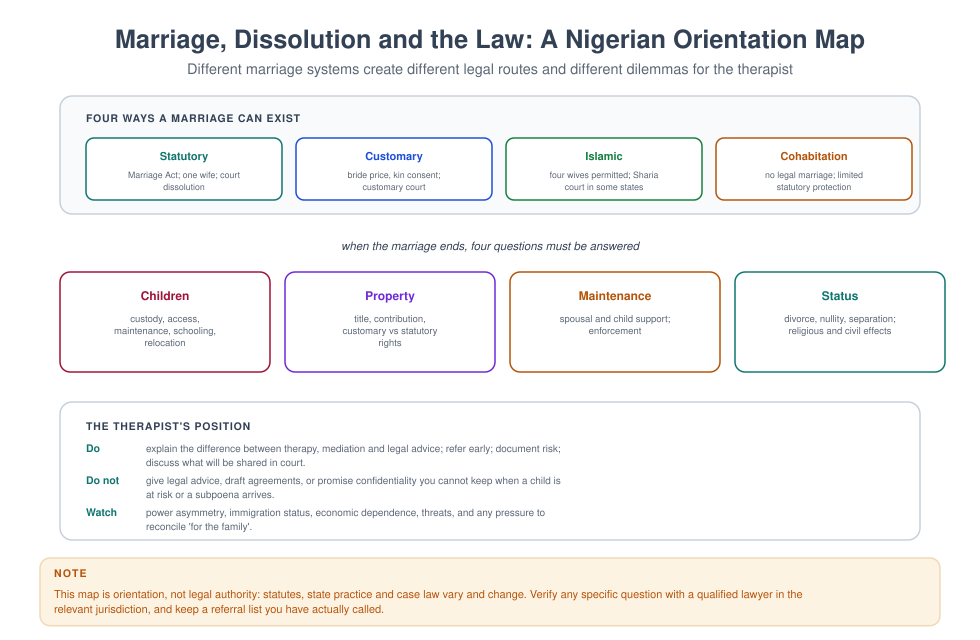
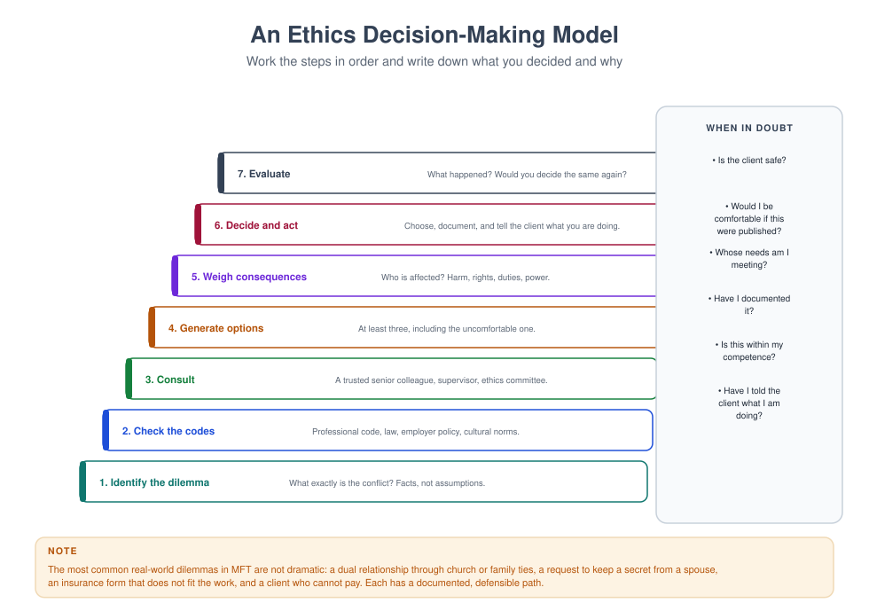

# MFT 704 — Ethical and Legal Issues in Therapy

> **MSc Marriage and Family Therapy** · Semester One · 1.71 Units · 14 teaching weeks · Prerequisite: none

**Course leader's summary.** This course trains judgement, not just compliance. You will learn the codes,
the law, and — more importantly — how to reason when the codes and the law point in different directions,
when the family's culture conflicts with the institution's policy, and when your own values are in the room.

---

## How to use this book

Every week presents a **standard**, a **case**, and a **decision**. Ethics is not memorised; it is
practised. The weekly incidents in this book are drawn from the ordinary texture of clinical life — the
secret, the subpoena, the gift, the neighbour, the unpaid fee — because those are the situations that
actually end careers.

---

## 1. Course description

Family therapy multiplies ethical complexity. In individual work there are two parties (you and the
client). In family work there may be six, with conflicting interests, unequal power, and secrets that
each person believes belongs to them. Add a school, a child protection agency, a court, an insurance
company, and a faith community, and the question "who is my client?" becomes the central professional
question of the course.

The course combines **normative ethics** (codes, duties, principles), **law** (the parts a clinician must
know and the parts a clinician must refer), and **professional formation** (the kind of clinician you are
becoming).

---

## 2. Learning outcomes

| # | Outcome | Assessed |
|---|---|---|
| LO1 | Apply the major ethical codes and principles to relational cases | Exam, case analysis |
| LO2 | Explain confidentiality and its limits in multiperson therapy | Exam |
| LO3 | Conduct and document a risk assessment for suicide, self-harm, violence and abuse | Skills assessment |
| LO4 | Manage secrets, dual relationships, gifts, fees and boundary dilemmas defensibly | Case analyses |
| LO5 | Describe the legal framework for marriage, divorce, custody and child protection in Nigeria | Exam |
| LO6 | Use a structured decision-making model and document the reasoning | Assignment |
| LO7 | Recognise when to refer for legal advice, and how to do so | Viva |

---

## 3. Assessment

| Component | Weight | Due |
|---|---|---|
| Ethics incident analyses (4 × 600 words) | 30% | Weeks 4, 6, 9, 11 |
| Risk assessment observed skills (15 min) | 20% | Week 10 |
| Examination (case-based) | 50% | Week 15 |

---

## 4. The fourteen-week plan

| Week | Topic | Practical |
|---|---|---|
| 1 | Moral philosophy for clinicians: duties, consequences, virtues, care | Trolley variants in therapy |
| 2 | The codes: AAMFT, IAMFC, APA, national associations; informed consent | Consent form drafting |
| 3 | Confidentiality in couple and family therapy | Secrecy protocol design |
| 4 | Secrets I: the individual disclosure | Scripted incident |
| 5 | Secrets II: infidelity, paternity, HIV status | Complex case debate |
| 6 | Boundaries and multiple relationships | Boundary audit |
| 7 | Competence, supervision, and the duty to refer | Competence self-audit |
| 8 | Risk I: suicide and self-harm | **Observed risk assessment** |
| 9 | Risk II: intimate partner violence and child protection | Safety planning |
| 10 | Legal framework: marriage, divorce, custody, maintenance | Court-report exercise |
| 11 | Records, documentation, subpoenas, court testimony | Note-writing lab |
| 12 | Money, gifts, barter, and the business of therapy | Fee policy workshop |
| 13 | Ethics of research, assessment and diagnosis | Consent and deception cases |
| 14 | Integration: your ethical stance and decision model | Viva |

---

## Week 1 — Moral philosophy for clinicians

You do not need to become a philosopher, but you need to know which argument you are making when you say
"that would be wrong". Most ethical failure in clinical practice is not the product of a bad person; it is
the product of a good person using one tradition of reasoning while believing they are using another, and
therefore being unable to see the objection that the other tradition would have raised.

| Tradition | Central question | Therapy example |
|---|---|---|
| Deontology (duty) | What are my duties regardless of outcome? | Keeping confidentiality even when disclosure would be convenient |
| Consequentialism | What produces the best overall outcome? | Breaking confidentiality to prevent a serious harm |
| Virtue ethics | What would a person of good character do? | Refusing a gift that would create obligation |
| Ethics of care | What does this relationship require of me? | Attending to the family's dependence on you |
| Justice / rights | Are power and resources fairly distributed? | Whose voice is missing from this room? |

**The four principles** (Beauchamp & Childress) remain the most portable framework: **autonomy,
beneficence, non-maleficence, justice**. In family work they collide constantly — respect for the father's
autonomy may conflict with the mother's safety, and a clinician who has not learned to name the collision
will resolve it silently, in favour of whoever is more articulate in the room.

**Why a family therapist needs philosophy more than an individual therapist does.** In individual work the
ethical questions are mostly about the boundary between two people: the client and the clinician. In
family work the questions are about *distribution*: whose interests the clinician is serving, whose secret
they are holding, whose account they believe, and whose voice the institution will hear. Those are
questions of justice and care before they are questions of compliance, and the codes — which are written
mostly for two-party work — do not answer them.

> **CASE** — A father telephones the clinic to ask what his wife said in her individual session. He is
> polite, he is paying the fee, and he is, in his own understanding, being a responsible head of household.
> The clinician has three duties in tension: confidentiality to the wife, honesty to the husband, and the
> welfare of a couple whose therapy depends on both of them returning. Which tradition she reaches for
> decides what she says in the next thirty seconds.

### 1.1 The lecture in ninety minutes

| Minutes | Segment | What the lecturer does | What students do |
|---|---|---|---|
| 0–10 | Why this week exists | The difference between compliance and judgement, with the case | Write the sentence they would say into the telephone |
| 10–24 | The five traditions | Each tradition, its strength, its characteristic failure | Classify six clinical utterances by tradition |
| 24–36 | The four principles | Autonomy, beneficence, non-maleficence, justice, and how they collide in family work | Rank the four for three different cases |
| 36–48 | Ethics of care and its critique of principle-based ethics | Gilligan, Noddings, and the relational objection | Name what a principles-only analysis would miss |
| 48–60 | Moral distress and moral injury | The difference between not knowing and not being able | Identify one episode of each from placement |
| 60–72 | The decision model | The seven-step model that the course will use all term | Run it on the case, in pairs |
| 72–84 | Cultural and religious moral frameworks | When the family's moral world and the code's are not the same | Argue one case from inside a framework not their own |
| 84–90 | The assessment | How the incident analyses are marked | Draft the outline of their first incident analysis |

**The teaching decision that makes the week work.** The lecture begins with the telephone call, before any
theory, and every student writes the sentence they would say. The sentences are read aloud and sorted onto
the board by tradition — and the class discovers that most of them are consequentialist ("it will damage the
therapy if I tell him"), a few are deontological ("I cannot discuss her sessions"), and almost none are
about care or justice. The sorting is the lesson: their instincts are already philosophical, and they have
never inspected them.

**The sentence the lecture must land.** "You already have a moral theory. This week is about finding out
which one, and whether you would defend it if a family asked you to."

### 1.2 Five traditions, and what each one cannot see

**1. Deontology: duty regardless of outcome.** The tradition that produced the codes. Its strength is
predictability: a rule that holds when it is inconvenient is a rule that can be relied upon by a family who
has never met you. Its characteristic failure is rigidity — the clinician who keeps a confidence that is
killing someone because the rule says so, and who experiences the resulting harm as bad luck rather than as
a decision. In family work, deontology's specific blindness is to *distribution*: a rule about confidentiality
applied equally to a powerful father and a dependent grandmother produces an unequal result, because they
have unequal capacity to use the information.

**2. Consequentialism: the best overall outcome.** Its strength is realism — it takes harm seriously and it
permits the clinician to weigh a small breach against a large protection. Its characteristic failure is
that nobody can calculate the consequences, and the calculation is usually done by the person who will
benefit from the answer. In family work, its blindness is to the *unrepresented*: the person whose interests
do not appear in the therapist's forecast is the person who gets sacrificed, and that person is usually the
one with least power in the room.

**3. Virtue ethics: what a person of good character would do.** Its strength is formation — it asks what kind
of clinician you are becoming, which is the question that survives when the code is silent. Its
characteristic failure is vagueness and self-congratulation: "I would know" is not a method, and the
practitioner who trusts their own character is the one least likely to notice its defects. In family work,
virtue ethics supplies the questions the codes cannot answer — courage, patience, humility, temperance about
one's own influence — and it needs a discipline to keep it honest, which is supervision.

**4. Ethics of care: what this relationship requires of me.** The tradition that family therapy needs most
and uses least. Its central claims: that moral life is constituted by relationships rather than by isolated
choosers; that responsiveness matters as much as rules; and that dependence is not a defect to be overcome
but a condition of being human, which every client in your room is in. Its strength is that it describes
family work accurately. Its characteristic failure is that it can justify almost anything in the name of the
relationship, and it has no natural defence against a clinician who is more attached to a family than is good
for the family.

**5. Justice and rights: are power and resources fairly distributed?** The tradition that asks who is not in
the room and who is paying for the room. Its strength is that it names the questions the other four avoid:
who has access to this service, whose language is spoken, whose account the institution will believe, and
who carries the cost of the arrangement. Its characteristic failure is abstraction — a clinician can conduct
a fine analysis of structural injustice and still be unjust to the person in front of them.

**The five are not a menu.** They are five different questions, and a competent clinician asks all five about
a hard case and then has to decide, in the open, which one governs. The decision is the practice; the
inspection of the decision is the profession.

### 1.2a The four principles, and how they collide in family work

The four principles are the most portable framework in the field, and the reason is that they are not a
theory: they are four considerations that any defensible decision must have addressed. Their use is not to
produce the answer but to make sure the answer has not ignored something.

**Autonomy.** The client's right to decide what happens to them, grounded in their capacity to do so. In
individual work it is the dominant principle and it is generally straightforward. In family work it is
immediately difficult, for three reasons. The first is *multiplicity*: there are several autonomous people
in the room, and their autonomies conflict — the adolescent's autonomy over her own body against her
parents' legal authority; the wife's autonomy over her own disclosure against the husband's claim to know.
The second is *capacity*: a nine-year-old, an eighty-one-year-old with dementia, and a woman in an abusive
relationship all have autonomy claims that are not identical to an adult's unconstrained choice, and
"respecting autonomy" without distinguishing them is a way of abandoning the vulnerable. The third is
*context*: in many of the households this book is written for, decisions are made by families rather than by
individuals, and a clinician who insists on individual consent is not being respectful; they are being
parochial.

**Beneficence.** The duty to act in the client's interest. It sounds unarguable and it is the principle most
often used to justify paternalism, because "the client's interest" is defined by the clinician. In family
work the principle has a specific structural problem: whose interest? A decision that benefits the marriage
may harm the wife; a decision that protects the child may end the family's engagement.

**Non-maleficence.** First, do no harm. The most useful of the four in practice, because it operates as a
check rather than a goal: before acting, ask what harm this could do, including the harms of the
intervention itself. In ethics, the harms that are most often overlooked are the ones the clinician's own
action causes: the disclosure that ends a therapy, the report that produces a violent reprisal, the note
that is read in court five years later.

**Justice.** Fairness in the distribution of benefits, risks and resources. In family work it appears in
three places that the other three principles do not reach: *access* (who can get to this clinic, at these
hours, at this fee); *voice* (whose account is taken seriously, in a room and in a record); and
*consequence* (who bears the cost of a decision — frequently not the person who made it).

**The collision, worked.** A seventeen-year-old discloses to the therapist that she is sexually active and
does not want her parents told. The four principles give four different answers. *Autonomy*: she is nearly
an adult and her confidence should be kept. *Beneficence*: telling the parents may protect her; not telling
may leave her without support. *Non-maleficence*: telling may produce the beating she fears, which is a harm
the clinician will have caused. *Justice*: her parents have legal responsibility and a legitimate interest;
she has the greater exposure to the consequences. The principles do not resolve it. They ensure the clinician
has seen all four, and then the clinician must decide and be able to say why.

**The order of the principles is not fixed.** Students frequently assume autonomy comes first because the
codes list it first in some jurisdictions. It does not. In a case involving a child's safety, non-maleficence
governs. In a case involving an adult's refusal of treatment, autonomy governs. Deciding which principle
governs *in this case* is the act of judgement the course is teaching, and it cannot be reduced to a rule
without producing the very rigidity deontology is criticised for.

### 1.2b Ethics of care: the tradition family therapy should own

Family therapy is, almost alone among the mental health professions, built on a relational ontology. It is
therefore strange that its ethics are usually imported from a tradition built on isolated choosers. This
section states the alternative, because it is the one that fits the work.

**The relational claim.** The ethics of care, developed by Gilligan, Noddings, Tronto and others, holds that
moral life is constituted by relationships of dependence and response rather than by transactions between
independent agents. Three consequences follow.

**First, responsiveness is a moral skill.** The question "what does this person need from me, here, now?" is
not a softer version of "what is the rule?" It is a different and equally rigorous question, and it requires
attention — the capacity to notice what is actually happening rather than what the category predicts. A
clinician who has not developed attention will apply the right rule to the wrong situation.

**Second, dependence is normal.** Every client in your room is dependent on someone, and most are dependent
on people who are also in the room. The tradition therefore refuses the picture of the autonomous chooser as
the ethical ideal: a grandmother with dementia, a nine-year-old, a woman who cannot leave — none of them is
a defective version of an independent adult. Each has claims that arise from their relationships.

**Third, power is the central ethical fact.** Care is not symmetrical. The person giving care has power, and
the ethics of care requires that the power be used responsively rather than according to the carer's
preferences. This is why the tradition is useful in family work: the therapist's power is enormous and
largely invisible, and a principles-only analysis gives almost no account of it.

**The critique, which the tradition must answer.** Care ethics can justify almost anything in the name of the
relationship. It has been used to keep women in caring roles, to excuse clinicians who will not end a
treatment, and to defend a therapist's attachment to a family that has outgrown the therapy. Noddings's own
answer is that caring must be *received* — the cared-for must experience it as care — which is a testable
condition, and it is the version this course uses. "I did it because I cared" is not an ethical justification
unless the person cared for can say that they were cared for.

**The clinical use, in three questions.** Whose need is being met by this decision — theirs or mine? Who in
this family is dependent on whom, and is the dependence being used or served? And what would the person with
least power in this room say if they were asked, in a language they had, with nobody watching?

### 1.3 The decision model: seven steps

The course uses one model all term, so that the incident analyses and the examination are comparable. It is
deliberately pedestrian. Its value is not that it produces the right answer but that it makes the reasoning
visible, which is what supervision, a court, and a professional body will all ask for.

**Step 1 — State the ethical question, not the practical one.** "What should I do about the husband's
telephone call?" is practical. "Whose confidence am I holding, and to whom do I owe what?" is ethical. Most
hard cases are hard because the ethical question has never been stated.

**Step 2 — Establish the facts.** What is actually known, by whom, and how. This step takes longer than
students expect and prevents most errors: a great many ethical dilemmas dissolve when the facts are
established (the husband already knew; the wife had said she would tell him; the child is not the father's).

**Step 3 — Identify the parties and their interests.** Every person affected, including the absent ones and
the institution. Name the interests, not the positions. Then ask which party has least power to protect
their own interest.

**Step 4 — Apply the frameworks.** All five traditions and all four principles, briefly, and record where
they disagree. The disagreement is the case's real content.

**Step 5 — Consult.** The code, the law, the agency policy, a supervisor, and — where appropriate and
possible — the client. Consultation is not a step for difficult cases; it is a step for any case in which
the clinician notices they have a preference.

**Step 6 — Decide, act, and record the reasoning.** The decision, the reasons, the alternatives rejected and
why. In a record, because the record is the only evidence that a decision was made rather than a drift.

**Step 7 — Review.** What happened; whether the prediction held; what would be done differently. The step
that nobody does, and the only one that produces learning.

### 1.3a Moral distress, moral injury, and the difference that matters

Two terms that are used loosely in the literature and that name different things. A clinician who cannot
tell them apart will misdiagnose their own state, and will look for the wrong remedy.

**Moral distress** is what happens when you know what the right action is and you are prevented from doing
it. Its classic form is institutional: the clinician who knows a child should be referred and cannot get an
appointment; who knows a family needs an interpreter and is not given one; who is required by an agency to
keep a number of sessions that the work does not need. The distress is not confusion about the good. It is
the experience of being unable to enact it.

The remedy for moral distress is structural, not psychological. It consists of changing the condition, or
of naming it collectively, or of leaving. What does not work — and what is usually offered — is resilience
training, which asks the clinician to feel better about an arrangement they are right to object to.

**Moral injury** is different and more serious. It names the lasting harm that follows acting against one's
own moral commitments, or witnessing such an act and being unable to prevent it. The term comes from
military psychiatry and it travels well into clinical settings, because clinicians do commit acts they
believe to be wrong under constraint: a disclosure that produces a reprisal, a report that ends a family's
engagement, a court report written in language the clinician knows to be misleading. The sequelae are not
anxiety or burnout; they are shame, a changed sense of self, and a withdrawal from the aspects of the work
that once mattered.

**The distinction, in one line.** Moral distress is "I could not do what I should". Moral injury is "I did
what I should not, or I stood by while it was done".

**What follows clinically.** For distress: audit the condition, escalate, and use supervision to keep the
judgement intact. For injury: supervision is necessary and insufficient; the remedy involves naming the act,
restoring the moral account (which sometimes means an apology to the family), and in some cases a change of
setting. A trainee who has been required to write a report they believe false needs a supervisor who will
say that it was wrong, not one who explains the agency's constraints.

**The course's position.** A significant proportion of what is called burnout in this profession is moral
distress that has been individualised. The remedy is not more self-care. It is a decision model that makes
the reasoning visible, a supervisor who will disagree, and a professional identity that can survive being in
the minority in a room.

### 1.4 The trolley, in a clinic

The trolley problem is a thought experiment about whether it is permissible to harm one person in order to
save several. It is useful here not because clinicians face trolleys but because the structure of the problem
— *may I redirect a harm toward someone who did not choose it?* — is the structure of half the hard cases in
family work.

**Variant 1 — The disclosure.** A wife tells the therapist, in an individual session, that her husband has
been physically violent twice. She does not want him told. The couple is in therapy together. The therapist
can: say nothing and continue couple work (harm: the wife is unprotected and the therapy is built on a
secret); disclose to the husband (harm: the wife loses her confidentiality and may be at greater risk); or
stop the couple work and see the wife alone (harm: the couple loses the treatment). *Redirection:* every
option pushes harm onto someone who did not choose it. The wife did not choose to lose her confidence; the
husband did not choose to be discussed; the children did not choose any of it.

**Variant 2 — The paternity.** A father asks whether the child is his. The mother knows the answer. The
therapist knows because the mother told her. Nothing the therapist does is neutral: silence is a lie by
omission to the father; disclosure is a breach to the mother; ending the therapy is a harm to the child.

**Variant 3 — The adolescent's risk.** A fifteen-year-old discloses self-harm and asks the therapist not to
tell her parents. Disclosing may end the therapeutic relationship; not disclosing may leave her alone with a
risk. *This is the variant that most resembles the trolley*, because the clinician is choosing which of two
identifiable people will bear the harm.

**Why the thought experiment is worth the time.** Because it trains three things. First, the recognition that
*someone will be harmed in every option*, which dissolves the fantasy of the harm-free decision and with it a
great deal of paralysis. Second, the discipline of naming who bears the harm, which is the justice question.
Third, the habit of asking whether the harm is being *redirected onto someone who did not choose it* — and
if it is, whether that person's consent could be obtained, which is frequently the move that converts an
impossible case into a workable one.

> **PRACTICAL** — Take three ethical dilemmas from your own life, not clinical ones. For each, identify which
> tradition you used at the time, and which you used to justify it afterwards. Then answer one question:
> were they the same? Most students find that the tradition they acted on was care or virtue, and the
> tradition they justified with was consequence. Write down what that gap suggests about how you will
> account for your decisions in a clinical record.

### 1.5 Case: the telephone call from the father

The case from the lecture, worked through the seven steps. This is the model the incident analyses follow.

**The facts.** The Okonkwos — Ada, 34, Chuka, 39, Ebuka, 9 — have been in couple therapy for six weeks.
In her third individual session, Ada disclosed that Chuka's night shifts have resumed and that she is
"managing everything alone", and that she has begun to think about taking the children to her mother's in
Lagos. She has not told Chuka. She asked the therapist not to tell him. On Thursday, Chuka telephones: "I
want to know what she said on Tuesday."

**Step 1 — The ethical question.** Not "what do I say to Chuka?" but: *I am holding a confidence from one
member of a couple I am treating jointly; to whom do I owe what, and how do I honour the couple's treatment
without deceiving either of them?*

**Step 2 — The facts.** What does Chuka actually know? (He knows the sessions exist; he does not know what
was said. He has noticed she is distant.) What has Ada been told about the confidentiality arrangement? (At
the start of therapy the therapist said, in front of both, that individual disclosures would be handled by
agreement — a sentence Ada may or may not have understood as a promise.) Is there a risk to anyone? (No
violence; no risk to the children; a risk of family separation if the decision is taken unilaterally.) What
is the therapist's contractual position? (The clinic's policy: no information from an individual session is
disclosed without the individual's agreement, except in the specified exceptions.)

**Step 3 — The parties and their interests.** Ada: to have a place where she can think without consequences,
and to be supported in a decision she has not made. Chuka: to know what is happening in his marriage, and
not to be humiliated by a therapist who knows more than he does. The children: continuity and the marriage's
stability. The therapist: to keep the treatment viable and to remain honest. The clinic: its policy. *Least
power:* Ada, because she has already been described by her husband to the therapist as "difficult", and
because she is the one whose confidence is at stake.

**Step 4 — The frameworks.** *Deontology:* the confidence holds; the clinic's rule is explicit. *Consequence:*
refusing Chuka may end his engagement with the therapy, and his engagement is what has kept the family in the
room. *Virtue:* what would a clinician of good character do — and would she be able to say it to both of them
in the same room? *Care:* Ada needs a place to think; Chuka needs not to be excluded; the couple needs an
arrangement that holds. *Justice:* the person with least power must not be the one who bears the cost of the
therapist's convenience.

**Step 5 — Consultation.** The clinic's written policy; a supervisor, by telephone the same day; and Ada
herself, before anything is said to Chuka.

**Step 6 — The decision.** The therapist does not disclose content. She says to Chuka: "I cannot tell you what
your wife said, and I want to be straight with you about why: if either of you cannot use an individual
session to think out loud, this therapy will not work. What I can do is ask her whether she is willing to
talk to you about the thing that is on her mind, with me in the room." She then telephones Ada, tells her
exactly what was said and what was not, and asks whether she will raise it in the joint session. Ada says
she will, on one condition: that the therapist opens the session, so that she is not the one who starts it.

**Step 7 — The review.** At the next joint session, Ada raises the question of Lagos. Chuka is angry and
then frightened. The disclosure does not end the therapy; the *manner* of it — preceded by a week in which
Ada had chosen to make it — is what keeps the therapy alive.

**What made the difference.** Two things, and neither is a principle. The first is that the therapist
consulted *before* answering, which is what converted a trap into a process. The second is that she told Ada
exactly what she had said to Chuka, which is the practice — not the rule — that keeps a multiperson therapy
honest. Neither is in any code. Both are what an experienced clinician does.

### 1.5a The four questions that stop a decision going wrong

Before the seven steps, four questions that an experienced clinician asks almost automatically, and that a
trainee can be taught to ask deliberately. They take ninety seconds and they catch the majority of errors.

**Question 1 — Who is not in this conversation?** The absent person is usually the one who will bear the
cost. A decision about a child made without the child; a decision about a marriage made without the husband;
a decision about a placement made without the person who will be moved. Naming the absent party does not
always mean convening them; it means accounting for them in the reasoning.

**Question 2 — Whose interest does my preferred option serve?** Asked honestly, this question is
uncomfortable, which is why it is asked *before* the decision rather than after. The clinician who wants to
disclose a secret is frequently protecting themselves from the discomfort of holding it. The clinician who
wants to keep it is frequently protecting the therapy they have built.

**Question 3 — What would I do if the person with least power were the one I had to explain this to?** The
test is a version of the publicity test: a decision that cannot be explained to the person most affected by
it is a decision that needs re-examining. The explanation does not have to be acceptable to them; it has to
be *possible*.

**Question 4 — What would I write in the record?** If the sentence that would have to go in the file reads
badly, the decision is bad — not because records are read, but because writing forces the reasoning into
plain language, and plain language is unforgiving of self-deception. This is the cheapest ethical instrument
in the book and the one most likely to change a decision in the thirty seconds before it is taken.

### 1.6 Transcript: the call, annotated

Eleven turns, reconstructed from a supervision recording. The therapist is a trainee, four months into
placement. The annotation names the tradition governing each move, which is the discipline the week is
teaching.

> **T1 Chuka:** I want to know what she said on Tuesday. I am her husband. I am paying for this.
> — *Two claims, both true in his frame: a status claim and a contract claim. Neither is answered by
> silence, which he will read as confirmation that something is being hidden.*
>
> **T2 Therapist:** You are her husband and you are paying, and both of those are reasons I should be
> straight with you rather than avoid you. — *The move: concede the true parts before refusing anything.
> Deontological in form, care in tone.*
>
> **T3 Chuka:** Then tell me.
>
> **T4 Therapist:** I am not going to tell you what she said. I want to say why, and I want you to hear that
> it is not because she has said something terrible about you. — *The disclosure of the rule, and the
> pre-emptive denial of the catastrophic reading. Without the second sentence, the first produces exactly
> the fantasy the therapist is trying to prevent.*
>
> **T5 Chuka:** Then she has said something.
>
> **T6 Therapist:** She has said something she is not ready to say to you, and I have said I will not say it
> for her. If I break that, neither of you can use a session to think. You would be sitting in that chair
> wondering what I am writing down. — *The justification is consequentialist, and it is chosen deliberately:
> the deontological version ("it is the rule") is true and it lands as bureaucracy. The consequentialist
> version gives him a reason he can use.*
>
> **T7 Chuka:** *(long pause)* So what do I do?
> — *The question that tells the therapist the refusal has been accepted. Note that it took four turns, not
> one, and that a therapist who stopped talking after T4 would not have got here.*
>
> **T8 Therapist:** Two things. I will ask her whether she is willing to bring it into the room with both of
> you, and I will tell you what she says either way. And in the meantime, I want to know what you have
> noticed at home, because you have noticed something or you would not be telephoning me. — *The offer of a
> next step, and the redirection of his energy from a demand for information to an account of his own
> observation. This is the turn that keeps him in the therapy.*
>
> **T9 Chuka:** She is packing. I saw a bag.
> — *The fact the therapist did not have. The husband is not asking for gossip; he is frightened, and the
> therapist's rule has, until this moment, kept her from knowing why.*
>
> **T10 Therapist:** *(pause)* Thank you. That is important, and I would not have known it if you had not
> telephoned. — *The acknowledgement is accurate, and it is also the repair: his call has produced something
> of value rather than only a refusal.*
>
> **T11 Chuka:** What do I do about the bag?
>
> **T12 Therapist:** Nothing yet, and not nothing forever. Give me until tomorrow to speak to her, and I will
> telephone you. If she will not talk to you by Friday, I will tell you that too, and we will decide then
> what the three of us do. — *A time limit, a commitment, and a fallback. The deontological refusal has been
> turned into a process with dates, which is what makes it survivable for a frightened man.*

**What the transcript shows that the model does not.** The seven-step model produces the decision; the
transcript produces the *sequence*, and the sequence is where the skill lives. Three things in particular.
First, the therapist never says "I understand your concern" — she demonstrates it by conceding the true
parts. Second, she offers a *reason* rather than a *rule*, and the reason is chosen for the listener. Third,
she ends with a date, which converts a refusal into a relationship.

### 1.6a Bad arguments, named

Students lose marks, and clinicians lose cases, by using one of six arguments that sound ethical and are not.
Naming them makes them visible.

**"It is my duty."** Sometimes true. More often a rule is being used to end a conversation the clinician does
not want to have. The test: can you state the duty, its source, and the harm it is preventing?

**"It is for their own good."** The paternalist's sentence. It may be correct; it is never sufficient. The
test: who decided what their good is, and were they asked?

**"Everyone does it."** A statement about a norm, not about an obligation. The test: is the practice defensible
or merely common?

**"It will damage the therapy."** Frequently true and frequently the clinician's own convenience in
therapeutic clothing. The test: whose therapy, and what is the damage measured against?

**"I had no choice."** Almost never accurate. There is usually a choice with a cost, and the honest statement
names the cost rather than denying the choice.

**"I was following the policy."** The defence that fails at every professional tribunal, because the
professional's obligation is to exercise judgement about the policy, not to be its instrument.

**The exercise.** In the laboratory, students are given six anonymised sentences from real disciplinary
findings and asked which of the six arguments each one is. The recognition is fast, and it transfers: once a
clinician can hear the shape of the bad argument, they can hear it in their own mouth.

### 1.7 Laboratory: the ethics incident analysis

**Aim.** To produce a 600-word incident analysis that a supervisor, a professional body, or a court could read
and follow. This is the format of the four assessed pieces of coursework.

**Procedure.** Students bring a real or witnessed incident (anonymised), or use one of the four briefs the
trainer supplies. They write the analysis in the session, in fifty minutes, against the seven steps, and then
exchange with a partner who marks it against the rubric. The last twenty minutes is the plenary, in which two
analyses are read aloud and the class identifies which step each one skipped.

**Marking rubric (20 marks).**

| Criterion | 0–1 | 2–3 | 4–5 |
|---|---|---|---|
| **The question** | A practical question | Ethical but vague | Ethical, specific, and the practical question is explicitly set aside |
| **The facts** | Assumed | Listed, but no account of what is unknown | Established, with what is unknown named and how it would be established |
| **The parties** | Client and therapist | All present parties | All parties including absent ones and the institution, with the least powerful identified |
| **The frameworks** | One tradition, unnamed | Two traditions, named | Four or five, applied briefly, with the disagreement between them stated |
| **The decision** | A preference | A decision with reasons | A decision, the rejected alternatives, and the review |

**The distinction that carries most of the marks.** The top band requires the student to state *where the
frameworks disagree*. A paper that applies five frameworks and finds they all point the same way has either
misapplied them or chosen a case that is not an ethical dilemma; and a paper that applies one framework and
calls it the answer has written an opinion rather than an analysis.

**The four briefs.**

*Brief A.* A couple's sixteen-year-old daughter asks to see you individually, and says she does not want her
parents to know. The parents are your clients and are paying.

*Brief B.* A colleague tells you, at lunch, that a family you both know is "probably abusive" and that he has
not reported it because "there is no evidence".

*Brief C.* A family offers you a substantial gift at the end of therapy. You know the family cannot easily
afford it.

*Brief D.* You are asked by a court to produce a report on custody, and you have been treating the mother for
a year. The fee is three times your usual rate.

### 1.8 Six errors

**Error 1 — Confusing the rule with the reason.** "Because the code says so" is a true statement and, said
to a frightened husband, it is heard as evasion. The code is the floor of the reasoning, not its content; a
clinician who cannot give a reason a family can understand has not yet understood the rule.

**Error 2 — Applying individual ethics to a multiperson system.** Almost every professional code is written
for two parties. Applied unchanged to a couple or a family, it produces a therapist who is scrupulously
confidential with one member and quietly deceptive to the other, and who believes they have been ethical
because they have followed the rule.

**Error 3 — Calculating consequences in your own favour.** Consequentialist reasoning is the most useful and
the most corruptible. The test is whether the calculation was made before or after the therapist noticed
what they wanted to do.

**Error 4 — Virtue ethics as a substitute for method.** "I would know" is not a decision procedure, and the
clinician who most trusts their own character is least likely to notice its defects. Virtue needs
supervision the way a knife needs a stone.

**Error 5 — Care as an alibi.** "I did it because I cared" has justified more boundary violations than
cynicism ever has. The test is Noddings's: was it *received* as care by the person cared for?

**Error 6 — Treating moral distress as a personal failing.** The clinician who cannot get a child an
appointment, and who concludes that they are not resilient, has misdiagnosed a structural problem as a
character flaw. The remedy is escalation, not self-care.

### 1.9 Culture, faith and the moral framework

**Three moral worlds in one room.** The family's moral framework, the profession's, and the clinician's own
are frequently three different systems, and the clinician's is the one least likely to be named. In the
households this book is written for, the operative framework is often not any of the five Western traditions
but a religious or communal one: duties are owed to a lineage rather than to an individual; the family's
reputation is a moral good in its own right; elder authority is not negotiable by argument; and shame, rather
than guilt, is the mechanism by which wrongdoing is registered.

**What that changes about the four principles.** Autonomy in the individualist sense is not the organising
value in many of these households, and a clinician who treats its absence as a deficit will misread
deference as incapacity and consultation as inefficiency. The workable translation is not to abandon
autonomy but to ask the family's version of the question: *who in this family has the standing to decide,
and does the person most affected have a route to be heard?* That question travels across frameworks, and it
is answerable in any of them.

**Shame, guilt and the ethics of disclosure.** In a guilt-oriented framework, wrongdoing is registered by the
individual's conscience and confession is restorative. In a shame-oriented framework, wrongdoing is
registered by the community's judgement and disclosure may be catastrophic for the whole household. This is
not a reason to keep a secret that must be told; it is a reason to plan *how* it is told, with whom, and in
whose presence, which is a clinical skill and not a concession.

**Faith as a moral authority in the room.** A pastor, an imam, or an elder may hold the authority that the
clinician's code does not. Where that is so, the code is not the only source of moral authority in the case
and pretending otherwise produces a clinician who is right and useless. The moves that work are the ones from
Week 13 of MFT 703: join the framework, add a mechanism, and hold one non-negotiable.

> **DEBATE** — "A therapist should never act against a competent adult client's stated wish, whatever the
> consequences." Argue for: the client's authority over their own life is the foundation of the profession,
> paternalism has a long and cruel history, and a clinician who overrides once will override again. Argue
> against: competence is not a switch, adults are frequently pressed by people with more power than they
> have, and a clinician who watches a foreseeable death without acting has chosen an abstraction over a
> person. Then state your actual rule, and the case in which you would break it — because every clinician
> eventually meets that case, and the ones who have never thought about it are the ones who improvise badly.

### 1.10 Evidence note

**What the research supports.** The four-principles framework is the most widely used analytic structure in
clinical ethics teaching, and studies of ethics education consistently find that structured decision models
improve the *consistency* and *documentation* of ethical reasoning, though not necessarily the quality of the
decisions. The finding that moral distress is prevalent in mental health work, and that it is associated with
intention to leave rather than with clinical incompetence, is well replicated. The association between
reflective supervision and improved ethical reasoning is modest but consistent.

**What is weaker.** Almost everything about *outcomes*. There is no body of evidence showing that clinicians
trained in one tradition make better decisions than clinicians trained in another, and the field's outcome
measures are self-report and vignette-based. The literature on moral injury in mental health professions is
recent and largely qualitative, mostly borrowed from military and nursing research.

**What is not supported.** That codes prevent misconduct — the disciplinary literature consistently finds that
violations are committed by clinicians who know the code. That ethics can be taught as compliance —
knowledge of rules is necessary and has never been sufficient. And that ethical reasoning is a stable trait;
it is a practice, and it degrades under workload and isolation, which is why consultation is a structural
protection rather than a courtesy.

**The matrix cell.** *Development is probabilistic and non-linear; the same input produces different outcomes
depending on timing and context.* A clinician with excellent ethical reasoning at nine in the morning, with
a supervisor available, is a different decision-maker from the same clinician at seven in the evening with a
waiting room full of people. The variables that most reliably predict ethical failure are not moral but
situational: fatigue, isolation, and speed.

### 1.10a What the codes do not cover

A short section with a long consequence. The professional codes are necessary and they are not a complete
account of the moral life of a clinician, and the gap is where most of the difficulty lives.

**The codes address conduct, not character.** They say what may not be done; they say almost nothing about
what kind of clinician to be. The virtues that matter most in this work — patience with a family that
returns for the eleventh time with the same problem, courage in a case conference where the consultant is
wrong, humility in front of a grandmother who has raised six children — are not in any code and are not
enforceable. They are formed by supervision, by example, and by the company a clinician keeps.

**The codes are written for individuals.** Confidentiality, consent and competence are all framed around a
single client and a single clinician. Multiperson work, which is the whole of this course, is covered by
adaptations rather than by the codes' own logic. The clinician who follows the code precisely in a family
case may still be unjust, because the code has no category for the second client.

**The codes are jurisdiction-bound.** Every code is written against a legal background that differs by
country and, in federal systems, by state. Statements about reporting obligations, minors' consent, and
record retention that are correct in one jurisdiction are wrong in another. This book states principles and
flags where the law must be checked locally, which is a permanent obligation rather than a limitation of
this text.

**The codes lag.** Reproductive technology, digital records, online therapy, social media contact with
clients, and cross-border tele-therapy are all areas in which practice has outrun guidance. A clinician
working at the edge is making policy by their conduct, and the obligation that follows is to be able to
defend the reasoning, not to be able to point at a rule that does not exist.

### 1.11 Key terms

**Deontology** — the ethics of duty; the right action follows from a rule or obligation regardless of
consequence.

**Consequentialism** — the ethics of outcome; the right action is the one that produces the best overall
result.

**Virtue ethics** — the ethics of character; the question is what a person of good character would do, and
how such a person is formed.

**Ethics of care** — the ethics of relationship and responsiveness; moral life is constituted by dependence
and response rather than by transactions between independent agents.

**Justice** — fairness in the distribution of benefits, risks and resources; in family work, the question of
whose voice is heard and who bears the cost.

**Autonomy** — the client's right to decide what happens to them, grounded in their capacity to do so.

**Beneficence** — the duty to act in the client's interest.

**Non-maleficence** — the duty not to cause harm, including the harms of one's own intervention.

**Moral distress** — knowing the right action and being prevented from taking it.

**Moral injury** — lasting harm following an act against one's moral commitments, or witnessing one.

**Paternalism** — overriding a person's wishes for their own good.

**Relational ethics** — the position that obligations arise from relationships and their power asymmetries,
not only from rules or outcomes.

### 1.12 Self-test

1. Name the five traditions and state the characteristic failure of each.
2. How do the four principles collide in a case involving a seventeen-year-old's confidentiality, and which
   one governs? Defend your answer.
3. What is the difference between moral distress and moral injury, and why does the remedy differ?
4. In the Okonkwo case, what two practices — neither of them in a code — kept the therapy alive?
5. Why does the lecture insist that "because the code says so" is an inadequate answer to a family?
6. What does the ethics of care add to a principles-based analysis, and what is its characteristic
   corruption?
7. What is the test for whether an act of care was really care?
8. Give the seven steps of the decision model, and say which one students most often skip.

**Answers.** *(1)* Deontology — rigidity; consequentialism — self-serving calculation and blindness to the
unrepresented; virtue — vagueness and self-congratulation; care — it can justify anything in the name of the
relationship; justice — abstraction, analysing structures while being unjust to the person present. *(2)*
Autonomy supports her confidence; beneficence may support disclosure as protection; non-maleficence warns that
disclosure may produce the beating she fears; justice notes that she bears the consequence and her parents
hold legal authority. Which governs depends on the assessed risk: in the absence of danger, autonomy and
non-maleficence together; where there is danger, non-maleficence governs and the disclosure is planned with
her rather than about her. *(3)* Distress is being unable to do what you believe right, and is remedied
structurally; injury is having acted against your commitments, and requires naming, repair and sometimes a
change of setting. *(4)* Consulting before answering, and telling Ada exactly what had been said to Chuka.
*(5)* Because the code is the floor of the reasoning, not its content; a family cannot use a rule they cannot
understand, and a clinician who offers only the rule is heard as evasive and hides something in doing so.
*(6)* It adds attention, dependence and power; its corruption is that it can justify almost anything as
care. *(7)* Noddings's test: the cared-for must be able to say they were cared for. *(8)* State the ethical
question; establish the facts; identify parties and interests; apply the frameworks; consult; decide, act and
record; review — the review is the step most often skipped.

### 1.13 Reflective task

Write down the last time you did something you believed to be wrong because you were required to. Do not
write about the ethics of the requirement; write about what you did, in one paragraph, in plain words. Then
answer three questions: who else knew? what did you tell yourself at the time? and what would have had to be
available for you to have acted differently? Most students find the answer to the third question is
concrete — a supervisor, an hour, a policy, one other person who agreed — which is the argument for
structures rather than for character.

### 1.14 Further reading

- Beauchamp, T. and Childress, J. *Principles of Biomedical Ethics* — the four-principles framework, and its
  critics' best answers.
- Gilligan, C. *In a Different Voice* — the origin of the care critique, best read with its reception.
- Noddings, N. *Caring* — the relational account, and the reception test used above.
- MacIntyre, A. *After Virtue* — the strongest case that rules without a tradition of practice are empty.
- Jameton, A. on moral distress — the original nursing account, which transfers cleanly to this work.

*Next: Week 2 — The codes and informed consent.*

---

## Week 2 — The codes and informed consent

**What codes do and do not do.** Codes set a floor, not a ceiling. They are written to be enforceable,
which means they are often silent on the hardest questions. They also vary by jurisdiction and by
professional body; know which one governs you.

**The core obligations across the major codes:**

1. Competence and its limits
2. Informed consent (including consent for recording and for supervision)
3. Confidentiality and its limits
4. Multiple relationships
5. Sexual intimacy with clients and former clients (prohibited; time limits vary)
6. Fees and financial arrangements
7. Advertising and representation
8. Research ethics
9. Cultural competence and non-discrimination
10. Reporting obligations and legal compliance

**Informed consent in family therapy is a document and a conversation.** It should cover: who the client
is; who is seen and in what combination; the confidentiality policy including secrets; recording and
supervision; fees and cancellation; the limits of confidentiality (risk, abuse, court order); and the
complaint route. Review it aloud in the first session, in the family's language, and record that you did.

> **PRACTICAL** — Draft a one-page informed-consent document for couple therapy. Exchange with a peer and
> identify the three sentences most likely to be misunderstood by a family with limited literacy. Rewrite
> them.

---

## Week 3 — Confidentiality in the multiperson system

There is no single confidentiality in family work; there is a **policy** you negotiate.

**Three workable models.**

| Model | Rule | Advantages | Risks |
|---|---|---|---|
| No-secrets | Anything told individually may be shared with the couple | Simple, transparent | Individual may withhold important material |
| Full secrecy | Individual disclosures are kept private | Protects individual therapy | Creates a therapeutic secret that distorts the couple work |
| Selective (negotiated) | The therapist and client agree in advance what will be shared | Flexible and realistic | Requires skill and documentation |

Most experienced couple therapists operate a **modified no-secrets policy**: they will not keep a secret
that materially affects the couple's work, and they tell each partner this before the first individual
session. This protects both the relationship and the therapist.

**Documentation.** Record the policy in the file, in the family's words if possible, and note the date it
was explained. If a secret arises, record what you did and why.

> **CASE** — During an individual session, a wife discloses that she has been having an affair for two
> years and has no intention of ending it or telling her husband. No one is at physical risk. Under a
> no-secrets policy, you tell her at the outset of the individual session that this cannot stay private
> if the couple work is to continue; you then help her decide how and when to disclose, with a deadline.
> Under a selective policy, you would negotiate what can be shared. What you must not do is carry the
> secret silently for months while conducting "couple therapy".

---

## Week 4 — Secrets I: the individual disclosure

**Classify before you respond.** Three questions: *Is anyone at risk? Does this information change the
treatment I am providing? Is the client able to disclose it themselves, with support?*

| Type of secret | Typical response |
|---|---|
| Harmless (a surprise party) | Keep it; it is not clinically material |
| Clinically material, no risk (an affair; a debt; a diagnosis) | Negotiate disclosure with a deadline; do not collude |
| Risk to a third party (HIV status undisclosed; threats) | Assess; follow legal and public-health obligations; document |
| Risk to a child or vulnerable adult | Report; inform; protect |
| Risk to self | Risk assessment; safety planning; break confidentiality as required |

**The clinical skill: refusing to be recruited.** "I understand you are not ready to tell him. I cannot
keep this and also work on your marriage with you, because I would be working with half the truth. Let
us plan how you will tell him, and when."

**The systemic reality.** Secrets are not only information; they are structure. A secret held by one
partner and the therapist creates a coalition — and the excluded partner often senses it, which damages
the therapy's credibility.

---

## Week 5 — Secrets II: infidelity, paternity, HIV status

Three cases that appear in every couple therapist's career, each with a different legal overlay.

**Infidelity.** Not a reportable act. The clinical tasks: stop the bleeding, contain the disclosure,
assess for sexually transmitted infection risk, address the meaning of the affair (not only its fact), and
decide with the couple whether disclosure to a third party (the affair partner's spouse) is required.
That last question is a values question with safety implications; consult.

**Paternity.** A man may discover that a child he is raising is not biologically his. The therapist must
not conceal information that affects a child's welfare, must not give legal advice, and must help the
family decide who needs to know and in what sequence. Refer for legal advice on paternity, maintenance and
custody; the emotional work is yours.

**HIV and other communicable conditions.** Confidentiality is strong, but public-health law may create
duties where a partner is at identifiable risk and the client refuses disclosure. Know your jurisdiction's
rule, consult, and document. Never disclose without advice.

> **DEBATE** — "A therapist who keeps an affair secret for six months is colluding in the harm the affair
> causes." Argue for and against, then write your own policy in 200 words.

---

## Week 6 — Boundaries and multiple relationships

**Definition.** A multiple relationship exists when you have another significant relationship with a
client or someone closely associated with them. Not all are unethical; all require examination.

**The test.** (1) Could the second relationship impair your objectivity? (2) Could it exploit the power
difference? (3) Would the client experience it as exploitative later? (4) Is it avoidable?

**Common in small communities.**

| Situation | Risk | Defensible approach |
|---|---|---|
| Seeing a neighbour's family | Overhearing information; social contact | Discuss openly; agree how to behave at community events |
| Client is a fellow church member | Role confusion; spiritual authority | Clarify roles; consider referral if you hold a leadership role |
| A relative of your child's classmate | Dual loyalty | Disclose in supervision; transfer if the risk is unmanageable |
| Client asks you to be a character witness | Role change; advocacy | Decline; explain; refer to a professional who can assess |
| Gift-giving after a bereavement | Cultural obligation vs boundary | Accept small cultural gifts; document; discuss meaning |
| Trading therapy for services | Exploitation risk | Usually decline; if unavoidable, document value and rationale |

**Touch, self-disclosure, and home visits.** Each is sometimes therapeutic and always requires a rationale
you can articulate in supervision. The test is never "did it feel right?" but "whose need did it serve?"

> **PRACTICAL** — Complete a boundary audit of your present life: community roles, family ties, business
> interests, social media. Identify the three situations most likely to produce a dual relationship in the
> next two years, and pre-decide your response.

---

## Week 7 — Competence and referral

**Competence has four dimensions:** knowledge, skills, experience, and appropriateness (personal and
cultural fit). You can be knowledgeable and inappropriate: a therapist with unprocessed trauma working
intensively with trauma, or a young male therapist seeing a couple in a culture where his authority is
contested.

**The duty to refer** arises when: the problem is outside your training; you lack supervision for it; your
personal reactions would compromise care; or the client needs a different modality or medical input.

**How to refer well.** Name the reason without shaming ("this needs someone with specific training in X");
make a warm handover (a call, not just a name); offer a bridge session if needed; follow up once; and
document. A referral is not abandonment.

> **SELF-AUDIT** — List the ten presenting problems you are most likely to see. For each, rate your
> competence 1–5 and name the supervisor or service you would refer to. The two lowest ratings are your
> professional development plan for this year.

---

## Week 8 — Risk I: suicide and self-harm

**The standard.** Ask directly, ask specifically, ask about means, and document. There is no evidence that
asking about suicide increases risk, and substantial evidence that clinicians fail to ask.

**A defensible risk assessment includes:**

1. **Ideation** — frequency, intensity, duration, controllability.
2. **Plan** — specific method, place, time.
3. **Intent** — "Do you intend to act on this?"
4. **Means** — access to firearms, medication, pesticides, heights.
5. **Previous attempts** — the strongest single predictor.
6. **Protective factors** — reasons for living, responsibility to children, faith, support.
7. **Substance use and impulsivity.**
8. **Family history.**
9. **Current stressors and recent losses.**
10. **Disclosure and support network** — who can be told, who can watch.

**Documentation.** Record the questions you asked and the answers, your formulation of risk (low/moderate/
high), the plan, who was informed, and the review date. If you decide *not* to break confidentiality,
record why.

**In family work.** A parent's suicidality, an adolescent's self-harm and a child's disclosure must be
handled without turning the family session into an interrogation. Structure: see the person individually
first, agree what will be shared, then facilitate the sharing.

> **PRACTICAL (OBSERVED)** — Fifteen-minute suicide risk assessment role-play with a trained actor. You must
> ask all ten elements, formulate risk, and agree a safety plan. Pass/fail.

---

## Week 9 — Risk II: intimate partner violence and child protection

**Distinguish two patterns.**

| Situational couple violence | Coercive control |
|---|---|
| Mutual, low-level, escalates under stress | One partner systematically dominates |
| Fear is situational | Fear is chronic; surveillance, isolation, threats |
| Couple therapy may be appropriate after assessment | Couple therapy is contraindicated; risk increases |
| Safety planning individual | Specialist advocacy and protection |

**Screening.** Screen each partner **separately**, at least once, using direct questions: "Has your
partner ever hit, kicked, or pushed you? Has he/she ever made you afraid? Do you feel safe going home
today?" Never screen in front of the partner.

**Child protection.** Know your jurisdiction's reporting duty. In Nigeria, the Child Rights Act (2003,
adopted in many but not all states) and state child protection laws create duties and structures; the
practical route is usually the state ministry responsible for social welfare, the police family unit, or a
designated safeguarding lead. Document the concern, the advice received, and the action taken.

> **CAUTION** — Conjoint sessions can escalate violence after the session. If there is any indication of
> coercive control, separate sessions and a safety plan precede any conjoint work. Write it down.

---

## Week 10 — The legal framework a clinician must know

This section is **orientation, not legal advice**. Statutes and state practice vary; verify with a lawyer.

**Marriage in Nigeria exists in four overlapping forms:** statutory (Marriage Act), customary, Islamic,
and cohabitation without legal marriage. A family may be married under more than one system.

**Dissolution.** Statutory divorce requires a court petition (Matrimonial Causes Act, with the
two-year rule and recognised grounds); customary and Islamic dissolutions follow their own processes and
courts. The therapist's role is not to advise on grounds but to help the family clarify what they are
deciding and to refer.

**Children.** Custody and access decisions are governed by the welfare principle — the child's best
interests. Maintenance obligations exist under both statutory and customary law. The therapist may be
asked for a report; a treating therapist should generally not conduct a forensic custody evaluation of
their own client (role conflict).

**Other relevant areas:** the Child Rights Act; the Violence Against Persons (Prohibition) Act 2015
(applicable in the FCT and in states that have adopted it); mental health legislation in the states that
have adopted the Mental Health Act 2021 framework; data protection obligations regarding client records.

---

## Week 11 — Records, subpoenas and court

**Write notes for three readers:** your future self, a colleague taking over, and a court. Use factual,
behavioural language; avoid speculation and avoid character judgements. Record: date, attendees, risk
screen, interventions, plan, and who was told what.

**If a subpoena or court order arrives:** do not ignore it; do not respond immediately without advice;
verify its validity; contact your supervisor, indemnity provider or lawyer; inform the client (unless
prohibited); release only what is required, with a privilege log if advised.

**Testifying.** Your role is to report what you observed, not to advocate for a preferred outcome. Answer
the question asked; do not volunteer; do not guess; say "I don't know" when you do not. Distinguish
*fact*, *clinical opinion* and *hypothesis*.

> **PRACTICAL** — Note-writing lab. Write a progress note for a session in which a risk was disclosed and
> a report to a school was agreed. Exchange; grade each other against the "three readers" standard.

---

## Week 12 — Money, gifts and the business of therapy

**Fees are clinical material.** They carry meaning about worth, dependency, entitlement and shame. Have a
written policy; state it at the start; apply it consistently; discuss non-payment rather than avoiding it.

**Refusing to reduce a fee sometimes ends therapy; never reducing a fee sometimes ends therapy.** Both are
true. Decide your sliding scale in advance and document the reason for each exception.

**Gifts.** Small cultural gifts may be accepted with documentation; expensive gifts should be discussed;
gifts with strings should be declined. Ask, "What would it mean to you if I accepted / declined?"

---

## Week 13 — Ethics of research, assessment and diagnosis

- **Informed consent** for research must be voluntary, capacity-appropriate and revocable; families,
  children and people in crisis require special care.
- **Deception** requires justification, debriefing, and ethics approval.
- **Diagnosis** carries consequences: access to care, stigma, insurance, custody. Diagnose what you can
  defend and describe what you cannot.
- **Assessment instruments** must be validated for the population and language; using an unvalidated
  instrument and acting on it is an ethical problem, not just a methodological one.

---

## Week 14 — Integration: the decision model and your stance

**The seven steps.** Identify the dilemma → check codes and law → consult → generate at least three
options including the uncomfortable one → weigh consequences for each affected party → decide, act and
document → evaluate afterwards.

**The documentation habit.** A defensible decision is not the same as a correct decision; it is one you can
explain. Write the reasoning at the time, not after a complaint.

**Your stance.** Write 500 words: what you will never do; what you will always consult about; and where your
personal values are most likely to distort your clinical judgement.

---

## Glossary

**Autonomy** — the client's right to self-determination.
**Beneficence / non-maleficence** — the duty to benefit and the duty not to harm.
**Coercive control** — a pattern of domination, isolation and threat, distinct from situational violence.
**Confidentiality** — the duty not to disclose information learned in a professional relationship.
**Dual relationship** — a second significant relationship with a client or someone close to them.
**Duty to warn / protect** — a legal obligation, in some jurisdictions, to act on a serious threat.
**Informed consent** — voluntary agreement based on adequate information and capacity.
**Mandated reporting** — a legal duty to report suspected abuse or neglect.
**Privilege** — the client's legal right to prevent disclosure in court proceedings.
**Subpoena** — a legal order requiring documents or testimony.
**Welfare principle** — the rule that a child's best interests govern decisions about them.

---

## Self-assessment

### Multiple choice

**1.** In couple therapy, the most defensible approach to individual secrets is:
(a) keep everything private (b) declare a policy in advance and apply it (c) tell the partner immediately
(d) refuse individual sessions entirely

**2.** Asking a client directly about suicide:
(a) increases risk (b) does not increase risk and is required practice (c) is only for psychiatrists
(d) should be avoided in family sessions

**3.** Couple therapy with a couple in which there is coercive control is:
(a) recommended (b) contraindicated until safety is established (c) harmless (d) the only legal option

**4.** The four principles of biomedical ethics are:
(a) autonomy, beneficence, non-maleficence, justice (b) consent, capacity, confidentiality, competence
(c) duty, utility, virtue, care (d) respect, honesty, integrity, courage

**5.** A treating therapist asked to conduct a custody evaluation for their own client should:
(a) accept (b) accept if paid (c) decline because of role conflict (d) accept with supervision

**6.** The welfare principle means decisions about children are governed by:
(a) parental preference (b) the child's best interests (c) the court's convenience (d) financial capacity

**7.** The strongest single predictor of a suicide attempt is:
(a) diagnosis (b) previous attempt (c) gender (d) family income

**8.** A small cultural gift after a bereavement should usually be:
(a) refused (b) accepted, discussed and documented (c) accepted silently (d) reported to the police

**9.** Screening for intimate partner violence should be done:
(a) with the couple present (b) with each partner separately (c) by questionnaire only (d) only if asked

**10.** A defensible ethical decision is one that:
(a) everyone agrees with (b) can be explained and documented (c) produces the best outcome
(d) follows the client's preference

### Answer key
1 b · 2 b · 3 b · 4 a · 5 c · 6 b · 7 b · 8 b · 9 b · 10 b

### Short answer

1. State a confidentiality policy for couple therapy in six sentences a family could understand.
2. List the ten elements of a defensible suicide risk assessment.
3. Distinguish situational couple violence from coercive control, and state the treatment implication.
4. What should you do when you receive a subpoena? Five steps.
5. Why is "I know it is unethical but it was the right thing to do" an inadequate defence?

### Essay (choose one, 2,000 words)

1. "The most difficult ethical problems in family therapy are not conflicts between right and wrong but
   between two rights." Discuss with three cases.
2. A father discloses that his 14-year-old daughter is self-harming and asks you not to tell her mother.
   Analyse the ethical, legal and clinical dimensions and set out your plan.
3. Critically examine the claim that the professional codes are culturally biased in favour of Western
   individualism.

---

## Further reading

- American Association for Marriage and Family Therapy. (2015). *Code of Ethics*.
- Beauchamp, T. L., & Childress, J. F. (2019). *Principles of Biomedical Ethics* (8th ed.). OUP.
- Corey, G., Corey, M. S., & Corey, C. (2019). *Issues and Ethics in the Helping Professions* (10th ed.).
- Doherty, W. J. (1995). *Soul Searching: Why Psychotherapy Must Promote Moral Responsibility*. Basic Books.
- Wilcoxon, S. A., Remley, T. P., & Gladding, S. T. (2013). *Ethical, Legal and Professional Issues in
  Counseling* (4th ed.). Pearson.
- Child Rights Act (Nigeria), 2003; Violence Against Persons (Prohibition) Act, 2015.

---

*Next: [MFT 705 — Research Methods in Marriage and Family Therapy](MFT-705-research-methods-in-mft.md)*
