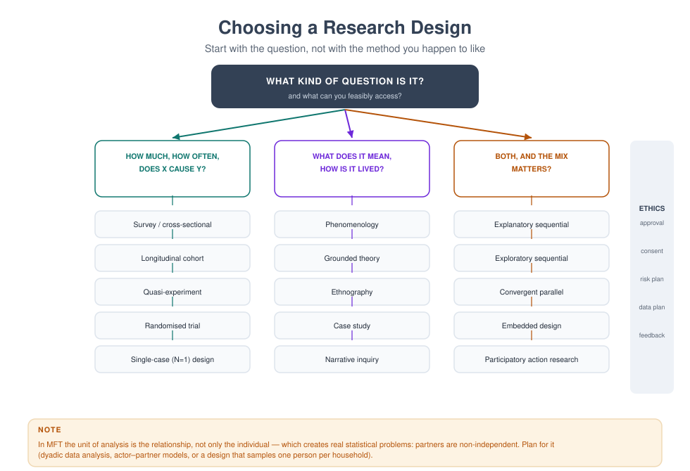
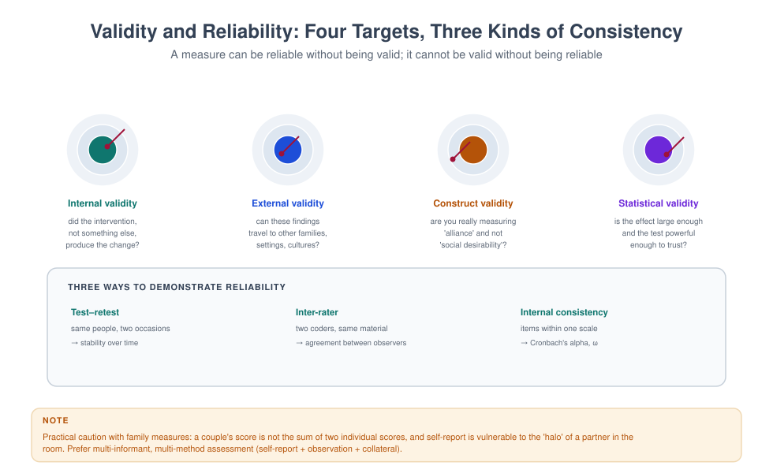
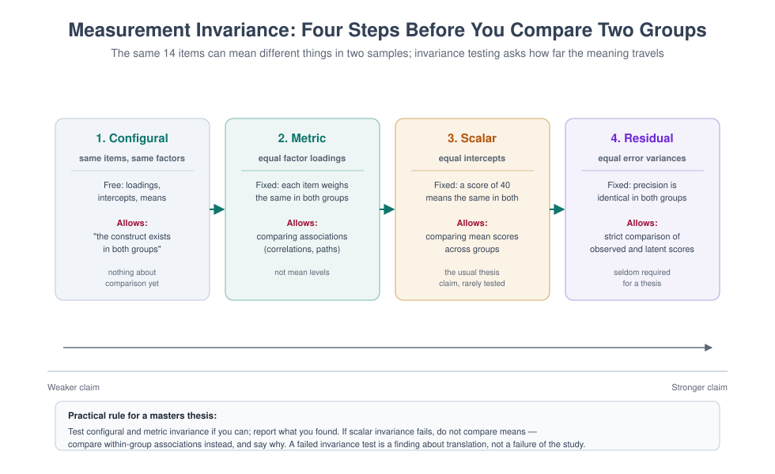
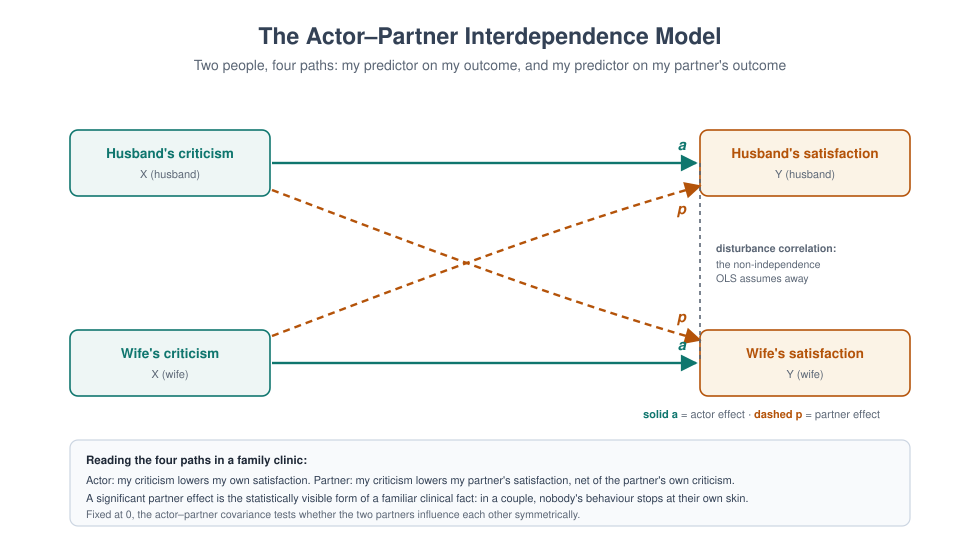

# MFT 705 — Research Methods in Marriage and Family Therapy

> **MSc Marriage and Family Therapy** · Semester One · 1.71 Units · 14 teaching weeks · Prerequisite: MFT 701

**Course leader's summary.** You will become a consumer who can read a paper in ten minutes and know what
it is worth, and a producer who can design a study you can actually finish. The course is deliberately
practical: every week you do something small with real or simulated data.

---

## How to use this book

Research methods are learned by doing badly, then better. Each week has a **concept**, a **worked
example**, and a **small task** you can complete in an hour. The tasks build towards your thesis proposal
in MFT 770, so keep every one of them.

---

## 1. Course description

Family therapy research is harder than individual therapy research for a structural reason: **people in a
family are not independent observations**. If you treat a couple as two independent people, you violate the
central assumption of most statistical tests. This course teaches you to see that problem and to handle it
in ways that survive examiners and journal reviewers.

The course covers: framing a good question; quantitative, qualitative and mixed designs; sampling and
measurement; basic analysis; appraisal of evidence; ethics; and writing a proposal.

---

## 2. Learning outcomes

| # | Outcome | Assessed |
|---|---|---|
| LO1 | Convert a clinical hunch into a focused, researchable question | Assignment 1 |
| LO2 | Select and justify a design appropriate to the question | Exam, proposal |
| LO3 | Evaluate the reliability and validity of commonly used family measures | Exam |
| LO4 | Handle non-independence and unit-of-analysis problems | Exam, proposal |
| LO5 | Interpret basic descriptive and inferential statistics and effect sizes | Exam, data exercise |
| LO6 | Appraise quantitative, qualitative and mixed-methods studies | Appraisal assignment |
| LO7 | Write an ethical, feasible research proposal | Proposal |

---

## 3. Assessment

| Component | Weight | Due |
|---|---|---|
| Question and design exercise (1,000 words) | 15% | Week 4 |
| Systematic appraisal of two studies (1,500 words) | 25% | Week 9 |
| Data analysis exercise (set problems) | 20% | Week 12 |
| Research proposal (2,500 words) | 40% | Week 15 |

---

## 4. The fourteen-week plan

| Week | Topic | Task |
|---|---|---|
| 1 | What research is for; evidence-based practice and its critics | Find one paper you will use in the thesis |
| 2 | From hunch to question: PICO/SPIDER; feasibility | Draft three questions |
| 3 | Designs overview: quantitative, qualitative, mixed | Map your question to a design |
| 4 | Sampling: who is in, who is out, who never comes | Critique a convenience sample |
| 5 | Measurement: reliability, validity, responsiveness | Appraise one couple measure |
| 6 | The independence problem: unit of analysis in family data | Worked analysis of couple data |
| 7 | Quantitative analysis I: descriptive and comparison | Run descriptives in software |
| 8 | Quantitative analysis II: association, prediction, effect size | Interpret a regression table |
| 9 | Qualitative methods and rigour | Code a transcript extract |
| 10 | Mixed methods; participatory approaches | Design a mixed study |
| 11 | Systematic review and critical appraisal | Appraise one meta-analysis |
| 12 | Data management, security, documentation | Write a data plan |
| 13 | Research ethics and with vulnerable families | Complete an ethics application |
| 14 | Writing it up; publication and impact | Proposal presentations |

---

## Week 1 — What research is for

**Learning outcomes.** By the end of this week the student can (1) state the three legitimate purposes of research
and identify a study that serves none of them; (2) explain evidence-based practice as the integration of research,
expertise and client context rather than the application of a manual; (3) distinguish efficacy from effectiveness
and say why the distinction matters in a Nigerian family clinic; (4) match a question type to the evidence that can
answer it; and (5) read a paper in ten minutes and state what it establishes and what it leaves open.

### Why a clinician is asked to do this

The first question students ask about this course is why a therapist needs research methods, and the honest answer
has three parts. The first is that **the therapist is already using research** — the model she practises, the
questions she asks in an intake, the assumption that a child's behaviour has a function. Every one of those came
from somewhere, and the therapist who does not know where will not know when they are wrong. The second is that
**the field's knowledge changes** and the practitioner who cannot read a paper is dependent on whoever summarises
it, which is frequently a training provider with a product. The third is institutional: the MFT 770 thesis, which
is a graduation requirement and which is best treated as the first study of a research career rather than a hoop.

**The three legitimate purposes.**

| Purpose | The question it answers | Typical design | The product |
|---|---|---|---|
| **Description** | What is happening, to whom, how often? | Survey, audit, qualitative description | A map: prevalence, patterns, experience |
| **Explanation** | Why, and under what conditions? | Qualitative, correlational, experimental | A mechanism, or a boundary condition |
| **Improvement** | Does this help, for whom, and at what cost? | Trial, quasi-experiment, service evaluation | Evidence that a service should change |

A study that serves none of these — a survey of attitudes that no decision depends on, a comparison of two
unvalidated questionnaires, a proposal written to satisfy a committee — is an exercise in the appearance of
research. The first discipline of this course is to ask, of any study including one's own, *what decision would
change if this came out differently?*

**Evidence-based practice, stated correctly.** The most quoted and most misread definition in the field: the
integration of the best available research evidence with clinical expertise and with the client's values,
preferences and circumstances. It is not "follow the manual", and the two critiques that students must be able to
state are these.

**Efficacy versus effectiveness.** An efficacy trial asks whether an intervention works under ideal conditions: a
selected sample, a manualised protocol, trained and supervised therapists, a comparison group, and participants who
volunteered and completed. An effectiveness trial asks whether it works in ordinary conditions: the clinic's actual
caseload, therapists with a caseload of forty, families with debts and court dates, and attrition. The gap between
the two is not a technicality. A programme that reduced symptoms in a university clinic may produce nothing in a
state hospital, and the reason is frequently not the model but the conditions under which it is delivered.

**The hierarchy is question-dependent.** A meta-analysis of randomised trials is the best evidence for "does this
work on average". It is useless for "how does this work, for whom does it fail, and what does it feel like to be on
the receiving end". A qualitative study of twelve families cannot tell you whether a treatment works and can tell
you why the treatment that works is refused by the families who most need it. Family therapy needs both, and the
practitioner who privileges one has half a field.

**The local argument that students should be able to make.** Most of the evidence base in couple and family therapy
was generated in North America and Europe, with samples that do not resemble the families in this book's cases.
That does not make the evidence irrelevant; it makes it conditional. The conditional question is precise: *which
part of this finding depends on the setting, the family structure, the therapist's training, or the availability of
a second appointment?* Answering that question is the intellectual work of a research-literate clinician, and it is
the reason this course spends as much time on appraisal as on design.

### 1.1 The lecture in ninety minutes

| Minutes | Content | Teaching form |
|---|---|---|
| 0–10 | Why clinicians research: the three purposes and the decision test | Three studies, students identify the decision each would change |
| 10–25 | Evidence-based practice, correctly defined; efficacy against effectiveness | Lecture with two trials described side by side |
| 25–40 | The hierarchy as a function of the question | Six questions, students choose the evidence that answers each |
| 40–55 | How to read a paper in ten minutes | Live demonstration on a projected abstract and results table |
| 55–70 | The local evidence problem: transportability and conditionality | Small groups: which findings would you expect to hold here? |
| 70–85 | The thesis as the first study: what MFT 770 will require | Walk through the assessment and the timeline |
| 85–90 | The decision test applied to the student's own interests | Written: my topic, and the decision it would change |

### 1.2 Five concepts that organise the week

**Concept 1 — Research is a decision instrument, not a ritual.** The purpose of a study is to reduce uncertainty
about something someone will do. Where no decision depends on the answer, the study will be conducted badly,
because nothing will be at stake in its conduct.

**Concept 2 — Evidence is conditional, and the conditions are usually the interesting part.** Every finding holds
under some conditions and not others. The practitioner's skill is to identify the conditions and to ask whether
they obtain here: the family structure, the referral route, the therapist's training, the number of sessions a
family can attend, the presence of a co-wife, a court case, a migration status.

**Concept 3 — The unit of analysis is the structural problem of family research.** People in a family are not
independent observations. A study that treats two spouses as two independent participants has made a statistical
error that no amount of sophisticated analysis repairs, and the error is the reason Week 6 exists.

**Concept 4 — The question determines the design, and the design determines what can be claimed.** A
cross-sectional survey cannot establish causation; a trial cannot explain mechanism; a qualitative study cannot
estimate prevalence. Most overclaiming in the literature, and in student theses, is a design described as though it
were a different design.

**Concept 5 — Rigour is a property of the whole study, not of the statistics.** A brilliant analysis of a biased
sample is a biased study. The hierarchy of what makes research trustworthy runs: the question, the sampling, the
measurement, the analysis, the reporting — in that order, and most failures happen in the first three.

### 1.3 The ten-minute paper reading method

A clinician does not need to read a paper the way a methodologist does. She needs to answer four questions in ten
minutes, and the answers determine whether the paper deserves another forty.

**Minute 1–2: the abstract, read for the claim.** What does the paper say it found? Write the claim in one sentence
in your own words. If the abstract will not yield a claim, the paper probably does not have one.

**Minute 3–4: the design and the sample, from the methods.** Who was studied, how many, recruited how, over what
period, and with what comparison? The four numbers that matter are the sample size, the recruitment route, the
attrition, and the comparison.

**Minute 5–6: the measure.** What was actually measured, by whose report, and with what instrument? A finding about
"family functioning" is only as good as the operationalisation of family functioning, which is usually one
person's questionnaire score.

**Minute 7–8: the result, in the table not the text.** Find the primary outcome and the effect size, with its
confidence interval. Ignore the p-values until you have the effect size, because a large sample can make a trivial
difference significant.

**Minute 9–10: the limits, in the discussion, and the ones not mentioned.** What do the authors say they cannot
conclude? What have they not mentioned — the sample's education, the therapists' training, the setting, who
declined? Then the decision question: would a different result have changed anything, and does this result change
anything for me?

**A worked example.** A student reads an abstract with the following structure: "A randomised trial of a
ten-session family intervention for adolescent depression in 120 families found a moderate reduction in depressive
symptoms at six months (d = 0.42, 95% CI 0.11 to 0.73) compared with treatment as usual; attrition was 18%."

What the ten minutes produce. *Claim:* ten sessions of family intervention reduce adolescent depression modestly.
*Design and sample:* 120 families, randomised, six-month follow-up, 18% attrition — the attrition is not random and
is likely to be higher among the most distressed. *Measure:* self-report symptoms; no observational measure of
family process, so the mechanism is untested. *Result:* effect size 0.42 with a confidence interval whose lower
bound is 0.11, which is small. *Limits:* the trial does not say which families benefited; the therapists were
trained and supervised by the developers, which is the classic efficacy condition.

*The clinician's conclusion:* this is worth adopting if the local service can deliver ten sessions with supervised
therapists, and it is not evidence that the model works in a clinic where families attend three times. That
sentence — specific, conditional, useful — is what this course is trying to produce.

### 1.3a The seven questions of appraisal

For a fuller appraisal, seven questions, in this order. They are the backbone of the Week 11 assignment and of the
habit that follows.

1. **What was the question, and was it answerable?** A vague question produces a vague study. Restate it in PICO or
   SPIDER form and see whether the study's design actually addresses it.
2. **Was the sample appropriate, and who is missing?** The participants who were never recruited are frequently the
   ones the clinician cares about: the families who refused, the fathers who did not attend, the households with no
   telephone.
3. **Were the measures valid for this population?** Translated instruments, unvalidated scales, single-informant
   reports.
4. **Was the comparison fair?** Treatment as usual is a different comparator in every setting, and an inactive
   control inflates the effect.
5. **Is the analysis appropriate to the data structure?** This is Week 6's question: were couples and families
   treated as independent?
6. **Is the effect size clinically meaningful, and for whom?** An effect of 0.2 across a whole sample may be a
   large effect for a subgroup that the paper does not report.
7. **What does this change?** The decision, the conversation with a family, the service's protocol — or nothing.

**The scoring discipline.** Students often want a single quality score. The discipline is to answer the seven
questions in sentences, then state a judgement with its basis: "moderate quality; strong design, weak measurement;
useful for service planning, not for choice of model."

### 1.4 The thesis, introduced early

The MFT 770 thesis is thirty to forty thousand words of independent work, and the students who struggle are
overwhelmingly those who chose a topic in month six. This week's task is therefore to begin the choice.

**The four constraints that determine a feasible thesis.** *Access:* the population you can actually reach.
*Time:* the academic calendar, minus ethics approval, minus analysis, minus writing. *Skill:* the methods you can
learn to competence in one semester, which is fewer than students believe. *Significance:* the decision the study
would inform.

**The commonest infeasible designs, and why.** A randomised trial, because randomisation, recruitment, follow-up
and analysis exceed a single student's capacity and require a service willing to be randomised. A longitudinal
study, because the follow-up period exceeds the programme. A nationally representative survey, because it requires
a sampling frame the student does not have. A study requiring an instrument that is copyrighted, unavailable or
unvalidated for the population.

**The designs that work in this programme.** A cross-sectional survey of a defined clinic population. A qualitative
interview study of eight to fifteen participants. A retrospective record review with a clear sampling frame. A
single-case or small-series design with systematic measurement. A systematic review or scoping review, where the
literature is available and the question is narrow. A mixed-methods service evaluation of a programme the student
can access.

**The sentence that should be written in week one.** "My study will answer [question] for [population] using
[design], and it will be finished by [date] because I have access to [source], the instrument is [available], and
the analysis is [within my competence]." Students who cannot complete that sentence in week one can frequently
complete it by week four, and the intervening work is the course.

### 1.2a The five questions a service asks before adopting a model

A practical instrument for the situation in section 1.5, and for any service considering a new programme. It takes
an afternoon with the paper and the service's own data.

**1. What did the trial actually deliver, in dose and duration?** The number of sessions is the first number to
check, because it is the one services most often reduce without noticing. Then the length of each session, the
period over which they were delivered, and the proportion of families who completed the full dose.

**2. Who delivered it, with what training and supervision?** Qualification, hours of training, fidelity monitoring,
and the frequency of supervision. If the trial's therapists received weekly supervision from the developers for a
year, the model as tested includes that supervision.

**3. Who was in the sample, and who was excluded?** Age, presenting problem, family structure, severity, language,
and the exclusions — families with violence, with substance misuse, with a parent in psychiatric care. The exclusions
frequently describe a large share of the local caseload.

**4. What was the comparison, and what does "usual care" mean here?** A trial against a waiting list tests the
model against nothing. A trial against an active comparator tests it against something. The local "usual care" is
whatever the clinic does now, which may be better or worse than the trial's comparator.

**5. What outcome was measured, and can we measure it here?** The instrument, its availability, its validity for
the local population, and whether the service can collect it at the same intervals. A model that cannot be measured
in the local service cannot be evaluated, and an unevaluated adoption is a purchase, not an improvement.

**How to write the answers up.** One page, five headings, and a verdict sentence: "the conditions of the trial are
met for / partially met for / not met for this service, and the specific gaps are …". That page is the document a
director can act on and a funder can read.

**The fifth question, added for honesty.** *What would we stop doing to deliver this?* A service that adds a
programme without removing anything has not changed its capacity; it has created a second queue, and the second
queue will be the one that is abandoned in the first busy month.

### 1.4a A worked thesis topic, developed in one page

The exercise students find hardest, done once, in full. The topic is deliberately modest, because modest topics
finish.

> **The question.** Among couples referred to a church-based counselling service in Ibadan, is the number of
> sessions attended associated with the couple's self-reported relationship satisfaction at the end of the
> programme, and does the association differ between couples in which both partners attend and couples in which only
> one does?
>
> **Why it matters.** The service has noticed that couples in which only one partner attends make up nearly half of
> referrals and are widely believed to do worse. If the data show otherwise, the service's intake policy — which
> currently gives priority to couples where both will attend — should change. If they show that one-partner couples
> do worse, the service needs a different offer for those couples rather than a longer wait.
>
> **Design.** A retrospective record review of all couples who began the programme in a twenty-four month period,
> with outcome data taken from the routinely administered measure at intake and at the final session.
>
> **Sample.** Approximately 120 couples, based on the service's records; exclusions are couples whose file lacks an
> intake score, and the excluded proportion will be reported.
>
> **Measures.** A validated couple satisfaction measure already administered by the service; sessions attended from
> the attendance record; attendance pattern coded as both-partner or one-partner from the first three sessions.
>
> **Analysis.** Descriptive statistics; comparison of change scores between the two attendance groups; a linear
> model with change as the outcome and attendance pattern, initial score, and number of sessions as predictors. The
> unit of analysis is the couple, not the individual, which is the Week 6 problem addressed from the start.
>
> **Feasibility.** Access: the service's director has given written permission. Time: data extraction in weeks one
> to four, analysis in five to six, writing in seven to twelve. Skill: the analysis is a comparison and a
> regression, both within the student's competence with supervision. Ethics: retrospective data, anonymised at
> extraction, with the service's approval and the university committee's.
>
> **What it cannot answer.** Whether the programme causes improvement; which components matter; how the couples
> experience the service. It can answer whether attendance pattern is associated with outcome, which is the
> decision the service actually faces.
>
> **What is given back.** A four-page report to the service, a fifteen-minute presentation to its counsellors, and a
> recommendation on the intake policy.

**What the page demonstrates.** Specificity in every element; a design that matches the question; a sample that
exists; an analysis within competence; and a stated limit. The student who can write this page in week four will
finish; the student who cannot yet will finish after two more drafts, which is the work of Weeks 2 to 4.

### 1.4b The three thesis failures that are visible in week one

**Failure 1 — the topic requires a population the student cannot reach.** The most common, and it is detectable by
asking how the student will find the first ten participants. If the answer is "I will advertise", the study has no
sampling frame.

**Failure 2 — the topic requires a measure that does not exist, is not validated, or is not permitted.** Students
frequently plan to use an instrument they have seen in a foreign paper without checking licensing, translation or
local validation. The check takes a week and belongs in week one.

**Failure 3 — the topic is a survey of opinion on a question that no decision depends on.** The result will be
predictable, uninteresting and unread, and the student's motivation will collapse in month four. The decision test
is the remedy.

**The interview that prevents all three.** Twenty minutes with the intended supervisor, before the topic is chosen,
in which the student is asked: who are your participants and how will you reach them; what will you measure and can
you get it; what will you do with the data; and what will you do if the answer is the opposite of what you expect.

### 1.5 Case: the clinic that wanted a programme

**The request.** The medical director of a private hospital in Ibadan asks a family therapist, Dr Kehinde Alao, to
introduce a "family therapy programme" for adolescents with behavioural difficulties. The hospital has read about a
model used in the United States, has a budget, and would like the therapist to "implement the evidence-based
protocol". The director adds, "we can run six sessions, and the parents must bring the adolescent".

**What the therapist knows.** The hospital's adolescent referrals are overwhelmingly boys aged 13 to 17, referred
by schools for truancy and by parents for "disrespect". Most families are Yoruba-speaking or bilingual. Fathers
attend about one session in four. Many families travel more than an hour. Payment is usually out of pocket, and the
hospital's own audit shows that two-thirds of patients attend fewer than three appointments when a second payment
is required. The hospital's therapists are two counsellors with no family therapy training beyond a diploma
module.

**The papers the hospital has in mind.** Two decades of trials of functional family therapy and multidimensional
family therapy for adolescent behaviour problems, with moderate to strong effects in the trials, delivered by
trained therapists with supervision, over twelve to twenty-six sessions, with the family attending most sessions.
Taken at face value, the evidence is impressive. The evidence-based practice question is not whether those trials
were good; it is whether their conditions obtain here.

**The five questions the therapist asked, in order.**

1. **What is the decision?** Whether to commit the hospital's budget to a model that requires twelve to twenty-six
   sessions and trained supervisors, or to something that can be delivered within the hospital's actual constraints.
2. **Which conditions in the evidence are load-bearing?** Session dose; therapist training and supervision; the
   inclusion of the father; the use of the model with families for whom the adolescent's behaviour is not the only
   problem. The trial evidence depends on all four; the hospital currently has none of them in place.
3. **What would an effectiveness study in this setting look like, and does one exist?** The local literature on
   family interventions for adolescent behaviour in West Africa is thin, with small samples and short follow-ups, and
   is frequently published in journals the hospital has not read. The honest statement is that the local evidence is
   insufficient to guide a choice, which is a finding in itself.
4. **What is the smallest change that would produce a testable improvement?** Not a full protocol: a six-session
   structured family engagement intervention delivered by the existing counsellors with a fortnightly group
   supervision, measured by attendance, school attendance and a validated parent-report measure.
5. **How would we know, at twelve months, whether it worked?** A pre-post audit with twenty consecutive families and
   a defined outcome would not establish efficacy and would establish whether the model is deliverable, which is the
   prior question.

**What the therapist did.** She wrote a two-page memorandum to the director that did four things: it summarised what
the trials actually tested; it set out the four conditions the trials depended on; it proposed a twelve-month
feasibility and evaluation plan within the hospital's constraints; and it proposed that the hospital *not* call what
it was doing by the name of a model it could not deliver.

The memorandum's central paragraph is worth reproducing because it is the whole of evidence-based practice in four
sentences.

> The trials of functional family therapy that we are being asked to replicate delivered twelve to twenty-six
> sessions with therapists trained to a specified standard and supervised throughout, to families who attended most
> of their appointments. Our service can currently deliver six sessions, with therapists who have not been trained
> in the model, to families of whom a majority attend fewer than three. It is not reasonable to expect the results
> of the trials under these conditions, and it is not honest to describe what we would be doing as the same
> treatment. I propose that we test the feasibility of a smaller intervention, measure it properly, and revisit the
> full protocol in a year.

**The director's response.** "So you are saying the evidence does not apply to us." The therapist's answer is the
sentence students should carry out of this week: "I am saying the evidence applies to a service that can do what the
trial did, and that we should either become that service or test what we can actually do."

**What the case teaches.**

1. **Evidence-based practice is a translation problem.** The evidence does not arrive as an instruction; it arrives
   as a set of conditions and an effect. The clinician's work is the comparison of conditions.
2. **The dose is part of the treatment.** A model delivered at a third of its tested dose is not the same treatment
   delivered more cheaply; it is a different treatment with unknown effects.
3. **Training and supervision are part of the treatment.** The trials' therapists were trained and supervised, and
   the supervision is frequently the active ingredient in implementation.
4. **A feasibility study is a legitimate research contribution, and frequently the more useful one.** It answers the
   question the service actually has, which is not "does the model work in ideal conditions" but "can we deliver
   anything here that works at all".
5. **Naming matters.** Calling a six-session engagement intervention by the name of a twenty-six-session model is a
   misrepresentation to the hospital, to the families, and to the funder.

### 1.6 Transcript: the journal club argument

Ten minutes from a hospital journal club. Presenter: a final-year student, Ifeoma. Participants: two counsellors, a
psychiatrist, and the therapist from the case.

> **P1 Ifeoma:** So the paper found a moderate effect. My question is whether we could get that here.
>
> **P2 Counsellor A:** If it works, it works. Why would it not work here?
>
> **P3 Ifeoma:** *(pause)* Three reasons, and I want to see whether you think they are fair. They used sixteen
> sessions; we use six. Their therapists were supervised weekly by the developers; ours are not supervised at all.
> And their families were recruited through a clinic where the treatment was free.
>
> **P4 Psychiatrist:** The third one is the one I would press. Free treatment selects a different family. You get the
> families who will come for anything, and you lose the ones who have to choose between an appointment and a day's
> income.
>
> **P5 Counsellor B:** But we cannot run a trial. We have a clinic.
>
> **P6 Ifeoma:** *(pause)* We cannot run that trial. *(pause)* We could run an audit. Twenty families, one measure,
> before and after, and we would know whether six sessions does anything at all in our own building. — *The
> substitution of a feasible design for an infeasible one, which is the practical form of research literacy.*
>
> **P7 Counsellor B:** An audit will not tell us whether it works. It will tell us whether they came.
>
> **P8 Ifeoma:** *(pause)* Yes. *(pause)* That is the first question though, is it not? If they do not come, the
> question of whether it works is — *(stops)*
>
> **P9 Counsellor B:** — is a question about a treatment nobody received. *(pause)* All right. I withdraw my
> objection.
>
> **P10 Therapist:** Then let us also be honest about the second question, which is what we would do with a negative
> audit. *(pause)* The director has already decided. If the audit comes back flat, will it change anything?
>
> **P11 Ifeoma:** *(long pause)* That is the question I should have asked first. — *The decision test of section 1.2,
> arriving late and arriving anyway.*

**What the transcript shows.** Three moves that constitute research literacy in practice: the identification of the
conditions under which the evidence holds; the substitution of a design that can be done for one that cannot; and the
question of whether the result would change a decision. The last question is the one that determines whether the
audit is research or decoration.

**The postscript.** The hospital ran the audit. Attendance at six sessions was 41%, with a median of three. The
parent-report measure improved in the families who attended four or more sessions and did not change in the rest.
The director's response was to fund a telephone reminder system, which was the intervention the audit actually
called for.

### 1.6a The three sentences that make a clinician research-literate

If this week produced only three sentences, they would be these, and each is a habit rather than a fact.

**"What conditions was that tested under?"** Asked of every paper, every training, and every claim made at a
conference. The question is not scepticism; it is the ordinary work of translation, and the clinician who asks it
will be told far more by the people who know the model than the clinician who nods.

**"Who is missing from this sample?"** The fathers, the families who refused, the households without a telephone, the
clients who did not speak English, the families who came once. The missing are frequently the ones the service most
needs to reach, and the sample's exclusions are a map of where the next study is.

**"What would change my mind?"** Asked of one's own beliefs, and answered in advance. A clinician who cannot state
what evidence would change her view is not holding a belief; she is holding an identity, and no amount of research
will move it.

**Why these three and not the statistics.** Statistical literacy is taught in Weeks 7 and 8 and is a technical skill.
The three sentences are the disposition that makes the technical skill usable, and they are what distinguishes a
clinician who can be argued with from one who cannot.

### 1.7 Laboratory: the decision test and the ten-minute read

**Part A — the decision test (twenty minutes, individual, written).** Each student brings three candidate thesis
topics, stated as sentences. For each, she writes: what decision would change if this study produced one answer
rather than another; who would make that decision; and what the answer would have to look like to change it. Topics
that fail the test are replaced, and the replacement is the exercise's product.

| Topic | The decision it would inform | Who decides | Verdict |
|---|---|---|---|
| "Attitudes of Nigerian men to couples therapy" | Whether a service markets to men differently | Service manager | Weak — the decision is thin |
| "Dropout from a clinic's family service: who leaves and after how many sessions" | Whether to change the intake and reminder system | Clinic manager | Strong — a concrete decision |
| "Lived experience of wives whose husbands refuse to attend" | Whether to offer an individual track for wives | Clinical lead | Strong, if the service can act |

**Part B — the ten-minute read (twenty-five minutes, pairs).** Each pair receives a different paper, cut to the
abstract, the methods paragraph and one results table. Ten minutes to produce the five-part summary of 1.3: claim,
design and sample, measure, result with effect size, limits. Pairs then exchange summaries and check each other
against the source.

| Criterion | 0–1 | 2–3 | 4–5 |
|---|---|---|---|
| **The claim** | Restates the title | Summarises the abstract | States the claim in one sentence, in the student's words |
| **The numbers** | Missing | Sample size only | Sample, recruitment, attrition, comparison, effect size with interval |
| **The measure** | Not identified | Instrument named | Instrument, informant and validity noted |
| **The limits** | Repeats the authors | One limit of the student's own | Three limits, including one the authors did not mention |
| **The judgement** | "It was good" | "Useful" | Conditional statement of what it changes and under what conditions |

**The observation for the debrief.** Almost every pair will report the p-value and omit the confidence interval.
That omission is the difference between statistical significance and usable information, and it is corrected in
Week 8.

### 1.8 Six errors

**Error 1 — Reading the abstract and calling it a review.** The abstract is written by the authors to persuade.
The method paragraph is where the study is.

**Error 2 — Treating the hierarchy as a ladder of quality rather than of fit.** A qualitative study is not a poor
version of a trial; it answers a question the trial cannot. The error is using the wrong design for the question,
not using a "lower" one.

**Error 3 — Assuming that a positive trial transfers.** The conditions of the trial — dose, training, population,
setting — are part of the finding.

**Error 4 — Choosing a thesis topic before checking access.** The topic that cannot recruit is the most common
failure in the programme, and it is detectable in week one by a single telephone call.

**Error 5 — Confusing significance with importance.** A significant difference of two points on a forty-point scale
is a finding about sample size, not about families.

**Error 6 — Doing research on a population rather than with it.** The families who are studied and never told the
result have been used. Naming what the study gives back is part of the design, not an afterthought.

### 1.9 Culture, faith and the research question

**Whose question is it?** A student intending to study "barriers to couples therapy among Yoruba men" is asking a
question generated by a service's difficulty. The men in question may have a different question, and the study that
imposes the service's question will produce answers that confirm the service's assumption. The correction is a
preliminary conversation with the population: what would you want to know, if you were doing this?

**Translation is a method, not a formality.** A study conducted in English among Yoruba speakers who think about
distress in Yoruba terms measures something, and the student must say what. Back-translation, cognitive interviews
with a handful of participants, and a stated account of what could not be translated are the minimum.

**The church, the mosque and the sampling frame.** Much of the accessible population in this region is reachable
through religious institutions, and a sample recruited through a church is a sample of church attenders. That is not
a fatal flaw; it is a limitation to be stated precisely, because the families who do not attend are frequently the
ones a family service most needs to understand.

**The ethics of researching the vulnerable.** Families in crisis, children, families in court, women in violent
households: each raises the Week 13 questions in advance. The student who plans to interview women in a domestically
violent household on a device that the husband may read has designed a risk, not an interview.

**The duty to return.** A study of a community that ends with a thesis in a university library and nothing else is
extractive. The smallest acceptable return: a plain-language summary given to the participating service, and where
possible a session in which the findings are presented to the staff who helped recruit.

### 1.9a The local evidence question, with a worked example

A student asks: "there is no local evidence for family therapy with adolescents here, so what do I do?" The answer is
a four-step procedure, and it is the procedure a research-literate clinician applies to any gap.

**Step 1 — search the region, not only the country.** Studies from Ghana, Kenya, South Africa, Uganda and Nigeria
frequently exist in journals that do not appear in the first page of a search. Search terms in the regional
literature differ: "family therapy" may appear as "family counselling", "psychosocial support", "family
intervention", or within a broader mental health study.

**Step 2 — search the adjacent literatures.** Task-shifting studies, school-based programmes, community health
worker interventions and pastoral counselling studies frequently contain family components that were not the focus
of the paper. A literature that has no family therapy trials may have a substantial literature on family engagement.

**Step 3 — use what exists as a boundary condition, not as a substitute.** If local studies show that fathers attend
rarely and that attendance predicts outcome, that finding is directly usable even where no trial exists. The
conditional claim — "engagement is likely to be the binding constraint here" — is stronger and more useful than
either "the evidence does not apply" or "the evidence applies".

**Step 4 — design the smallest study that would reduce the uncertainty.** That is the feasibility audit of section
1.5, and it is a legitimate contribution when it is designed and reported properly.

### 1.10 Evidence note

**What is known.** The movement towards evidence-based practice in family therapy has produced a substantial body
of trial evidence for several models, together with a persistent finding that outcomes in routine practice are
poorer and more variable than in the trials. Implementation research consistently identifies training, supervision,
fidelity and organisational support as the determinants of whether a model works when transported. The literature on
common factors finds that the alliance and therapist effects account for a large share of outcome variance across
models, which is the empirical basis for the scepticism about manualised protocol as the whole of evidence-based
practice.

**What is weaker.** The evidence base outside North America and Europe is thin, with small samples, short
follow-ups and limited local validation of measures. This is not a failure of local researchers; it reflects funding
and infrastructure, and it means that the clinician's conditional reasoning in section 1.5 is frequently the best
available method.

**What is not supported.** That a model which works in a trial will work at a fraction of its dose. That
effectiveness follows automatically from efficacy. And that a study's quality can be judged from its journal's
reputation.

**The matrix cell.** *Development is probabilistic and non-linear; the same input produces different outcomes
depending on timing and context.* The same intervention, delivered at sixteen sessions and at six, to a free and a
fee-paying population, is not the same intervention.

### 1.8a The reading habit that survives practice

Reading research as a practitioner requires a system, because the alternative is irregular good intentions.

**The four-part system.** *A source:* three journals in your field, tables of contents by email, no more. *A filter:*
the ten-minute read of section 1.3, applied to everything, with a decision to discard most of it. *A store:* one
document, one entry per paper, with the claim, the sample, the effect size and the sentence "what this changes".
*An application:* one paper used in a case discussion or a supervision every month, which is the step that converts
reading into practice.

**The arithmetic.** Thirty papers a year, read in ten minutes each and stored in a single document, is five hours of
reading and produces a knowledge base that will outlast any course. Most practitioners read nothing after
qualification and rely on conferences; the difference between them and the practitioner with the document is
visible in supervision within a year.

**The two journals to choose.** One that publishes trials and reviews in your clinical area, and one that publishes
qualitative and theoretical work. A practitioner who reads only the first will believe that family therapy is a
technology; a practitioner who reads only the second will believe that nothing can be known. Both are wrong in the
same way.

### 1.11a The supervision relationship for research

Research supervision is not clinical supervision with a different subject, and students who treat it as such
frustrate both parties.

**What the research supervisor owes the student.** A topic that is feasible; a method within the student's reach;
comments on drafts within a stated time; honesty about the student's competence and its limits; and a signature only
when the work merits it. **What the student owes the supervisor.** Drafts that have been read before they are sent;
a written record of decisions taken between meetings; early warning of problems, particularly access problems; and
the discipline not to send eleven pages of thinking and ask "is this right?"

**The four meetings that structure a thesis.** The scoping meeting (topic and feasibility); the design meeting
(question, sample, measures, analysis); the analysis meeting (what the data show, and what the student is tempted to
claim); and the pre-submission meeting (draft, limits, and the viva). Students who book these four in the calendar at
the start finish; students who rely on "when I have something to show" do not.

**The one question a student must be able to answer at any meeting.** "What have I decided since we last met, and
what am I stuck on?" A student who can answer it will be supervised well, because the supervisor can spend the hour
on the difficulty rather than on reconstructing the project.

### 1.5a What the evidence cannot settle, and why clinicians keep asking

Three questions that recur in every family service, to which research has no decisive answer, and the honest
professional position on each.

**Question 1 — "How many sessions does a family need?"** The dose-response literature shows that most improvement
occurs in the first eight to ten sessions and that a substantial proportion of clients improve within three. It does
not show that a given family needs a given number. The answer depends on the problem, the severity, the stage of
change, and the family's capacity to attend. The professional position: measure the response session by session and
stop when it flattens, which is the practice of feedback-informed work rather than a prescription of a number.

**Question 2 — "Is couple therapy or individual therapy better for this person?"** The comparative literature is
weak, and the two questions are usually different: individual therapy addresses the person's symptoms, couple
therapy addresses the relationship's pattern, and many clients need both in sequence. The evidence available
suggests that the alliance and the fit matter more than the modality, which is unhelpful in a case discussion and
is what the data say.

**Question 3 — "Does it work with our families?"** Almost never answered by the literature, because "our families"
are rarely in it. The professional answer is the feasibility study of section 1.5, and the intellectual honesty to
say that the absence of evidence for a local population is not evidence of absence of effect — it is a gap, and gaps
are research opportunities rather than reasons to do nothing.

**Why clinicians keep asking anyway.** Because the questions are the ones a service must decide, and because a
decision has to be made whether or not the evidence is decisive. The research-literate clinician's skill is to
distinguish *the question the evidence can answer* from *the question the service must answer*, and to answer the
second with a transparent judgement rather than with a spurious citation.

### 1.10a The evidence pyramid, redrawn as decisions

Most textbooks present a hierarchy of designs. For a clinician, the more useful version is a hierarchy of decisions,
because each level of evidence is capable of settling a different kind of question.

| Level of evidence | What it can settle | What it cannot |
|---|---|---|
| **Systematic review of trials** | Whether an intervention works on average, and for whom the average holds | Whether it will work in your clinic |
| **Single trial** | Whether it worked in that population, under those conditions | Whether the effect is robust; whether it was the model or the therapists |
| **Quasi-experimental or cohort** | Whether an association survives adjustment for the obvious confounders | Causation, without a design that supports it |
| **Cross-sectional survey** | Prevalence, association, the shape of a problem | Direction of effect, change over time |
| **Qualitative study** | Mechanism, meaning, the reasons a treatment is refused or fails | Frequency, magnitude, generalisability |
| **Case series or audit** | Whether a service is delivering what it thinks it is delivering | Whether the delivery is responsible for the outcome |

**How to use the table.** Identify the decision; identify the level of evidence that could settle it; then ask
whether that level exists for your question. Where it does not, the decision is a judgement, and the professional
obligation is to say so out loud rather than to dress the judgement as evidence.

**The common error the table corrects.** Clinicians frequently cite a trial to justify a service decision the trial
cannot support — "the evidence says family therapy works, so we are introducing it" — and then discover, as in the
Alao case, that the trial tested a different dose, a different population and a different service. The table makes
the gap visible before the budget is committed.

### 1.11 Key terms

**Efficacy** — whether an intervention works under ideal, controlled conditions.

**Effectiveness** — whether it works under the conditions of ordinary practice.

**Evidence-based practice** — the integration of the best available evidence with clinical expertise and the
client's values, preferences and circumstances.

**Transportability** — the extent to which findings hold when a programme is delivered in a new setting.

**Fidelity** — the degree to which a delivery matches the model as tested.

**Unit of analysis** — the level at which observations are treated as independent; the structural problem of family
data.

**Effect size** — the magnitude of a difference, expressed in standardised units or in natural ones.

**Confirmatory bias** — the tendency to seek and accept evidence that supports an existing view.

### 1.11a The four things you will be asked in the viva

By the end of the programme, the thesis viva will ask four questions in some form, and this week is where the first
two are decided.

1. **Why this question?** The answer must name the decision it informs, not the gap in the literature.
2. **Why this design?** The answer must connect the design to the question and name one design you rejected and why.
3. **What are the limits?** The answer must include a limit the student discovered herself, not only those in the
   textbook.
4. **What next?** The answer must be a study, not a hope: the next question this one has opened, and the design that
   would answer it.

### 1.12 Self-test

1. State the three legitimate purposes of research and give a design appropriate to each.
2. Define evidence-based practice and name the two components that are most often omitted.
3. Distinguish efficacy from effectiveness and give three conditions that typically differ between them.
4. Why is the evidence hierarchy "question-dependent"? Give an example of each direction.
5. Give the five parts of the ten-minute read.
6. What are the four constraints that determine a feasible thesis, and the sentence that should be written in week
   one?
7. In the Alao case, which four conditions of the trial evidence were not met locally?
8. What is the decision test, and why does a study that fails it tend to be conducted badly?

**Answers.** *(1)* Description — survey or audit; explanation — qualitative or correlational; improvement — trial or
service evaluation. *(2)* Research evidence integrated with clinical expertise and the client's values, preferences
and circumstances; the two most often omitted are the client's context and the therapist's expertise. *(3)* Efficacy
is tested under ideal conditions; effectiveness in ordinary ones; they typically differ in the dose delivered, the
training and supervision of therapists, and the population and its payment status. *(4)* Because the best evidence
depends on the question: a meta-analysis of trials answers "does it work on average", while a qualitative study
answers "how does it work and for whom does it fail". *(5)* The claim; design and sample; the measure; the result
with effect size; the limits and the decision. *(6)* Access, time, skill and significance; "my study will answer
[question] for [population] using [design], and it will be finished by [date] because I have access to [source], the
instrument is [available], and the analysis is [within my competence]". *(7)* Session dose, therapist training and
supervision, father attendance, and freedom from cost as a recruitment filter. *(8)* The question of what decision
would change if the study produced one answer rather than another; a study with no decision at stake has nothing at
stake in its conduct, so sampling, measurement and analysis are done carelessly.

### 1.13 Reflective task

Write two hundred words on the following: what do you already believe about families that you have never tested, and where did the belief come from? Most therapists find that their strongest convictions came from one family, usually their own. That is not a reason to distrust the conviction; it is a reason to design a study that could prove it wrong. Then write the sentence you would need to see in a paper for the belief to be abandoned — a specific finding, in a specific population, with a specific comparison — and notice how difficult it is to produce. Beliefs that cannot be specified in that form are the ones that will survive every paper you ever read, and naming them is the beginning of intellectual honesty. that you have never tested, and
where did the belief come from? Most therapists find that their strongest convictions came from one family, usually
their own. That is not a reason to distrust the conviction; it is a reason to design a study that could prove it
wrong.

### 1.14 Further reading

- The original statement of evidence-based practice in psychology, read for the definition rather than the slogan.
- Any current systematic review of family therapy for adolescent behaviour problems — read the forest plot before
  the discussion.
- The implementation literature on fidelity, supervision and organisational support.
- A text on research methods in family therapy, for the unit-of-analysis problem that Week 6 develops.
- Two local studies in your intended area, read in full rather than abstracted, to see what is actually available.

*Next: Week 2 — From hunch to question.*

---

## Week 2 — From hunch to question

**Learning outcomes.** By the end of this week the student can (1) convert a clinical hunch into a focused
researchable question; (2) apply PICO to a quantitative question and SPIDER to a qualitative one; (3) state why a
question that cannot be answered is not a research question; (4) run the six-element feasibility screen and the
recruitment arithmetic; and (5) revise her own question three times in response to a supervisor's objections.

### The hunch, and what happens to it

Every study begins as a sentence a clinician says in a corridor: "these families never come back after the second
session". The hunch is valuable — it comes from practice, which is where the real questions are — and it is not yet
research, for three reasons.

**It is not specific enough to be answered.** "Families never come back" — which families, after how many sessions,
compared with what, measured how?

**It embeds its own conclusion.** A hunch usually contains a causal assumption: "they do not come back because the
fathers refuse to attend". The study must be able to find that the assumption is wrong.

**It may not be answerable by the student, in the time available, with the access she has.** The best question in
the world is not a research question if the population cannot be reached.

| The hunch | The question it contains | The study that would answer it |
|---|---|---|
| "Families drop out early" | What proportion of families attend fewer than three sessions, and what distinguishes them? | Retrospective record review with comparison |
| "Fathers will not come" | What reasons do fathers give for not attending, in their own words? | Qualitative interview study with 10–12 fathers |
| "The model does not work here" | Does a six-session version produce measurable change in this clinic's population? | Pre-post audit with a validated measure |
| "Our therapists are not confident with couples" | What do therapists report about their training and confidence, and what predicts confidence? | Cross-sectional survey of therapists |
| "The church referral is the reason they come" | Do families referred by religious leaders attend more sessions than self-referrals? | Comparative record review |

### 2.1 The lecture in ninety minutes

| Minutes | Content | Teaching form |
|---|---|---|
| 0–10 | Why hunches are valuable and why they are not questions | Three hunches from the class, written on the board |
| 10–30 | The four tests of a usable question: answerable, feasible, significant, ethical | Each test applied to the board's hunches |
| 30–50 | PICO, worked three times | Live construction with a volunteer's topic |
| 50–62 | SPIDER, and when a qualitative question is the right one | Two topics, students choose the framework |
| 62–78 | The feasibility screen and the recruitment arithmetic | Worked calculation; students calculate their own |
| 78–90 | The question clinic | Each student's question, revised once in public |

### 2.2 Five concepts that organise the week

**Concept 1 — The question contains the design.** A question that specifies a comparison implies a comparative
design; a question about meaning implies a qualitative one; a question about prevalence implies a survey or an
audit. Students who choose a design and then invent a question are working backwards and will produce a study that
does not answer what it claims.

**Concept 2 — Naming the population is a claim that must be defended.** "Families in Nigeria" is not a population;
it is a country. "Couples referred to a church-based counselling service in Ibadan over twenty-four months" is a
population with a sampling frame, a boundary and a known limitation. The narrower the population, the more
defensible the inference and the smaller the claim — which is the correct trade.

**Concept 3 — The outcome must be measurable and meaningful.** Measurable: an instrument, a record, a count. Meaningful:
something the service or the family would recognise as an improvement. A study whose outcome is measurable but
meaningless produces a number nobody uses; a study whose outcome is meaningful but unmeasurable produces an essay.

**Concept 4 — Feasibility is not a concession to reality; it is part of rigour.** A study that recruits eight of the
sixty participants it planned is not a small study; it is a failed study with a small sample. The feasibility screen
exists to prevent the failure, and the screening happens before the proposal, not after the first month of
recruitment.

**Concept 5 — The question must be falsifiable.** There must be an answer that would count against the hunch. "Does
family therapy help families?" cannot be falsified because any improvement confirms it and any non-improvement is
explained by poor attendance. "Does a six-session structured engagement intervention reduce days absent from school
at twelve weeks, compared with usual care?" can be answered no.

### 2.2a PICO, worked three times

PICO — Population, Intervention, Comparison, Outcome — is the framework for a question about an effect. It is
simple and it is frequently applied carelessly, because the population and the comparison are the elements students
leave vague.

**Worked example 1, a therapy question.**

> **P:** Adolescents aged 13–17 referred to a community clinic for school refusal, with at least one parent willing
> to attend.
> **I:** A structured six-session family engagement intervention, delivered by the clinic's counsellors.
> **C:** The clinic's usual care, which is unstructured individual counselling of the adolescent.
> **O:** Days absent from school in the four weeks before the twelve-week follow-up, from school records.
>
> *The question:* among adolescents referred for school refusal with a parent willing to attend, does a structured
> six-session family engagement intervention, compared with usual individual counselling, reduce days absent from
> school at twelve weeks?

**What the PICO did.** It converted "does family therapy work for school refusal" into a question that specifies
who, what, compared with what, and measured how. It also revealed a feasibility problem that the vague version
concealed: the comparison group is the clinic's usual care, which means the study requires the clinic to continue
doing what it does, which is easy, and to allocate adolescents to it, which raises an ethical question that must be
answered.

**Worked example 2, a service question.**

> **P:** Couples attending a church-based counselling service.
> **I:** Both partners attending.
> **C:** One partner attending.
> **O:** Change in couple satisfaction score between intake and final session.
>
> *The question:* among couples attending the service, is the change in satisfaction score different between
> couples in which both partners attend and couples in which one attends?

**What the PICO did.** It revealed that this is not an intervention question at all — no one is assigned to
anything — and that the language of "intervention" and "comparison" is being borrowed to describe two naturally
occurring groups. The correct description is a comparative observational study, and the correct claim is association
and not effect.

**Worked example 3, a question that fails on the outcome.**

> **P:** Families referred by religious leaders.
> **I:** A pastoral referral pathway.
> **C:** Self-referral.
> **O:** "Better family functioning."
>
> *The question:* do families referred by religious leaders have better family functioning than self-referrals? The
> PICO is complete and the question is unanswerable, because "better family functioning" is not operationalised: by
> whose report, with what instrument, at what time point? The fix is an outcome that can be measured, even if it is
> imperfect: "the couple's score on a validated satisfaction measure at the final session, and the therapist's
> rating on a session-by-session outcome measure".

**The habit to build.** After constructing a PICO, read the question back and ask: could two researchers, given
this question, collect different data? If yes, the question is not yet specific enough.

### 2.2b SPIDER, for questions about meaning

SPIDER — Sample, Phenomenon of Interest, Design, Evaluation, Research type — is the qualitative counterpart. It is
less well known and more useful than its reputation, because it forces the student to name the research type, which
is where qualitative proposals most often go vague.

**Worked example.**

> **S:** Fathers of children referred to a child mental health service, who attended no more than one appointment.
> **PI:** Their experience of the referral and their reasons for not attending.
> **D:** Semi-structured interviews.
> **E:** Themes and accounts; the meaning fathers attach to attendance.
> **R:** Qualitative, experiential.
>
> *The question:* how do fathers who attended no more than one appointment describe their experience of the
> referral and their reasons for not returning?

**What SPIDER added.** The sample is defined by a behaviour (attended no more than once), which makes recruitment
possible and defines the boundary. The evaluation is thematic rather than numeric, which sets the analysis. The
research type is experiential, which sets the claim: the study will not say how common the reasons are, only what
they are and how they are described.

**The three design decisions that follow from a SPIDER question.**

1. **Sampling:** purposive, with a rationale for the criteria, and a stated plan for how many and why. "Until no new
   themes appear" is acceptable only with an account of how the student will judge that.
2. **The interview:** a topic guide, piloted with two participants, with questions that are open and follow-ups that
   are prepared.
3. **Rigour:** verbatim transcription, a coding approach named and justified, a second coder for a proportion of the
   material, an audit trail, and a reflexivity statement that says who the researcher is in relation to the
   participants.

**The common error.** A SPIDER question used to ask a question about frequency ("how many fathers do not attend, and
why?"). The "how many" part requires a quantitative design, and a qualitative study that reports counts is reporting
incidental information as though it were a finding.

### 2.2c When the question is a comparison of two services

A design that students frequently propose and rarely do well: comparing two clinics, two programmes, or two
approaches that already exist. The question is legitimate and the inference is weak, because the two services differ
in more than the approach.

**The checklist before proposing it.** Do the two services serve comparable populations? If one is in a wealthy
area and one in a poor one, the comparison is of catchments rather than of services. Are the outcomes collected the
same way, at the same time points, with the same instrument? If not, the comparison is of measurement systems. Are
the therapists comparable in training and experience? If not, the comparison is of people.

**What such a study can honestly claim.** "The two services differ in outcome, and the difference is consistent with
the approach, but also with the catchment, the measurement and the staff." That sentence is honest and is not
publishable as evidence of effectiveness, which is why the design is usually better replaced by a within-service
study with a clear comparison.

### 2.2d The five questions that reveal a hidden design

Before writing the question formally, five questions expose whether the student has a design in mind or only a
topic.

**1. "What will you compare?"** If the answer is "nothing", the study is descriptive, and it must be justified as
such rather than presented as an evaluation.

**2. "What is the unit — the person, the couple, the family or the service?"** The answer determines the analysis,
the sample size and the claim. A study that collects data from individuals and analyses them as a family has
answered a different question from the one it asked.

**3. "How many times will you measure?"** Once is a snapshot; twice is a change; three or more is a trajectory. Each
requires a different design and a different analysis, and students frequently propose a change study with one
measurement.

**4. "Who assigns people to conditions?"** If the researcher assigns, the study can support a causal claim (with
randomisation) or a weaker one (without). If the world assigns, the study is observational and the language must
change.

**5. "What will you do if half the participants do not complete?"** The answer reveals whether the student has
considered attrition, which is the single most common reason a well-designed study produces unusable data.

**What the questions produce.** A one-paragraph design statement, written before the proposal: the comparison, the
unit, the number of measurements, the assignment, and the attrition plan. That paragraph is the proposal's skeleton,
and it takes twenty minutes.

### 2.3 The feasibility screen

Six elements, checked in this order, each with the question to ask and the evidence required.

| Element | The question | The evidence |
|---|---|---|
| **Access** | Can I reach this population, and will the gatekeeper let me? | A named person who has said yes in writing |
| **Numbers** | How many participants can I recruit in the time available? | The service's last twelve months' figures, not an estimate |
| **Permission** | What approvals are needed, and how long do they take? | The committee's published timetable |
| **Cost** | What will this cost, and who pays? | Transcription, travel, printing, instrument licences |
| **Time** | What is the calendar, minus approvals, minus recruitment, minus analysis? | A dated plan working backwards from submission |
| **Skill** | Can I learn the analysis to competence in the time? | A named supervisor, a course, or a simpler analysis |

**Access is the element that fails most often and latest.** A student obtains permission from a clinic's medical
director, begins recruitment, and discovers in month two that the records she needs are held by an administrative
officer who was not consulted. The check requires the named person who controls the data, not only the person who
controls the door.

**Numbers require arithmetic, not optimism.** The sentence "I will recruit thirty couples" is a wish. The
calculation is: how many couples attended the service last year; what proportion of them would meet the criteria;
what proportion of those can be contacted; what proportion of those contacted will agree; and what proportion will
complete the measure. Each proportion is a guess, and the guesses multiply.

**Permission has a timetable.** Ethics committees meet monthly or quarterly, require revisions, and close for
holidays. A student who plans to submit in week ten has planned to start in month four.

**Cost is small and real.** Transcription of ten one-hour interviews at local rates, travel to two sites, printing
and binding, a licence for a copyrighted instrument. A proposal without a budget is a proposal that will be funded
by the student's family, which is frequently the actual arrangement and should be stated.

**Time is the element that is always underestimated.** Students plan the writing in four weeks and discover it takes
ten. The working rule: double the estimate for everything except the literature review, and triple that.

**Skill is the last check and the most liberating.** Most students plan an analysis they cannot do. The supervisor's
task is to name the simplest analysis that answers the question, which is usually a comparison, a correlation or a
thematic analysis, and to say so in week two rather than in month eight.

### 2.3a The recruitment arithmetic, worked

A student plans a survey of couples attending a clinic. The headline number is "one hundred couples". Here is the
arithmetic, using the clinic's own figures.

| Step | Calculation | Number |
|---|---|---|
| Couples who attended in the twelve-month window | clinic records | 210 |
| Meeting the criteria (both partners named in the file, at least three sessions) | 210 × 0.65 | 137 |
| Contactable (telephone number in the file, still connected) | 137 × 0.80 | 110 |
| Agree to participate (assume one in two, which is optimistic for a survey about relationship satisfaction) | 110 × 0.50 | 55 |
| Complete both measures (allow for partial completion and withdrawal) | 55 × 0.85 | 47 |

**The headline number was one hundred. The realistic number is forty-seven**, and the study's precision depends on
the realistic number. The student who plans for one hundred will describe a sample of forty-seven as a failure; the
student who plans for fifty will describe it as the study.

**What to do with a shortfall before it happens.** Extend the window to twenty-four months (which requires ethics
approval for the wider period), add a second site, or change the design to use records that already exist. All three
are decisions for week two.

**The rule of three.** Whatever number the arithmetic produces, plan for two-thirds of it, and state in the proposal
what you will do if you reach only half. A proposal with a stated contingency is a proposal an examiner trusts.

### 2.4 The question clinic

The exercise that this week is built around: each student's question, subjected to four objections, in public, and
revised three times on the spot.

**Objection 1 — "Which families, exactly?"** The answer must name the population, the setting and the period, and
must be capable of being written as an inclusion criterion.

**Objection 2 — "How would you know if you were wrong?"** The answer must name a result that would count against the
hunch. If no result would, the question is not falsifiable.

**Objection 3 — "Where will the first ten participants come from?"** The answer must be a mechanism, not a plan to
advertise. This objection kills more proposals than any other.

**Objection 4 — "What will you do with the answer?"** The answer must be a decision, a practice, or a next study.

**The three revisions.** The first revision narrows the population. The second operationalises the outcome. The
third adds the comparison or the timeframe. Most students arrive with a question that survives none of the
objections and leave with one that survives all four — which is the difference between a topic and a study.

**Worked example of the three revisions.**

> *Initial:* "Does family therapy help adolescents?"
> *Revision 1 (population):* "Does family therapy help adolescents referred for school refusal in Lagos?"
> *Revision 2 (outcome):* "…reduce days absent from school, measured from school records at twelve weeks?"
> *Revision 3 (comparison and design):* "Among adolescents referred for school refusal to two Lagos clinics, does a
> six-session family engagement intervention, compared with the clinics' usual individual counselling, reduce days
> absent at twelve weeks, and what proportion of families complete the intervention?"

The final version is longer, less exciting, and answerable. It also contains a second question — the completion
proportion — which is the feasibility question that will determine whether the first question can ever be answered
properly.

What a good question sounds like, in six disciplines

Students learn faster from examples across topics than from their own. Six questions, each of which passes all four
objections.

- **Couple therapy:** "Among couples attending a church-based service, is the number of sessions attended associated
  with change in satisfaction score, and does the association differ by attendance pattern?"
- **Child and adolescent:** "How do parents of children referred for behavioural difficulties describe the point at
  which they decided to seek help?"
- **Trauma:** "What do therapists in a state hospital report about their confidence and training in asking about
  childhood sexual abuse?"
- **Medical family therapy:** "Among families of patients discharged after a stroke, what proportion attend a
  follow-up family session, and what distinguishes those who do?"
- **Supervision:** "How do supervisees describe the experience of raising a disagreement with a supervisor?"
- **Service evaluation:** "Does the introduction of a telephone reminder reduce non-attendance at first
  appointments, compared with the previous twelve months?"

**What they share.** A named setting; a defined period or sampling frame; an outcome that can be measured or a
phenomenon that can be described; and a decision that would follow from the answer. None is glamorous. All six could
be completed by one student in one academic year, which is the highest compliment a research question can be paid.

### 2.5a The five sentence question, and the paragraph that defends it

A well-formed question can be stated in five sentences, and the discipline of writing them is the week's assessment.

1. **The problem sentence.** "In this service, two-thirds of referred families attend fewer than three sessions and
   no one knows why."
2. **The question sentence.** "How do parents of referred children describe their first contact with the service and
   their decision not to return?"
3. **The design sentence.** "I will interview twelve parents, purposively selected from the referral records, using
   a semi-structured guide, and analyse the transcripts thematically."
4. **The significance sentence.** "The service's intake procedure will be revised in light of the findings, and the
   interviewing will establish whether a quantitative study of attendance is worth doing."
5. **The feasibility sentence.** "The service's manager has agreed in writing, the referral records exist for
   eighteen months, twelve interviews are achievable in eight weeks, and the analysis is within my competence with
   supervision."

**Why five and not three.** The fifth sentence is the one students omit, and it is the one that separates a proposal
that will be approved from one that will be revised. Examiners approve proposals whose feasibility is demonstrable
and return proposals whose feasibility is asserted.

**The paragraph that follows.** Two hundred words expanding each sentence, which becomes the introduction of the
proposal. Students who write the five sentences in week two have their introduction by week four and spend the rest
of the semester on the method, which is where the marks are.

### 2.5 Case: Tope's question, which changed three times

**The student.** Tope, 29, a counsellor in a school in Akure, enrolled on the programme with a clear interest: she
wants to know why boys in her school refuse to attend the counselling service she runs.

**The first question.** "Why do boys not come to counselling?" Presented in week two. The supervisor's first
objection — which families, exactly? — produces a silence and then a description of the school: 1,400 pupils, a
counselling office with two chairs, a referral system through class teachers, and a service that is voluntary.

**The first revision.** "What are the reasons boys in a coeducational secondary school give for not attending the
school counselling service?" This is better and still unanswerable in a semester, because the population of boys who
do not attend is the whole school.

**The second revision, produced by the objection about the first ten participants.** The students who are reachable
are the ones who were referred and did not attend — the referral slips exist. "How do boys who were referred but
attended no more than one session describe their reasons for not returning?" That question has a sampling frame: the
referral slips, of which there were forty-one in the previous term.

**The third revision, produced by the question about what she will do with the answer.** Tope's answer was that she
would change how the service is presented. The supervisor asked what she would do differently if the reasons were
"fear of being seen going in" versus "the sessions are during football". Tope said that the first requires a change
of venue and the second a change of time. The question was then sharpened to ask about the practical and social
barriers, and the study became useful: **"How do referred boys who attended no more than one session describe the
practical and social barriers to attending the school counselling service?"**

**The design that followed.** Semi-structured interviews with eight to twelve boys, purposive sampling from the
referral records, interviews of thirty to forty minutes in a room the boys chose, with parental consent and the
boys' assent. Thematic analysis with a second coder for a third of the transcripts. Ethics: school permission, parent
consent, pupil assent, and a procedure for the disclosure of risk during an interview, which in a school setting is
not hypothetical.

**What the supervisor noticed, and what she said.** Tope's questions all contained an assumption: that the service
was good and the boys were avoiding it. The supervisor's sentence — "what would you find if the service were the
problem?" — changed the interview guide more than any other single intervention. The topic guide eventually
included questions about the room, the waiting area, the receptionist, and what the boys' friends said about the
counsellor, and those questions produced most of the findings.

**What Tope found.** Three themes: *visibility* (being seen entering the office, which was on the corridor opposite
the football field); *the counsellor's questions* (the boys described the first session as an interrogation about
their families); and *the reputation of the service* (that attendance was for boys who were "mad" or "in trouble").
The recommendations were specific: move the office, change the first session to a conversation about the boy's own
goals, and rename the service.

**What the case teaches.**

1. **The question is narrowed by the constraint, not by the theory.** The referral slips made the study possible;
   the ambition had to be cut to fit them.
2. **The third revision comes from the decision.** Asking what she would do with the answer produced the sharpening
   that four weeks of reading could not.
3. **The supervisor's question about the assumption was the most valuable intervention of the study.** Every
   student's question contains a buried assumption, and the interview guide is where it becomes visible.
4. **A small study with a clear decision produced a change.** The office moved. This is the ordinary, unglamorous
   value of research in a school.

### 2.6 Transcript: twenty minutes of supervision, and the question narrowing

The supervision meeting in which Tope's second revision became the third. Annotated.

> **S1 Supervisor:** Read me the question as it stands.
>
> **S2 Tope:** "What are the reasons boys in the school give for not attending counselling?"
>
> **S3 Supervisor:** *(pause)* Who are your participants?
>
> **S4 Tope:** Boys who do not come.
>
> **S5 Supervisor:** *(pause)* How will you find them?
>
> **S6 Tope:** *(pause)* I — through the teachers?
>
> **S7 Supervisor:** Which teachers, and what will they say to the boys? — *The question that exposes the sampling
> frame as a wish. Note that the supervisor does not supply the answer; she asks the question that makes the absence
> visible.*
>
> **S8 Tope:** They would ask them to come and see me. Which is — *(stops)*
>
> **S9 Supervisor:** — which is the thing that is not happening. *(pause)* So the finding would be: boys who came to
> see you when a teacher asked them. — *The refutation, made in one sentence, with the finding stated as the study
> would produce it.*
>
> **S10 Tope:** *(long pause)* I need the ones who were referred and did not come.
>
> **S11 Supervisor:** Do you have a record of referrals?
>
> **S12 Tope:** Yes. The slips. Forty-one last term. — *The sampling frame, found in the room, in the second half of
> the meeting.*
>
> **S13 Supervisor:** *(pause)* Then you have a study. *(pause)* Now the harder question. What are you assuming?
>
> **S14 Tope:** That they are avoiding something they need.
>
> **S15 Supervisor:** Which means your interview guide will ask "why do you not come", and every boy will answer a
> question that is already an accusation. *(pause)* What would you ask instead? — *The move from the sampling
> problem to the design problem, and from the design problem to the ethical problem of the interview.*
>
> **S16 Tope:** *(pause)* I would ask what happens when a boy is referred. What he hears about it. What his friends
> say. — *The reframe that produced the findings: the object of study moves from the boy's deficiency to the
> service's reception.*
>
> **S17 Supervisor:** *(writing)* Then put that in the guide, and take out the word "barriers" until the analysis,
> because it is a conclusion. — *The precise instruction: the word in the question has already decided the finding.*

**What the transcript shows.** Four of the supervisor's turns are questions and one is a refutation. The student
produced the sampling frame, the reframe and the design change. Supervision that works looks like this: the student
leaves with a decision she made, not with instructions she will half-remember.

**The note Tope wrote afterwards.** "Question narrowed from 'why boys do not come' to 'how referred boys describe
the service and their non-attendance'. Sampling frame: 41 referral slips. First draft of the topic guide written.
Supervisor's objection about the word 'barriers' — the question must not contain the finding."

The eight questions a proposal must answer

The proposal is the Week 15 deliverable, and its structure is fixed by the questions it must answer. Students who
begin drafting it in week two finish it in week fourteen; students who begin in week twelve finish it in the resit
period.

1. **What is the question?** One sentence, in PICO or SPIDER form, with a population that has a sampling frame.
2. **Why does it matter?** The decision it informs, and for whom.
3. **What is already known?** A review of the literature that is selective and critical, not exhaustive and
   uncritical: what the field agrees on, where it disagrees, and what the gap is.
4. **What is the design?** The comparison, the unit, the measurements, the assignment, and the analysis — in that
   order, because each constrains the next.
5. **Who will participate, and how will they be found?** The sampling frame, the inclusion and exclusion criteria,
   and the recruitment route.
6. **What will be measured, and with what?** The instruments, their validity, their licensing, and the practicalities
   of administration.
7. **What are the ethical issues?** Consent, vulnerability, risk, data protection, and what the study gives back.
8. **What is the timetable and the budget?** Dated, costed, and with a contingency for the recruitment shortfall.

**The three questions examiners ask about a proposal.** Is the design capable of answering the question? Is the
sample capable of supporting the design? And is the student capable of completing the analysis? A proposal that
answers all three is approved, whatever its topic.

### 2.6a What a good question sounds like, in six disciplines

Students learn faster from examples across topics than from their own. Six questions, each of which passes all four
objections.

- **Couple therapy:** "Among couples attending a church-based service, is the number of sessions attended associated
  with change in satisfaction score, and does the association differ by attendance pattern?"
- **Child and adolescent:** "How do parents of children referred for behavioural difficulties describe the point at
  which they decided to seek help?"
- **Trauma:** "What do therapists in a state hospital report about their confidence and training in asking about
  childhood sexual abuse?"
- **Medical family therapy:** "Among families of patients discharged after a stroke, what proportion attend a
  follow-up family session, and what distinguishes those who do?"
- **Supervision:** "How do supervisees describe the experience of raising a disagreement with a supervisor?"
- **Service evaluation:** "Does the introduction of a telephone reminder reduce non-attendance at first
  appointments, compared with the previous twelve months?"

**What they share.** A named setting; a defined period or sampling frame; an outcome that can be measured or a
phenomenon that can be described; and a decision that would follow from the answer. None is glamorous. All six could
be completed by one student in one academic year, which is the highest compliment a research question can be paid.

### 2.6b The two-sentence test for a research idea

Before the PICO, before the feasibility screen, a test that takes a minute and saves a semester. Say the idea out
loud in two sentences.

**Sentence one:** "I want to find out whether / how [something] among [whom] in [where]."

**Sentence two:** "If it turns out that [answer A], I will [do something]; if [answer B], I will [do something
else]."

If sentence two cannot be completed, the idea is a curiosity rather than a study, and curiosity is the right
starting point and the wrong ending. If sentence two can be completed with two different actions, the idea has a
decision attached and is worth the next three months.

**Worked twice.** *Idea:* "I want to know whether the church referral helps." *Sentence two:* "If referred families
attend more and improve more, I will build the referral pathway; if they do not, I will stop spending my time on
sermons and put it into follow-up calls." The idea passes.

*Idea:* "I want to explore family resilience." *Sentence two:* cannot be completed, because any finding is
consistent with continuing to explore. The idea fails, and the fix is either a decision (what would the service do
differently?) or an explicit exploratory framing with a stated contribution.

**Why the test is strict.** Because a semester is short, and because the failure mode of student research is not a
wrong answer but a study that ends with nothing anyone can act on.

### 2.7 Laboratory: the question clinic and the feasibility budget

**Part A — the question clinic (forty minutes).** Students rotate in groups of four. Each presents a question in two
sentences; the group applies the four objections of section 2.4 in order, and the presenter writes the next revision
without defending the previous one. Three rotations, so each student revises three times.

| Criterion | 0–1 | 2–3 | 4–5 |
|---|---|---|---|
| **Population** | A country or a category | A setting | A setting, a period and an inclusion criterion |
| **Falsifiability** | No result would count against it | A result would | The result named, and what it would mean |
| **Reachability** | "I will advertise" | A service is named | A sampling frame exists and the gatekeeper has agreed |
| **Decision** | "It will add to knowledge" | A service is interested | A specific decision, with the person who makes it |
| **Revision** | Defended the original | Revised once | Revised three times, each narrower |

**Part B — the feasibility budget (thirty minutes).** Each student completes the six-element screen and the
recruitment arithmetic for her own study, then presents the arithmetic to a partner, who checks every proportion
against a source. Proportions invented without a source are marked as invented, which is the point: the exercise
teaches that a recruitment estimate is a claim about a service, and services keep records.

| Element | My answer | Source or evidence |
|---|---|---|
| Access | | |
| Numbers | | |
| Permission | | |
| Cost | | |
| Time | | |
| Skill | | |

**The debrief question.** "Which proportion in your arithmetic is the most optimistic, and what would you do if it
were half?" Students almost always identify the agreement rate, and the answer to the second question is frequently
"change the design", which is the right answer and is available in week two.

### 2.7a The interview guide, built in an hour

The topic guide is the instrument of a qualitative study, and it is usually written badly: a list of questions that
invite short answers.

**The structure.** Five sections, fifteen to twenty minutes each for a ninety-minute interview. *Opening:* a
question the participant can answer easily, which is not about the research question ("tell me about your week").
*The account:* the participant's description of the event or experience, with minimal interruption. *The detail:* the
follow-ups that pursue what was said. *The meanings:* what it was like, what it meant, what they would say to
someone in the same position. *Closing:* what should I have asked you that I did not?

**The eight rules for the questions.**

1. Open, not closed: "what happened when you were referred", not "were you referred".
2. One question at a time.
3. No jargon, and no terms the participant has not used.
4. No "why" at the start of a question in a context where "why" implies blame; use "what led up to" instead.
5. Follow up with "can you tell me more about that?" and with silence.
6. Ask for an example: it converts an abstraction into data.
7. Avoid the leading formulation: "how difficult was it?" assumes it was.
8. Do not ask the research question in the interview; ask the questions that will let you answer it.

**The pilot.** Two interviews with participants who will not be in the analysis. The pilot produces three findings
without fail: two questions that do not work, one section that is too long, and a follow-up that yields the best
material. The pilot is rewritten into the guide and the changes are recorded, which is the audit trail.

**The reflexive note.** At the top of the guide: who I am in relation to this participant; what I expect to hear; and
what I am afraid of hearing. That note is data, and it is the beginning of the analysis.

### 2.8 Six errors

**Error 1 — The question that names a country.** "Families in Nigeria" is not a population and produces a study
that can recruit anyone and therefore cannot say anything.

**Error 2 — The question with the conclusion inside it.** "Why do fathers refuse to engage?" contains the finding
and will produce an interview guide that produces it. The remedy is to remove the evaluative word until the
analysis.

**Error 3 — The comparison that is not a comparison.** Two services in different catchments, two periods in which
something else changed, two groups that were not formed by the researcher. The claim must be association, and the
write-up must say so.

**Error 4 — The outcome chosen because it is available.** A validated instrument that measures something adjacent to
the question, used because the clinic already administers it. Availability is a good reason to prefer one measure
over another; it is not a reason to change the question.

**Error 5 — The recruitment estimate without a denominator.** "Thirty couples" without the clinic's last year's
figures is a wish. The arithmetic of 2.3a takes an hour and prevents the commonest failure in the programme.

**Error 6 — Planning the analysis after the data arrive.** The analysis is a design decision, and a design decision
made after collection is a decision to fit the analysis to the data, which is how p-hacking begins even in an
honest student.

### 2.8aThe question that changes mid-study, and what to do

It happens routinely: the question written in the proposal turns out to be unanswerable, or the data turn out to be
about something else.

**The three legitimate responses.** *Refine the question and record the refinement,* with the reason, before the
analysis begins. *Report the study as conducted and state the change* in the methods and limitations, which is
honest and acceptable. *Add a second question* that the data can answer, provided it is declared and analysed
properly.

**The illegitimate response.** Analysing the data in whatever way produces the most interesting result and then
rewriting the question to match, which is hypothesising after the results are known. It is the commonest form of
research misconduct among students and it is almost always unconscious.

**The test.** Could you have written this question, in this form, before you saw the data? If not, the question has
been fitted to the results and the study's claim must be stated as exploratory.

**The record that protects the student.** A dated research diary, kept from week one: the question at each stage, the
decisions, and the reasons. Two pages a month, and it is the difference between a demonstrable process and an
allegation that cannot be answered.

### 2.9 Culture, faith and the ownership of the question

**Whose question is being asked?** A study of "barriers to couples therapy" is a service's question. The couples may
have a different one, and the difference matters: a study that asks why people do not use a service will find
deficits in the people; a study that asks how a service is experienced will find deficits in the service. The
second is usually more useful and is less often proposed.

**Community consent and the gatekeeper.** In many settings the church, the mosque, the compound head or the school
principal is the gatekeeper, and a study that arrives without the gatekeeper's permission will not recruit. The
gatekeeper's permission is in addition to individual consent and never instead of it, and the proposal should state
which was obtained and how.

**Language and the shape of the question.** A question written in English for participants who think in Yoruba,
Igbo or Hausa may be answering a different question than the one the student intended. The practical remedies are
piloting the topic guide in the participants' language, recording the interview in the language the participant
chooses, and transcribing with the translation decisions recorded rather than silently made.

**The question that the community would ask.** Where a study is designed with a community, the community's question
is frequently about service access, cost or trust, rather than about mechanism. A student who can accommodate both —
her question and theirs, in one design — produces research that is both examinable and welcome.

**Religion and the framing of the outcome.** In settings where a family's improvement is understood as spiritual, an
outcome measure that asks only about symptoms will record improvement as absence of distress. That is not wrong; it
is partial, and the discussion should say so, because the meaning of the change is part of the finding.

### 2.9a The consent conversation for a study of a service's own clients

The most common ethical problem in student research in this programme, and the least often solved properly.

**The problem.** A student who works in a clinic wants to study that clinic's clients. The clients know her, depend
on her, and will agree. Their agreement is not a free choice, and the ethics committee will ask how the student
knows that.

**The four solutions, in order of strength.**

1. **Recruit through someone else.** A colleague or an administrator describes the study and obtains consent; the
   student meets participants only after consent. Strongest, and usually possible.
2. **Recruit by letter, with a cooling-off period.** A written invitation, a week to consider, and no conversation
   in which the student asks. Adequate, and requires discipline.
3. **Recruit by the student, with the offer of a different service.** The student asks, and the client is told that
   declining is without consequence and that an alternative counsellor exists. Weaker, and honest.
4. **Recruit by the student with no alternative offered.** Not consent; a request from a person with power. Should
   not be approved.

**What the information sheet must say.** That participation is voluntary; that declining or withdrawing will not
affect care; who will know the participant took part; what will be done with the data; what the risks are; and how to
complain. Five sentences in plain language, and a telephone number.

**The question the student must answer in the application.** "How would a client in this service be able to refuse
without cost, and what would happen if she did?" An application that cannot answer it will be rejected, and should
be.

### 2.10 Evidence note

**What is known.** The literature on question formulation is largely methodological and practical rather than
empirical: the PICO and SPIDER frameworks are widely used and improve the specificity of searchable questions, and
the feasibility literature consistently identifies access, recruitment and retention as the main determinants of
whether a study is completed. Reviews of research waste find that a large proportion of studies are never completed,
are completed with inadequate samples, or answer a question that was not the one that mattered — and that these
failures are visible at the design stage.

**What is weaker.** There is little evidence on how best to teach question formulation, and the frameworks
themselves have been criticised for fitting qualitative work poorly in some traditions. The advice in this week is
therefore a practical synthesis rather than an evidence-based protocol.

**What is not supported.** That a narrower question is a lesser question. Most of the studies that changed practice in
this field were narrow. And that a large sample compensates for an ill-defined population; it does the opposite,
because a large ill-defined sample produces a precise estimate of a meaningless quantity.

**The matrix cell.** *Development is probabilistic and non-linear; the same input produces different outcomes
depending on timing and context.* The same question, asked of a clinic's caseload in June and in December, may have a
different answer, because the caseload changes with the school year and the referral patterns.

### 2.11 Key terms

**PICO** — Population, Intervention, Comparison, Outcome; a framework for effect questions.

**SPIDER** — Sample, Phenomenon of Interest, Design, Evaluation, Research type; a framework for qualitative
questions.

**Sampling frame** — the list or mechanism from which participants are drawn; the absence of one is the commonest
fatal design flaw.

**Inclusion criterion** — a stated characteristic that determines eligibility, expressed so that another researcher
could apply it.

**Operationalisation** — the specification of how a concept will be measured.

**Falsifiability** — the property of a question such that some answers count against the hypothesis.

**Feasibility screen** — the six-element check of access, numbers, permission, cost, time and skill.

### 2.12 Self-test

1. Give the four tests of a usable research question.
2. Apply PICO to the question of whether a six-session family intervention reduces school absence.
3. Apply SPIDER to the question of how referred boys describe non-attendance.
4. Why is "families in Nigeria" not a population?
5. Give the six elements of the feasibility screen, with the evidence each requires.
6. Work the arithmetic: 210 couples, 65% eligible, 80% contactable, 50% agree, 85% complete. How many?
7. What is the difference between a question with a conclusion inside it and one without, and how is it detected?
8. In the Tope case, what produced the sampling frame, and what produced the reframe?

**Answers.** *(1)* Answerable, feasible, significant, ethical. *(2)* Population: adolescents referred for school
refusal with a parent willing to attend; Intervention: a structured six-session family engagement intervention;
Comparison: usual individual counselling; Outcome: days absent from school at twelve weeks, from school records.
*(3)* Sample: boys referred but attending no more than once; Phenomenon: their description of the service and
non-attendance; Design: semi-structured interviews; Evaluation: thematic; Research type: qualitative experiential.
*(4)* Because it has no sampling frame, no boundary, no defined period and no defensible inference; it is a country,
not a population. *(5)* Access — a named gatekeeper's written agreement; numbers — the service's last twelve months'
figures; permission — the committee's timetable; cost — a budget; time — a dated plan; skill — a named supervisor or
course. *(6)* 210 × 0.65 = 137; × 0.80 = 110; × 0.50 = 55; × 0.85 = 47. *(7)* A question with a conclusion inside it
contains an evaluative term ("refuse", "barriers", "fail") that presumes the answer and shapes the interview guide;
it is detected by asking what the opposite finding would look like and whether the question allows it. *(8)* The
sampling frame came from the supervisor's question about how the participants would be found, which produced the
realisation that referral slips existed; the reframe came from the question about what the student was assuming,
which moved the object of study from the boys' deficiency to the service's reception.

### 2.12a Three questions to ask before you send the proposal

The last check, made the evening before submission, and it catches more errors than a week of drafting.

**"Does the question in the title match the question in the methods?"** Proposals frequently drift: the title
promises an evaluation, the methods describe a survey, and the analysis describes a comparison. A reader who can
trace one question from title to analysis will approve the proposal.

**"Could a stranger do this study from this document?"** The test of a method section. If a competent researcher could
not recruit the sample, administer the measures and conduct the analysis from the text alone, the section is a
description rather than a method.

**"What is the weakest link, and have I named it?"** Every study has one: the sample, the measure, the response rate,
the single coder. A proposal that names its own weakest link and mitigates it is trusted; a proposal that claims
none is not believed.

**The five-minute version.** Read the proposal backwards, from the limitations to the question. If the limitations do
not correspond to the design, the proposal has been written in two sittings by two different people, and it will be
returned.

### 2.13 Reflective task

Write your question three times: as you first thought of it, as it reads after the population objection, and as it
reads after the feasibility screen. Then write one sentence on what you lost in the process. Something is always
lost — usually scope, occasionally glamour — and naming it is what allows you to defend the narrower version to an
examiner who asks why you did not study something bigger.

### 2.14 Further reading

- Any current guide to systematic searching that sets out PICO and its variants, read for the operational detail.
- The literature on research waste and on recruitment failure in clinical studies.
- A qualitative methods text for the SPIDER framework and for the sampling and rigour decisions that follow from it.
- Two theses from your department, read for the shape of the question rather than the findings.
- Your own service's annual report, which contains the numbers your arithmetic needs.

*Next: Week 3 — Designs overview: quantitative, qualitative and mixed.*

---

## Week 3 — Designs overview: quantitative, qualitative and mixed

**Learning outcomes.** By the end of this week the student can (1) match a question to a design and state what the
design licenses her to claim; (2) distinguish the five common quantitative designs by the inference each supports;
(3) distinguish the six common qualitative approaches by the kind of knowledge each produces; (4) explain what a
mixed-methods design adds and what it costs; and (5) write a one-paragraph design statement that a supervisor can
approve or correct in a single reading.

### The design is an argument, not a label

Students describe designs as labels — "I am doing a qualitative study" — as though the label settled anything. A
design is an argument with three premises: **this question** can only be answered by **this comparison or this
description**, gathered **this way from these people**, and therefore the claim I make at the end can be **this
strong and no stronger**.

The last clause is the one that matters most, and it is the one students leave out. Every design licenses a specific
claim, and the discipline of the week is to write the claim down before the study begins, because the claim is what
the discussion section will be tempted to inflate.

| Design | The claim it licenses | The claim it does not |
|---|---|---|
| Cross-sectional survey | "In this population at this time, X and Y are associated" | "X causes Y" |
| Longitudinal cohort | "X at time one predicts Y at time two, adjusted for the obvious confounders" | "X causes Y" without further argument |
| Quasi-experiment | "The group that received the intervention improved more than the comparison group" | "The intervention caused the difference" |
| Randomised trial | "The intervention caused the difference in this population under these conditions" | "It will work in your clinic" |
| Single-case design | "In this family, the change coincided with the intervention, repeatedly" | "It works in general" |
| Phenomenology | "For these participants, the experience is structured like this" | "This is how all such people experience it" |
| Grounded theory | "Here is a theory of the process, generated from this data" | "This theory is true of all settings" |
| Ethnography | "In this setting, practice works like this" | "This is how the culture works everywhere" |
| Case study | "In this bounded system, these mechanisms were at work" | "This generalises to the population" |
| Mixed methods | "The quantitative pattern is explained, in part, by these accounts" | "The accounts are representative" |

**Quantitative designs.**

| Design | Answers | Strengths | Threats |
|---|---|---|---|
| Cross-sectional survey | How common? What is associated? | Cheap, fast | Cannot establish temporality |
| Longitudinal cohort | What predicts change? | Temporal ordering | Attrition |
| Quasi-experiment | Does the intervention work without randomisation? | Feasible in clinics | Selection bias |
| Randomised controlled trial | Does it cause the effect? | Strongest causal inference | Cost, ethics, generalisability |
| Single-case (N=1) design | Does it work for *this* family? | Clinically realistic | Limited generalisation |

**Qualitative approaches.**

| Approach | Focus | Sample size |
|---|---|---|
| Phenomenology | Lived experience of a phenomenon | 6–12 |
| Grounded theory | Building a theory from data | 15–30, to saturation |
| Ethnography | Culture and practice in a setting | Prolonged fieldwork |
| Case study | Depth in one bounded system | 1–5 cases |
| Narrative inquiry | How people story their lives | 3–10 |
| IPA | How individuals make sense of experience | 3–6 |

**Mixed methods** — developed in Week 10, introduced here as a design in its own right rather than a bolt-on.

### 3.1 The lecture in ninety minutes

| Minutes | Content | Teaching form |
|---|---|---|
| 0–10 | Design as argument; the claim table | Three claims, students match to designs |
| 10–28 | The five quantitative designs, by inference | Lecture with one study of each, described in ninety seconds |
| 28–45 | The six qualitative approaches, by the knowledge they produce | Students sort six abstracts into approaches and defend the sort |
| 45–58 | Mixed methods: what it adds, what it costs | Two designs compared; the integration question |
| 58–72 | Threats to inference, and the design that survives each | Eight threats on cards; students pair threat and design |
| 72–85 | The design statement, written live | Volunteer's question, whole class drafting |
| 85–90 | The claim sentence | Each student writes what her study will be entitled to say |

### 3.2 Five concepts that organise the week

**Concept 1 — Design follows from the claim you want to make, and the claim must be affordable.** A causal claim
costs a design that supports it: randomisation, a comparison, a controlled delivery. A descriptive claim costs
much less. Students who want causal language and a cross-sectional survey are asking for something the data cannot
supply, and the correction is either a bigger design or a smaller claim.

**Concept 2 — Every design has a characteristic threat, and the threat is named in the methods not the limitations.**
Selection bias belongs to the quasi-experiment, attrition to the cohort, social desirability to the self-report
survey, reactivity to the observed family, researcher influence to the qualitative interview. The competent
proposal names the threat at the point of design and says what will be done about it.

**Concept 3 — Qualitative approaches are not interchangeable.** Phenomenology, grounded theory, ethnography, case
study, narrative inquiry and IPA answer different questions and require different analytic procedures. A student who
says "I will do qualitative interviews and use thematic analysis" has not yet chosen an approach, and the analysis
will drift.

**Concept 4 — Mixed methods is a design with an integration problem, not two studies stapled together.** The value
of a mixed design lies in what the two strands say to each other: does the qualitative material explain the
quantitative pattern, contradict it, or fill in the mechanism? If the two strands are analysed and reported
separately with a sentence of connection, the study has the costs of both designs and the benefits of neither.

**Concept 5 — Feasibility is a design criterion.** A randomised trial that cannot recruit, a cohort that cannot be
followed up, an ethnography that cannot spend six months in the field: each is a design that fails on paper and
will fail in practice. The design that can be completed and honestly reported is worth more than the design that is
methodologically superior and abandoned in month five.

### 3.2a The five quantitative designs, in ninety seconds each

**Cross-sectional survey.** One measurement, many people, at one time. Best for prevalence, patterns and
association. The characteristic error is temporal: an association between marital satisfaction and depression
measured on the same day cannot tell you which came first, and the write-up must not imply that it can.

**Longitudinal cohort.** The same people measured more than once. The design buys temporal ordering: if X precedes
Y, at least the arrow cannot run backwards. It pays for this with attrition, which is never random — the people who
leave are usually the ones with the worst outcomes, and the study's estimate is optimistic in proportion.

**Quasi-experiment.** A comparison between groups that were not randomly formed: two clinics, two periods, a
waiting list, a natural change in policy. It is the most common design in service settings because randomisation is
often impossible. Its characteristic threat is selection: the groups differ before the intervention, and the
analysis must either adjust for the differences or state honestly that it cannot.

**Randomised controlled trial.** Random allocation to conditions. The design's power is that randomisation
distributes both known and unknown confounders, which is why it supports a causal claim. Its costs are money,
ethics, and the gap between the trial's conditions and practice (Week 1). In family therapy the practical obstacles
are substantial: consent from two adults, the impossibility of blinding participants, and the contamination that
occurs when the same therapist delivers both conditions.

**Single-case design.** One family, or a small number, measured repeatedly across phases — baseline, intervention,
withdrawal or reversal where possible, follow-up. It is the design closest to clinical practice and the one most
neglected in training. Its logic is the demonstration of a stable baseline followed by a change coinciding with the
intervention, repeated across cases (multiple baseline). It cannot support a general claim and it can support
exactly the claim a clinician needs: that the change happened here, and happened when the intervention happened.

### 3.2d The single-case design, in more detail

The design most likely to be useful to a practising family therapist, and the one about which students are least
informed. Its logic is simple and it is not the same as a case report.

**The logic.** A stable baseline is measured repeatedly. The intervention begins. The measure continues. If the
behaviour changes at the point the intervention begins, and not before, and if the change is repeated when the
intervention is introduced in a second case at a different time, the intervention is a plausible explanation. The
design's power comes from repetition within the case and replication across cases, not from the number of people.

**The four variants.**

| Variant | Structure | Use |
|---|---|---|
| **A-B** | Baseline, then intervention | Weakest; cannot rule out maturation or history |
| **A-B-A** | Baseline, intervention, withdrawal | Stronger, and often unethical in therapy because withdrawing help harms |
| **Multiple baseline across cases** | Intervention introduced at different times in different families | The workhorse of clinical single-case research |
| **Multiple baseline across behaviours** | Intervention introduced for different behaviours in sequence | Useful where the family has several targets |

**What makes it rigorous, in five requirements.** A measure repeated often enough to show a trend rather than a
point; a baseline long enough to be stable; a measure that is independent of the therapist's impression; a
pre-specified criterion for what counts as change; and a report that includes the data, not only the conclusion.

**What it can and cannot claim.** It can claim that in this family, the change coincided with the intervention, and
that in six families the coincidence recurred at six different points. It cannot claim that the intervention works
for families in general, and the write-up should not try: the claim's modesty is what makes it credible.

**A worked example.** A therapist working with four families in which a child's night waking has exhausted the
parents introduces a bedtime routine at weeks 3, 5, 7 and 9 respectively, with daily parent-recorded waking counts
from week 1. The counts are stable in each family before its routine begins and decline afterwards in all four. The
report states the four baselines, the four introduction points and the four trajectories, and claims only what the
figure shows.

### 3.2b The six qualitative approaches, by the knowledge each produces

**Phenomenology.** Asks what the experience of a phenomenon is like, for people who have lived it. The method is
deep, open interviewing and a descriptive analysis that stays close to the participants' accounts. Its product is a
description of the essence or structure of the experience. Its claim is about the participants, not the population.
*A thesis-sized example:* how parents describe the first month after a child's diagnosis of autism.

**Grounded theory.** Asks how a process works — what people do, in what stages, in response to what conditions. The
method is iterative: data collection, coding, comparison, more data collection targeted at the emerging theory. Its
product is a theory, expressed as categories related to one another. Its distinctive discipline is constant
comparison and theoretical sampling; a study that interviews its participants once and codes them has used the word
but not the method. *A thesis-sized example:* the process by which families decide to disclose a diagnosis of HIV to
a spouse.

**Ethnography.** Asks how a setting works as a culture: what people do, what it means, how they talk about it. The
method is prolonged fieldwork, observation, field notes, documents, interviews. Its product is a thick description of
practice. It is the most demanding design in this year's programme and the most valuable for understanding a service
from the inside. *A thesis-sized example:* what happens on a ward when a family visits, observed over three months.

**Case study.** Asks how a bounded system works: one family, one service, one intervention, one decision. The method
is a combination of whatever is needed — records, interviews, observation — and the analysis is within-case, then
cross-case. Its product is an understanding of the mechanisms in that system. Its distinctive strength is the
ability to hold a whole, complicated thing together. *A thesis-sized example:* the decision-making of a family
service about a complex case, reconstructed from records.

**Narrative inquiry.** Asks how people story their lives: what plot they use, what role they assign themselves,
which events they foreground. The method is the collection of narratives and the analysis of their structure. Its
product is an account of the narrative resources a person uses and their consequences. *A thesis-sized example:*
how couples who separated after infidelity tell the story of the marriage to themselves and to others.

**Interpretative phenomenological analysis (IPA).** Asks how individual participants make sense of an experience,
with a commitment to the idiosyncratic and a small, homogeneous sample. The method is close, deep interviewing and a
case-by-case analysis that eventually produces themes. Its claim is about the meanings in a small, specific group,
and it is the design most likely to be used badly because it is also a normal word for a normal interview. *A
thesis-sized example:* how three firstborn children describe taking on a caring role after a mother's illness.

**How to choose among them.** By the question, in this order.

| If the question is about | The approach is | Because |
|---|---|---|
| What an experience is like | Phenomenology | The product is a description of experience |
| How a process unfolds and why | Grounded theory | The product is a theory of the process |
| How a setting or culture works | Ethnography | The product is a description of practice |
| How a bounded case works | Case study | The product is a mechanism in a system |
| How people tell the story | Narrative inquiry | The product is the narrative structure |
| How individuals make sense of one thing | IPA | The product is interpretative, individual, close |

**The wrong way to choose.** By convenience. "I can get ten participants, so I will call it a phenomenology." The
approach determines the sampling, the interview, the analysis and the claim, and a design chosen because it fits the
available participants will be mismatched at every one of those points.

### 3.2c The mixed-methods design, introduced

Three basic forms, distinguished by sequence and purpose.

| Form | Sequence | Purpose | Example |
|---|---|---|---|
| **Explanatory sequential** | Quantitative first, qualitative second | To explain a quantitative pattern | A survey finds high dropout; interviews with leavers explain why |
| **Exploratory sequential** | Qualitative first, quantitative second | To build a measure or a hypothesis from accounts | Interviews generate the items for a local scale, then a survey tests it |
| **Convergent** | Both at once | To compare two views of the same phenomenon | Survey scores and interviews about the same couples' change |

**The integration question.** In every mixed design the student must specify **how the two strands will speak to each
other**: which data will be used to interpret which, what will happen if they disagree, and where in the report the
integration will appear. Without that specification, the study is two studies.

**What a mixed design costs.** Time (two methods), skills (two competences), ethical exposure (two points of
contact, two data sets), and analysis complexity (the qualitative strand cannot be a decoration). In a one-year
thesis, a mixed design is feasible only when one strand is small and subordinate — for example, a survey of eighty
people plus eight explanatory interviews.

**The single most common failure.** The qualitative strand is designed to confirm the quantitative one, so it
interviews the participants who will provide illustrative quotations. The design then produces no integration,
because the qualitative data were selected to agree.

### 3.3 Choosing: a worked comparison

One question, four designs, and what each would produce. The question: *why do families attending a clinic for child
behaviour problems stop attending after two or three sessions?*

| Design | What it would produce | What it would cost | What it could not claim |
|---|---|---|---|
| **Record review (cross-sectional)** | The dropout rate, and the characteristics associated with it — age, sex, referral source, distance | Access to records; a fortnight of data extraction | Why; what the families were thinking |
| **Explanatory sequential mixed** | The dropout rate and its correlates, then interviews with twelve leavers explaining what the correlates meant | Two strands, two skills, twice the time | Causation; representativeness of the interviews |
| **Phenomenology of the leavers** | A description of the experience of deciding to stop | Recruitment through records, twelve interviews, careful analysis | How common the experience is |
| **Grounded theory of the dropout process** | A theory of the process — how a first appointment leads, for some, to a decision to abandon | Iterative sampling, 15–20 interviews, longitudinal contact | Prevalence; the size of any effect |

**The choice rule.** If the service does not know its dropout rate, the record review comes first, because a
qualitative study of the reasons without a number will be read as an impression. If the rate is known and the
service wants to act, the explanatory sequential design produces the actionable answer. If the field has no theory
of the process, grounded theory. If the service wants to change how it feels to attend, the phenomenology.

**What the worked comparison teaches.** All four designs are legitimate; none is the "right" one. The choice is
determined by what the service already knows, what it will do with the answer, and what the student can complete.

### 3.3a Threats to inference, and the design that answers each

Eight threats, each with the design that reduces it and the honest alternative where it cannot be reduced. This table
is the working core of the week: a proposal that names its threat and its mitigation is a proposal that will be
approved.

**1. Selection.** The groups differ before the intervention because people chose, or were chosen, into them.
*Design that answers it:* randomisation. *Where randomisation is impossible:* a comparison group measured at
baseline, with the differences described and, where possible, adjusted for statistically — and a discussion that
admits the residual difference.

**2. History.** Something else happened between the two measurements — a national strike, a school closure, a
bereavement in the family. *Design that answers it:* a comparison group exposed to the same history. *Without one:*
a shorter interval, and a discussion that names the events.

**3. Maturation.** The participants changed because time passed, not because of the intervention — children develop,
grief subsides, acute crises settle. *Design that answers it:* a comparison group, or repeated measurement to show
the change did not begin before the intervention.

**4. Attrition.** The people who leave are different from the people who stay, and the difference is usually in the
direction of worse outcome. *Design that answers it:* intensive follow-up, and an analysis that compares completers
with leavers on what is known. *The minimum:* report the attrition rate, and describe the leavers.

**5. Regression to the mean.** People present for help when things are at their worst, so they improve afterwards
whatever is done. *Design that answers it:* a comparison group, or a baseline period long enough to show that the
extremity was not temporary.

**6. Measurement reactivity.** Being measured changes the behaviour or the report — families who know they are being
observed behave differently, and clients who complete a weekly outcome measure report improvement. *Design that
answers it:* independent measures, unobtrusive data, and an awareness that a weekly measure is an intervention.

**7. Social desirability.** Participants report what they believe the researcher wants, particularly about
relationship quality, violence, discipline and faith. *Design that answers it:* anonymity, self-administered
measures, triangulation with records, and questions asked in a form that permits the undesirable answer.

**8. Researcher influence.** In qualitative work the researcher's presence, questions and interpretations shape the
data. *Design that answers it:* reflexivity, a second coder, member checking, and an audit trail — not a pretence of
neutrality.

**How to use the table.** In the methods section, name the two or three threats that are most serious for this
design and this population, and say what will be done. In the limitations, be honest about what remains. The
examiner is not looking for a study without threats; she is looking for a student who knows which ones she has.

### 3.4 The design statement

One paragraph, six sentences, written before the proposal. It is the deliverable of this week and the skeleton of
Week 15.

1. **The question**, in one sentence.
2. **The design**, named, with the reason it fits the question.
3. **The comparison or the description**, whichever applies: what is compared with what, or what is being described
   and from whose perspective.
4. **The data**, in one sentence: what will be collected, from how many, by what method, at what time points.
5. **The analysis**, named, with the reason it fits the data structure.
6. **The claim** the design will license, stated in the exact words the discussion section will be permitted to use.

**A worked statement.**

> This study asks whether a six-session structured family engagement intervention reduces days absent from school
> among adolescents referred for school refusal, compared with the clinic's usual individual counselling. It uses a
> quasi-experimental comparison of two consecutive cohorts, because randomisation is not possible in a service that
> must offer its usual care to everyone who presents. The comparison is between adolescents referred in the twelve
> months before the intervention was introduced and those referred in the twelve months after. Data are the school
> attendance records held by the referring schools, with parental consent, for approximately sixty adolescents, plus
> the clinic's own session records. The analysis compares attendance between cohorts with adjustment for referral
> source and distance from the clinic, and reports the difference with its confidence interval. The design will
> license the claim that the cohort receiving the intervention had better attendance than the earlier cohort, and
> will not license the claim that the intervention caused the difference, because the two cohorts differ in period
> as well as in treatment.

**What the statement does that a proposal does not.** It makes the claim and its limit adjacent, so the student cannot
write a discussion that drifts into causal language without noticing that she wrote the opposite three months
earlier.

### 3.5 Case: the design that was chosen for the wrong reason

**The student.** Chinedu, a chaplain at a university, wants to study the spiritual lives of students who have lost a
parent. He proposes "a phenomenological study" with ten students, and describes the analysis as "thematic".

**The supervisor's first question.** "Why phenomenology?" The answer: "because I want to understand their
experience." The supervisor asks a second question: "what will you do with the understanding?" The answer: "I want
to design a support group."

**The mismatch.** Chinedu wants to build something, which is a question about process and mechanism — how do these
students cope, what helps, what does not — and he has chosen a design whose product is a description of the essence
of the experience. The description will be beautiful and will not tell him what to put in a support group. The
mismatch is not fatal and it is real: the analysis will produce themes about the meaning of loss, and the
recommendations will be extrapolations.

**What the supervisor proposed instead, and why.** Grounded theory, because the product — a theory of the process of
coping, with conditions, strategies and consequences — is exactly the material from which a support group can be
built. The cost of the change: theoretical sampling, iterative data collection, and a longer fieldwork period than
Chinedu had planned. He accepted the cost and reduced the sample to twelve, with a second round of interviews with
six of them.

**The third question, which changed the design again.** "Who are these students, and how will you find them?" The
answer was the chaplaincy's list, which includes only students who have come to the chaplaincy. Chinedu's sample
would have been students who seek help from a chaplain, studying coping with a chaplain — a sample selected on the
outcome. The correction: recruit through the university's records office and the student affairs office as well, so
that the sample included students who had not sought help at all.

**What happened.** Twelve participants, eight of whom had not used the chaplaincy. The theory that emerged had three
stages — *holding the news*, *carrying it alone*, and *finding a witness* — and the finding that mattered most for
the support group was that the students who had not sought help described the chaplaincy as "for people who are
religious", which the chaplain had never considered.

**What the case teaches.**

1. **"I want to understand the experience" is not a design rationale.** The rationale is the product: what kind of
   knowledge will this design produce, and is that the knowledge the next decision needs?
2. **The design follows the use.** Chinedu's support group needed a theory of process, not an essence of experience.
3. **The sampling decision was the design decision.** Recruiting only through the chaplaincy would have produced a
   study of help-seekers, whatever the label on the method.
4. **A design change in week three is cheap.** The same change in month seven would have been a new thesis.

### 3.5a The four questions a service asks about a proposed design

When a student proposes to study a service, the manager will ask four questions, and the answers determine whether
the study happens.

**1. "What will it cost us?"** Staff time for recruitment, room bookings, records extraction, a supervisor's hours.
The proposal should arrive with an estimate, because the manager who is asked to approve an unbudgeted cost will
approve it slowly or not at all.

**2. "What will we get?"** A report, a presentation, a one-page summary, a recommendation about a specific decision.
The answer must be concrete and must arrive on a stated date, not at the end of the programme.

**3. "What will it do to our clients?"** Interviews take an hour; a survey takes twenty minutes; a record review takes
none. The manager is asking whether the study is a burden on people who came for help, and the answer should be
specific about the burden and about what the participant gets.

**4. "What if it shows something bad?"** The question managers are too polite to ask, and the one that decides
whether the study proceeds. The answer is a written agreement about reporting: the service sees the findings first,
may comment, and may not suppress them; the report may be anonymised; and the student will not publish anything that
identifies the service without consent.

**The agreement that follows.** One page, four headings, signed by the manager and the student, copied to the
supervisor. It takes an hour and it is the difference between a study that proceeds and a study that is still being
negotiated in month four.

### 3.6 Transcript: the design supervision

Minutes nine to twenty-four of the supervision in which Chinedu's design changed. Annotated.

> **D1 Supervisor:** Tell me what your study will produce at the end, in one sentence.
>
> **D2 Chinedu:** A rich description of what it is like to lose a parent while you are at university.
>
> **D3 Supervisor:** *(pause)* And then what?
>
> **D4 Chinedu:** Then I would use it to design the support group.
>
> **D5 Supervisor:** How would a description of what it is like tell you what to put in a group? — *The question that
> exposes the gap between product and use. Note that the supervisor does not say the design is wrong; she asks the
> question that lets the student discover the mismatch.*
>
> **D6 Chinedu:** *(long pause)* It would tell me what they need.
>
> **D7 Supervisor:** It would tell you what it felt like. *(pause)* Those are not the same, and the distance between
> them is where most pastoral care goes wrong. — *The distinction, stated flatly and without contempt, which is what
> makes it usable.*
>
> **D8 Chinedu:** So I need something that tells me what helps.
>
> **D9 Supervisor:** You need something that tells you what they *did*, in what order, and what happened as a
> result. *(pause)* That is a process question, and it has a different name. — *The reframe, in the student's own
> vocabulary, with the method named only after the phenomenon has been.*
>
> **D10 Chinedu:** Grounded theory.
>
> **D11 Supervisor:** Grounded theory, if you are willing to do what it requires, which is a second round of
> interviews with some of the same people, chosen because of what the first round said. — *The cost named up front,
> so that the student chooses the method with its obligations attached.*
>
> **D12 Chinedu:** How long would that take?
>
> **D13 Supervisor:** Two months longer than your plan, and it fits your calendar, which is why I am suggesting it
> rather than telling you no. — *The feasibility judgement, made explicit.*
>
> **D14 Chinedu:** *(pause)* Who should I interview?
>
> **D15 Supervisor:** That is the third question, and it is the one that will decide what you find. *(pause)* Where
> is your list coming from? — *The sampling question, deferred to the moment the student is ready to hear it.*
>
> **D16 Chinedu:** The chaplaincy.
>
> **D17 Supervisor:** Then you will find out how students who come to the chaplaincy cope. *(pause)* Which is a
> perfectly good study and is not the study you described, because the ones who do not come are the ones a support
> group is for. — *The selection problem, named in a sentence, with the consequence spelled out.*

**What the transcript shows.** The supervisor never says "your design is wrong". She asks what the study will
produce, what it will be used for, and where the sample comes from — and the student changes the design three times
in fifteen minutes. None of the changes required a lecture on methods.

**The note Chinedu wrote.** "Design changed from phenomenology to grounded theory. Reason: the product needed is a
theory of process, not a description of experience. Sampling changed from chaplaincy list to records plus student
affairs, to include non-help-seekers. Cost: two months, second interviews with six. Supervisor's sentence to
remember: 'it would tell you what it felt like, not what they did'."

### 3.6a Three designs compared on the same data

A teaching exercise that makes the design's function visible: the same phenomenon, three ways of collecting it.

**The phenomenon.** A family's first appointment at a clinic: the waiting room, the form, the first ten minutes.

**Design one, the survey.** A questionnaire completed after the first appointment: twelve items on satisfaction,
waiting time, information received, and whether they would return. *What it produces:* a number per item, across all
families, comparable over time. *What it cannot produce:* what the family understood by the form, why the waiting
room felt the way it did, which moment decided whether they returned.

**Design two, the interview.** Eight families interviewed a fortnight after their first appointment. *What it
produces:* accounts of the experience — the form that asked for the father's tribe, the receptionist's tone, the
counsellor's first question. *What it cannot produce:* how common any of this is, or whether it predicts return.

**Design three, the observation.** A researcher sitting in the waiting room for three weeks, writing field notes.
*What it produces:* what actually happens, including what nobody reports — who arrives late, who is spoken to first,
what the room sounds like. *What it cannot produce:* what any of it meant to the family, without asking them.

**What the comparison teaches.** Each design sees a different part of the same event, and the choice between them is
not a choice of quality. The mixed design of Week 10 exists because a service frequently needs two of the three at
once: the survey to know how often, the interviews to know what it meant, the observation to know what happened.

### 3.7 Laboratory: the design sort and the design statement

**Part A — the design sort (thirty-five minutes).** Each group receives six abstracts, stripped of their method
sections, and must (a) state the question each study is answering, (b) name the design, and (c) state the claim the
abstract is entitled to make. Two of the six abstracts overclaim, and identifying them is the exercise's real
purpose.

| Criterion | 0–1 | 2–3 | 4–5 |
|---|---|---|---|
| **Question** | Restates the title | States the question | States the question and the population |
| **Design** | Guessed | Named | Named, with the feature that gives it away |
| **Claim** | Accepts the abstract's claim | Questions one claim | Identifies both overclaims, with the design reason |
| **Justification** | "It says so" | One reason | Reasoning from design feature to licensed claim |

**Part B — the design statement (thirty minutes, individual).** Each student writes the six-sentence statement of
section 3.4 for her own question, and a partner marks it against four tests: is the design named and justified; is
the comparison or description specified; is the analysis named; and does the claim sentence match the design rather
than the student's ambition.

**Marks (20 total).** Part A five; Part B fifteen (design justified 4, comparison specified 4, analysis named 3,
claim matched 4).

**The observation for the debrief.** Almost every student's first claim sentence will be stronger than her design.
The correction is the whole point of the exercise, and it is easier to make in week three than in the discussion
chapter.

### 3.7a The design decision record

A one-page document, kept with the proposal, that takes forty minutes and prevents the commonest viva disaster: the
candidate who cannot remember why she chose what she chose.

**Six entries.** *The question*, as it stands today. *The designs considered* — at least three, with one sentence
each on what they would have produced. *The design chosen*, and the two reasons. *What it costs* — time, money,
access, skill. *The claim it licenses*, in the exact words. *What would make me change it* — the finding at week four
that would justify a redesign.

**Why three designs and not two.** Because two options produce a binary in which the alternative is a straw man, and
because the presence of a third option demonstrates that the choice was a choice. The third is frequently the design
the student rejected for reasons of pride rather than method, and writing it down exposes the reason.

**When to revisit it.** At the end of data collection, before analysis begins, and at the viva preparation. At each
revisit the student adds a dated line: what changed, and why. Three revisits produce a record that answers the
examiner's question before it is asked.

### 3.7b The design in one diagram

Draw it before you write the methods. A design diagram has four boxes and three arrows, and a student who cannot draw
it has not decided the study.

**The four boxes.** *Who* — the population and the sample, with the numbers. *What they receive or experience* — the
intervention, the condition or the phenomenon. *What is measured or described* — the outcome, the construct, the
account. *When* — the time points, with the intervals.

**The three arrows.** From who to what, showing allocation and whether it was random. From what to measurement,
showing who measures and whether they know the condition. From measurement to the next time point, showing what is
expected to change.

**What the diagram exposes.** Mismatched units (families allocated, individuals measured), missing comparison groups,
measurement points that do not align with the intervention, and outcomes that the intervention could not plausibly
affect. It takes ten minutes and it catches design errors that three pages of prose conceal.

### 3.8 Six errors

**Error 1 — The design chosen by convenience.** "I can get ten participants, so I will call it phenomenology." The
approach then mismatches the sampling, the interview and the analysis, and the mismatch shows in the viva.

**Error 2 — The qualitative study described with quantitative ambitions.** "The study will show how common this
experience is." It will not; frequency is a different question with a different design.

**Error 3 — The trial that cannot be run.** A randomised design proposed for a service that cannot refuse care to
anyone. The proposal will be rejected, and the student will lose a month.

**Error 4 — The single-case design dismissed as "just a case".** The most clinically relevant design in the list,
and the one students least often consider, because it does not sound like research. It is research, with a logic,
a method and a literature.

**Error 5 — The mixed design that is two studies.** No integration question, no point at which the strands speak,
and a discussion with a paragraph beginning "the qualitative findings were consistent with the survey".

**Error 6 — The claim that grows between the design and the discussion.** The design supports association; the
discussion says "influences"; the abstract says "causes". Each step is small and the compound is a misrepresentation.

### 3.9 Culture, faith and the choice of design

**Some questions are only answerable qualitatively in this setting, and that is a finding rather than a limitation.**
A study of how families decide whether to consult a traditional healer cannot be done with a questionnaire that the
student has designed from the outside, because the categories in the questionnaire will not be the categories the
family uses. The qualitative design is not a fallback here; it is the only design that can discover the categories.

**The community's expectation of research.** Where a community has experience of surveys that produced nothing,
a questionnaire may be refused while an interview is welcomed, because the interview involves somebody listening. The
design choice is therefore also a relational choice, and the proposal should say so.

**Gatekeepers and the shape of the sample.** Access through a church, a mosque, a school or a compound determines
the sample's character. A study recruited through one congregation is a study of that congregation's families, and
the design should state this as a boundary rather than describe the sample as "Nigerian families".

**The single-case design and the extended family.** In a household where several adults share the care of a child,
a single-case design measured on the child alone will miss the change that occurred because the grandmother moved
in. The unit of the case is a design decision, and in this setting it is frequently larger than the referred
individual.

**Faith and the language of outcome.** A study measuring only symptom scores will record a family's improvement
partially, because the family's own account of change may be about peace, reconciliation or obedience. The
qualitative strand of a mixed design is where that language can be heard; a purely quantitative design should say in
its limitations that it measured what it measured.

**The ethics of the design choice.** Some designs expose participants more than others: a randomised trial of a
family intervention assigns families to conditions; an ethnographic study observes a household; a survey asks about
violence in a form that a husband might read. The design chapter is where those exposures are counted, not only the
benefits.

### 3.9a What the design decides about the participant's experience

A neglected consideration: the design determines what it is like to take part, and that is an ethical matter as well
as a methodological one.

**The survey participant** gives twenty minutes and a set of numbers. She may never learn what happened, and her
experience is of a form. The obligation is to make the form answerable, to say what it is for, and to return a
summary.

**The interview participant** gives an hour of her story to a stranger, and frequently finds it valuable and
occasionally finds it distressing. The obligation is a competent interviewer, a procedure for distress, and a
follow-up that does not leave her with more than she came with.

**The observed family** gives up privacy in a room where privacy is the point. The obligation is a clear statement of
what will be written down, who will read it, and the right to ask for the recorder or the observer to leave.

**The single-case participant** is measured repeatedly, which can feel like being watched. The obligation is to
explain what the measurements are for and to share them — a family who sees her own graph is a collaborator rather
than a subject.

**The trial participant** may be allocated to the condition the researcher believes is inferior. The obligation is
honesty about the uncertainty, a stated plan for what happens if the intervention looks effective before the trial
ends, and a guarantee that the comparison condition is not nothing.

### 3.10 Evidence note

**What is known.** The methodological literature is strong on the connection between design and inference: the
hierarchy of causal designs, the logic of the single-case experiment, and the conditions under which qualitative
approaches produce knowledge that quantitative work cannot. Mixed-methods writing has developed a substantial
literature on integration and on the reporting standards for each strand. The empirical literature on research
quality consistently finds that the largest source of error is not the analysis but the design: samples that cannot
answer the question, comparisons that cannot support the claim, and measures that do not capture the construct.

**What is weaker.** The comparative merit of qualitative approaches is a matter of methodological argument rather
than empirical demonstration; there are few studies showing that a phenomenological analysis produces better
knowledge than a thematic one for a given purpose. The claim in this week that the approach must follow the product
is a coherent position rather than a demonstrated finding.

**What is not supported.** That qualitative and quantitative methods can be combined without a design; that a mixed
study is automatically stronger than either strand; and that a design label guarantees the rigour of the work
conducted under it.

**The matrix cell.** *Development is probabilistic and non-linear; the same input produces different outcomes
depending on timing and context.* A design that fits a question in a stable service may not fit the same question in
a service that is reorganising, because the comparison group's "usual care" is changing while it is being measured.

### 3.10a The eleven design questions a viva will ask

Collected here because they are asked in some form at every thesis defence in this field, and each one is answerable
in two sentences.

1. **Why this design and not the obvious alternative?** Name the alternative and say what it would have cost.
2. **What can you not conclude?** The limitations, stated before they are extracted.
3. **What was your comparison, and why is it fair?** Or, for qualitative work, whose perspective and why theirs.
4. **How did you decide the sample size?** A calculation, a saturation account, or a stated convention.
5. **What would you have done if recruitment had failed?** The contingency, stated in advance.
6. **Who is missing from your sample, and what does that do to the claim?** The refusers, the fathers, the families
   without a telephone.
7. **What is the unit of analysis, and is it the unit of the claim?** The Week 6 problem, asked early.
8. **What did you do about the characteristic threat of this design?** Selection, attrition, reactivity, influence.
9. **Where does your data end and your interpretation begin?** The line that qualitative work must draw explicitly.
10. **What would have counted as a different answer?** The falsifiability question, asked at the end.
11. **What would you do differently?** A specific change, not a generality.

**Why these eleven.** Because each of them can be answered in two sentences by a student who designed the study
herself, and cannot be answered by a student who followed a template. The viva is not a memory test; it is a test of
whether the design was thought through.

### 3.11 Key terms

**Design** — the structure of a study that connects a question to the data that can answer it and to the claim the
answer can support.

**Inference** — the move from data to conclusion; the strength of the move is what the design determines.

**Confounder** — a variable associated with both the supposed cause and the outcome, which can produce a spurious
association.

**Selection bias** — systematic difference between groups that exists before the intervention.

**Attrition** — loss of participants between measurement points; rarely random.

**Regression to the mean** — the tendency of extreme measurements to be less extreme on a second occasion.

**Reactivity** — the change in behaviour or report caused by being measured.

**Saturation** — the point at which further data collection produces no new categories; relevant to qualitative
sampling and contested as a criterion.

**Integration** — in mixed methods, the specification of how the two strands inform each other.

**Single-case design** — repeated measurement across phases in one case or a small number, with the logic of
demonstrating a change coinciding with an intervention.

### 3.12 Self-test

1. State the three premises of a design argument.
2. Match each of the five quantitative designs to the claim it licenses.
3. Match each of the six qualitative approaches to the kind of knowledge it produces.
4. Name five threats to inference and the design that answers each.
5. What are the six sentences of a design statement?
6. In the Chinedu case, what two design decisions were wrong, and why?
7. What is the integration question in a mixed design, and what happens if it is not answered?
8. Give four of the eleven viva questions and a two-sentence answer to one of them for your own study.

**Answers.** *(1)* That this question requires this comparison or description; that it will be gathered this way
from these people; and that the claim permitted at the end is this strong and no stronger. *(2)* Survey —
association at one time; cohort — temporal prediction; quasi-experiment — a difference between non-randomised groups;
trial — causation in that population under those conditions; single case — change coinciding with intervention in
that case. *(3)* Phenomenology — the structure of experience; grounded theory — a theory of process; ethnography —
how a setting works as a culture; case study — mechanisms in a bounded system; narrative inquiry — how lives are
storied; IPA — how individuals make sense of one thing. *(4)* Selection — randomisation; history — a comparison group
exposed to the same events; maturation — comparison or repeated baseline; attrition — intensive follow-up and
reporting of leavers; regression to the mean — comparison or a longer baseline; reactivity — unobtrusive measures.
*(5)* Question; design and reason; comparison or description; data; analysis; the claim licensed. *(6)* The design
(phenomenology for a question about process and use) and the sampling frame (chaplaincy users only, which selected
the sample on the outcome). *(7)* The specification of how the strands inform each other — which data interpret
which, what happens if they disagree, and where the integration appears; without it the study is two studies with
two sets of costs. *(8)* For example: "Why this design and not the obvious alternative?" — "A qualitative design
because no theory of the process exists to test, and a survey would impose categories the participants do not use. A
survey would have been faster and would have answered a question about prevalence, which is not the question the
service faces."

### 3.12a The four sentences that keep the discussion honest

Written at the top of the discussion chapter, before a word of it is drafted.

**"The design permits me to say …"** The claim sentence from the design statement, copied verbatim.

**"It does not permit me to say …"** The claim the reader will expect and the design cannot support.

**"The most serious threat is …, and I have addressed it by …"** One threat, not a list, chosen because it is the
one an examiner would raise.

**"What this study adds to the decision is …"** The specific contribution, in the service's terms rather than the
literature's.

**Why four and not ten.** Because a discussion chapter with ten limitations reads as an apology, and a discussion
with one named and addressed threat reads as competence. The remaining threats belong in a table, briefly, where
they can be read by the person who wants them.

### 3.13 Reflective task

Write the claim sentence for your study in the exact words you would permit yourself to use in the abstract, then a second sentence naming the design feature that licenses it, and a third naming the nearest claim you are not entitled to make. Read them on one line and ask which of the three you would rather have written, then
read it against your design. If the sentence is stronger than the design, weaken one of them. Most students weaken
the sentence; a few change the design, and those are the ones who finish with a study that says something true.

### 3.14 Further reading

- Any current text on research design in the social sciences, for the inference logic of the five quantitative
  designs.
- A qualitative methods text that distinguishes the six approaches by procedure rather than by label — read the
  chapters on analysis, which is where the differences live.
- The mixed-methods literature on integration and on reporting standards for each strand.
- One exemplar single-case study in family therapy, read for the logic rather than the result.
- Two theses from your department in each tradition, read for the design statement.

*Next: Week 4 — Sampling: who is in, who is out, who never comes.*

---

## Week 4 — Sampling: who is in, who is out, who never comes

**Learning outcomes.** By the end of this week the student can (1) explain why clinical samples are almost never
representative and what that means for the wording of a conclusion; (2) choose between probability and
non-probability sampling on the basis of the claim she wants to make; (3) identify the participant within a family
and defend the choice; (4) conduct a power calculation for a simple comparison and state its assumptions; and (5)
justify a qualitative sample size without invoking saturation as a magic word.

### The uncomfortable fact

Clinical samples are almost never representative, and the reason is not carelessness. A sample drawn from a clinic is
a sample of families who were referred *and* attended *and* continued *and* were recorded. Each of those filters
removes a different kind of family, and the filters are not random: the family that attends has the money for
transport, the household that can spare an adult for two hours, the parents who believe that a stranger can help,
and the child whose school allowed the absence.

The practical consequence is a discipline of language. A study of clinic attenders may conclude something about
*clinic attenders*; it may not conclude something about *families*, and the abstract must say which. Most of the
overclaiming in the family literature is not statistical; it is a study of attenders described as a study of
families.

| The population the student imagines | The population actually sampled | The difference |
|---|---|---|
| "Families in Ibadan" | Families who attended one clinic in the last year | Access, income, referral route, belief in therapy |
| "Couples with marital difficulties" | Couples in which one partner agreed to come | Motivation, severity, gender dynamics |
| "Adolescents with depression" | Adolescents whose parents sought help and who consented | Parental recognition, severity, family resources |
| "Fathers' views on therapy" | Fathers who attended at least once | The fathers who never attended are the question |

**Probability sampling** — simple random, systematic, stratified, cluster — permits generalisation because every
member of a defined population has a known chance of selection. It requires a sampling frame, which is why it is rare
in family services: the frame would have to list every family, including those who never present.

**Non-probability sampling** — convenience, purposive, snowball, quota — does not permit generalisation, and this is
entirely acceptable where the claim is descriptive or explanatory rather than inferential. The rule is not "use
probability sampling"; it is "describe the sample accurately, and make the claim the sample supports".

**Four questions specific to family research.**

- **Who is the participant?** The mother, the father, the child, the whole family as a unit, or the therapist's
  rating of the family? Each answers a different question and produces a different claim.
- **Who refuses, and what do they have in common?** Fathers are the most common absence in family research and in
  family therapy. A study that reports "family functioning" from mothers' reports is a study of mothers' reports,
  and saying so is not a limitation to be buried in the discussion but a fact to be stated in the abstract.
- **How large must the sample be?** For quantitative work, a power calculation before collection, with its
  assumptions stated. For qualitative work, a sampling strategy and a stated criterion for stopping.
- **What is the unit?** The individual, the dyad, the family or the service. The unit determines the analysis (Week
  6) and the sample size, and studies routinely collect at one level and analyse at another.

### 4.1 The lecture in ninety minutes

| Minutes | Content | Teaching form |
|---|---|---|
| 0–10 | The four filters: referred, attended, continued, recorded | Four studies, students identify the filter each ignores |
| 10–25 | Probability against non-probability, and the claim each supports | Lecture with two sampling frames drawn on the board |
| 25–40 | Who is the participant in a family? Five choices, five claims | Case, students choose and defend |
| 40–55 | The missing father, and what his absence does | Data from a real clinic audit; students compute the distortion |
| 55–72 | Power: a worked calculation, on paper, with assumptions | Whole-group calculation, then pairs with their own numbers |
| 72–85 | Qualitative sampling: purposive, snowball, quota, and the stopping rule | Students write their own sampling paragraph |
| 85–90 | The sentence that must appear in the abstract | Written and collected |

### 4.2 Five concepts that organise the week

**Concept 1 — A sampling frame is a list, and a list is a political object.** Who appears on the clinic register, who
appears on the church roll, who appears on the school list: each list encodes a set of decisions about who counts.
The study inherits those decisions, and the proposal should say so.

**Concept 2 — The people who are missing are usually the people the question is about.** Fathers, refusers,
non-attenders, families without a telephone, households where the woman cannot speak to a stranger alone. A sample
is defined as much by its exclusions as by its inclusions, and the exclusions should be reported as findings.

**Concept 3 — Sample size is an argument, not a number.** For a comparison, the argument is a power calculation with
stated assumptions about effect size, variability and attrition. For a qualitative study, the argument is about the
sampling strategy, the homogeneity of the group, and the point at which further interviews stop producing new
material — which must be defined in advance, not asserted afterwards.

**Concept 4 — The unit of sampling and the unit of analysis must be the same, or the study must say why not.** A
study that samples families and analyses individuals has made the Week 6 error at the design stage. A study that
samples individuals and makes claims about families has made a different error with the same origin.

**Concept 5 — Sampling is where the ethics and the method meet.** Who is asked, who is pressured, who is paid, who is
excluded because they cannot consent in the language of the study: each of those is an ethical decision that is also
a sampling decision, and the proposal must show that both were considered.

**Concept 6 — Sampling ends when the analysis begins, not when the fieldwork does.** Every statement in the
results chapter inherits the sample's boundaries, and the examiners will read the results against the methods. A
defensible thesis is one in which the claim in the conclusion could be traced back, sentence by sentence, to a
population that was actually sampled.

### 4.2a Probability sampling, in the four forms a student might actually use

**Simple random sampling.** Every member of the frame has an equal chance. Requires a complete list and a random
mechanism. In a clinic study the frame is the register, and the practical obstacle is that a third of the telephone
numbers are out of date.

**Systematic sampling.** Every *n*th name on the list, with a random start. Simpler than simple random and vulnerable
to periodicity: if the list is ordered by appointment date and every *n*th appointment falls on a Saturday, the
sample is a sample of Saturdays.

**Stratified sampling.** Divide the frame into groups — sex, referral source, distance from the clinic — and sample
within each. It guarantees representation of the strata and requires the strata to be known in advance. In family
research the most useful stratification is usually by referral source, because referral source predicts attendance.

**Cluster sampling.** Select whole clusters — schools, clinics, compounds — and sample within them. It is the design
for a population without a list, and it costs precision: families within a cluster are more similar to each other
than to families in another cluster, which must be accounted for in the analysis.

**The sample size consequence of cluster sampling.** The design effect: the variance is inflated by a factor related
to the intra-cluster correlation, which means a cluster sample of 200 families may carry the information of a simple
random sample of 120. A proposal using clusters must state the design effect or acknowledge that it has not.

**When a student can realistically use probability sampling.** Almost only with a complete administrative list and a
small, well-defined population: a school's register, a clinic's list of all couples seen in a year, a programme's
cohort. That is enough for a defensible thesis, and it is more than most published studies in this field achieve.

### 4.3 Non-probability sampling: the four forms and the claim each supports

**Convenience sampling.** Whoever is available. Fast, cheap, and honest only if called what it is. The correct
description is "a convenience sample of couples attending a church-based programme in Ibadan between March and
June", not "couples in Ibadan".

**Purposive sampling.** Participants chosen because they can speak to the question. It has sub-forms worth naming: *criterion* (everyone who meets a defined criterion), *maximum variation* (deliberately including the extremes so that the range of experience appears), *typical case* (the ordinary instance, chosen to describe the norm), *deviant case* (the exception, chosen to test a theory), and *theory-based* (the next case chosen to fill the gap in an emerging theory).

**Snowball sampling.** One participant recruits others. Essential where the population is hidden — same-sex couples, families in which a member has been violent, therapists in a small specialty. Its bias is structural: networks recruit the well-connected and the willing, and a snowball sample is a sample of social circles.

**Quota sampling.** Fixed numbers in each category — twenty fathers, twenty mothers, ten from each religion, four per referral source — filled by convenience. It looks like stratification and is not, because the selection within each cell is not random. It is nonetheless a reasonable way to prevent the most common distortion in family research, which is a sample that is almost entirely mothers.

| Form | Basis of selection | Claim it licenses | Typical use in family research |
|---|---|---|---|
| Simple random | Random mechanism on a full frame | Estimate for the defined population | Clinic audit of all couples seen in a year |
| Stratified | Random within known groups | Estimate within each group, with guarantees | Over-sampling fathers or referral sources |
| Cluster | Random selection of whole units | Estimate with a stated design effect | School or community studies |
| Convenience | Availability | Description of those who came | Church or clinic programme evaluation |
| Purposive | Relevance to the question | Explanation and depth | Experiences of disclosure, separation, violence |
| Snowball | Peer referral | Hidden populations, with network bias stated | Stigmatised or small populations |
| Quota | Fixed cells, convenience within | Balanced description, not estimation | Ensuring fathers and mothers are both present |

### 4.4 Who is the participant? The five choices and the five claims

The same clinical question has five defensible designs, and each produces a different sentence in the findings.

1. **One parent reports on the family.** Claim: the mother's perception of family functioning. Design: individual
   interview or self-report from mothers. Weakness: a mother's report is not a family's functioning.
2. **Both parents report separately.** Claim: convergence and divergence between parents. Design: dyadic data,
   analysed with the dependence acknowledged (Week 6). Strength: divergence is a finding, not a nuisance.
3. **The child reports.** Claim: the child's experience. Design: age-appropriate interview. Ethics: consent, assent,
   safeguarding, and the risk that the parent reads the transcript.
4. **The family is observed together.** Claim: interaction as observed in one setting. Design: recorded task.
   Weakness: the observation is a sample of behaviour under observation, and the family knows it.
5. **The therapist rates the family.** Claim: the clinician's formulation. Design: rating scale after sessions.
   Weakness: the rating measures the clinician as much as the family, and inter-rater reliability becomes the
   question.

**The design implication.** Choosing one of these is not a technical decision. A study of "communication in
distressed couples" that samples mothers and asks them to describe communication is a study of mothers' descriptions
of communication. That is a legitimate study, and it must be titled as one.

> **CASE** — *The study that was about mothers.* A masters student in Ibadan proposed to study "family communication
> patterns in homes with an adolescent who has dropped out of school". Her plan: 60 families, one interview each.
> In the field, the person who came to the interview was the mother in fifty-four of the sixty homes, and in the
> remaining six it was a grandmother or an aunt. Fathers were at work, or considered the matter the mother's, or
> declined. Her first draft reported "family communication patterns" throughout.

> **CASE** — *What her supervisor asked.* One question: "In how many of these homes did anybody other than a woman
> speak to you?" The answer was none. The supervisor did not ask her to restart. She asked her to do three things:
> retitle the study as a study of mothers' accounts; add a paragraph to the methods explaining why fathers were
> absent and what that absence means for the claim; and try, in the last ten homes, to reach fathers by telephone
> in the evening, reporting what happened when she did. In seven of the ten she reached a father. Those seven
> conversations were the most interesting material in the thesis, and they were not in the original design.

> **CASE** — *The number she could not defend.* The final sample was 64 mothers, 7 fathers and 3 grandmothers. Her
> examiner asked how she had arrived at 60 homes. She said: "It was what was feasible." That answer is defensible
> for a qualitative study with a saturation argument, and indefensible for the percentage comparisons she had put
> in her results chapter. She had, in effect, made a probability-sampling claim from a convenience sample of women.

> **CASE** — *The repair.* The thesis was restructured in five moves. The title changed to *Mothers' accounts of
> communication in homes where an adolescent has left school: a qualitative study in Ibadan*. The 74 participants
> were described in a single table with sex, relationship to the adolescent, religion, and how each was recruited.
> The seven fathers became a short comparative section rather than a footnote. All percentages were replaced by
> counts and illustrative quotations. And the discussion gained a paragraph headed "Whose voice is missing", which
> the examiners cited as the strongest part of the work.

**The transferable lesson.** Most sampling problems in student work are not solved by collecting more; they are
solved by describing accurately, and by turning the absence into a reported finding rather than a private
embarrassment.

### 4.5 Sample size for a comparison: the calculation, done on paper

A power calculation answers a narrow question: how many participants would be needed, under stated assumptions, for
a test to detect a difference of a stated size with a stated probability. It is not a ritual. Each of its four
inputs is a judgement that the proposal must defend.

**The four inputs.**

- **Effect size.** How large a difference matters? For a mean difference this is expressed in standard deviation
  units (Cohen's *d*); for a correlation, as *r*; for proportions, as the difference between them. Use the smallest
  difference that would change practice, not the largest found in a pilot.
- **Standard deviation (or variability).** From a pilot, from the literature, or from a published Nigerian sample.
  If none exists, state the assumption and run the calculation twice, at the low and high plausible value.
- **Alpha.** Usually 0.05, two-tailed. Justify any departure.
- **Power.** Usually 0.80, sometimes 0.90 where the consequence of missing an effect is serious.

**The worked calculation, with real numbers.** A student tests whether a ten-session couples programme reduces
Dyadic Adjustment Scale scores more than a waiting list. She assumes a between-group difference of 8 points at
follow-up, a standard deviation of 15 points (from a Nigerian validation study), alpha 0.05 two-tailed, power 0.80.
The standardised effect is 8/15 = 0.53. The required number per group from the standard formula is approximately

> n per group = 2(zα/2 + zβ)² / d² = 2(1.96 + 0.84)² / 0.53² = 2(7.84) / 0.281 ≈ 56

**Then the corrections that students forget.**

- **Attrition.** Couples programmes lose 20–30 per cent by follow-up. At 25 per cent, 56 requires 75 per group.
- **Design effect.** If couples are recruited through four churches and the analysis accounts for clustering with an
  intra-class correlation of 0.05 and an average cluster size of 20, the design effect is 1 + (20 − 1)(0.05) = 1.95,
  which nearly doubles the requirement.
- **The unit.** If the unit of analysis is the couple, the couple is the unit for the calculation, not the individual.
  A study that says "150 participants" when it means 75 couples has mis-stated its power.

**What to write in the proposal.** A single paragraph: the effect size and where it came from; the alpha and power;
the resulting number; the attrition allowance; the design effect if any; and the final target with the recruitment
plan that will reach it. Six sentences, no more, and every number sourced.

### 4.5a A second calculation: comparing two proportions

Not every family study compares means. A student evaluates whether a six-session psychoeducation programme increases
the proportion of fathers who attend at least one clinic appointment. In the control condition, 20 per cent of
fathers attend; she wants to detect a rise to 45 per cent.

**The inputs.** p1 = 0.20, p2 = 0.45, alpha 0.05 two-tailed, power 0.80. The standard formula for two proportions
gives approximately

> n per group = (zα/2 + zβ)² [p1(1 − p1) + p2(1 − p2)] / (p2 − p1)²
> = 7.84 [0.16 + 0.2475] / 0.0625 = 7.84(0.4075) / 0.0625 ≈ 51

**Then the same corrections.** Fifty-one families per arm before attrition; at 20 per cent loss, 64 per arm. And
because families are recruited through four clinics with an average of 16 families each and an intra-class
correlation of 0.03, the design effect is 1 + 15(0.03) = 1.45, bringing the target to about 93 families per arm.

**The judgement inside the number.** A rise from 20 to 45 per cent is a large effect, and the student should ask
whether it is plausible. A programme that roughly doubles paternal attendance in a setting where attendance is
structured by working hours and by the assumption that the mother handles the child's schooling is an ambitious
programme. If the realistic rise is from 20 to 30 per cent, the required sample per arm roughly triples, and the
study becomes a multi-site trial — which is the honest conclusion, and the one a supervisor wants to hear at the
proposal stage rather than at the analysis stage.

**What this second calculation establishes.** The formula is trivial and the judgement is not. Every number in a
power calculation is a claim about the world: how common the outcome is, how much it can move, how much of the
movement this programme could produce. A proposal whose power calculation says "assuming a large effect" without
arguing for the largeness has not done the work.

### 4.6 Sample size for a qualitative study: what saturation actually means

Saturation is the point at which additional data stop producing new codes, themes or insights. It is a property of
the analysis, not of the sample size, and it cannot be known in advance with certainty. What can be known in advance
is the *plan*: the sampling strategy, the homogeneity of the group, the breadth of the question, and the criterion
the researcher will use to judge that further interviews are unproductive.

**Four legitimate ways to justify a qualitative sample.**

1. **Information power.** The more specific the aim, the denser the sample's relevance to it, the stronger the
   theory, the better the dialogue quality and the narrower the analysis, the fewer participants are needed. State
   each of those five judgements for your own study.
2. **A prior range from the literature**, with the citation, and a statement of where in that range this study sits.
3. **A stopping rule defined in advance**: for example, "recruitment will continue until three consecutive
   interviews produce no new codes, with a minimum of twelve and a maximum of twenty-five."
4. **A design-based number**: phenomenology typically 6–12 for a homogeneous group; a grounded theory of a process
   may need 20–30; a multi-case study 4–8 cases with several interviews each.

**What is not a justification.** "Qualitative research does not require sample size calculation." It does not
require a power calculation; it requires an argument, and a reader can tell the difference.

> **PRACTICAL** — *Three numbers, three sentences.* Each student writes three sentences about their own intended
> sample: (a) the number and what it is a number *of*; (b) the basis on which the number was chosen, named — power
> calculation, information power, prior range, or stopping rule; (c) the sentence in the abstract that will describe
> the sample honestly. The three sentences are read aloud and the class votes on which is the most honest. In every
> cohort, the winning sentence contains the word "attending" or "referred" or "who agreed".

### 4.7 Recruitment arithmetic: from the population to the analysed sample

Every study has a chain of numbers, and each link loses people. Writing the chain out is the single most useful
planning act in a proposal, because it shows at a glance whether the study is feasible.

**A worked chain.** The student needs 75 couples per arm, two arms, 150 couples.

| Stage | Number | Loss | Why |
|---|---|---|---|
| Couples on the church programme lists | 640 | — | Four churches, 2019–2024 registers |
| Reachable by telephone | 480 | 160 | Changed numbers, relocation |
| Screened and eligible | 310 | 170 | Separated, moved abroad, did not meet criteria |
| Consented | 186 | 124 | Refused, one partner refused, no time |
| Attended first session | 164 | 22 | Dropout before starting |
| Completed programme | 132 | 32 | Attrition during |
| Provided follow-up data | 118 | 14 | Lost at follow-up |

The study needs 150 couples and the chain yields 118. That is a finding at the design stage, and it changes the
design: extend to six churches, extend the recruitment window, or relax the effect size assumption and state the
reduced power honestly. What is never acceptable is to proceed and report a null result as if the study had been
adequately powered.

**The reverse calculation.** If the number of available participants is fixed — a programme with 90 couples — run
the power calculation backwards to find the smallest detectable effect, and say so: "with 90 couples the study can
detect a difference of *d* = 0.60 at 80 per cent power; smaller effects will not be detectable and will be reported
as inconclusive rather than as absent." That sentence is worth more than a fabricated 0.80.

### 4.8 The missing father: a sampling problem with a theory behind it

Fathers are the most common absence in family research and in family therapy across settings, and the reasons are
not mysterious. Referral routes favour the person who brings the child. Service hours favour the parent who is not
in paid work. The invitation is often addressed to "the mother of". And in many settings the father's role in
child-rearing is construed as providing rather than attending.

**Three ways to handle it, in ascending order of quality.**

1. **Ignore it**, and describe the sample as "parents". This is the most common and the least defensible.
2. **Report it** — "of the 74 participants, 8 were fathers" — and discuss the implication for the claims.
3. **Design for it** — evening or weekend appointments, separate interviews, telephone or video options, recruitment
   through the father's own networks (workplace, mosque, church men's group, market association), and a sampling
   frame that begins from the household rather than from the clinic.

**The theoretical point.** If the father's absence from the clinic is itself a feature of the phenomenon — a
statement about how families in this setting distribute responsibility for a child's difficulty — then a study of
mothers is not a defective study of families but a *valid study of a gendered help-seeking process*. That
reframing is the intellectual move that turns a limitation into a contribution, and it requires the researcher to
know the literature on help-seeking rather than only the literature on the presenting problem.

### 4.9 Bias, and the four kinds that live in sampling

**Selection bias.** The sample differs systematically from the population on something related to the outcome.
Volunteer bias, referral bias, survival bias (studying only couples who stayed together), and left-censoring (the
clinic only sees families after the problem has become severe).

**Coverage bias.** Some of the population has no chance of selection: households without phones, families outside
the catchment, people who do not speak the language of the instrument.

**Non-response bias.** Those who decline differ from those who accept. The size of the bias depends on the
difference times the response rate; a study with a 30 per cent response rate can have an enormous bias from a small
difference.

**Attrition bias.** Those who leave a longitudinal study differ from those who stay, and they usually differ in the
direction of the outcome — the families who deteriorate are the ones who stop attending.

**The diagnostic habit.** For each of the four, ask: in which direction would this bias move my estimate, and by how
much? A proposal that names the direction and the reason is stronger than one that lists "limitations" without
thinking about the sign.

### 4.9a Attrition, worked out with a table a student can actually build

Attrition is not a single event. It is a set of distinct exits, each with a reason, and the reasons matter more than
the total. A student following 90 couples over six months should keep a table of this shape from the first week of
fieldwork.

| Exit point | Couples lost | Stated reason | What the loss does to the estimate |
|---|---|---|---|
| Baseline to session 3 | 11 | Work travel, relocation | Removes the more mobile, slightly better-off couples |
| Session 3 to session 6 | 9 | Separation, one partner withdrew | Removes the most distressed; inflates satisfaction scores |
| Session 6 to follow-up | 6 | Unreachable by telephone | Unknown direction; requires a tracing attempt |
| Refused follow-up | 4 | No reason given | Unknown direction |
| **Total** | **30 of 90 (33 per cent)** | | Analysis sample 60 |

**Three habits that follow from this table.**

**Compare the leavers with the stayers.** At baseline the study has a satisfaction score for every couple. The
difference between the baseline scores of those who completed and those who left is the best available estimate of
the direction of attrition bias, and it costs nothing to compute.

**Trace before you write the limitation.** Six couples unreachable by telephone may be reachable through the church
register, a neighbour, or a home visit. The number written into the limitation should be the number after tracing,
not before.

**Report the analysis sample, not the recruited sample, in the results.** A study that reports 90 couples in the
abstract and analyses 60 has mis-stated its own power, and the mis-statement usually survives into the discussion.

**The intention-to-treat question.** For a programme evaluation, analysing only those who completed answers a
different question from analysing everyone allocated: the first is the effect of *receiving* the programme, the
second the effect of *offering* it. Both are legitimate, they must be labelled, and for a family programme the
effect of offering is usually the one a policymaker wants.

### 4.10 An annotated methods paragraph, good and bad

**The bad version.**

> "A sample of 100 couples was randomly selected from the community. Couples were interviewed about their marital
> satisfaction using a standard questionnaire. Ethical approval was obtained."

Six problems in three sentences: "randomly selected from the community" without a frame; "couples" without saying
whether both partners were interviewed; "community" undefined; "standard questionnaire" unnamed; the analysis unit
unstated; and "ethical approval was obtained" without naming the body or the consent process.

**The good version.**

> "Participants were 74 mothers of adolescents who had left secondary school in the previous three years, recruited
> from the attendance registers of three government secondary schools in Ibadan North between March and July 2025.
> All 212 mothers on the registers were approached by telephone; 74 (35 per cent) agreed and completed an
> interviewer-administered questionnaire at the school. Mothers who declined did not differ from participants in the
> adolescent's sex or school (p = 0.4) but were more likely to be in paid employment (p = 0.03). Fathers were not
> interviewed: the register records only one contact per household, which in 91 per cent of cases was the mother, and
> this is discussed as a limitation and as a finding about help-seeking. The unit of analysis is the mother."

**What the good version does, sentence by sentence.** Names the participants and their relationship to the index
person; names the frame and the period; gives the denominator and the response rate; reports a non-response check;
states the father's absence with a reason and frames it as knowledge; and states the unit of analysis. It is twelve
lines long and it does more methodological work than most published methods sections.

> **DRILL** — *Rewrite the sentence.* Take any published Nigerian family study available to you and rewrite its
> sampling paragraph in the six-part form above: participants, frame, period, denominator and response rate,
> non-response check, unit of analysis. Where the original does not supply a part, write "[not reported]" and count
> how many parts are missing. In a class of twenty students doing this exercise on twenty papers, the mean number of
> missing parts is between three and four, and the paper that reports all six is the exception.

### 4.11 Lab: build your sampling plan

**Aim.** Produce a one-page sampling plan for your own proposed study that a supervisor can approve or reject
without asking a further question.

**Materials.** Your research question from Week 2, your design from Week 3, a calculator or R, and the recruitment
arithmetic table from §4.7.

**Steps.**

1. **Write the claim you intend to make, in one sentence.** It must name the population and the verb: estimate,
   describe, explain, compare.
2. **Name the population twice** — the population you are studying and the population you can actually reach. Write
   the second one on the same line, in brackets.
3. **Name the frame.** What list, register, roll or network will you draw from, who maintains it, and what does it
   omit?
4. **Choose the sampling method** and write the single sentence that justifies it against your claim.
5. **Decide the participant** — mother, father, both, child, family, clinician — and write the claim that choice
   supports and the claim it forbids.
6. **Compute the number.** Quantitative: effect size, alpha, power, attrition, design effect. Qualitative: strategy,
   information power or stopping rule, expected range.
7. **Draw the recruitment chain** with a number at every stage, from frame to analysed sample.
8. **Name the four biases** and the direction of each.
9. **Write the abstract sentence** describing the sample honestly.
10. **Have a peer mark it** against the six-part form in §4.10.

**Rubric (20 marks).**

| Criterion | Marks | What distinguishes full marks |
|---|---|---|
| Claim and population stated, twice | 3 | The reachable population is named and the gap acknowledged |
| Frame described with its omissions | 3 | Names the list-keeper and at least two omissions |
| Method justified against the claim | 3 | The justification would not work for a different claim |
| Participant choice defended | 3 | Both the licensed and the forbidden claim are stated |
| Number computed with assumptions | 4 | Every input has a source or an explicit assumption |
| Recruitment chain complete | 2 | Numbers at every stage, and they reconcile |
| Biases named with direction | 2 | Direction argued, not merely listed |

**Fail conditions.** A number with no argument. "Random" without a frame. A qualitative study justified by
"qualitative research does not need sample size". An abstract sentence that says "families" when the sample was
mothers.

### 4.12 Six sampling errors that survive examination

**Error 1 — Random without a frame.** "Participants were randomly selected" when what happened was that the
researcher approached whoever was present and did not choose. Randomness is a mechanism, not a mood.

**Error 2 — The availability fallacy.** Using the sample you could get and writing the conclusion for the sample you
wanted. The tell is an abstract noun in the title — "families", "couples", "adolescents" — and a methods section
full of "attending".

**Error 3 — Power calculated after the fact.** Observed power, or "post hoc power", is a transformation of the
p-value and adds nothing. Power belongs before collection, or in the discussion as a limitation about the design.

**Error 4 — Saturation asserted.** "Saturation was reached after twelve interviews" with no account of what was
saturated, how it was judged, or who judged it. Either describe the judgement or describe the stopping rule.

**Error 5 — Unit confusion.** Sampling individuals, analysing individuals, concluding about families. The most
common form is the mother who reports the family.

**Error 6 — The invisible refusal.** A response rate reported as a sample size: "the sample was 120 couples" when
380 were approached. The denominator is part of the finding.

> **CAUTION** — *The convenience sample that became a prevalence estimate.* A church counselling unit published that
> "34 per cent of couples in Ibadan experience severe marital distress", based on 210 couples who attended a
> marriage seminar and completed a questionnaire. The number was quoted in a national newspaper. The study had
> measured the distress of couples who chose to attend a marriage seminar, which is not a prevalence estimate and
> could not be, and the correction cost the unit more credibility than the original claim had earned.

### 4.13 Culture, kinship and the ethics of who gets asked

Sampling in Nigerian family research runs through kinship, and kinship changes what a sample means.

**The household is not the family.** A compound may contain three generations, several wives, foster children and
wards. Deciding who counts as a household member is a sampling decision, and the answer affects every rate computed.

**Permission flows upward.** Asking a young wife before asking her husband, or a child before a father, may be
read as an insult or as a threat, and it may also be the only way to obtain a truthful account from the wife. The
ethics protocol must decide, in advance, how consent will be sequenced without making the woman's participation
contingent on the man's permission.

**Gatekeepers decide the sample.** Church leaders, imams, ward heads, school principals and market women's
associations control access. A sample recruited through a gatekeeper is a sample of that gatekeeper's people, with
their loyalties and their exclusions, and the proposal should say whose permission opened the door.

**Money changes answers.** Transport reimbursement is standard and defensible; payment for participation in a
study of marital violence may buy a narrative the participant thinks the researcher wants, and may also create a
coercive inducement in a poor household.

**Language decides the sample too.** An instrument written in English, administered in English, silently excludes
the older woman who speaks Yoruba comfortably and English with effort, and she declines rather than admit it. An
interpreter solves the exclusion and creates a new one: interviews conducted through a third person — often a
relative, sometimes a co-wife — produce accounts edited for the audience. If an interpreter is needed, the proposal
must say who will interpret, whether that person is known to the family, and how the interpreter's presence is
expected to change what is said.

> **DEBATE** — *Should fathers be over-sampled at the cost of representativeness?* One position: yes, because the
> absence of fathers is the field's most persistent distortion and quota sampling for fathers produces knowledge
> that no representative sample of mothers can. The other: no, because a quota sample of fathers recruited through
> men's fellowships is a sample of religiously active fathers, and the distortion has merely moved. Resolve it by
> asking what claim the study intends, and whether the sample can support it.

> **REFLECT** — Write the sentence you would put in your abstract if your sample turned out to be nothing like your
> plan. If you cannot write it now, you will write it badly at the end, under pressure, in the discussion chapter,
> where examiners look first.

### 4.14 An annotated supervision transcript: the sample that could not answer the question

*The student is a second-year masters candidate. His proposed study compares the marital satisfaction of couples in
which the wife works outside the home with that of couples in which she does not. He plans to recruit through two
churches in Ibadan.*

**SUPERVISOR:** Read me your sampling paragraph as it stands.

**STUDENT:** "Two hundred couples will be selected from churches in Ibadan. The couples will be divided into two
groups according to the wife's employment status, and their marital satisfaction will be compared using the Dyadic
Adjustment Scale."

**SUPERVISOR:** Two hundred couples. How many people is that?

**STUDENT:** Four hundred.

**SUPERVISOR:** Only if both partners answer. Will both answer?

**STUDENT:** *(pause)* In the pilot, mostly the wives answered.

**SUPERVISOR:** So you have two hundred wives, and you are calling the variable "the wife's employment status" while
measuring "the wife's report of marital satisfaction". Is that a problem?

**STUDENT:** It is a limitation.

**SUPERVISOR:** It is not a limitation, it is a different study. A limitation is when your design falls slightly
short of its claim. This is a mismatch between the claim and the data. Say the claim out loud as your data will
support it.

**STUDENT:** "Wives who work outside the home report lower marital satisfaction than wives who do not, in two
Ibadan churches."

**SUPERVISOR:** Better. Now — why two churches?

**STUDENT:** They are the ones my pastor knows.

**SUPERVISOR:** Write that. "A convenience sample recruited through the pastor's network in two congregations."
And what does that network contain?

**STUDENT:** Active members. People who come on Sundays. Couples who are not in crisis, mostly.

**SUPERVISOR:** So your comparison is between two groups of religiously active, non-crisis wives whose husbands
allowed them to be interviewed. What is the most likely direction of the bias?

**STUDENT:** The wives who work may be the ones with more education, and education may be doing the work rather
than employment.

**SUPERVISOR:** Which means what for your design?

**STUDENT:** I need to measure education and control for it. And I need to think about whether I can even find
wives who do not work — in a church in Ibadan, most women trade or farm.

**SUPERVISOR:** Now you are doing sampling. Let me ask the arithmetic. If the difference in satisfaction between
working and non-working wives is about a third of a standard deviation, and you have one hundred per group, what is
your power?

**STUDENT:** I would have to calculate.

**SUPERVISOR:** Do it tonight, with the attrition. Then tell me whether two churches can yield one hundred
non-working wives whose husbands permit the interview. If the answer is no, the study changes: fewer groups, a
narrower claim, or a qualitative design that asks wives to describe the relationship between work and marriage in
their own terms.

**STUDENT:** That might be better.

**SUPERVISOR:** It might be more honest. It is not automatically better. A qualitative study answers a different
question, and you have to want that question.

**What the transcript teaches.**

- **"Two hundred couples" is not a number until it is a number of people who will actually answer.** The unit
  question (couple, individual) came before every other design question, and the design collapsed without it.
- **The supervisor's move was to make the student state the claim his data would support**, not to correct his
  method. Once the claim was stated honestly, the method's problems became obvious to the student.
- **The gatekeeper was named** — the pastor's network — and its contents described. That one sentence about the
  sample's social location did more than any paragraph of limitations.
- **The confound arrived through the sampling conversation.** Wives in paid work differ by education, and the
  comparison is therefore a comparison of two bundles of characteristics, not two employment statuses. Sampling
  decisions and confounding are the same conversation.
- **The arithmetic ended the fantasy.** Two churches cannot produce a hundred non-working wives who will consent;
  the discovery is cheap at the design stage and expensive at the analysis stage.
- **The alternative was offered with its cost.** The supervisor did not say "do qualitative instead"; he said a
  qualitative study answers a different question, and the student must want that question. That is the difference
  between advice and direction.

### 4.15 Evidence: what the sampling literature actually establishes

| Claim | What the evidence supports | Confidence | Implication for this week's teaching |
|---|---|---|---|
| Clinical samples differ systematically from the populations they are said to represent | Consistent across help-seeking, attrition and referral studies in high- and middle-income settings | High | State the reachable population in the abstract, always |
| Non-response bias is larger in low-response surveys and is not random with respect to outcome | Well established | High | Report denominators and a non-response check |
| Fathers are under-represented in family research and in family therapy attendance | Consistent in Western and African service studies, magnitude varies | Moderate–high | Design for fathers or name their absence as a finding |
| Design effects in clustered family and community samples are often substantial | Established methodologically; magnitude sample-specific | High | State the design effect; do not ignore clustering |
| Post hoc power adds no information | Established | High | Never report observed power |
| Saturation is a defensible stopping criterion only when the judgement procedure is described | Contested in the methodological literature | Moderate | Require a stated procedure or stopping rule |
| Information power provides a defensible a priori justification for qualitative sample size | Increasingly accepted | Moderate | Teach it as the preferred qualitative justification |
| Purposive maximum-variation samples improve the description of a range at the cost of typicality | Consistent | Moderate | Match the sampling strategy to the claim, not to fashion |

**One cell, expanded — the missing father.** The evidence is consistent that fathers attend family therapy less
often than mothers, and that services are structured in ways that make their attendance less likely: hours,
wording of invitations, the assumption that the mother is the "primary caregiver". What the evidence does not
establish is a single figure for the proportion of fathers in Nigerian family studies, because the reporting is
too inconsistent to pool. The teaching consequence is precise: a student may state that fathers are commonly
absent and cite the service literature, but may not state a percentage for Nigeria without citing a study that
measured it.

### 4.16 Key terms

**Sampling frame** — the list from which a sample is drawn; its keeper and its omissions are part of the method.

**Reachable population** — the population the researcher can actually contact, as distinct from the population of
interest.

**Probability sample** — a sample in which each member of the frame has a known, non-zero chance of selection.

**Sampling fraction** — the proportion of the frame that is selected; the basis of weighting in complex designs.

**Design effect** — the factor by which the variance is inflated by clustering or by weighting; entered into the
sample size calculation or acknowledged as absent.

**Stratification** — dividing the frame into groups and sampling within each; guarantees representation, requires
prior knowledge of the strata.

**Cluster sampling** — selecting whole units and sampling within them; used where no list of individuals exists.

**Purposive sampling** — deliberate selection of participants who can speak to the question; includes criterion,
maximum-variation, typical-case, deviant-case and theory-based forms.

**Snowball sampling** — recruitment through participants' networks; the design for hidden populations, with network
bias built in.

**Quota sampling** — fixed numbers per category filled by convenience; balances a sample without permitting
estimation.

**Saturation** — the point at which further data yield no new codes or themes; a judgement about analysis, not a
number.

**Information power** — the amount of information a sample carries, determined by aim, specificity, theory, dialogue
quality and analysis strategy.

**Effect size** — the magnitude of the difference or association of interest, expressed in standardised units or in
the units of the measure; the first input to any power calculation.

**Power** — the probability of detecting an effect of a stated size if it exists; conventionally 0.80.

**Attrition** — loss of participants between measurement points; the correction that students most often omit from
the sample size.

**Non-response bias** — distortion arising because those who decline differ from those who accept.

**Selection bias** — distortion arising because the sample differs systematically from the population on something
related to the outcome.

**Coverage bias** — distortion arising because part of the population has no chance of selection.

**Unit of analysis** — the entity about which conclusions are drawn; must be the unit that was sampled.

**Gatekeeper** — a person or body controlling access to participants; the sample inherits the gatekeeper's
boundaries.

**Denominator** — the number approached, as distinct from the number who participated; part of the finding.

### 4.17 Self-test

1. Define the sampling frame for a study of couples attending a named clinic, and name two of its omissions.
2. A student approaches everyone in the waiting room on four mornings. Name the sampling method and the claim it
   can support.
3. Why does cluster sampling reduce precision even when the total number of participants is unchanged?
4. State the four inputs to a power calculation and say which one students most often fail to justify.
5. Compute the number per group for a difference of 6 points, a standard deviation of 12, alpha 0.05 and power 0.80.
6. A study has 150 couples but reports 25 per cent attrition and a design effect of 1.4. What is the effective
   sample?
7. Distinguish saturation from information power in one sentence each.
8. Give the three ways of handling the missing father, and say which is a design solution rather than a reporting
   one.
9. Name the four sampling biases and give the direction of each in a study of couples who remain married.
10. Rewrite in one sentence: "A random sample of 100 couples was drawn from the community."
11. What is wrong with "saturation was reached after twelve interviews"?
12. Why is post hoc power uninformative?

### 4.18 Answers

1. The clinic register of couples seen between two dates; it omits couples who never attended, couples seen elsewhere,
   and families whose first contact was by telephone only.
2. Convenience sampling; it supports a description of couples who attend on those mornings, not an estimate for the
   clinic population.
3. Because observations within a cluster are correlated, so the second family in a cluster adds less new information
   than the first; the variance is inflated by the design effect.
4. Effect size, variability, alpha and power; the effect size is most often unjustified, usually borrowed from a
   study in another country.
5. *d* = 0.5, so n per group = 2(1.96 + 0.84)² / 0.25 = 62.7, approximately 63 per group before attrition.
6. 150 × 0.75 = 112.5 couples after attrition; divided by 1.4 gives an effective sample of about 80 couples.
7. Saturation is the point at which further data yield nothing new, judged during analysis; information power is the
   a priori judgement of how much a sample can tell you, given the aim, specificity, theory and dialogue quality.
8. Ignore, report, design for; only designing for fathers — through timing, recruitment route and separate
   interviews — is a design solution.
9. Selection (favours couples who stayed together, who are more satisfied), coverage (excludes those who left the
   area), non-response (excludes refusers, who may be less satisfied), attrition (excludes the deteriorating).
10. "A convenience sample of 100 couples attending a named clinic during a stated period was interviewed" — or, if a
   frame existed, name it and the random mechanism.
11. It states a stopping point without stating what was saturated, how the researcher judged it, or what would have
   counted as evidence that saturation had not been reached.
12. Because it is a deterministic function of the observed p-value and the sample size; it tells you nothing that the
   confidence interval does not already tell you.

### 4.19 Readings and preparation for Week 5

**Required.** Any standard chapter on sampling in a social research methods text available to you — read it with a
pencil and mark every place where the author assumes a sampling frame exists.

**Required.** Re-read your own Week 3 design statement and find the sentence that implies a sample. Most design
statements imply one without stating it, and the sample must follow from the design rather than be arranged around
it.

**Recommended.** A published Nigerian family or mental health study of your choice: write out its six-part sampling
paragraph as in §4.10, marking the missing parts.

**Preparation task.** Bring to Week 5 a printed copy of one measurement instrument you intend to use, with its
developer's manual or the paper reporting its validation, and one sentence on whether it has been validated in a
Nigerian sample. Week 5 concerns measurement, and a study is only as good as the instrument it carries its question
in.

*Next: Week 5 — Measurement: instruments, validity, reliability and the problem of translation.*

---

## Week 5 — Measurement: instruments, validity and the work of translation

**Learning outcomes.** By the end of this week the student can (1) distinguish reliability, validity and
responsiveness and say which one a given claim requires; (2) evaluate an instrument's evidence for a specific
population rather than in general; (3) run a translation and cognitive-interviewing process that produces a
defensible local version; and (4) write a measurement section that an examiner cannot dismantle.

### The instrument carries the question

A design is an argument, a sample is a population, and an instrument is the vehicle in which the question travels to
the participant and the answer travels back. If the vehicle is unsuited — too long, idiomatically foreign, keyed to a
family form the participants do not live in — the answer that arrives is not the answer to the question asked, and no
amount of careful analysis downstream can recover it.

The three properties that matter are easy to state and hard to establish.

**Reliable** means consistent: the same person measured twice, or two similar items, or two raters, give similar
results. **Valid** means it measures what it claims: the score behaves as the construct should behave. **Responsive**
means sensitive to change: it can detect the improvement a therapy produces, which is a separate property from being
reliable, and a scale can be perfectly reliable and completely unresponsive.

The order matters. Reliability is a precondition of validity: an inconsistent measure cannot be valid, because its
scores are partly noise and noise does not correlate with anything. Validity is a precondition of a useful claim: a
consistent measure of the wrong thing produces confident nonsense.

### 5.1 The lecture in ninety minutes

| Minutes | Content | Teaching form |
|---|---|---|
| 0–12 | Reliability, validity, responsiveness: the three properties and their order | Three instruments on the table, students guess which fails which |
| 12–28 | Internal consistency, test–retest, inter-rater: what each number means and does not mean | Worked alpha on the board; the alpha-0.90 trap |
| 28–45 | The four validity targets and the evidence each requires | Table built live from students' own proposed measures |
| 45–60 | The instrument inventory: what exists, what is validated where | Students locate their instrument's validation papers |
| 60–78 | Translation: forward, back, committee, cognitive interviewing | Live cognitive interview with a volunteer |
| 78–90 | The measurement paragraph: five sentences, no adjectives | Written and collected |

### 5.2 Five concepts that organise the week

**Concept 1 — Reliability is about noise, and the coefficient tells you how much.** A reliability coefficient of 0.80
means roughly 80 per cent of the variance in scores is true-score variance and 20 per cent is error. That error does
not disappear when the sample gets larger; it attenuates every correlation you compute, which is why a study using an
unreliable measure underestimates its own effects and reports a null finding with a straight face.

**Concept 2 — Cronbach's alpha is not a certificate.** Alpha is a lower bound on reliability under assumptions that
family data routinely violate (essential tau-equivalence, uncorrelated errors). It rises with the number of items
regardless of whether they measure one thing. A 60-item family functioning scale will produce alpha above 0.85 even
if it is measuring three loosely related things. Report alpha, report the number of items, and add omega or a
factor-analytic account if the structure matters.

**Concept 3 — Validity is a property of an inference, not of a document.** No instrument is "validated" in the
abstract. A scale validated on American married couples is not thereby validated on Yoruba-speaking co-wives in a
polygynous household. The question is always: validated, on whom, for what claim?

**Concept 4 — Measurement invariance is the technical name for cultural validity.** Before comparing mean scores
across two groups, you need evidence that the items mean the same thing in both. Figure 5.2 shows the four steps.
Most theses in this field compare means across groups without ever testing the first step, and most examiners do not
ask — which is not the same as its being defensible.

**Concept 5 — Every instrument imports a family model.** A scale that asks how often "we sit down together and discuss
the children's problems" presumes a nuclear household with a shared evening. A scale that asks about "my partner and I
sharing household tasks" presumes a division of labour the household may not recognise. The items are theory in
disguise, and reading an instrument's items is reading its theory.

### 5.2a The three reliabilities, calculated and interpreted

**Internal consistency** — do the items hang together? Computed as alpha or omega from a single administration.
Relevant when items are intended as indicators of one construct. It says nothing about stability over time.

**Test–retest** — is the score stable? The same people measured twice, with an interval long enough that they cannot
remember their answers and short enough that the construct has not changed. For a state-like construct such as
current distress, low test–retest is expected and appropriate; for a trait-like construct such as personality, low
test–retest is a problem. The interval must be justified: two weeks for satisfaction, six months for a stable trait.

**Inter-rater reliability** — do two observers agree? Reported as percentage agreement, kappa (for categories), or
intra-class correlation (for continuous ratings). Percentage agreement flatters: two raters who both say "no
evidence" for 85 per cent of families will agree 85 per cent of the time by chance.

**The worked numbers.** A student administers a 14-item satisfaction scale to 120 couples and obtains alpha = 0.78.
She retests 40 of them after three weeks and obtains a correlation of 0.71. Two research assistants rate 30 recorded
sessions on a five-point engagement scale and obtain an intra-class correlation of 0.54.

What the three numbers mean, together: internal consistency is acceptable for group comparisons and marginal for
individual decisions; test–retest is moderate, and the three-week interval sits inside a period in which the couples
were in active therapy, so some genuine change is expected and the coefficient understates stability; inter-rater
reliability of 0.54 is weak, and any finding that depends on the engagement ratings must be reported with that
weakness in view.

**The reporting table.** A measurement section should present, for each instrument, the source, the number of items,
the response format, the reliability in *this* sample, and the validation evidence in a comparable population. Five
columns, one row per instrument, and the row that is blank in the last two columns is the row the examiner will ask
about.

### 5.3 The four validity targets, and the evidence each one requires

The scaffold's table gives the four targets. What a thesis needs is not the definitions but the evidence that would
support each claim.

| Validity | The question | Evidence that would support it | Common shortcut that does not |
|---|---|---|---|
| Internal | Did the intervention, and not something else, produce the change? | Comparison group, randomisation, measurement of rival explanations | "The scores improved after therapy" |
| External | Can these findings travel? | A sample described well enough to judge, and replications | "Further research is needed" |
| Construct | Are you measuring alliance, or wanting to please the therapist? | Convergent and discriminant correlations, factor structure, known-groups differences | Face validity, or the instrument's own manual |
| Statistical | Is the effect real and adequately estimated? | Confidence intervals, adequate power, correct model | A p-value alone |

**Construct validity is where family research fails most instructively.** Consider the Working Alliance Inventory
applied to family therapy. The concept of alliance was built for a dyad: one client, one therapist, one bond. In
family work there are several alliances — each member with the therapist, the members with each other, the family
with the therapist — and they diverge. A high total WAI score may mean that one parent feels understood while the
adolescent feels ganged up on. The instrument is reliable; the construct has changed shape.

**The known-groups test, cheap and convincing.** If a scale is valid, it should distinguish groups that theory says
differ. A family functioning measure should score couples in a clinic sample lower than couples in a community
sample. A student who adds one comparison of this kind to a validation study has done something an examiner can
credit.

**The convergent–discriminant pair.** A new measure of marital satisfaction should correlate substantially with an
established one (convergent) and less substantially with a measure of, say, social desirability (discriminant). If
it correlates with social desirability at r = 0.6, it is at least partly a measure of wanting to look good.

### 5.3a The instrument inventory, and how to read an entry

| Instrument | Measures | Items / format | Evidence in African samples | Cautions |
|---|---|---|---|---|
| Dyadic Adjustment Scale (DAS) | Relationship satisfaction, four subscales | 32 items, 6-point | Used in several Nigerian studies; full psychometric reporting rare | Long; the affectional expression subscale performs inconsistently |
| DAS-4 | Global satisfaction | 4 items | Limited local reporting | Excellent for repeated measurement; weak for subscale claims |
| Revised DAS (RDAS) | Satisfaction, consensus, cohesion | 14 items | Some Nigerian use | Factor structure unstable in some samples |
| FACES-IV | Cohesion and flexibility | 42 items, 5-point | Sparse | Psychometrics debated even in origin samples; use cautiously |
| Family Assessment Device (FAD) | Family functioning, six subscales | 60 items, 4-point | Used in African studies; subscale reliability varies | Long; the general functioning subscale is the most robust |
| Working Alliance Inventory (WAI-SR) | Therapeutic alliance | 12 items | Growing use | Built for dyads; family adaptation requires re-thinking the referent |
| PHQ-9 | Depression severity | 9 items, 4-point | Widely validated in Nigerian clinical and community samples | Somatic items inflate scores where physical illness is common |
| GAD-7 | Anxiety severity | 7 items | Widely used | Screens, does not diagnose |
| SDQ | Child emotional and behavioural functioning | 25 items, three informants | Validated in several African settings | Parent–teacher–self discrepancies are informative, not error |
| Locke–Wallace | Marital adjustment | 15 items | Older; some Nigerian use | Dated item content on sex and leisure |

**How to read the table.** The column that matters is the fourth. "Used in Nigerian studies" is not the same as
"validated in a Nigerian sample", and a thesis that conflates the two has made the error the examiner is looking for.
The correct sentence is: "The DAS-4 has been used in Nigerian clinic samples (cite), though published reports of its
internal consistency and factor structure in this population are limited; the present study reports alpha in its own
sample."

**The free-instrument rule.** Where a validated free instrument exists (PHQ-9, GAD-7, SDQ, WHODAS), use it rather
than a locally invented scale, because the examiner can compare your numbers with a literature. Where no instrument
fits the construct — and for many family processes in this setting none does — say so, build carefully, and pilot the
new measure. A locally built measure with a pilot, a factor analysis and a reliability estimate is a legitimate
contribution; an ad hoc list of ten questions written the week before fieldwork is not.

> **TASK** — Choose one instrument from the table for your own study and answer four questions in writing: what
> construct does it claim to measure; what is the strongest published evidence for its use in a population like yours;
> what is its reliability in samples like yours; and what would you have to add to your own study to report its
> performance in your sample.

### 5.3b Who answers for the family? Informants, aggregation and its arithmetic

Many family constructs are not individual attributes: cohesion, flexibility, communication, organisation. Somebody has
to report them, and whoever reports them changes the score.

**Four informant strategies, with their costs.**

1. **One key informant** — usually the mother. Cheap, and biased toward her position, particularly on discipline,
   closeness to children, and the fairness of household labour.
2. **All adult members, analysed separately.** Two scores per couple, and the divergence between them becomes a
   variable of interest. Requires dependent-data analysis (Week 6) but is the richest option.
3. **All members, aggregated to a family mean.** Convenient and often wrong: averaging a father's 2 and a mother's 6
   yields a 4 that describes neither, and the mean conceals the disagreement that is the clinically interesting fact.
4. **All members, with discrepancy scores reported alongside the mean.** The mean describes the family's central
   tendency; the discrepancy describes its division. This is the strategy that most family research should use and
   least often does.

**The arithmetic that surprises students.** With a two-item scale per person and a family of four, the family mean has
a standard error that depends on the within-family variance. In a family that agrees, the mean is precise; in a family
that disagrees, the same mean carries far more uncertainty. Reporting a family mean without the within-family spread
is reporting a point estimate with the error hidden.

**The practical rule.** If your construct is relational, either report the discrepancy or justify why the family mean
is the quantity of interest. The sentence "family cohesion was 4.2" is incomplete until someone says whose 4.2, and
how much the members differed.

### 5.3c The observation measure: coding, drift and the reliability you can actually claim

An observational measure — a coding scheme applied to recorded family interaction — carries three reliabilities, and
theses usually report the least meaningful one.

**Inter-rater reliability** between two coders on the same recordings: necessary and not sufficient.

**Intra-rater reliability**: the same coder re-coding a sample after a gap. Drift over months of coding is common and
rarely reported.

**Calibration over time**: periodic re-coding of a set of criterion recordings to detect drift, with a threshold
(e.g. agreement falling below 0.70) that triggers retraining.

**The coding sheet that makes reliability possible.** Behaviour categories must be mutually exclusive and exhaustive,
with an anchor example and a counter-example for each. A category defined only by its label — "warmth" — will produce
low agreement, and the low agreement will be blamed on the coders rather than on the definition.

**The number to report.** Kappa for categorical codes, intra-class correlation for counts or ratings, with the number
of recordings double-coded and whether they were sampled randomly or drawn from the difficult cases. A study that
double-codes only the first five recordings reports reliability on the easiest material.

### 5.4 Translation: the five-stage protocol

Translation is the part of measurement that students most often do badly and could most easily do well. The
five-stage protocol below is the standard in cross-cultural instrument work, and it costs about three weeks.

**Stage 1 — Two independent forward translations.** Two bilingual people, ideally with different backgrounds (one a
clinician, one a lay person), translate the instrument into the target language independently. They must not consult
each other.

**Stage 2 — Synthesis.** The two translations are reconciled into one, with the discrepancies recorded and resolved.
The record of the discrepancies is the valuable artefact: it shows which items were ambiguous in the source.

**Stage 3 — Two independent back-translations.** Two other bilingual people, blind to the original, translate the
synthesised version back into the source language. Discrepancies between the back-translation and the original reveal
where meaning drifted.

**Stage 4 — Expert committee.** Clinicians, methodologists and translators review all versions and produce a
pre-final version, deciding on cultural relevance of each item and the equivalence of each concept.

**Stage 5 — Pre-testing by cognitive interviewing.** Ten to fifteen members of the target population complete the
pre-final version while thinking aloud, and are asked after each item: what did that question mean to you, and how did
you decide your answer?

**What the protocol catches that ordinary translation misses.** An instrument that asks whether the respondent
"talks things over with my partner" translates without difficulty and fails in the field, because in this setting
"talking things over" with a spouse may be understood as reporting a decision already taken by the husband's family.
The words were translatable; the concept was not. Only stage 5 finds that.

**The refused item.** If an item is understood by fewer than about 80 per cent of pre-test participants, or is
judged irrelevant or offensive by the committee, it should be dropped and the deletion reported. A locally adapted
14-item scale with one item removed and a documented reason is a better instrument than a defended 15-item scale.

### 5.4a A worked translation problem: "we share decisions"

The item: *"My partner and I share decisions about the children."*

**Forward translation 1** renders "share decisions" as *a máa ń ṣe ìpinnu pọ̀*, roughly "we take decisions together".
**Forward translation 2** renders it as *a máa ń gbà á lọ́wọ́* — "we receive it from each other's hands", an idiom
for consultation. The two versions differ: the first implies joint authority, the second implies one partner being
informed.

**Back-translation** of the synthesised version returns "we discuss decisions about the children before deciding".
The committee notices the shift: the original measures *authority*, the version measures *consultation*. In a
household where the father's family has final authority, a couple can consult daily and share no authority at all.
The scores would be high on the adapted version and would not mean what the construct claims.

**The committee's three options.** Keep the item with a clarified gloss ("decisions about the children are taken by
the two of us, not by other people"), drop it, or split it into two items — one about consultation, one about
authority. In practice the third option is usually best, because the distinction is real and worth measuring.

**The cognitive interview that settled it.** Asked what the question meant, one mother said: "It means I cannot
decide alone that my son will go to the polytechnic. I must tell his father, and then his father tells his people."
Asked whether she and her husband shared the decision, she said yes; asked who decided, she said her husband's
brother. The item, as adapted, was measuring the presence of a conversation; the construct concerned the location of
authority.

**The general lesson.** Translations fail at the level of *concept*, not at the level of *word*, and the failure is
invisible to everyone except a pre-test participant who is asked to explain her answer. This is why stage 5 is not
optional.

### 5.4b The adaptation timetable: what three weeks actually buys

Students routinely plan adaptation as a weekend task and discover, in the field, that they have produced a version
nobody understands. The timetable below is the minimum for a single instrument.

| Week | Activity | Deliverable | Who is needed |
|---|---|---|---|
| 1 | Licence request; two forward translations | Two independent texts and a signed permission | Two bilingual translators |
| 1–2 | Synthesis with discrepancy record | One reconciled text and a list of ambiguous items | Researcher plus one translator |
| 2 | Two back-translations, blind to the original | Two back-translations and a drift report | Two further bilinguals |
| 2–3 | Expert committee meeting | Pre-final version with per-item decisions | Clinician, linguist, lay member, researcher |
| 3 | Cognitive interviews, 10–15 participants | Item-by-item paraphrase record and revisions | Researcher, participants |
| 3 | Final revision and documentation | Appendix-ready instrument and adaptation record | Researcher and supervisor |

**The two deliverables that examiners ask for.** The permission letter and the adaptation record. Both live in an
appendix, both take minutes to file, and their absence is interpreted as evidence that the adaptation was improvised.

**The cost in a low-resource setting.** Four bilinguals and a committee are not free, but they are usually available
within a department: a colleague in linguistics, a clinician, a community health worker, and the researcher. The
expensive item is time, not money, and the time is three weeks in a fourteen-week project — which is why the planning
must put adaptation before fieldwork rather than after it.

### 5.5 Case: the adaptation of a couple measure in Ibadan

**CASE** — *Blessing's seven months.* Blessing Adeyemi, a masters candidate, set out to compare marital satisfaction
between couples in monogamous and polygynous households in Ibadan. She chose the RDAS, 14 items, because it is short
enough to administer in a market or a church hall and has subscales she could report.

**Month one — permission.** She obtained the instrument and its scoring instructions from the publishing house, wrote
for permission to adapt, and was granted a licence for non-commercial research use with the requirement that she not
alter the response format. The requirement shaped everything after it.

**Month two — translation.** Two forward translations, a synthesis in which the translators disagreed on five items,
two back-translations, and a committee of four: a family therapist, a Yoruba lecturer, a community health worker and
Blessing. The committee's minutes recorded six problems: "demonstrations of affection" (which participants heard as
sexual intercourse), "matters of recreation" (which presupposes leisure time), "religious matters" (which in a
compound with two faiths meant something more fraught than the item anticipated), two items about in-laws that were
ambiguous in polygynous households, and a cohesion item about "doing things together as a couple" that in practice
included children.

**Month three — cognitive interviewing.** Twelve participants, six in monogamous and six in polygynous households.
Three findings changed the instrument. First, the affection item produced visible discomfort and two refusals; the
committee reworded it to "showing that you care for each other" and the discomfort disappeared. Second, the
recreation item was understood as "going out", which almost no participant did, so the item measured income rather
than satisfaction; it was retained but its interpretation flagged. Third, and most consequentially, participants in
polygynous households answered the consensus items with reference to a different referent in nearly every case: some
about the husband and the senior wife, some about the husband and the whole compound.

**Month four — the referent problem.** The scale assumes one partner. In a polygynous household the question "my
partner and I" has several possible referents. Blessing's solution was to add a single clarifying instruction at the
head of the instrument: "In answering, think about your own relationship with your husband" — and to record, in the
demographic section, the wife's position in the household.

**Month five — the pilot.** Forty couples, alpha 0.74 for the total scale, subscale alphas from 0.58 to 0.71, and a
test–retest correlation of 0.69 in a subsample of fifteen re-interviewed after a fortnight. The cohesion subscale
performed worst; two of its three items had low item–total correlations.

**Month six — the decision.** She retained the total score, reported the subscale reliabilities with a caution, and
dropped cohesion from the analysis. In the thesis she wrote a two-page measurement section that described the
protocol, reported every coefficient, and listed the four items that had been reworded with the reasons.

**Month seven — the viva.** The examiner's first question was not about her findings. It was: "Your sample is 40
couples in the pilot and 180 in the main study. Did you re-examine the factor structure in the main sample?" She had
not, and said so. It became a recommendation for further work rather than a fatal flaw, because she had done
everything else and could describe it precisely.

**What the case teaches.**

- **The licence shaped the design.** Permission conditions are part of the method, and a student who ignores them
  cannot publish.
- **The committee is where concept problems are caught.** Six problems in fourteen items is normal, not a sign of a
  bad instrument.
- **The referent problem is a family-structure problem.** An instrument built for a dyad meets a household. Adding
  one instruction and recording household position is a small, honest solution.
- **The pilot's job is to produce numbers the thesis will report**, not to prove the instrument works. Alpha 0.58 on
  a subscale is a finding; suppressing it is misconduct.
- **The viva asks about the thing you did not do.** Knowing which thing that is, in advance, is what supervision is
  for.

> **DRILL** — *Classify the paraphrase.* For each participant paraphrase below, name the failure type — matching,
> narrowing, broadening or shifting — and the single smallest change that would repair it.

1. Item: "We agree on matters of recreation." Paraphrase: "We go out together sometimes." *Failure:* narrowing to
   income-dependent outings. *Repair:* ask about time spent together at home, with an anchor.
2. Item: "I can express affection to my partner." Paraphrase: "You mean sex." *Failure:* shifting from affection to
   sexual intimacy, with a refusal risk. *Repair:* replace "affection" with "showing that you care", and separate
   sexual items entirely.
3. Item: "Our family solves problems together." Paraphrase: "We call my husband's brother." *Failure:* broadening —
   problem-solving includes the extended family, which the item did not anticipate. *Repair:* accept the extension and
   add an item about who is consulted.
4. Item: "I feel close to my children." Paraphrase: "I feed them and they are well." *Failure:* shifting from
   emotional closeness to the fulfilment of duty. *Repair:* ask about confiding and about enjoyment, with behavioural
   anchors.
5. Item: "We have similar ideas about what is right and wrong." Paraphrase: "We are both Christians." *Failure:*
   narrowing to shared affiliation. *Repair:* add a concrete domain — discipline, money, or dealings with relatives.

**The pattern across the five.** Every failure is a movement between the abstract construct and a concrete practice
the participant actually experiences. Adaptation is not a search for better synonyms; it is a decision about which
concrete practice the item should point to, and the decision belongs in the adaptation record.

### 5.6 An annotated cognitive interview

*The participant is a 41-year-old trader, married for nineteen years, mother of four, interviewed in Yoruba in a
church annex. The interviewer is Blessing. The item under test: "Do you and your husband agree on how to spend
money?"*

**BLESSING:** I will read a question and I want you to tell me what it means to you before you answer it.

**PARTICIPANT:** *(laughs)* It means we do not fight about money.

**BLESSING:** What would "agree" look like in your house?

**PARTICIPANT:** He gives me money for the shop and for food. If I need more, I tell him. If he does not have it, I
find it. That is the agreement.

**BLESSING:** So agreeing is about the money arriving?

**PARTICIPANT:** Yes. Some men do not give anything. Their wives suffer.

**BLESSING:** If money arrives but you never discuss how it is spent, would you answer "always agree"?

**PARTICIPANT:** I would answer yes. There is no problem.

**What this exchange reveals.** The item intends to measure *consensus about allocation* — a negotiation between
partners. The participant reads it as *provision adequacy* — whether money arrives. In her household the decisions
about large expenditure are made by her husband and his elder brother; her role is to manage the household allowance.
She is not withholding information; she is answering a different question sincerely.

**The interviewer's follow-up probes that mattered.**

- **"What would 'agree' look like?"** — turns an abstract item into a behavioural description, and reveals the
  criterion the participant is using.
- **"If money arrives but you never discuss it…"** — a hypothetical counter-case, the single most productive probe in
  cognitive interviewing, because it forces the participant to separate the two meanings.
- **"Who decides if the money is for something big?"** — a referent probe, which located the decision in the extended
  family and made the item's individualist assumption visible.

**The three probe types, named.** *Comprehension* probes ask what the question means; *criterion* probes ask how the
participant decided on an answer; *referent* probes ask who or what she had in mind. A cognitive interview schedule
is these three, repeated across items, and it takes about forty minutes for a fourteen-item scale.

**The committee's response to this interview.** The item was reworded from "agree on how to spend money" to "agree
on how the money for the house is used", and a second item was added asking who decides about large expenditure. The
rewording did not fix the underlying construct — a monogamous-couple notion of joint budgeting does not map cleanly
onto a compound economy — but it stopped the item from silently measuring provision.

**What the transcript teaches a student.**

- **Participants answer the question they hear, not the question you wrote**, and they do so honestly. The error is
  in the instrument, not in the respondent.
- **A laugh is data.** The participant's laugh at the first question marked the item as slightly absurd, and that
  reaction was the first signal that the item's frame did not fit.
- **The hypothetical counter-case is the workhorse probe.** It separates meanings that ordinary answers fuse.
- **Some items cannot be repaired, only reported.** The final decision to keep the item with a documented
  interpretation limit, and to add a companion item, is better than a confident claim of equivalence.

### 5.7 Lab: build and defend a measurement section

**Aim.** A one-page measurement section, plus an appendix table, that states what each instrument measures, what
evidence supports its use in this population, and what the present study will add.

**Materials.** Your instruments, their manuals or validation papers, a spreadsheet, and fifteen minutes of a
volunteer's time for a cognitive interview.

**Steps.**

1. **List every variable in your study** and mark each as measured, manipulated or derived. Every measured variable
   needs an instrument, and every instrument needs a citation.
2. **Complete the five-column table** from §5.2a: source, items and format, reliability in comparable samples,
   validation in comparable samples, reliability in your sample.
3. **Run one cognitive interview** with three items from your main instrument. Record the participant's paraphrase of
   each item verbatim.
4. **Classify each paraphrase** as matching, narrowing, broadening or shifting the construct.
5. **Decide for each problem item**: keep, reword, add a companion item, or drop. Write one sentence of justification.
6. **Write the five-sentence paragraph**: what the instrument measures; the source and licence; the evidence in this
   population; what you did to it and why; what you will report from your own sample.
7. **Pilot twenty cases** and compute alpha, item–total correlations and, if possible, a two-week retest in ten.
8. **Peer review** against the rubric.

**Rubric (20 marks).**

| Criterion | Marks | What distinguishes full marks |
|---|---|---|
| Every variable instrumented and cited | 3 | No orphan variable; no uncited scale |
| Table complete, including the two honest blanks | 4 | Blanks are stated as gaps, not filled with generalities |
| Cognitive interview recorded and used | 4 | Paraphrases quoted, problems classified |
| Decisions justified per item | 3 | The justification refers to a paraphrase or a coefficient |
| Five-sentence paragraph | 3 | No adjectives; every claim sourced |
| Pilot numbers reported honestly | 3 | Low coefficients reported and interpreted, not hidden |

**Fail conditions.** "The instrument is standard and widely used" as the whole justification. A locally written scale
with no pilot. A translation produced by the researcher alone. An alpha reported for the whole scale when subscales
carry the analysis.

### 5.8 Six measurement errors that survive examination

**Error 1 — The borrowed instrument with no local evidence.** The scale was validated in Michigan; the thesis is set
in Ibadan; the measurement section says nothing about the difference. The examiner's question — "what is your
evidence that this measures the same thing here?" — has no answer.

**Error 2 — Alpha worship.** A single alpha above 0.80 used as proof of validity. Alpha is a lower bound on
reliability, insensitive to multidimensionality, and inflated by item count.

**Error 3 — The unreported adaptation.** Items were reworded or dropped in the field and the thesis reports the
original scale. This is the most serious of the six, because it is a misdescription of what was done.

**Error 4 — Comparing means without invariance.** Two groups compared on a mean score, with no test of whether the
items mean the same thing in both. Common, rarely challenged, and addressed by reporting the limitation at minimum.

**Error 5 — The social desirability blind spot.** A self-report measure of marital satisfaction administered in the
presence of the spouse, or by a church worker known to the couple, measures something other than satisfaction.

**Error 6 — Responsiveness assumed.** A pre–post design using a scale whose smallest detectable change is larger than
the effect the therapy could plausibly produce. The study reports "no significant change" when the instrument could
not have detected change.

> **CAUTION** — *The alpha that was computed on the wrong sample.* A student reported alpha = 0.91 for a family
> functioning scale, then discovered that she had computed it on the pooled sample of mothers and fathers, where
> between-family variance inflates the coefficient. Within mothers the alpha was 0.72 and within fathers 0.68. She
> reported all three, explained the inflation, and the examiners treated the correction as evidence of competence
> rather than of error.

### 5.8a An audit of a published measurement section

*The following is a composite of the form common in regional journals. Read it once, then work through the audit.*

> "Marital satisfaction was measured using the Dyadic Adjustment Scale (Spanier, 1976), a widely used and validated
> instrument with good reliability. The scale has 32 items scored on a six-point scale. Couples were interviewed at
> the clinic. Reliability in the present study was high."

**Six audit questions.**

1. **Which sample validated it, and for what?** The citation is to 1976 and to a North American sample; the claim
   "widely used and validated" is true in general and uninformative for this population.
2. **Reliability of what?** "Good reliability" with no coefficient, no sample, and no citation is unverifiable. Later,
   "reliability in the present study was high" — with no number. Both sentences are placeholders.
3. **Which score was analysed?** The DAS has four subscales and a total. A thesis that analyses the total while
   discussing affection is analysing a number that does not measure affection.
4. **Who was interviewed, and where?** "Couples were interviewed at the clinic" leaves open whether partners were seen
   together, separately, or only one attended.
5. **What was the adaptation?** Nothing is said, so the reader must assume none — which, if any occurred, is a
   misdescription.
6. **What about social desirability, literacy, language, and the presence of the partner?** Absent. Any one of these
   would have been a sentence and would have strengthened the section.

**The rewritten version, in five sentences.**

> "Relationship satisfaction was measured with the 14-item Revised Dyadic Adjustment Scale (Busby et al., 1995), used
> under a research licence. The RDAS has been used in Nigerian clinic samples but published reports of its internal
> consistency in this population are limited, so reliability was estimated in the present sample: alpha was 0.78 for
> the total score and 0.61 to 0.72 for subscales. Four items were reworded during a five-stage adaptation with
> cognitive interviewing, and one cohesion item was dropped (Appendix C). Partners completed the scale separately in
> sealed envelopes to reduce mutual influence. Subscale scores are reported but only the total score is used in
> analysis, because subscale reliabilities were below 0.70."

**Why the rewrite is stronger.** It states the instrument, the licence, the local evidence gap, the coefficient in
this sample, the adaptation with its appendix, the administration condition, and the analytic decision. Every sentence
would survive an examiner's question, and the total is about 110 words — shorter than many paragraphs that say less.

**The transferable template.** Instrument and citation · local evidence and its gap · coefficient in your sample ·
what you changed and where the record is · administration condition · which score you analyse and why. Six moves, six
sentences, and the measurement section is finished.

### 5.9 Culture, faith and the ethics of asking

**The question that offends.** Instruments imported from elsewhere occasionally contain items that are not merely
inapplicable but invasive: questions about sexual frequency, about physical violence, about a husband's other
partners. In a church annex with the pastor's wife nearby, such items produce refusal, minimisation, or an answer the
participant believes is expected. The ethics protocol must decide, item by item, which questions can be asked, by
whom, where, and with what opt-out.

**Self-report in the presence of others.** A satisfaction questionnaire completed by a wife in the same room as her
husband is a measure of the marriage they present, not the marriage they live. Where literacy allows, self-completion
in separate rooms with sealed envelopes is the minimum standard; where it does not, separate interviews with
different interviewers, conducted simultaneously, are the practical alternative.

**The interpreter as instrument.** When an interpreter mediates, the interpreter's choices become measurement
decisions. A good protocol trains interpreters on the items, uses the same interpreter for a whole household where
possible, and records where the interpreter paraphrased.

**Faith and the framing of the construct.** "Marital satisfaction" is a construct with a history, and in a
religiously observant sample it may be read through a theology of endurance. A participant who says her marriage is
satisfactory because "we have not divorced, and God hates divorce" is answering the item as she understands her duty,
not as she understands her happiness. A study that wants to measure satisfaction must decide whether to ask about
happiness, duty, or both — and the choice is a conceptual one, not a technical one.

**The social desirability check.** Two cheap options: include a short social desirability scale, or ask a
behavioural item alongside every attitudinal one ("how many evenings last week did you and your husband eat
together?"). Behavioural items are less susceptible to faith-shaped framing, and they cost three lines in the
questionnaire.

> **DEBATE** — *Is a locally adapted instrument better than a well-validated imported one?* One position: adaptation
> produces instruments that measure the local construct, and the imported one measures an American family. The other:
> adaptation destroys comparability, and a field in which everyone adapts has no cumulative evidence — every study
> speaks only to itself. The resolution is a two-instrument strategy where resources allow: the imported measure for
> comparability and a small set of locally generated items for validity, with both reported.

### 5.9a Building a local measure in five steps (when nothing fits)

Some constructs in family work in this setting have no adequate instrument: the management of a co-wife relationship,
the negotiation of child discipline across two households, the role of the extended family in a couple's decisions.
For these, a student may build a measure, and the five steps below are the minimum defensible process.

**Step 1 — Define the construct in one paragraph**, with a boundary: what it is and what it is not. This paragraph is
the most important document in the process, because every later decision is judged against it.

**Step 2 — Generate items from the population, not from the literature alone.** Twenty open-ended interviews with
people who have the experience, asking them to describe it in their own words. Then a content analysis producing
domains, then items written in the participants' language.

**Step 3 — Expert review and cognitive interviewing.** Six to ten experts rate each item's relevance to the construct
(content validity index) and the items are revised; then ten participants talk through each item.

**Step 4 — Pilot, then examine structure.** Two hundred respondents if possible, exploratory factor analysis,
item–total correlations, and a decision rule for deletion stated in advance.

**Step 5 — Report everything.** The construct definition, the item generation procedure, the CVI, the deleted items
with reasons, the factor structure, the alphas, and the full instrument in an appendix.

**What a locally built measure can and cannot support.** It can support a description of the construct in this
population and a test of its associations. It cannot support comparison with studies that used a different instrument,
and it should not be described as "validated" on the basis of one pilot in one city. The honest phrase is
"developed and piloted for this study".

### 5.10 Evidence: what the measurement literature establishes

| Claim | What the evidence supports | Confidence | Implication for teaching |
|---|---|---|---|
| Reliability is necessary but not sufficient for validity | Established | High | Teach the order, not the definitions alone |
| Alpha is a lower bound and is inflated by item count and multidimensionality | Established | High | Require omega or factor structure where the claim depends on it |
| Cross-cultural adaptation by forward and back translation alone is insufficient | Established; cognitive interviewing improves equivalence | High | Make stage 5 non-negotiable in the rubric |
| Scalar invariance frequently fails across cultural groups for family and mental health measures | Consistent in the invariance literature | Moderate–high | Report invariance or state its absence as a limitation |
| The WAI and similar alliance measures require re-conceptualisation for family work | Consistent; several proposed family adaptations | Moderate | Warn against unmodified use in conjoint therapy |
| Self-report of marital quality is sensitive to the presence of the partner | Consistent | Moderate | Require separate administration |
| Brief measures (DAS-4, PHQ-9) perform comparably to long forms for global scores | Consistent for global scores, not for subscales | Moderate | Recommend brief measures for repeated measurement |
| Locally developed measures are rarely validated beyond their development sample | Consistent in the regional literature | Moderate | Require the phrase "developed and piloted" rather than "validated" |

**One cell, expanded — measurement invariance in practice.** Studies that formally test invariance of family measures
across cultural or linguistic groups frequently find that configural and metric models fit but scalar models do not:
the items relate to the construct similarly, but the thresholds for endorsing them differ. The practical consequence
is precise and teachable. Associations can be compared across groups; mean scores cannot, unless scalar invariance
holds. Most theses in this field compare means. A student who knows this and writes one honest paragraph about it is
better equipped than the median published paper in the field.

### 5.11 Key terms

**Reliability** — consistency of measurement across occasions, items, raters or forms.

**Internal consistency** — the extent to which items intended to measure one construct covary; estimated by alpha or
omega.

**Cronbach's alpha** — a lower-bound estimate of reliability under assumptions of essential tau-equivalence and
uncorrelated errors; inflated by item count.

**McDonald's omega** — a reliability estimate derived from a factor model; preferred where the scale is
multidimensional.

**Test–retest reliability** — stability of scores across two administrations separated by a justified interval.

**Inter-rater reliability** — agreement between observers; reported as kappa or intra-class correlation, not as
percentage agreement alone.

**Standard error of measurement** — the expected variability of an individual's score around their true score; the
basis for a minimal detectable change.

**Validity** — the extent to which a score supports the inference it is used for; a property of inferences, not of
documents.

**Construct validity** — evidence that a measure reflects the construct it names, from convergent, discriminant,
factor-analytic and known-groups evidence.

**Convergent validity** — correlation with measures of the same or a closely related construct.

**Discriminant validity** — the absence of strong correlation with measures of different constructs.

**Known-groups validity** — the ability of a measure to distinguish groups that theory says should differ.

**Criterion validity** — agreement with an external standard, concurrent or predictive.

**Responsiveness** — sensitivity to change over time or with treatment; distinct from reliability.

**Floor and ceiling effects** — clustering of scores at the extremes, which reduces both variance and responsiveness.

**Measurement invariance** — the extent to which an instrument measures the same construct in the same way across
groups; tested in four steps, configural, metric, scalar and residual.

**Configural invariance** — the same items load on the same factors in each group.

**Metric invariance** — factor loadings are equal across groups, permitting comparison of associations.

**Scalar invariance** — item intercepts are equal across groups, permitting comparison of mean scores.

**Differential item functioning** — an item that behaves differently for two groups at the same level of the
construct.

**Back-translation** — translating an adapted instrument back into the source language to detect drift in meaning.

**Cognitive interviewing** — pre-testing in which participants explain what an item means and how they chose their
answer.

**Content validity index** — the proportion of experts rating an item as relevant; used in instrument development.

**Social desirability bias** — distortion toward answers the participant believes are acceptable.

**Minimal detectable change** — the smallest change in score that exceeds measurement error.

### 5.12 Self-test

1. State the relationship between reliability and validity, and why the order cannot be reversed.
2. A scale has alpha 0.92 with 48 items. What additional information do you need before trusting it?
3. Distinguish test–retest reliability from internal consistency, and give a construct for which low test–retest is
   expected.
4. Name the four validity targets and, for each, one piece of evidence that would support it.
5. Why does an unreliable measure attenuate the correlations computed with it?
6. Describe the five stages of cross-cultural adaptation and say which stage catches conceptual failure.
7. What is the referent problem in a polygynous household, and what is one practical remedy?
8. Explain the difference between metric and scalar invariance, and the claim each licenses.
9. A student compares mean satisfaction between two language groups without testing invariance. What is the
   objection, and what is the minimum honest response?
10. Give three behavioural items that could accompany attitudinal items on marital satisfaction.
11. What is minimal detectable change, and why does it matter for a pre–post design?
12. When is it legitimate to build a new instrument, and what five steps must accompany it?

### 5.13 Answers

1. An unreliable measure cannot be valid because its variance includes error that does not correlate with the
   construct; but a reliable measure can be consistently wrong, so reliability does not imply validity.
2. Item–total correlations, the factor structure, the response format's susceptibility to acquiescence, and the
   evidence in your population; also whether the analysis uses subscales whose alphas may be much lower.
3. Test–retest compares scores across occasions and indexes stability; internal consistency compares items within one
   administration and indexes homogeneity. Low test–retest is expected for a state construct such as current
   distress or session-rated alliance.
4. Internal — a comparison group and measured rival explanations; external — a fully described sample permitting
   judgement of transferability; construct — convergent and discriminant correlations or factor structure;
   statistical — confidence intervals and adequate power.
5. Because the observed correlation is the true correlation multiplied by the square roots of the two reliabilities;
   with reliabilities of 0.7 each, a true correlation of 0.5 appears as about 0.35.
6. Forward translations, synthesis, back-translations, expert committee, cognitive pre-testing; stage 5 catches
   conceptual failure.
7. "My partner and I" has no single referent where there are several wives and an extended household; remedy: a
   clarifying instruction naming the husband and a record of the wife's household position.
8. Metric requires equal loadings and licenses comparison of associations; scalar requires equal intercepts and
   licenses comparison of means.
9. The objection is that differences in means may reflect different item functioning rather than different
   satisfaction; the minimum response is to report the limitation, describe the adaptation, and frame the comparison
   as provisional.
10. Number of evenings eating together last week; number of conversations about a child's schooling last month;
    number of joint outings in the last three months.
11. The smallest change exceeding measurement error; if the expected treatment effect is smaller, a null result is
    uninformative.
12. When no adequate instrument exists for the construct in this population; the five steps are construct
    definition, item generation from the population, expert review and cognitive interviewing, pilot with factor
    analysis, and full reporting including deleted items.

### 5.14 Reflection

> **REFLECT** — Take the last questionnaire you completed yourself, in any setting. Recall one item you found
> ambiguous, and what you decided it meant. You answered a question the researcher did not write. Somewhere in your
> own instrument, a participant will do the same thing this week. Write down which item is most likely to be that one,
> and what you will do about it before fieldwork rather than after.

### 5.15 Readings and preparation for Week 6

**Required.** The user's manual or the primary validation paper for your main instrument, read for the sample it was
validated on rather than for the alpha it reports.

**Required.** Any published account of cross-cultural adaptation using forward and back translation with cognitive
interviewing; the protocol detail is what transfers.

**Recommended.** A paper reporting measurement invariance testing for a family or mental health measure across two
language groups; read the fit statistics table and note what failed.

**Preparation task.** Bring to Week 6 a dataset or a clearly specified data structure — the variables, their scales of
measurement, and the unit of analysis — because Week 6 concerns analysis, and analysis can only be as good as the data
structure it receives.

*Next: Week 6 — Data analysis: from description to inference, with the unit of analysis in view.*

---

## Week 6 — The independence problem: analysing data from couples and families

**Learning outcomes.** By the end of this week the student can (1) explain why observations from partners are not
independent, and what happens to a test that assumes they are; (2) compute and interpret an intraclass correlation and
a design effect; (3) choose between couple-level scoring, multilevel modelling and a dyadic model, and justify the
choice against the question; (4) read an APIM table and say what the actor and partner effects mean clinically; and
(5) write an analysis section that names the unit of analysis and the dependence structure.

### The problem, stated carefully

In a study of 100 couples you do not have 100 independent observations; you have 50 couples, and partners' scores are
correlated. Standard tests — the t-test, ANOVA, ordinary least squares regression — assume that each observation
carries independent information. When that assumption fails, two things go wrong at once: the standard errors are
underestimated, so the p-values are too small; and the effective sample size is smaller than the nominal sample, so
the study is less informative than its degrees of freedom suggest.

The consequence in practice is that studies of couples report effects that will not replicate. The error is not
subtle, and it is not rare: the majority of published papers in family therapy journals that analyse couple data with
individual-level tests make this mistake, and the mistake survives peer review because the analysis looks ordinary.

**Why the correlation is inevitable.** Partners share a household, a history, a set of current stressors and, by the
time they reach a clinic, a problem. A husband's satisfaction and his wife's satisfaction are not two independent
draws from a population of satisfaction scores; they are two measurements from a system that has been generating
shared experience for years.

### 6.1 The lecture in ninety minutes

| Minutes | Content | Teaching form |
|---|---|---|
| 0–12 | What independence buys you, and what it costs | Two-by-two illustration; one inflated p-value on the board |
| 12–25 | The intraclass correlation: definition, typical values, why 0.4 is common | Students estimate the ICC in their own data or a supplied dataset |
| 25–38 | Three solutions: couple-level scores, multilevel models, dyadic models | Comparison table built live |
| 38–55 | The APIM: actor, partner, and the four paths | Path diagram on the board, then Figure 6.1 |
| 55–72 | Worked reanalysis: the same data under three models | Software demonstration and students' own numbers |
| 72–85 | Writing the analysis section, and the sentence that names the unit | Written and collected |
| 85–90 | The one mistake to avoid in your own thesis | Vote and discussion |

### 6.2 Five concepts that organise the week

**Concept 1 — Dependence is information as well as a nuisance.** The correlation between partners is not only a
statistical problem; it is the phenomenon. A couple in which both partners report low satisfaction is different from
a couple in which one reports high and the other low, and the difference is clinically central. Methods that erase
dependence erase the finding.

**Concept 2 — The intraclass correlation is the exchange rate between nominal and effective sample size.** An ICC of
0.50 in a sample of 100 couples means the 200 individual observations carry roughly the information of 133 independent
ones. An ICC of 0.70 means they carry about 118. The formula and its use are set out in §6.2a.

**Concept 3 — The unit of analysis is a claim, not a convenience.** Analysing at the individual level claims that
individuals are exchangeable; analysing at the couple level claims that couples are the units of interest; a
multilevel model claims that both levels matter and estimates the variance at each. The choice must be made from the
question, and the question must be visible in the sentence.

**Concept 4 — Actor and partner effects answer the clinical question.** In family work, almost every interesting
question is about cross-over: does my behaviour affect your wellbeing? Ordinary regression, applied to individuals,
cannot answer it because it has no concept of "your". The APIM is the minimal model that does.

**Concept 5 — Sample size, power and dependence are one conversation.** A power calculation that assumes independent
observations and a design that samples couples will produce an underpowered study. The design effect must enter the
calculation, not the discussion.

### 6.2a The arithmetic: intraclass correlation, effective n, design effect

**The intraclass correlation.** For a sample of *k* couples with two observations each, the ICC is the proportion of
total variance that lies between couples:

> ICC = variance between couples / (variance between couples + variance within couples)

If partners' scores were unrelated, all the variance would be within couples and the ICC would be 0. If partners were
identical, all the variance would be between couples and the ICC would be 1. In clinic samples of marital
satisfaction, values of 0.35 to 0.60 are typical; for measures of family functioning reported by two parents, 0.30 to
0.50; for individually experienced constructs such as depression, 0.15 to 0.35.

**The design effect.** For a cluster of size *m*,

> design effect = 1 + (m − 1) × ICC

For couples, *m* = 2, so the design effect is 1 + ICC. At an ICC of 0.50, the design effect is 1.5: the effective
sample is the number of individuals divided by 1.5.

**The worked example.** A student collects 200 individuals in 100 couples. The ICC for satisfaction is 0.50.

- Effective *n* = 200 / 1.5 = 133.
- A t-test computed on 200 independent observations with a standard error based on 198 degrees of freedom has
  standard errors that are too small by a factor of √1.5 = 1.22.
- A result reported as p = 0.01 may, when corrected, be p = 0.04. A result reported as p = 0.06 may be p = 0.25.

**The two corrections a student can make without new software.**

1. **Aggregate to the couple** and analyse *n* = 100. Conservative, simple, and defensible for a question about
   couples.
2. **Adjust the degrees of freedom** in the individual-level test. Crude, transparent, and better than nothing: divide
   the *df* by the design effect.

**The number to report.** Whatever the model, report the ICC and the design effect, because they allow the reader to
judge how much information the sample actually carries. A table row saying "ICC = 0.48; design effect 1.48; effective
n = 135" is the mark of an analysis that has thought about its own data.

### 6.2b What inflation looks like: a simulated demonstration a student can reproduce

The demonstration in the scaffold's task is worth doing carefully, because the arithmetic becomes memorable once a
student has watched a p-value move.

**The simulation.** Generate 40 couples. Give each couple a latent satisfaction level drawn from a normal
distribution with mean 50 and standard deviation 10. Give each partner that couple level plus an individual
deviation with standard deviation 7. Randomly assign half the couples to a "programme" group and half to "no
programme", and add no treatment effect at all. Then run a t-test on all 80 individuals.

**What happens.** Because partners share the couple level, the 80 observations behave like roughly 55 independent
ones. The t-test's standard error is too small, and across many simulated datasets it rejects the null hypothesis
about 15 to 20 per cent of the time at the 0.05 level, instead of 5 per cent. The test is not biased in its estimate
of the difference — the mean difference is centred on zero — but it is wildly overconfident about that estimate.

**The same simulation, three ways.** Run it again and analyse (a) all 80 individuals, (b) the 40 couple means, and
(c) a model with a random intercept for couple. The estimated difference is similar in all three. The confidence
interval is narrowest in (a), widest in (b), and intermediate in (c) — which is the correct answer, because (b) throws
away the within-couple information legitimately while (a) pretends there is more information than there is.

**The lesson in one sentence.** With dependent data, the estimate is usually fine and the uncertainty is usually
wrong; and it is the uncertainty that decides whether you claim an effect.

**The three numbers a student should keep.** Type I error inflation at ICC 0.5 with pairs: nominal 5 per cent becomes
roughly 17 per cent. Effective *n* at ICC 0.5: two-thirds of the nominal. The correction factor on standard errors:
√(1 + ICC) = 1.22.

### 6.2c Four questions to ask your own data before you model anything

Before choosing software, a student should be able to answer four questions about the data structure. Each answer
determines something the model must do.

**Question 1 — What is the identifier?** Is there a column that marks the couple, family or therapist? Without it no
dependent-data method is available, and obtaining it after collection means going back to the field. The question
sounds trivial and has ended more analyses than any other: a dataset of 200 rows with a "sex" column and no "couple"
column cannot be reanalysed by any of this week's methods.

**Question 2 — Are the clusters complete?** Forty couples planned; in the event, 33 couples with both partners, five
with one partner only, and two with a grandmother added as a third informant. Clusters of unequal size are estimable in
a multilevel model, but they are not estimable by couple-mean scoring without an explicit decision about the five
singletons and the two triads. That decision belongs in the analysis section, with the counts.

**Question 3 — At what level does the predictor vary?** Some predictors vary within a cluster — a partner's own
criticism — and some are constant within it: household income, distance from the clinic, allocation to a programme. A
cluster-constant predictor cannot be estimated as a within-cluster effect, and a student who models it there will be
told by the software, in an error message, what this paragraph could have told them in advance. The distinction also
governs interpretation: a within-cluster effect answers "when this partner is more critical than usual", while a
between-cluster effect answers "couples who are more critical", and these are different clinical claims.

**Question 4 — How many clusters, and how many members each?** The ratio decides what is estimable. Many clusters of
two permit a random intercept but not a random slope; few clusters of many members permit aggregation but not stable
hierarchical estimation; one cluster per level is not a multilevel structure at all. Thirty clusters is the usual
floor, fifty is comfortable, and a hundred is where random slopes become defensible.

**The four answers written down** take a single page and prevent the three crises that consume the analysis month: no
identifier, unhandled singletons, and a model estimated on twenty clusters whose results nobody can defend.

### 6.3 The three solutions, compared honestly

| Approach | What it does | What it costs | When it is the right choice |
|---|---|---|---|
| Couple-level score | Collapses two observations into one — mean, difference, or both | Loses within-couple information, and the loss may be the finding | Small samples; questions about the couple as a unit; teaching analyses |
| Multilevel model with random intercepts | Estimates between-couple and within-couple variance separately | Requires enough clusters (usually 30+, ideally 50+) and software | Nested designs: individuals in couples, couples in therapists, therapists in clinics |
| Dyadic model (APIM) | Separates actor from partner effects, models the correlation between partners' residuals | Requires both partners' data and a structural model | Questions about mutual influence — the majority of clinically interesting questions |

**What all three have in common.** Each names the dependence structure and deals with it. The error is not choosing
the simple option; the error is choosing the individual-level option and saying nothing.

**The sample-size floor for multilevel models.** With fewer than about 30 clusters, variance estimates are unstable and
the model may fail to converge or may report implausibly precise effects. A study of 20 couples is a study for
couple-level analysis, not for hierarchical linear modelling, and a student who insists otherwise will spend three
months fighting software instead of writing.

**The worked pair to memorise.** Two couples, both nominally "satisfied" at 50 on a hundred-point scale. In the first,
both partners score 50. In the second, one scores 80 and the other 20. The mean is identical; the second couple is in
serious trouble, and the discrepancy score is the only number in the analysis that knows it. Any study that reports
couple satisfaction as a single number per couple has made a decision to average this away, and that decision must be
argued rather than assumed.

### 6.3a Couple-level scoring: the mean, the difference, and the third variable

Three derived variables can be computed from a dyad, and each answers a different question.

**The mean** — the couple's average level. Answers: how satisfied is this couple, on average? Erases disagreement.

**The difference** — partner A minus partner B. Answers: how far apart are they? Erases level. A couple scoring 30 and
70 and a couple scoring 55 and 55 have the same mean difference in absolute terms but very different marriages, and
neither the mean alone nor the difference alone distinguishes them.

**The pair of scores, kept as a pair** — the two variables entered together, with the dependence modelled. This is the
APIM, and it is the only one of the three that keeps both level and discrepancy.

**An illustration that settles the argument.** Two couples, both with a mean satisfaction of 50. In couple A, both
partners score 50. In couple B, one scores 20 and the other 80. Any analysis based on the mean treats them as
identical. Any clinician knows they are not, and the difference — 60 points — is the clinically meaningful measurement
in couple B.

**The reporting convention.** If a study uses the couple mean, it should also report the mean absolute difference and
its correlation with the outcome. That single additional number tells the reader whether the mean is hiding the story.

### 6.3b Multilevel models in plain language

A multilevel model does not require the student to become a statistician, but it does require four ideas.

**Idea 1 — Two sources of variation.** Individuals vary around their couple's level (within-couple variation), and
couples vary around the sample mean (between-couple variation). The model estimates both, and their ratio is the
intraclass correlation.

**Idea 2 — Random intercepts.** Each couple is allowed its own baseline. The model estimates the spread of those
baselines rather than fixing them.

**Idea 3 — Random slopes.** Each couple can also be allowed its own relationship between predictor and outcome. This
is usually too much to estimate with two people per couple, and a student should not attempt it without more than
about 100 couples.

**Idea 4 — Shrinkage.** Couples with few observations are pulled toward the overall mean, which is a feature: the
estimates borrow strength from the sample.

**The minimum reportable model.** A random-intercept model with the couple identifier, one or two predictors, and a
reported ICC. In R: a linear mixed model with a random intercept for couple; in Stata: `mixed`; in SPSS: `MIXED`. The
output the thesis needs is the fixed effects with confidence intervals, the variance components, and the ICC.

**The three reporting failures.** Reporting only fixed effects with no variance components; failing to state the
number of clusters; and reporting a model that did not converge as though it had.

### 6.4 The APIM: a worked example with numbers a student can read

**The design.** Sixty couples, both partners measured. Predictor: criticism, from a five-item self-report subscale
(higher = more criticism). Outcome: satisfaction, from the RDAS total. Each person therefore has an X and a Y, and the
couple has two of each.

**The model.** Two equations, one per partner:

> Yhusband = b0 + ah·Xhusband + ph·Xwife + eh
> Ywife = b1 + aw·Xwife + pw·Xhusband + ew

with the two residuals allowed to correlate. That residual correlation is the non-independence, made explicit rather
than assumed away.

**The results as they might be reported.**

| Path | Estimate | 95% CI | Interpretation |
|---|---|---|---|
| Actor, husband (ah) | −0.62 | −0.91 to −0.33 | His criticism lowers his own satisfaction |
| Actor, wife (aw) | −0.48 | −0.79 to −0.17 | Her criticism lowers her own satisfaction |
| Partner, husband→wife (pw) | −0.31 | −0.58 to −0.04 | His criticism lowers her satisfaction |
| Partner, wife→husband (ph) | −0.22 | −0.49 to 0.05 | Her criticism does not clearly affect his |
| Residual correlation | 0.34 | 0.10 to 0.55 | Satisfaction levels remain correlated within couples |

**The three readings the table supports, and the one it does not.**

1. **Both actor effects are negative and clearly estimated.** Criticism costs the person who gives it, which is the
   least intuitive finding for students and the most reliable one in the literature.
2. **The partner effect from husband to wife is negative and its interval excludes zero.** His criticism predicts her
   lower satisfaction, net of her own criticism. This is the finding an individual-level analysis cannot produce.
3. **The partner effect from wife to husband is imprecisely estimated.** The interval includes zero, and the correct
   conclusion is "not established in this sample", not "no effect".
4. **What the table does not support:** a claim of asymmetry. The two partner effects differ by 0.09 with overlapping
   intervals, and a test of their difference would almost certainly be non-significant. Students routinely write "his
   criticism harms her but hers does not harm him" from numbers like these, and that sentence is not in the data.

**How to test the asymmetry properly.** Constrain the two partner effects to be equal and compare model fit; or
compute the difference and its confidence interval directly. Reporting the constrained model, with the fit comparison,
is the honest route, and it takes one extra line of syntax.

**Distinguishable and exchangeable dyads.** In the model above the partners are *distinguishable*: husband and wife
are different roles, and the paths are estimated separately. Where partners are exchangeable — same-sex couples
without a role distinction, or friendships — the model is estimated with a single actor effect and a single partner
effect, and the roles are assigned at random within dyad. The choice must be stated, because it changes the number of
parameters and therefore the power.

**The k parameter, briefly.** The ratio of partner to actor effect, *k* = p/a, is sometimes reported as a measure of
how much a dyad behaves as a unit. An alternative is the "mutual influence" index. Neither is essential for a masters
thesis, and both are worth knowing exist; a student who reports one should be able to say what it is for.

### 6.4a Three questions the APIM answers that regression cannot

**Question 1 — Does my behaviour affect your wellbeing, over and above your own behaviour?** That is the partner
effect, and no individual-level model has a "your". This is the question couples bring to therapy.

**Question 2 — Do the two partners influence each other equally?** That is a constraint test on the two partner
effects. In clinical terms it asks whether the relationship is symmetrical, and answers to it change how a therapist
opens a session.

**Question 3 — How much of the similarity between partners' outcomes is due to influence and how much to selection?**
Partially answerable: the residual correlation captures the similarity not explained by the modelled paths, and it is
a lower bound on selection because the model cannot distinguish shared history from shared circumstance.

**The fourth question the APIM cannot answer.** Causation. All four paths are associations in cross-sectional data.
A student who writes "criticism caused lower satisfaction" from a cross-sectional APIM has overstated the design by
one word per sentence, and it is the word examiners circle.

### 6.5 Case: the thesis that was reanalysed in a weekend

**CASE** — *Emeka's 120 people.* Emeka Ogunbiyi, a masters candidate, studied the relationship between financial
stress and marital satisfaction. He collected data from 120 participants — 60 couples, both partners — at a private
hospital's family clinic in Ibadan, using the RDAS and a four-item financial stress scale.

**The first analysis.** He entered all 120 rows into SPSS, ran a correlation between financial stress and
satisfaction, and obtained r = −0.38, p < 0.001. He ran a regression with three covariates and obtained a significant
coefficient for financial stress. He wrote a results chapter over two weeks. His supervisor read it and asked a single
question: "Are these 120 people independent?"

**The diagnosis.** They were not. The ICC for satisfaction in his data was 0.52. The design effect was therefore 1.52,
the effective sample was about 79, and his standard errors were too small by a factor of about 1.23. He recomputed:
the correlation's confidence interval widened from roughly −0.52 to −0.22 to roughly −0.55 to −0.19, and the
regression coefficient's p-value moved from 0.002 to 0.03.

**What survived.** The association survived. The significance survived, barely in the regression. What did not survive
was his interpretation of a covariate: the coefficient for "years married" had been significant at 0.04 in the
individual-level model and was 0.19 after correction. He removed the claim.

**The second analysis.** He then did three things worth describing, because they are the three things a supervisor
hopes for.

1. **Re-ran with the couple as the unit**, having computed a couple mean for each variable and a couple difference for
   satisfaction. The correlation with the couple mean was r = −0.41; the correlation with the couple *difference* was
   r = 0.09 and non-significant. The second result told him that financial stress was associated with how satisfied
   the couple was on average, not with how far apart the partners were — a distinction he had not known to look for.
2. **Fitted a random-intercept model** with individuals nested in couples. The fixed effect for financial stress was
   −0.29 (95% CI −0.51 to −0.07); the between-couple variance component was 42.6 and the within-couple 21.9, giving an
   ICC of 0.66 in the model — higher than his crude estimate, because the model partitioned shared variance that his
   other covariates had absorbed.
3. **Fitted an APIM** to test whether one partner's financial stress affected the other's satisfaction. The actor
   effect was −0.34; the partner effect was −0.18 with a confidence interval that included zero. He reported that the
   cross-partner effect was not established in his sample, and noted the sample size as the reason.

**The viva.** The examiner asked why the ICC in the model differed from the crude ICC. Emeka had prepared the answer:
the crude estimate treats all variance as either between or within couple, whereas the model's ICC is conditional on
the covariates, and since financial stress is shared within couples it reduces the residual between-couple variance
differently. The examiner then asked whether he had tested the equal-partner-effects constraint. He had not, and said
so; it became a recommendation.

**What the case teaches.**

- **The correction changed a substantive claim**, not merely the width of an interval. The covariate that was
  significant at the individual level was not significant at the couple level.
- **The difference score was the cheapest new finding.** It cost one line of syntax and produced the most interesting
  sentence in the chapter.
- **Model-based and crude ICCs differ, and the student must be able to explain why.** This is the question that
  separates a student who ran a model from one who understands it.
- **A non-significant partner effect is a result, not a failure**, provided the interval is reported and the reason
  for imprecision stated.

### 6.5a The reanalysis checklist: seven steps from the old analysis to the new one

A student who discovers a dependence problem late should not panic and should not start over. The seven steps below
convert the discovery into a stronger results chapter, in the order that avoids wasted work.

1. **Confirm the structure.** Identify the cluster variable, count the clusters, count the members, and locate the
   singletons. If there is no identifier, reconstruct it from the questionnaire's serial numbers or the interview log
   — this is possible more often than students expect.
2. **Compute the ICC** for each outcome variable, not only the main one. Report them in a table.
3. **Re-run the primary analysis at the correct level** and record the estimate, interval and p-value beside the
   original.
4. **Report both, labelled.** "Uncorrected individual-level analysis: p = 0.002. Couple-level analysis: p = 0.03."
   Presenting the correction is not an admission of incompetence; concealing it is.
5. **Check which substantive claims changed.** Usually the main association survives and a covariate does not; the
   covariate is the part of the chapter that must be rewritten.
6. **Add the discrepancy analysis** if the outcome is relational. It is one line of syntax and it is often the most
   interesting result.
7. **Update the abstract, the discussion and the limitations** in the same editing pass. The commonest failure at this
   stage is a corrected analysis with an uncorrected abstract.

**The time cost.** For a completed thesis with a clean dataset, the seven steps take two to four days. For a thesis
without a couple identifier, they take two weeks and a return to the field. The difference is entirely a design
decision, which is why this week's lesson belongs at the proposal stage.

### 6.6 An annotated supervision transcript: the analysis plan

*The student is planning her analysis before collecting data, which is the right time. Her study compares a
ten-session group programme with a waiting list, in 40 couples per arm.*

**SUPERVISOR:** Describe your analysis in one sentence.

**STUDENT:** I will compare the mean satisfaction of the two groups after the programme using an independent-samples
t-test.

**SUPERVISOR:** How many observations?

**STUDENT:** Eighty per group — forty couples.

**SUPERVISOR:** So you will enter 80 rows per group, and the test will treat them as 80 independent people. What is
your estimate of the ICC?

**STUDENT:** I do not know. From the literature, maybe 0.4.

**SUPERVISOR:** Then your design effect is 1.4 and your effective sample is 57 per group, not 80. Your power
calculation was for 80. Does that change your conclusion?

**STUDENT:** It might not be powered.

**SUPERVISOR:** Redo the calculation with the design effect. Then decide: more couples, a bigger expected effect, or a
different analysis. Now — what is your outcome variable, precisely?

**STUDENT:** Satisfaction. Each person's score.

**SUPERVISOR:** Then you have two outcomes per couple, and the interesting question is whether the programme changes
the couple's average, the gap between them, or both. Which one does your theory predict?

**STUDENT:** The average, mainly. But the gap should narrow too — the programme works on communication.

**SUPERVISOR:** Then specify two outcomes, and tell me how you will handle the fact that they are correlated. And say
in the analysis section which model you will use for each. What model?

**STUDENT:** A mixed model with a random intercept for couple.

**SUPERVISOR:** Good. What will you report from it?

**STUDENT:** The fixed effect of group, with a confidence interval, and the variance components, and the ICC.

**SUPERVISOR:** And if the model does not converge because you have 80 clusters of two?

**STUDENT:** It should converge. If not, I would fall back to couple-level means and report that I did.

**SUPERVISOR:** Write that sentence in the analysis plan now, before fieldwork. Then nothing that happens later will
look like improvisation.

**What the transcript teaches.**

- **The power calculation and the analysis model must be the same model.** The student's original calculation assumed
  independence, which the planned analysis would violate.
- **"Satisfaction" was not yet a variable.** It became one only when the student said whose satisfaction and which
  aspect; the specification produced a second outcome she had not planned.
- **The fallback belongs in the plan.** Stating the alternative before collection converts a crisis into a decision.
- **The reportable set is fixed in advance**: fixed effect with interval, variance components, ICC. A student who
  decides this at the analysis stage reports whatever the software printed.

### 6.7 Lab: reanalyse a dependent-data dataset in three ways

**Aim.** Take one dataset with a dyadic or clustered structure and produce three analyses, then write the paragraph
that justifies the one you will use.

**Materials.** A dataset with a couple or family identifier and at least one repeated measure; R, Stata, SPSS or even a
spreadsheet; the ICC formula.

**Steps.**

1. **Identify the cluster variable.** Which column identifies the couple or family? Confirm every cluster has the
   expected number of members, and count the singletons.
2. **Compute the ICC** for your main outcome, by hand from the between- and within-cluster variances or from a
   random-intercept model. Report the design effect and the effective sample.
3. **Analysis A — individual level, uncorrected.** Run the test you would have run before this week. Record the
   estimate, the standard error, the p-value and the interval.
4. **Analysis B — couple level.** Compute the mean and the difference for each cluster, run the same test on the means,
   and run the difference as a second outcome.
5. **Analysis C — multilevel.** Fit a random-intercept model. Record the fixed effect, the interval, the variance
   components and the model-based ICC.
6. **Compare the three.** Tabulate estimate, standard error, interval and p-value side by side.
7. **Write the paragraph**: what the unit of analysis is, what the dependence structure is, what the ICC is, which
   model you chose and why, and what you will report.
8. **Peer review.** Exchange with a partner and check that the paragraph names the unit in its first sentence.

**Rubric (20 marks).**

| Criterion | Marks | What distinguishes full marks |
|---|---|---|
| Cluster identified and described | 3 | Counts of clusters and members; singletons accounted for |
| ICC computed and interpreted | 4 | Both crude and model-based where possible, and the difference explained |
| Three analyses computed correctly | 4 | Estimates reconcile; the widening of intervals is visible |
| Comparison table | 3 | Estimate, SE, interval and p for all three, same outcome |
| Analytic paragraph | 4 | Unit stated first, dependence named, choice justified, fallback stated |
| Honest conclusion | 2 | The weakest analysis is not the one presented as the finding |

**Fail conditions.** Reporting the individual-level analysis as the main result with the multilevel model in an
appendix. An ICC with no denominator stated. A model reported without its number of clusters.

### 6.8 Six errors of dependent data

**Error 1 — Treating partners as strangers.** The individual-level t-test on couple data, reported without comment.
The most common error in the field, and the one this week exists to correct.

**Error 2 — The couple mean that hides the marriage.** Analysing only the couple mean, and never the discrepancy, when
the question concerns the relationship rather than the couple's average level.

**Error 3 — Multilevel modelling with too few clusters.** Twenty couples, random slopes, and a convergence warning
ignored. The model estimates effects with intervals that are artefacts of the software's optimism.

**Error 4 — The residual correlation unmodelled.** An APIM reported without the correlation between partners'
residuals, which is where the non-independence lives. Omitting it re-imposes the independence assumption inside a
model that was chosen to relax it.

**Error 5 — Significance differences treated as differences in significance.** "The effect was significant for wives
but not for husbands" when the two intervals overlap substantially. The correct claim needs a test of the difference.

**Error 6 — Power calculated for individuals, study analysed as couples.** The mirror image of Error 1, committed at
the design stage, and undetectable in the finished thesis except by the reader who computes the effective sample.

> **CAUTION** — *The therapist-level cluster that nobody noticed.* A programme evaluation sampled 180 families across
> six therapists and analysed at the family level. The ICC for family functioning within therapist was 0.11 — small,
> but with an average of 30 families per therapist the design effect was 1 + 29(0.11) = 4.2, and the effective sample
> was 43 families, not 180. The reported effects were four times more precise than the data could support. The
> therapist effect was the most interesting thing in the dataset and it had been treated as noise.

### 6.8a Three published analyses, audited

*The three patterns below appear constantly in regional journals. Each is described, then audited.*

**Pattern 1 — the 300 participants who were 150 couples.** "Data were collected from 300 married respondents. A
t-test compared satisfaction by employment status." *Audit:* the number is individuals, the design is dyadic, and the
analysis treats spouses as strangers. The correction would be a couple-level or multilevel analysis; the minimum
honest addition is the ICC and an acknowledgement that the reported p-values are optimistic.

**Pattern 2 — the regression with both partners' scores in one row.** "A multiple regression predicted family
functioning from communication, cohesion and support, N = 240." *Audit:* with both partners entered as separate rows
and no cluster identifier, the model cannot know that rows 1 and 2 belong to the same marriage. The coefficients are
probably close to correct; the intervals are not, and the claim about which predictors matter may rest on the
difference between p = 0.04 and p = 0.06.

**Pattern 3 — the intervention with six therapists.** "The programme improved family functioning (p = 0.02), N = 180
families." *Audit:* the therapist is a cluster and the effective sample may be under a fifth of the nominal. The most
interesting result in the study — that the therapist accounted for a large share of the variance — is not reported,
because the model could not see it.

**What unites the three.** In each, the estimate is defensible and the uncertainty is not; and in each, the fact that
would have changed the interpretation was buried in a level the model ignored. The audit question to ask of any paper
is therefore not "is the analysis right?" but "at what level does this model believe the data vary?"

> **AUDIT** — Take one paper from your reading list and answer three questions: how many people, how many clusters, and
> what does the model treat as independent? Then compute the effective sample under an assumed ICC of 0.4 and note how
> far the reported precision exceeds what the data support.

### 6.9 Culture, family structure and the dependence you did not model

**The dependency structure is not always a couple.** In a polygynous household, the co-wives are nested within the
husband, and the co-wife relationship carries variance that no two-level model captures. In a compound, several
households share a kitchen and a patriarch, and the household mean conceals the compound. In a church programme, the
couples are nested within the congregation, and the pastor's influence is a cluster effect with a name.

**Three structural questions to ask before modelling.**

1. **Who shares what?** Resources, space, reputation, obligation. Each shared thing is a source of correlation.
2. **What is the nesting order?** Individual within wife-relationship, within husband, within compound, within
   community. The order determines the levels, and getting it wrong produces a model that partitions variance into the
   wrong boxes.
3. **What is the unit of decision?** If the couple cannot decide without the husband's family, the couple is not the
   decision unit, and a couple-level analysis will overstate its autonomy.

**The fathers-and-mothers asymmetry.** In studies that do obtain both partners' reports, mothers and fathers often
differ systematically — mothers report more emotional closeness, fathers report more satisfaction and less conflict.
This is not measurement error to be averaged away; it is a finding about gendered experience, and the discrepancy
score is its measurement. A study that reports only the couple mean has averaged the finding into silence.

**The single-informant ceiling.** Where only one partner can be interviewed — common in studies of men who travel for
work — the design cannot estimate partner effects at all. The honest report says so: "the cross-partner effects cannot
be estimated from these data because only one partner was interviewed", and the analysis is confined to what one
informant can support.

> **DEBATE** — *Should a thesis with couple data always use a dyadic model?* One position: yes, because the question
> that drew the student to family research is almost always about mutual influence, and a couple-level analysis
> answers a weaker version of it. The other: no, because a well-executed couple-level analysis with a clear question
> and honest reporting is better than an APIM fitted to 30 couples with unstable estimates. The resolution: match the
> model to the number of dyads, and state the constraint.

> **REFLECT** — Look at the last quantitative paper you read in this field. Work out whether its analysis treated
> individuals as independent, and if so, what would change if the dependence were modelled. Write the answer in four
> sentences: the design, the likely ICC, the direction of the error, and the claim you would now qualify.

### 6.9a The family beyond the couple: triads, and what the two-person model leaves out

The APIM is a two-person model, and most families in this setting are larger. A triad — mother, father, adolescent —
has three actor effects and six partner effects, and estimating all of them with 60 families is not possible. Three
practical options exist.

**Option 1 — Analyse the adolescent separately.** The parents form a dyad analysed with an APIM; the adolescent's
outcome is analysed with the two parents' predictors entered as separate variables. This answers a clear question
("does each parent's criticism predict the adolescent's wellbeing?") and ignores the adolescent's influence on the
parents, which must be said.

**Option 2 — Aggregate the parents into a parental block**, using the mean and the discrepancy, and model the
adolescent's outcome against both. This is the standard approach when the parental subsystem is the unit of interest.

**Option 3 — Social relations model**, which partitions variance into actor, partner and relationship components
across a group. Elegant, and beyond the scope of most masters theses; a student who proposes it should have a
statistician on the supervisory team.

**The honest sentence for a thesis that uses Option 1.** "The present analysis models the parental dyad and treats the
adolescent's report as an outcome; the reciprocal influence of the adolescent on the parents is not estimated, and the
cross-sectional design cannot order the effects."

**The general rule.** A model that covers part of the system should say which part, in the analysis section, before the
results. The limitation is then a boundary rather than an omission.

> **AUDIT** — *Count the paths.* For a family of four, count the actor effects, the partner effects and the residual
> correlations in a full model. Write the number down, then write the number of parameters your sample could estimate
> at ten observations per parameter. The gap between the two numbers is the reason family research simplifies, and
> the reason the simplification must be stated.

**The reflexive question.** If your data can only see one informant, your findings are findings about that
informant's account, and the discussion chapter should say so in a sentence a reader cannot miss. "These are mothers'
accounts" is a limitation; "these are mothers' accounts, and the pattern they describe is itself patterned by who is
expected to speak for a family" is a contribution.

### 6.10 Evidence: what the methodological literature establishes

| Claim | What the evidence supports | Confidence | Implication for teaching |
|---|---|---|---|
| Individual-level tests on dyadic data inflate Type I error | Established by simulation and analytic work | High | Teach the ICC and the design effect as compulsory arithmetic |
| The ICC in couple satisfaction data is typically substantial (0.3–0.6) | Consistent across samples | High | Assume dependence; do not test for it and proceed as if absent |
| Multilevel models require roughly 30 or more clusters for stable variance estimates | Established in simulation studies | High | Set a floor; recommend couple-level analysis below it |
| APIM separates actor and partner effects and changes substantive conclusions | Established in the dyadic literature | High | Teach the model as the default for mutual-influence questions |
| Actor effects are generally larger than partner effects | Consistent across dyadic studies | Moderate | Report asymmetry tests rather than asserting asymmetry |
| Discrepancy scores predict relationship outcomes independently of mean levels | Consistent, though the literature is smaller | Moderate | Require the discrepancy in couple-level analyses |
| Egalitarian or exchangeable dyad specification changes estimates materially where roles differ | Established | Moderate | Require the student to state and justify the specification |
| Cluster effects at therapist or site level are frequently larger than assumed | Consistent | Moderate | Ask about nesting above the couple |

**One cell, expanded — the asymmetry claim.** Studies in the APIM tradition frequently report that actor effects
exceed partner effects, and this is one of the more robust regularities in the dyadic literature: one's own behaviour
predicts one's own outcomes more strongly than it predicts the partner's. What the literature does not support is the
ubiquitous secondary claim that the partner effect is significant for wives but not for husbands, because the
difference between those two partner effects is rarely tested. The teaching consequence: report the two intervals,
test the difference if the claim matters, and if the test is not done, write "imprecisely estimated" rather than "no
effect".

**The one-paragraph version for the discussion chapter.** "The intraclass correlation for satisfaction in this
sample was 0.52, giving a design effect of 1.52 and an effective sample of approximately 79 rather than 120. The
couple-level and multilevel analyses reported here therefore carry wider intervals than an individual-level analysis
of the same data would have produced, and the individual-level p-values reported in Appendix D should be read as
optimistic. The substantive association between financial stress and satisfaction survived correction; the association
with years married did not, and the earlier claim has been withdrawn." Five sentences, one table reference, and the
chapter is defensible.

### 6.11 Key terms

**Independence assumption** — the requirement that each observation contribute information unrelated to the others;
violated whenever data are clustered.

**Clustering** — the grouping of observations within larger units, such as partners within couples, couples within
therapists, families within communities.

**Intraclass correlation (ICC)** — the proportion of total variance lying between clusters; the exchange rate between
nominal and effective sample size.

**Design effect** — the factor by which variance is inflated by clustering, 1 + (m − 1) × ICC for clusters of size m.

**Effective sample size** — the number of independent observations that would carry the same information as the
clustered sample.

**Unit of analysis** — the entity about which conclusions are drawn; must match the unit of sampling.

**Multilevel model** — a model that estimates variation at more than one level simultaneously, with random intercepts
and optionally random slopes.

**Random intercept** — a cluster-specific baseline allowed to vary around the overall mean.

**Random slope** — a cluster-specific relationship between predictor and outcome; rarely estimable with two members
per cluster.

**Variance components** — the estimated variance at each level of a multilevel model.

**Shrinkage** — the borrowing of strength across clusters, pulling poorly estimated cluster values toward the overall
mean.

**Actor effect** — the association between a person's predictor and that same person's outcome.

**Partner effect** — the association between a person's predictor and the other person's outcome.

**APIM** — the actor–partner interdependence model; the minimal dyadic model separating actor and partner effects and
allowing correlated residuals.

**Distinguishable dyads** — dyads whose members have different roles, such as husband and wife, requiring separate
estimates for each.

**Exchangeable dyads** — dyads whose members have no role distinction, permitting a single actor and partner effect.

**Residual correlation** — the correlation between partners' outcomes after the modelled paths; where non-independence
remains visible.

**Discrepancy score** — the difference between partners' scores on the same measure; a measure of distance rather than
level.

**Couple mean** — the average of partners' scores; a measure of level that conceals disagreement.

**Between-cluster and within-cluster variance** — the two components whose ratio defines the ICC.

**Singleton** — a cluster with one member; it contributes to the individual-level variance but not to the ICC, and its
handling must be stated.

**Convergence failure** — the model's inability to reach a stable estimate; must be reported, not hidden.

### 6.12 Self-test

1. Why does an individual-level t-test on couple data produce p-values that are too small?
2. Compute the design effect for an ICC of 0.30 with clusters of size 3 (mother, father, adolescent).
3. A sample has 240 individuals in 80 families; the ICC is 0.25. What is the effective sample?
4. Distinguish the couple mean from the discrepancy score, and say what each conceals.
5. What is the minimum number of clusters for a stable random-intercept model, and what should a student with 25
   clusters do instead?
6. Write the two equations of an APIM and say what the residual correlation represents.
7. A partner effect has an interval of −0.49 to 0.05. What is the correct conclusion?
8. Why is "the effect was significant for wives but not for husbands" insufficient evidence of asymmetry?
9. What does the k parameter represent, and why is it optional?
10. Give the four items a thesis must report from a multilevel model.
11. How would you handle 40 co-wives nested within 12 husbands?
12. What is the single sentence that should open every analysis section in this field?

### 6.13 Answers

1. Because the standard error is computed as though the observations were independent; dependence reduces the
   effective information, so the true standard error is larger by roughly the square root of the design effect.
2. 1 + (3 − 1)(0.30) = 1.60.
3. 240 / (1 + 1 × 0.25) = 192.
4. The mean measures the couple's average level and conceals disagreement; the discrepancy measures distance and
   conceals level.
5. About 30; with 25 clusters the student should aggregate to the cluster level (couple or family means) and analyse
   those, reporting the aggregation and its loss of within-cluster information.
6. YA = b0 + a·XA + p·XB + eA and
   YB = b1 + a·XB + p·XA + eB; the residual correlation is the
   similarity between partners not accounted for by the modelled paths.
7. That a cross-partner effect is not established in this sample; the estimate is compatible with an effect of either
   sign.
8. Because non-overlapping significance does not imply a significant difference between the two estimates; the
   difference must be tested directly.
9. The ratio of the partner effect to the actor effect, p/a, an index of how strongly the dyad behaves as a unit; it is
   optional because it is a transformation of coefficients already reported and its interpretation is contested.
10. The fixed effects with confidence intervals, the variance components, the number of clusters, and the ICC.
11. As a three-level model (co-wife within husband within community) if the number of husbands permits, or by
    aggregating to the husband level and reporting the loss; with 12 husbands, aggregation is the honest choice.
12. "The unit of analysis is the couple (or family), and the dependence between partners is modelled with a random
    intercept for couple."

### 6.14 Reflection

> **REFLECT** — Write the one sentence you will put at the start of your analysis section, naming your unit of
> analysis. Then write the sentence that follows it, naming the dependence and how you handled it. If you cannot write
> the second sentence yet, you have found this week's task: you cannot handle dependence you have not described.

### 6.15 Readings and preparation for Week 7

**Required.** A chapter or tutorial on the actor–partner interdependence model, read for the two equations and the
table of four paths rather than for the software syntax.

**Required.** Any simulation or methodological paper demonstrating Type I error inflation in dyadic data; the numbers
are what make the lesson stick.

**Recommended.** A published family study that reports an ICC or a design effect; note how rare it is, and how much
more informative the paper becomes.

**Preparation task.** Bring to Week 7 your analysis plan in one page: the unit, the dependence structure, the model,
the reportable set, and the fallback if the model does not converge. Week 7 concerns qualitative analysis, and the
same discipline applies — the unit, the procedure and the stopping rule, stated before the data are read.

*Next: Week 7 — Qualitative analysis: from transcripts to defensible themes.*

---

## Week 7 — Quantitative analysis I

**Descriptive statistics.** Mean and standard deviation for symmetric data; median and interquartile range
for skewed data (income, session counts). Always report n, missingness, and the range.

**Comparing groups.** t-test (two groups), ANOVA (three or more), chi-square (categorical). Check
assumptions: independence, normality (roughly), equal variance.

**Clinical significance versus statistical significance.** A drop of 2 points on a satisfaction scale can
be statistically significant with n = 400 and clinically meaningless. Report **effect sizes** and, where
available, the **minimal clinically important difference**.

**Common effect sizes.**

| Statistic | Meaning | Rough benchmark |
|---|---|---|
| Cohen's d | Standardised mean difference | 0.2 small, 0.5 moderate, 0.8 large |
| Pearson's r | Association | 0.1 small, 0.3 moderate, 0.5 large |
| Odds ratio | Relative odds | 1.5 modest, 2+ substantial |
| Number needed to treat | How many treated for one extra success | Lower is better |

> **TASK** — Interpret this sentence for a non-researcher in two sentences: "The intervention group showed
> a greater reduction in distress than controls (d = 0.55, 95% CI [0.21, 0.89], p = .002)."

---

## Week 8 — Quantitative analysis II

**Correlation is not causation, and neither is regression.** Regression tells you how much of the variance
in an outcome is associated with predictors, adjusted for other predictors. It does not tell you the
direction, unless the design does.

**Reading a regression table.** Look at: which predictors are significant; the *sign* and *size* of the
coefficient (in meaningful units); the confidence intervals; R² (variance explained); and whether the model
diagnostics were reported.

**Moderation and mediation.** *Moderation*: for whom, or under what conditions, does the effect hold?
(e.g. does the intervention work better for younger adolescents?) *Mediation*: through what mechanism?
(e.g. does improved communication explain the reduction in distress?). Mediation requires strong
assumptions and, ideally, longitudinal data.

> **TASK** — Take a published regression table from a family study. Write four sentences a clinician could
> use, including one caveat.

---

## Week 9 — Qualitative methods and rigour

**When qualitative methods are the right choice:** when you need to know *how* something is experienced,
*why* a service is not used, *what* a concept means locally, or *how* a therapy unfolds. They are not a
fallback for people who dislike numbers.

**Rigour criteria** (Lincoln & Guba; Braun & Clarke for reflexive TA):

| Criterion | Practical meaning |
|---|---|
| Credibility | Do the findings ring true to participants? (member checking, triangulation) |
| Transferability | Enough context for a reader to judge relevance elsewhere (thick description) |
| Dependability | An audit trail of decisions |
| Confirmability | Findings grounded in data, not in the researcher's preferences |
| Reflexivity | Your own position examined, not hidden |

**Coding, briefly.** Familiarise → code → generate themes → review → define → write. Coding can be
inductive (from the data) or deductive (from a framework). Reflexive thematic analysis explicitly treats
themes as *constructed* by the analyst, not excavated from the data.

**Sample extracts.** Suppose a father says: *"They asked me to come, but nobody asked me what I thought
was wrong. I sat there like a visitor in my own house."* Codes: *excluded*, *not consulted*, *home as
foreign*. Candidate theme: *"A visitor in my own house": the disengagement of fathers in family therapy*.
Note how the theme uses the participant's own language.

> **TASK** — Code the extract above independently, then compare with a peer. Where you disagree, ask
> whether you are coding the same *unit*.

---

## Week 10 — Mixed methods and participatory approaches

**Why mix.** Numbers answer "how much"; words answer "how" and "why". Three designs:

1. **Explanatory sequential** — quantitative first, then qualitative to explain the result.
2. **Exploratory sequential** — qualitative first (to build a culturally valid measure or model), then
   quantitative.
3. **Convergent parallel** — both at once, integrated in interpretation.

**Integration is the hard part.** A study that reports a survey and some interviews side by side, without
integrating the findings, is two studies in one paper. Use a **joint display** table: finding from strand A
| finding from strand B | convergence / divergence | interpretation.

**Participatory action research** is particularly well suited to community and family work: families help
define the question, collect data, and interpret findings. It strengthens validity and ethics at once.

> **TASK** — Design a mixed-methods study to understand why families drop out after the first session.
> Specify the sequence, the integration point, and one joint display row.

---

## Week 11 — Systematic review and critical appraisal

**Levels of evidence** (roughly, for treatment questions): systematic reviews and meta-analyses > RCTs >
quasi-experiments > cohort > case-control > cross-sectional > case series > expert opinion. For questions
of meaning, the hierarchy inverts.

**Appraising a meta-analysis.** Ask: Was the search systematic and pre-registered? Were studies comparable
enough to pool? Was heterogeneity (I²) reported and explained? Was publication bias assessed (funnel plot,
Egger's test)? Do the authors' conclusions follow from the data?

**A ten-minute paper reading routine.**
1. Abstract: design, n, outcome, conclusion.
2. Participants: who, where, how recruited.
3. Comparison: what was the control?
4. Measure: does it measure something you care about?
5. Effect: size and confidence interval, not just p.
6. Limitations: what the authors admit and what they do not.
7. Relevance: your population, your setting, your resources.

> **TASK** — Appraise one meta-analysis of couple or family therapy. Write 500 words: what it establishes,
> what it cannot establish, and one clinical implication.

---

## Week 12 — Data management

**Principles.** Collect the minimum you need; store it encrypted; separate identifiers from data; define
retention and destruction; document every decision.

**Practical protocol for a master's thesis.**

| Element | Rule |
|---|---|
| Identifiers | Separate key file, encrypted, access limited to you and supervisor |
| Audio/video | Encrypted drive, deletion date agreed with participants |
| Transcription | Pseudonymised at the point of transcription, not after |
| Version control | Date every dataset; never overwrite raw data |
| Analysis log | One page per week: what you did, what you decided, why |
| Backup | Two locations, one offline |

> **TASK** — Write a one-page data management plan for your proposed study.

---

## Week 13 — Research ethics

**Core requirements.** Institutional ethics approval before recruitment; informed consent appropriate to
age and capacity; voluntariness (especially for your own clients); protection of confidentiality; a plan
for distress and incidental findings; fair selection of participants; and a dissemination plan that
returns something to the community.

**Specific issues in family research.**

- **Consent within families:** if a parent consents, does the adolescent have a genuine choice? Use
  separate assent and consent processes.
- **Coercion by proxy:** recruiting your own clients creates pressure. Use a third party for recruitment.
- **Group confidentiality:** you cannot guarantee that family members will not repeat what is said.
- **Power and payment:** paying participants can be appropriate compensation or an undue inducement; be
  transparent about the reasoning.

> **TASK** — Complete a mock ethics application for your proposal, including consent forms for an adult and
> for a 14-year-old.

---

## Week 14 — Writing it up

**Structure (IMRaD).** Introduction (why this question matters; what is known; the gap) → Method (what you
did, in enough detail to replicate) → Results (what you found, without interpretation) → Discussion (what
it means, limitations, implications) → Conclusion.

**Writing rules that examiners reward.** One idea per paragraph; active voice where possible; report
numbers with units and confidence intervals; state limitations honestly and specifically; do not overclaim
in the abstract.

**Publication.** Target a journal that publishes practitioner research; follow the author guidelines
exactly; expect rejection once and revise.

---

## Glossary

**Actor–partner interdependence model (APIM)** — a dyadic model separating one's own and one's partner's effects.
**Attrition** — loss of participants over time.
**Confidence interval** — the range within which the true value is likely to fall.
**Construct validity** — the degree to which a measure captures the intended concept.
**Effect size** — the magnitude of an effect, independent of sample size.
**Heterogeneity (I²)** — the proportion of variation across studies due to real differences rather than chance.
**Independence assumption** — the statistical requirement that observations are not correlated.
**Measurement invariance** — whether an instrument measures the same construct across groups.
**Power** — the probability of detecting an effect that exists.
**Saturation** — the point at which new data yield no new themes.
**Triangulation** — using multiple methods, sources or analysts to strengthen inference.

---

## Self-assessment

### Multiple choice

**1.** Treating both partners in 50 couples as 100 independent observations primarily threatens:
(a) external validity (b) statistical conclusion validity (c) construct validity (d) reliability

**2.** The APIM distinguishes:
(a) pretest and posttest (b) actor and partner effects (c) randomisation and control (d) qualitative and quantitative

**3.** A qualitative study of lived experience with 8 participants is most likely:
(a) grounded theory (b) phenomenology (c) ethnography (d) RCT

**4.** Cronbach's alpha estimates:
(a) test–retest reliability (b) inter-rater reliability (c) internal consistency (d) construct validity

**5.** The strongest design for causal inference is:
(a) cross-sectional survey (b) quasi-experiment (c) randomised controlled trial (d) case series

**6.** "For whom and under what conditions does the effect hold?" refers to:
(a) mediation (b) moderation (c) randomisation (d) sampling

**7.** Which is *not* a qualitative rigour criterion?
(a) credibility (b) transferability (c) generalisability (d) reflexivity

**8.** A 95% confidence interval that includes zero suggests:
(a) a large effect (b) a non-significant effect at the .05 level (c) a reliable measure (d) a sampling error in the measure

**9.** The most common absence in family research samples is:
(a) mothers (b) fathers (c) adolescents (d) grandparents

**10.** Reflexivity in qualitative research means:
(a) the researcher examines their own position and effect (b) participants review findings
(c) the study is replicated (d) data are triangulated

### Answer key
1 b · 2 b · 3 b · 4 c · 5 c · 6 b · 7 c · 8 b · 9 b · 10 a

### Short answer

1. Convert "does family therapy help adolescents?" into a PICO question.
2. Explain the unit-of-analysis problem in one paragraph a clinician would understand.
3. Name three threats to internal validity in a pre-post clinic study.
4. What is measurement invariance and why does it matter in cross-cultural family research?
5. List five elements of a data management plan.

### Essay (choose one, 2,000 words)

1. "The randomised controlled trial is the wrong gold standard for family therapy." Discuss.
2. Design a mixed-methods study of therapy drop-out in a Nigerian family clinic, justifying every methodological choice.
3. Critically appraise the evidence that common factors explain most psychotherapy outcome.

---

## Further reading

- Kazdin, A. E. (2021). *Research Design in Clinical Psychology* (5th ed.). CUP.
- Wampold, B. E., & Imel, Z. E. (2015). *The Great Psychotherapy Debate* (2nd ed.). Routledge.
- Kenny, D. A., Kashy, D. A., & Cook, W. L. (2006). *Dyadic Data Analysis*. Guilford.
- Braun, V., & Clarke, V. (2022). *Thematic Analysis: A Practical Guide*. Sage.
- Snyder, D. K., Heyman, R. E., & Haynes, S. N. (2005). Evidence-based approaches to assessing couple distress. *Psychological Assessment, 17*(3), 288–307.
- Lebow, J., & Snyder, D. K. (2022). *Clinical Handbook of Couple Therapy* (6th ed.). Guilford.

---

*Next: [MFT 706 — Clinical Practice and Techniques](MFT-706-clinical-practice-and-techniques.md)*
