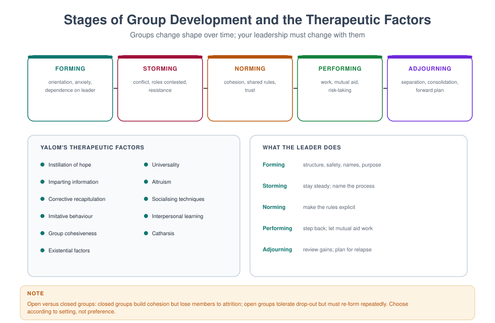

# MFT 709 — Group Therapy Techniques

> **MSc Marriage and Family Therapy** · Semester Two · 1.71 Units · 15 teaching weeks · Prerequisite: MFT 706

**Course leader's summary.** Groups are the most efficient and the most unpredictable clinical format. This
course teaches you to design a group, build a culture, work with the process rather than only the content,
manage the difficult members, and co-facilitate without performing a marriage in front of the members.

---

## How to use this book

A group cannot be learned from a book alone, but it can be *ruined* without one. Each week gives you the
theory, a facilitation script, and a hazard. The practical sessions in this course run as a real group: you
will be members before you are leaders, and you will write about both.

---

## 1. Course description

Group therapy is a distinct modality with its own theory of change: members help each other, and that mutual
aid is the treatment. Family therapists use groups for couples (multiple couples in one group), parents,
adolescents, men who have used violence, people in recovery, the bereaved, and children.

This course covers group design, composition, stages of development, therapeutic factors, process
observation, difficult members, co-facilitation, ethics and evaluation. It is grounded in Yalom's
interpersonal model and in systemic thinking about the group-as-a-system.

---

## 2. Learning outcomes

| # | Outcome | Assessed |
|---|---|---|
| LO1 | Design a group: purpose, membership, size, duration, setting | Group proposal |
| LO2 | Explain and use Yalom's therapeutic factors | Exam |
| LO3 | Identify and work with group process (here-and-now) | Observed facilitation |
| LO4 | Manage difficult members and group crises safely | Viva, observed |
| LO5 | Co-facilitate effectively, including managing disagreement | Peer and tutor rating |
| LO6 | Screen and prepare members ethically | Screening role-play |
| LO7 | Evaluate group outcomes | Evaluation plan |

---

## 3. Assessment

| Component | Weight | Due |
|---|---|---|
| Group design proposal (2,000 words) | 25% | Week 6 |
| Process reflection log (as member, 6 entries) | 20% | Fortnightly |
| Observed co-facilitation (30 min) | 30% | Weeks 12–14 |
| Examination | 25% | Week 16 |

---

## 4. The fifteen-week plan

| Week | Topic | Practical |
|---|---|---|
| 1 | Why groups work: mutual aid and the social microcosm | First group session (as member) |
| 2 | Types of group in family therapy | Observation of a live/recorded group |
| 3 | Design: aims, size, duration, open vs closed | Design clinic |
| 4 | Screening, consent and preparation | Screening role-play |
| 5 | Yalom's therapeutic factors | Factor-spotting exercise |
| 6 | **Group proposal due**; group stages I: forming and storming | Process observation |
| 7 | Group stages II: norming, performing, adjourning | Leader tasks by stage |
| 8 | The here-and-now: working with process | Process commentary drill |
| 9 | Difficult members: monopoliser, silent, hostile, help-rejecting | Structured rehearsals |
| 10 | Conflict, scapegoating and subgrouping in groups | Live intervention |
| 11 | Co-facilitation: division of labour, disagreement, repair | Co-therapy pairs |
| 12 | **Observed co-facilitation begins** | Assessed |
| 13 | Groups for couples and for parents | Design adaptation |
| 14 | Ethics, confidentiality and boundaries in groups | Incident analysis |
| 15 | Evaluation and endings | Outcome plan |

---

## Week 1 — Why groups work

**The core claim.** In a group, members are simultaneously helpers and helped. This reciprocal process —
Yalom called it *mutual aid* — produces learning that a one-to-one relationship cannot, because it is
horizontal rather than vertical. The leader is not the only source of help; the membership is.

**The social microcosm.** A group is a small society in which each member eventually behaves as they do
outside: the man who must control, the woman who apologises, the adolescent who deflects with humour. The
group then becomes a laboratory in which those behaviours are noticed, felt, and changed *in vivo*.

**Systemic framing.** A group is a system: it has boundaries (who is in, who is out), roles, norms, a
developmental history, and homeostatic mechanisms that resist change. Everything you learned about families
applies. The scapegoat in a group is playing the same structural role as the identified patient in a family.

> **PRACTICAL** — Begin the experiential group this week. The group runs for the semester with two student
> co-leaders rotating. Write your first reflection on what it felt like to be a member.

---

## Week 2 — Groups in family therapy practice

| Group type | Members | Typical aims |
|---|---|---|
| Couples group | 4–6 couples | Communication skills, shared normalisation, vicarious learning |
| Parents group | 6–10 parents | Behaviour management, support, reducing isolation |
| Adolescent group | 6–8 | Identity, peer feedback, social skills |
| Men's behaviour change | 8–12 | Accountability, gender norms, non-violence |
| Recovery group | 8–12 | Sobriety support, family reintegration |
| Bereavement group | 6–10 | Normalising grief, meaning-making |
| Psychoeducational | 10–20 | Information plus discussion |
| Multi-family group | 4–6 families | Family–family learning (strong evidence in psychosis and eating disorders) |

**Multi-family groups** deserve particular attention in this programme: they combine systemic work with
mutual aid, are cost-effective, and have good evidence in severe mental illness, eating disorders and
adolescent conduct problems.

---

## Week 3 — Design

**Eight design decisions.** Each should be justified in your proposal.

1. **Aim** — what change, for whom, measured how?
2. **Membership** — who is included, who excluded, and on what criteria?
3. **Size** — 6–10 for interactional groups; larger for psychoeducation.
4. **Duration and frequency** — 8–16 sessions weekly is typical; state the rationale.
5. **Open or closed** — closed builds cohesion; open tolerates attrition.
6. **Setting and materials** — circular seating, privacy, accessibility.
7. **Leadership** — solo or co-facilitated (co-facilitation is strongly preferred for beginners).
8. **Evaluation** — pre/post measures, attendance, satisfaction, and a follow-up.

**Composition traps.** Mixing victims and perpetrators of violence in one group; mixing adolescents and
adults; including two people in a current conflict (e.g. two co-wives, or a couple in the same parents'
group); including a member who knows another member socially without discussing it in advance.

> **PROPOSAL (25%)** — A 2,000-word design document: population, aims, evidence base, membership criteria,
> screening protocol, session-by-session outline, facilitation plan, risk protocol, evaluation plan, budget.

---

## Week 4 — Screening, consent and preparation

**Screening protects the group as much as the individual.** Screen for: fit with the group's aims, current
risk, ability to tolerate group feedback, concurrent individual therapy, and practical commitment.

**The screening interview (30 minutes).**

1. What brings you here, and what do you hope for?
2. What has helped before? What has not?
3. Have you been in a group before? How was it?
4. How do you usually handle conflict and criticism?
5. Is there anyone in the group you know? (Show the member list where appropriate.)
6. Are you currently safe? (Risk screen.)
7. Are you willing to keep confidentiality, knowing it cannot be guaranteed?

**Consent must be specific.** Explain that confidentiality is a group norm but not a guarantee; that
members may be upset by others; that the leaders will break confidentiality only in the circumstances
described; and that attendance and punctuality are part of the contract.

**Preparation improves outcomes.** Tell the member what to expect, what will be asked of them in the first
session, and how to introduce themselves. Pre-group preparation reduces drop-out measurably.

> **PRACTICAL** — Screening role-play with a volunteer who is ambivalent and has been pressured to attend.
> Practise: exploring ambivalence, explaining the frame, and declining a poor fit without rejecting the person.

---

## Week 5 — Yalom's therapeutic factors

| Factor | What it looks like | How the leader strengthens it |
|---|---|---|
| Instillation of hope | A member describes recovery | Ask for specifics; keep the member connected to the group |
| Universality | "I thought I was the only one" | Name the shared experience explicitly |
| Imparting information | Advice, psychoeducation | Redirect advice-giving into dialogue |
| Altruism | A member helps another | Point out the help; let the helper be seen |
| Corrective recapitulation | Old family patterns reappear | Interpret the pattern in the here-and-now |
| Socialising techniques | Learning social feedback | Model and reinforce it |
| Imitative behaviour | Modelling the leader or a member | Use yourself deliberately |
| Interpersonal learning | Feedback changes behaviour | Make the group the site of the experiment |
| Group cohesiveness | Belonging, attendance, care | Protect the frame; address absences |
| Catharsis | Emotional release | Contain it; link it to meaning |
| Existential factors | Responsibility, mortality, isolation | Allow the conversation; do not rush to technique |

**The beginner's error:** chasing catharsis. Tears without integration produce relief for a day and no
change. The sequence is: **express → understand → experiment → consolidate**.

---

## Week 6 — Stages I: forming and storming

**Forming.** Anxiety, politeness, dependence on the leader, search for structure. Members ask: "What are we
supposed to do? Is this allowed?"

*Leader task:* provide structure and safety, model disclosure at an appropriate level, establish norms
(punctuality, confidentiality, one person at a time, no advice without asking), and name the anxiety.

*Script:* "Most groups start quietly. Part of what we will do is notice what we are all avoiding."

**Storming.** Conflict, role competition, resistance, criticism of the leader, subgrouping. This is not
failure; it is the group testing whether it can survive difference.

*Leader task:* stay steady, do not defend, name the process, and let the group negotiate. Avoid solving it
for them.

*Script:* "There is something happening between the two of you that the rest of us are watching. Can we
look at it together rather than settle it?"

> **PRACTICAL** — Process observation. Two observers code the session for: who speaks, who is interrupted,
> who is silent, and three moments of process (as opposed to content). Feed back to the group in the last
> ten minutes.

---

## Week 7 — Stages II: norming, performing, adjourning

**Norming.** Cohesion, shared rules, mutual trust, humour. Attendance stabilises.

*Leader task:* consolidate the norms explicitly; use the cohesion to do deeper work.

**Performing.** The productive stage: mutual aid, confrontation with care, risk-taking, insight.

*Leader task:* step back. Your best sessions are the ones in which you spoke least and the group worked.
Redirect all content to the members: "What does the group think?"

**Adjourning.** Ending, loss, consolidation, transfer to life outside.

*Leader task:* review gains, name the loss, have each member say what they gave and received, and make a
forward plan. Do not let the group end by attrition.

*Termination script:* "We have four sessions left. I want us to use them for two things: what each of you
has learned, and what each of you will do when the group is not here."

---

## Week 8 — The here-and-now

**Two layers.** *Content* is what the group is talking about; *process* is what is happening between the
people while they talk about it. Groups change through process.

**The four-step process commentary.**

1. **Notice** something concrete: "Every time Ada speaks about her marriage, Femi looks at the clock."
2. **Name it to the group, not about the person:** "I notice something happening here."
3. **Ask the group to look:** "Does anyone else notice it? What do you think it is about?"
4. **Return it to the relationship:** "Femi, what is happening for you when Ada speaks?"

**Timing rules.** Do not process-comment in the first two sessions (no safety yet). Do not do it to
demonstrate skill. Do it when the same pattern has occurred at least twice.

**Hazards.** Process commentary can feel like exposure. Use the group as the buffer ("does anyone else…"),
avoid naming individuals as specimens, and never interpret someone's process before you have checked it
with them.

> **DRILL** — Ten minutes of "process-only": the group may only speak about what is happening *here*, not
> about events outside the room. Debrief how uncomfortable it was.

---

## Week 9 — Difficult members

| Member type | Behaviour | What it protects | Intervention |
|---|---|---|---|
| Monopoliser | Talks at length; fills silence | Anxiety, fear of invisibility | "I want to bring others in; you may find that hard." Set a turn-taking norm |
| Silent member | Says nothing; attends | Fear of exposure, cultural deference | Low-demand invitation; do not force; check in privately |
| Hostile/devaluing | Attacks the leader or a member | Shame, previous betrayal | Name impact; set the boundary; explore what it protects |
| Help-rejecting complainer | Asks for help then rejects it | Control, fear of change | Move from advice to the function: "What would it cost you to accept help?" |
| Group mascot | Defuses everything with humour | Avoids grief | "Your jokes are welcome. I also want to know what is underneath this one." |
| Scapegoat | Becomes the group's problem | Carries disowned material | Protect; interpret the group's function in selecting them |
| Subgroup | Two or three form a bloc | Safety in numbers | Bring it into the open; do not let it be secret |

**The principle.** Every difficult behaviour is a *solution* the member has found for a problem. Your task
is to understand the problem, not to eliminate the behaviour by force.

---

## Week 10 — Conflict, scapegoating and subgrouping

**Escalation in groups is faster than in dyads** because of contagion. Interrupt earlier than you would in
a family session.

**The scapegoat sequence** (learn to spot it): a member is different → the group's anxiety attaches to them
→ the group pressures them → the leader is invited to condemn them → if the leader agrees, the group learns
that difference is dangerous.

*Leader intervention:* name the process, protect the member, and give the group the work: "I notice we have
all become very interested in what Femi is doing wrong. What is it about him that makes us comfortable
focusing there?"

**Subgroups.** Two members who meet outside, or a bloc that votes together. Name it without accusation:
"I am aware that some of you talk outside. That is allowed, and it affects what happens here. What shall we
do about it?"

---

## Week 11 — Co-facilitation

**Why co-facilitate.** Two sets of eyes, two relational styles, a model of a working relationship, and
protection when one of you is triggered.

**Division of labour — decide before every session.**

- Who opens and closes?
- Who tracks process, who tracks content?
- Who handles risk or a member leaving the room?
- How will you signal a disagreement in the moment?

**Managing disagreement in front of the group.** Never contradict your co-leader without acknowledging it.
Options: (a) defer and discuss after; (b) name the difference openly and model resolution: "I see it
differently, and I want the group to hear both." Naming it well is a gift; naming it badly is a rupture.

**The classic co-therapy failure: the couple dynamic.** Two co-leaders who replicate a parent–child or
pursue–withdraw pattern in front of the group. The group will notice and may act it out. Take it to
supervision immediately.

> **PRACTICAL** — Co-therapy pairs plan a session in ten minutes using the division-of-labour checklist,
> then facilitate with the observed group. The observer records every moment the pair were out of sync.

---

## Week 12 — Observed co-facilitation

Thirty minutes of an experiential group, co-facilitated, assessed against: safety and structure; use of
process; inclusion of silent members; containment of difficult behaviour; co-leader coordination; and
closing.

---

## Week 13 — Couples and parents groups

**Couples group.** Four to six couples. Strengths: normalisation ("other couples have this too"), vicarious
learning, and reduced shame. Risks: public conflict, competition, and one partner feeling ganged up on.

*Structure:* 15 minutes check-in (one sentence per person), 20 minutes teaching, 30 minutes exercise (couples
work together while leaders circulate), 15 minutes group debrief. Never ask a couple to do a deep
vulnerability exercise in front of others before they have done it alone with you.

**Parents group.** Strengths: reducing isolation, shared problem-solving. Risks: one parent becoming the
group's expert, and advice-giving replacing reflection.

*Structure:* check-in, one skill, one application, one commitment. Keep advice horizontal: "Who has tried
something that worked?"

---

## Week 14 — Ethics and boundaries in groups

| Issue | Standard |
|---|---|
| Confidentiality | Explain it is a norm, not a guarantee; revisit when a member leaves |
| Screening | Never skip it; document it |
| Dual relationships | Members who know each other; leaders who know members socially |
| Touch | Discourage between members; use only with explicit norms |
| Out-of-group contact | Agree a policy; do not become a member's confidant |
| Recordings | Separate consent from each member; a member may withdraw at any time |
| Risk disclosure | Leaders follow their duty of care; tell the group if confidentiality must be broken |

**The most common ethical complaint in groups** is not dramatic: it is a member learning that something
they said was repeated outside. Prevention: explicit norms, a written agreement, and a leader who models
discretion.

---

## Week 15 — Evaluation and endings

**Minimum evaluation package.** Attendance and drop-out (with reasons), a pre/post measure of the target
problem, a session-by-session satisfaction rating, and a follow-up at 8–12 weeks.

**Writing up.** Report the design, the actual membership, the adaptations you made, the outcome and the
limitations. A well-reported small group is a contribution; an unreported one is a private experience.

---

## Glossary

**Cohesion** — the group's sense of belonging and mutual commitment; a precondition for productive work.
**Group-as-a-whole** — the group considered as a single system with its own dynamics.
**Here-and-now** — the immediate interpersonal process in the room, as distinct from outside content.
**Mutual aid** — the reciprocal helping that occurs between members.
**Process** — the relational layer of communication, as distinct from content.
**Scapegoating** — the group's displacement of anxiety onto one member.
**Social microcosm** — the group as a small society in which members' characteristic patterns appear.
**Subgrouping** — the formation of alliances within the group.
**Therapeutic factor** — a mechanism of change identified by Yalom (e.g. universality, cohesiveness).

---

## Self-assessment

### Multiple choice

**1.** Mutual aid refers to:
(a) the leader helping members (b) members helping each other (c) financial support (d) group cohesion

**2.** Scapegoating in a group usually functions to:
(a) help the scapegoat (b) absorb the group's anxiety (c) improve cohesion (d) test the leader

**3.** Pre-group preparation:
(a) is optional (b) reduces drop-out and improves outcome (c) increases anxiety (d) is only for research

**4.** The leader's main task in the performing stage is to:
(a) direct more (b) step back and let mutual aid work (c) introduce new rules (d) end the group

**5.** "Here-and-now" work means:
(a) discussing childhood (b) working with immediate in-room process (c) using mindfulness (d) homework review

**6.** Confidentiality in groups is:
(a) guaranteed (b) a norm that cannot be guaranteed (c) irrelevant (d) the leader's legal duty only

**7.** A closed group:
(a) admits new members (b) has fixed membership (c) has no rules (d) is always shorter

**8.** Catharsis without integration typically produces:
(a) lasting change (b) temporary relief (c) increased cohesion (d) no effect at all

**9.** The best composition decision when two members are in an active conflict is to:
(a) include both to work it out (b) avoid placing them in the same group (c) seat them together (d) ask them to sign a contract

**10.** Parallel process in co-facilitation means:
(a) the leaders take turns (b) the leaders' relationship replicates a family pattern (c) members copy the leaders (d) two groups run at once

### Answer key
1 b · 2 b · 3 b · 4 b · 5 b · 6 b · 7 b · 8 b · 9 b · 10 b

### Short answer

1. List five design decisions and the rationale for each.
2. Name five therapeutic factors and one leader behaviour that strengthens each.
3. Give the four steps of process commentary with an example.
4. How would you intervene with a monopoliser without shaming them?
5. What are the four elements of a group evaluation plan?

### Essay (choose one, 1,800 words)

1. Design a couples group for eight distressed couples, justifying every design decision.
2. "The group is the treatment, not the leader." Discuss with reference to mutual aid and process.
3. Analyse a difficult moment in your experiential group and set out what you would do differently as leader.

---

## Further reading

- Yalom, I. D., & Leszcz, M. (2020). *The Theory and Practice of Group Psychotherapy* (6th ed.). Basic Books.
- Bion, W. R. (1961). *Experiences in Groups*. Tavistock.
- Burlingame, G. M., Strauss, B., & Joyce, A. S. (2013). Change mechanisms and effectiveness of small group treatments. In *Bergin and Garfield's Handbook*.
- Asen, E., & Scholz, M. (2010). *Multi-Family Therapy: Concepts and Techniques*. Routledge.

---

*Next: [MFT 710 — Couples Therapy](MFT-710-couples-therapy.md)*
