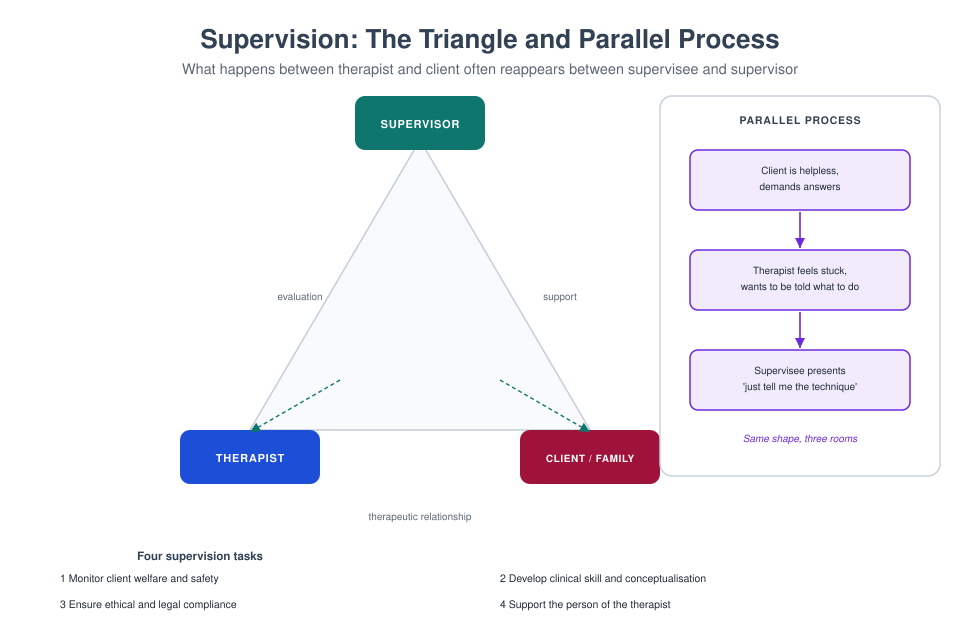

# MFT 720 — Supervision and Consultation in Therapy

> **MSc Marriage and Family Therapy** · Semester Three · 1.71 Units · 15 teaching weeks · Prerequisite: MFT 706, 704

**Course leader's summary.** Supervision is the profession's quality-control mechanism and its main method of
training. This course prepares you to receive supervision well and to give it competently — with models,
structure, feedback skills, attention to power, and the discipline of parallel process.

---

## How to use this book

You are simultaneously a supervisee and a developing supervisor in this course. Each week you will analyse your
own supervision (what worked, what did not, what you did not say) and practise supervising a peer. The two roles
teach each other.

---

## 1. Course description

The course covers models of supervision (developmental, systemic, competency-based, reflective), the
supervisory alliance, contracting and boundaries, live and recorded supervision, feedback, evaluation and
gatekeeping, power and culture in supervision, parallel process, ethical and legal responsibilities, and
consultation to organisations.

---

## 2. Learning outcomes

| # | Outcome | Assessed |
|---|---|---|
| LO1 | Describe and apply at least three supervision models | Exam |
| LO2 | Contract clearly with a supervisee, including evaluation criteria | Contract document |
| LO3 | Give specific, behavioural feedback that changes practice | Observed supervision |
| LO4 | Identify and use parallel process | Case analysis |
| LO5 | Manage power, culture and conflict in supervision | Reflective portfolio |
| LO6 | Fulfil gatekeeping responsibilities ethically | Viva |
| LO7 | Consult to a team or organisation | Consultation report |

---

## 3. Assessment

| Component | Weight | Due |
|---|---|---|
| Supervision contract and learning plan | 15% | Week 4 |
| Observed supervision session (40 min) | 30% | Week 10 |
| Case analysis of parallel process (1,500 words) | 20% | Week 12 |
| Consultation report (2,000 words) | 25% | Week 14 |
| Reflective portfolio | 10% | Ongoing |

---

## 4. The fifteen-week plan

| Week | Topic | Practical |
|---|---|---|
| 1 | What supervision is for; supervision versus therapy versus mentoring | Role clarification |
| 2 | Models I: developmental and competency-based | Model application |
| 3 | Models II: systemic and reflective | Reflecting team in supervision |
| 4 | **Contract due**; contracting and boundaries | Contract negotiation |
| 5 | The supervisory alliance and rupture repair | Alliance repair rehearsal |
| 6 | Structure: agenda, case presentation formats, time | Structured case presentation |
| 7 | Feedback that changes practice | Feedback lab |
| 8 | Live supervision and recorded review | Live observation |
| 9 | Parallel process and the supervision triangle | Parallel process analysis |
| 10 | **Observed supervision session** | Assessed |
| 11 | Power, culture, gender and race in supervision | Power audit |
| 12 | **Parallel process analysis due**; conflict and incompetence | Difficult conversations |
| 13 | Evaluation, gatekeeping and fitness to practise | Evaluation interview |
| 14 | **Consultation report due**; consultation to organisations | Consultation simulation |
| 15 | Integration: the supervisor you want to be | Viva |

---

## Week 1 — What supervision is for

**Four functions** (Kadushin, adapted).

1. **Clinical** — ensuring the client receives good, safe care.
2. **Developmental** — building the supervisee's competence.
3. **Supportive** — sustaining the person doing difficult work.
4. **Gatekeeping** — protecting the public and the profession.

**What supervision is not.** It is not therapy, although it may be therapeutic. It is not mentoring, which is
about career. It is not line management, although it overlaps. Confusing these roles is the most common source
of boundary difficulty.

**The client is the third party in the room.** Whatever the supervisee needs, the question that governs the
supervision is: *is this client safe and well served?*

---

## Week 2 — Developmental and competency models

**Developmental models** (e.g. Stoltenberg) describe stages: the supervisee moves from dependence and
anxiety, through dependence–autonomy conflict, to conditional autonomy, to mastery. The supervisor's style must
change with the stage: more structure early, more consultation later.

| Stage | Supervisee needs | Supervisor stance |
|---|---|---|
| Novice | Structure, direct guidance, safety | Teaching, modelling, clear expectations |
| Advanced beginner | Autonomy with support | Coaching, prompting, joint formulation |
| Competent | Challenge, complexity | Consulting, debating, opening alternatives |
| Proficient | Peer-level dialogue | Collegial, focusing on the system and self |

**Competency-based models** specify observable skills and rate them, using frameworks such as the UCL
competence frameworks. Their strength is transparency and defensibility; their risk is reducing supervision to a
checklist.

**The best use of both.** Use developmental stage to decide *how much structure*, and competencies to decide
*what to look for*.

---

## Week 3 — Systemic and reflective models

**Systemic supervision** attends to the system of client–therapist–supervisor, and to the wider systems
(agency, family, culture). The supervisor asks: what is the function of this presentation in this system, at
this time?

**Reflective supervision** uses the supervisor's and supervisee's emotional responses as data, and models
curiosity rather than expertise. Techniques include the reflecting team (in supervision), genograms of the
case, and structured self-reflection.

**Live supervision** (behind a mirror, or in-room) gives immediate data. Formats: the phone-in, the
"whispering" supervisor, the consultant who joins for ten minutes, and the reflecting team.

**The advantage of live work** is that it reveals what the therapist does, not what they remember doing. The
disadvantage is anxiety, which must be managed explicitly in the contract.

---

## Week 4 — Contracting

**A supervision contract covers:**

1. Purpose and scope; who else is involved (agency, university).
2. Frequency, duration, location, cancellation.
3. Case presentation format and preparation expectations.
4. Recording and observation policy, including consent from clients.
5. Confidentiality and its limits (client safety, fitness to practise, legal).
6. Evaluation: criteria, timing, who sees it, and consequences.
7. Boundaries: contact between sessions, personal disclosure, dual relationships.
8. Procedures for disagreement, complaint and termination.

**Negotiate, do not impose.** The contract should include the supervisee's goals: "By the end of this
placement, I want to be able to…"

> **DOCUMENT (15%)** — A supervision contract and learning plan for a first-placement supervisee.

---

## Week 5 — The supervisory alliance

**Three components** (parallel to the therapeutic alliance): goals, tasks, and bond.

**Ruptures are inevitable**: a supervisee feels judged; a supervisor feels ignored; a disagreement about a case
becomes personal. The repair is the model.

**Repair script.**

> "I noticed you went quiet when I suggested you had missed the risk. Did I get that wrong, or did it land
> badly?"
> "What I intended was a question, not a verdict. Let me say it again differently."

**The unspoken curriculum.** Supervisees learn more from how you behave than from what you teach. If you avoid
difficult feedback, they will avoid it with clients. If you are curious about your own mistakes, they will be
curious about theirs.

---

## Week 6 — Structure

**A 50-minute supervision session.**

| Minutes | Content |
|---|---|
| 0–5 | Check-in; agenda setting |
| 5–15 | Case 1: presentation, formulation, question |
| 15–30 | Case 1: exploration, recording review, options |
| 30–40 | Case 2 or a theme (risk, ethics, culture) |
| 40–47 | Learning points; tasks for the week |
| 47–50 | Administrative and evaluation notes |

**A case presentation format (five minutes, no notes).**

1. Who is the family, and who is in the room?
2. What is the presenting problem, in their words?
3. What is my formulation and my uncertainty?
4. What did I do, and what happened?
5. What is my question for supervision?

**The discipline matters:** a supervisee who cannot present in five minutes is not yet thinking systemically.

---

## Week 7 — Feedback

**Principles.** Behavioural, specific, timely, owned, and limited to what can be acted on.

**The four-step structure.**

1. **What I observed** ("you asked three questions in a row after she cried").
2. **What it did** (to the client, or to me as observer) ("she stopped elaborating").
3. **What to keep** ("your opening was excellent — you named the risk clearly").
4. **What to try** ("next time, try a reflection before the next question").

**The banned practices.** The sandwich (praise–criticism–praise), "you need to be more confident" (not
behavioural), public criticism, and feedback given weeks after the event.

**Receiving feedback** is a skill too: listen, ask for an example, resist explaining, and decide what to use.

---

## Week 8 — Live supervision and recording

**Consent.** Families must consent to recording and to observation, in writing, with a clear explanation of who
will watch and how long the recording is kept.

**In-session formats.**

- **Phone-in:** the supervisor calls in with one or two suggestions. Risk: the therapist becomes a puppet.
- **Reflecting team:** the team talks in front of the family (or behind a mirror). The therapist chooses what
  to bring back. Strong evidence and strong engagement effects.
- **Consultant joins:** a senior clinician joins for ten minutes and then leaves.

**Debriefing.** Always debrief the supervisee's experience first, then the clinical content. The order matters:
the person before the problem.

---

## Week 9 — Parallel process

**Definition.** The pattern in the therapy reappears in the supervision: a helpless family produces a helpless
therapist who produces a supervisor who takes over; a controlling family produces a therapist who complies and
a supervisor who feels ignored.

**How to use it.**

1. Notice your own experience in supervision (boredom, irritation, the urge to solve).
2. Ask: is this mine, the supervisee's, or the system's?
3. Name it tentatively: "I notice I am doing a lot of the thinking here. I wonder whether that is also how it
   feels in the room."
4. Use it to generate a hypothesis about the family.

**Caution.** Parallel process is a hypothesis, not a law. Do not use it to explain away a supervisee's
difficulty or your own poor supervision.

> **ANALYSIS (20%)** — A 1,500-word analysis of a parallel process from your own supervision, with evidence and
> alternatives considered.

---

## Week 10 — Observed supervision session

Forty minutes, supervising a peer with a real (anonymised) case. Assessed on: contract and structure;
case presentation discipline; formulation support; feedback quality; attention to the supervisee's experience;
and clear learning tasks.

---

## Week 11 — Power, culture, gender and race

**Power is structural.** The supervisor evaluates, gatekeeps and holds institutional authority. It cannot be
wished away; it can be made transparent.

**Cultural dynamics.** Differences in language, ethnicity, religion, gender, class and age shape what is said
and what is withheld. A supervisee from a culture that does not openly disagree with elders may appear
"unreflective" when they are being respectful.

**Practical disciplines.**

- Discuss difference explicitly at the start: "What should I know about how you prefer to receive feedback?"
- Invite disagreement in a form that is culturally possible: "What would you say if you disagreed?"
- Notice who speaks first, who is interrupted, and whose cases get the most time.
- Examine your own assumptions about competence.

---

## Week 12 — Conflict, incompetence and impairment

**Conflict.** Address early, privately, behaviourally. Distinguish disagreement about a case (healthy) from
disagreement about values (harder) from a relationship rupture (needs repair).

**Incompetence.** Define it against the competencies, in writing, with a development plan and a review date.
Most incompetence is developmental and remediable.

**Impairment.** When the supervisee's own difficulties affect client care (substance use, untreated trauma,
exhaustion), the response is support plus boundaries, not silence. Silence is the most common failure of
supervisors and the most damaging to clients.

**The conversation.** "I am concerned about you, and I am also concerned about your clients. Let us talk about
both."

---

## Week 13 — Evaluation and gatekeeping

**Evaluation criteria should be known in advance and behavioural.**

| Domain | Example indicator |
|---|---|
| Clinical competence | Can conduct a structured assessment and formulation |
| Professional conduct | Punctuality, record-keeping, boundaries |
| Reflective capacity | Uses feedback; identifies own contribution |
| Ethical practice | Recognises and escalates risk |
| Relational capacity | Builds alliances with all family members |

**Gatekeeping.** If a supervisee is not safe, the supervisor must act, even when it is painful: extend
supervision, restrict caseload, require therapy, or fail the placement with a documented rationale.

**Failing well.** Give clear reasons, a written plan, support, and a route to appeal. Document throughout, not
only at the end.

---

## Week 14 — Consultation to organisations

**The shift.** Supervision develops a person; consultation helps a system. Your client is the team, the school,
the clinic or the agency.

**A consultation cycle.**

1. **Contract:** who is the client, what is the question, who holds authority, what will be shared?
2. **Assess the system:** structure, communication, roles, alliances, and the presenting problem's function.
3. **Feedback:** present the systemic picture, with hypotheses rather than verdicts.
4. **Intervention:** a workshop, a reflecting team, a policy change, a case conference structure.
5. **Exit and evaluate:** what changed, and how will it be sustained?

**Common organisational dynamics.** The identified "difficult team member" who carries the team's anxiety; the
"impossible case" that holds a conflict between services; the over-worked manager who mirrors the over-worked
family therapist.

> **REPORT (25%)** — A consultation report for a team or organisation, with a systemic assessment and a
> proposal.

---

## Week 15 — The supervisor you want to be

Write 700 words: your model of supervision; how you will handle power; what you will never do; the feedback you
find hardest to give; and how you will know you are doing harm. Defend it in a viva.

---

## Glossary

**Competency-based supervision** — supervision organised around observable, rated skills.
**Gatekeeping** — the supervisor's responsibility to protect the public by preventing unsafe practice.
**Live supervision** — observation of therapy as it happens, with in-session input.
**Parallel process** — the reproduction of the therapy dynamic in the supervision.
**Reflecting team** — a group that discusses the case in front of the family, with the therapist choosing what
to bring back.
**Supervisory alliance** — the goals, tasks and bond of the supervision relationship.

---

## Self-assessment

### Multiple choice

**1.** The client in supervision is:
(a) the supervisee (b) the family receiving therapy (c) the agency (d) the university

**2.** Gatekeeping exists to:
(a) protect the profession's reputation only (b) protect the public and the profession (c) increase pass rates
(d) satisfy administrators

**3.** Parallel process is:
(a) a proven law (b) a hypothesis about the reproduction of dynamics in supervision (c) transference (d) supervision of supervision

**4.** A good feedback statement is:
(a) general and encouraging (b) behavioural, specific and owned (c) delayed (d) public

**5.** Live supervision requires:
(a) no consent (b) written client consent and clear explanation (c) only supervisor consent (d) audio only

**6.** The sandwich technique is discouraged because:
(a) it is too positive (b) it trains people to hear praise as a warning (c) it is fast (d) it is illegal

**7.** Developmental models suggest that novices need:
(a) less structure (b) more structure and direct guidance (c) peer consultation only (d) no evaluation

**8.** Impairment in a supervisee should be met with:
(a) silence (b) support plus clear boundaries (c) immediate dismissal (d) transfer without discussion

**9.** Consultation differs from supervision in that it:
(a) develops a person (b) helps a system (c) evaluates students (d) is always clinical

**10.** A supervision contract should include:
(a) only the times (b) purpose, frequency, confidentiality, evaluation and boundaries (c) the supervisor's fees only (d) the client's diagnosis

### Answer key
1 b · 2 b · 3 b · 4 b · 5 b · 6 b · 7 b · 8 b · 9 b · 10 b

### Short answer

1. Name the four functions of supervision.
2. Describe a five-minute case presentation format.
3. What are the four steps of behavioural feedback?
4. Give three ways power operates in supervision and one way to make it transparent.
5. What should a supervisor do when a supervisee is unsafe?

### Essay (choose one, 1,800 words)

1. "Supervision is the profession's most important ethical practice." Discuss.
2. Analyse a parallel process from your own experience and what it revealed about the case.
3. Discuss the management of cultural difference in supervision, with examples.

---

## Further reading

- Hawkins, P., & Shohet, R. (2012). *Supervision in the Helping Professions* (4th ed.). Open University Press.
- Stoltenberg, C. D., & McNeill, B. (2010). *IDM Supervision* (3rd ed.). Routledge.
- Bernard, J. M., & Goodyear, R. K. (2019). *Fundamentals of Clinical Supervision* (6th ed.). Pearson.
- Andersen, T. (1991). *The Reflecting Team*. Norton.
- Pilling, S., & Fornells-Ambrojo, M. (2015). *Supervision and Consultation Competence Frameworks*. UCL.

---

*Next: [MFT 721 — Research Methodology](MFT-721-research-methodology.md)*
