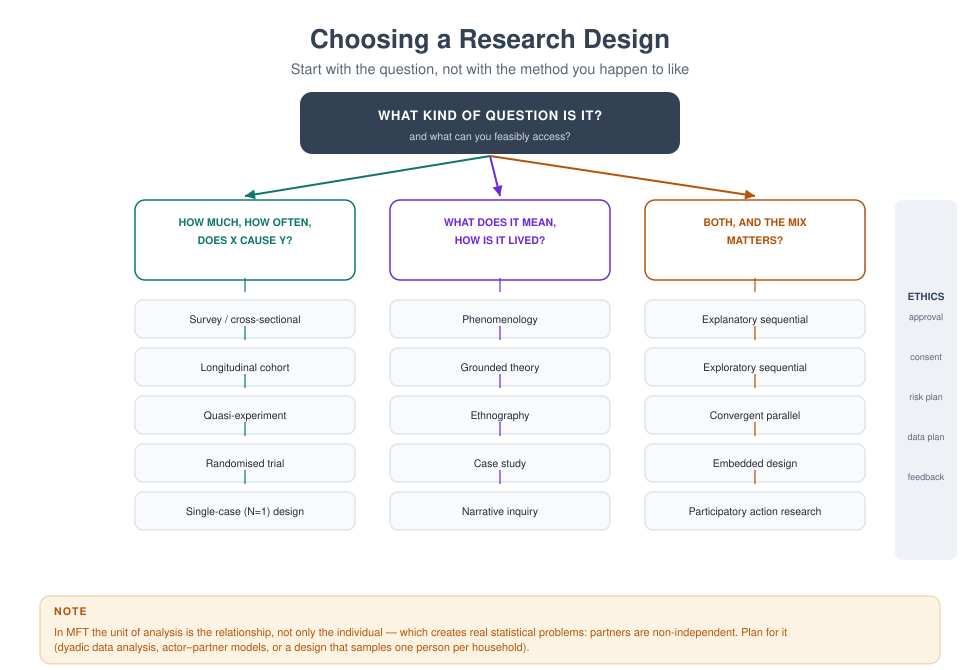
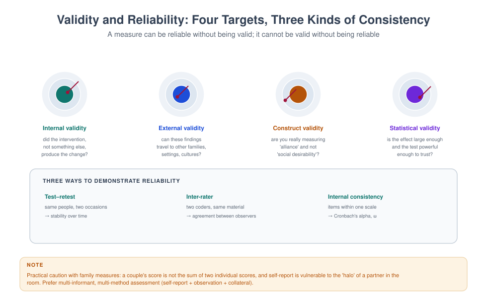

# MFT 721 — Research Methodology

> **MSc Marriage and Family Therapy** · Semester Three · 1.71 Units · 14 teaching weeks · Prerequisite: MFT 705

**Course leader's summary.** This is the advanced methods course that turns a proposal into a thesis. You will
work with real data, choose and justify analytic strategies, defend your design against examiners, and learn to
write findings that practitioners will actually read.

---

## How to use this book

Every week's task contributes directly to your thesis. Bring your own dataset, or use the teaching dataset
supplied with the course. Do not read statistics passively; run them, break them, and interpret them badly at
least once.

---

## 1. Course description

The course covers advanced design (longitudinal, dyadic, single-case, participatory), analysis (regression,
multilevel modelling, dyadic models, thematic and framework analysis, mixed-methods integration), measurement
and psychometric evaluation, systematic reviewing, data management and reproducibility, writing for
publication, and defence of a study.

---

## 2. Learning outcomes

| # | Outcome | Assessed |
|---|---|---|
| LO1 | Select and justify a design for a complex relational question | Thesis proposal |
| LO2 | Conduct and interpret appropriate analyses for relational data | Analysis portfolio |
| LO3 | Evaluate the psychometric quality of a measure in a new population | Psychometric report |
| LO4 | Integrate quantitative and qualitative findings coherently | Mixed-methods report |
| LO5 | Defend design decisions against alternative explanations | Viva |
| LO6 | Write a publishable findings chapter | Thesis chapter |
| LO7 | Manage data ethically, securely and reproducibly | Data plan and audit |

---

## 3. Assessment

| Component | Weight | Due |
|---|---|---|
| Analysis portfolio (4 exercises) | 30% | Weeks 5, 8, 11, 13 |
| Psychometric evaluation report (1,500 words) | 20% | Week 9 |
| Mixed-methods integration report (2,000 words) | 20% | Week 12 |
| Thesis methodology chapter + viva | 30% | Week 15 |

---

## 4. The fourteen-week plan

| Week | Topic | Task |
|---|---|---|
| 1 | From proposal to protocol; pre-registration and its limits | Protocol draft |
| 2 | Design for relational questions | Design decision log |
| 3 | Sampling, power and feasibility in clinical settings | Power calculation |
| 4 | Data preparation and the analysis plan | Data cleaning log |
| 5 | **Analysis 1:** regression and its assumptions | Run and interpret |
| 6 | Multilevel models for nested family data | Model comparison |
| 7 | Dyadic models: APIM in practice | APIM exercise |
| 8 | **Analysis 2:** thematic and framework analysis | Coding audit |
| 9 | Psychometrics: reliability, factor structure, invariance | Report |
| 10 | Systematic review and meta-analysis basics | Search and appraise |
| 11 | **Analysis 3:** single-case and small-N designs | SCED exercise |
| 12 | Mixed methods and integration | Joint display |
| 13 | **Analysis 4:** robustness, missing data, common pitfalls | Sensitivity analysis |
| 14 | Writing, publishing and defending | Chapter and viva prep |

---

## Week 1 — Protocol and pre-registration

**The protocol** is the study's constitution: question, design, sample, measures, analysis plan, ethics, and
timeline. Write it before you collect data; revise it with dated amendments if you must change course.

**Pre-registration** (e.g. on OSF) commits you publicly to a plan, which reduces the risk of unconscious
analytical flexibility ("p-hacking"). It is standard in trials and increasingly expected elsewhere.

**Honest limits.** Exploratory qualitative work and community-based participatory research are often
incompatible with rigid pre-registration. Declare your approach and be transparent about decisions made during
the study.

**A live analysis log** — one page per week, dated — is the single most useful document in a thesis. It records
what you did, what you decided, and why.

> **TASK** — Draft a two-page protocol for your thesis. Include one paragraph on what you will do if recruitment
> is half of what you expect.

---

## Week 2 — Design for relational questions

**Four designs especially suited to family questions.**

| Design | Question | Strength | Weakness |
|---|---|---|---|
| Longitudinal panel | Does X predict change in Y? | Temporal ordering | Attrition, cost |
| Dyadic (APIM) | How do partners affect each other? | Separates actor and partner effects | Requires both partners |
| Single-case experimental (SCED) | Does this intervention work for this family? | Clinical realism, causal inference within case | Generalisation |
| Participatory action research | What would improve this community's experience? | Validity, ethics, impact | Time, power negotiation |

**The design decision log.** For each choice, record: the alternative considered, the reason for rejection, and
the threat it leaves unresolved. Examiners reward this; it shows you know what your design cannot do.

---

## Week 3 — Sampling, power and feasibility

**Power.** Do the calculation before you collect (G*Power, R's `pwr`, or simulation). For dyadic and multilevel
designs, power depends on the number of *clusters* (couples, families), not the number of individuals.

**Practical realities in clinical settings.**

- Referral rates: how many families does the clinic actually see per week?
- Eligibility: what proportion will meet your criteria?
- Consent: what proportion will agree? (Often 30–60% in clinical samples.)
- Attrition: assume 20–30% at follow-up.
- Seasonality: school terms, holidays, religious calendars.

**The feasibility sentence.** "To recruit 60 couples in six months, I need 4 eligible referrals per week with a
60% consent rate; the clinic receives 9 per week; two colleagues have agreed to refer."

---

## Week 4 — Data preparation

**The unglamorous work that determines everything.**

1. **Codebook** — every variable, its label, its values, its missingness convention.
2. **Raw data frozen** — never edit the original file after data entry.
3. **Cleaning log** — every decision (a value of 99 recoded to missing; one duplicate removed).
4. **Missing data** — describe the pattern; distinguish missing at random from missing not at random;
   consider multiple imputation rather than listwise deletion.
5. **Reverse scoring** — check; a mis-scored subscale invalidates the results.
6. **Outliers** — inspect, do not automatically delete.

> **TASK** — Produce a codebook and cleaning log for your dataset (or the teaching dataset).

---

## Week 5 — Regression

**What regression does.** Estimates the association between predictors and an outcome, adjusting for other
predictors, and expresses it in the outcome's units.

**Assumptions to check.** Linearity, independence of errors, homoscedasticity, normality of residuals (for
inference), and no severe multicollinearity. Report the checks; do not just assert them.

**Reading output.** Coefficient (direction, size, units), standard error, confidence interval, p-value, R², and
model fit. Report effect sizes with confidence intervals, not only p-values.

**Clinical translation.** "Each additional point on the criticism scale was associated with a 0.3-point lower
satisfaction score (95% CI −0.5 to −0.1), holding depression constant." That sentence is worth more than a
table of asterisks.

---

## Week 6 — Multilevel models

**The problem.** Individuals nested in couples, couples nested in therapists, repeated measures nested in
people. Standard regression assumes independence and will produce confidence intervals that are too narrow.

**The multilevel solution.** Model the nesting explicitly:

- **Fixed effects** — the average relationship across the sample.
- **Random effects** — how intercepts (and slopes) vary across clusters.
- **ICC** — the proportion of variance attributable to the cluster. A high ICC means the clustering matters
  greatly and cannot be ignored.

**Model-building sequence.** Null model (ICC) → add level-1 predictors → add level-2 predictors → test random
slopes → compare with likelihood ratio tests or information criteria (AIC/BIC).

**Report.** Always report the ICC, the number of clusters, and the estimation method.

---

## Week 7 — Dyadic models

**APIM in four numbers.**

- **Actor effect (a):** my predictor on my outcome.
- **Partner effect (p):** my predictor on my partner's outcome.
- **Distinguishability:** whether partners are distinguishable (e.g. by gender or role) and whether effects can
  be constrained equal.
- **K:** the correlation between partners' residuals, which models the non-independence.

**Interpretation example.** In a study of 80 couples, criticism predicted lower satisfaction for the person
giving it (actor effect) more strongly than for the person receiving it (partner effect). Clinical implication:
the critic is also being harmed, which is a more useful reframe than "stop criticising your partner".

**Software.** R (`lme4`, `nlme`, `ape`), Mplus, SPSS MIXED.

---

## Week 8 — Qualitative analysis

**Two workable approaches.**

| Approach | Logic | Output |
|---|---|---|
| Reflexive thematic analysis (Braun & Clarke) | Themes constructed from coding, with the analyst's role explicit | Rich thematic account |
| Framework analysis (Ritchie & Spencer) | Matrix of cases × themes, often for applied policy questions | Structured matrix, comparable across cases |

**Rigour in practice.**

- Keep a **coding audit trail**: initial codes, revisions, discarded codes and why.
- Use **analytic memos** after each transcript.
- **Second-coder check** on at least 20% of data with a documented discussion of divergence.
- **Member reflection** where appropriate (not to validate themes, but to deepen them).
- **Reflexive journal** on your own reactions and assumptions.

**The common error** is presenting themes as "findings that emerged" from data, as though the analyst were not
present. Themes are constructed; say so.

---

## Week 9 — Psychometrics

**A psychometric evaluation of a measure in your population.**

1. **Internal consistency** — Cronbach's α (and ω, which is more appropriate for congeneric items).
2. **Factor structure** — exploratory or confirmatory factor analysis; report fit indices (CFI, TLI, RMSEA, SRMR).
3. **Construct validity** — correlations with related and unrelated measures.
4. **Measurement invariance** — configural, metric, scalar, across groups (gender, language, age).
5. **Responsiveness** — change scores in a treated sample.

**A local validation study is a perfectly good thesis**, and often more useful to the field than another
outcome study using an unvalidated instrument.

> **REPORT (20%)** — A 1,500-word psychometric evaluation of one instrument, with recommendations.

---

## Week 10 — Systematic review basics

**Steps.** Register the protocol (PROSPERO) → define the question (PICO) → search systematically (at least
three databases; record the strategy) → screen (two reviewers; report agreement) → extract data → assess risk of
bias (e.g. Cochrane RoB 2, or CASP for qualitative) → synthesise (narrative or meta-analytic) → assess certainty
(GRADE).

**Meta-analysis, briefly.** Pool effect sizes with a random-effects model unless there is a justification for
fixed effects; report heterogeneity (I², τ²); explore it with subgroup analysis or meta-regression if there are
enough studies; assess publication bias with a funnel plot and Egger's test, understanding their limitations.

**What examiners look for.** A search strategy that could be reproduced; a bias assessment that is not
perfunctory; and a conclusion proportionate to the evidence.

---

## Week 11 — Single-case and small-N designs

**Why they matter in family therapy.** Clinical samples are small, families are heterogeneous, and randomised
trials are expensive. Single-case designs give causal inference *within* a case.

**Core designs.**

| Design | Structure | Inference |
|---|---|---|
| A–B | Baseline, then intervention | Weak (confounded by time) |
| A–B–A | Baseline, intervention, withdrawal | Stronger if reversal occurs |
| Multiple baseline across behaviours | Staggered introduction | Strong; no withdrawal needed |
| Multiple baseline across participants | Staggered across families | Strong; realistic in clinics |

**Analysis.** Visual analysis (level, trend, variability) plus a quantitative index (e.g. Tau-U) and, ideally,
systematic replication across cases.

**Reporting standard.** Follow the SCED reporting guidelines (e.g. SCRIBE), including baseline stability and
treatment fidelity.

---

## Week 12 — Mixed methods integration

**The integration question.** What does the combination tell you that neither strand could alone?

**Joint display format.**

| Quantitative finding | Qualitative finding | Convergence / divergence | Interpretation |
|---|---|---|---|
| Attendance predicted outcome (β = .32) | Families described "being known" by the therapist as decisive | Divergence in mechanism | Attendance may be a proxy for alliance |
| Drop-out 34% | Families cited transport and work shifts | Convergence | Structural barriers, not motivation |

**Avoid the two common failures.** Reporting two parallel studies with no integration; and using qualitative
data merely to illustrate quantitative findings.

> **REPORT (20%)** — A 2,000-word integration report with at least three joint display rows.

---

## Week 13 — Robustness and pitfalls

**Pitfalls you will meet.**

| Pitfall | What it looks like | Fix |
|---|---|---|
| p-hacking | Many tests, reporting the significant ones | Pre-specify; adjust; report all |
| HARKing | Hypothesis stated after results known | Register the hypothesis |
| Overfitting | Model too complex for the sample | Simpler model; cross-validation |
| Ignoring clustering | Treating partners as independent | Multilevel or dyadic models |
| Selective reporting | Reporting one measure, ignoring another | Report all pre-specified outcomes |
| Causal language | "Caused" from cross-sectional data | Use associational language |

**Sensitivity analysis.** Run your main analysis again with a different reasonable decision (e.g. excluding an
outlier, using a different missing-data approach) and report whether conclusions change. If they do, say so.

---

## Week 14 — Writing, publishing and defending

**The findings chapter.** Present, do not interpret (that is the discussion's job). Structure by question.
Report descriptive statistics before inferential. Use tables for numbers and prose for meaning.

**The discussion.** What you found → how it compares with the literature → mechanisms → limitations (specific,
not generic) → implications for practice and policy → future research.

**Defending.** Prepare for four questions: (1) Why this design? (2) What are the threats to validity and how did
you address them? (3) Why these analyses? (4) What can and cannot be concluded? Rehearse short answers.

**Publishing.** Choose a journal that publishes practitioner research; follow the author guidelines exactly;
expect a rejection and a revision; respond to reviewers point by point.

---

## Glossary

**APIM** — Actor–Partner Interdependence Model.
**Cluster** — a grouping unit (couple, family, therapist) whose members are not independent.
**GRADE** — a system for rating the certainty of evidence.
**ICC** — intraclass correlation; the share of variance due to clustering.
**Measurement invariance** — equivalence of a measure's functioning across groups.
**Pre-registration** — public commitment to a study plan before data collection.
**SCED** — single-case experimental design.
**Sensitivity analysis** — re-analysis under different assumptions to test robustness.

---

## Self-assessment

### Multiple choice

**1.** Treating partners as independent observations primarily affects:
(a) external validity (b) standard errors and Type I error (c) reliability (d) sampling

**2.** The ICC indicates:
(a) internal consistency (b) the proportion of variance due to clustering (c) effect size (d) power

**3.** A multiple baseline design is strong because:
(a) it requires withdrawal (b) staggered introduction controls for time (c) it uses large samples (d) it is qualitative

**4.** Joint displays are used to:
(a) present descriptive statistics (b) integrate quantitative and qualitative findings (c) assess bias (d) calculate power

**5.** Pre-registration mainly reduces:
(a) attrition (b) analytical flexibility and p-hacking (c) cost (d) sample size

**6.** Measurement invariance concerns:
(a) whether a measure behaves equivalently across groups (b) internal consistency only (c) sample size (d) randomisation

**7.** A sensitivity analysis tests:
(a) whether conclusions hold under different assumptions (b) the sample's normality (c) the coding frame (d) the ethics

**8.** HARKing means:
(a) hypothesising after results are known (b) random sampling (c) qualitative coding (d) data entry

**9.** In framework analysis the output is typically:
(a) a case × theme matrix (b) a regression table (c) a factor loading matrix (d) a funnel plot

**10.** The most useful document in a thesis is:
(a) the title page (b) a dated analysis log (c) the abstract (d) the reference list

### Answer key
1 b · 2 b · 3 b · 4 b · 5 b · 6 a · 7 a · 8 a · 9 a · 10 b

### Short answer

1. Explain why clustering matters for standard errors.
2. Distinguish actor and partner effects with an example.
3. List five elements of a systematic review protocol.
4. What is the difference between a sensitivity analysis and a subgroup analysis?
5. Name four threats to validity in a pre-post clinic study.

### Essay (choose one, 2,000 words)

1. Defend (or attack) the claim that randomised trials are the gold standard for family therapy research.
2. Present a design for a dyadic study of criticism and satisfaction, justifying every choice.
3. Critically appraise a systematic review of family interventions, focusing on method and certainty.

---

## Further reading

- Kenny, D. A., Kashy, D. A., & Cook, W. L. (2006). *Dyadic Data Analysis*. Guilford.
- Hox, J., Moerbeek, M., & van de Schoot, R. (2017). *Multilevel Analysis* (3rd ed.). Routledge.
- Braun, V., & Clarke, V. (2022). *Thematic Analysis: A Practical Guide*. Sage.
- Higgins, J. P. T. et al. (Eds.). (2023). *Cochrane Handbook for Systematic Reviews of Interventions*.
- Kazdin, A. E. (2021). *Single-Case Research Designs* (3rd ed.). OUP.

---

*Next: [MFT 770 — Master Thesis](MFT-770-master-thesis.md)*
